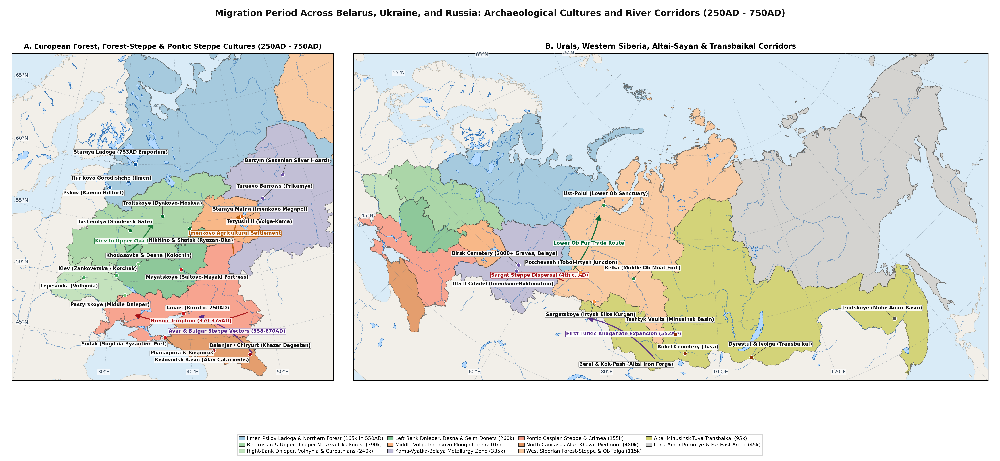
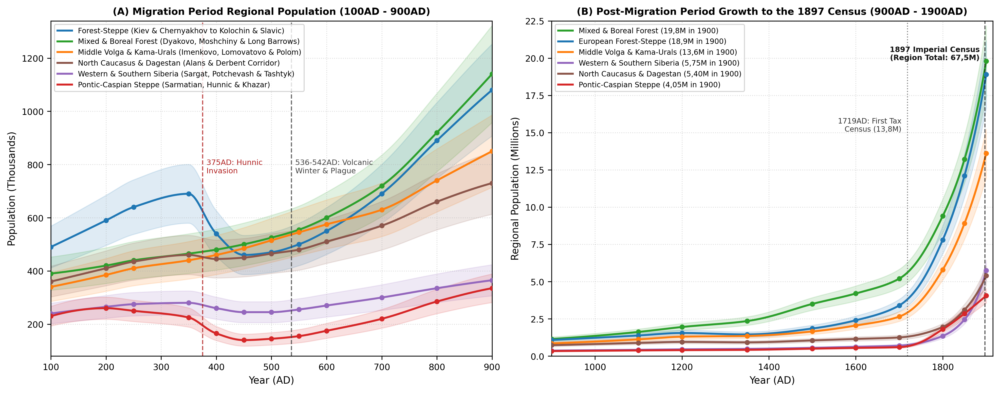
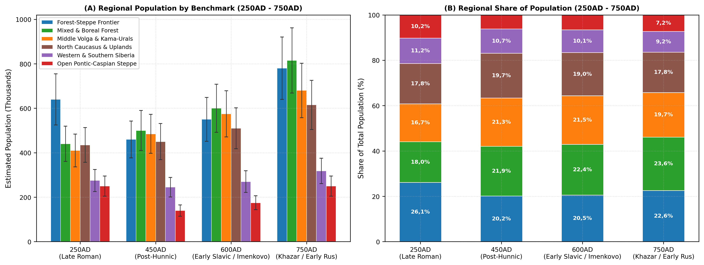
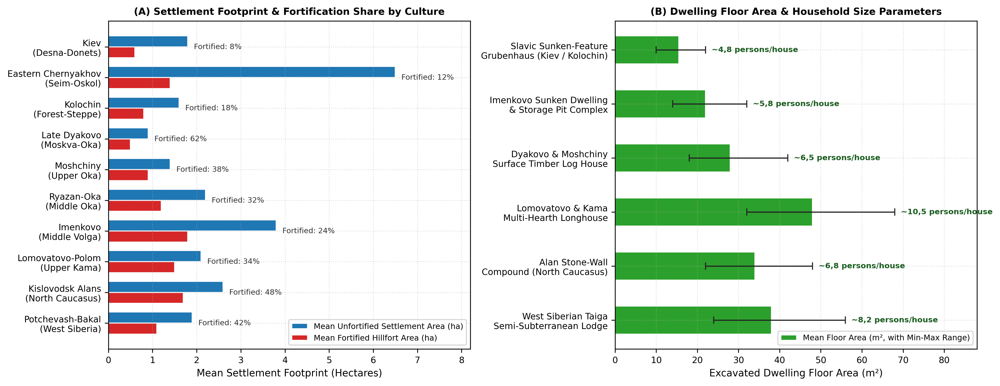

# Abstract

This working paper reviews external Russian and international
archaeological, osteological, palynological, and historical-demographic
scholarship to estimate regional populations and settlement patterns
across Belarus, Ukraine, and Russia during the Migration Period (*Epokha
Velikogo pereseleniya narodov*, c. 250-750AD), placed within a long-run
comparative series extending from 100AD to the First All-Russian
Imperial Census of 1897 (1900AD). Drawing on excavated house-floor
areas, hillfort and open village dimensions, cremation and inhumation
cemetery burial counts, and river-basin survey inventories across six
major geographical regions, we reconstruct consistent regional
population series. Across Belarus, Ukraine, and Russia (excluding the
Baltic provinces), total population rose from 2,05 M (1,60-2,54 M) in
100AD to a Late Roman peak of 2,56 M (2,00-3,17 M) around 350AD,
declined to 2,28 M (1,78-2,83 M) by 450AD following the Hunnic invasion
and the collapse of the eastern Chernyakhov and Late Sarmatian
settlement networks, and recovered after the 536-542AD climatic downturn
(2,49 M in 550AD) to reach 3,13 M (2,44-3,88 M) by 700AD and 4,50 M
(3,51-5,58 M) by 900AD. Notably, the Migration Period did not bring
uniform depopulation across the region, but rather a major geographical
shift: populations in the open Pontic-Caspian steppe and exposed
southern forest-steppe fell by 28-44% between 350AD and 450AD, whereas
Pripyat Polesia and Volhynia (*Prague-Korchak*), the Middle Volga
(*Imenkovo*), the Belarusian, Volga-Oka, and northwestern forest zone
(*Tushemlya-Bantserovshchina*, *Late Dyakovo*, *Moshchiny*,
*Ryazan-Oka*, *Pskov Long Barrows*), the Kama-Cis-Ural basin
(*Bakhmutino*, *Turaevo*, *Lomovatovo*, *Polom*), and the North
Caucasian terraced mountain valleys (*Alanian Kislovodsk* and
*Derbent-Palasa-Syrt*) experienced steady settlement expansion and
agricultural growth
[\[1\]](#ref-oblomskiy2002dneprovskoe)[\[2\]](#ref-vyazov2019middle)[\[3\]](#ref-korobov2013terraced)[\[4\]](#ref-krenke2019moskvorechye).
Over the subsequent millennium, agricultural colonisation, urban growth,
and early modern agrarian settlement carried the population across the
study region to 6,60 M in 1200AD, 9,10 M in 1500AD, 13,80 M in 1700AD,
28,10 M in 1800AD, and 67,50 M by 1900AD
[\[5\]](#ref-vodarsky1973naselenie)[\[6\]](#ref-kabuzan1990narody)[\[7\]](#ref-rashin1956naselenie)[\[8\]](#ref-troinitsky1905perepis).



# Background

Estimating the population of Northern Eurasia during the Migration
Period (c. 250-750AD) presents distinct empirical challenges
[\[9\]](#ref-shchukin2005gotskiy)[\[10\]](#ref-kazanski2010middle)[\[11\]](#ref-oblomskiy2016kolochinskaya).
Unlike the Roman provinces of the Mediterranean or early medieval
Western Europe, where tax registers and written charters survive,
demographic estimates across the East European Plain, the North
Caucasus, the Urals, and Western and Southern Siberia must be built from
four archaeological sources: (1) the layout and floor area of excavated
houses inside fortified hillforts (*gorodishcha*) and unfortified
villages (*selishcha*), (2) mortality life tables calculated from
cremation and inhumation cemeteries, (3) pollen cores measuring forest
clearance and cereal cultivation (*Cerealia*, *Secale*, *Plantago
lanceolata*, and *Rumex*), and (4) systematic river-valley field surveys
[\[2\]](#ref-vyazov2019middle)[\[3\]](#ref-korobov2013terraced)[\[12\]](#ref-krenke2011dyakovo)[\[13\]](#ref-goldina1999drevnyaya).

In older archaeological literature, changes in the raw number of known
sites between the third and seventh centuries AD were sometimes
interpreted as sharp half-century swings in total population. Modern
regional fieldwork shows that raw site counts often reflect shifts in
village size and settlement mobility rather than actual population loss
or gain
[\[1\]](#ref-oblomskiy2002dneprovskoe)[\[2\]](#ref-vyazov2019middle)[\[14\]](#ref-matveeva2024migratsii).
For instance, in the Desna, Seim, and Upper Donets forest-steppe, the
replacement of large Chernyakhov farming villages (4,0-12,0 ha) in the
mid-fourth century AD by smaller, dispersed Kolochin and early Penkovka
river-terrace hamlets (0,8-2,2 ha) in the fifth and sixth centuries
increased the number of small ceramic scatters per river bend while
reducing the average population per village from 145 inhabitants to 45
inhabitants
[\[11\]](#ref-oblomskiy2016kolochinskaya)[\[15\]](#ref-terpylovsky2000kievskaya)[\[16\]](#ref-goryunova1999velikie).
Conversely, in the Moskva-Oka basin and the Kislovodsk mountain basin,
the concentration of rural households into fortified promontory
hillforts or stone cliff fortresses reduced the number of separate sites
while increasing local agricultural output through iron ploughshares and
manured terrace fields
[\[3\]](#ref-korobov2013terraced)[\[4\]](#ref-krenke2019moskvorechye)[\[17\]](#ref-korobov2023alany).[^1]

Two major historical turning points reshaped settlement patterns across
Belarus, Ukraine, and Russia during the Migration Period. First, during
the Hunnic invasion of 370-378AD and subsequent post-Hunnic settlement
shifts (454-500AD), the crossing of the Volga and Don by Hunnic nomadic
forces broke up the Late Sarmatian pastoral network and led to the
abandonment of the eastern Chernyakhov frontier in the Kursk-Belgorod
forest-steppe
[\[9\]](#ref-shchukin2005gotskiy)[\[18\]](#ref-medvedev2018postsarmat)[\[19\]](#ref-novikova2026istoriografiya).
Rather than disappearing, many post-Chernyakhov and post-Zarubintsy
farming communities moved north and north-east into the sheltered
forest-steppe and southern forest valleys of the Upper Oka
(*Moshchiny*), the Middle Oka (*Ryazan-Oka*), and the
Samara-Sviyaga-Lower Kama confluence (*Imenkovo*)
[\[2\]](#ref-vyazov2019middle)[\[20\]](#ref-vorontsov2021fibuly)[\[21\]](#ref-zhikh2019rannie).

Second, during the 536-542AD climatic cooling and the early medieval
agricultural expansion that followed, tree-ring and pollen records from
the Upper Volga, Novgorod-Pskov, and the Middle Volga record a sharp
temperature downturn in the mid-sixth century AD
[\[2\]](#ref-vyazov2019middle)[\[4\]](#ref-krenke2019moskvorechye).
Across the Middle Volga and forest-steppe zones, this cooler climate
encouraged the wider adoption of hardy winter rye (*Secale cereale*) and
iron-shod ploughs, supporting the steady growth of Early Slavic
(*Prague-Korchak*, *Kolochin*, *Penkovka*) and Finno-Permic
(*Lomovatovo*, *Polom*, *Nevolino*) farming populations from the late
sixth through eighth centuries AD
[\[10\]](#ref-kazanski2010middle)[\[22\]](#ref-goldina2012nevolino)[\[23\]](#ref-nazarov2025lomovatovo).

# Methodology

## Settlement and Household Estimates

To calculate comparable population figures across different
archaeological cultures, we combine excavated house sizes, the number of
simultaneous dwellings per village, and regional river-valley survey
counts
[\[1\]](#ref-oblomskiy2002dneprovskoe)[\[12\]](#ref-krenke2011dyakovo)[\[13\]](#ref-goldina1999drevnyaya)[\[24\]](#ref-matveeva2000sargat).
For an archaeological culture $`c`$ in region $`z`$ at date $`t`$, the
regional population $`P_{c,z}(t)`$ is estimated as:

``` math
P_{c,z}(t) = N_{\text{clusters}}(t) \times \bar{S}_{\text{contemp}} \times \bar{H}_{\text{active}} \times \mu_{\text{house}}(c)
```

where $`N_{\text{clusters}}(t)`$ is the estimated number of active
settlement clusters across the surveyed river valleys (adjusted for
regional survey coverage $`\kappa_z \in [0{,}30,\, 0{,}65]`$),
$`\bar{S}_{\text{contemp}}`$ is the mean number of simultaneously
inhabited villages per cluster after adjusting for average village
occupation span ($`\tau_{\text{site}} / \Delta T_{\text{phase}}`$),
$`\bar{H}_{\text{active}}`$ is the average number of contemporaneously
occupied houses per village, and $`\mu_{\text{house}}(c)`$ is the
average household size for that house type.

Broad-area settlement excavations across Belarus, Ukraine, and Russia
identify three main domestic building traditions during the Migration
Period. Square sunken-featured dwellings (*poluzemlyanki*) were typical
of the Kiev, Kolochin, Penkovka, Prague-Korchak, and Imenkovo cultures
[\[1\]](#ref-oblomskiy2002dneprovskoe)[\[11\]](#ref-oblomskiy2016kolochinskaya)[\[16\]](#ref-goryunova1999velikie)[\[25\]](#ref-vyazov2008zemledelie);
their floor areas average $`A_d \in [12{,}0,\, 22{,}5]\text{ m}^2`$ with
a single corner stone or clay oven, housing a nuclear family of
$`\mu_{\text{house}} = 4{,}5\text{-}5{,}5`$ persons
($`P_{\text{house}} \approx 0{,}28 \cdot A_d^{0{,}92}`$). Surface
timber-frame and post-built houses (*nazemnye postroyki*) characterised
the Late Dyakovo, Moshchiny, Tushemlya, and Ryazan-Oka forest-zone
cultures as well as the eastern Chernyakhov surface longhouses
[\[9\]](#ref-shchukin2005gotskiy)[\[12\]](#ref-krenke2011dyakovo)[\[26\]](#ref-islanova2012ozero)[\[27\]](#ref-lopatin2007severnye),
with floor areas spanning $`A_d \in [20{,}0,\, 36{,}0]\text{ m}^2`$ and
housing nuclear or extended households of
$`\mu_{\text{house}} = 5{,}5\text{-}7{,}5`$ persons. Multi-hearth log
longhouses and timber chambers prevailed among the Kama-Vyatka-Belaya
Permic and Ugrian cultures (*Azeevo*, *Mazunino*, *Bakhmutino*,
*Lomovatovo*, *Polom*) and West Siberian sub-taiga groups (*Karym*,
*Potchevash*)
[\[13\]](#ref-goldina1999drevnyaya)[\[24\]](#ref-matveeva2000sargat)[\[28\]](#ref-chizhevskiy2020oboronitelnye);
measuring $`A_d \in [34{,}0,\, 72{,}0]\text{ m}^2`$ with two to four
central hearths, these longhouses accommodated extended families of
$`\mu_{\text{house}} = 10{,}0\text{-}16{,}0`$ persons.

## Cemetery Mortality Estimates

In regions where seasonal camps or timber surface houses leave faint
traces - particularly among steppe pastoralists, North Caucasian
catacomb communities, and Middle Oka or Kama-Ural burial groups -
village population is cross-checked using the standard Acsádi-Nemeskéri
life-table formula
[\[29\]](#ref-veselovskaya2021ryazan)[\[30\]](#ref-zelenkov2025potchevash)[\[31\]](#ref-vodyasov2023tashtyk):

``` math
P_{\text{community}} = \frac{\text{MNI}_{\text{total}} \times e_0}{\Delta t_{\text{use}} \times \eta_{\text{recovery}}}
```

where $`\text{MNI}_{\text{total}}`$ is the minimum number of individuals
excavated or projected across the cemetery, $`e_0`$ is life expectancy
at birth (ranging between 21,5 and 25,5 years in Migration Period
skeletal series, with mean adult age at death
$`e_{20} + 20 \approx 36{,}5\text{-}41{,}0\text{ years}`$ and child
mortality $`d_{0\text{-}14} \approx 42\text{-}50\%`$),
$`\Delta t_{\text{use}}`$ is the duration of cemetery use in years, and
$`\eta_{\text{recovery}} \in [0{,}55,\, 0{,}85]`$ accounts for infant
bone loss and unexcavated cemetery edges
[\[29\]](#ref-veselovskaya2021ryazan)[\[31\]](#ref-vodyasov2023tashtyk)[\[32\]](#ref-seregin2021altai).

# Pontic-Caspian Steppe and Forest-Steppe Frontier

## The Kiev and Eastern Chernyakhov Cultures (c. 250-400AD)

Across the Right-Bank and Left-Bank Dnieper, Volhynia, Podolia, Southern
Pripyat, Desna, Seim, Psyol, Vorskla, and Upper Donets river basins of
Ukraine, southern Belarus, and the Russian Central Black-Earth
borderlands, the Late Roman Period was shaped by the coexistence of the
forest-steppe Kiev culture (*Kievskaya kul’tura*, c. 200-420AD) and the
provincial-Roman Chernyakhov culture (*Chernyakhovskaya kul’tura*,
c. 260-400AD)
[\[1\]](#ref-oblomskiy2002dneprovskoe)[\[9\]](#ref-shchukin2005gotskiy)[\[15\]](#ref-terpylovsky2000kievskaya)[\[19\]](#ref-novikova2026istoriografiya).

Field surveys compiled by Oblomskiy and Terpylovsky show that Kiev
culture settlements stood on low first flood-plain terraces in linear
groups of 3-10 unfortified *selishcha* spaced 0,5-2,0 km apart
[\[1\]](#ref-oblomskiy2002dneprovskoe)[\[15\]](#ref-terpylovsky2000kievskaya).
Individual villages covered 0,5-2,5 ha (mean 1,8 ha) and contained 5-12
simultaneously occupied square sunken-featured *poluzemlyanki* (12-20
m², mean 16,5 m², dug 0,4-0,8 m into the ground with a central or side
post and open hearth), giving an average village population of 30-70
inhabitants (midpoint 48) and a river-valley density of 1,2-2,5
persons/km² [\[1\]](#ref-oblomskiy2002dneprovskoe).

By contrast, the eastern Chernyakhov frontier in the Seim, Oskol, and
Upper Donets valleys (*Gochevo*, *Komsomolskoye*, *Khokhlovo*)
introduced heavy iron-shared plough agriculture, rotary querns,
wheel-thrown grey-ware kilns, and large unfortified valley-slope
villages spanning 4,0-15,0 ha (mean 6,5 ha)
[\[9\]](#ref-shchukin2005gotskiy)[\[19\]](#ref-novikova2026istoriografiya).
Excavations uncover rows of 15-35 surface wattle-and-daub longhouses
(*Wohnstallhäuser*, 24-45 m²) alongside sunken craft workshops and
biritual cemeteries (*MNI* 80-250 graves), supporting 95-210 inhabitants
per village (midpoint 145) and local valley densities of 3,5-6,5
persons/km²
[\[9\]](#ref-shchukin2005gotskiy)[\[15\]](#ref-terpylovsky2000kievskaya).
Together with Chernyakhov and Prague-Korchak agricultural clusters in
Volhynia, Podolia, and the Right-Bank Dnieper (*Lepesovka*, *Korchak*,
*Pastyrskoye*) and Late Sarmatian settlements on the Middle Don
[\[18\]](#ref-medvedev2018postsarmat)[\[33\]](#ref-zemtsov2013migratsii),
the forest-steppe zone reached a Late Roman peak of 690k (550-830k)
around 350AD.

## The Hunnic Invasion, Kolochin, Penkovka, and Nomadic Groups (c. 375-750AD)

The Hunnic crossing of the Volga-Don interfluve in 370-378AD and the
breakup of the Gothic-Chernyakhov realm caused a sharp settlement
retreat along the exposed southern forest-steppe border
[\[9\]](#ref-shchukin2005gotskiy)[\[34\]](#ref-kazanski2020steppe)[\[35\]](#ref-oblomskiy2022torgovyy).
Between 375AD and 450AD, regional population across the
Dnieper-Desna-Don forest-steppe declined from 690k to 460k (-33,3%),
while the open Pontic-Caspian and Crimean steppe fell from 225k to 140k
(-37,8%)
[\[18\]](#ref-medvedev2018postsarmat)[\[36\]](#ref-botalov2009gunny).

From the blending of surviving Kiev communities and northern forest-zone
settlers arose the Kolochin culture (*Kolochinskaya kul’tura*,
c. 400/420-680AD) across the Desna, Seim, Upper Psyol, and Kursk-Bryansk
basins, alongside the Penkovka culture (*Pen’kovskaya kul’tura*, 5th-7th
centuries AD) further south and Early Slavic settlements on the Upper
Don (*Zemtsov*, *Chertovitskoye-Zamyatino*)
[\[11\]](#ref-oblomskiy2016kolochinskaya)[\[16\]](#ref-goryunova1999velikie)[\[33\]](#ref-zemtsov2013migratsii)[\[37\]](#ref-sereda1999kolochinskiy).
As excavated at *Velikie Budki (Khutor)*, *Kolochin I*, and
*Kartamyshevo*, Kolochin communities lived in small flood-plain
*selishcha* (0,8-2,5 ha) paired with refuge hillforts (*gorodishcha*,
0,4-1,0 ha, 18% of sites fortified), each containing 5-10 square
*poluzemlyanki* (12-18 m² with stone or clay ovens) and flat urn or pit
cremation cemeteries (*Kartamyshevo*, *Knippovo*, *Lebedka*, 20-65
cremations per cemetery), corresponding to 28-68 inhabitants per village
(mean 45)
[\[11\]](#ref-oblomskiy2016kolochinskaya)[\[16\]](#ref-goryunova1999velikie)[\[37\]](#ref-sereda1999kolochinskiy).
During the late sixth and seventh centuries AD - marked by the burial of
“Antian” silver and bronze hoards (*Sudzha*, *Gaponovo*, *Kolocha*) -
Slavic settlement expanded across the Desna-Don forest-steppe, restoring
regional population to 550k by 600AD and 690k by 700AD ahead of the
Borshevo and Romny tribal settlements
[\[10\]](#ref-kazanski2010middle)[\[38\]](#ref-sedov1999drevnerusskaya)[\[39\]](#ref-gavritukhin2005chronology).

# Mixed and Boreal Forest Zone of Belarus and European Russia

## Late Dyakovo, Moshchiny, and Ryazan-Oka Finnic Cultures (c. 250-750AD)

In contrast to the exposed steppe borderlands, the mixed
broadleaf-coniferous forest zone of the Moskva, Upper Volga, and Oka
basins served as a stable settlement core and refuge zone throughout the
Migration Period
[\[4\]](#ref-krenke2019moskvorechye)[\[12\]](#ref-krenke2011dyakovo)[\[20\]](#ref-vorontsov2021fibuly)[\[40\]](#ref-akhmedov2018ryazan).
Within the Late Dyakovo culture (*Pozdned’yakovskaya kul’tura*,
c. 250-550/600AD), Krenke’s radiocarbon and stratigraphic excavations at
*Dyakovo*, *Troitskoye*, *Lukovskoye*, and *Kuntsevo* in the Moskva
River basin show that 62% of settlements were fortified promontory
*gorodishcha* (0,3-1,2 ha, enclosed by double or triple timber-and-earth
ramparts) paired with outer open villages
[\[4\]](#ref-krenke2019moskvorechye)[\[12\]](#ref-krenke2011dyakovo)[\[41\]](#ref-veksler2017dyakovo).
Houses shifted from early round structures to rectangular surface
post-built and log dwellings (18-32 m², mean 24,0 m²), with 8-15 houses
per hillfort supporting 40-95 inhabitants (mean 65) and river-valley
densities of 1,0-2,2 persons/km² [\[12\]](#ref-krenke2011dyakovo).

Further south, in the Upper Oka, Ugra, and Protva basins (Kaluga, Tula,
and western Oryol oblasts), Baltic-speaking communities of the Moshchiny
culture (*Moshchinskaya kul’tura*, 4th-7th centuries AD) absorbed
post-Chernyakhov and Middle Dnieper settlers after 375AD, as shown by
*Kartavtsevo-Serensk* brooches, champlevé red enamels, and wheel-thrown
pottery imitations
[\[20\]](#ref-vorontsov2021fibuly)[\[42\]](#ref-mayorov2016moschiny)[\[43\]](#ref-sevostyanov2022keramika).
Centred on fortified hillforts (*Moshchiny*, *Serensk*, *Supruty*,
0,5-1,5 ha) and surrounding open villages (1,0-2,5 ha) with cremation
barrows (*kurgany*), the Upper Oka population grew steadily from 95k in
250AD to 145k by 600AD
[\[20\]](#ref-vorontsov2021fibuly)[\[42\]](#ref-mayorov2016moschiny).

Along the Middle Oka bend from Kolomna to Kasimov (*Nikitino*, *Borki*,
*Kuzminskoye*, *Shatrishche*, *Undrikh*, *Korablino*), Finnic farming
and fur-trading communities of the Ryazan-Oka cemetery culture
(*Kul’tura ryazano-okskikh mogil’nikov*, 3rd-7th centuries AD)
maintained one of the densest settlement networks in Forest-Zone Russia
[\[29\]](#ref-veselovskaya2021ryazan)[\[40\]](#ref-akhmedov2018ryazan)[\[44\]](#ref-semenov2022ryazan).
Promontory hillforts and large terrace villages (1,5-3,5 ha) were paired
with large flat inhumation cemeteries containing 100-600+ graves
furnished with cross-shaped brooches, Roman and Sassanian silver
vessels, and horse-riding weapons
[\[29\]](#ref-veselovskaya2021ryazan)[\[40\]](#ref-akhmedov2018ryazan)[\[45\]](#ref-vikhlyaev2011erzya)[\[46\]](#ref-mokshina2012peterburgskiy).
Skeletal and burial-count studies indicate village populations of 55-125
inhabitants (mean 85) and a regional Middle Oka-Mordvin population
rising from 135k in 250AD to 215k by 700AD.

## Northwestern Forest Zone: Tushemlya and Pskov Long Barrows (c. 300-750AD)

Across the Belarusian Upper Dnieper, Berezina, Pripyat, and Western
Dvina basins and the Russian Smolensk, Velikaya, and Ilmen-Msta
watersheds (excluding the Baltic provinces of Estonia, Latvia, and
Lithuania), Lopatin, Furasiev, Mikhailova, and Islanova document the
steady settlement of sandy pine river terraces
[\[26\]](#ref-islanova2012ozero)[\[27\]](#ref-lopatin2007severnye)[\[47\]](#ref-mikhailova2014poseleniya)[\[48\]](#ref-mikhailova2014snaryazhenie)[\[49\]](#ref-markov2024pskov).
While the Belarusian and Smolensk Tushemlya-Bantserovshchina group
(4th-7th centuries AD) combined small open *selishcha* (0,5-1,8 ha) with
oval timber-walled refuge enclosures (*Bantserovshchina* near Minsk,
*Tushemlya*, *Gorodok*, *Kovsharovo*), the Culture of Pskov Long Barrows
(*Kul’tura pskovskikh dlinnykh kurganov*, 5th-9th centuries AD) spread
across the Velikaya, Lovat, Msta, and Upper Volga watersheds
[\[26\]](#ref-islanova2012ozero)[\[47\]](#ref-mikhailova2014poseleniya)[\[49\]](#ref-markov2024pskov).
Each long barrow cemetery (3-25 elongated or oval mounds, each holding
2-12 cremations) served a local group of 2-4 unfortified lakeshore
hamlets (25-50 inhabitants per hamlet), supporting a combined
northwestern forest population that grew from 115k in 250AD to 165k in
550AD and 230k by 700AD
[\[26\]](#ref-islanova2012ozero)[\[47\]](#ref-mikhailova2014poseleniya).

# Middle Volga, Kama-Vyatka, and Cis-Urals

## The Imenkovo Agricultural Expansion on the Middle Volga (c. 400-700AD)

One of the most important demographic developments of Migration Period
Russia was the rapid agricultural settlement of the Middle Volga, Samara
Bend (*Samarskaya Luka*), Sviyaga, Cheremshan, and Lower Kama valleys by
the Imenkovo culture (*Imenkovskaya kul’tura*, c. 400-650/700AD)
[\[2\]](#ref-vyazov2019middle)[\[21\]](#ref-zhikh2019rannie)[\[25\]](#ref-vyazov2008zemledelie)[\[50\]](#ref-vyazov2020kompleks).
Combining over 600 mapped settlements (*Staraya Maina*, *Imenkovo*,
*Maklasheevo*, *Osh-Pando-Ner’*, *Scherbet’*) with pollen cores and
radiocarbon dates, Vyazov et al. show that cultivated land and
settlement density on the Middle Volga quadrupled between 400AD and
600AD [\[2\]](#ref-vyazov2019middle)[\[25\]](#ref-vyazov2008zemledelie).

Formed by post-Zarubintsy and post-Chernyakhov settlers from the
Dnieper-Desna forest-steppe mingling with local Finno-Volgaic
communities, Imenkovo settlements formed tight local clusters consisting
of a central fortified *gorodishche* (1,0-3,0 ha) surrounded by 4-12
large unfortified *selishcha* (2,0-8,0 ha, with *Staraya Maina*
exceeding 6 ha)
[\[2\]](#ref-vyazov2019middle)[\[21\]](#ref-zhikh2019rannie). Using
heavy iron ploughshares (*ral’niki*), sickles, cylindrical grain storage
pits (*khlebnye yamy* holding 300-800 kg of millet, wheat, and winter
rye), and iron smelting furnaces, individual Imenkovo villages contained
12-30 simultaneously occupied *poluzemlyanki* (16-26 m²), supporting
70-160 inhabitants per village (mean 110) and a Middle Volga population
that rose from 145k in 350AD to 240k by 550-600AD
[\[2\]](#ref-vyazov2019middle)[\[25\]](#ref-vyazov2008zemledelie). In
the late seventh century AD, the arrival of Early Bulgar nomadic groups
(*Novinkovka* burial mounds on the Samara Bend and *Shilovka*) led part
of the Imenkovo population to move west toward the Middle Dnieper
(*Volyntsevo* culture), while the remaining farming villages were
absorbed into early Volga Bulgaria
[\[21\]](#ref-zhikh2019rannie)[\[50\]](#ref-vyazov2020kompleks)[\[51\]](#ref-skarbovenko2012kochevniki)[\[52\]](#ref-lifanov2020alekseevskoe).

## Permic and Cis-Ural Groups: Mazunino, Bakhmutino, Turaevo, Lomovatovo, and Polom (c. 250-750AD)

In the Kama, Vyatka, Belaya, and Sylva river basins of the Cis-Urals
(Udmurtia, Perm Krai, Bashkortostan, and eastern Tatarstan), large-scale
excavations synthesised by Goldina, Gening, Chizhevskiy, Bakhshiev, and
Shmuratko document steady Permic and Ugrian population growth
[\[13\]](#ref-goldina1999drevnyaya)[\[22\]](#ref-goldina2012nevolino)[\[28\]](#ref-chizhevskiy2020oboronitelnye)[\[53\]](#ref-gening1988turaevo)[\[54\]](#ref-bakhshiev2017bakhmutino)[\[55\]](#ref-shmuratko2011prikamye)[\[56\]](#ref-belitskaya2026slitki).
Following the breakup of the Late Pyanobor union in the third to sixth
centuries AD, the Mazunino culture (Middle Kama and Lower Belaya) and
Bakhmutino culture (Belaya-Ufa basin, including the large *Ufa II*
fortified town and *Birsk* cemetery with over 1 000 burials) built dense
networks of timber-rampart hillforts (0,8-2,5 ha) and open villages
[\[13\]](#ref-goldina1999drevnyaya)[\[28\]](#ref-chizhevskiy2020oboronitelnye)[\[54\]](#ref-bakhshiev2017bakhmutino).
In the fifth century AD, the arrival of armed steppe-forest groups
created the Turaevo kurgan group (*Turaevo*, *Bartym*) on the Middle
Kama
[\[53\]](#ref-gening1988turaevo)[\[55\]](#ref-shmuratko2011prikamye).

Between the fifth and eighth centuries AD, across the Upper Kama
(*Lomovatovo*), Cheptsa (*Polom*), and Sylva (*Nevolino*, e.g. *Brody*,
*Verkh-Saya*) basins, Permic communities lived in multi-hearth surface
log longhouses (35-65 m², mean 42,0 m², housing 10-15 family members)
and buried their dead in large flat cemeteries containing hundreds of
graves with Sassanian and Byzantine silver vessels (*Bartym*,
*Kudymkar*) exchanged for northern sable and squirrel furs
[\[13\]](#ref-goldina1999drevnyaya)[\[22\]](#ref-goldina2012nevolino)[\[23\]](#ref-nazarov2025lomovatovo)[\[57\]](#ref-ivanov2021ugrian).
Total population across the Kama-Vyatka-Belaya Cis-Urals grew from 265k
in 250AD to 335k in 550AD and 395k by 700AD.

# North Caucasus and Caspian Corridor

The North Caucasus and the narrow Caspian coastal plain of Dagestan
formed the strategic gateway between the Eurasian steppe and the
Sassanian and Byzantine empires
[\[3\]](#ref-korobov2013terraced)[\[17\]](#ref-korobov2023alany)[\[58\]](#ref-gadzhiev2002derbent)[\[59\]](#ref-gmyrya2022palasa).
Using GIS mapping, soil phosphate testing, and systematic surveys of 268
Early Alanian fortified settlements and catacomb cemeteries (*Klin-Yar
III-IV*, *Mokraya Balka*, *Gornoe Ekho*), Korobov and Borisov showed
that after the Hunnic invasion of the open Ciscaucasian steppe in 375AD,
Alanian communities settled densely inside the sheltered Kislovodsk
mountain basin (800-1 400 m elevation)
[\[3\]](#ref-korobov2013terraced)[\[17\]](#ref-korobov2023alany)[\[60\]](#ref-fomenko2018alany).
To support this concentrated population, Alanian farmers built thousands
of hectares of artificial agricultural terraces fertilised with
household manure [\[3\]](#ref-korobov2013terraced). Each stone-walled
cliff fortress (0,8-2,5 ha, spaced 1,0-2,5 km apart) and paired catacomb
cemetery (*Klin-Yar* and *Mokraya Balka* containing 400-1 000+ family
catacombs) supported 80-175 inhabitants (mean 120), producing
mountain-valley densities of 12-22 persons/km² and a central Alanian
piedmont population of 195-260k between the fifth and eighth centuries
AD [\[3\]](#ref-korobov2013terraced)[\[17\]](#ref-korobov2023alany).

On the Lower Kuban and Taman-Abkhazian coast (*Dyurso*, *Pashkovskiy*,
*Borisovskiy*), Mastykova’s study of burial dress documents mixed
Alanian, Adyghe-Zikh, and East Germanic (*Tetraxite Goth*) farming and
port communities \[95-130k\]
[\[61\]](#ref-mastykova2009kuban)[\[62\]](#ref-mastykova2009ierarkhiya).
Along the Caspian coast in Dagestan, the Sassanian construction of the
stone fortress and walls of Derbent under Kavad I and Khosrow I
Anushirvan (6th century AD) protected a dense urban-garrison and
irrigated farming zone alongside the large Palasa-Syrt kurgan-catacomb
cemetery (1 500+ mounds dating to the 4th-6th centuries AD, excavated by
Gmyrya, Gadzhiev, and Malashev)
[\[58\]](#ref-gadzhiev2002derbent)[\[59\]](#ref-gmyrya2022palasa)[\[63\]](#ref-malashev2011palasa).
Total population across the North Caucasus and Dagestan rose from 435k
in 250AD to 480k in 550AD and 570k by 700AD.

# Western and Southern Siberia

## Tobol-Ishim-Irtysh-Ob Forest-Steppe and Southern Taiga (c. 250-750AD)

In Western Siberia, Matveeva, Zelenkov, and Sleptsova have traced the
post-Sargat settlement reorganisation across the Tobol, Ishim, Irtysh,
and Middle Ob basins
[\[14\]](#ref-matveeva2024migratsii)[\[24\]](#ref-matveeva2000sargat)[\[30\]](#ref-zelenkov2025potchevash).
During the third and fourth centuries AD, the Sargat kurgan union
(*Tsarev Kurgan*, *Isakovka*, estimated by Matveeva at 110-145k across
the Tobol-Irtysh forest-steppe with 50-100 inhabitants per fortified
settlement group) broke apart under the combined effects of steppe
drying, Hunnic-Xianbei movements, and the southward expansion of taiga
Karym and Kozlov hunting, fishing, and iron-working groups
[\[14\]](#ref-matveeva2024migratsii)[\[24\]](#ref-matveeva2000sargat).

Out of this mixing between the fifth and eighth centuries AD emerged the
Bakalskaya culture in the Tobol-Ishim forest-steppe and the Potchevash
culture (*Potchevash*, *Vikulovo*, *Okunevo*, *Likhachevo*) along the
Irtysh and Middle Ob
[\[14\]](#ref-matveeva2024migratsii)[\[30\]](#ref-zelenkov2025potchevash).
Living in promontory hillforts (0,6-1,5 ha) and multi-family
semi-subterranean log houses (28-42 m²) while practising horse breeding,
floodplain farming, and fur trapping, West Siberian populations stood at
145-165k in 450-550AD and grew to 185k by 700AD
[\[14\]](#ref-matveeva2024migratsii)[\[30\]](#ref-zelenkov2025potchevash).

## Minusinsk Basin, Altai, Tuva, and Cis-Baikal (c. 250-750AD)

Across the mountain-steppe basins of Southern Siberia, three main
regional traditions developed during the Migration Period. In the
Yenisei-Abakan Minusinsk Basin (*Oglakhty*, *Tepsen*, *Bateni*,
*Izzykhtash*), Azbelev and Vodyasov and Zaitseva trace the Tashtyk
culture (1st-6th centuries AD) through the shift from individual
inhumation and cremation pit graves to large collective timber-lined
subterranean vaults (*sklepy*, up to 60-80 m²) holding 20-150+ cremated
and mummified burials with painted gypsum funerary masks
[\[31\]](#ref-vodyasov2023tashtyk)[\[64\]](#ref-azbelev2007oglakhty).
Supported by irrigated millet farming and valley pastoralism, the
Minusinsk Basin sustained 55-75k inhabitants before the rise of the
Yenisei Kyrgyz (*Chaatas* period, 6th-9th centuries AD)
[\[31\]](#ref-vodyasov2023tashtyk).

Further south and east across Tuva, the Altai, and Lake Baikal, regional
cemetery excavations document resilient pastoral and metallurgical
populations. In Tuva, the post-Xiongnu Kokel culture (*Kokel*, *Eerbek*,
*Khemchik*, 2nd-5th centuries AD) excavated by Wainstein, Teterin, and
Mit’ko left large cemeteries of 100-400+ timber-coffin burials
\[30-45k\] [\[65\]](#ref-teterin2013kokel). In the Russian Altai,
Seregin and Matrenin’s studies of the Bulan-Koba (Xianbei-Rouran period,
2nd-5th centuries AD, e.g. *Choburak-I*, *Stepushka*,
*Ust’-Steklyannoe*) and Early Turkic (*Kudyrge*, *Katanda*, *Tuekta*,
*Berel*, 6th-8th centuries AD) burials document high child mortality
(40-48%) alongside growing iron-smelting and pastoral communities
\[35-55k\] under the First Turkic Khaganate after 552AD
[\[32\]](#ref-seregin2021altai)[\[66\]](#ref-seregin2022xianbei)[\[67\]](#ref-matrenin2015pryazhki)[\[68\]](#ref-tishin2018turks).
West of Lake Baikal and along the Angara-Lena watershed, Kharinsky
traces the transition from the Elga graves (3rd century BC - 4th century
AD) to the iron-smelting and irrigation-farming Kurumchin (*Kurykan*)
culture (6th-10th centuries AD) \[20-35k\]
[\[69\]](#ref-kharinsky2005baikal)[\[70\]](#ref-kharinsky2014elga).

# Population and Settlement Estimates

## Population Estimates (100 - 900AD)

Combining the regional archaeological evidence across the six
macro-regions of Belarus, Ukraine, and Russia produces a consistent
demographic series from 100AD to 1900AD (Table and Figure ). During the
Late Roman Warm Period (100-350AD), under mild climatic conditions and
active trade with the Roman Black Sea provinces and Sarmatian steppe,
total population across the study region rose from 2,05 M (1,60-2,54 M)
in 100AD to 2,45 M in 250AD and 2,56 M (2,00-3,17 M) in 350AD (an annual
growth rate of roughly +0,09%/yr), led by the eastern Chernyakhov and
Kiev farming villages in the forest-steppe (690k) and steady settlement
growth across the Late Dyakovo, Ryazan-Oka, and Mazunino forest and Kama
regions
[\[1\]](#ref-oblomskiy2002dneprovskoe)[\[9\]](#ref-shchukin2005gotskiy)[\[12\]](#ref-krenke2011dyakovo).

During the Hunnic invasion and the northward and upland settlement shift
(375-550AD), the campaigns of 370-378AD and fifth-century steppe warfare
reduced the total population of the study region by 10,9% to 2,28 M
(1,78-2,83 M) around 450AD. However, as Figure shows, this drop was
confined to the open Pontic-Caspian steppe (-37,8%) and the exposed
southern forest-steppe border (-33,3%). Over the same period
(350-550AD), population grew substantially in the Middle Volga
*Imenkovo* region and Kama Cis-Urals (+23,9%, from 440k to 545k), the
Volga-Oka and northwestern forest zone (+19,4%, from 465k to 555k), and
the terraced mountain valleys of the North Caucasus (+4,3%, from 460k to
480k)
[\[2\]](#ref-vyazov2019middle)[\[3\]](#ref-korobov2013terraced)[\[20\]](#ref-vorontsov2021fibuly).
As a result, the combined share of the forest zone, Middle Volga-Kama,
and North Caucasian valleys rose from 52,5% of the regional total in
250AD to 62,9% in 450AD and 63,4% in 550AD.

During the subsequent phase of early medieval agricultural growth
(560-900AD), following the 536-542AD cooling episode and the spread of
winter rye, heavy iron ploughshares, and river trade along the Volga,
Don, and Dnieper under the Khazar and First Turkic khaganates, total
population across Belarus, Ukraine, and Russia grew from 2,49 M in 550AD
to 2,68 M in 600AD, 3,13 M in 700AD, 3,83 M in 800AD, and 4,50 M
(3,51-5,58 M) by 900AD (+0,17%/yr)
[\[2\]](#ref-vyazov2019middle)[\[10\]](#ref-kazanski2010middle)[\[13\]](#ref-goldina1999drevnyaya)[\[17\]](#ref-korobov2023alany).

## Post-Migration Period Growth to the 1897 Census (900 - 1900AD)

To place the Migration Period estimates into a long-run context
extending to modern statistical records, Table and Figure extend the
regional population series from 900AD to the First All-Russian Imperial
Census of 1897 (1900AD)
[\[5\]](#ref-vodarsky1973naselenie)[\[6\]](#ref-kabuzan1990narody)[\[7\]](#ref-rashin1956naselenie)[\[8\]](#ref-troinitsky1905perepis).
Between 900AD and 1200AD, during the pre-Mongol expansion of Kievan Rus’
and Volga Bulgaria, the clearing of mixed forest watersheds across
Novgorod-Pskov, Vladimir-Suzdal, Smolensk, Murom-Ryazan, and urban Volga
Bulgaria raised the population within the boundaries of modern Russia
from 4,50 M to 6,60 M (5,28-7,92 M), with the mixed and boreal forest
zone reaching 1,95 M and the Middle Volga-Kama region 1,30 M
[\[2\]](#ref-vyazov2019middle)[\[4\]](#ref-krenke2019moskvorechye).

Despite the demographic losses of the Mongol campaigns (1237-1240AD) and
fourteenth-century plague outbreaks, northeastward rural settlement into
the Moscow-Upper Volga basin enabled total population across Russia to
reach 9,10 M (7,46-10,74 M) by 1500AD, as recorded in early Muscovite
land cadastres (*pistsovye knigi*) [\[5\]](#ref-vodarsky1973naselenie).
Construction of the southern defensive lines (*zasechnye cherty*) in the
sixteenth and seventeenth centuries reopened the black-earth
forest-steppe of Kursk, Voronezh, Tambov, and Penza to plough
cultivation; by the 1678 household census (*perepisnye knigi*) and Peter
I’s First Poll-Tax Revision of 1719 (c. 1700AD benchmark), total
population within the Russian territories stood at 13,80 M (12,14-15,46
M), including 5,20 M in the forest zone, 3,40 M in the forest-steppe,
and 2,65 M in the Middle Volga-Kama-Ural provinces
[\[5\]](#ref-vodarsky1973naselenie)[\[6\]](#ref-kabuzan1990narody).

Across the eighteenth and nineteenth centuries, the agricultural
settlement of the Lower Volga-Don steppe, the mining and industrial
growth of the Urals, and peasant migration into Western and Southern
Siberia raised the population of the Russian territories from 28,10 M in
1800AD (Fifth and Sixth Poll-Tax Revisions) to 67,50 M (65,48-69,53 M)
in the 1897 Imperial Census (adjusted to the *gubernii* and provinces
within modern Russia), comprising 19,80 M in the forest zone, 18,90 M in
the Central Black-Earth forest-steppe, 13,60 M in the Middle Volga and
Urals, 5,75 M in Siberia, 5,40 M in the North Caucasus, and 4,05 M in
the Lower Don-Volga steppe
[\[6\]](#ref-kabuzan1990narody)[\[7\]](#ref-rashin1956naselenie)[\[8\]](#ref-troinitsky1905perepis)[\[71\]](#ref-fedoseev2021povolzhe).



| Year | Forest-Steppe | Forest Zone | Volga & Urals | North Caucasus | Siberia | Steppe | Total (k) | Range (M) |
|:---|:---|:---|:---|:---|:---|:---|:---|:---|
| 100AD | 490 | 390 | 340 | 360 | 240 | 230 | 2 050 | 1,60-2,54 M |
| 250AD | 640 | 440 | 410 | 435 | 275 | 250 | 2 450 | 1,91-3,04 M |
| 350AD | 690 | 465 | 440 | 460 | 280 | 225 | 2 560 | 2,00-3,17 M |
| 450AD | 460 | 500 | 485 | 450 | 245 | 140 | 2 280 | 1,78-2,83 M |
| 550AD | 500 | 555 | 545 | 480 | 255 | 155 | 2 490 | 1,94-3,09 M |
| 700AD | 690 | 720 | 630 | 570 | 300 | 220 | 3 130 | 2,44-3,88 M |
| 800AD | 890 | 920 | 740 | 660 | 335 | 285 | 3 830 | 2,99-4,75 M |
| 900AD | 1 080 | 1 140 | 850 | 730 | 365 | 335 | 4 500 | 3,51-5,58 M |
| 1200AD | 1 550 | 1 950 | 1 300 | 950 | 450 | 400 | 6 600 | 5,28-7,92 M |
| 1500AD | 1 850 | 3 500 | 1 650 | 1 050 | 550 | 500 | 9 100 | 7,46-10,74 M |
| 1700AD | 3 400 | 5 200 | 2 650 | 1 250 | 700 | 600 | 13 800 | 12,14-15,46 M |
| 1800AD | 7 800 | 9 400 | 5 800 | 1 950 | 1 350 | 1 800 | 28 100 | 25,85-30,35 M |
| 1900AD | 18 900 | 19 800 | 13 600 | 5 400 | 5 750 | 4 050 | 67 500 | 65,48-69,53 M |

Regional population estimates and uncertainty ranges across the six
macro-regions of Belarus, Ukraine, and Russia (100AD - 1900AD).



## Settlement Estimates

Figure and Table summarise the village sizes, fortification shares, and
house floor areas compiled across twenty major Migration Period
archaeological cultures in Belarus, Ukraine, and Russia. A clear
contrast separates the unfortified river-terrace farming hamlets of the
Desna-Seim forest-steppe (*Kiev* and *Kolochin*, where only 8-18% of
sites are fortified and square *poluzemlyanki* average 15,0-16,5 m²)
from the fortified promontory hillfort networks of the Moskva-Oka forest
zone (*Late Dyakovo*, 62% fortified) and the stone cliff fortresses of
the North Caucasian *Kislovodsk Alans* (48% fortified)
[\[1\]](#ref-oblomskiy2002dneprovskoe)[\[3\]](#ref-korobov2013terraced)[\[11\]](#ref-oblomskiy2016kolochinskaya)[\[12\]](#ref-krenke2011dyakovo).
Meanwhile, the largest individual village populations occur in the
plough-farming *Chernyakhov* (145 inhabitants/site) and *Imenkovo* (110
inhabitants/site) agricultural clusters, the terraced Alanian mountain
valleys (120 inhabitants/site), and the multi-hearth log longhouse
communities of the Kama-Ural *Lomovatovo-Polom* cultures (95
inhabitants/site, mean house floor area 42,0 m²)
[\[2\]](#ref-vyazov2019middle)[\[9\]](#ref-shchukin2005gotskiy)[\[13\]](#ref-goldina1999drevnyaya).



| Archaeological Culture | Dates | Core River Basins | House Type & Area | Site Pop. (Mean) | Regional Pop. |
|:---|:---|:---|:---|:---|:---|
| Kiev Culture | 200-420AD | Desna, Seim, Upper Donets | Poluzemlyanka (12-20 m²) | 30-70 (48) | 140-210 k |
| Chernyakhov (Eastern Frontier) | 260-400AD | Seim, Psyol, Oskol, Donets | Surface longhouse (22-42 m²) | 95-210 (145) | 180-260 k |
| Kolochin Culture | 420-680AD | Desna, Seim, Kursk-Bryansk | Poluzemlyanka (12-18 m²) | 28-68 (45) | 150-230 k |
| Penkovka (NE Forest-Steppe) | 450-680AD | Seim, Vorskla, Middle Donets | Poluzemlyanka (12-19 m²) | 30-72 (48) | 90-145 k |
| Post-Sarmatian / Middle Don | 250-450AD | Middle & Lower Don, Hopjor | Yurt / light frame (14-22 m²) | 25-60 (40) | 60-110 k |
| Late Dyakovo Culture | 250-580AD | Moskva, Upper Volga, Oka | Surface log/post (18-32 m²) | 40-95 (65) | 110-165 k |
| Moshchiny Culture | 350-680AD | Upper Oka, Ugra, Protva | Surface log/sunken (16-26 m²) | 35-80 (55) | 95-145 k |
| Ryazan-Oka Cemetery Culture | 250-680AD | Middle Oka, Moksha, Tsna | Surface timber house (20-34 m²) | 55-125 (85) | 135-215 k |
| Tushemlya-Bantserovshchina | 350-680AD | Smolensk Dnieper, W. Dvina | Post/log house (16-24 m²) | 25-55 (38) | 65-105 k |
| Pskov Long Barrows | 420-850AD | Velikaya, Peipus, Ilmen, Msta | Surface timber house (16-25 m²) | 25-50 (35) | 75-135 k |
| Imenkovo Culture | 400-680AD | Middle Volga, Samara, Sviyaga | Poluzemlyanka (16-26 m²) | 70-160 (110) | 145-240 k |
| Early Bulgars (Novinkovka) | 630-780AD | Samara Bend, Ulyanovsk Volga | Yurt / semi-sunken (14-20 m²) | 35-85 (55) | 45-85 k |
| Mazunino / Azeevo | 250-500AD | Middle Kama, Lower Belaya | Multi-hearth log (30-50 m²) | 55-120 (82) | 85-130 k |
| Bakhmutino / Turaevo | 300-650AD | Belaya, Ufa, Middle Kama | Timber frame / log (26-45 m²) | 65-145 (98) | 110-165 k |
| Lomovatovo & Polom | 450-850AD | Upper Kama, Cheptsa, Sylva | Multi-hearth longhouse (35-65 m²) | 60-140 (95) | 120-195 k |
| Kislovodsk Basin Alans | 250-750AD | Kislovodsk, Upper Kuban, Terek | Stone-walled compound (24-42 m²) | 80-175 (120) | 180-260 k |
| Derbent & Palasa-Syrt Corridor | 300-750AD | Caspian Dagestan, Rubas, Sulak | Mudbrick/stone urban & rural | 90-250 (140) | 130-200 k |
| Lower Kuban / Dyurso | 400-750AD | Lower Kuban, Taman, Black Sea | Timber/stone house (18-30 m²) | 50-115 (78) | 85-130 k |
| Potchevash & Bakalskaya | 420-800AD | Tobol, Ishim, Irtysh, Middle Ob | Semi-sunken log (26-42 m²) | 45-115 (75) | 130-185 k |
| Tashtyk / Kokel / Altai Turks | 200-750AD | Minusinsk, Altai, Tuva, Baikal | Log polygonal / yurt (18-36 m²) | 30-80 (50) | 115-165 k |

Chronology, core river basins, house floor areas, and estimated village
and regional populations across twenty Migration Period cultures
(250AD - 750AD).

# Limitations

Three main source limitations account for the uncertainty ranges (+/-
18-24%) in our Migration Period estimates. First, across the forest and
forest-steppe regions (*Kiev*, *Kolochin*, *Moshchiny*, *Tushemlya*,
*Pskov Long Barrows*, and *Imenkovo*), surface or shallow-pit cremation
rites destroy fragile infant and child bones
[\[2\]](#ref-vyazov2019middle)[\[11\]](#ref-oblomskiy2016kolochinskaya)[\[47\]](#ref-mikhailova2014poseleniya).
For cremation cultures, population estimates must therefore rely
primarily on excavated house counts (*poluzemlyanki* and surface timber
dwellings) rather than raw cremation urn totals.

Second, unfortified forest-steppe and forest *selishcha* frequently
relocated along river terraces every 25-50 years as local arable plots
or timber supplies were exhausted
[\[1\]](#ref-oblomskiy2002dneprovskoe)[\[26\]](#ref-islanova2012ozero).
Without radiocarbon dating of individual settlement layers (such as the
series from *Dyakovo* analysed by Krenke and from the *Samara-Middle
Volga* basin by Vyazov et al.), adding together all ceramic scatters
dated to a two-century period would overstate the number of
simultaneously inhabited villages by two to three times
[\[2\]](#ref-vyazov2019middle)[\[4\]](#ref-krenke2019moskvorechye). Our
regional calculations apply an occupation-span adjustment
($`\tau_{\text{site}} / \Delta T_{\text{phase}} \in [0{,}28,\, 0{,}50]`$)
so that only simultaneously occupied villages are counted.

Third, in the open Pontic-Caspian, Lower Volga-Don, and South Siberian
steppes, winter pastoral camps (*zimovki*) often lie submerged beneath
modern reservoirs (Tsimlyansk, Volgograd, Saratov, and Krasnoyarsk
reservoirs) or eroded riverbanks, leaving burial mounds (*Tanais*,
*Palasa-Syrt*, *Novinkovka*, *Kudyrge*) as the main archaeological
record
[\[18\]](#ref-medvedev2018postsarmat)[\[32\]](#ref-seregin2021altai)[\[51\]](#ref-skarbovenko2012kochevniki).
Steppe pastoral densities (0,15-0,45 persons/km²) consequently carry
wider relative uncertainty ranges than settled farming valleys.

# Conclusion

Reviewing external Russian and international archaeological scholarship
across the Migration Period (c. 250-750AD) shows that the demographic
history of Belarus, Ukraine, and Russia was defined by regional
redistribution rather than general collapse. While the Hunnic invasion
of 370-378AD and the breakup of the eastern Chernyakhov and Late
Sarmatian networks reduced population across the open steppe and exposed
southern forest-steppe border from 915k in 350AD to 600k in 450AD,
concurrent movement into the forest zone and mountain valleys supported
steady agricultural and settlement growth across the Middle Volga
(*Imenkovo*), the Volga-Oka and northwestern forest zone (*Late
Dyakovo*, *Moshchiny*, *Ryazan-Oka*, *Pskov Long Barrows*), the
Kama-Cis-Ural Permic groups (*Bakhmutino*, *Lomovatovo*, *Polom*), and
the terraced valleys of the North Caucasus (*Kislovodsk Alans* and
*Derbent*). Across the study region of Belarus, Ukraine, and Russia as a
whole, population stood at 2,45 M in 250AD and 2,56 M in 350AD, dipped
to 2,28 M in 450AD, and expanded with the spread of winter rye and iron
ploughshares to 3,13 M in 700AD and 4,50 M by 900AD, laying the
demographic foundations for subsequent growth to 6,60 M in 1200AD, 9,10
M in 1500AD, 13,80 M in 1700AD, and 67,50 M by the 1897 Imperial Census
(1900AD).

# Appendix

## Regional Density and Life-Table Estimates

Table summarises the river-valley population densities, farming systems,
and skeletal life-table estimates compiled from the regional
archaeological literature across the six macro-regions of Belarus,
Ukraine, and Russia.

| Region | River-Valley Density | Subsistence & Farming System | Skeletal Life-Table Estimates | Key Regional Studies |
|:---|:---|:---|:---|:---|
| 1\. European Forest-Steppe | 1,2-6,5 persons/km² (river valleys) | Millet, barley, wheat; iron plough (Chernyakhov) -\> winter rye (6th-8th c.) | e0 = 22,5-24,8 yr; child d(0-14) = 44-48% | Oblomskiy (2002, 2016); Terpylovsky (2000); Shchukin (2005) |
| 2\. Mixed & Boreal Forest Zone | 0,6-2,2 persons/km² (terrace corridors) | Forest-fallow & flood-plain plots; barley, wheat, flax, livestock, fur trade | e0 = 22,0-24,5 yr; adult mean age 37,5-40,2 yr (Ryazan-Oka) | Krenke (2011, 2019); Vorontsov (2021); Veselovskaya et al. (2021) |
| 3\. Middle Volga (Imenkovo Core) | 2,5-5,8 persons/km² (Samara-Sviyaga) | Intensive iron-plough farming; winter rye, millet, wheat; cylindrical grain pits | e0 = 23,0-25,0 yr; high cereal-starch dental caries rate | Vyazov (2008); Vyazov et al. (2019, 2020); Zhikh (2019) |
| 4\. Kama-Vyatka-Belaya Cis-Urals | 1,1-3,0 persons/km² (Kama-Belaya) | Mixed arable-pastoralism, horse breeding, bronze/iron metallurgy, fur export | e0 = 21,8-24,2 yr; Birsk / Nevolino / Lomovatovo series | Goldina (1999, 2012); Gening (1988); Bakhshiev et al. (2017) |
| 5\. North Caucasus (Kislovodsk & Dagestan) | 12,0-22,0 persons/km² (terraced valleys) | Manured artificial hillside terraces (Kislovodsk); irrigated coast (Derbent) | e0 = 23,5-26,0 yr; Klin-Yar & Palasa-Syrt catacomb series | Korobov & Borisov (2013); Korobov (2023); Gmyrya (2022) |
| 6\. Western & Southern Siberia | 0,4-1,8 persons/km² (forest-steppe valleys) | Floodplain millet/barley (Minusinsk/Irtysh), valley horse-sheep pastoralism | e0 = 21,5-24,0 yr; child mortality 42-48% (Altai / Tashtyk) | Matveeva et al. (2024); Vodyasov & Zaitseva (2023); Seregin (2021) |

River-valley population densities, farming systems, and skeletal
life-table estimates across the six macro-regions (250AD - 750AD).

# Sources

<div id="refs" class="references csl-bib-body" data-entry-spacing="0">

<div id="ref-oblomskiy2002dneprovskoe" class="csl-entry">

<span class="csl-left-margin">1.
</span><span class="csl-right-inline">Oblomskiy, Andrey Mikhaylovich.
*Dneprovskoe Lesostepnoe Levoberezh’e v Pozdnerimskoe i Gunnskoe Vremya
(Seredina III - Pervaya Polovina v v. N.e.)*. vol. 5, Nauka, 2002,
<https://search.worldcat.org/search?q=Dneprovskoe+lesostepnoe+Levoberezh+pozdnerimskoe+gunnskoe+vremya+seredina+III+Oblomskiy+2002>.</span>

</div>

<div id="ref-vyazov2019middle" class="csl-entry">

<span class="csl-left-margin">2.
</span><span class="csl-right-inline">Vyazov, Leonid A., et al.
“Demographic Changes, Trade Routes, and the Formation of Anthropogenic
Landscapes in the Middle Volga Region in the Past 2500 Years.”
*Socio-Environmental Dynamics Along the Historical Silk Road*, edited by
Liang Emlyn Yang et al., Springer, 2019, pp. 411-52,
<https://doi.org/10.1007/978-3-030-00728-7_19>.</span>

</div>

<div id="ref-korobov2013terraced" class="csl-entry">

<span class="csl-left-margin">3.
</span><span class="csl-right-inline">Korobov, Dmitry S., and Alexander
V. Borisov. “The Origins of Terraced Field Agriculture in the Caucasus:
New Discoveries in the Kislovodsk Basin.” *Antiquity*, vol. 87, no. 338,
2013, pp. 1086-103, <https://doi.org/10.1017/S0003598X00049887>.</span>

</div>

<div id="ref-krenke2019moskvorechye" class="csl-entry">

<span class="csl-left-margin">4.
</span><span class="csl-right-inline">Krenke, Nikolay Aleksandrovich.
*Drevnosti Basseyna Moskvy-Reki Ot Neolita Do Srednevekov’ya
\[Antiquities of the Moskva River Basin from the Neolithic to the Middle
Ages\]*. Institut arkheologii RAN, 2019,
<https://search.worldcat.org/search?q=Antiquities+Moskva+River+Basin+Neolithic+Middle+Ages+Krenke+2019>.</span>

</div>

<div id="ref-vodarsky1973naselenie" class="csl-entry">

<span class="csl-left-margin">5.
</span><span class="csl-right-inline">Vodarsky, Yaroslav Evgen’evich.
*Naselenie Rossii Za 400 Let (XVI – Nachalo XX Vv.) \[the Population of
Russia over 400 Years (16th to Early 20th Centuries)\]*. Prosveshchenie,
1973,
<https://search.worldcat.org/search?q=Population+Russia+over+400+Years+16th+Early+20th+Vodarsky+1973>.</span>

</div>

<div id="ref-kabuzan1990narody" class="csl-entry">

<span class="csl-left-margin">6.
</span><span class="csl-right-inline">Kabuzan, Vladimir Maksimovich.
*Narody Rossii v XVIII Veke: Chislennost’ i Etnicheskiy Sostav \[Peoples
of Russia in the 18th Century: Population Size and Ethnic
Composition\]*. Nauka, 1990,
<https://search.worldcat.org/search?q=Peoples+Russia+18th+Century+Population+Size+Ethnic+Composition+Kabuzan+1990>.</span>

</div>

<div id="ref-rashin1956naselenie" class="csl-entry">

<span class="csl-left-margin">7.
</span><span class="csl-right-inline">Rashin, Adolf Grigor’evich.
*Naselenie Rossii Za 100 Let (1811–1913 Gg.): Statisticheskie Ocherki
\[the Population of Russia over 100 Years (1811–1913): Statistical
Essays\]*. Gosstatizdat, 1956,
<https://www.demoscope.ru/weekly/ssp/census.php>.</span>

</div>

<div id="ref-troinitsky1905perepis" class="csl-entry">

<span class="csl-left-margin">8.
</span><span class="csl-right-inline">Troinitsky, Nikolay
Aleksandrovich. *Obshchiy Svod Po Imperii Rezul’tatov Razrabotki Dannykh
Pervoy Vseobshchey Perepisi Naseleniya, Proizvedennoy 28 Yanvarya 1897
Goda \[General Summary for the Empire of the Results of the First
General Census of Population of 28 January 1897\]*. Tsentral’nyy
statisticheskiy komitet MVD, 1905,
<https://www.demoscope.ru/weekly/ssp/rus1897_01.php>.</span>

</div>

<div id="ref-shchukin2005gotskiy" class="csl-entry">

<span class="csl-left-margin">9.
</span><span class="csl-right-inline">Shchukin, Mark Borisovich.
*Gotskiy Put’ (Goty, Rim i Chernyakhovskaya Kul’tura)*. Filologicheskiy
fakul’tet SPbGU, 2005,
<https://search.worldcat.org/search?q=Gotskiy+put+goty+Rim+chernyakhovskaya+kul+tura+Shchukin+2005>.</span>

</div>

<div id="ref-kazanski2010middle" class="csl-entry">

<span class="csl-left-margin">10.
</span><span class="csl-right-inline">Kazanski, Michel. “Archaeology of
the Slavic Migrations in the Forest-Steppe and Forest Zones of Eastern
Europe (5th-7th Centuries).” *Stratum Plus*, no. 5, 2010, pp. 17-64,
<https://scholar.google.com/scholar?q=Archaeology+Slavic+Migrations+Forest+Steppe+Forest+Zones+Eastern+Kazanski+2010>.</span>

</div>

<div id="ref-oblomskiy2016kolochinskaya" class="csl-entry">

<span class="csl-left-margin">11.
</span><span class="csl-right-inline">Oblomskiy, Andrey Mikhaylovich.
*Kolochinskaya Kul’tura \[the Kolochin Culture\]*. vol. 17, Institut
arkheologii RAN, 2016,
<https://search.worldcat.org/search?q=Kolochin+Culture+Oblomskiy+2016>.</span>

</div>

<div id="ref-krenke2011dyakovo" class="csl-entry">

<span class="csl-left-margin">12.
</span><span class="csl-right-inline">Krenke, Nikolay Aleksandrovich.
*D’yakovo Gorodishche: Kul’tura Naseleniya Basseyna Moskvy-Reki v i Tys.
Do n.e. - i Tys. N.e.* Institut arkheologii RAN, 2011,
<https://search.worldcat.org/search?q=yakovo+gorodishche+kul+tura+naseleniya+basseyna+Moskvy+reki+Krenke+2011>.</span>

</div>

<div id="ref-goldina1999drevnyaya" class="csl-entry">

<span class="csl-left-margin">13.
</span><span class="csl-right-inline">Goldina, Rimma Dmitrievna.
*Drevnyaya i Srednevekovaya Istoriya Udmurtskogo Naroda \[Ancient and
Medieval History of the Udmurt People\]*. Udmurtskiy universitet, 1999,
<https://search.worldcat.org/search?q=Ancient+Medieval+History+Udmurt+People+Goldina+1999>.</span>

</div>

<div id="ref-matveeva2024migratsii" class="csl-entry">

<span class="csl-left-margin">14.
</span><span class="csl-right-inline">Matveeva, Natal’ya Petrovna, et
al. “Rol’ Migratsiy v Kul’turogeneze Srednevekovogo Naseleniya
Lesostepnogo Zaural’ya i Zapadnoy Sibiri.” *Vestnik Permskogo
Universiteta. Istoriya*, no. 1 (64), 2024, pp. 39-58,
<https://doi.org/10.17072/2219-3111-2024-1-39-58>.</span>

</div>

<div id="ref-terpylovsky2000kievskaya" class="csl-entry">

<span class="csl-left-margin">15.
</span><span class="csl-right-inline">Terpylovsky, Rostislav V.
“Kievskaya i Chernyakhovskaya Kul’tury: Problema Kontaktov v Srednem
Podneprov’e.” *Stratum Plus*, no. 4, 2000, pp. 303-31,
<https://scholar.google.com/scholar?q=Kievskaya+chernyakhovskaya+kul+tury+problema+kontaktov+Srednem+Podneprov+Terpylovsky+2000>.</span>

</div>

<div id="ref-goryunova1999velikie" class="csl-entry">

<span class="csl-left-margin">16.
</span><span class="csl-right-inline">Goryunova, Valentina M., and Vlada
E. Rodinkova. “Ranneslavyanskoe Poselenie Velikie Budki (Khutor) Na
Posul’e.” *Stratum Plus*, no. 5, 1999, pp. 167-219,
<https://cyberleninka.ru/article/n/ranneslavyanskoe-poselenie-velikie-budki-hutor-na-posulie>.</span>

</div>

<div id="ref-korobov2023alany" class="csl-entry">

<span class="csl-left-margin">17.
</span><span class="csl-right-inline">Korobov, Dmitriy Sergeevich.
“Severokavkazskie Alany: 1000 Let Na Puti k Gosudarstvennosti.” *Vestnik
Vladikavkazskogo Nauchnogo Tsentra*, vol. 23, no. 3, 2023, pp. 48-57,
<https://doi.org/10.46698/VNC.2023.87.48.014>.</span>

</div>

<div id="ref-medvedev2018postsarmat" class="csl-entry">

<span class="csl-left-margin">18.
</span><span class="csl-right-inline">Medvedev, Aleksandr Pavlovich, and
Vadim Dmitrievich Berezutskiy. “O Novoy Gruppe Pogrebeniy
Postsarmatskogo Vremeni Na Srednem Donu.” *Vestnik Volgogradskogo
Gosudarstvennogo Universiteta. Seriya 4, Istoriya*, vol. 23, no. 3,
2018, pp. 138-52, <https://doi.org/10.15688/jvolsu4.2018.3.12>.</span>

</div>

<div id="ref-novikova2026istoriografiya" class="csl-entry">

<span class="csl-left-margin">19.
</span><span class="csl-right-inline">Novikova, Viktoriya Aleksandrovna.
“Istoriografiya Problemy Interpretatsii Pamyatnikov Chernyakhovskoy
Kul’tury v Vostochnom Areale.” *Istoricheskiy Zhurnal: Nauchnye
Issledovaniya*, no. 1, 2026, pp. 45-59,
<https://cyberleninka.ru/article/n/istoriografiya-problemy-interpretatsii-pamyatnikov-chernyahovskoy-kultury-v-vostochnom-areale>.</span>

</div>

<div id="ref-vorontsov2021fibuly" class="csl-entry">

<span class="csl-left-margin">20.
</span><span class="csl-right-inline">Vorontsov, Aleksey Mikhaylovich.
“Fibuly Tipa Kartavtsevo-Serensk: K Voprosu o Vzaimodeystvii Naseleniya
Basseyna Verkhney Oki s Postchernyakhovskim Mirom.” *Povolzhskaya
Arkheologiya*, no. 1 (35), 2021, pp. 114-30,
<https://doi.org/10.24852/pa2021.1.35.114.130>.</span>

</div>

<div id="ref-zhikh2019rannie" class="csl-entry">

<span class="csl-left-margin">21.
</span><span class="csl-right-inline">Zhikh, Maksim Ivanovich. “Rannie
Slavyane v Srednem Povolzh’e (Po Pis’mennym i Arkheologicheskim
Istochnikam).” *Istoricheskiy Format*, no. 3-4, 2019, pp. 70-115,
<https://cyberleninka.ru/article/n/rannie-slavyane-v-srednem-povolzhie-po-pismennym-i-arheologicheskim-istochnikam>.</span>

</div>

<div id="ref-goldina2012nevolino" class="csl-entry">

<span class="csl-left-margin">22.
</span><span class="csl-right-inline">Goldina, Rimma Dmitrievna, and
Svetlana Aleksandrovna Perevozchikova. “Khronologiya Nevolinskoy
Kul’tury v Basseyne r. Sylvy (IV-IX Vv.).” *Povolzhskaya Arkheologiya*,
no. 2, 2012, pp. 120-48,
<https://cyberleninka.ru/article/n/hronologiya-nevolinskoy-kultury-v-basseyne-r-sylvy-iv-ix-vv>.</span>

</div>

<div id="ref-nazarov2025lomovatovo" class="csl-entry">

<span class="csl-left-margin">23.
</span><span class="csl-right-inline">Nazarov, Artyom Alekseevich.
“Sravnenie Pogrebal’nogo Obryada Lomovatovskoy i Nevolinskoy Kul’tur.”
*Arkheologiya Evraziyskikh Stepey*, no. 2, 2025, pp. 47-57,
<https://doi.org/10.24852/2587-6112.2025.2.47.57>.</span>

</div>

<div id="ref-matveeva2000sargat" class="csl-entry">

<span class="csl-left-margin">24.
</span><span class="csl-right-inline">Matveeva, Natal’ya Petrovna.
*Sotsial’no-Ekonomicheskie Struktury Naseleniya Zapadnoy Sibiri v Rannem
Zheleznom Veke (Lesostepnaya i Podtaezhnaya Zony)*. Nauka, 2000,
<https://cyberleninka.ru/article/n/sotsialno-ekonomicheskie-struktury-naseleniya-zapadnoy-sibiri-v-rannem-zheleznom-veke>.</span>

</div>

<div id="ref-vyazov2008zemledelie" class="csl-entry">

<span class="csl-left-margin">25.
</span><span class="csl-right-inline">Vyazov, Leonid Aleksandrovich.
“Zemledelie Plemen Imenkovskoy Kul’tury \[Agriculture of the Imenkovo
Culture Tribes\].” *Uchenye Zapiski Kazanskogo Gosudarstvennogo
Universiteta. Seriya Gumanitarnye Nauki*, vol. 150, no. 1, 2008, pp.
7-18,
<https://cyberleninka.ru/article/n/zemledelie-plemen-imenkovskoy-kultury>.</span>

</div>

<div id="ref-islanova2012ozero" class="csl-entry">

<span class="csl-left-margin">26.
</span><span class="csl-right-inline">Islanova, Inna Vasil’evna.
*Drevnosti v Verkhov’yakh Volgi i Msty (i Tys. N.e.)*. Institut
arkheologii RAN, 2012,
<https://search.worldcat.org/search?q=Drevnosti+verkhov+yakh+Volgi+Msty+tys+Islanova+2012>.</span>

</div>

<div id="ref-lopatin2007severnye" class="csl-entry">

<span class="csl-left-margin">27.
</span><span class="csl-right-inline">Lopatin, Nikolay Vladimirovich,
and Aleksey Georgievich Furasiev. *Severnye Rubezhi Ranneslavyanskogo
Mira v III-v Vv. N.e.* vol. 8, Institut arkheologii RAN, 2007,
<https://search.worldcat.org/search?q=Severnye+rubezhi+ranneslavyanskogo+mira+III+vv+Lopatin+2007>.</span>

</div>

<div id="ref-chizhevskiy2020oboronitelnye" class="csl-entry">

<span class="csl-left-margin">28.
</span><span class="csl-right-inline">Chizhevskiy, Andrey Alekseevich,
and Asiya Akhatovna Khisyametdinova. “Oboronitel’nye Sooruzheniya
Mysovykh Gorodishch Kamsko-Vyatskogo Mezhdurech’ya v Pervoy Polovine i
Tys. n.e.” *Arkheologiya Evraziyskikh Stepey*, no. 1, 2020, pp. 185-202,
<https://cyberleninka.ru/article/n/oboronitelnye-sooruzheniya-mysovyh-gorodisch-kamsko-vyatskogo-mezhdurechya-v-pervoy-polovine-i-tys-n-e>.</span>

</div>

<div id="ref-veselovskaya2021ryazan" class="csl-entry">

<span class="csl-left-margin">29.
</span><span class="csl-right-inline">Veselovskaya, Elizaveta
Valentinovna, et al. “Pogrebenie Voina Iz Kompleksa Ryazano-Okskikh
Mogil’nikov: Antropologicheskaya Rekonstruktsiya.” *Vestnik
Antropologii*, no. 2 (54), 2021, pp. 248-73,
<https://doi.org/10.33876/2311-0546/2021-54-2/248-273>.</span>

</div>

<div id="ref-zelenkov2025potchevash" class="csl-entry">

<span class="csl-left-margin">30.
</span><span class="csl-right-inline">Zelenkov, Aleksandr Sergeevich,
and Anastasiya Viktorovna Sleptsova. “Statisticheskiy Analiz
Pogrebal’nogo Obryada Potchevashskoy Kul’tury Zapadnoy Sibiri.” *Vestnik
Arkheologii, Antropologii i Etnografii*, no. 1 (68), 2025, pp. 85-98,
<https://cyberleninka.ru/article/n/statisticheskiy-analiz-pogrebalnogo-obryada-potchevashskoy-kultury-zapadnoy-sibiri>.</span>

</div>

<div id="ref-vodyasov2023tashtyk" class="csl-entry">

<span class="csl-left-margin">31.
</span><span class="csl-right-inline">Vodyasov, Evgeniy Vyacheslavovich,
and Ol’ga Viktorovna Zaitseva. “Tesinskie i Tashtykskie Pogrebal’nye
Kompleksy Minusinskoy Kotloviny: Demograficheskiy i Obryadovyy Aspekty.”
*Sibirskie Istoricheskie Issledovaniya*, no. 3, 2023, pp. 286-308,
<https://doi.org/10.17223/2312461X/41/15>.</span>

</div>

<div id="ref-seregin2021altai" class="csl-entry">

<span class="csl-left-margin">32.
</span><span class="csl-right-inline">Seregin, Nikolay Nikolaevich, et
al. “Obshchie i Osobennye Kharakteristiki Detskoy Pogrebal’noy
Obryadnosti Kochevnikov Altaya v Syan’biysko-Zhuzhan’skoe Vremya.”
*Izvestiya Altayskogo Gosudarstvennogo Universiteta*, no. 2 (118), 2021,
pp. 96-103,
<https://cyberleninka.ru/article/n/obschie-i-osobennye-harakteristiki-detskoy-pogrebalnoy-obryadnosti-kochevnikov-altaya-v-syanbiysko-zhuzhanskoe-vremya>.</span>

</div>

<div id="ref-zemtsov2013migratsii" class="csl-entry">

<span class="csl-left-margin">33.
</span><span class="csl-right-inline">Zemtsov, Grigoriy Leonidovich.
“Migratsii Ranneslavyanskogo Naseleniya Po Materialam Poseleniy
Lesostepnogo Podon’ya.” *Vestnik Tambovskogo Universiteta. Seriya:
Gumanitarnye Nauki*, no. 11 (127), 2013, pp. 224-30,
<https://cyberleninka.ru/article/n/migratsii-ranneslavyanskogo-naseleniya-po-materialam-poseleniy-lesostepnogo-podonya>.</span>

</div>

<div id="ref-kazanski2020steppe" class="csl-entry">

<span class="csl-left-margin">34.
</span><span class="csl-right-inline">Kazanski, Michel. “Steppe Nomads
and the Forest Zone of Eastern Europe During the Migration Period
(Fourth-Seventh Centuries).” *Materialy Po Arkheologii, Istorii i
Etnografii Tavrii*, vol. 25, 2020, pp. 82-118,
<https://cyberleninka.ru/article/n/steppe-nomads-and-the-forest-zone-of-eastern-europe-during-the-migration-period-fourth-seventh-centuries>.</span>

</div>

<div id="ref-oblomskiy2022torgovyy" class="csl-entry">

<span class="csl-left-margin">35.
</span><span class="csl-right-inline">Oblomskiy, Andrey Mikhaylovich.
“Torgovyy Put’ Iz Prichernomor’ya v Pooch’e v Pozdnerimskoe Vremya i v
Epokhu Velikogo Pereseleniya Narodov.” *Materialy Po Arkheologii,
Istorii i Etnografii Tavrii*, vol. 27, 2022, pp. 117-43,
<https://doi.org/10.29039/2413-189X.2022.27.117-143>.</span>

</div>

<div id="ref-botalov2009gunny" class="csl-entry">

<span class="csl-left-margin">36.
</span><span class="csl-right-inline">Botalov, Sergey Gennad’evich.
*Gunny i Tyurki (Istoriko-Arkheologicheskaya Rekonstruktsiya)*.
Yuzhno-Ural’skiy gosudarstvennyy universitet, 2009,
<https://search.worldcat.org/search?q=Gunny+tyurki+istoriko+arkheologicheskaya+rekonstruktsiya+Botalov+2009>.</span>

</div>

<div id="ref-sereda1999kolochinskiy" class="csl-entry">

<span class="csl-left-margin">37.
</span><span class="csl-right-inline">Sereda, Denis V. “Kolochinskiy
Keramicheskiy Kompleks Poseleniya Velikie Budki (Khutor).” *Stratum
Plus*, no. 4, 1999, pp. 258-69,
<https://cyberleninka.ru/article/n/kolochinskiy-keramicheskiy-kompleks-poseleniya-velikie-budki-hutor>.</span>

</div>

<div id="ref-sedov1999drevnerusskaya" class="csl-entry">

<span class="csl-left-margin">38.
</span><span class="csl-right-inline">Sedov, Valentin Vasil’evich. *U
Istokov Vostochnogo Slavyanstva \[at the Origins of the Eastern
Slavs\]*. Vostochnaya literatura RAN, 1999,
<https://search.worldcat.org/search?q=Origins+Eastern+Slavs+Sedov+1999>.</span>

</div>

<div id="ref-gavritukhin2005chronology" class="csl-entry">

<span class="csl-left-margin">39.
</span><span class="csl-right-inline">Gavritukhin, Igor Olegovich.
“Khronologiya Epokhi Stanovleniya Khazarskogo Kaganata (Elementy
Remennoy Garnitury).” *Khazary: Evrei i Slavyane*, vol. 16, 2005, pp.
378-426,
<https://cyberleninka.ru/article/n/hronologiya-epohi-stanovleniya-hazarskogo-kaganata-elementy-remennoy-garnitury>.</span>

</div>

<div id="ref-akhmedov2018ryazan" class="csl-entry">

<span class="csl-left-margin">40.
</span><span class="csl-right-inline">Akhmedov, Il’ya Rafailovich.
“Ryazano-Okskie Finny v Sisteme Kul’tur Epokhi Velikogo Pereseleniya
Narodov.” *Kratkie Soobshcheniya Instituta Arkheologii (KSIA)*, vol.
250, 2018, pp. 212-31,
<https://cyberleninka.ru/article/n/ryazano-okskie-finny-v-sisteme-kultur-epohi-velikogo-pereseleniya-narodov>.</span>

</div>

<div id="ref-veksler2017dyakovo" class="csl-entry">

<span class="csl-left-margin">41.
</span><span class="csl-right-inline">Veksler, Aleksandr Grigor’evich,
and Mikhail Gennad’evich Gusakov. “K Voprosu o Pozdney Stadii
d’yakovskoy Kul’tury.” *Vestnik MGOU. Seriya: Istoriya i Politicheskie
Nauki*, no. 4, 2017, pp. 90-106,
<https://cyberleninka.ru/article/n/k-voprosu-o-pozdney-stadii-dyakovskoy-kultury>.</span>

</div>

<div id="ref-mayorov2016moschiny" class="csl-entry">

<span class="csl-left-margin">42.
</span><span class="csl-right-inline">Mayorov, Anatoliy Aleksandrovich.
“K Voprosu Ob Assimilyatsii Vyatichami Nositeley Moshchinskoy Kul’tury v
Verkhnem Pooch’e.” *Srednerusskiy Vestnik Obshchestvennykh Nauk*, vol.
11, no. 5, 2016, pp. 195-203,
<https://cyberleninka.ru/article/n/k-voprosu-ob-assimilyatsii-vyatichami-nositeley-moschinskoy-kultury-v-verhnem-poochie>.</span>

</div>

<div id="ref-sevostyanov2022keramika" class="csl-entry">

<span class="csl-left-margin">43.
</span><span class="csl-right-inline">Sevost’yanov, Aleksey Sergeevich.
“Issledovanie Arkheologicheskoy Keramiki Poseleniya Epokhi Velikogo
Pereseleniya Narodov v Basseyne Verkhney Oki.” *Izvestiya Tul’skogo
Gosudarstvennogo Universiteta. Gumanitarnye Nauki*, no. 3, 2022, pp.
89-101,
<https://cyberleninka.ru/article/n/issledovanie-arheologicheskoy-keramiki-poseleniya-epohi-velikogo-pereseleniya-narodov-v-basseyne-verhney-oki>.</span>

</div>

<div id="ref-semenov2022ryazan" class="csl-entry">

<span class="csl-left-margin">44.
</span><span class="csl-right-inline">Semenov, Aleksandr Sergeevich, and
Elena Viktorovna Bulankina. “Proiskhozhdenie Ryazano-Okskikh
Krestoobraznykh Fibul.” *Genesis: Istoricheskie Issledovaniya*, no. 12,
2022, pp. 112-28,
<https://doi.org/10.25136/2409-868X.2022.12.39518>.</span>

</div>

<div id="ref-vikhlyaev2011erzya" class="csl-entry">

<span class="csl-left-margin">45.
</span><span class="csl-right-inline">Vikhlyaev, Viktor Ivanovich.
“Erzyanskoe Pogrebenie v Srednevekovom Mokshanskom Mogil’nike.”
*Finno-Ugorskiy Mir*, no. 1, 2011, pp. 31-36,
<https://cyberleninka.ru/article/n/erzyanskoe-pogrebenie-v-srednevekovom-mokshanskom-mogilnike>.</span>

</div>

<div id="ref-mokshina2012peterburgskiy" class="csl-entry">

<span class="csl-left-margin">46.
</span><span class="csl-right-inline">Mokshina, Elena Nikolaevna. “I. M.
Peterburgskiy - Arkheolog, Istorik, Pedagog (k Issledovaniyu
Drevnemordovskikh Mogil’nikov).” *Gumanitariy: Aktual’nye Problemy
Gumanitarnoy Nauki i Obrazovaniya*, no. 2 (18), 2012, pp. 82-86,
<https://scholar.google.com/scholar?q=Peterburgskiy+arkheolog+istorik+pedagog+issledovaniyu+drevnemordovskikh+mogil+nikov+Mokshina+2012>.</span>

</div>

<div id="ref-mikhailova2014poseleniya" class="csl-entry">

<span class="csl-left-margin">47.
</span><span class="csl-right-inline">Mikhailova, Elena Robertovna.
“Rannesrednevekovye Poseleniya i Kurgany v Basseyne r. Velikoy:
Osobennosti Topografii i Vzaimovstrechaemosti.” *Vestnik
Sankt-Peterburgskogo Universiteta. Istoriya*, no. 3, 2014, pp. 119-30,
<https://cyberleninka.ru/article/n/rannesrednevekovye-poseleniya-i-kurgany-v-basseyne-r-velikoy-osobennosti-topografii-i-vzaimovstrechaemosti>.</span>

</div>

<div id="ref-mikhailova2014snaryazhenie" class="csl-entry">

<span class="csl-left-margin">48.
</span><span class="csl-right-inline">Mikhailova, Elena Robertovna.
“Snaryazhenie Vsadnika i Konya v Pskovskikh Dlinnykh Kurganakh.”
*Stratum Plus*, no. 5, 2014, pp. 161-76,
<https://cyberleninka.ru/article/n/snaryazhenie-vsadnika-i-konya-v-pskovskih-dlinnyh-kurganah>.</span>

</div>

<div id="ref-markov2024pskov" class="csl-entry">

<span class="csl-left-margin">49.
</span><span class="csl-right-inline">Markov, Vladimir Viktorovich. “O
Nekotorykh Diskussionnykh Voprosakh v Arkheologii Kul’tury Pskovskikh
Dlinnykh Kurganov.” *Gumanitarnyy Aktsent*, no. 2, 2024, pp. 52-64,
<https://scholar.google.com/scholar?q=nekotorykh+diskussionnykh+voprosakh+arkheologii+kul+tury+pskovskikh+dlinnykh+Markov+2024>.</span>

</div>

<div id="ref-vyazov2020kompleks" class="csl-entry">

<span class="csl-left-margin">50.
</span><span class="csl-right-inline">Vyazov, Leonid Aleksandrovich, et
al. “Kompleks Predmetov Vooruzheniya Iz Okrestnostey s. Malaya Ryazan’ i
Problema Prisutstviya Kochevnikov v Samarskom Povolzh’e v Seredine i
Tys. n.e.” *Povolzhskaya Arkheologiya*, no. 3 (33), 2020, pp. 181-96,
<https://doi.org/10.24411/2587-6112-2020-10065>.</span>

</div>

<div id="ref-skarbovenko2012kochevniki" class="csl-entry">

<span class="csl-left-margin">51.
</span><span class="csl-right-inline">Skarbovenko, Viktor
Aleksandrovich, and Nikolay Aleksandrovich Lifanov.
“Pogrebal’no-Pominal’nye Kompleksy Rannesrednevekovykh Kochevnikov Iz
Vostochnogo Prisamar’ya.” *Izvestiya Samarskogo Nauchnogo Tsentra RAN*,
vol. 14, no. 3, 2012, pp. 218-26,
<https://cyberleninka.ru/article/n/pogrebalno-pominalnye-kompleksy-rannesrednevekovyh-kochevnikov-iz-vostochnogo-prisamarya>.</span>

</div>

<div id="ref-lifanov2020alekseevskoe" class="csl-entry">

<span class="csl-left-margin">52.
</span><span class="csl-right-inline">Lifanov, Nikolay Aleksandrovich.
“Alekseevskoe Pogrebenie: K Voprosu o Pamyatnikakh Novinkovskogo Tipa v
Stepnom Zavolzh’e.” *Povolzhskaya Arkheologiya*, no. 3 (33), 2020, pp.
223-35, <https://doi.org/10.24411/2587-6112-2020-10072>.</span>

</div>

<div id="ref-gening1988turaevo" class="csl-entry">

<span class="csl-left-margin">53.
</span><span class="csl-right-inline">Gening, Vladimir Fedorovich.
*Turaevskiy Kurgannyy Mogil’nik v Nizhnem Prikam’e (v v. N.e.)*.
Ural’skoe otdelenie AN SSSR, 1988,
<https://search.worldcat.org/search?q=Turaevskiy+kurgannyy+mogil+nik+Nizhnem+Prikam+Gening+1988>.</span>

</div>

<div id="ref-bakhshiev2017bakhmutino" class="csl-entry">

<span class="csl-left-margin">54.
</span><span class="csl-right-inline">Bakhshiev, Ildar I., et al. “Novoe
Pogrebenie Epokhi Rannego Srednevekov’ya Na Territorii Bashkirskogo
Priural’ya.” *Ural’skiy Istoricheskiy Vestnik*, no. 3 (56), 2017, pp.
44-53,
<https://cyberleninka.ru/article/n/novoe-pogrebenie-epohi-rannego-srednevekovya-na-territorii-bashkirskogo-priuralya>.</span>

</div>

<div id="ref-shmuratko2011prikamye" class="csl-entry">

<span class="csl-left-margin">55.
</span><span class="csl-right-inline">Shmuratko, Dmitriy Vladimirovich.
“Territoriya Srednego Prikam’ya v Rannem Srednevekov’e: Sistema
Rasseleniya i Migratsionnye Protsessy.” *Vestnik Permskogo Universiteta.
Istoriya*, no. 1 (15), 2011, pp. 58-67,
<https://cyberleninka.ru/article/n/territoriya-srednego-prikamya-v-rannem-srednevekovie-sistema-rasseleniya-i-migratsionnye-protsessy>.</span>

</div>

<div id="ref-belitskaya2026slitki" class="csl-entry">

<span class="csl-left-margin">56.
</span><span class="csl-right-inline">Belitskaya, Anastasiya Leonidovna.
“Slitki-Droty Iz Tsvetnogo Metalla Na Pamyatnikakh Prikam’ya v Pervoy
Polovine - Seredine i Tys. n.e.” *Permskiy Istoricheskiy Zhurnal*, no. 1
(21), 2026, pp. 7-21,
<https://doi.org/10.24412/2713-0231-2026-21-7-21>.</span>

</div>

<div id="ref-ivanov2021ugrian" class="csl-entry">

<span class="csl-left-margin">57.
</span><span class="csl-right-inline">Ivanov, Vladimir Aleksandrovich,
and Tat’yana Vyacheslavovna Chichko. “Nekotorye Dopolneniya k
Khronologii Ugorskikh (Drevnemad’yarskikh) Pamyatnikov
Uralo-Povolzh’ya.” *Ufimskiy Arkheologicheskiy Vestnik*, vol. 21, no. 1,
2021, pp. 46-60,
<https://doi.org/10.24412/2658-7637-2021-19-46-60>.</span>

</div>

<div id="ref-gadzhiev2002derbent" class="csl-entry">

<span class="csl-left-margin">58.
</span><span class="csl-right-inline">Gadzhiev, Murtazali
Serazhutdinovich. *Drevniy Gorod Dagestana: Opyt
Istoriko-Topograficheskogo i Sotsial’no-Ekonomicheskogo Analiza*.
Vostochnaya literatura RAN, 2002,
<https://search.worldcat.org/search?q=Drevniy+gorod+Dagestana+opyt+istoriko+topograficheskogo+sotsial+no+Gadzhiev+2002>.</span>

</div>

<div id="ref-gmyrya2022palasa" class="csl-entry">

<span class="csl-left-margin">59.
</span><span class="csl-right-inline">Gmyrya, Lyudmila Borisovna.
“Zolotye Visochnye Priveski s Azhurnoy Businoy Iz Katakomb
Palasa-Syrtskogo Kurgannogo Mogil’nika IV-v Vv.” *Arkheologiya
Evraziyskikh Stepey*, no. 1, 2022, pp. 121-35,
<https://doi.org/10.24852/2587-6112.2022.1.121.135>.</span>

</div>

<div id="ref-fomenko2018alany" class="csl-entry">

<span class="csl-left-margin">60.
</span><span class="csl-right-inline">Fomenko, Vladimir Aleksandrovich.
“Ob Etnicheskom i Sotsial’nom Sostave Naseleniya Tsentral’nogo
Predkavkaz’ya v Pervoy Polovine i Tys. n.e.” *Obshchestvo: Filosofiya,
Istoriya, Kul’tura*, no. 7, 2018, pp. 38-42,
<https://doi.org/10.24158/fik.2018.7.6>.</span>

</div>

<div id="ref-mastykova2009kuban" class="csl-entry">

<span class="csl-left-margin">61.
</span><span class="csl-right-inline">Mastykova, Anna Vladimirovna.
“Zhenskiy Kostyum Osedlogo Naseleniya Nizhney Kubani v VI - Pervoy
Polovine VII v. (Po Materialam Mogil’nika Dyurso).” *Kratkie
Soobshcheniya Instituta Arkheologii (KSIA)*, vol. 223, 2009, pp.
187-204,
<https://cyberleninka.ru/article/n/zhenskiy-kostyum-osedlogo-naseleniya-nizhney-kubani-v-vi-pervoy-polovine-vii-v-po-materialam-mogilnika-dyurso>.</span>

</div>

<div id="ref-mastykova2009ierarkhiya" class="csl-entry">

<span class="csl-left-margin">62.
</span><span class="csl-right-inline">Mastykova, Anna Vladimirovna.
“Sotsial’naya Ierarkhiya Zhenskogo Kostyuma u Naseleniya
Severo-Vostochnogo Prichernomor’ya v Epokhu Velikogo Pereseleniya
Narodov.” *Problemy Istorii, Filologii, Kul’tury*, no. 3 (25), 2009, pp.
138-54,
<https://cyberleninka.ru/article/n/sotsialnaya-ierarhiya-zhenskogo-kostyuma-u-naseleniya-severo-vostochnogo-prichernomorya-v-epohu-velikogo-pereseleniya-narodov>.</span>

</div>

<div id="ref-malashev2011palasa" class="csl-entry">

<span class="csl-left-margin">63.
</span><span class="csl-right-inline">Malashev, Vladimir Yur’evich, et
al. “Raboty Na Palasa-Syrtskom Mogil’nike v 2009 Godu.” *Problemy
Istorii, Filologii, Kul’tury*, no. 1 (31), 2011, pp. 215-28,
<https://cyberleninka.ru/article/n/raboty-na-palasa-syrtskom-mogilnike-v-2009-godu>.</span>

</div>

<div id="ref-azbelev2007oglakhty" class="csl-entry">

<span class="csl-left-margin">64.
</span><span class="csl-right-inline">Azbelev, Pavel Petrovich.
“Oglakhtinskaya Kul’tura (k Pereosmysleniyu Ponyatiya Tashtykskoy Epokhi
v Minusinskoy Kotlovine).” *Arkheologicheskie Vesti*, vol. 14, 2007, pp.
115-28,
<https://cyberleninka.ru/article/n/oglahtinskaya-kultura-k-pereosmysleniyu-ponyatiya-tashtykskoy-epohi-v-minusinskoy-kotlovine>.</span>

</div>

<div id="ref-teterin2013kokel" class="csl-entry">

<span class="csl-left-margin">65.
</span><span class="csl-right-inline">Teterin, Yuriy Vital’evich, and
Ol’ga Aleksandrovna Mit’ko. “Kokel’skie Pamyatniki v Doline Reki Eerbek
v Tuve.” *Vestnik Novosibirskogo Gosudarstvennogo Universiteta. Seriya:
Istoriya, Filologiya*, vol. 12, no. 5, 2013, pp. 178-89,
<https://cyberleninka.ru/article/n/kokelskie-pamyatniki-v-doline-reki-eerbek-v-tuve>.</span>

</div>

<div id="ref-seregin2022xianbei" class="csl-entry">

<span class="csl-left-margin">66.
</span><span class="csl-right-inline">Seregin, Nikolay Nikolaevich, and
Sergey Sergeevich Matrenin. “Pogrebenie Rannesyan’biyskogo Vremeni v
Urochishche Ust’-Steklyannoe (Severnyy Altay).” *Narody i Religii
Evrazii*, vol. 27, no. 1, 2022, pp. 32-46,
<https://cyberleninka.ru/article/n/pogrebenie-rannesyanbiyskogo-vremeni-v-urochische-ust-steklyannoe-severnyy-altay>.</span>

</div>

<div id="ref-matrenin2015pryazhki" class="csl-entry">

<span class="csl-left-margin">67.
</span><span class="csl-right-inline">Matrenin, Sergey Sergeevich, and
Aleksey Alekseevich Tishkin. “Poyasnye Pryazhki Kochevnikov Altaya
Khunnusko-Syan’biyskogo Vremeni.” *Izvestiya Altayskogo Gosudarstvennogo
Universiteta*, no. 4-2 (88), 2015, pp. 142-48,
<https://cyberleninka.ru/article/n/poyasnye-pryazhki-kochevnikov-altaya-hunnusko-syanbiyskogo-vremeni>.</span>

</div>

<div id="ref-tishin2018turks" class="csl-entry">

<span class="csl-left-margin">68.
</span><span class="csl-right-inline">Tishin, Vladimir Vladimirovich,
and Nikolay Nikolaevich Seregin. “Osnovnye Aspekty Izucheniya Kompleksa
Uyuk-Arzhan (k Probleme Kul’turno-Istoricheskikh Protsessov v Tuve v
Rannetyurkskoe Vremya).” *Oriental Studies*, vol. 11, no. 4, 2018, pp.
22-35,
<https://scholar.google.com/scholar?q=Osnovnye+aspekty+izucheniya+kompleksa+Uyuk+Arzhan+probleme+kul+Tishin+2018>.</span>

</div>

<div id="ref-kharinsky2005baikal" class="csl-entry">

<span class="csl-left-margin">69.
</span><span class="csl-right-inline">Kharinsky, Artur Viktorovich.
“Zapadnoe Poberezh’e Ozera Baykal v i Tys. Do n.e. - i Tys. n.e.”
*Izvestiya Laboratorii Drevnikh Tekhnologiy*, no. 3, 2005, pp. 198-215,
<https://scholar.google.com/scholar?q=Zapadnoe+poberezh+ozera+Baykal+tys+tys+Kharinsky+2005>.</span>

</div>

<div id="ref-kharinsky2014elga" class="csl-entry">

<span class="csl-left-margin">70.
</span><span class="csl-right-inline">Kharinsky, Artur Viktorovich.
“Elginskie Zakhoroneniya Pribaykal’ya (k Voprosu o
Kul’turno-Khronologicheskoy Atributsii).” *Izvestiya Irkutskogo
Gosudarstvennogo Universiteta. Seriya: Geoarkheologiya. Etnologiya.
Antropologiya*, vol. 8, 2014, pp. 71-92,
<https://scholar.google.com/scholar?q=Elginskie+zakhoroneniya+Pribaykal+ya+voprosu+kul+turno+khronologicheskoy+Kharinsky+2014>.</span>

</div>

<div id="ref-fedoseev2021povolzhe" class="csl-entry">

<span class="csl-left-margin">71.
</span><span class="csl-right-inline">Fedoseev, Roman Vasil’evich.
“Potomstvennoe Dvoryanstvo Srednego Povolzh’ya Vo Vtoroy Polovine XIX
Veka: Chislennost’ i Natsional’naya Prinadlezhnost’.” *Manuskript*, vol.
14, no. 12, 2021, pp. 2585-90,
<https://cyberleninka.ru/article/n/potomstvennoe-dvoryanstvo-srednego-povolzhya-vo-vtoroy-polovine-xix-veka-chislennost-i-natsionalnaya-prinadlezhnost>.</span>

</div>

</div>

[^1]: Throughout this review, all regional population figures are
    derived from excavated house counts, settlement areas, and cemetery
    burial totals rather than unadjusted site counts.
