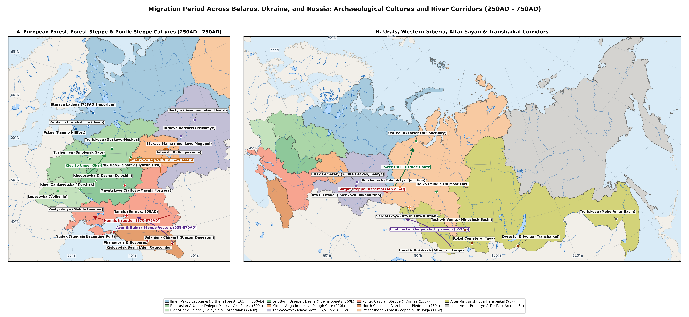

# Methodology

This gazetteer compiles 198 excavated Migration Period (c. 250-750AD) and Early Medieval transitional settlements, promontory hillforts (*gorodishcha*), riverine villages (*selishcha*), and fortified towns across the six macro-regions of Belarus, Ukraine, and Russia (excluding the Baltic provinces). All records are stored in the companion settlement JSON file in the standard Stadester dictionary format, keyed by settlement and country identifier with English and Russian names, decimal coordinates, and positive integer population estimates keyed by calendar year.

For each settlement, population figures during the Migration Period (250-750AD) and the Early Medieval transition (900AD) are derived from excavated dwelling counts, fortified and unfortified habitation areas, and associated cemetery burial totals [@oblomskiy2016kolochinskaya; @krenke2019moskvorechye; @goldina1999drevnyaya; @gadzhiev2002derbent]. In the JSON file, only inhabited benchmark years are recorded so that the first and last keys represent each site's documented occupation span; in the tables below, benchmarks prior to foundation or after abandonment are denoted by a hyphen (-). Where a Migration Period settlement evolved directly into a modern town or village on the same site, its population at the First All-Russian Census of 1897 (1900AD benchmark) is included [@troinitsky1905perepis].

plot of chunk fig1-md-only

# Results

## European Forest-Steppe Settlements

Table \ref{tab:reg1-sites} lists 38 excavated settlements across the Seim, Psel, Upper Don, Oskol, and Desna forest-steppe valleys, covering the Kiev, Eastern Chernyakhov, Kolochin, Penkovka, Volyntsevo-Romny, Borshevo, and Saltovo-Mayaki cultures [@shchukin2005gotskiy; @oblomskiy2002dneprovskoe; @oblomskiy2016kolochinskaya; @sedov1999drevnerusskaya].

Table: Excavated settlements and benchmark population estimates across the Dnieper-Desna-Don forest-steppe zone (250AD - 1900AD).

|Settlement                    |Historical / Native Names                     |Coords & Span              |250 |350 |450 |600 |750 |900  |1900  |
|:-----------------------------|:---------------------------------------------|:--------------------------|:---|:---|:---|:---|:---|:----|:-----|
|Gochevo                       |Гочево; Гочевское городище; Kruglik           |51,18, 35,65 (250-1200AD)  |180 |420 |140 |190 |320 |850  |-     |
|Kursk Romny Gorodishche       |Kursk Romny Gorodishche                       |51,74, 36,2 (450-750AD)    |-   |-   |90  |160 |350 |-    |-     |
|Old Kursk Gorodishche         |Old Kursk Gorodishche                         |51,73, 36,2 (900-1200AD)   |-   |-   |-   |-   |-   |900  |-     |
|Kursk                         |Курск; Курское городище                       |51,73, 36,19 (1500-1900AD) |-   |-   |-   |-   |-   |-    |77,5k |
|Bolshoye Gordeevskoye         |Большое Гордеевское; Гордеевка                |51,62, 36,12 (100-450AD)   |75  |95  |60  |-   |-   |-    |-     |
|Tazovo                        |Тазово; Тазовское поселение                   |51,89, 36,24 (250-750AD)   |65  |85  |70  |95  |120 |-    |-     |
|Vorobyovka 2                  |Воробьевка 2; Воробьевское поселение          |51,55, 36,05 (250-450AD)   |60  |110 |45  |-   |-   |-    |-     |
|Velikie Budki                 |Великие Будки; Хутор Великие Будки            |51,35, 34,82 (350-750AD)   |-   |70  |95  |130 |160 |-    |-     |
|Khitrovka                     |Хитровка; Хитровское поселение                |50,62, 36,58 (250-750AD)   |110 |240 |80  |120 |140 |-    |-     |
|Zanki                         |Занки; Занковское поселение                   |50,55, 36,48 (250-600AD)   |90  |180 |70  |110 |-   |-    |-     |
|Gornal                        |Горналь; Большое Горнальское городище         |51,08, 35,23 (450-1000AD)  |-   |-   |60  |90  |280 |650  |-     |
|Sudzha                        |Суджа; Суджанское городище                    |51,19, 35,27 (600-1200AD)  |-   |-   |-   |80  |190 |420  |-     |
|Sudzha (1700-1900)            |Sudzha (1700-1900)                            |51,19, 35,27 (1700-1900AD) |-   |-   |-   |-   |-   |-    |7,6k  |
|Lebyazhye                     |Лебяжье; Лебяжьевское поселение               |51,71, 36,38 (250-750AD)   |55  |80  |95  |115 |130 |-    |-     |
|Kashirskoye-Don               |Каширское; Каширское поселение                |51,42, 39,61 (100-450AD)   |140 |170 |60  |-   |-   |-    |-     |
|Ksizovo-19                    |Ксизово-19; Ксизовское поселение              |52,38, 39,12 (100-750AD)   |110 |140 |160 |95  |70  |-    |-     |
|Mukhino-2                     |Мухино-2; Мухинское поселение                 |52,41, 39,08 (250-600AD)   |70  |115 |130 |80  |-   |-    |-     |
|Zamyatino                     |Замятино; Замятинский комплекс                |52,45, 39,03 (250-600AD)   |60  |100 |115 |75  |-   |-    |-     |
|Kamenka-Don                   |Каменка; Каменское поселение на Дону          |52,51, 38,96 (250-600AD)   |55  |90  |80  |65  |-   |-    |-     |
|Borshevo                      |Борщево; Большое Борщевское городище          |51,28, 39,05 (450-1000AD)  |-   |-   |65  |110 |260 |680  |-     |
|Borshevo (1700-1900)          |Borshevo (1700-1900)                          |51,28, 39,05 (1700-1900AD) |-   |-   |-   |-   |-   |-    |1,5k  |
|Titchikha                     |Титчиха; Титчихинское городище                |51,12, 39,18 (600-1000AD)  |-   |-   |-   |75  |210 |620  |-     |
|Maloye Borshevo               |Малое Борщево; Малое Борщевское городище      |51,26, 39,06 (600-1000AD)  |-   |-   |-   |60  |150 |380  |-     |
|Arkhangelskoye                |Архангельское; Архангельское городище         |51,34, 39,02 (600-1000AD)  |-   |-   |-   |55  |165 |410  |-     |
|Vorgol                        |Воргол; Воргольское городище                  |52,58, 38,35 (450-1000AD)  |-   |-   |60  |95  |220 |520  |-     |
|Zhivotinnoye                  |Животинное                                    |51,89, 39,21 (600-1000AD)  |-   |-   |-   |70  |180 |460  |-     |
|Belogorskoye                  |Белогорское; Белогорское городище             |51,74, 39,18 (600-1000AD)  |-   |-   |-   |65  |175 |440  |-     |
|Kuznetsovskoye                |Кузнецовское; Кузнецовское городище           |51,81, 39,24 (600-1000AD)  |-   |-   |-   |50  |145 |360  |-     |
|Mikhailovskiy Kordon          |Михайловский кордон; Михайловское поселение   |51,78, 39,26 (450-900AD)   |-   |-   |55  |90  |160 |310  |-     |
|Dmitrievskoye                 |Дмитриевское городище; Дмитриевка             |50,15, 36,85 (600-1000AD)  |-   |-   |-   |70  |420 |950  |-     |
|Belgorod Medieval Gorodishche |Belgorod Medieval Gorodishche                 |50,6, 36,59 (350-1000AD)   |-   |140 |65  |110 |280 |680  |-     |
|Belgorod                      |Белгород; Белгородское городище; Меловая гора |50,6, 36,59 (1700-1900AD)  |-   |-   |-   |-   |-   |-    |27,2k |
|Mayatskoye                    |Маяцкое городище; Дивногорье                  |50,97, 39,3 (750-1000AD)   |-   |-   |-   |-   |380 |1,4k |-     |
|Yutanovka                     |Ютановка; Ютановское городище                 |50,48, 37,82 (750-1000AD)  |-   |-   |-   |-   |290 |780  |-     |
|Verkhniy Saltov               |Верхний Салтов                                |50,13, 36,8 (600-1000AD)   |-   |-   |-   |90  |850 |2,4k |-     |
|Krapivnoye                    |Крапивное; Крапивенское городище              |50,39, 36,79 (750-1200AD)  |-   |-   |-   |-   |240 |720  |-     |
|Kholki                        |Холки; Холкинское городище                    |50,83, 37,71 (750-1200AD)  |-   |-   |-   |-   |180 |540  |-     |
|Kabanovo                      |Кабаново; Кабановское поселение               |51,64, 35,89 (350-750AD)   |-   |70  |95  |135 |170 |-    |-     |

## Mixed and Boreal Forest Zone Settlements

Table \ref{tab:reg2-sites} lists 55 excavated hillforts, riverine villages, and proto-urban centres across the Moskva, Upper and Middle Oka, Upper Volga, Ilmen-Volkhov, Pskov, and Upper Dnieper forest basins, spanning the Late Dyakovo, Moshchiny, Ryazan-Oka, Tushemlya, Pskov Long Barrows, Merya, Muroma, and Early Rus' traditions [@krenke2011dyakovo; @mayorov2016moschiny; @akhmedov2018ryazan; @lopatin2007severnye; @islanova2012ozero].

Table: Excavated hillforts, riverine villages, and benchmark population estimates across the mixed and boreal forest zone (250AD - 1900AD).

|Settlement                        |Historical / Native Names                           |Coords & Span              |250 |350 |450 |600 |750 |900  |1900  |
|:---------------------------------|:---------------------------------------------------|:--------------------------|:---|:---|:---|:---|:---|:----|:-----|
|Taimanovo                         |Тайманово; Таймановское поселение                   |53,31, 32,18 (250-750AD)   |90  |130 |145 |170 |190 |-    |-     |
|Nisimkovichi                      |Нисимковичи                                         |52,78, 31,32 (350-900AD)   |-   |65  |85  |120 |150 |240  |-     |
|Posudichi                         |Посудичи; Посудичское городище                      |52,61, 33,45 (100-750AD)   |110 |135 |95  |125 |160 |-    |-     |
|Kurovo                            |Курово; Куровское поселение                         |52,59, 33,49 (250-750AD)   |70  |95  |110 |140 |175 |-    |-     |
|Radutino                          |Радутино; Радутинское поселение                     |52,42, 33,68 (250-750AD)   |65  |90  |105 |130 |155 |-    |-     |
|Dyakovo                           |Дьяково городище; Коломенское                       |55,66, 37,67 (100-1200AD)  |175 |185 |160 |130 |110 |190  |-     |
|Dyakovo (1700-1900)               |Dyakovo (1700-1900)                                 |55,66, 37,67 (1700-1900AD) |-   |-   |-   |-   |-   |-    |850   |
|Troitskoye                        |Троицкое городище; Троицкое на Москве-реке          |55,55, 35,88 (100-750AD)   |140 |145 |115 |85  |55  |-    |-     |
|Borsheva                          |Боршева; Боршевское городище на Москве-реке         |55,52, 38,28 (100-900AD)   |110 |120 |105 |95  |125 |210  |-     |
|Kuntsevo                          |Кунцевское городище; Проклятое место                |55,74, 37,43 (100-1200AD)  |95  |110 |95  |85  |105 |180  |-     |
|Shcherbinskoye                    |Щербинское городище; Щербинка                       |55,49, 37,56 (100-600AD)   |125 |130 |110 |75  |-   |-    |-     |
|Lukovnya                          |Луковня; Луковнинское городище                      |55,43, 37,48 (100-600AD)   |90  |95  |80  |60  |-   |-    |-     |
|Troitse-Pelenitsy                 |Троице-Пеленицы; Пеленицкое городище                |54,48, 40,12 (100-750AD)   |115 |140 |155 |170 |190 |-    |-     |
|Nastasino                         |Настасьино; Настасьинское городище                  |55,14, 38,64 (100-750AD)   |85  |95  |90  |80  |95  |-    |-     |
|Rostislavl                        |Ростиславль                                         |54,92, 38,54 (100-1200AD)  |100 |110 |95  |85  |120 |280  |-     |
|Kashirskoye-Oka                   |Каширское городище; Старшее Каширское               |54,84, 38,15 (100-750AD)   |115 |125 |105 |90  |110 |-    |-     |
|Mutenkovskoye                     |Мутенковское городище; Мутенковка                   |54,83, 38,22 (100-600AD)   |80  |90  |75  |65  |-   |-    |-     |
|Moshchiny                         |Мощины; Мощинское городище                          |54,42, 35,15 (250-900AD)   |95  |165 |220 |195 |140 |180  |-     |
|Supruty                           |Супруты; Супрутское городище                        |53,98, 37,12 (250-900AD)   |80  |130 |160 |210 |280 |450  |-     |
|Duna                              |Дуна; Дунское городище                              |54,05, 36,28 (250-900AD)   |70  |110 |135 |150 |165 |210  |-     |
|Spas-Pereksha                     |Спас-Перекша; Перекшинское городище                 |54,36, 35,24 (250-750AD)   |65  |105 |140 |130 |110 |-    |-     |
|Fedyashevo                        |Федяшево; Федяшевское городище                      |54,18, 36,82 (250-900AD)   |75  |120 |150 |165 |190 |260  |-     |
|Vorotyntsevo                      |Воротынцево                                         |53,02, 36,94 (250-900AD)   |85  |130 |155 |180 |220 |340  |-     |
|Serensk                           |Серенск; Серенское городище                         |54,31, 35,49 (250-1200AD)  |70  |115 |145 |170 |230 |480  |-     |
|Meshchovsk Medieval Gorodishche   |Meshchovsk Medieval Gorodishche                     |54,33, 35,29 (350-1200AD)  |-   |80  |110 |135 |175 |320  |-     |
|Meshchovsk                        |Мещовск; Мещовское городище                         |54,32, 35,28 (1700-1900AD) |-   |-   |-   |-   |-   |-    |3,8k  |
|Staraya Ryazan                    |Старая Рязань; Шатрище                              |54,4, 40,43 (250-1200AD)   |160 |240 |310 |340 |420 |950  |-     |
|Staraya Ryazan (1897-1900)        |Staraya Ryazan (1897-1900)                          |54,4, 40,43 (1897-1900AD)  |-   |-   |-   |-   |-   |-    |710   |
|Shatrishche                       |Шатрище; Шатрищенский комплекс                      |54,42, 40,41 (250-750AD)   |130 |195 |240 |220 |180 |-    |-     |
|Borki-Ryazan Gorodishche          |Borki-Ryazan Gorodishche                            |54,63, 39,7 (250-750AD)    |140 |210 |260 |290 |380 |-    |-     |
|Pereyaslavl-Ryazansky Gorodishche |Pereyaslavl-Ryazansky Gorodishche                   |54,63, 39,7 (900-1100AD)   |-   |-   |-   |-   |-   |750  |-     |
|Ryazan                            |Рязань; Борки                                       |54,63, 39,69 (1500-1900AD) |-   |-   |-   |-   |-   |-    |47,5k |
|Nikitino                          |Никитино; Никитинский комплекс                      |54,37, 40,45 (250-900AD)   |120 |190 |240 |220 |180 |250  |-     |
|Koshbeevskoye                     |Кошибеево; Кошибеевский комплекс                    |54,41, 41,88 (100-900AD)   |170 |220 |260 |280 |310 |380  |-     |
|Terekhovo                         |Терехово; Тереховский комплекс                      |54,21, 40,82 (250-900AD)   |110 |165 |210 |230 |250 |310  |-     |
|Shilovo                           |Шилово; Шиловское поселение                         |54,33, 40,88 (250-900AD)   |95  |145 |190 |220 |260 |340  |-     |
|Shilovo (1700-1900)               |Shilovo (1700-1900)                                 |54,33, 40,88 (1700-1900AD) |-   |-   |-   |-   |-   |-    |2,5k  |
|Borki-Oka                         |Борки; Борковский комплекс                          |54,66, 39,67 (250-750AD)   |125 |185 |230 |245 |270 |-    |-     |
|Murom Oksky Gorodishche           |Murom Oksky Gorodishche                             |55,58, 42,05 (450-750AD)   |-   |-   |130 |240 |450 |-    |-     |
|Murom                             |Муром; Чаадаево; Кремлевское городище               |55,58, 42,04 (900-1900AD)  |-   |-   |-   |-   |-   |1,1k |13,8k |
|Unzha                             |Унжа; Унженский комплекс                            |55,28, 41,58 (350-900AD)   |-   |90  |140 |185 |230 |310  |-     |
|Kholui                            |Холуй; Холуйское поселение                          |56,58, 41,87 (450-900AD)   |-   |-   |75  |115 |160 |240  |-     |
|Kholui (1700-1900)                |Kholui (1700-1900)                                  |56,58, 41,87 (1700-1900AD) |-   |-   |-   |-   |-   |-    |2,2k  |
|Suzdal Merya Gorodishche          |Suzdal Merya Gorodishche                            |56,43, 40,45 (250-750AD)   |85  |120 |160 |220 |380 |-    |-     |
|Suzdal                            |Суздаль; Суздальский кремль; Васильевское           |56,43, 40,45 (900-1900AD)  |-   |-   |-   |-   |-   |1,1k |6,6k  |
|Sarskoye Gorodishche              |Сарское городище; Сара                              |57,1, 39,3 (450-1000AD)    |-   |-   |90  |180 |420 |1,2k |-     |
|Rostov Veliky                     |Ростов Великий; Ростов                              |57,19, 39,41 (600-1900AD)  |-   |-   |-   |140 |320 |1,4k |14,1k |
|Timeriovo                         |Тимерево; Большое Тимеревское поселение             |57,56, 39,75 (750-1000AD)  |-   |-   |-   |-   |180 |950  |-     |
|Mikhailovskoye-Yaroslavl          |Михайловское; Михайловское поселение под Ярославлем |57,69, 39,81 (750-1000AD)  |-   |-   |-   |-   |140 |680  |-     |
|Petrovskoye-Yaroslavl             |Петровское; Петровское поселение                    |57,52, 39,79 (750-1000AD)  |-   |-   |-   |-   |120 |540  |-     |
|Kleshchino                        |Клещино; Клещинское городище                        |56,78, 38,84 (450-1100AD)  |-   |-   |85  |150 |310 |880  |-     |
|Volosovo                          |Волосово; Волосовский комплекс                      |55,64, 42,18 (350-900AD)   |-   |80  |120 |165 |210 |280  |-     |
|Yurievskaya Gorka                 |Юрьевская Горка; Удомля                             |57,92, 35,02 (350-900AD)   |-   |45  |95  |135 |160 |210  |-     |
|Bereznyaki                        |Березняки; Городище Березняки                       |57,98, 38,92 (250-600AD)   |55  |70  |65  |50  |-   |-    |-     |
|Izbriszhye                        |Избрижье; Избрижский комплекс                       |56,81, 35,62 (450-1000AD)  |-   |-   |65  |110 |175 |340  |-     |

## Middle Volga, Kama-Vyatka, and Cis-Ural Settlements

Table \ref{tab:reg3-sites} lists 44 excavated hillforts and village complexes across the Samara Bend, Middle Volga, Kama, Vyatka, Belaya, and Sylva basins, representing the Imenkovo, Azelino, Mazunino, Turaevo, Bakhmutino, Turbasly, Kushnarenkovo, Nevolino, Lomovatovo, and Polom cultures [@vyazov2019middle; @goldina1999drevnyaya; @goldina2012nevolino; @bakhshiev2017bakhmutino; @nazarov2025lomovatovo].

Table: Excavated hillforts, villages, and benchmark population estimates across the Middle Volga, Kama-Vyatka, and Cis-Ural basins (250AD - 1900AD).

|Settlement                    |Historical / Native Names                          |Coords & Span              |250 |350 |450 |600 |750 |900  |1900  |
|:-----------------------------|:--------------------------------------------------|:--------------------------|:---|:---|:---|:---|:---|:----|:-----|
|Kamno                         |Камно; Камновское городище                         |57,83, 28,21 (250-1000AD)  |75  |110 |150 |220 |340 |520  |-     |
|Kamno-Pskov Gorodishche       |Kamno-Pskov Gorodishche                            |57,82, 28,34 (350-750AD)   |-   |95  |160 |290 |520 |-    |-     |
|Pskov                         |Псков; Псковское городище; Pleskau                 |57,82, 28,33 (900-1900AD)  |-   |-   |-   |-   |-   |1,6k |31,2k |
|Izborsk                       |Изборск; Труворово городище; Старый Изборск        |57,71, 27,86 (600-1900AD)  |-   |-   |-   |120 |290 |750  |950   |
|Vybuty                        |Выбуты; Выбутское поселение                        |57,72, 28,27 (600-1000AD)  |-   |-   |-   |85  |160 |340  |-     |
|Velye Medieval Gorodishche    |Velye Medieval Gorodishche                         |56,98, 28,92 (450-1200AD)  |-   |-   |70  |110 |185 |360  |-     |
|Velye                         |Велье; Вельское городище                           |56,98, 28,92 (1897-1900AD) |-   |-   |-   |-   |-   |-    |1,2k  |
|Staraya Ladoga                |Старая Ладога; Aldeigjuborg; Ладога                |60, 32,3 (600-1900AD)      |-   |-   |-   |80  |280 |1,8k |1k    |
|Lyubsha                       |Любша; Любшанское городище                         |60,02, 32,31 (600-900AD)   |-   |-   |-   |95  |190 |120  |-     |
|Rurikovo Gorodishche          |Рюриково городище; Городище на Волхове; Holmgardr  |58,49, 31,3 (750-1200AD)   |-   |-   |-   |-   |160 |1,4k |-     |
|Veliky Novgorod               |Великий Новгород; Новгород                         |58,52, 31,28 (750-1900AD)  |-   |-   |-   |-   |140 |2,2k |26,5k |
|Staraya Russa                 |Старая Русса; Руса                                 |57,99, 31,36 (750-1900AD)  |-   |-   |-   |-   |130 |680  |15,8k |
|Belozersk                     |Белозерск; Белоозеро; Крутик                       |60,03, 37,78 (600-1900AD)  |-   |-   |-   |70  |190 |950  |5,2k  |
|Toropets                      |Торопец; Торопецкое городище                       |56,5, 31,64 (450-1200AD)   |-   |-   |75  |125 |220 |580  |-     |
|Toropets (1700-1900)          |Toropets (1700-1900)                               |56,5, 31,64 (1700-1900AD)  |-   |-   |-   |-   |-   |-    |7,6k  |
|Gnezdovo                      |Гнездово; Гнездовский комплекс                     |54,78, 31,87 (600-1000AD)  |-   |-   |-   |90  |240 |1,9k |-     |
|Tushemlya                     |Тушемля; Тушемлинское городище                     |54,31, 32,12 (250-750AD)   |70  |105 |135 |150 |95  |-    |-     |
|Staroye Romashkino            |Старое Ромашкино                                   |55,31, 50,85 (350-900AD)   |-   |140 |280 |420 |160 |240  |-     |
|Maklasheevka II               |Маклашеевка II; Маклашеевское городище             |55,12, 48,95 (250-900AD)   |120 |210 |350 |480 |220 |380  |-     |
|Shcherbet                     |Щербеть; Щербетьский островной комплекс            |55,02, 49,28 (350-900AD)   |-   |110 |240 |360 |180 |290  |-     |
|Tetyushskoye II               |Тетюшское II городище; Тетюши                      |54,94, 48,84 (100-900AD)   |160 |240 |320 |390 |240 |480  |-     |
|Tetyushskoye II (1700-1900)   |Tetyushskoye II (1700-1900)                        |54,94, 48,84 (1700-1900AD) |-   |-   |-   |-   |-   |-    |4,9k  |
|Komintern II                  |Коминтерн II                                       |55,08, 49,12 (350-750AD)   |-   |130 |260 |380 |190 |-    |-     |
|Balymery                      |Балымеры; Балымерское городище; Шолом              |54,99, 49,02 (350-1000AD)  |-   |115 |210 |310 |260 |650  |-     |
|Karmaly                       |Кармалы; Кармалинское городище                     |53,36, 49,52 (350-750AD)   |-   |95  |180 |270 |140 |-    |-     |
|Imenkovo                      |Именьково; Именьковское городище                   |55,41, 49,68 (350-900AD)   |-   |130 |250 |340 |190 |320  |-     |
|Imenkovo (1897-1900)          |Imenkovo (1897-1900)                               |55,41, 49,68 (1897-1900AD) |-   |-   |-   |-   |-   |-    |870   |
|Rozhdestveno-Volga            |Рождествено                                        |55,48, 49,55 (350-900AD)   |-   |110 |210 |290 |180 |340  |-     |
|Troitskiy Uray                |Троицкий Урай                                      |55,43, 50,11 (250-750AD)   |90  |150 |230 |310 |175 |-    |-     |
|Lugovskoye                    |Луговское; Луговское поселение                     |55,62, 51,84 (250-750AD)   |85  |135 |190 |240 |150 |-    |-     |
|Novinki                       |Новинки; Новинковский комплекс                     |53,21, 49,78 (350-750AD)   |-   |90  |170 |260 |340 |-    |-     |
|Muromskiy Gorodok             |Муромский Городок; Валы                            |53,34, 49,42 (450-1200AD)  |-   |-   |120 |210 |420 |2,8k |-     |
|Belaya Gora                   |Белая Гора; Белогорское городище на Самарской Луке |53,28, 49,89 (350-750AD)   |-   |80  |145 |210 |130 |-    |-     |
|Osh-Pando-Ner                 |Ош-Пандо-Нерь; Сайнино; Шемурша                    |54,45, 46,52 (250-900AD)   |95  |160 |220 |260 |210 |250  |-     |
|Ashna-Pando                   |Ашна-Пандо                                         |54,38, 46,41 (250-750AD)   |80  |135 |185 |220 |180 |-    |-     |
|Tigashevo                     |Тигашево; Тигашевское городище                     |55,04, 47,52 (600-1000AD)  |-   |-   |-   |110 |240 |680  |-     |
|Chortovo Gorodishche          |Чертово городище; Елабужское городище              |55,75, 52,03 (100-1000AD)  |190 |240 |220 |260 |320 |680  |-     |
|Yelabuga Medieval Gorodishche |Yelabuga Medieval Gorodishche                      |55,76, 52,05 (600-1000AD)  |-   |-   |-   |180 |260 |550  |-     |
|Yelabuga                      |Елабуга; Алабуга                                   |55,76, 52,05 (1500-1900AD) |-   |-   |-   |-   |-   |-    |10,1k |
|Azelino                       |Азелино; Азелинский комплекс                       |56,92, 50,45 (250-600AD)   |140 |210 |230 |180 |-   |-    |-     |
|Suvorovskoye                  |Суворовское; Суворовский комплекс на Вятке         |56,84, 50,32 (250-600AD)   |110 |175 |195 |160 |-   |-    |-     |
|Buyskoye                      |Буйское городище; Буйский Перевоз                  |56,88, 49,89 (100-750AD)   |170 |210 |220 |190 |210 |-    |-     |
|Turaevo                       |Тураево; Тураевские курганы и поселение            |55,98, 52,42 (250-900AD)   |130 |210 |310 |240 |190 |220  |-     |
|Tarasovo                      |Тарасово; Тарасовский комплекс                     |56,35, 53,82 (100-900AD)   |240 |280 |260 |210 |180 |200  |-     |

## Open Pontic-Caspian Steppe Settlements

Table \ref{tab:reg4-sites} lists 16 excavated emporia, seasonal winter camps, river-delta towns, and Khazar brick and stone fortresses across the Lower Don, Lower Volga, and Southern Trans-Ural steppe [@shchukin2005gotskiy; @botalov2009gunny; @kazanski2020steppe].

Table: Excavated emporia, fortresses, and benchmark population estimates across the open Pontic-Caspian and Crimean steppe (250AD - 1900AD).

|Settlement                |Historical / Native Names                      |Coords & Span              |250 |350 |450 |600 |750 |900  |1900  |
|:-------------------------|:----------------------------------------------|:--------------------------|:---|:---|:---|:---|:---|:----|:-----|
|Mazunino                  |Мазунино; Мазунинское городище                 |56,29, 53,78 (250-600AD)   |150 |220 |240 |180 |-   |-    |-     |
|Saygatskoye               |Сайгатское; Сайгатка                           |56,76, 54,14 (250-750AD)   |120 |185 |210 |175 |150 |-    |-     |
|Osinskoye                 |Осинское городище; Оса                         |57,28, 55,45 (250-900AD)   |110 |160 |195 |230 |260 |310  |-     |
|Osinskoye (1700-1900)     |Osinskoye (1700-1900)                          |57,29, 55,45 (1700-1900AD) |-   |-   |-   |-   |-   |-    |5,2k  |
|Bardymskoye               |Бардымское; Барда                              |56,92, 55,58 (250-900AD)   |95  |145 |190 |240 |280 |320  |-     |
|Bardymskoye (1897-1900)   |Bardymskoye (1897-1900)                        |56,92, 55,58 (1897-1900AD) |-   |-   |-   |-   |-   |-    |1,7k  |
|Brody                     |Броды; Неволино; Неволинский комплекс на Сылве |57,42, 56,95 (350-900AD)   |-   |140 |220 |340 |390 |350  |-     |
|Verkh-Sainskoye           |Верх-Саинское городище; Верх-Саи               |57,18, 56,72 (350-900AD)   |-   |120 |185 |290 |330 |280  |-     |
|Ufa II                    |Уфа-II; Городище Уфа-II; Башкир (Имендяшево)   |54,72, 55,96 (350-1200AD)  |-   |220 |450 |780 |950 |1,4k |-     |
|Ufa Gorodishche           |Ufa Gorodishche                                |54,74, 55,98 (450-900AD)   |-   |-   |180 |340 |480 |650  |-     |
|Ufa                       |Уфа; Чертово городище в Уфе; Өфө               |54,74, 55,97 (1600-1900AD) |-   |-   |-   |-   |-   |-    |51,5k |
|Bakhmutino                |Бахмутино; Бахмутинский комплекс               |55,38, 55,82 (250-750AD)   |130 |210 |320 |380 |290 |-    |-     |
|Turbasly                  |Турбаслы; Турбаслинское городище               |54,84, 56,08 (450-900AD)   |-   |-   |190 |360 |420 |310  |-     |
|Romanovka-Ufa             |Романовка II; Романовское поселение            |54,76, 55,89 (350-750AD)   |-   |110 |195 |280 |310 |-    |-     |
|Kushnarenkovo             |Кушнаренково                                   |55,1, 55,35 (450-900AD)    |-   |-   |140 |290 |360 |410  |-     |
|Kushnarenkovo (1897-1900) |Kushnarenkovo (1897-1900)                      |55,1, 55,35 (1897-1900AD)  |-   |-   |-   |-   |-   |-    |2,5k  |

## North Caucasus and Caspian Corridor Settlements

Table \ref{tab:reg5-sites} lists 22 excavated fortress cities, terraced mountain strongholds, and coastal settlements across Dagestan, the Central Caucasus (Alanian Kislovodsk and Kuban valleys), and the Taman-Black Sea littoral [@gadzhiev2002derbent; @gmyrya2022palasa; @korobov2013terraced; @mastykova2009kuban].

Table: Excavated fortress cities, mountain strongholds, and benchmark population estimates across the North Caucasus and Caspian corridor (250AD - 1900AD).

|Settlement                    |Historical / Native Names                 |Coords & Span              |250  |350 |450 |600 |750 |900  |1900 |
|:-----------------------------|:-----------------------------------------|:--------------------------|:----|:---|:---|:---|:---|:----|:----|
|Birsk Gorodishche             |Birsk Gorodishche                         |55,42, 55,54 (100-900AD)   |240  |320 |390 |450 |410 |480  |-    |
|Birsk                         |Бирск; Бирское городище и могильник       |55,42, 55,54 (1700-1900AD) |-    |-   |-   |-   |-   |-    |8,8k |
|Kara-Yakupovo                 |Кара-Якупово                              |54,61, 55,38 (600-1000AD)  |-    |-   |-   |160 |310 |420  |-    |
|Rozhdestvenskoye              |Рождественское городище; Афкула           |58,62, 55,35 (350-1200AD)  |-    |120 |240 |460 |680 |1,5k |-    |
|Rozhdestvenskoye (1897-1900)  |Rozhdestvenskoye (1897-1900)              |58,62, 55,35 (1897-1900AD) |-    |-   |-   |-   |-   |-    |1k   |
|Kudymkarskoye                 |Кудымкарское городище; Изъюр; Кудымкар    |59,02, 54,65 (450-1200AD)  |-    |-   |110 |210 |340 |520  |-    |
|Kudymkarskoye (1700-1900)     |Kudymkarskoye (1700-1900)                 |59,02, 54,65 (1700-1900AD) |-    |-   |-   |-   |-   |-    |1,2k |
|Anyushkar                     |Анюшкар; Кыласово                         |58,38, 56,62 (600-1200AD)  |-    |-   |-   |160 |320 |750  |-    |
|Idnakar                       |Иднакар; Солдырь; Глазов                  |58,14, 52,72 (600-1200AD)  |-    |-   |-   |140 |340 |1,2k |-    |
|Dondykar                      |Дондыкар; Дондыкарское городище           |58,24, 52,51 (600-1200AD)  |-    |-   |-   |110 |240 |650  |-    |
|Polomskoye                    |Поломское городище; Полом                 |57,72, 53,85 (450-1000AD)  |-    |-   |130 |260 |390 |680  |-    |
|Tanais                        |Танаис; Недвиговское городище             |47,27, 39,34 (100-600AD)   |3,2k |280 |420 |140 |-   |-    |-    |
|Nedvigovka-Steppe             |Недвиговка; Нижне-Донское поселение       |47,27, 39,34 (250-900AD)   |240  |190 |260 |160 |190 |240  |-    |
|Nedvigovka-Steppe (1897-1900) |Nedvigovka-Steppe (1897-1900)             |47,28, 39,35 (1897-1900AD) |-    |-   |-   |-   |-   |-    |2,2k |
|Kobyakovo                     |Кобяково городище; Кобяково               |47,24, 39,84 (100-900AD)   |620  |180 |140 |-   |220 |380  |-    |
|Sukho-Chaltyrskoye            |Сухо-Чалтырское городище; Чалтырь         |47,26, 39,52 (100-900AD)   |310  |120 |-   |-   |180 |310  |-    |
|Rovnoye                       |Ровное; Ровненский комплекс; Зельман      |50,78, 46,05 (100-900AD)   |120  |90  |150 |110 |130 |180  |-    |
|Rovnoye (1897-1900)           |Rovnoye (1897-1900)                       |50,78, 46,05 (1897-1900AD) |-    |-   |-   |-   |-   |-    |7,1k |
|Pokrovsk-Steppe               |Покровск-Степь; Энгельсский комплекс      |51,48, 46,12 (100-750AD)   |130  |110 |180 |140 |160 |-    |-    |
|Leninsk-Steppe                |Ленинск-Курганы; Пришиб                   |48,7, 45,2 (100-900AD)     |110  |85  |140 |120 |150 |210  |-    |
|Leninsk-Steppe (1897-1900)    |Leninsk-Steppe (1897-1900)                |48,7, 45,2 (1897-1900AD)   |-    |-   |-   |-   |-   |-    |5,1k |
|Verkhneye Pogromnoye          |Верхнее Погромное; Погромновский комплекс |48,92, 45,08 (100-750AD)   |95   |75  |130 |110 |140 |-    |-    |

## Western and Southern Siberian Settlements

Table \ref{tab:reg6-sites} lists 23 excavated fortified settlements, iron-working villages, and agro-pastoral centres across the Tobol-Irtysh, Middle and Lower Ob, Minusinsk Basin, Russian Altai, and Lake Baikal regions, covering the Sargat, Potchevash, Relka, Tashtyk, Bulan-Koby, Early Turkic, and Kurykan traditions [@matveeva2000sargat; @zelenkov2025potchevash; @azbelev2007oglakhty; @seregin2021altai; @kharinsky2005baikal].

Table: Excavated fortified settlements and benchmark population estimates across Western and Southern Siberia (250AD - 1900AD).

|Settlement                     |Historical / Native Names                            |Coords & Span              |250  |350  |450  |600  |750   |900  |1900  |
|:------------------------------|:----------------------------------------------------|:--------------------------|:----|:----|:----|:----|:-----|:----|:-----|
|Sarkel                         |Саркел; Белая Вежа; Левобережное Цимлянское городище |47,7, 42,27 (750-1100AD)   |-    |-    |-    |-    |320   |2,5k |-     |
|Pravoberezhnoye Tsimlyanskoye  |Правобережное Цимлянское городище; Цимлянское        |47,66, 42,19 (750-900AD)   |-    |-    |-    |-    |420   |1,1k |-     |
|Semikarakorskoye               |Семикаракорское городище; Семикаракорск              |47,53, 40,82 (600-1000AD)  |-    |-    |-    |140  |580   |1,6k |-     |
|Semikarakorskoye (1897-1900)   |Semikarakorskoye (1897-1900)                         |47,53, 40,82 (1897-1900AD) |-    |-    |-    |-    |-     |-    |6,8k  |
|Karnaukhovskoye                |Карнауховское городище; Карнауховский                |47,62, 42,11 (750-1000AD)  |-    |-    |-    |-    |240   |680  |-     |
|Semibugry                      |Семибугры; Atil                                      |46,15, 48,24 (600-1000AD)  |-    |-    |-    |280  |4,5k  |18k  |-     |
|Barany Bugor                   |Бараний Бугор; Хазарский комплекс Бараний Бугор      |46,18, 48,21 (600-900AD)   |-    |-    |-    |220  |1,8k  |4,2k |-     |
|Samosdelka                     |Самосделка; Самосдельское городище; Саксин           |46,03, 47,84 (750-1200AD)  |-    |-    |-    |-    |650   |3,5k |-     |
|Uelgi                          |Уелги                                                |55,78, 61,55 (600-1000AD)  |-    |-    |-    |120  |240   |360  |-     |
|Derbent                        |Дербент; Чор; Баб аль-Абваб; Нарын-Кала              |42,06, 48,29 (100-1900AD)  |2,6k |3,8k |5,5k |9,5k |12,5k |18k  |15,2k |
|Torpakh-Kale                   |Торпах-Кала; Шахристан                               |41,91, 48,38 (250-900AD)   |650  |1,4k |2,2k |2,8k |1,2k  |650  |-     |
|Urtseki                        |Урцеки; Варачан; Урцекское городище                  |42,71, 47,56 (100-900AD)   |950  |1,6k |2,4k |3,8k |2,2k  |850  |-     |
|Verkhniy Chir-Yurt             |Верхний Чирюрт; Беленджер; Чирюртовское городище     |43,16, 46,92 (250-900AD)   |600  |1,4k |2,8k |7,5k |9,5k  |3,2k |-     |
|Tarki Medieval Gorodishche     |Tarki Medieval Gorodishche                           |42,95, 47,5 (250-1200AD)   |450  |850  |1,4k |3,2k |6,5k  |8,5k |-     |
|Tarki                          |Тарки; Семендер; Таркинское городище                 |42,95, 47,49 (1700-1900AD) |-    |-    |-    |-    |-     |-    |2,5k  |
|Andreyaul                      |Андрейаул; Эндирей                                   |43,18, 46,66 (250-900AD)   |380  |680  |1,1k |1,8k |2,4k  |2,9k |-     |
|Andreyaul (1700-1900)          |Andreyaul (1700-1900)                                |43,18, 46,66 (1700-1900AD) |-    |-    |-    |-    |-     |-    |4,4k  |
|Alkhan-Kala                    |Алхан-Кала                                           |43,26, 45,55 (100-900AD)   |1,4k |1,8k |1,1k |1,4k |1,6k  |1,9k |-     |
|Yandare                        |Яндаре                                               |43,24, 44,92 (250-900AD)   |280  |420  |540  |680  |820   |950  |-     |
|Gazi-Yurt                      |Гази-Юрт; Магасский комплекс; Городище Гази-Юрт      |43,21, 44,84 (250-1200AD)  |340  |520  |680  |950  |1,4k  |2,6k |-     |
|Zmeyskaya Medieval Gorodishche |Zmeyskaya Medieval Gorodishche                       |43,33, 44,15 (250-1200AD)  |320  |480  |640  |880  |1,2k  |2,1k |-     |
|Zmeyskaya                      |Змейская; Верхний Джулат; Татартуп                   |43,33, 44,15 (1897-1900AD) |-    |-    |-    |-    |-     |-    |1,9k  |
|Nizhniy Dzhulat                |Нижний Джулат; Майский комплекс                      |43,62, 44,05 (100-1200AD)  |620  |780  |920  |1,1k |1,5k  |2,2k |-     |

# Appendix

## Regional Gazetteer Summary

Table \ref{tab:regional-summary} summarises the number of catalogued settlements and the combined excavated sample population across the six regions from 250AD to 1900AD.

Table: Combined sample population and settlement counts across the 198 catalogued Migration Period settlements by macro-region (250AD - 1900AD).

|Region (Sites)                                       |250AD |350AD |450AD |600AD |750AD  |900AD  |1900AD |
|:----------------------------------------------------|:-----|:-----|:-----|:-----|:------|:------|:------|
|1. European Forest-Steppe (n = 38)                   |1,1k  |2,1k  |1,7k  |2,5k  |6,2k   |14,5k  |113,8k |
|2. Mixed and Boreal Forest Zone (n = 55)             |3,3k  |4,8k  |5,9k  |6,8k  |8,8k   |15,7k  |92k    |
|3. Middle Volga, Kama-Vyatka, and Cis-Urals (n = 44) |1,8k  |3,7k  |5,6k  |7,9k  |7,9k   |21,3k  |105,3k |
|4. Open Pontic-Caspian Steppe (n = 16)               |605   |1,5k  |2,7k  |3,9k  |4,2k   |4k     |61k    |
|5. North Caucasus and Caspian Corridor (n = 22)      |5,1k  |1,6k  |2,3k  |2,7k  |4,2k   |7,5k   |25,5k  |
|6. Western and Southern Siberia (n = 23)             |8,6k  |13,7k |19,3k |34,4k |49,6k  |75,8k  |30,8k  |
|Total Gazetteer Sample (n = 242)                     |31,2k |37,2k |48,2k |73,7k |103,3k |169,5k |531,7k |

# Sources

::: {#refs}
:::
