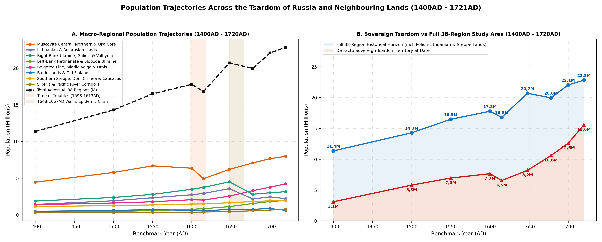
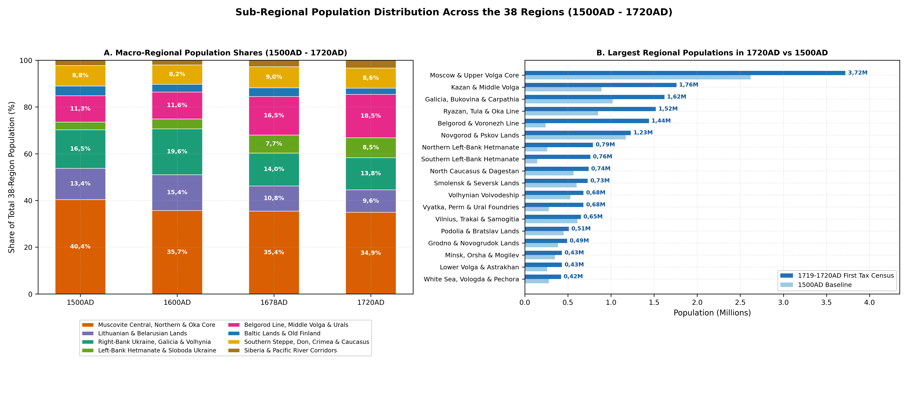
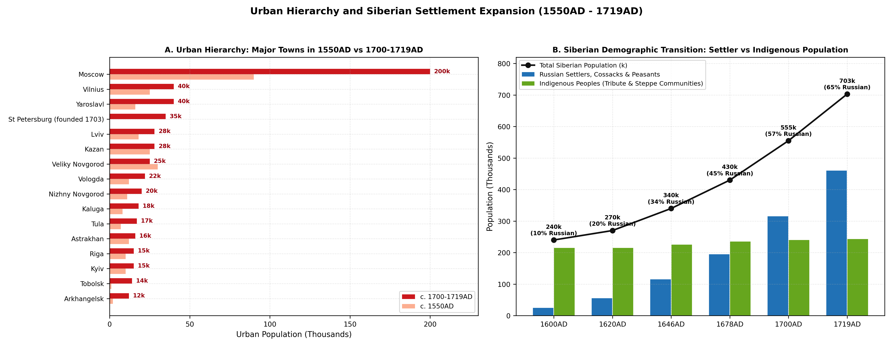

# Population Estimates and Historical Regions (1400AD - 1721AD)

Between 1400AD and the Treaty of Nystad at the conclusion of the Great
Northern War in 1721AD, the Northern Eurasian, East Slavic, and Eastern
Baltic landmass underwent a fundamental demographic, institutional, and
spatial transformation. In 1400AD, the combined population across the
thirty-eight historical regions spanning the Eastern Baltic
confederations, the Grand Duchy of Lithuania, Vyborg-Kexholm Karelia,
Crown and Cossack Ukraine, Crimea, the Tsardom of Russia, the North
Caucasus, and Siberia stood at 11 355k (11,36M). At that late medieval
benchmark, regional population comprised 935k across Terra Mariana and
Livonia, Courland-Inflanty, core Lithuania, and Vyborg-Kexholm (Regions
1-4), 950k across the four Belarusian voivodeships of the Grand Duchy of
Lithuania (Regions 5-8), 2 510k across the nine Ukrainian and
Crimean-Pontic historical regions (Regions 9-17), and 6 960k across the
twenty-one Russian, Volga-Ural, Steppe, Caucasian, and Siberian regions
(Regions 18-38, divided between 6 660k in European Russia, the Steppe,
and the North Caucasus across Regions 18-30 and 300k across the eight
Siberian functional zones Regions 31-38)
[\[1\]](#ref-Vodarsky1973)[\[2\]](#ref-Kopanev1959)[\[3\]](#ref-Palli1996)[\[4\]](#ref-Ochmanski1982)[\[5\]](#ref-Yakovenko2006)[\[6\]](#ref-Dolgikh1960).
Over the subsequent three centuries, total domain population doubled to
20 695k (20,70M) on the eve of the mid-17th-century wars in 1648AD and
reached 22 830k (22,83M) at Peter I’s First Poll-Tax Revision in 1720AD,
comprising 1 260k in the Baltic, Lithuanian, and Old Finland provinces
(Regions 1-4), 1 550k in Belarus (Regions 5-8), 5 650k in Ukraine and
Crimea (Regions 9-17), and 14 370k across Russia and Siberia (Regions
18-38: 13 610k in Regions 18-30 and 760k across Regions 31-38)
[\[7\]](#ref-Vodarsky1977)[\[8\]](#ref-Kabuzan1963)[\[9\]](#ref-KarpachevKozlovsky1972)[\[10\]](#ref-Dunsdorfs1962)[\[11\]](#ref-Saloheimo1976).

This long-term expansion was governed by the interaction of two opposing
demographic regimes. On one side, recurrent military, climatic, and
epidemic shocks repeatedly struck the western littoral and older forest
cores: the Livonian War and Ivan IV’s *Oprichnina* (1558-1583AD), the
Huaynaputina volcanic-winter famine of 1601-1603AD and the Time of
Troubles (*Smuta*, 1604-1618AD), the Russo-Polish War or Deluge
(*Potop*, 1654-1667AD) across Lithuania and Belarus, *The Ruin*
(*Ruina*, 1657-1687AD) in Right-Bank Ukraine, the Great Famine of
1695-1697AD (*Suur nalg* and *Suuret kuolonvuodet*) in Estland, Livland,
and Old Finland, and the Great Northern War and Baltic-Lithuanian Plague
of 1708-1711AD
[\[12\]](#ref-Shapiro1974)[\[13\]](#ref-Morzy1965)[\[14\]](#ref-Seppel2004)[\[15\]](#ref-Malve2023)[\[16\]](#ref-Majewska2018).
On the other side, sustained frontier colonisation transformed the
Left-Bank Cossack Hetmanate, Sloboda Ukraine, the Oka-Belgorod-Simbirsk
fortification lines (*Zasechnye Cherty*), the Middle Volga, the Demidov
Urals, and the river-portage highways and southern fortified ploughlands
of Siberia
[\[17\]](#ref-Bagaley1887)[\[18\]](#ref-Stevens1995)[\[19\]](#ref-Moon1999)[\[20\]](#ref-Pokrovsky1984).

Eliminating anachronistic post-1991 state borders while deliberately
excluding Central Asia and the South Caucasus prior to their 18th- and
19th-century annexations, this synthesis partitions the 18 119 929 km2
domain into thirty-eight historical regions constructed from Livonian
and Swedish Baltic provinces, Courlandian and Polish-Lithuanian
palatinates, Vyborg and Kexholm fiefs, Cossack regimental territories,
pre-modern Muscovite *uezds* and frontier *razryads*, Volga-Ural
*darugas*, and eight Siberian portage, fortified ploughland, steppe, and
*yasak* zones (Figure and Table ). Across the Baltic, Lithuanian, and
Old Finland rim (Regions 1-4), Terra Mariana and Swedish Estland and
Livland (Region 1, 76 229 km2) shifted from 260k in 1400AD to 360k in
1648AD and 300k in 1720AD; the Duchy of Courland and Semigallia and
Polish Inflanty (Region 2, 37 284 km2) moved from 140k to 260k and 200k;
the Grand Duchy of Lithuania core of Vilnius, Trakai, and Samogitia
(Region 3, 65 877 km2) expanded from 460k to 1 060k before contracting
to 650k; and Vyborg Fief and Kexholm County (Region 4, 49 685 km2) rose
from 75k to 110k. Across the four Belarusian voivodeships of the Grand
Duchy of Lithuania (Regions 5-8), Polotsk and Vitebsk on the Western
Dvina (Region 5, 32 576 km2; 240k in 1400AD to 560k in 1648AD to 370k in
1720AD), Grodno and Novogrudok in Black Ruthenia (Region 6, 48 968 km2;
280k to 740k to 490k), Minsk and the Orsha-Mogilev Dnieper corridor
(Region 7, 102 278 km2; 260k to 680k to 430k), and Brest-Litovsk and
Pinsk-Turov Polesia (Region 8, 62 824 km2; 170k to 520k to 260k) all
peaked on the eve of the mid-17th-century wars before suffering severe
wartime losses.

Across the nine Ukrainian and Crimean-Pontic regions (Regions 9-17), the
Ruthenian and Belz Voivodeships of Galicia with Bukovina and Carpathian
Rus (Region 9, 71 558 km2) grew from 820k in 1400AD to 1 750k in 1648AD
and 1 620k in 1720AD, whereas Volhynia (Region 10, 45 176 km2; 420k to
920k to 680k), Podolia and Bratslav (Region 11, 39 620 km2; 350k to 910k
to 510k), and the Right-Bank Kyiv Voivodeship and Cossack regiments
(Region 12, 56 764 km2; 280k to 920k to 340k) experienced deep
late-17th-century depopulation that fed rapid growth in the Northern
Left-Bank Hetmanate around Chernihiv and Nizhyn (Region 13, 55 782 km2;
210k to 490k to 790k), the Southern Left-Bank Hetmanate around
Pereyaslav and Poltava (Region 14, 52 082 km2; 110k to 460k to 760k),
and the Sloboda Ukraine regiments around Kharkiv and Sumy (Region 15, 60
982 km2; 50k to 160k to 400k), alongside the Zaporozhian Sich and Pontic
Wild Fields (Region 16, 193 859 km2; 60k to 130k to 180k) and the
Crimean Khanate and Ottoman Eyalet of Kefe (Region 17, 32 002 km2; 210k
to 360k to 370k).

Within the thirteen European Russian, Volga-Ural, Steppe, and North
Caucasian regions (Regions 18-30), the Moscow and Zamoskovny core
(Region 18, 277 154 km2) grew from 1 950k in 1400AD to 2 850k in 1648AD
and 3 720k in 1720AD, flanked by the Novgorod and Pskov Five Pyatiny
(Region 19, 159 354 km2; 920k to 930k to 1 230k), Olonets Karelia and
Baltic Ingria including Saint Petersburg (Region 20, 205 031 km2; 200k
to 220k to 350k), the Smolensk and Seversk borderlands (Region 21, 83
068 km2; 480k to 640k to 730k), and the northern Pomorye, Vologda,
Northern Dvina, and Vychegda-Pechora lands (Region 22, 1 385 055 km2;
210k to 460k to 420k). South and east of the Oka, rapid agrarian and
military colonisation transformed the Ryazan, Tula, Oryol, and Great Oka
Abatis Line (Region 23, 95 590 km2; 680k to 1 080k to 1 520k), the
Belgorod and Sevsk Razryads (Region 24, 148 778 km2; 190k to 620k to 1
440k), the former Khanate of Kazan, Nizhny Novgorod, and the
Simbirsk-Penza Line (Region 25, 237 582 km2; 780k to 1 180k to 1 760k),
Great Perm, Vyatka, and the Stroganov-Demidov Urals (Region 26, 479 789
km2; 220k to 480k to 680k), the Bashkir Four Darugas and Yaik frontier
(Region 27, 484 827 km2; 180k to 260k to 340k), the Lower Volga,
Astrakhan, and Kalmyk Steppe (Region 28, 251 397 km2; 240k to 320k to
430k), the Don Cossack Host and Azov (Region 29, 169 534 km2; 90k to
165k to 250k), and the North Caucasus across Circassia, Kabarda, Vainakh
societies, Dagestan, and Terskiy Gorod (Region 30, 263 210 km2; 520k to
665k to 740k). Finally, across Northern Asia, the eight Siberian
functional zones (Regions 31-38) comprised the Pomor-Mangazeya maritime
and Taz-Turukhansk Arctic route (Region 31, 1 760 905 km2; 16k to 26k to
18k), the Tobolsk-Irtysh-Middle Ob water highway (Region 32, 871 344
km2; 42k to 88k to 158k), the southern Tara-Tomsk-Kuznetsk fortified
agricultural frontier (Region 33, 359 192 km2; 38k to 86k to 254k), the
nomadic Baraba-Altai-Minusinsk-Tuva steppe borderlands (Region 34, 821
185 km2; 74k to 84k to 100k), the Ket-Yeniseysk-Angara-Ilimsk-Irkutsk
portage spine (Region 35, 1 931 504 km2; 28k to 44k to 98k), Transbaikal
Dauria and the Upper Amur frontier (Region 36, 1 753 934 km2; 34k to 40k
to 62k), the central Lena-Vilyuy-Aldan Yakutsk basin (Region 37, 1 373
412 km2; 38k to 42k to 47k), and the Northeast Arctic and Pacific
*yasak* frontier (Region 38, 3 924 538 km2; 30k to 25k to 23k).

| Historical Region / Subtotal | 1400AD | 1500AD | 1550AD | 1580AD | 1600AD | 1615AD | 1648AD | 1667AD | 1678AD | 1700AD | 1720AD |
|:---|:---|:---|:---|:---|:---|:---|:---|:---|:---|:---|:---|
| 1\. Terra Mariana / Swedish Estland & Livland | 260 | 330 | 390 | 270 | 290 | 260 | 360 | 340 | 390 | 440 | 300 |
| 2\. Courland, Semigallia & Polish Inflanty | 140 | 175 | 210 | 190 | 210 | 200 | 260 | 210 | 240 | 280 | 200 |
| 3\. GDL Core: Vilnius, Trakai & Samogitia | 460 | 610 | 720 | 780 | 850 | 890 | 1 060 | 640 | 710 | 810 | 650 |
| 4\. Vyborg Fief & Kexholm / Old Finland | 75 | 92 | 105 | 88 | 95 | 80 | 110 | 105 | 118 | 130 | 110 |
| 5\. Polotsk & Vitebsk Voivodeships (GDL) | 240 | 320 | 390 | 350 | 410 | 440 | 560 | 270 | 310 | 360 | 370 |
| 6\. Grodno & Novogrudok Voivodeships (GDL) | 280 | 385 | 470 | 520 | 580 | 620 | 740 | 420 | 470 | 520 | 490 |
| 7\. Minsk, Orsha & Mogilev Dnieper (GDL) | 260 | 350 | 430 | 460 | 510 | 550 | 680 | 330 | 380 | 430 | 430 |
| 8\. Brest-Litovsk & Pinsk-Turov Polesia (GDL) | 170 | 245 | 310 | 340 | 380 | 410 | 520 | 260 | 290 | 320 | 260 |
| 9\. Ruthenian/Galicia, Belz & Carpathian Rus | 820 | 1 020 | 1 180 | 1 290 | 1 420 | 1 510 | 1 750 | 1 380 | 1 450 | 1 580 | 1 620 |
| 10\. Volhynian Voivodeship (Lutsk & Ostroh) | 420 | 530 | 620 | 680 | 750 | 790 | 920 | 580 | 610 | 660 | 680 |
| 11\. Podolian & Bratslav Voivodeships | 350 | 450 | 540 | 610 | 690 | 740 | 910 | 490 | 380 | 440 | 510 |
| 12\. Right-Bank Kyiv Regiments (Chyhyryn) | 280 | 360 | 440 | 520 | 620 | 690 | 920 | 520 | 360 | 320 | 340 |
| 13\. N. Left-Bank Hetmanate (Chernihiv-Nizhyn) | 210 | 260 | 300 | 330 | 370 | 390 | 490 | 560 | 620 | 720 | 790 |
| 14\. S. Left-Bank Hetmanate (Poltava-Lubny) | 110 | 145 | 180 | 220 | 270 | 320 | 460 | 540 | 610 | 710 | 760 |
| 15\. Sloboda Ukraine Regiments (Kharkiv-Sumy) | 50 | 65 | 80 | 95 | 110 | 120 | 160 | 250 | 310 | 380 | 400 |
| 16\. Zaporozhian Sich & Pontic Wild Fields | 60 | 70 | 80 | 90 | 100 | 105 | 130 | 135 | 145 | 165 | 180 |
| 17\. Crimean Khanate & Ottoman Kefe | 210 | 260 | 290 | 310 | 330 | 335 | 360 | 365 | 375 | 385 | 370 |
| 18\. Moscow & Zamoskovny Core (Vladimir-Tver) | 1 950 | 2 620 | 3 050 | 2 780 | 2 950 | 2 280 | 2 850 | 3 080 | 3 320 | 3 620 | 3 720 |
| 19\. Novgorod & Pskov Five Pyatiny | 920 | 1 170 | 1 340 | 960 | 1 040 | 710 | 930 | 1 010 | 1 090 | 1 180 | 1 230 |
| 20\. Olonets Karelia & Baltic Ingria (St P.) | 200 | 250 | 280 | 220 | 240 | 180 | 220 | 230 | 250 | 270 | 350 |
| 21\. Smolensk & Seversk Borderlands (Bryansk) | 480 | 600 | 680 | 640 | 690 | 510 | 640 | 580 | 640 | 710 | 730 |
| 22\. Pomorye, Vologda, Dvina & Pechora North | 210 | 280 | 340 | 380 | 410 | 420 | 460 | 470 | 480 | 450 | 420 |
| 23\. Ryazan, Tula, Oryol & Great Oka Abatis | 680 | 850 | 980 | 940 | 1 020 | 820 | 1 080 | 1 180 | 1 290 | 1 420 | 1 520 |
| 24\. Belgorod & Sevsk Razryads (Voronezh-Kursk) | 190 | 240 | 290 | 340 | 410 | 380 | 620 | 820 | 980 | 1 220 | 1 440 |
| 25\. Kazan, Nizhny Novgorod & Simbirsk Line | 780 | 890 | 940 | 960 | 1 020 | 980 | 1 180 | 1 320 | 1 460 | 1 620 | 1 760 |
| 26\. Vyatka, Great Perm & Stroganov Urals | 220 | 280 | 330 | 360 | 390 | 405 | 480 | 520 | 560 | 610 | 680 |
| 27\. Bashkir Four Darugas (Ufa) & Yaik Frontier | 180 | 200 | 215 | 225 | 235 | 240 | 260 | 275 | 290 | 310 | 340 |
| 28\. Lower Volga, Astrakhan & Kalmyk Steppe | 240 | 260 | 270 | 265 | 275 | 280 | 320 | 350 | 375 | 400 | 430 |
| 29\. Don Cossack Host (Cherkassk) & Azov | 90 | 100 | 110 | 120 | 135 | 130 | 165 | 190 | 215 | 240 | 250 |
| 30\. North Caucasus (Circassia, Kabarda, Dagestan) | 520 | 565 | 595 | 610 | 625 | 635 | 665 | 680 | 695 | 715 | 740 |
| 31\. Pomor-Mangazeya Maritime & Taz Portage | 16 | 17 | 18 | 19 | 24 | 28 | 26 | 22 | 19 | 18 | 18 |
| 32\. Tobolsk-Irtysh-Middle Ob Portage Highway | 42 | 45 | 47 | 49 | 56 | 64 | 88 | 105 | 118 | 138 | 158 |
| 33\. S. Tobol-Tara-Tomsk-Kuznetsk Ploughland | 38 | 42 | 45 | 47 | 52 | 60 | 86 | 118 | 145 | 195 | 254 |
| 34\. Nomadic Baraba-Altai-Minusinsk Steppe | 74 | 77 | 80 | 81 | 82 | 82 | 84 | 82 | 80 | 88 | 100 |
| 35\. Ket-Yeniseysk-Angara-Ilimsk-Irkutsk Spine | 28 | 30 | 31 | 32 | 33 | 34 | 44 | 56 | 66 | 82 | 98 |
| 36\. Transbaikal Dauria & Upper Amur (Nerchinsk) | 34 | 36 | 37 | 38 | 39 | 39 | 40 | 44 | 48 | 55 | 62 |
| 37\. Central Lena-Vilyuy-Aldan (Yakutsk Alaas) | 38 | 40 | 41 | 42 | 42 | 41 | 42 | 43 | 44 | 45 | 47 |
| 38\. NE Arctic & Pacific Yasak (Kolyma-Kamchatka) | 30 | 30 | 31 | 30 | 29 | 27 | 25 | 25 | 25 | 24 | 23 |
| Baltic, Lithuania & Old Finland (Reg. 1-4) | 935 | 1 207 | 1 425 | 1 328 | 1 445 | 1 430 | 1 790 | 1 295 | 1 458 | 1 660 | 1 260 |
| Belarus GDL Subtotal (Reg. 5-8) | 950 | 1 300 | 1 600 | 1 670 | 1 880 | 2 020 | 2 500 | 1 280 | 1 450 | 1 630 | 1 550 |
| Ukraine & Crimea Subtotal (Reg. 9-17) | 2 510 | 3 160 | 3 710 | 4 145 | 4 660 | 5 000 | 6 100 | 4 820 | 4 860 | 5 360 | 5 650 |
| Russia European & Steppe (Reg. 18-30) | 6 660 | 8 305 | 9 420 | 8 800 | 9 440 | 7 970 | 9 870 | 10 705 | 11 645 | 12 765 | 13 610 |
| Russia Siberian Zones (Reg. 31-38) | 300 | 317 | 330 | 338 | 357 | 375 | 435 | 495 | 545 | 645 | 760 |
| Russia Subtotal (Reg. 18-38) | 6 960 | 8 622 | 9 750 | 9 138 | 9 797 | 8 345 | 10 305 | 11 200 | 12 190 | 13 410 | 14 370 |
| Total Domain (All 38 Period Regions) | 11 355 | 14 289 | 16 485 | 16 281 | 17 782 | 16 795 | 20 695 | 18 595 | 19 958 | 22 060 | 22 830 |

Regional population estimates and polity subtotals across all
thirty-eight historical regions in thousands (1400AD - 1720AD).

## Fiscal Cadastres, Ploughland Audits, Household Censuses, and Revisions

Demographic reconstruction across the thirty-eight regions between
1400AD and 1721AD rests on six complementary fiscal and ecclesiastical
accounting traditions that progressively replaced indirect arable-unit
assessments with household, hearth, and individual soul enumerations
[\[3\]](#ref-Palli1996)[\[7\]](#ref-Vodarsky1977)[\[21\]](#ref-Avdeev2025)[\[22\]](#ref-Ulyanova2016).
In the Muscovite core and northern provinces (Regions 18-26), late 15th-
and 16th-century registration relied on the *pistsovye knigi* (scribe
land cadastres), which assessed obligations in units of arable land
known as the *sokha* (400 to 800 *chetverti* of good arable land in
three fields, scaled by service, church, or state-peasant tenure) and
the Novgorodian *obzha* (Regions 19-20)
[\[2\]](#ref-Kopanev1959)[\[23\]](#ref-Shapiro1971). Because peasants
reacted to wartime fiscal pressure by abandoning assessed ploughland or
merging nuclear families into extended households, cadastral *dvor*
counts require calibration against empirically observed household
multipliers of 6,0 to 8,5 persons
[\[1\]](#ref-Vodarsky1973)[\[19\]](#ref-Moon1999).

The shift from land-area (*pozemelnoe*) to household (*podvornoe*)
taxation in the Tsardom of Russia produced the comprehensive
enumerations of 1646AD and 1678AD (*perepisnye knigi*)
[\[7\]](#ref-Vodarsky1977)[\[21\]](#ref-Avdeev2025). Cross-checking the
1678AD household books against the 1710AD wartime audit and Peter I’s
First Poll-Tax Revision (1719-1721AD, verified by military *popolnenie*
commissions in 1721-1724AD), Ya. E. Vodarsky (1977) and V. M. Kabuzan
(1963) demonstrated that pre-Petrine household registers omitted rural
clergy, *sluzhilye lyudi* servicemen, and untaxed *bobyli* or
*zadvornye* dependents while encouraging artificial household
amalgamation to 8,5-9,2 persons (4,2-4,6 males) per *dvor*
[\[7\]](#ref-Vodarsky1977)[\[8\]](#ref-Kabuzan1963). Replacing the
household levy with the individual male capitation tax (*podushnaya
podat*) in 1718-1719AD removed the fiscal incentive to conceal split
families and registered 7,18M male souls (14 370k total inhabitants of
both sexes across Regions 18-38 in 1720AD)
[\[8\]](#ref-Kabuzan1963)[\[24\]](#ref-Mironov2007).

Along the western Baltic and Fennoscandian littoral (Regions 1, 2, and
4), demographic series are anchored by Livonian and Swedish
*Hakenrevisionen* (ploughland *adramaa* and *haken* audits of
1586-1591AD, 1601AD, 1638AD, 1688AD, and 1712AD), Lutheran parish
registers (*kirikuraamatud* introduced across Estland, Livland, and
Vyborg-Kexholm from the mid-17th century), Courlandian ducal domain
inventories, and Swedish poll-tax (*mantalslangder*) rolls reconstructed
by H. Palli (1996), S. Vahtre (1973), E. Dunsdorfs (1962), and V.
Saloheimo (1976)
[\[3\]](#ref-Palli1996)[\[10\]](#ref-Dunsdorfs1962)[\[11\]](#ref-Saloheimo1976)[\[25\]](#ref-Vahtre1973).
In core Lithuania (Region 3), Belarus (Regions 5-8), and Polish Crown
Ukraine (Regions 9-12), estimates rest on the 1528AD Grand Duchy of
Lithuania Military Census (*Popis voyska*, recording 19 842 noble
cavalrymen at a statutory ratio of 1 horseman per 8 peasant *sluzhby*
alongside grand-ducal and church estates), the 1557AD *Voloka* agrarian
cadastres (*Pomiara wloczna*), Crown royal *lustracje* (1564-1565AD,
1616AD, 1629AD), and *podymne* hearth-tax registers of 1629AD,
1648-1650AD, 1667AD, 1690AD, and 1717AD
[\[4\]](#ref-Ochmanski1982)[\[5\]](#ref-Yakovenko2006)[\[9\]](#ref-KarpachevKozlovsky1972)[\[13\]](#ref-Morzy1965)[\[26\]](#ref-Lowmianski1983).
Finally, the Cossack Hetmanate and Sloboda Ukraine (Regions 12-15),
Crimea (Region 17), and the eight Siberian zones (Regions 31-38) draw on
the 1649AD Zboriv Register, the 1666AD Left-Bank *perepysni knyhy*,
Ottoman *tahrir defterleri* of Kefe, and Siberian *yasachnye* and
*dozornye knigi*
[\[6\]](#ref-Dolgikh1960)[\[20\]](#ref-Pokrovsky1984)[\[27\]](#ref-Krypiakevych1954)[\[28\]](#ref-Ozturk2019).

| Documentary Corpus | Period | Primary Accounting Unit | Demographic Multiplier | Regional Coverage | Principal Scholarship |
|:---|:---|:---|:---|:---|:---|
| Baltic Hakenrevisionen & Mantalslangder | 1561-1715AD | Adramaa / Haken, farmstead (talu) & parish soul | 7,5 - 9,5 persons / talu farmstead | Regions 1, 2 & 4 (Estland, Livland, Courland, Vyborg) | Palli 1996; Vahtre 1973; Dunsdorfs 1962; Saloheimo 1976 |
| Lithuanian 1528AD Popis & Voloka Books | 1528-1600AD | Cavalry horse, sluzhba & voloka (21,36 ha) | 6,5 - 7,5 persons / voloka-sluzhba | Regions 3, 5-8 & 10 (Lithuania, Belarus & Volhynia) | Lowmianski 1983; Ochmanski 1982; Vasiliauskas 2012 |
| Polish Crown Lustracje & Podymne Hearths | 1564-1717AD | Taxable hearth (dym) & lan arable unit | 6,0 - 6,5 persons / rural dym | Regions 2-3 & 5-12 (Inflanty, GDL & Crown Rus) | Morzy 1965; Karpachev & Kozlovsky 1972; Yakovenko 2006 |
| Novgorod & Moscow Pistsovye Knigi | 1495-1594AD | Sokha, obzha & peasant household (dvor) | 5,5 - 7,0 persons / dvor | Regions 18-23 (Zamoskovny, Pyatiny, Ingria, Oka) | Kopanev 1959; Shapiro 1971, 1974; Selin 2020 |
| Zboriv Register, 1666AD Books & Tahrir | 1520-1700AD | Cossack kurin/dvor, posad dvor & Ottoman hane | 5,5 - 7,0 persons / household | Regions 12-17 (Hetmanate, Sloboda & Crimea) | Krypiakevych 1954; Irtenina 2022; Ozturk 2019 |
| 1646AD & 1678AD Perepisnye Knigi | 1646AD; 1678AD | Taxable household (tyaglyy dvor) | 8,0 - 9,2 persons / enlarged dvor | Regions 18-29 (Muscovite Core & Frontier Razryads) | Vodarsky 1973, 1977; Avdeev 2025 |
| Siberian Yasachnye & Dozornye Knigi | 1595-1719AD | Yasak-paying adult male (18-50 years) | 4,0 - 4,2 total pop / yasak payer | Regions 31-38 (8 Siberian Portage & Yasak Zones) | Dolgikh 1960; Pokrovsky 1984; Ushnitskiy 2017b |
| First Poll-Tax Revision (Revizskie Skazki) | 1719-1724AD | Individual male soul (revizskaya dusha) | 2,00 - 2,02 total pop / male soul | Regions 1, 4, 13-15 & 18-38 (Petrine Empire) | Kabuzan 1963, 1990; Ulyanova 2016; Mironov 2007 |

Principal fiscal cadastres, ploughland audits, parish registers, and
household censuses used for regional demographic reconstruction
(1400AD - 1721AD).

# The Baltic Littoral, Courland-Inflanty, Core Lithuania, and Old Finland (Regions 1-4)

## Terra Mariana to Swedish Estland and Livland (Region 1) and Courland-Inflanty (Region 2)

Across the Eastern Baltic littoral (Regions 1 and 2, covering 113 513
km2 combined), late medieval political authority belonged to the
ecclesiastical and knightly confederation of *Terra Mariana* (the
Archbishopric of Riga, the Bishoprics of Dorpat, Osel-Wiek, and
Courland, and the Livonian Branch of the Teutonic Order) alongside
Hanseatic mercantile municipalities led by Riga (8k in 1400AD -\> 12k in
1550AD), Reval / Tallinn (5,5k -\> 8k), Dorpat / Tartu (4,5k -\> 6,5k),
Pernau / Parnu (1,6k -\> 2,6k), Narva (1,8k -\> 3,2k), Wenden / Cesis
(1,5k -\> 2,4k), and Arensburg / Kuressaare
[\[3\]](#ref-Palli1996)[\[10\]](#ref-Dunsdorfs1962)[\[29\]](#ref-Bernotas2013).
Favoured by a century of relative internal peace after 1435AD and rising
rye, flax, and timber exports to Western Europe, Terra Mariana / Estland
and Livland (Region 1, 76 229 km2) grew from 260k in 1400AD to 330k in
1500AD and 390k in 1550AD, while southern Courland, Semigallia, and
Latgale (Region 2, 37 284 km2) rose from 140k to 210k
[\[3\]](#ref-Palli1996)[\[10\]](#ref-Dunsdorfs1962)[\[25\]](#ref-Vahtre1973).

Ivan IV’s invasion of Narva and Dorpat in 1558AD shattered the medieval
confederation and initiated seventy years of intermittent Baltic
warfare. During the Livonian War (1558-1583AD) and the subsequent
Polish-Swedish wars of 1600-1629AD - compounded by the extreme
volcanic-winter crop failure, famine, and plague of 1601-1603AD - rural
*adramaa* farmstead occupancy across mainland Estland and northern
Livland dropped by more than half
[\[3\]](#ref-Palli1996)[\[14\]](#ref-Seppel2004). Region 1 fell by 30,8%
between 1550AD (390k) and 1580AD (270k) and stood at 260k in 1615AD
before the Truce of Altmark (1629AD) and Treaty of Bromsebro (1645AD,
ceding Osel/Saaremaa from Denmark) consolidated Swedish Estland and
Livland [\[3\]](#ref-Palli1996)[\[30\]](#ref-Karjaharm1998). Under
17th-century Swedish administration, inward rural migration of Finnish,
Russian, Latvian, and Lithuanian settlers, parish schooling, and Charles
XI’s *Reduktion* of noble estates in the 1680sAD drove vigorous
demographic recovery: Region 1 climbed to 360k in 1648AD, 390k in
1678AD, and 440k at the turn of the century (c. 1695-1700AD), despite
the severe Great Famine of 1695-1697AD (*Suur nalg*), when cold,
rain-soaked summers destroyed two consecutive harvests and killed
roughly 70k-75k inhabitants across Estland and Livland while Swedish
authorities continued shipping Baltic manor grain to Stockholm and
Finland
[\[3\]](#ref-Palli1996)[\[14\]](#ref-Seppel2004)[\[31\]](#ref-PlathVanamolder2022).

South of the Daugava (Western Dvina), the Pact of Vilnius (1561AD)
secularised the southern Ordensstaat into the hereditary Duchy of
Courland and Semigallia under Gotthard Kettler as a fief of the
Polish-Lithuanian Commonwealth, while eastern Latgale remained under
direct Commonwealth sovereignty after 1629AD as the Voivodeship of
Inflanty (Dunaburg / Daugavpils, Rezhitsa / Rezekne, and Ludza)
[\[10\]](#ref-Dunsdorfs1962)[\[32\]](#ref-Rachuba2020). Shielded from
the worst fighting of the Livonian War (dipping mildly from 210k in
1550AD to 190k in 1580AD), Region 2 expanded to 260k in 1648AD under the
mercantilist manufactures, shipyards, and Atlantic-Baltic trade of Duke
Jacob Kettler (1642-1682AD) at his capital Mitau / Jelgava (5,5k in
1648AD), the shipbuilding port of Windau / Ventspils (3,2k), Libau /
Liepaja (3,5k), Goldingen / Kuldiga (3,0k), and Bauske (2,5k)
[\[10\]](#ref-Dunsdorfs1962)[\[33\]](#ref-PetersoneGordina2011). After
suffering a 19,2% contraction (260k -\> 210k) during the 1658-1660AD
Swedish occupation of Courland and Muscovite capture of Dunaburg
(briefly renamed *Borisoglebsk* in 1656-1666AD), Region 2 recovered to
280k by 1700AD [\[10\]](#ref-Dunsdorfs1962)[\[34\]](#ref-Janicki2022).

Both Baltic regions then experienced an unprecedented demographic
catastrophe during the Great Northern War (1700-1710AD) and the Great
Baltic Plague of 1710-1711AD
[\[3\]](#ref-Palli1996)[\[15\]](#ref-Malve2023)[\[33\]](#ref-PetersoneGordina2011)[\[34\]](#ref-Janicki2022):

Region 1 (Estland and Livland) plunged by 43,2% in a single decade, from
440k in 1700AD to 250k in 1710AD, as Russian and Swedish campaigns
around Narva (1700AD, 1704AD), Dorpat (besieged in 1704AD and
systematically demolished in 1708AD with its burghers deported to
Vologda), Pernau, and Riga culminated in the *Yersinia pestis* epidemic
of summer-autumn 1710AD, which killed over half the besieged population
of Riga (15k to 6,5k), roughly two-thirds of Reval (5k to 4,5k), and up
to 70% of western Estland coastal parishes before the Baltic knighthoods
signed the Capitulations of 1710AD (confirmed by the Treaty of Nystad in
1721AD, with population recovering to 300k in 1720AD)
[\[3\]](#ref-Palli1996)[\[15\]](#ref-Malve2023)[\[30\]](#ref-Karjaharm1998).

Region 2 (Courland, Semigallia, and Polish Inflanty) fell by 39,3%, from
280k in 1700AD to 170k in 1710AD (recovering to 200k by 1720AD), as
Saxon, Swedish, and Russian armies fought across the Daugava (1701AD)
and Gemauerthof (1705AD) and the 1710AD plague wiped out nearly half of
Courland’s rural inhabitants and reduced Mitau from 6,8k to 2,6k
[\[10\]](#ref-Dunsdorfs1962)[\[33\]](#ref-PetersoneGordina2011)[\[34\]](#ref-Janicki2022).

## Grand Duchy of Lithuania Core: Vilnius, Trakai, and Samogitia (Region 3)

Immediately south of Courland and Livonia lay the political and ethnic
Lithuanian core of the Grand Duchy of Lithuania: Region 3 (65 877 km2),
uniting the western districts of the Vilnius and Trakai Voivodeships
with the Eldership of Samogitia (*Zemaitija*)
[\[4\]](#ref-Ochmanski1982)[\[35\]](#ref-Kiaupa2000). Untouched by Tatar
steppe raiding north of the Neman (Nemunas) and stimulated by
German/Prussian and Baltic river commerce through the Hanseatic factory
at Kaunas, Region 3 grew steadily from 460k in 1400AD to 610k in 1500AD
and 720k in 1550AD. In Henryk Lowmianski’s and Jerzy Ochmanski’s
reconstructions of the 1528AD GDL Military Census (*Popis voyska*),
ethnic Lithuania and Samogitia exhibited the highest rural settlement
densities in the entire Grand Duchy
[\[4\]](#ref-Ochmanski1982)[\[26\]](#ref-Lowmianski1983). Following
Sigismund II Augustus’s 1557AD Volok Reform (*Valaku reforma*), which
reorganised grand-ducal and magnate domains (such as the vast Siauliai
Crown Economie) into regular three-field *voloka* villages and chartered
scores of market towns (*miesteliai*), Region 3 expanded to 850k in
1600AD and 1 060k in 1648AD
[\[35\]](#ref-Kiaupa2000)[\[36\]](#ref-Vasiliauskas2012). At its
mid-17th-century zenith, the Grand-Ducal capital Vilnius (seat of the
1579AD Jesuit University, the Lithuanian Tribunal, and thriving
Ruthenian, Polish, Lithuanian, Jewish, German, and Karaite communities)
reached ~28k inhabitants, flanked by Kaunas (~15k), the Radziwill
Protestant commercial hub of Kedainiai (~6,5k), Trakai (~5k), Siauliai
(~3,5k), Raseiniai (~3,2k, parliamentary seat of Samogitia), and Telsiai
(~2,6k)
[\[35\]](#ref-Kiaupa2000)[\[36\]](#ref-Vasiliauskas2012)[\[37\]](#ref-Zvirblys2021).

This Golden Age ended abruptly in August 1655AD when Tsar Aleksey
Mikhailovich’s armies and Ivan Zolotarenko’s Cossacks captured Vilnius -
the first foreign capture of the Lithuanian capital in its history -
sparking a seventeen-day conflagration, while Swedish forces occupied
Samogitia and Kedainiai
[\[13\]](#ref-Morzy1965)[\[35\]](#ref-Kiaupa2000). Six years of
Muscovite occupation in Vilnius and Trakai (1655-1661AD), famine, the
1657-1658AD plague, and artisan deportations reduced Region 3 by 39,6%,
from 1 060k in 1648AD to 640k in 1667AD (with Vilnius shrinking to 11,5k
and Kaunas to 6,0k) [\[4\]](#ref-Ochmanski1982)[\[13\]](#ref-Morzy1965).
Although post-war reconstruction lifted Region 3 back to 710k in 1678AD
and 810k in 1700AD, the Great Northern War (during which Swedish,
Russian, Saxon, and rival Sapieha-Oginski Lithuanian confederate armies
ravaged Samogitia and Vilnius) and the devastating Great Plague of
1708-1711AD killed more than a quarter of the population, driving Region
3 down to 580k in 1710AD (-28,4%) before an initial recovery to 650k in
1720AD
[\[16\]](#ref-Majewska2018)[\[32\]](#ref-Rachuba2020)[\[35\]](#ref-Kiaupa2000).

## Vyborg Fief, Kexholm County, and the Origins of Old Finland (Region 4)

On the north-western Karelian Isthmus, Lake Saimaa, and the western
shore of Lake Ladoga, Region 4 (49 685 km2) bridges the Swedish-Finnish
and Novgorodian-Russian worlds
[\[11\]](#ref-Saloheimo1976)[\[38\]](#ref-Katajala2017). Throughout the
15th and early 16th centuries, the western half of this territory formed
the Swedish frontier province of Vyborg Fief (*Viipurin linnalaani*),
guarded by the stone castle of Vyborg / Viipuri (chartered 1403AD, 2,2k
in 1400AD -\> 3,6k in 1550AD) and the inland Savo lake fortress of
Nyslott / Savonlinna (*Olavinlinna*, founded 1475AD), while the eastern
Ladoga shore belonged to Novgorod’s and Muscovy’s Korela (*Kexholm /
Priozersk*) uezd [\[23\]](#ref-Shapiro1971)[\[38\]](#ref-Katajala2017).
Combined population grew from 75k in 1400AD to 105k in 1550AD before the
25-year Russo-Swedish “Long Wrath” (*Pitka viha*, 1570-1595AD) and
Swedish occupation of Kexholm (1580-1595AD) depressed regional numbers
to 88k in 1580AD and 80k during the *Smuta* / Ingrian War in 1615AD
[\[38\]](#ref-Katajala2017)[\[39\]](#ref-Selin2020).

When the Treaty of Stolbovo (February 1617AD) transferred Kexholm County
(*Kakisalmen laani*) to the Swedish Empire, Region 4 underwent a
near-total ethno-confessional replacement documented in Swedish tax
rolls and Muscovite *pistsovye knigi* by V. Saloheimo (1976), K.
Katajala (2017), O. M. Fishman (2020), and Yu. V. Stepanova (2024)
[\[11\]](#ref-Saloheimo1976)[\[38\]](#ref-Katajala2017)[\[40\]](#ref-Fishman2020)[\[41\]](#ref-Stepanova2024).
Facing heavy Swedish crown rents, noble fief (*forlaning*) exactions,
and Lutheran proselytising under Bishop Isaac Rothovius’s successors,
Orthodox Karelian families migrated *en masse* across the border into
Russia - first during the 1620s-1640sAD (some 25k migrants) and
decisively during the Russo-Swedish War of 1656-1658AD (*Ruptuuri*),
when an additional 20k-25k Orthodox Karelians withdrew with Russian
troops and were settled by Tsar Aleksey Mikhailovich on crown lands in
Bezhetskiy Verkh, Tver, Torzhok, Vyshny Volochyok, and Valdai (Regions
18-19), creating the enduring Tver Karelian population
[\[40\]](#ref-Fishman2020)[\[41\]](#ref-Stepanova2024). Simultaneously,
Lutheran peasants from Savonia (*Savo*) and Vyborg Karelia poured into
the vacated Kexholm parishes to clear slash-and-burn (*kaski*) rye
plots, lifting Region 4 to 110k in 1648AD and 130k by 1700AD alongside
newly chartered Saimaa-Gulf of Finland tar-export towns at Villmanstrand
/ Lappeenranta (1649AD) and Vehkalahti / Fredrikshamn (Hamina) (1653AD)
[\[11\]](#ref-Saloheimo1976)[\[38\]](#ref-Katajala2017). The Finnish
Great Famine of 1696-1697AD (*Suuret kuolonvuodet*), followed by Peter
I’s 1710AD Sieges of Vyborg and Kexholm (conceived as the northern
security glacis for Saint Petersburg) and the Great Wrath occupation
(*Isoviha*), cut Region 4 by 26,9% to 95k in 1710AD before recovering to
110k in 1720AD upon formal Russian annexation of Vyborg and Kexholm
(“Old Finland”, *Vanha Suomi*) at the Treaty of Nystad (1721AD)
[\[11\]](#ref-Saloheimo1976)[\[38\]](#ref-Katajala2017).

| Western / Baltic Region | Area | Principal Urban & Fortress Centres | 1648AD / 1700AD | Crisis Trough (% Drop) | 1720AD |
|:---|:---|:---|:---|:---|:---|
| 1\. Estland & Livland (Terra Mariana / Ostsee) | 76 229 km2 | Riga, Reval (Tallinn), Dorpat (Tartu), Narva, Pernau, Wenden, Arensburg | 360k / 440k | 250k (1710AD, -43,2%) | 300k |
| 2\. Courland, Semigallia & Polish Inflanty | 37 284 km2 | Mitau (Jelgava), Libau, Windau, Goldingen, Bauske, Dunaburg, Rezhitsa | 260k / 280k | 170k (1710AD, -39,3%) | 200k |
| 3\. GDL Core: Vilnius, Trakai & Samogitia | 65 877 km2 | Vilnius, Kaunas, Trakai, Kedainiai, Siauliai, Raseiniai, Telsiai | 1 060k / 810k | 640k (1667AD) / 580k (1710AD) | 650k |
| 4\. Vyborg Fief & Kexholm / Old Finland | 49 685 km2 | Vyborg (Viipuri), Kexholm (Priozersk), Nyslott, Fredrikshamn, Villmanstrand | 110k / 130k | 80k (1615AD) / 95k (1710AD) | 110k |
| Western Rim Subtotal (Regions 1-4) | 229 075 km2 | 27 chartered Hanseatic, Magdeburg, ducal, and Swedish staple towns | 1 790k / 1 660k | 1 095k (1710AD, -34,0% vs 1700AD) | 1 260k |

Population summary of the Baltic provinces, Lithuania, and Old Finland
(1400AD - 1720AD), showing pre-war peaks, epidemic troughs, and 1720AD
totals.

# Muscovite Core, Novgorod Pyatiny, Karelia-Ingria, and Pomorye (Regions 18-22)

## Consolidation of the Forest Core and Separation of Novgorod Pyatiny (Region 19) from Karelia-Ingria (Region 20)

At the opening of the 15th century, the five northern and western forest
regions of Russia (Regions 18-22, totalling 3 760k in 1400AD) were
recovering from recurrent waves of the Black Death (1352-1353AD,
1364-1366AD, 1417AD, and 1425-1427AD) and the destructive campaigns of
Tokhtamysh (1382AD) and Edigu (1408AD)
[\[1\]](#ref-Vodarsky1973)[\[42\]](#ref-Tikhomirov1962). Within Moscow
and Zamoskovny Core (Region 18, 277 154 km2; 1 950k in 1400AD -\> 3 050k
in 1550AD), internal agricultural colonisation advanced along the
watershed ridges (*vodorazdely*) of the Moscow-Klyazma basin, the
fertile Suzdal *Opolye*, Tver, Yaroslavl, Kostroma, and Kaluga, led by
peasant clearance and monastic settlement networks around the
Trinity-Sergius Lavra
[\[2\]](#ref-Kopanev1959)[\[23\]](#ref-Shapiro1971).

Under Ivan III (1462-1505AD) and Vasily III (1505-1533AD), Moscow
annexed the Novgorod Republic (1478AD), the Grand Principality of Tver
(1485AD), Vyatka (1489AD), the Upper Oka and Seversk principalities
(1494-1503AD), Pskov (1510AD), Smolensk (1514AD), and Ryazan (1521AD)
[\[43\]](#ref-Tsybakov2022)[\[44\]](#ref-Postnikov2021)[\[45\]](#ref-Bogdanov2025).
Because the Ilmen-Pskov arable heartland and the Finno-Karelian / Neva
borderlands followed distinct institutional and military trajectories
between 1478AD and 1721AD, our 38-region partition separates Region 19
from Region 20 (while western Vyborg and Ladoga Kexholm are tracked
separately in Region 4):

Region 19: Novgorod and Pskov Lands (Five Pyatiny and Velikie Luki) (159
354 km2; 920k in 1400AD to 1 170k in 1500AD to 1 340k in 1550AD):
Encompassing the core Shelonskaya, Derevskaya, Bezhetskaya, and southern
Vodskaya/Obonezhskaya *pyatiny* around Lake Ilmen, the Volkhov, and the
Lovat, together with the Pskov Republic (Pskov, Izborsk, Ostrov,
Opochka, Gdov) and the southern border fortress of Velikie Luki
[\[23\]](#ref-Shapiro1971)[\[44\]](#ref-Postnikov2021). Following the
confiscation of Novgorodian boyar and archiepiscopal estates in
1478-1489AD and the settlement of Moscow cavalry *pomeshchiki*, the
surviving *pistsovye knigi* of 1495-1505AD and the 1540s-1550sAD
document a 14,5% demographic expansion between 1500AD and 1550AD, with
Veliky Novgorod (~33k-35k in 1500-1550AD) and Pskov (~28k-30k inside the
Okolny Gorod wall) ranking as the second and third cities of the Tsardom
[\[12\]](#ref-Shapiro1974)[\[23\]](#ref-Shapiro1971).

Region 20: Olonets Karelia and Baltic Ingria (Ivangorod, Oreshek, and St
Petersburg 1703AD) (205 031 km2; 200k in 1400AD to 280k in 1550AD to
180k in 1615AD to 350k in 1720AD): Spanning the Neva-Gulf of Finland
littoral (*Izhora / Ingria*: Ivangorod founded 1492AD opposite Narva,
Yam, Koporye, and Oreshek / Noteburg at the Neva outlet) together with
Olonets-Onega Karelia (*Zaonezhskie* and *Lopatinskie pogosty*, Olonets
fortress founded 1649AD)
[\[23\]](#ref-Shapiro1971)[\[39\]](#ref-Selin2020). Unlike the
Ilmen-Pskov grain belt (Region 19), Region 20 combined slash-and-burn
(*podseka*) agriculture, Ladoga-Onega fisheries, bog-iron smelting
(*domnitsy*, and later Petrine Olonets ironworks at Petrovskaya Sloboda
in 1703AD), and strategic Neva-Ingrian fortresses ceded to Sweden under
the Treaty of Stolbovo (1617AD) before Peter I’s reconquest and
foundation of Saint Petersburg (1703AD)
[\[12\]](#ref-Shapiro1974)[\[39\]](#ref-Selin2020).

Region 21: Smolensk and Seversk Borderlands (Smolensk, Bryansk, Roslavl,
and Upper Desna) (83 068 km2; 480k in 1400AD to 680k in 1550AD to 730k
in 1720AD): Guarded the strategic Upper Dnieper and Desna-Bryansk
corridor between Moscow and the Grand Duchy of Lithuania, anchored by
Fyodor Kon’s brick citadel at Smolensk (1595-1602AD), Dorogobuzh,
Vyazma, Roslavl, and Bryansk [\[1\]](#ref-Vodarsky1973). Region 22:
Pomorye, Vologda, Northern Dvina (Arkhangelsk), and Vychegda-Pechora
Komi Lands (1 385 055 km2; 210k in 1400AD to 340k in 1550AD to 480k in
1678AD to 420k in 1720AD): The vast *chernososhnye* (state-peasant)
maritime, salt-boiling, fur-trading, and Zyryan Komi region of the
Russian North. After English navigator Richard Chancellor reached the
Northern Dvina in 1553AD, the White Sea trade route stimulated rapid
urban growth along the Sukhona-Dvina axis linking Vologda (13k in
1550AD), Veliky Ustyug (5k), Solvychegodsk (4k), Kholmogory (8k),
Arkhangelsk (founded 1584AD), Kargopol, Kola, and the Pechora portage
outpost of Pustozersk (1499AD)
[\[1\]](#ref-Vodarsky1973)[\[42\]](#ref-Tikhomirov1962). Region 22
peaked at 480k in 1678AD before declining to 420k by 1720AD as Petrine
military conscription, naval timber levies, and the 1713-1718AD decrees
diverting foreign maritime trade from Arkhangelsk to Saint Petersburg
(Region 20) drew population out of the White Sea basin
[\[7\]](#ref-Vodarsky1977).

## The Oprichnina, the Livonian War, and the Pustoshi Crisis of the 1570s-1580sAD

The demographic expansion of the old Muscovite heartland was abruptly
reversed during the second half of the reign of Ivan IV (1547-1584AD).
Four overlapping shocks struck Regions 18, 19, 20, and 21 between 1565AD
and 1583AD
[\[12\]](#ref-Shapiro1974)[\[39\]](#ref-Selin2020)[\[46\]](#ref-Hellie1971):

Fiscal Over-Taxation and the Livonian War (1558-1583AD): Twenty-five
years of continuous mobilisation and extraordinary wartime levies
(*pyatinnye dengi*, *yam* post obligations, and siege-artillery
transport) exhausted the tax-paying peasantry (*tyaglye krestyane*) and
*pomeshchik* service estates across the Novgorod, Pskov, Ingrian,
Smolensk, and Zamoskovny districts
[\[12\]](#ref-Shapiro1974)[\[39\]](#ref-Selin2020). The Oprichnina
Terror (1565-1572AD): Ivan IV’s division of the realm into the
*Zemshchina* and the *Oprichnina* entailed forced estate confiscations,
predatory exactions, and the punitive expedition against Tver, Torzhok,
Klin, and Veliky Novgorod in January-February 1570AD, killing thousands
of inhabitants and paralysing regional grain trade
[\[1\]](#ref-Vodarsky1973)[\[12\]](#ref-Shapiro1974).

Subsistence Famine and Plague (1569-1571AD): Early frosts and harvest
failure in 1569-1570AD triggered severe famine across central and
north-western Russia, compounded by a lethal plague epidemic (*morovoe
povetrie*) throughout Regions 18-20 [\[12\]](#ref-Shapiro1974). Crimean
Tatar Devastation (1571-1572AD): In May 1571AD, Khan Devlet I Giray
bypassed the Oka defences (Region 23) and burned the wooden suburbs of
Moscow (Region 18), killing tens of thousands and carrying off an
estimated 60k-100k captives before Prince Mikhail Vorotynsky defeated
the Crimean host at the Battle of Molodi in 1572AD
[\[47\]](#ref-Davies2007)[\[48\]](#ref-Moiseev2015).

The cadastral books compiled in the 1580sAD and early 1590sAD document
widespread rural abandonment (*zapustenie*)
[\[1\]](#ref-Vodarsky1973)[\[12\]](#ref-Shapiro1974). In Novgorod and
Pskov (Region 19), between 75% and 90% of previously cultivated *obzhi*
were registered as deserted wasteland (*pustoshi* or *porozhnie zemli*);
regional population dropped by 28,4%, from 1 340k in 1550AD to 960k in
1580AD, while Olonets Karelia and Baltic Ingria (Region 20) fell by
21,4% (280k -\> 220k) during Pontus De la Gardie’s Swedish capture of
Ivangorod, Yam, and Koporye (1581-1590AD, recovered by Russia at the
1595AD Truce of Teusina)
[\[12\]](#ref-Shapiro1974)[\[39\]](#ref-Selin2020). Moscow and
Zamoskovny Core (Region 18) contracted from 3 050k (1550AD) to 2 780k
(1580AD), and Smolensk and Seversk (Region 21) declined from 680k to
640k [\[1\]](#ref-Vodarsky1973)[\[45\]](#ref-Bogdanov2025). Conversely,
fugitive peasants moved north into Pomorye (Region 22, 340k -\> 380k),
south into the Belgorod and Sevsk Razryads (Region 24, 290k -\> 340k),
and east into Kazan and the Middle Volga (Region 25, 940k -\> 960k) and
Perm-Urals (Region 26, 330k -\> 360k), prompting the Muscovite crown to
introduce the *zapovednye leta* (“forbidden years”, from 1581AD)
suspending peasant departure on St George’s Day (*Yuryev den*)
[\[19\]](#ref-Moon1999)[\[46\]](#ref-Hellie1971).

# Belarusian GDL Voivodeships and Polish Crown Ukraine (Regions 5-14: 1400AD - 1648AD)

## The Four Belarusian GDL Voivodeships (Regions 5-8) and the Voloka Agrarian Reform

In sharp contrast to late 16th-century Muscovy, the four Belarusian
regional clusters of the Grand Duchy of Lithuania (Regions 5-8, covering
246 646 km2) experienced sustained demographic and urban expansion
between 1400AD and 1648AD, with combined Belarusian population rising
from 950k (1400AD) to 1 300k (1500AD), 1 600k (1550AD), 1 880k (1600AD),
and 2 500k on the eve of the mid-17th-century wars (1648AD)
[\[9\]](#ref-KarpachevKozlovsky1972)[\[13\]](#ref-Morzy1965)[\[26\]](#ref-Lowmianski1983):

Region 5: Polotsk and Vitebsk Voivodeships (32 576 km2): Anchored by the
Western Dvina export artery to Riga and the commercial cities of Polotsk
(~20k in 1648AD), Vitebsk (~17k), Drissa, and Lepel, population expanded
from 240k (1400AD) to 390k (1550AD), dipped temporarily to 350k (1580AD)
during Ivan IV’s occupation of Polotsk (1563-1579AD) and Stephen
Bathory’s reconquest, and climbed to 560k in 1648AD
[\[13\]](#ref-Morzy1965)[\[49\]](#ref-Sharukho2010). Region 6: Grodno
and Novogrudok Voivodeships (48 968 km2): Comprising Black Ruthenia
(*Chornaya Rus*) and the fertile Ponemanje basin (Grodno ~13,5k,
Novogrudok ~9k, Slonim ~7,2k, Lida ~6k, and Volkovysk ~5,5k), this
densely cultivated region grew from 280k (1400AD) to 470k (1550AD) and
740k in 1648AD [\[13\]](#ref-Morzy1965)[\[26\]](#ref-Lowmianski1983).

Region 7: Minsk Voivodeship and Orsha-Mogilev Dnieper Corridor (102 278
km2): Spanning the central Belarusian watershed and the Upper
Dnieper-Berezina-Sozh river arteries, population rose from 260k (1400AD)
to 430k (1550AD) and 680k (1648AD), led by Mogilev (~25k in 1648AD, the
largest city in Belarus and premier transit market between Moscow and
Poland-Lithuania), Minsk (~13k), Slutsk (~12,5k), Orsha (~9,5k),
Mstislavl (~9k), the Radziwill residence at Nesvizh (~7,5k), Gomel, and
Bobruysk
[\[9\]](#ref-KarpachevKozlovsky1972)[\[49\]](#ref-Sharukho2010).

Region 8: Brest-Litovsk Voivodeship and Pinsk-Turov-Mozyr Polesia (62
824 km2): Encompassing the Western Bug gateway at Brest-Litovsk (~15k in
1648AD, granted Magdeburg Law in 1390AD and site of the 1596AD Church
Union) alongside the Pripyat river-marshland towns of Pinsk (~12k),
Mozyr (~6k), and Turov, population tripled from 170k (1400AD) to 310k
(1550AD) and 520k in 1648AD
[\[9\]](#ref-KarpachevKozlovsky1972)[\[13\]](#ref-Morzy1965).

This sustained expansion rested on Queen Bona Sforza’s and Sigismund II
Augustus’s Voloka Reform (*Ustava na voloki*, 1557AD), which
consolidated scattered peasant *dvorishcha* into regular three-field
linear villages divided into standard 21,36 ha *voloka* plots, paired
with the chartering of more than 60 Magdeburg-law municipalities and
over 300 noble market towns (*miasteczka*)
[\[13\]](#ref-Morzy1965)[\[49\]](#ref-Sharukho2010).

## Crown Ukraine, Right-Bank Kyiv, and the Left-Bank Colonisation Boom (Regions 9-14: 1400AD - 1648AD)

Across the Ukrainian and Crimean territories (Regions 9-17, covering 607
825 km2), total population rose from 2 510k in 1400AD to 3 160k
(1500AD), 3 710k (1550AD), 4 660k (1600AD), and 6 100k in 1648AD
[\[5\]](#ref-Yakovenko2006)[\[27\]](#ref-Krypiakevych1954). Following
the Union of Lublin (1569AD), which transferred Volhynia,
Podolia-Bratslav, and the Kyiv Voivodeship from Lithuania to the Polish
Crown, each Ukrainian region followed a distinct settlement trajectory:

Region 9: Ruthenian and Belz Voivodeships (Galicia), Bukovina, and
Hungarian Carpathian Rus (71 558 km2): The most densely settled East
Slavic territory under Polish Crown rule (paired with Moldavian Bukovina
and Hungarian Transcarpathia), expanding from 820k (1400AD) to 1 180k
(1550AD) and 1 750k in 1648AD (5 persons/km2). Its metropolitan capital
Lviv (~25k in 1648AD) linked Black Sea and Levantine trade with Central
Europe, flanked by Drohobych (~7,2k), Brody (~6,5k), Halych, Ternopil,
and Zhovkva [\[5\]](#ref-Yakovenko2006)[\[27\]](#ref-Krypiakevych1954).

Region 10: Volhynian Voivodeship (45 176 km2): Seat of the great
Ruthenian princely houses (Ostrogski, Zaslawski, Zbaraski, Sanguszko,
and Czartoryski), growing from 420k (1400AD) to 620k (1550AD) and 920k
(1648AD), anchored by Ostroh (~12k, site of the Ostroh Academy and
1581AD Slavonic Bible), Lutsk (~11k), Kremenets (~8k), Dubno (~7,5k),
and Volodymyr (~6k) [\[5\]](#ref-Yakovenko2006). Region 11: Podolian and
Bratslav Voivodeships (39 620 km2): Spanning the Dniester and Southern
Bug forest-steppe uplands, population rose from 350k (1400AD) to 540k
(1550AD) and 910k (1648AD), led by the royal cliff fortress of
Kamianets-Podilskyi (~15k), Vinnytsia (~9k), Bratslav (~8,5k), Bar
(~7,5k), and Medzhybizh (~7k)
[\[5\]](#ref-Yakovenko2006)[\[27\]](#ref-Krypiakevych1954).

Region 12: Right-Bank Kyiv Voivodeship and Cossack Regiments (56 764
km2): Covering the Right-Bank Dnieper, Teterev, Irpin, Ros, and Tyasmin
basins, population surged from 280k (1400AD) and 440k (1550AD) to 920k
in 1648AD as magnate *slobody* (granting 15-30 years of tax exemption)
and Registered Cossack regiments proliferated around Kyiv (~18k in
1648AD, intellectual seat of Metropolitan Petro Mohyla’s Collegium),
Uman (~11k), Bila Tserkva (~10,5k), Korsun (~9,5k), and Chyhyryn (~8k,
Bohdan Khmelnytsky’s residence and first Hetmanate capital)
[\[5\]](#ref-Yakovenko2006)[\[27\]](#ref-Krypiakevych1954).

Regions 13 and 14: Northern and Southern Left-Bank Hetmanate (55 782
km2; hetmanate_left_bank_south_poltava, 52 082 km2): In 1400AD, the
Northern Left Bank (Region 13: Chernihiv, Nizhyn, Starodub, Putyvl,
Baturyn, Hlukhiv) held 210k inhabitants and the Southern Left Bank
(Region 14: Pereyaslav, Lubny, Myrhorod, Pryluky, Poltava, Hadiach) held
110k. After the 1618AD Truce of Deulino transferred Chernihiv-Seversk to
Poland and the trans-Dnieper Wisniowiecki latifundium
(*Wisniowiecczyzna*) centred on Lubny expanded from ~600 households in
1600AD to over 38 000 households (~230k inhabitants across 56
trans-Dnieper towns) by 1645AD, Region 13 reached 490k and Region 14
reached 460k in 1648AD (950k combined across the Left Bank)
[\[5\]](#ref-Yakovenko2006)[\[27\]](#ref-Krypiakevych1954).

# The Time of Troubles, the Deluge, and the Ukrainian Ruina (1598AD - 1687AD)

## The Boris Godunov Famine (1601-1603AD), the Smuta, and the Post-Stolbovo Karelian Exodus

Following partial demographic recovery under Tsar Feodor Ivanovich and
Boris Godunov (1584-1600AD) - which lifted Zamoskovny Moscow (Region 18)
to 2 950k and Novgorod-Pskov (Region 19) to 1 040k in 1600AD - the
Tsardom of Russia was struck by the Huaynaputina volcanic-winter famine
of 1601-1603AD and the civil and international wars of the Time of
Troubles (*Smuta*, 1604-1618AD)
[\[1\]](#ref-Vodarsky1973)[\[50\]](#ref-Hellie1999)[\[51\]](#ref-Zorin2012).
Post-*Smuta* inspection cadastres (*dozornye knigi* of 1614-1619AD)
record sharp contractions across central and north-western Russia
between 1600AD and 1615AD
[\[1\]](#ref-Vodarsky1973)[\[21\]](#ref-Avdeev2025):

Moscow and Zamoskovny Core (Region 18) fell by 22,7%, from 2 950k
(1600AD) to 2 280k (1615AD), amid famine, the Bolotnikov rebellion, the
Tushino camp, the 1610-1612AD Polish garrison in Moscow, and
*Lisowczycy* light-cavalry raids. Novgorod and Pskov Five Pyatiny
(Region 19) plunged by 31,7% (and by 47,0% relative to 1550AD), from 1
040k (1600AD) to 710k (1615AD), during Jacob De la Gardie’s Swedish
occupation of Veliky Novgorod (1611-1617AD) and Gustavus Adolphus’s
siege of Pskov (1615AD). Olonets Karelia and Baltic Ingria (Region 20)
dropped by 25,0%, from 240k (1600AD) to 180k (1615AD), mirroring Vyborg
and Kexholm (Region 4, 95k to 80k). When the Treaty of Stolbovo (1617AD)
ceded Baltic Ingria (*Ivangorod, Yam, Koporye, Noteburg*) alongside
Kexholm County to Sweden, tens of thousands of Orthodox Karelians and
Izhorians fled Swedish rule in the 1620s-1650sAD into the Bezhetskiy
Verkh, Tver, Torzhok, and Tikhvin *uezds* (Regions 18-19)
[\[38\]](#ref-Katajala2017)[\[40\]](#ref-Fishman2020)[\[41\]](#ref-Stepanova2024).

Smolensk and Seversk (Region 21) fell by 26,1% (690k to 510k) following
the twenty-month Polish siege of Smolensk (1609-1611AD) and its cession
at Deulino (1618AD), while Ryazan, Tula, and Oryol (Region 23) declined
from 1 020k to 820k and the Belgorod and Sevsk Razryads (Region 24)
dipped from 410k to 380k
[\[51\]](#ref-Zorin2012)[\[52\]](#ref-Papkov2013a). Conversely,
sheltered Pomorye and Vologda (Region 22, 410k to 420k), Vyatka, Perm,
and the Urals (Region 26, 390k to 405k), and the Eight Siberian Zones
(Regions 31-38, 357k to 375k) escaped devastation and financed the
1611-1612AD Second Volunteer Army of Minin and Pozharsky from Nizhny
Novgorod (Region 25) and Yaroslavl (Region 18)
[\[1\]](#ref-Vodarsky1973).

## The Deluge (Krovavy Potop, 1654-1667AD) Across Lithuania and the Four Belarusian Regions

During the Russo-Polish War of 1654-1667AD (*Potop* / *Krovavy Potop*),
both Core Lithuania (Region 3, 1 060k -\> 640k, -39,6%) and the Four
Belarusian GDL Regions (Regions 5-8) suffered one of the steepest
demographic collapses in early modern Europe
[\[9\]](#ref-KarpachevKozlovsky1972)[\[13\]](#ref-Morzy1965). Comparing
the 1648-1650AD and 1667AD *podymne* hearth-tax registers across all GDL
*powiaty*, J. Morzy (1965) and A. M. Karpachev and P. G. Kozlovsky
(1972) established that Belarus lost 48,8% of its total population,
plunging from 2 500k in 1648AD to 1 280k at the Truce of Andrusovo
(1667AD):

Region 5 (Polotsk and Vitebsk Voivodeships) fell by 51,8% (560k to 270k)
amid Dvina sieges, the 1657-1658AD plague, and forced resettlements of
skilled Belarusian townspeople (*belorustsy*) to Moscow
[\[13\]](#ref-Morzy1965). Region 7 (Minsk, Orsha, and Mogilev Dnieper
Corridor) dropped by 51,5% (680k to 330k) following the sack of
Mstislavl (1654AD), the 1661AD Mogilev uprising, and continuous
campaigning along the Smolensk-Orsha-Minsk road
[\[9\]](#ref-KarpachevKozlovsky1972). Region 8 (Brest-Litovsk and
Pinsk-Turov-Mozyr Polesia) declined by 50,0% (520k to 260k), and Region
6 (Grodno and Novogrudok Voivodeships) contracted by 43,2% (740k to
420k) [\[9\]](#ref-KarpachevKozlovsky1972)[\[13\]](#ref-Morzy1965).

Although the four Belarusian regions partially recovered to 1 450k
(1678AD) and 1 630k (1700AD), the Great Northern War (1700-1721AD) -
marked by Russian, Swedish, Saxon, and Polish operations across Grodno,
Polotsk, Lesnaya (1708AD), and Mogilev (burned in 1708AD), alongside the
1708-1711AD plague - pushed Belarus back to 1 430k in 1710AD and 1 550k
in 1720AD (still 38,0% below its 1648AD peak)
[\[9\]](#ref-KarpachevKozlovsky1972)[\[16\]](#ref-Majewska2018)[\[49\]](#ref-Sharukho2010).

## The Ukrainian Ruina (1657-1687AD) and the Shift to the Left-Bank and Sloboda Regiments

In Ukraine, the Khmelnytsky Uprising (1648-1657AD), the 1654AD
Pereyaslav Agreement, and the thirty-year multi-sided conflict known as
The Ruin (*Ruina*, 1657-1687AD) permanently shifted the demographic
centre of gravity from Right-Bank Ukraine (Regions 10, 11, and 12) to
the Left-Bank Hetmanate (Regions 13 and 14) and Sloboda Ukraine (Region
15)
[\[5\]](#ref-Yakovenko2006)[\[27\]](#ref-Krypiakevych1954)[\[53\]](#ref-Irtenina2022)[\[54\]](#ref-Papkov2013b):

Depopulation of Right-Bank Kyiv (Region 12), Podolia-Bratslav (Region
11), and Volhynia (Region 10): Between 1648AD and 1678AD, Right-Bank
Kyiv Voivodeship and Cossack Regiments (Region 12) lost 60,9% of its
population, plunging from 920k (1648AD) to 520k (1667AD), 360k (1678AD),
and 320k (1700AD) after the Ottoman-Tatar Chyhyryn campaigns
(1674-1678AD, destroying Uman and Chyhyryn), Hetman Ivan Samoilovych’s
1678-1679AD *Velykyi Zhin* (forced trans-Dnieper evacuation to the Left
Bank), and the 1686AD Eternal Peace buffer-zone clause (while the city
of Kyiv itself remained under Russian garrison rule on the Dnieper cliff
at ~15k-18k) [\[5\]](#ref-Yakovenko2006)[\[53\]](#ref-Irtenina2022).
Simultaneously, Podolia and Bratslav (Region 11, ruled by the Ottoman
Empire as the Eyalet of Kamanice in 1672-1699AD) fell by 58,2% (910k to
380k in 1678AD, recovering to 510k by 1720AD after the 1699AD Treaty of
Karlowitz), Volhynia (Region 10) dropped from 920k to 580k (680k in
1720AD), and Galicia-Belz (Region 9) contracted from 1 750k to 1 380k (1
620k in 1720AD) [\[5\]](#ref-Yakovenko2006).

Expansion of the Northern and Southern Left-Bank Hetmanate (Regions 13
and 14), absorbing waves of Right-Bank settlers, Northern Left-Bank
Hetmanate (Region 13: Chernihiv, Nizhyn, Starodub, and Putyvl, plus the
Hetman capitals of Baturyn 1669-1708AD and Hlukhiv 1708-1764AD) grew
continuously from 490k (1648AD) to 560k (1667AD), 620k (1678AD), and
790k in 1720AD (+61,2%) [\[53\]](#ref-Irtenina2022). Southern Left-Bank
Hetmanate (Region 14: Pereyaslav, Lubny, Myrhorod, Pryluky, Hadiach, and
Poltava Regiments) rose from 460k (1648AD) to 540k (1667AD), 610k
(1678AD), and 760k in 1720AD (+65,2%), weathering the 1708-1709AD
Swedish invasion and Battle of Poltava (June 1709AD)
[\[5\]](#ref-Yakovenko2006)[\[53\]](#ref-Irtenina2022).

Boom of Sloboda Ukraine (Region 15: Kharkiv, Sumy, Okhtyrka,
Ostrogozhsk, and Izium Regiments): Colonised by Ukrainian *cherkasy*
migrants under Tsar Aleksey Mikhailovich’s autonomous regimental
charters (Ostrogozhsk 1652AD, Sumy 1652AD, Kharkiv 1654AD, Okhtyrka
1654AD, Izium 1681AD), Sloboda Ukraine (Region 15, 60 982 km2) surged
from 110k (1600AD) and 160k (1648AD) to 250k (1667AD), 310k (1678AD),
380k (1700AD), and 400k in 1720AD (+150,0% above 1648AD)
[\[17\]](#ref-Bagaley1887)[\[54\]](#ref-Papkov2013b)[\[55\]](#ref-Krasnova2020).

# Frontier Razryads, Fortification Lines, and the Pontic-Caspian Steppe (Regions 16-17, 23-24, 28-30)

## The Great Oka Abatis Line (Region 23) and the Belgorod-Sevsk Razryads (Region 24)

South of the Muscovite forest zone, the conversion of the forest-steppe
chernozem from a Crimean-Nogai raiding ground (*Pole*) into the agrarian
core of Russia unfolded across two frontier regions constructed from
pre-modern *uezds*
[\[18\]](#ref-Stevens1995)[\[52\]](#ref-Papkov2013a)[\[56\]](#ref-Zhigalov2024):

Region 23: Ryazan, Tula, Oryol, and Great Oka Abatis Line (95 590 km2):
Shielded by the felled-forest barriers, earthworks, and artillery gates
of the Great Abatis Line (*Bolshaya Zasechnaya Cherta*, 1521-1566AD,
rebuilt in 1638AD) running from Kozelsk, Belev, and Odoyev through Tula
and Venev to Ryazan (*Pereyaslavl-Ryazansky*), Kolomna, Oryol (1566AD),
and Yelets (1592AD), this region expanded from 680k (1400AD) to 980k
(1550AD), recovered from its 1615AD *Smuta* dip (820k), and reached 1
080k (1648AD), 1 290k (1678AD), and 1 520k in 1720AD (9 persons/km2),
with Tula (19k in 1720AD, home to the 1632AD Vinius ironworks and 1712AD
Imperial Arms Plant) serving as Russia’s premier weapons centre
[\[7\]](#ref-Vodarsky1977)[\[18\]](#ref-Stevens1995).

Region 24: Belgorod and Sevsk Razryads (148 778 km2): Blocking the
Muravsky, Izyumsky, and Kalmiussky Tatar trails across the Kursk,
Belgorod, Voronezh, Lipetsk, Kozlov, and Tambov chernozem *uezds*, the
Military Chancellery (*Razryadny Prikaz*) founded Voronezh (1586AD),
Livny (1586AD), Stary Oskol (1593AD), Belgorod (1596AD), and Kursk
(1596AD), and in 1635-1658AD built the continuous 800 km Belgorod
Fortified Line (*Belgorodskaya Cherta*) extending to Kozlov (1635AD) and
Tambov (1636AD) [\[47\]](#ref-Davies2007)[\[56\]](#ref-Zhigalov2024).
Organised into the Belgorod Razryad (1658AD) and Sevsk Razryad, Region
24 grew more than seven-fold from 190k (1400AD) and 290k (1550AD) to
620k (1648AD), 980k (1678AD), and 1 440k in 1720AD (+132,3% above
1648AD) [\[7\]](#ref-Vodarsky1977)[\[57\]](#ref-Kabuzan1971). Its rural
society was anchored by odnodvortsy (“single-homesteaders” descended
from 17th-century *deti boyarskie*, cossacks, streltsy, and dragoons,
exceeding 450k male souls by the 1720sAD), alongside expanding landlord
serf estates and Peter I’s Azov fleet shipyards at Voronezh (16k in
1720AD) and Lipetsk
[\[18\]](#ref-Stevens1995)[\[58\]](#ref-Astafev2022).

| Frontier System / Regional Polity | Active Phase | Geographic Span | Principal Urban & Garrison Hubs | Dominant Social Estates | Regional Population Trajectory |
|:---|:---|:---|:---|:---|:---|
| Great Oka Abatis Line (Region 23) | 1521-1638AD | ~600 km (Kozelsk - Tula - Kolomna - Ryazan) | Tula, Ryazan, Oryol, Kolomna, Yelets, Belev | Pomeshchiki, streltsy, gunsmiths & landlords’ serfs | 680k (1400AD) -\> 1 080k (1648AD) -\> 1 520k (1720AD) |
| Belgorod & Sevsk Razryads (Region 24) | 1586-1658AD | ~800 km (Belgorod - Voronezh - Kozlov - Tambov) | Belgorod, Voronezh, Kursk, Tambov, Kozlov, Stary Oskol | Odnodvortsy (deti boyarskie), streltsy & serfs | 190k (1400AD) -\> 620k (1648AD) -\> 1 440k (1720AD) |
| Kazan & Simbirsk-Penza Line (Region 25) | 1552-1683AD | ~650 km (Saransk - Karsun - Simbirsk - Penza - Syzran) | Kazan, Nizhny Novgorod, Simbirsk, Saransk, Penza, Samara | Service Tatars/Mordvins, yasak Chuvash/Mari & serfs | 780k (1400AD) -\> 1 180k (1648AD) -\> 1 760k (1720AD) |
| Sloboda Ukraine Regiments (Region 15) | 1652-1681AD | ~530 km (Sumy - Okhtyrka - Kharkiv - Ostrogozhsk - Izium) | Kharkiv, Sumy, Okhtyrka, Izium, Ostrogozhsk, Valuyki | Ukrainian Cherkasy regimental cossacks & burghers | 50k (1400AD) -\> 160k (1648AD) -\> 400k (1720AD) |
| N. & S. Left-Bank Hetmanate (Regions 13-14) | 1648-1720AD | Desna, Sula, Psyol & Vorskla regiment network | Baturyn, Hlukhiv, Nizhyn, Chernihiv, Poltava, Lubny | Registered Cossacks, pospolyti peasants & burghers | 320k (1400AD) -\> 950k (1648AD) -\> 1 550k (1720AD) |
| Bashkir Four Darugas & Yaik (Region 27) | 1574-1720AD | Belaya (Agidel), Ufa & Yaik river frontier | Ufa (1574AD), Birsk (1663AD), Menzelinsk, Yaitskiy Gorodok | Votchinniki Bashkirs (4 darugas), teptyari & Yaik Cossacks | 180k (1400AD) -\> 260k (1648AD) -\> 340k (1720AD) |

Defensive fortification lines, frontier razryads, Cossack regimental
polities, and population growth across Regions 13-15 and 23-27 (1400AD -
1720AD).

## Zaporozhia, Crimea, the Lower Volga, the Don Host, and the North Caucasus (Regions 16-17, 28-30)

Beyond the settled forest-steppe lines lay five steppe, maritime, and
mountain polities:

Region 16: Zaporozhian Sich and Pontic Wild Fields (193 859 km2; 60k in
1400AD to 130k in 1648AD to 180k in 1720AD): Centred on the island
strongholds of the Zaporozhian Cossack Host below the Dnieper rapids
(Khortytsia, Tomakivka, Bazavluk, Mykytyn Rih, Chortomlyk 1652-1709AD,
Kamianka, and Oleshky), Polish river fort Kodak (1635AD), surrounding
winter fishing-pastoral homesteads (*zymivnyky*), Ottoman Black Sea
fortress Ochakiv (*Ozu*), and the Bakhmut salt-boiling forts
[\[27\]](#ref-Krypiakevych1954)[\[54\]](#ref-Papkov2013b). Region 17:
Crimean Khanate and Ottoman Eyalet of Kefe (32 002 km2; 210k in 1400AD
to 360k in 1648AD to 370k in 1720AD): Divided after 1475AD between the
direct Ottoman coastal province of Kefe (*Kaffa / Feodosia*) - holding
~65k-85k Muslim, Greek, Armenian, and Jewish inhabitants in 16th-century
Ottoman *tahrir defterleri* across Kaffa, Sudak, Balaklava, Mangup,
Kerch, and Taman [\[28\]](#ref-Ozturk2019)[\[59\]](#ref-Kurnikova2026) -
and the Giray Crimean Khanate (~270k-290k inhabitants), anchored by
Bakhchisarai (~20k-22k), Qarasubazar (*Karasubazar*) (~11k-12,5k), and
Gozleve (*Yevpatoria*) (~10k) [\[28\]](#ref-Ozturk2019).

Region 28: Lower Volga Garrison Towns, Astrakhan, and Kalmyk Khanate
(251 397 km2; 240k in 1400AD to 320k in 1648AD to 430k in 1720AD):
Following Ivan IV’s conquest of the Khanate of Astrakhan (1556AD),
Muscovy secured the Volga-Caspian trade artery with Astrakhan (22k in
1720AD, hosting Russian, Tatar, Bukharan, Persian, Armenian, and Indian
merchant compounds), Tsaritsyn (1589AD), and Saratov (1590AD), while
Oirat pastoralists under Kho Orluk and Ayuka Khan (1669-1724AD)
established the Kalmyk Khanate (~40k-50k *kibitki* or ~200k-250k nomads)
across the surrounding Caspian-Volga steppes
[\[7\]](#ref-Vodarsky1977)[\[48\]](#ref-Moiseev2015)[\[60\]](#ref-Tepkeev2025).

Region 29: Don Cossack Host and Ottoman/Petrine Azov (169 534 km2; 90k
in 1400AD to 165k in 1648AD to 240k in 1700AD to 230k in 1710AD to 250k
in 1720AD): Along the Lower and Middle Don, Seversky Donets, Khopyor,
and Medveditsa, the autonomous Don Cossack Host established over 120
fortified *gorodki* governed from Razdory and Cherkassk (capital from
1644AD, ~8,5k in 1720AD, plus Mikhaylovskiy Gorodok on the Khopyor),
contesting Ottoman Azov (held by the Cossacks in 1637-1642AD and by
Peter I in 1696-1711AD alongside newly built Taganrog 1698AD) and
experiencing a brief demographic dip during the Bulavin Rebellion of
1707-1708AD [\[47\]](#ref-Davies2007)[\[61\]](#ref-Prudnikov2024).

Region 30: Circassia, Kabarda, Vainakh Societies, Dagestan Shamkhalate,
and Terskiy Gorod (263 210 km2; 520k in 1400AD to 665k in 1648AD to 740k
in 1720AD): Encompassing Adyghe/Circassian societies, Greater and Lesser
Kabarda (allied with Moscow from 1557AD), Vainakh (*Chechen* and
*Ingush*) highland tower communities and piedmont settlements
[\[62\]](#ref-Albogachiev2025), the Russian Terek delta fortress of
Terskiy Gorod (*Terki*, 1588AD) with the Grebensky Cossacks, and the
polities of Dagestan (Derbent, the Kumyk Shamkhalate of Tarki, Endirey,
Kumukh, the Avar Khanate, and mountain *jamaat* unions)
[\[63\]](#ref-Dadaev2014).

# Eastwards Colonisation: Kazan, the Urals, Bashkiria, and the Eight Siberian Zones (Regions 25-27, 31-38)

## The Middle Volga (Region 25), Perm-Stroganov Urals (Region 26), and Bashkir Four Darugas (Region 27)

East of the Oka and Sura rivers, the conquest of the Khanate of Kazan
(1552AD) integrated the Middle Volga, Kama, and Ural basins into the
Russian state across three regions:

Region 25: Former Khanate of Kazan, Nizhny Novgorod, Chuvash-Mari Lands,
and Simbirsk-Penza Line (237 582 km2; 780k in 1400AD to 940k in 1550AD
to 1 180k in 1648AD to 1 760k in 1720AD): Combining Nizhny Novgorod (15k
in 1720AD, adjacent to the Makaryev Fair), Arzamas, Kasimov, and
Temnikov with the former Kazan Khanate (Kazan 30k in 1720AD, Sviyazhsk
1551AD, Cheboksary 1555AD, Samara 1586AD) and the Simbirsk-Kama
(1648-1656AD) and Penza-Syzran (1663-1683AD) fortification lines
(Saransk 1641AD, Simbirsk 1648AD, Penza 1663AD, Syzran 1683AD),
populated by Russian peasants alongside *yasak* and service
(*sluzhilye*) Volga Tatars, Chuvash, Mordvins, Mari, and Udmurts
[\[7\]](#ref-Vodarsky1977)[\[64\]](#ref-Mustafina2008)[\[65\]](#ref-Belyakov2013)[\[66\]](#ref-Belyakov2014).

Region 26: Great Perm, Vyatka, Solikamsk-Stroganov Salt Lands, and Early
Demidov Ural Foundries (479 789 km2; 220k in 1400AD to 330k in 1550AD to
480k in 1648AD to 680k in 1720AD): Linking the *chernososhnye* grain
basin of Vyatka (*Khlynov*) with Perm Velikaya (Cherdyn, Solikamsk 9,8k
in 1720AD, and the Stroganov Kama-Chusovaya salt domains), the Sylva
agricultural hub of Kungur (1648/1663AD), and Nikita Demidov’s Petrine
blast-furnace ironworks in the Middle Urals (Nevyansk 1701AD, Kamensk
1701AD, Alapaevsk 1704AD)
[\[7\]](#ref-Vodarsky1977)[\[8\]](#ref-Kabuzan1963).

Region 27: Bashkir Four Darugas (Ufa Ostrog) and Yaik Cossack Steppe
Frontier (484 827 km2; 180k in 1400AD to 215k in 1550AD to 260k in
1648AD to 340k in 1720AD): Administered after Ufa’s foundation (1574AD)
through the four Bashkir *Darugas* (Kazan, Nogai, Osinskaya, and
Siberian), where hereditary Bashkir *votchinniki* clans defended their
patrimonial land rights in the uprisings of 1662-1664AD, 1681-1684AD,
and 1704-1711AD alongside Russian fortresses (Birsk 1663AD, Menzelinsk),
*teptyari* migrants, and the Yaik Cossack Host at Yaitskiy Gorodok
[\[7\]](#ref-Vodarsky1977)[\[57\]](#ref-Kabuzan1971).

## The Eight Disaggregated Siberian Portage, Ploughland, Steppe, and Yasak Zones (Regions 31-38: 1582AD - 1721AD)

East of the Ural divide, Russian servicemen (*sluzhilye lyudi*), fur
trappers (*promyshlenniki*), and state plough peasants (*pashennye
krestyane*) advanced 6 000 kilometres from Yermak’s 1582AD capture of
Qashliq (*Isker*) to Okhotsk (1647AD), the Bering Strait (1648AD), the
Amur (1651-1689AD), and Kamchatka (1697AD)
[\[6\]](#ref-Dolgikh1960)[\[20\]](#ref-Pokrovsky1984)[\[67\]](#ref-Rezun1989)[\[68\]](#ref-Matveev2011).
Because early modern Siberian settlement followed east-west
river-portage highways (*voloki*), southern fortified ploughlands
(*gosudareva desyatinnaya pashnya*), unsubjugated nomadic steppe
borderlands, and boreal/Arctic *yasak* fur districts, our partition
disaggregates Northern Asia (12 806 014 km2 across Regions 31-38, rising
from 300k in 1400AD and 338k in 1580AD to 435k in 1648AD, 545k in
1678AD, and 760k in 1720AD) into eight functional zones (Panel B of
Figure , Panel B of Figure , and Table ):

Region 31: Pomor-Mangazeya Maritime and Taz-Turukhansk Arctic Portage
Route (1 760 905 km2; 16k in 1400AD to 19k in 1580AD to 28k peak in
1615AD to 26k in 1648AD to 18k in 1720AD): Pomor mariners sailing
*kochi* across the Kara Sea and the Yamal portage founded Obdorsk
(1595AD), Mangazeya (1601AD) on the Taz River, and Turukhansk (1607AD),
lifting seasonal and indigenous Nenets, Enets, Nganasan, and Selkup
numbers to 28k in 1615AD before Tsar Mikhail Romanov’s 1619AD decree
closing the Mangazeya Sea Route, sable depletion, and the 1642AD
Mangazeya fire relocated administration to Novaya Mangazeya
(*Turukhansk*, 1672AD) and reduced Region 31 to 18k by 1720AD
[\[6\]](#ref-Dolgikh1960)[\[67\]](#ref-Rezun1989)[\[69\]](#ref-Vizgalov2011).

Region 32: Tobolsk-Irtysh-Middle Ob River Portage Highway (871 344 km2;
42k in 1400AD to 49k in 1580AD to 88k in 1648AD to 118k in 1678AD to
158k in 1720AD): Controlled via the Babylka Ural Portage (1598AD) at
Verkhoturye (1598AD), Turinsk (1600AD), Pelym (1593AD), Tyumen (1586AD),
and the Siberian capital Tobolsk (1587AD, 15k in 1720AD), and extending
down the Lower Irtysh (Berezov 1593AD) and Middle Ob (Surgut 1594AD,
Narym 1596AD, Ketsky Ostrog 1602AD) across Khanty, Mansi, and Siberian
Tatar *yasak* volosts
[\[7\]](#ref-Vodarsky1977)[\[70\]](#ref-Solodkin2015)[\[71\]](#ref-Solodkin2019)[\[72\]](#ref-Tychinskikh2019).

Region 33: Southern Tobol-Ishim-Tara-Tomsk-Kuznetsk Fortified
Agricultural Frontier (359 192 km2; 38k in 1400AD to 47k in 1580AD to
86k in 1648AD to 145k in 1678AD to 254k in 1720AD): Stretching along the
forest-steppe chernozem from the Iset-Tobol *slobody* (Shadrinsk 1662AD,
Kurgan 1679AD), Tara (1594AD), and Omsk (1716AD) to Tomsk (1604AD, 8,5k
in 1720AD) and Kuznetsk (1618AD), Region 33 became the primary
demographic engine of Siberia, expanding more than five-fold from 47k
(1580AD) to 254k in 1720AD and housing over 60% of Northern Asia’s
Russian plough peasantry
[\[20\]](#ref-Pokrovsky1984)[\[73\]](#ref-Kolesnikov1973)[\[74\]](#ref-Kabuzan1990).

Region 34: Nomadic Baraba-Altai-Minusinsk-Tuva Steppe Borderlands (821
185 km2; 74k in 1400AD to 81k in 1580AD to 84k in 1648AD to 80k in
1678AD to 100k in 1720AD): A contested zone of dual tribute
(*dvoedanstvo*) inhabited by Baraba Tatars, Teleuts, Shors, Tuvans, and
the four Yenisei Kirghiz *ulusy* of Minusinsk until the 1703AD Dzungar
relocation of the Kirghiz elite enabled Russian construction of
Abakansky Ostrog (1707AD) and Biysky Ostrog (1709AD)
[\[6\]](#ref-Dolgikh1960)[\[73\]](#ref-Kolesnikov1973). Region 35:
Ket-Yeniseysk-Angara-Ilimsk-Irkutsk River Portage Spine (1 931 504 km2;
28k in 1400AD to 32k in 1580AD to 44k in 1648AD to 66k in 1678AD to 98k
in 1720AD): Linking the Makovskiy Ket-Yenisei portage (1618AD) through
Yeniseysk (1619AD, 8k in 1720AD) and Krasnoyarsk (1628AD) up the Angara
to Ilimsk (1630AD, Lena Portage) and Irkutsk (1661AD, 6,5k in 1720AD)
among Western Buryats, Kets, and Evenks
[\[6\]](#ref-Dolgikh1960)[\[7\]](#ref-Vodarsky1977)[\[67\]](#ref-Rezun1989).

Region 36: Transbaikal Dauria and Upper Amur Frontier (1 753 934 km2;
34k in 1400AD to 38k in 1580AD to 40k in 1648AD to 48k in 1678AD to 62k
in 1720AD): Anchored by Nerchinsk (1658AD), Selenginsk (1665AD), and
Udinsk (1666AD) among Khori-Selenga Buryats, Evenks, and Daurs, after
Qing sieges of Albazin (1651-1689AD) and the Treaty of Nerchinsk
(1689AD) redirected Russian settlement into Nerchinsk silver-lead mining
(1704AD) and Kiakhta-Selenga caravan trade
[\[6\]](#ref-Dolgikh1960)[\[75\]](#ref-Turaev2020)[\[76\]](#ref-Turaev2013).
Region 37: Central Lena-Vilyuy-Aldan Basin (1 373 412 km2; 38k in 1400AD
to 42k in 1580AD to 42k in 1648AD to 44k in 1678AD to 47k in 1720AD):
Centred on Yakutsk (1632AD), Vilyuysk (1634AD), and Olekminsk (1635AD)
in the thermokarst *alaas* meadows of the Yakut (Sakha) cattle- and
horse-breeding pastoralists (~28,5k-35k Sakha across 35 *yasak* volosts
plus Evenks and ~4k-5k Russians by 1720AD)
[\[6\]](#ref-Dolgikh1960)[\[77\]](#ref-Ushnitskiy2017b).

Region 38: Northeast Arctic and Pacific Yasak Frontier (3 924 538 km2;
30k in 1400AD to 30k in 1580AD to 25k in 1648AD to 25k in 1678AD to 23k
in 1720AD): Spanning Okhotsk (1647AD), Anadyrsk (1649AD), and
Nizhnekamchatsk (1697/1703AD), where virgin-soil smallpox epidemics
(1651-1653AD, 1669AD, 1691-1694AD) and frontier conflict reduced
Yukaghir, Itelmen, Koryak, Even, and Chukchi populations from 30k to 23k
[\[6\]](#ref-Dolgikh1960)[\[76\]](#ref-Turaev2013)[\[78\]](#ref-Tolkacheva2015).

| Siberian Functional Zone (Reg. 31-38) | Area | Principal Ostrogi, Portages & Indigenous Ulusy | 1580AD | 1615AD | 1648AD | 1678AD | 1720AD |
|:---|:---|:---|:---|:---|:---|:---|:---|
| 31\. Pomor-Mangazeya Maritime & Taz Portage | 1 760 905 km2 | Obdorsk (1595AD), Mangazeya (1601AD; closed 1619AD), Turukhansk (1607/1672AD) | 19k | 28k | 26k | 19k | 18k |
| 32\. Tobolsk-Irtysh-Middle Ob Portage Highway | 871 344 km2 | Tyumen (1586AD), Tobolsk (1587AD), Berezov (1593AD), Surgut (1594AD), Verkhoturye (1598AD) | 49k | 64k | 88k | 118k | 158k |
| 33\. S. Tobol-Tara-Tomsk-Kuznetsk Ploughland | 359 192 km2 | Tara (1594AD), Tomsk (1604AD), Kuznetsk (1618AD), Shadrinsk (1662AD), Omsk (1716AD) | 47k | 60k | 86k | 145k | 254k |
| 34\. Nomadic Baraba-Altai-Minusinsk-Tuva Steppe | 821 185 km2 | Baraba & Teleut ulusy, Hongorai Kirghiz; Abakansky (1707AD), Biysky (1709AD) | 81k | 82k | 84k | 80k | 100k |
| 35\. Ket-Yeniseysk-Angara-Ilimsk-Irkutsk Spine | 1 931 504 km2 | Makovskiy (1618AD), Yeniseysk (1619AD), Krasnoyarsk (1628AD), Ilimsk (1630AD), Irkutsk (1661AD) | 32k | 34k | 44k | 66k | 98k |
| 36\. Transbaikal Dauria & Upper Amur Frontier | 1 753 934 km2 | Albazin (1651-1689AD), Nerchinsk (1658AD), Selenginsk (1665AD), Udinsk (1666AD) | 38k | 39k | 40k | 48k | 62k |
| 37\. Central Lena-Vilyuy-Aldan (Yakutsk Alaas) | 1 373 412 km2 | Yakutsk (1632AD), Vilyuysk (1634AD), Olekminsk (1635AD), Amginskaya Sloboda (1652AD) | 42k | 41k | 42k | 44k | 47k |
| 38\. NE Arctic & Pacific Yasak (Kolyma-Kamchatka) | 3 924 538 km2 | Verkhoyansk (1638AD), Srednekolymsk (1643AD), Okhotsk (1647AD), Anadyrsk (1649AD), Nizhnekamchatsk (1697AD) | 30k | 27k | 25k | 25k | 23k |
| Total Siberia & Far East (Regions 31-38) | 12 806 014 km2 | Over 50 ostrogi, slobody, portage stations, and goroda across Northern Asia | 338k (~2k RU) | 375k (~25k RU) | 435k (~85k RU) | 545k (~165k RU) | 760k (~365k RU) |

Land areas, principal towns, and benchmark population series across the
eight Siberian river, steppe, and frontier zones (1580AD - 1720AD).

# Petrine Reforms, Urban Hierarchy, and the 1720/1721AD Imperial Splice

## Saint Petersburg, the First Poll-Tax Revision, and the 1720AD Urban Hierarchy

The reign of Peter I (1682/1689-1725AD) and the Great Northern War
(1700-1721AD) transformed both the administrative structure and the
urban hierarchy of the realm
[\[7\]](#ref-Vodarsky1977)[\[8\]](#ref-Kabuzan1963)[\[24\]](#ref-Mironov2007).
After capturing Swedish Noteburg (Shlisselburg) and Nyenskans on the
Neva in Region 20 (muscovy_karelia_ingria_st_petersburg), Peter I
founded Saint Petersburg (May 1703AD) and the naval fortress of
Kronstadt (1704AD), reinforced in 1710AD by the conquest of Vyborg,
Kexholm (Region 4), Riga, Pernau, Arensburg, and Reval (Region 1).
Driven by annual conscription of 20k-40k *rabotnye lyudi* labourers and
the mandatory transfer of noble families, foreign-trade merchants, and
central colleges (1712-1718AD), Saint Petersburg expanded from ~5k in
1703AD to ~18k in 1710AD and 40k in 1720AD, lifting Region 20 from 270k
(1700AD) to 350k (1720AD) and making the new Baltic capital the second
largest city in the Empire behind Moscow (Region 18, 160k)
[\[7\]](#ref-Vodarsky1977)[\[24\]](#ref-Mironov2007).

Following the 1708-1710AD guberniya reform (creating Moscow,
Ingermanland/Saint Petersburg, Kiev, Smolensk, Arkhangelogorod, Kazan,
Azov/Voronezh, and Siberia, joined after 1710-1713AD by Riga/Livland and
Reval/Estland) and the 1710AD household audit - which exposed wartime
recruitment losses, plague mortality in the western provinces, and
widespread household concealment (*utayka dvorov*, reflected in the
aggregate dip from 22 060k in 1700AD to 21 549k in 1710AD) - the Senate
enacted the First Poll-Tax Revision (1718-1721AD)
[\[7\]](#ref-Vodarsky1977)[\[8\]](#ref-Kabuzan1963)[\[22\]](#ref-Ulyanova2016).
By 1720AD, the urban hierarchy across all thirty-eight regions (Figure )
encompassed distinct macro-regional tiers:

In Russia and Siberia (Regions 18-38, 14 370k total): Behind Moscow
(Region 18, 160k) and Saint Petersburg (Region 20, 40k), the leading
centres were Kazan (Region 25, 30k), Yaroslavl (Region 18, 26k),
Astrakhan (Region 28, 22k), Kaluga (Region 18, 20k), Tula (Region 23,
19k), Voronezh (Region 24, 16k), Nizhny Novgorod (Region 25, 15k),
Tobolsk (Region 32, 15k), Pskov (Region 19, 15k), Veliky Novgorod
(Region 19, 14,5k), Kostroma (Region 18, 14,5k), Vologda (Region 22,
14k), Smolensk (Region 21, 14k), Kursk (Region 24, 12,5k), Kolomna
(Region 23, 12,5k), Belgorod (Region 24, 11k), and Oryol (Region 23,
11k) [\[7\]](#ref-Vodarsky1977)[\[24\]](#ref-Mironov2007).

In Ukraine and Crimea (Regions 9-17, 5 650k total): Lviv (Region 9,
25k), Bakhchisarai (Region 17, 20k), and Kaffa (Region 17, 19k) led the
western and southern rims, while Kyiv (Region 12, 18k), Nizhyn (Region
13, 14k), Chernihiv (Region 13, 13,5k), Hlukhiv (Region 13, 12,5k),
Poltava (Region 14, 12k), Starodub (Region 13, 11,5k), Pereyaslav
(Region 14, 11,5k), Kamianets-Podilskyi (Region 11, 11,5k), and Kharkiv
(Region 15, 11k) anchored the Hetmanate, Sloboda Ukraine, and Podolia
[\[5\]](#ref-Yakovenko2006)[\[28\]](#ref-Ozturk2019)[\[53\]](#ref-Irtenina2022).

In the Ostsee Baltics, Courland, Core Lithuania, Belarus, and Old
Finland (Regions 1-8, 2 810k total): Recovering from the 1708-1711AD
plague and Great Northern War sieges, Mogilev (Region 7, 18k) and
Vilnius (Region 3, 13,5k, down from 28k in 1648AD) led the
Lithuanian-Belarusian interior alongside Slutsk (Region 7, 9,5k),
Polotsk (Region 5, 9k), Vitebsk (Region 5, 8,5k), Grodno (Region 6,
8,5k), Minsk (Region 7, 8k), Brest-Litovsk (Region 8, 8k), and Kaunas
(Region 3, 6,5k), while Riga (Region 1, 9,5k), Reval / Tallinn (Region
1, 6,8k), Mitau / Jelgava (Region 2, 4,2k), Narva (Region 1, 4,2k),
Vyborg (Region 4, 3,5k), Libau (Region 2, 3,2k), and Dorpat / Tartu
(Region 1, 2,8k) anchored the Nystad Baltic littoral
[\[3\]](#ref-Palli1996)[\[9\]](#ref-KarpachevKozlovsky1972)[\[10\]](#ref-Dunsdorfs1962)[\[35\]](#ref-Kiaupa2000).

## Continuity and Spatial Envelope Splice at 1720/1721AD into Early Imperial Russia

At the Treaty of Nystad (30 August / 10 September 1721AD), Peter I
assumed the title of Emperor (*Imperator Vserossiyskiy*), closing the
tsardom_of_russia epoch (1400AD - 1721AD, 38 regions, 18 119 929 km2,
448 088 pixels; 22 830k in 1720AD) and splicing directly into the
imperial_russia_pre_1815 epoch (1721AD - 1815AD, 40 regions, 18 496 636
km2, 457 996 pixels; 23 888k in 1721AD)
[\[8\]](#ref-Kabuzan1963)[\[57\]](#ref-Kabuzan1971). Across the newly
annexed Nystad and Polish-Lithuanian border provinces, regional
populations splice one-to-one: Region 1 (300k in 1720AD) partitions
cleanly into Estland Governorate (105k in 1721AD) and Livland
Governorate (195k in 1721AD); Region 2 (200k) aligns with Courland
(200k); Region 3 (650k) aligns with Vilna and Samogitia (655k); and
Region 4 (110k) continues directly as Old Finland / Vyborg Governorate
(110k). The net difference of +1 058k (+376 707 km2, +9 908 pixels)
between the 1720AD Tsardom terminal total (22 830k) and the 1721AD Early
Imperial baseline (23 888k) reflects two transparent components: first,
the +590k spatial envelope expansion adding the Grand Duchy of Finland
(annexed 1809AD at Fredrikshamn, 333 899 km2, 390k in 1721AD) and
Bessarabia / Budjak (annexed 1812AD at Bucharest, 47 077 km2, 200k in
1721AD) so the 1721-1815AD partition holds a fixed spatial denominator;
and second, +468k (+2,05%) across the continuous 38-region core from
post-Nystad demographic recovery and the military revision *popolnenie*
audits of 1721-1724AD
[\[7\]](#ref-Vodarsky1977)[\[8\]](#ref-Kabuzan1963).

# Sources

1.
Vodarsky, Yaroslav Evgenevich.
*Naselenie Rossii Za 400 Let (XVI - Nachalo XX Vv.) \[the Population of
Russia over 400 Years, 16th to Early 20th Centuries\]*. Prosveshchenie,
1973,
<https://search.worldcat.org/search?q=Population+Russia+over+400+Years+16th+Early+20th+Vodarsky+1973>.

2.
Kopanev, Aleksandr Ilich.
“Naselenie Russkogo Gosudarstva v XVI v. \[The Population of the Russian
State in the 16th Century\].” *Istoricheskie Zapiski*, vol. 64, 1959,
pp. 233-54,
<https://cyberleninka.ru/article/n/naselenie-russkogo-gosudarstva-v-xvi-v>.

3.
Palli, Heldur. *Eesti Rahvastiku
Ajalugu Kuni 1712. Aastani \[Population History of Estonia up to
1712\]*. Teaduste Akadeemia Kirjastus, 1996,
<https://search.worldcat.org/search?q=Population+History+Estonia+up+1712+Palli+1996>.

4.
Ochmanski, Jerzy. *Historia Litwy
\[History and Demographic Reconstruction of the Grand Duchy of
Lithuania\]*. Ossolineum, 1982,
<https://search.worldcat.org/search?q=History+Demographic+Reconstruction+Grand+Duchy+Lithuania+Ochmanski+1982>.

5.
Yakovenko, Nataliya Mykolaivna.
*Narys Istorii Serednovichnoi Ta Rannomodernoi Ukrainy \[Outline History
of Medieval and Early Modern Ukraine\]*. Krytyka, 2006,
<https://search.worldcat.org/search?q=Outline+History+Medieval+Early+Modern+Ukraine+Yakovenko+2006>.

6.
Dolgikh, Boris Osipovich. *Rodovoy
i Plemennoy Sostav Narodov Sibiri v XVII Veke \[Clan and Tribal
Composition of the Peoples of Siberia in the 17th Century\]*.
Izdatelstvo Akademii Nauk SSSR, 1960,
<https://search.worldcat.org/search?q=Clan+Tribal+Composition+Peoples+Siberia+17th+Century+Dolgikh+1960>.

7.
Vodarsky, Yaroslav Evgenevich.
*Naselenie Rossii v Kontse XVII - Nachale XVIII Veka (Chislennost,
Soslovno-Klassovyy Sostav, Razmeshchenie) \[the Population of Russia in
the Late 17th and Early 18th Centuries: Size, Social Composition and
Distribution\]*. Nauka, 1977, <https://doi.org/10.2307/1853555>.

8.
Kabuzan, Vladimir Maksimovich.
*Narodonaselenie Rossii v XVIII - Pervoy Polovine XIX v. (Po Materialam
Reviziy) \[Population of Russia in the 18th and First Half of the 19th
Century According to the Revisions\]*. Izdatelstvo Akademii Nauk SSSR,
1963,
<https://search.worldcat.org/search?q=Population+Russia+18th+First+Half+19th+Century+According+Kabuzan+1963>.

9.
Karpachev, Avram Moiseevich, and
Pavel Grigorevich Kozlovsky. *Dinamika Chislennosti Naseleniya
Belorussii Vo Vtoroy Polovine XVII - XVIII Vv. \[Dynamics of the
Population Size of Belarus in the Second Half of the 17th and 18th
Centuries\]*. Nauka i Tekhnika, 1972, pp. 81-94,
<https://search.worldcat.org/search?q=Dynamics+Population+Size+Belarus+Second+Half+17th+18th+Karpachev+1972>.

10.
Dunsdorfs, Edgars. *Latvijas
Vesture 1600-1710 \[History and Historical Demography of Latvia,
Livonia, Courland and Latgale, 1600-1710\]*. Daugava, 1962,
<https://search.worldcat.org/search?q=History+Historical+Demography+Latvia+Livonia+Courland+Latgale+1600+Dunsdorfs+1962>.

11.
Saloheimo, Veijo.
*Pohjois-Karjalan Historia II: 1617-1721 \[History and Population
Resettlement of Kexholm County and Northern Karelia, 1617-1721\]*.
Karjalaisen Kulttuurin Edistamissaatio, 1976,
<https://search.worldcat.org/search?q=History+Population+Resettlement+Kexholm+County+Northern+Karelia+1617+Saloheimo+1976>.

12.
Shapiro, Aleksandr Lvovich.
*Agrarnaya Istoriya Severo-Zapada Rossii XVI Veka: Novgorodskie Pyatiny
\[Agrarian History of North-Western Russia in the 16th Century: The
Novgorodian Pyatiny\]*. Nauka, 1974,
<https://search.worldcat.org/search?q=Agrarian+History+North+Western+Russia+16th+Century+Novgorodian+Shapiro+1974>.

13.
Morzy, Jozef. *Kryzys
Demograficzny Na Litwie i Bialorusi w II Polowie XVII Wieku \[the
Demographic Crisis in Lithuania and Belarus in the Second Half of the
17th Century\]*. Wydawnictwo Naukowe Uniwersytetu im. Adama Mickiewicza,
1965,
<https://search.worldcat.org/search?q=Demographic+Crisis+Lithuania+Belarus+Second+Half+17th+Century+Morzy+1965>.

14.
Seppel, Marten. “The Assistance of
Manors to Peasants in Cases of Subsistence Crisis in Seventeenth-Century
Estonia and Livonia.” *Acta Historica Tallinnensia*, vol. 8, 2004, pp.
3-19, <https://doi.org/10.3176/hist.2004.1.01>.

15.
Malve, Martin. “First Glimpse of
Infectious Diseases in Medieval and Early Modern Estonia Based on
Osteoarchaeological Material.” *Estonian Journal of Archaeology*, vol.
27, no. 3S, 2023, pp. 165-84,
<https://doi.org/10.3176/arch.2023.3S.08>.

16.
Majewska, Gabriela. “The
Polish-Lithuanian Commonwealth and Its Inhabitants During the Great
Northern War (1700-1721).” *Studia Maritima*, vol. 31, 2018, pp. 125-46,
<https://doi.org/10.18276/sm.2018.31-07>.

17.
Bagaley, Dmitriy Ivanovich.
*Ocherki Iz Istorii Kolonizatsii i Byta Stepnoy Okrainy Moskovskogo
Gosudarstva \[Essays on the History of Colonisation and Life on the
Steppe Frontier of the Muscovite State\]*. Universitetskaya Tipografiya,
1887,
<https://search.worldcat.org/search?q=Essays+History+Colonisation+Life+Steppe+Frontier+Muscovite+State+Bagaley+1887>.

18.
Stevens, Carol Belkin. *Soldiers
on the Steppe: Army Reform and Social Change in Early Modern Russia*.
Northern Illinois University Press, 1995,
<https://search.worldcat.org/search?q=Soldiers+Steppe+Army+Reform+Social+Change+Early+Modern+Stevens+1995>.

19.
Moon, David. *The Russian
Peasantry 1600-1930: The World the Peasants Made*. Longman, 1999,
<https://doi.org/10.1093/ehr/116.465.229>.

20.
Pokrovsky, Nikolay Nikolaevich.
*Tomsk 1648-1649 Gg.: Voevodskaya Vlast i Zemskie Miry \[Tomsk in
1648-1649: Voivode Authority and Local Communities\]*. Nauka, 1984,
<https://search.worldcat.org/search?q=Tomsk+1648+1649+Voivode+Authority+Local+Communities+Pokrovsky+1984>.

21.
Avdeev, Aleksandr Aleksandrovich.
“Dorevizskiy Uchet Naseleniya v Rossii (XIII-XVII Veka): Istoriografiya
i Istochniki \[Pre-Revision Population Registration in Russia (13th-17th
Centuries): Historiography and Sources\].” *Istoricheskaya Demografiya*,
vol. 1, 2025, pp. 12-38,
<https://doi.org/10.17323/demreview.v12i1.26573>.

22.
Ulyanova, Galina Nikolaevna.
“Revizskie Skazki Kak Istochnik v Istoriografii 1970-Kh - 2010-Kh Gg.
\[Revision Tales as a Source in the Historiography of the
1970s-2010s\].” *Istoricheskiy Zhurnal: Nauchnye Issledovaniya*, no. 4,
2016, pp. 412-25,
<https://cyberleninka.ru/article/n/revizskie-skazki-kak-istochnik-v-istoriografii-1970-h-2010-h-godov>.

23.
Shapiro, Aleksandr Lvovich.
*Agrarnaya Istoriya Severo-Zapada Rossii: Vtoraya Polovina XV - Nachalo
XVI v. \[Agrarian History of North-Western Russia: Second Half of the
15th to Early 16th Century\]*. Nauka, 1971,
<https://search.worldcat.org/search?q=Agrarian+History+North+Western+Russia+Second+Half+15th+Shapiro+1971>.

24.
Mironov, Boris Nikolaevich.
*Novaya Istoricheskaya Demografiya Imperskoy Rossii \[New Historical
Demography of Imperial Russia\]*. Dmitriy Bulanin, 2007,
<https://cyberleninka.ru/article/n/novaya-istoricheskaya-demografiya-imperskoy-rossii-analiticheskiy-obzor-sovremennoy-literatury-1>.

25.
Vahtre, Sulev. *Eestimaa
Talurahvas Hingeloenduste Andmeil (1782-1858) \[the Peasantry of Estland
According to the Soul Revisions and Earlier Land Cadastres\]*. Eesti
Raamat, 1973,
<https://search.worldcat.org/search?q=Peasantry+Estland+According+Soul+Revisions+Earlier+Land+Cadastres+Vahtre+1973>.

26.
Lowmianski, Henryk. *Studia Nad
Dziejami Wielkiego Ksiestwa Litewskiego \[Studies on the History and
Demography of the Grand Duchy of Lithuania\]*. Wydawnictwo Naukowe UAM,
1983,
<https://search.worldcat.org/search?q=Studies+History+Demography+Grand+Duchy+Lithuania+Lowmianski+1983>.

27.
Krypiakevych, Ivan Petrovych.
*Bohdan Khmelnytskyi \[Bohdan Khmelnytsky and the Social-Demographic
Transformation of 17th-Century Ukraine\]*. Vydavnytstvo AN URSR, 1954,
<https://search.worldcat.org/search?q=Bohdan+Khmelnytsky+Social+Demographic+Transformation+17th+Century+Ukraine+Krypiakevych+1954>.

28.
Ozturk, Yucel. “An Eastern
European Capital City: Kefe and the Demography of the Crimean Khanate
and Ottoman Eyâlet (1475-1700).” *Karadeniz Arastirmalari*, vol. 16, no.
62, 2019, pp. 185-212,
<https://doi.org/10.22378/kio.2019.1.45-70>.

29.
Bernotas, Rivo. “Estonian Small
Towns in the Middle Ages: Archaeology and the History of Urban Defense.”
*Ajalooline Ajakiri / The Estonian Historical Journal*, no. 3, 2013, pp.
265-97, <https://doi.org/10.12697/AA.2013.3.01>.

30.
Karjaharm, Toomas. *Ida Ja Laane
Vahel: Eesti-Vene Suhted \[Between East and West: Estonian-Russian
Relations and Baltic Demography\]*. Eesti Entsuklopeediakirjastus, 1998,
<https://search.worldcat.org/search?q=Between+East+West+Estonian+Russian+Relations+Baltic+Demography+Karjaharm+1998>.

31.
Plath, Ulrike, and Kaarel
Vanamolder. “Clashing Weatherlands in 17th-Century Livonia: Climate,
Subsistence and the Great Famine of 1695-1697.” *Methis: Studia
Humaniora Estonica*, vol. 24, no. 30, 2022, pp. 38-64,
<https://doi.org/10.7592/methis.v24i30.22101>.

32.
Rachuba, Andrzej. “Livonian and
Courlander Nobility in Samogitia in the 17th and 18th Century.” *Klio:
Czasopismo Poswiecone Dziejom Polski i Powszechnym*, vol. 55, no. 3,
2020, pp. 85-110, <https://doi.org/10.12775/klio.2020.039>.

33.
Petersone-Gordina, Elina, and
Guntis Gerhards. “Dental Disease and Urban Mortality in a 17th-18th
Century Community in Jelgava (Mitau), Duchy of Courland.” *Papers on
Anthropology*, vol. 20, 2011, pp. 311-26,
<https://scholar.google.com/scholar?q=Dental+Disease+Urban+Mortality+17th+18th+Century+Community+Petersone+2011>.

34.
Janicki, Arkadiusz. “Russian
Expansion in the Baltic in the 18th Century: Demographic Losses of the
Great Northern War and Plague.” *Studia Historica Gedanensia*, vol. 13,
2022, pp. 101-23,
<https://doi.org/10.4467/23916001hg.22.006.17426>.

35.
Kiaupa, Zigmantas, et al. *The
History of Lithuania Before 1795*. Lithuanian Institute of History,
2000,
<https://search.worldcat.org/search?q=History+Lithuania+Before+1795+Kiaupa+2000>.

36.
Vasiliauskas, Ernestas. “The
Development of Towns of the Siauliai Crown Estate in Samogitia from the
16th to the 18th Century.” *Archaeologia Baltica*, vol. 18, 2012, pp.
186-205, <https://doi.org/10.15181/ab.v16i0.35>.

37.
Zvirblys, Atas. “Early Modern
Urban Material Culture and Trade Connections in 17th-Century Vilnius.”
*Estonian Journal of Archaeology*, vol. 25, no. 2, 2021, pp. 93-112,
<https://doi.org/10.3176/arch.2021.2.01>.

38.
Katajala, Kimmo. “Liniya, Zona Ili
Resheto? Kontseptualizatsiya Rossiysko-Shvedskoy Granitsy 1617 g.
\[Line, Zone or Sieve? Conceptualising the Russo-Swedish Border of
Stolbovo 1617 in Kexholm and Karelia\].” *Nordic and Baltic Studies
Review*, no. 2, 2017, pp. 42-65,
<https://doi.org/10.15393/j103.art.2017.755>.

39.
Selin, Adrian Aleksandrovich.
“Izgnannye Iz Livonii: Ob Ustroystve Pomeshchikov Starykh i Novykh v
Novgorodskoy Zemle v Kontse XVI v. \[Exiled from Livonia: The
Resettlement of Service Landholders in the Novgorod Land in the Late
16th Century\].” *Novgorodskiy Istoricheskiy Sbornik*, vol. 19, 2020,
pp. 175-98, <https://doi.org/10.21638/spbu19.2020.202>.

40.
Fishman, Olga Mikhaylovna. “The
Ethnography and Demography of Karelians Outside Karelia: Tver, Tikhvin
and Valdai Resettlement.” *Nordic and Baltic Studies Review*, no. 5,
2020, pp. 218-42, <https://doi.org/10.15393/j103.art.2020.1648>.

41.
Stepanova, Yuliya Vladimirovna.
“Pervye Karelskie Vykhodtsy v Pogostakh Tverskoy Poloviny Bezhetskoy
Pyatiny Po Dannym Pistsovykh Opisaniy Vtoroy Chetverti XVII v. \[The
First Karelian Migrants in the Tver Half of Bezhetskaya Pyatina
According to Cadastres of the Second Quarter of the 17th Century\].”
*Ezhegodnik Finno-Ugorskikh Issledovaniy*, vol. 18, no. 1, 2024, pp.
102-16, <https://doi.org/10.35634/2224-9443-2024-18-3-435-445>.

42.
Tikhomirov, Mikhail Nikolaevich.
*Rossiya v XVI Stoletii \[Russia in the 16th Century\]*. Izdatelstvo
Akademii Nauk SSSR, 1962,
<https://search.worldcat.org/search?q=Russia+16th+Century+Tikhomirov+1962>.

43.
Tsybakov, Denis Leonidovich.
“Problemy Opredeleniya Vladeteley Territorii Verkhney Oki Na Rubezhe
XV-XVI Vv. \[Problems of Identifying Rulers and Principalities of the
Upper Oka Territory at the Turn of the 15th-16th Centuries\].”
*Istoriya: Fakty i Simvoly*, no. 3, 2022, pp. 44-56,
<https://doi.org/10.52070/2500-347X_2022_4_849_110>.

44.
Postnikov, Arseniy Borisovich.
“Posadskie Lyudi Pskova v Istoriografii \[the Posad Population of Pskov
in Historiography\].” *Pskov: Nauchno-Prakticheskiy,
Istoriko-Kraevedcheskiy Zhurnal*, no. 54, 2021, pp. 28-41,
<https://cyberleninka.ru/article/n/posadskie-lyudi-pskova-v-istoriografii>.

45.
Bogdanov, Vladimir Olegovich.
“Sukhoputnye Dorogi Uezda Rzhevy Volodimerovoy v XV-XVII Vv. \[Overland
Roads and Settlement Network of Rzheva Volodimerova Uezd in the
15th-17th Centuries\].” *Istoricheskaya Geografiya*, vol. 7, 2025, pp.
104-36, <https://doi.org/10.24888/2410-4205-2025-42-1-8-21>.

46.
Hellie, Richard. *Enserfment and
Military Change in Muscovy*. University of Chicago Press, 1971,
<https://doi.org/10.7208/chicago/9780226326467.001.0001>.

47.
Davies, Brian L. *Warfare, State
and Society on the Black Sea Steppe, 1500-1700*. Routledge, 2007,
<https://doi.org/10.4324/9780203961766>.

48.
Moiseev, Maksim Vladimirovich.
“Stepnye Voyny Ot Ugry Do Nogayskogo Pogroma Kryma (1480-1523 Gg.)
\[Steppe Wars from the Stand on the Ugra to the Nogai Devastation of
Crimea, 1480-1523\].” *Zolotoordynskaya Tsivilizatsiya*, no. 8, 2015,
pp. 252-74,
<https://cyberleninka.ru/article/n/stepnye-voyny-ot-ugry-do-nogayskogo-pogroma-kryma-1480-1522-gg>.

49.
Sharukho, Igor Nikolaevich.
“Mestechki Belarusi: Iz Proshlogo v Budushchee \[the Miasteczka of
Belarus: Urban-Agrarian Settlement Evolution from the 15th to the 20th
Century\].” *Pskovskiy Regionologicheskiy Zhurnal*, no. 10, 2010, pp.
115-24,
<https://cyberleninka.ru/article/n/mestechki-belarusi-iz-proshlogo-v-buduschee>.

50.
Hellie, Richard. *The Economy and
Material Culture of Russia, 1600-1725*. University of Chicago Press,
1999, <https://doi.org/10.2307/2652607>.

51.
Zorin, Aleksandr Vasilevich.
“Aleksandr Yuzef Lisovskiy: Geroy Smutnogo Vremeni \[Aleksander Jozef
Lisowski and the Raids of the Time of Troubles in Seversk and Central
Russia\].” *Istoriya Voenno-Politicheskikh Konfliktov*, vol. 4, 2012,
pp. 1-78,
<https://cyberleninka.ru/article/n/aleksandr-yuzef-lisovskiy-geroy-smutnogo-vremeni>.

52.
Papkov, Andrey Igorevich.
“Osvoenie Rossiyskim Gosudarstvom Yuzhnykh Okrain v XVI-XVII Vekakh
\[Colonisation of the Southern Borderlands by the Russian State in the
16th-17th Centuries\].” *Nauchnye Vedomosti Belgorodskogo
Gosudarstvennogo Universiteta: Istoriya, Politologiya*, vol. 25, no. 1,
2013, pp. 82-90,
<https://cyberleninka.ru/article/n/osvoenie-rossiyskim-gosudarstvom-yuzhnyh-okrain-v-xvi-veke>.

53.
Irtenina, Natalya Valerevna.
“Evolyutsii Malorossiyskogo Kazachestva v XVII-XVIII Vv. \[Social and
Demographic Evolution of the Left-Bank Ukrainian Cossack Hetmanate in
the 17th-18th Centuries\].” *Voprosy Istorii*, no. 6, 2022, pp. 92-107,
<https://cyberleninka.ru/article/n/evolyutsii-malorossiyskogo-kazachestva-v-xviii-nachale-xx-v-iz-istorii-odnogo-roda>.

54.
Papkov, Andrey Igorevich.
“Rasselenie Cherkas Na Yuzhnoy Okraine Rossii v Kontse XVI - Nachale
XVIII Veka \[the Settlement of Ukrainian Cherkasy on the Southern
Frontier of Russia from the Late 16th to the Early 18th Century\].”
*Rusin*, no. 3, 2013, pp. 55-71,
<https://cyberleninka.ru/article/n/rasselenie-cherkas-na-yuzhnoy-okraine-rossii-v-kontse-xvi-nachale-xvii-v>.

55.
Krasnova, Irina Vladimirovna.
“Istoki Formirovaniya Slobozhanshchiny Kak Chasti Geokulturnogo
Prostranstva Rossii i Ukrainy \[Origins of the Formation of Sloboda
Ukraine as a Frontier Demographic Space\].” *Via in Tempore: Istoriya,
Politologiya*, vol. 47, no. 2, 2020, pp. 358-67,
<https://doi.org/10.34685/HI.2020.26.95.011>.

56.
Zhigalov, Vladimir Mikhaylovich.
“Formirovanie i Periodizatsiya Voenno-Administrativnoy Sistemy
Belgorodskogo Razryada v Kontse XVI - XVII Vv. \[Formation and
Periodisation of the Military-Administrative System of the Belgorod
Razryad in the Late 16th-17th Centuries\].” *Izvestiya Voronezhskogo
Gosudarstvennogo Pedagogicheskogo Universiteta*, no. 1, 2024, pp. 64-73,
<https://doi.org/10.52575/2687-0967-2024-51-1-102-115>.

57.
Kabuzan, Vladimir Maksimovich.
*Izmeneniya v Razmeshchenii Naseleniya Rossii v XVIII - Pervoy Polovine
XIX v. \[Changes in the Distribution of the Population of Russia in the
18th and First Half of the 19th Century\]*. Nauka, 1971,
<https://search.worldcat.org/search?q=Changes+Distribution+Population+Russia+18th+First+Half+19th+Kabuzan+1971>.

58.
Astafev, Dmitriy Aleksandrovich.
“Osobennosti Izucheniya Genealogii Odnodvortsev Yuzhnoy Rossii
XVII-XVIII Vv. \[Specifics of Studying the Genealogy and Cadastral
Registration of Odnodvortsy in Southern Russia in the 17th-18th
Centuries\].” *Istoricheskiy Vestnik*, vol. 39, 2022, pp. 118-35,
<https://doi.org/10.18287/2542-0445-2022-28-4-24-32>.

59.
Kurnikova, Oksana Mikhaylovna.
“Krepost Taman v Strukture Osmanskoy Provintsii Kefe v XVI-XVIII Vekakh
\[Fortress Taman in the Structure of the Ottoman Province of Kefe in the
16th-18th Centuries\].” *Materialy Po Arkheologii, Istorii i Etnografii
Tavrii*, vol. 31, 2026, pp. 210-28,
<https://doi.org/10.31696/2072-5795-2026-2-5-11>.

60.
Tepkeev, Vladimir Toltaevich.
“Kalmytsko-Dzhungarskie Otnosheniya i Kochevya Kalmytskogo Khanstva v
Nizhnem Povolzhe v Kontse XVII Veka \[Kalmyk-Dzungar Relations and the
Nomadic Pastures of the Kalmyk Khanate on the Lower Volga in the Late
17th Century\].” *Oriental Studies*, vol. 18, no. 1, 2025, pp. 52-66,
<https://doi.org/10.54770/20729286-2025-2-257>.

61.
Prudnikov, Yaroslav Vladimirovich.
“Donskoy i Donetskiy Kazachiy Gorodok XVI-XVII Vv. \[Don and Donets
Cossack Fortified Settlements in the 16th-17th Centuries\].” *Izvestiya
Vuzov: Severo-Kavkazskiy Region*, no. 2, 2024, pp. 38-49,
<https://doi.org/10.15688/jvolsu4.2024.2.4>.

62.
Albogachiev, Magomed Mikhaylovich.
“Akkinskie Migratsii i Rasselenie Vakhnakhov v XV-XVII Vv. \[Vainakh and
Akkin Migrations and Piedmont Resettlement in the 15th-17th
Centuries\].” *Vestnik Instituta Istorii, Arkheologii i Etnografii DNTs
RAN*, vol. 21, no. 1, 2025, pp. 74-89,
<https://doi.org/10.7256/2454-0609.2025.2.70633>.

63.
Dadaev, Yusup Usmanovich. “Sistema
Organov Vlasti i Upravleniya Feodalnykh Vladeniy i Soyuzov Selskikh
Obshchestv Dagestana v XV-XVIII Vv. \[System of Governance in Feudal
Polities and Unions of Rural Jamaats of Dagestan in the 15th-18th
Centuries\].” *Vestnik Dagestanskogo Nauchnogo Tsentra*, no. 53, 2014,
pp. 82-91,
<https://cyberleninka.ru/article/n/sistema-organov-vlasti-i-upravleniya-feodalnyh-vladeniy-dagestana>.

64.
Mustafina, Dina Abdulbarovna.
“Materialy Opisaniy 1685-1687 Gg. Kak Istochnik Po Istorii
Zemlevladeniya v Kazanskom Uezde \[Materials of the 1685-1687 Surveys as
a Source on Landholding in Kazan Uezd\].” *Uchenye Zapiski Kazanskogo
Universiteta*, vol. 150, no. 1, 2008, pp. 88-99,
<https://cyberleninka.ru/article/n/materialy-opisaniy-1685-1687-gg-kak-istochnik-po-istorii-zemlevladeniya-v-kazanskom-uezde>.

65.
Belyakov, Andrey Vasilevich.
“Nevidimki Russkoy Armii XVI Veka \[Service Tatars of Kasimov, Kadom and
Temnikov in the 16th-Century Russian Army\].” *Zolotoordynskoe
Obozrenie*, no. 2, 2013, pp. 145-62,
<https://cyberleninka.ru/article/n/nevidimki-russkoy-armii-xvi-veka>.

66.
Belyakov, Andrey Vasilevich.
“Temnikovskoe Knyazhestvo Po Istochnikam XVI-XVII Vv. \[The Temnikov
Principality According to 16th-17th Century Sources\].” *Srednevekovye
Tyurko-Tatarskie Gosudarstva*, no. 6, 2014, pp. 31-44,
<https://cyberleninka.ru/article/n/temnikovskoe-knyazhestvo-po-istochnikam-xvi-xvii-vv>.

67.
Rezun, Dmitriy Yakovlevich, and
Ruslan Sergeevich Vasilievsky. *Letopis Sibirskikh Gorodov \[Chronicle
of Siberian Towns\]*. Novosibirskoe Knizhnoe Izdatelstvo, 1989,
<https://search.worldcat.org/search?q=Chronicle+Siberian+Towns+Rezun+1989>.

68.
Matveev, Andrey Vasilevich. “Puti
Soobshcheniya Sibirskikh Khanstv \[Overland and Riverine Communication
Routes of the Siberian Khanates in the 15th-16th Centuries\].” *Vestnik
Omskogo Universiteta*, no. 3, 2011, pp. 181-90,
<https://cyberleninka.ru/article/n/puti-soobscheniya-sibirskih-hanstv>.

69.
Vizgalov, Georgiy Petrovich, and
Oleg Viktorovich Kardash. “Ostyatskaya Usadba v Posade Goroda Berezova
XVII-XVIII Vv. \[Indigenous and Russian Urban Households in the Posad of
Berezov in the 17th-18th Centuries\].” *Arkheologiya, Etnografiya i
Antropologiya Evrazii*, no. 2, 2011, pp. 94-105,
<https://cyberleninka.ru/article/n/ostyatskaya-usadba-v-posade-goroda-berezova-xviii-v>.

70.
Solodkin, Yankel Gutmanovich.
“Kodskoe Knyazhestvo i Russkie Vlasti Sibiri v Kontse XVI - Pervoy Treti
XVII v. \[The Koda Khanty Principality and Russian Authorities in
Siberia in the Late 16th and Early 17th Centuries\].” *Vestnik
Ugrovedeniya*, no. 3, 2015, pp. 112-21,
<https://cyberleninka.ru/article/n/kodskoe-knyazhestvo-i-russkie-vlasti-sibiri-v-kontse-xvi-nachale-xvii-vv>.

71.
Solodkin, Yankel Gutmanovich.
“Pervye Novokreshcheny Severo-Zapadnoy Sibiri (Konets XVI - Pervaya Tret
XVII v.) \[the First Baptised Indigenous Inhabitants and Garrison
Settlements of North-Western Siberia\].” *Vestnik Tomskogo
Gosudarstvennogo Universiteta: Istoriya*, no. 58, 2019, pp. 25-31,
<https://cyberleninka.ru/article/n/pervye-novokrescheny-severo-zapadnoy-sibiri-konets-xvi-pervaya-tret-xvii-v>.

72.
Tychinskikh, Zaytuna
Aptrashitovna. “Istoriko-Demograficheskaya Kharakteristika Tatarskogo
Naseleniya Tobolskogo i Tyumenskogo Uezdov v XVII-XVIII Vv.
\[Historical-Demographic Profile of the Tatar Population of Tobolsk and
Tyumen Uezds in the 17th-18th Centuries\].” *Zolotoordynskoe Obozrenie*,
vol. 7, no. 2, 2019, pp. 342-61,
<https://doi.org/10.17223/15617793/447/22>.

73.
Kolesnikov, Aleksandr Dmitrievich.
*Russkoe Naselenie Zapadnoy Sibiri v XVIII - Nachale XIX Vv. \[The
Russian Population of Western Siberia in the 18th and Early 19th
Centuries\]*. Zapadno-Sibirskoe Knizhnoe Izdatelstvo, 1973,
<https://search.worldcat.org/search?q=Russian+Population+Western+Siberia+18th+Early+19th+Centuries+Kolesnikov+1973>.

74.
Kabuzan, Vladimir Maksimovich.
*Narody Rossii v XVIII Veke: Chislennost i Etnicheskiy Sostav \[Peoples
of Russia in the 18th Century: Population Size and Ethnic
Composition\]*. Nauka, 1990,
<https://search.worldcat.org/search?q=Peoples+Russia+18th+Century+Population+Size+Ethnic+Composition+Kabuzan+1990>.

75.
Turaev, Vadim Anatolevich.
“Rossiysko-Kitayskoe Pogranichye v XVII Veke \[the Russian-Chinese
Borderland in the Amur Basin in the 17th Century: Albazin, Nerchinsk and
Daur-Ducher Demography\].” *Rossiya i ATR*, no. 2, 2020, pp. 31-48,
<https://doi.org/10.24411/2658-5960-2020-10022>.

76.
Turaev, Vadim Anatolevich.
“Khozhdenie Vstrech Solntsu v Kontekste Problem Prisoedineniya Dalnego
Vostoka k Rossiyskomu Gosudarstvu (XVII-XVIII Vv.) \[Moving Towards the
Sun: Russian Annexation and Indigenous Demography of the Far East in the
17th-18th Centuries\].” *Rossiya i ATR*, no. 1, 2013, pp. 5-21,
<https://cyberleninka.ru/article/n/hozhdenie-vstrech-solntsu-v-kontekste-problem-prisoedineniya-dalnego-vostoka-k-rossiyskomu-gosudarstvu-hvii-hviii-vv>.

77.
Ushnitskiy, Vasiliy Vasilevich.
“Yakutskie Volosti v 30-40-Kh Godakh XVII Veka \[Yakut Volosts and Yasak
Assessments in the 1630s-1640s\].” *Severo-Vostochnyy Gumanitarnyy
Vestnik*, no. 3, 2017, pp. 26-34,
<https://cyberleninka.ru/article/n/yakutskie-volosti-v-30-40-h-godah-xvii-veka>.

78.
Tolkacheva, Natalya Vladimirovna.
“Russkie Lyudi i Korennye Narody Kamchatki: Pervye Kontakty (Konets
XVII - Nachalo XVIII v.) \[Russian Servicemen and Indigenous Itelmen and
Koryak Peoples of Kamchatka at the Turn of the 17th-18th Centuries\].”
*Vestnik Kemerovskogo Gosudarstvennogo Universiteta*, no. 4, 2015, pp.
85-92, <https://doi.org/10.17217/2079-0333-2015-32-100-109>.

