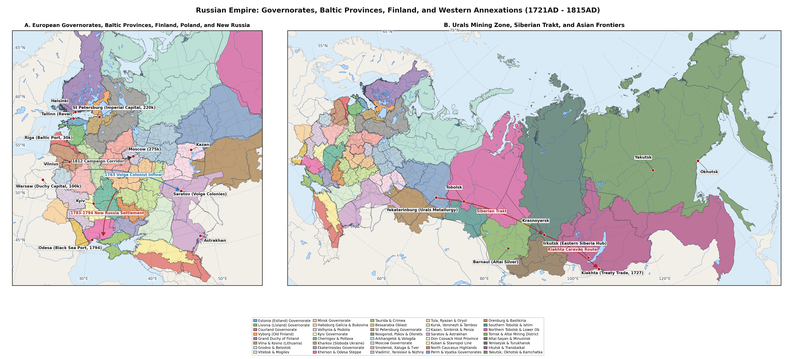
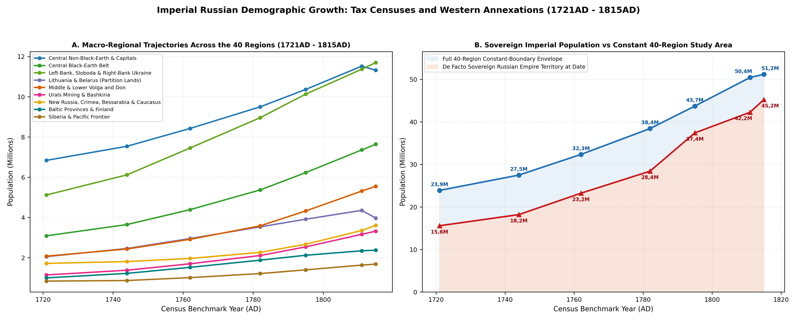
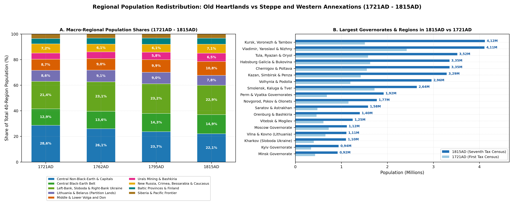
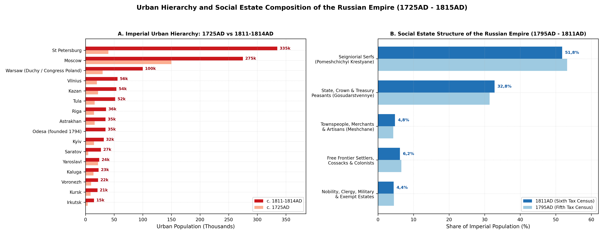

# Soul-Revision Sources & Methodology (1721-1815AD)

Between the proclamation of the Russian Empire at the Treaty of Nystad
in September 1721AD and the Final Act of the Congress of Vienna in June
1815AD - prior to the formal incorporation of Congress Poland - the
territories of the Russian Empire and its contiguous partitioned
borderlands underwent one of the largest demographic expansions in early
modern Eurasia. Across the 40 period-authentic provincial and frontier
regions defined in imperial_russia_pre_1815.json5 (spanning 18 496 636
km² and 457 996 raster pixels across the Baltic Baltic governorates, Old
Finland and the Grand Duchy of Finland, the Polish-Lithuanian Partition
lands including Habsburg Galicia-Bukovina, Left-Bank and Steppe Ukraine,
Bessarabia, European Russia, the North Caucasus and eighteenth-century
Siberia, whilst excluding Central Asia and Transcaucasia), total
population more than doubled from 23 888k (23,89M) in 1721AD to 51 171k
(51,17M) in 1815AD (+114,2%)
[\[1\]](#ref-Kabuzan1963)[\[2\]](#ref-Kabuzan1971)[\[3\]](#ref-Vodarsky1973)[\[4\]](#ref-Mironov2000).
Within the 39 regions that belonged to the Russian Empire by 1815AD (18
426 024 km², excluding Region 10, the Habsburg Kingdom of Galicia and
Lodomeria with Bukovina and Carpathian Rus, which grew from 1 625k to 3
350k), the population within the 1815AD imperial envelope rose from 22
263k (22,26M) in 1721AD to 25 606k in 1744AD, 30 119k in 1762AD, 35 768k
in 1782AD, 40 746k in 1795AD, 45 069k in 1806AD, 47 160k on the eve of
Napoleon’s invasion in 1811AD and 47 821k (47,82M) in 1815AD (+114,8%)
[\[5\]](#ref-Kabuzan1990)[\[6\]](#ref-Kabuzan1992)[\[7\]](#ref-Keppen1857).
Taken strictly within contemporary shifting sovereign frontiers, the de
facto population ruled from Saint Petersburg expanded nearly threefold
from roughly 15,6M at the close of the Great Northern War (1721AD) to
37,4M after the Third Partition of Poland-Lithuania (1795AD) and 43,1M -
47,8M by 1815AD, combining sustained rural natural increase in the
forest-steppe and Volga-Ural basins with the annexation of densely
settled western and southern provinces
[\[2\]](#ref-Kabuzan1971)[\[8\]](#ref-Kahan1985)[\[9\]](#ref-Kappeler2001).

Quantitative reconstruction across the eight benchmark slices of
imperial_russia_pre_1815.json5 (1721AD, 1744AD, 1762AD, 1782AD, 1795AD,
1806AD, 1811AD and 1815AD) rests upon four interlocking archival regimes
[\[10\]](#ref-Ulyanova2016Revizii)[\[11\]](#ref-Avdeev2025):

Imperial Poll-Tax Soul Revisions (*Revizskie skazki*, Revisions I to
VII), instituted by Peter I’s decree of 26 November 1718AD to replace
the seventeenth-century household tax (*podvornoe oblozhenie*, last
enumerated across European Russia in 1678AD and 1710AD) with a
capitation levy (*podushnaya podat*) assessed on individual male
“revision souls” (*revizskie dushi*), the Imperial Senate and College of
Camarilla conducted seven enumerations between 1719AD and 1816AD
[\[10\]](#ref-Ulyanova2016Revizii)[\[11\]](#ref-Avdeev2025)[\[12\]](#ref-Vodarsky1977).
The First Revision (1719-1724AD, verified by military inspection
commissions up to 1727AD) and Second Revision (1743-1747AD) registered
taxable males only (court, monastic and seigneurial serfs alongside
urban *posadskie*), omitting women, hereditary nobles, clergy, regular
troops and entire autonomous borderlands (the Ostsee provinces,
Left-Bank Hetmanate, Sloboda Cossack regiments and nomadic steppe
peoples) [\[1\]](#ref-Kabuzan1963)[\[3\]](#ref-Vodarsky1973). Beginning
with the Third Revision (1761-1763AD), Fourth Revision (1781-1782AD,
synchronised with Catherine II’s 1775AD *Guberniya* Statute) and Fifth
Revision (1794-1795AD), female inhabitants were recorded alongside
males, and fiscal registration was extended across the Ostsee provinces
(*Hingeloendid* / *Seelenrevisionen*), Little Russia, Sloboda Ukraine,
Novorossiya and the newly annexed Belarusian, Lithuanian and Right-Bank
Ukrainian governorates
[\[2\]](#ref-Kabuzan1971)[\[13\]](#ref-Palli1996). Under wartime fiscal
urgency on the eve of the 1812AD campaign, Alexander I’s Sixth Revision
(decreed 18 May 1811AD) reverted to a rapid male-only count,
necessitating sex-ratio parity multipliers derived from the post-war
Seventh Revision (decreed 20 June 1815AD and completed in 1816AD), which
restored full male-female household schedules and captured the
demographic toll of the Napoleonic wars
[\[6\]](#ref-Kabuzan1992)[\[7\]](#ref-Keppen1857)[\[14\]](#ref-Hermann1819)[\[15\]](#ref-Myakisheva2016).
Following Vladimir Kabuzan, Yaroslav Vodarsky and Boris Mironov, total
regional populations are derived from archival Central Statistical
Committee and RGADA *perechnevye vedomosti* by doubling male revision
souls where female returns were absent (applying empirical regional
female-to-male ratios of 1,02 - 1,06), adding non-taxable estates
(*nepodayushchie sosloviya*: nobility, Orthodox and Uniate clergy, civil
officials, retired soldiers and regular garrisons, typically 4,5% - 7,5%
of provincial totals) and correcting early-revision infant and fugitive
under-registration (+18% - 22% before military verification in 1721AD,
narrowing to +3% - 5% by 1782-1795AD and +6% - 8% during the rushed
1811AD count) [\[1\]](#ref-Kabuzan1963)[\[16\]](#ref-Mironov2015).

Swedish-Finnish *Tabellverket* and Lutheran Parish Registers (Regions
1-5): In the Grand Duchy of Finland (Region 5), continuous national
vital and population tabulations began in 1749AD under the Royal Swedish
*Tabellverket* - the oldest continuous state demographic statistical
office in Europe - preserved unbroken after the 1809AD Treaty of
Fredrikshamn
[\[17\]](#ref-Jutikkala1965)[\[18\]](#ref-Turpeinen1979)[\[19\]](#ref-Luostarinen2026FinlandTabellverket).
For 1721AD and 1744AD, Eino Jutikkala, Oiva Turpeinen and Kari Pitkänen
reconstructed county populations backward from the 1749AD baseline using
Lutheran communion books (*rippikirjat*) and burial registers across the
post-1713AD *Isoviha* (“Great Wrath”) recovery and the 1741-1743AD
Russo-Swedish War
[\[17\]](#ref-Jutikkala1965)[\[20\]](#ref-Pitkanen1993). In Estland
(Region 1), Livland (Region 2) and Courland (Region 3), Heldur Palli and
August Wilhelm Hupel cross-checked eighteenth-century *Hakenrevisionen*
ploughland rolls (1725-1726AD, 1732AD, 1744AD, 1758AD and 1774AD)
against Lutheran parish registers before Imperial Soul Revisions began
in 1782AD (and 1795AD in Courland)
[\[13\]](#ref-Palli1996)[\[21\]](#ref-Hupel1774)[\[22\]](#ref-Palli1980)[\[23\]](#ref-Jaadla2014Tartu).
In Old Finland / Vyborg Governorate (Region 4), Russian revision rolls
from 1724AD and 1744AD supplement Karelian Lutheran church books
[\[24\]](#ref-Kashchenko2016Vyborg).

Polish-Lithuanian Commonwealth Hearth/Poll Censuses and Habsburg
Conscriptions (Regions 6-12): Prior to the Three Partitions (1772AD,
1793AD and 1795AD), demographic series across Lithuania, Belarus and
Right-Bank Ukraine draw on the 1764-1765AD Commonwealth Jewish
capitation census, episcopal Uniate and Roman Catholic parish
visitations, Four-Year Sejm hearth taxes (*podymne*, 1789-1790AD) and
magnate estate inventories synthesised by Cezary Kuklo, Shaul Stampfer
and Arnold Perkovsky
[\[25\]](#ref-Kuklo2009)[\[26\]](#ref-Stampfer1995)[\[27\]](#ref-Perkovsky1979)[\[28\]](#ref-Klier1986).
In Region 10 (Habsburg Galicia and Bukovina), Vienna introduced
military-fiscal soul conscriptions immediately upon annexation in
1772-1776AD, followed by Emperor Joseph II’s patent conscriptions of
1785-1787AD and Franciscan updates of 1807-1815AD
[\[29\]](#ref-Bohachevsky1967)[\[30\]](#ref-Fellerer2023Galicia).

Cossack Regimental Surveys, Steppe Cadastral Rolls and Siberian *Yasak*
Books (Regions 13-18, 29-31 and 34-40): In the Left-Bank Hetmanate
(Region 13) and Sloboda Ukraine (Region 14), regimental *revizii* of
1723-1732AD and Field Marshal Pyotr Rumyantsev’s monumental General
Description of Little Russia (*Generalnaya opis Malorossii*,
1765-1769AD) bridge the pre-1782AD gap
[\[31\]](#ref-Irtenina2022Hetmanate)[\[32\]](#ref-Bagaley1918)[\[33\]](#ref-Kabuzan2006).
Across Novorossiya, Crimea and Bessarabia (Regions 15-18), Ottoman
*tahrir* / *cizye* estimates, the 1783-1784AD Taurida cameral
description of Baron Osip Igelström, Apollon Skalkovsky’s Novorossiya
chancellery tables and the 1812-1816AD Bessarabian boyar and colonist
surveys anchor rapid frontier settlement
[\[34\]](#ref-Skalkovsky1836)[\[35\]](#ref-Kabuzan1976Novorossiya)[\[36\]](#ref-Dmitriev2018CrimeaEmigration)[\[37\]](#ref-Feldman2023Bessarabia).
In the North Caucasus highlands (Region 31) and Siberia (Regions 34-40),
Russian revision books for Slavic peasants, *pripisnye* mineworkers and
Siberian Tatars are combined with *yasak* fur-tribute ledgers and
Gerhard Friedrich Müller’s academic expedition questionnaires
[\[5\]](#ref-Kabuzan1990)[\[38\]](#ref-Forsyth1992)[\[39\]](#ref-Korusenko2011Siberia)[\[40\]](#ref-Tovsultanov2017).

Figure illustrates the aggregate imperial trajectory alongside ten
contrasting provincial curves, whilst Table presents the complete
40-region series from \_gis_cache/imperial_russia_pre_1815_summary.json
and Table summarises the seven Imperial Soul Revisions and parallel
borderland enumerations.

| Period-Authentic Region (1-40) | 1721AD | 1744AD | 1762AD | 1782AD | 1795AD | 1806AD | 1811AD | 1815AD | Change |
|:---|:---|:---|:---|:---|:---|:---|:---|:---|:---|
| 1\. Estland Governorate | 105k | 140k | 175k | 200k | 212k | 222k | 228k | 232k | +121,0% |
| 2\. Livland Governorate | 195k | 280k | 385k | 495k | 550k | 585k | 605k | 615k | +215,4% |
| 3\. Courland Governorate | 200k | 250k | 305k | 365k | 405k | 425k | 435k | 418k | +109,0% |
| 4\. Old Finland / Vyborg Governorate | 110k | 128k | 152k | 175k | 186k | 194k | 198k | 202k | +83,6% |
| 5\. Grand Duchy of Finland | 390k | 425k | 505k | 645k | 770k | 875k | 880k | 908k | +132,8% |
| 6\. Vilna Governorate & Samogitia / Kovno | 655k | 760k | 880k | 1 020k | 1 110k | 1 190k | 1 220k | 1 110k | +69,5% |
| 7\. Grodno Governorate & Belostok Oblast | 360k | 430k | 515k | 615k | 680k | 735k | 760k | 695k | +93,1% |
| 8\. Vitebsk & Mogilev Governorates | 610k | 740k | 910k | 1 110k | 1 240k | 1 340k | 1 380k | 1 245k | +104,1% |
| 9\. Minsk Governorate & Pripyat Polesia | 430k | 530k | 650k | 790k | 885k | 960k | 995k | 920k | +114,0% |
| 10\. Habsburg Kingdom of Galicia & Lodomeria | 1 625k | 1 880k | 2 220k | 2 650k | 2 950k | 3 160k | 3 260k | 3 350k | +106,2% |
| 11\. Volhynia & Podolia Governorates | 1 195k | 1 490k | 1 880k | 2 300k | 2 600k | 2 780k | 2 870k | 2 960k | +147,7% |
| 12\. Kyiv Governorate | 342k | 430k | 550k | 655k | 755k | 855k | 905k | 940k | +174,9% |
| 13\. Little Russia: Chernigov & Poltava Governorates | 1 555k | 1 820k | 2 180k | 2 580k | 2 920k | 3 160k | 3 270k | 3 350k | +115,4% |
| 14\. Sloboda-Ukrainian / Kharkov Governorate | 402k | 500k | 625k | 775k | 905k | 1 010k | 1 065k | 1 100k | +173,6% |
| 15\. Ekaterinoslav Governorate & Former Zaporozhian Lands | 145k | 175k | 225k | 355k | 540k | 690k | 765k | 820k | +465,5% |
| 16\. Kherson / Nikolaev Governorate & Ochakov Steppe | 105k | 125k | 155k | 225k | 355k | 495k | 565k | 620k | +490,5% |
| 17\. Taurida Governorate | 370k | 350k | 345k | 320k | 260k | 315k | 345k | 370k | 0,0% |
| 18\. Bessarabia Oblast | 200k | 225k | 255k | 290k | 320k | 340k | 310k | 385k | +92,5% |
| 19\. Saint Petersburg Governorate | 260k | 345k | 435k | 545k | 625k | 695k | 735k | 760k | +192,3% |
| 20\. Novgorod, Pskov & Olonets Governorates | 1 155k | 1 250k | 1 365k | 1 510k | 1 625k | 1 715k | 1 755k | 1 770k | +53,2% |
| 21\. Arkhangelsk & Vologda Governorates | 560k | 610k | 670k | 750k | 820k | 875k | 905k | 920k | +64,3% |
| 22\. Moscow Governorate | 725k | 795k | 885k | 985k | 1 085k | 1 185k | 1 235k | 1 120k | +54,5% |
| 23\. Smolensk, Kaluga & Tver Governorates | 1 720k | 1 890k | 2 110k | 2 380k | 2 590k | 2 780k | 2 870k | 2 640k | +53,5% |
| 24\. Central Non-Black-Earth Governorates: Vladimir, Yaroslavl, Kostroma & Nizhny Novgorod | 2 420k | 2 650k | 2 960k | 3 330k | 3 620k | 3 890k | 4 020k | 4 110k | +69,8% |
| 25\. Northern Central Black-Earth Governorates: Tula, Ryazan & Oryol | 1 580k | 1 830k | 2 150k | 2 580k | 2 950k | 3 260k | 3 420k | 3 520k | +122,8% |
| 26\. Southern Central Black-Earth Governorates: Kursk, Voronezh & Tambov | 1 510k | 1 820k | 2 240k | 2 790k | 3 280k | 3 710k | 3 940k | 4 120k | +172,8% |
| 27\. Middle Volga Governorates: Kazan, Simbirsk & Penza | 1 420k | 1 660k | 1 960k | 2 360k | 2 720k | 3 020k | 3 180k | 3 290k | +131,7% |
| 28\. Saratov & Astrakhan Governorates | 480k | 560k | 690k | 860k | 1 120k | 1 360k | 1 490k | 1 580k | +229,2% |
| 29\. Province of the Don Cossack Host | 180k | 215k | 265k | 365k | 485k | 590k | 645k | 680k | +277,8% |
| 30\. Caucasian Fortified Line, Black Sea Cossack Kuban | 120k | 135k | 155k | 215k | 310k | 410k | 465k | 505k | +320,8% |
| 31\. North Caucasian Highlanders: Circassia, Kabarda, Chechnya & Dagestan Khanates | 780k | 800k | 830k | 860k | 885k | 900k | 905k | 910k | +16,7% |
| 32\. Perm & Vyatka Governorates | 685k | 830k | 1 030k | 1 290k | 1 530k | 1 740k | 1 845k | 1 920k | +180,3% |
| 33\. Orenburg Governorate & Bashkiria | 460k | 550k | 670k | 820k | 1 010k | 1 210k | 1 320k | 1 400k | +204,3% |
| 34\. Tobolsk Governorate South: Siberian Trakt | 215k | 255k | 308k | 380k | 445k | 500k | 528k | 545k | +153,5% |
| 35\. Tobolsk & Narym River North: Tobolsk, Berezov, Surgut & Obdorsk Yasak Tundra | 85k | 96k | 109k | 124k | 139k | 151k | 156k | 160k | +88,2% |
| 36\. Tomsk Governorate | 95k | 118k | 150k | 196k | 236k | 272k | 289k | 300k | +215,8% |
| 37\. Altai-Sayan & Minusinsk Borderlands | 75k | 74k | 82k | 95k | 106k | 117k | 122k | 125k | +66,7% |
| 38\. Yeniseisk Province: Krasnoyarsk Trakt, Angara Portage & Turukhansk Polar North | 72k | 76k | 86k | 102k | 118k | 132k | 138k | 144k | +100,0% |
| 39\. Irkutsk Governorate & Transbaikal Frontier | 142k | 134k | 152k | 181k | 209k | 232k | 243k | 252k | +77,5% |
| 40\. Yakutsk, Okhotsk Seaboard & Kamchatka Oblast | 155k | 115k | 125k | 135k | 145k | 154k | 158k | 160k | +3,2% |
| Sub-Total: Baltic Provinces & Finland (Regions 1-5) | 1 000k | 1 223k | 1 522k | 1 880k | 2 123k | 2 301k | 2 346k | 2 375k | +137,5% |
| Sub-Total: Partitions & Galicia-Bukovina (Regions 6-12) | 5 217k | 6 260k | 7 605k | 9 140k | 10 220k | 11 020k | 11 390k | 11 220k | +115,1% |
| Sub-Total: Hetmanate, Novorossiya & Bessarabia (Regions 13-18) | 2 777k | 3 195k | 3 785k | 4 545k | 5 300k | 6 010k | 6 320k | 6 645k | +139,3% |
| Sub-Total: Capitals, North & Central Russia (Regions 19-26) | 9 930k | 11 190k | 12 815k | 14 870k | 16 595k | 18 110k | 18 880k | 18 960k | +90,9% |
| Sub-Total: Volga, Urals, Don & Caucasus (Regions 27-33) | 4 125k | 4 750k | 5 600k | 6 770k | 8 060k | 9 230k | 9 850k | 10 285k | +149,3% |
| Sub-Total: Siberia & North Pacific (Regions 34-40) | 839k | 868k | 1 012k | 1 213k | 1 398k | 1 558k | 1 634k | 1 686k | +101,0% |
| Sub-Total: 39-Region Imperial Envelope (Excl. Reg. 10) | 22 263k | 25 606k | 30 119k | 35 768k | 40 746k | 45 069k | 47 160k | 47 821k | +114,8% |
| Grand Total: All 40 Regions (18 496 636 km2) | 23 888k | 27 486k | 32 339k | 38 418k | 43 696k | 48 229k | 50 420k | 51 171k | +114,2% |

Population Trajectories across the 40 Period-Authentic Soul-Revision
Regions of Early Imperial Russia and Adjacent Partition Lands (1721AD -
1815AD).

| Enumeration / Archival Regime | Benchmark | Registered Scope & Sex Coverage | 40-Region Total | Standard Scholarly Adjustments |
|:---|:---|:---|:---|:---|
| 1st Soul Revision (Decreed Nov 1718AD; Verified 1719-1727AD) | 1721AD | Taxable males only in Great Russia & Siberia; excludes Ostsee, Hetmanate, nobles | 23 888k (22 263k Imp.) | +18-22% early evasion fixed by 1722-1727AD military commissions; x2 sex multiplier + exempted estates |
| 2nd Soul Revision (Decreed Dec 1743AD; Conducted 1744-1747AD) | 1744AD | Taxable males only; adds Old Finland (1743AD Abo) & Orenburg Line settlements | 27 486k (25 606k Imp.) | +6-9% frontier evasion; x2,03 sex multiplier + clergy/garrisons (Kabuzan 1963; Vodarsky 1973) |
| 3rd Soul Revision (Decreed Nov 1761AD; Conducted 1762-1763AD) | 1762AD | Both sexes; still excludes Baltic Ritterschaften & Polish-Lithuanian lands | 32 339k (30 119k Imp.) | +4-6% omission; supplemented by 1765-1769AD Rumyantsev Little Russian Survey |
| 4th Soul Revision (Decreed Nov 1781AD; Conducted 1781-1782AD) | 1782AD | Both sexes across Catherine II’s 1775AD namestnichestva, Ostsee, Hetmanate, E. Belarus | 38 418k (35 768k Imp.) | +3-4% omission; unified cameral accounting across 41 vicegerencies (Kabuzan 1971) |
| 5th Soul Revision (Decreed Jun 1794AD; Conducted 1794-1795AD) | 1795AD | Both sexes across 50 provinces incl. 2nd/3rd Polish Partitions, Courland & Crimea | 43 696k (40 746k Imp.) | +3-5% omission (+10-15% in newly annexed Jewish kahal rolls; Stampfer 1995) |
| Governorate Annual Tables & 1806AD Administrative Returns | 1806AD | Both sexes via Ministry of Internal Affairs provincial reports & Keppen tables | 48 229k (45 069k Imp.) | Reconciled with diocesan vital balances (CBR ~48-51, CDR ~33-37 per 1 000; Hermann 1819) |
| 6th Soul Revision (Decreed May 1811AD; Wartime Male Count) | 1811AD | Males only under pre-war fiscal urgency; includes Belostok (1807) & Finland (1809) | 50 420k (47 160k Imp.) | Female parity interpolated from 5th/7th Revisions; +6-8% hurried wartime undercount (Keppen 1857) |
| 7th Soul Revision (Decreed Jun 1815AD; Conducted 1815-1816AD) | 1815AD | Both sexes across post-Vienna Empire incl. Bessarabia (1812AD); captures 1812 losses | 51 171k (47 821k Imp.) | Direct measurement of 1812-1814AD excess military/civilian deficits in Regions 3, 6-9, 22-23 |
| Parallel Borderland Censuses (Tabellverket, Commonwealth, Habsburg) | 1721-1815AD | Swedish-Finnish Tabellverket (from 1749AD), 1764/1789 Polish rolls, Austrian conscriptions | Anchored in Regions 1-12 | Palli (1996), Jutikkala (1965), Kuklo (2009) & Bohachevsky (1967) parish-census syntheses |

Imperial Fiscal Revisions (I-VII) and Parallel Borderland Demographic
Sources Anchoring the Eight Benchmark Slices (1721AD - 1815AD).

# Baltic Provinces and Finland (Regions 1-5)

Across the northwestern Baltic littoral (Regions 1-5, 481 891 km²),
combined population grew by +137,5% from 1 000k in 1721AD to 2 375k in
1815AD under institutional regimes wholly distinct from Great Russian
serfdom
[\[9\]](#ref-Kappeler2001)[\[13\]](#ref-Palli1996)[\[17\]](#ref-Jutikkala1965).
Under the Capitulations of Riga and Reval (1710AD), confirmed at the
Treaty of Nystad (30 August 1721AD), Peter I guaranteed the Baltic
German *Ritterschaften*, Lutheran consistories and Hanseatic magistrate
privileges of Estland Governorate (Region 1) and Livland Governorate
(Region 2, including Ösel/Saaremaa and South Estonian Dorpat-Pernau
alongside Latvian Vidzeme)
[\[21\]](#ref-Hupel1774)[\[41\]](#ref-Savikhin2011Ostsee). Both
provinces entered 1721AD severely depleted by the Great Famine of
1695-1697AD, Great Northern War devastation and the catastrophic
1710-1711AD Baltic bubonic plague, which had killed over half the
inhabitants of Reval (Tallinn) and Riga: Estland stood at just 105k in
1721AD and Livland at 195k
[\[13\]](#ref-Palli1996)[\[22\]](#ref-Palli1980). Over the next six
decades, the absence of Russian military conscription (until 1797AD),
early smallpox variolation, Moravian Brethren (*Herrnhuter*) peasant
literacy campaigns and grain-distilling manor expansion fuelled one of
Europe’s fastest post-plague recoveries
[\[13\]](#ref-Palli1996)[\[23\]](#ref-Jaadla2014Tartu). Estland more
than doubled to 175k (1762AD), 212k (1795AD) and 232k (1815AD, +121,0%),
with Reval rising from 5,2k to 12,8k alongside Wesenberg, Hapsal and
Weissenstein. Livland more than tripled from 195k (1721AD) to 385k
(1762AD), 550k (1795AD) and 615k (1815AD, +215,4%), led by Riga - the
Empire’s second maritime export port after Saint Petersburg - which
expanded from 11,8k in 1721AD to 36,5k in 1811AD (dipping slightly to
36,0k in 1815AD after Governor Essen burned Riga’s wooden suburbs
against Marshal Macdonald’s X Corps in July 1812AD), whilst Dorpat
(Tartu, refounded as an Imperial German-language university in 1802AD)
grew from 1,8k to 7,5k and Narva, Pernau, Fellin, Walk and Arensburg
anchored coastal and inland trade
[\[21\]](#ref-Hupel1774)[\[23\]](#ref-Jaadla2014Tartu). Alexander I’s
1804AD Livland and Estland peasant ordinances regulated corvée
(*Fronarbeit*) norms and prepared the full personal emancipation enacted
in 1816-1819AD [\[4\]](#ref-Mironov2000).

To the south, the Duchy of Courland and Semigallia (Region 3, together
with Pilten District) remained a Polish-Lithuanian vassal fief under the
Kettler and Biron dukes until its annexation during the Third Partition
in March 1795AD [\[5\]](#ref-Kabuzan1990)[\[9\]](#ref-Kappeler2001).
Spared the worst fighting of 1710-1721AD, Courland grew steadily from
200k in 1721AD to 305k (1762AD), 405k at the Fifth Revision (1795AD) and
435k in 1811AD, centred on the ducal capital of Mitau (Jelgava, 5,5k -\>
12,0k), the ice-free Baltic port of Libau (Liepaja, 2,8k -\> 6,2k),
Windau (Ventspils), Goldingen and Bauske. In 1812AD, Franco-Prussian
occupation, cattle requisitions and typhus reduced Courland’s population
to 418k by the Seventh Revision (1815AD, +109,0% overall)
[\[6\]](#ref-Kabuzan1992).

Across the Gulf of Finland, Karelian and Finnish territories entered the
Empire in two stages:

Old Finland / Vyborg Governorate (Region 4: 110k to 202k, +83,6%): Ceded
by Sweden in two slices - Karelian Vyborg and Kexholm at Nystad (1721AD)
and the Kymi River strip of Hamina (Fredrikshamn), Lappeenranta
(Villmanstrand) and Savonlinna (Nyslott) at the Treaty of Åbo (1743AD) -
Vyborg Governorate grew from 110k (1721AD) to 152k (1762AD) and 198k
(1811AD) [\[24\]](#ref-Kashchenko2016Vyborg). Unlike mainland
Sweden-Finland, vast tracts of Old Finland were granted as imperial
*lahjoitusmaat* (“donation estates”) to Russian court aristocrats,
depressing peasant mobility relative to Swedish Savo-Karelia until
Alexander I reunited Vyborg Governorate with the autonomous Grand Duchy
of Finland on 1 January 1812AD (reaching 202k in 1815AD, with Vyborg
town at 3,8k alongside Sortavala, Kexholm and Hamina)
[\[17\]](#ref-Jutikkala1965)[\[24\]](#ref-Kashchenko2016Vyborg).

Grand Duchy of Finland (Region 5: 390k to 908k, +132,8%): Emerging from
the demographic trough of the 1713-1721AD Russian occupation (*Isoviha*,
390k in 1721AD) and the 1741-1743AD *Pikkuviha* war (425k in 1744AD),
mainland Finland experienced rapid pioneering land clearance (*isojaot*
enclosure, tar-burning in Ostrobothnia and slash-and-burn *kaski*
farming in Savonia), surging across the *Tabellverket* registers to 505k
(1762AD), 645k (1782AD), 770k (1795AD) and 875k (1806AD)
[\[17\]](#ref-Jutikkala1965)[\[18\]](#ref-Turpeinen1979). During the
Finnish War of 1808-1809AD, epidemic dysentery, typhus and relapsing
fever spread along military supply routes, pushing Finland’s crude death
rate above 55 - 60 per 1 000 in 1808-1809AD and causing roughly 35k -
45k excess civilian deaths
[\[19\]](#ref-Luostarinen2026FinlandTabellverket)[\[20\]](#ref-Pitkanen1993).
Consequently, Region 5 plateaued at 880k in 1811AD after annexation
under the Diet of Borgå (Porvoo) and Treaty of Fredrikshamn (17
September 1809AD), before rebounding to 908k by 1815AD. In April 1812AD,
Alexander I transferred the Grand Duchy’s capital from Swedish-oriented
Åbo (Turku, Finland’s largest town at 11,6k in 1815AD) to Helsingfors
(Helsinki, 4,8k, guarded by Sveaborg sea fortress), alongside Uleåborg
(Oulu, 3,8k), Vasa (9k), Björneborg (Pori, 2,8k) and Tammerfors
(Tampere) [\[17\]](#ref-Jutikkala1965).

# Polish Partitions, Early Pale & Galicia (Regions 6-12)

The geopolitical centrepiece of Catherine II’s western policy was the
tripartite dismemberment of the Polish-Lithuanian Commonwealth (1772AD,
1793AD and 1795AD), augmented by Napoleon’s cession of Belostok
(Bialystok) Oblast to Russia at the Treaty of Tilsit (July 1807AD)
[\[9\]](#ref-Kappeler2001)[\[25\]](#ref-Kuklo2009)[\[42\]](#ref-Lieven2009).
Across Regions 6-12 (553 379 km²), combined population rose by +115,1%
from 5 217k in 1721AD to a pre-war peak of 11 390k in 1811AD before
contracting to 11 220k in 1815AD under the devastation of the 1812AD
campaign in Lithuania and Belarus (Table ).

| Chronology & Event | Primary Regions | Demographic Magnitude & Structural Impact | Key Literature |
|:---|:---|:---|:---|
| 1721AD Nystad & 1743AD Abo Treaties (Baltic & Old Finland) | Regions 1, 2 & 4 | Incorporates ~410k inhabitants (1721AD) + ~55k (1743AD); rapid post-1710 plague rebound | Palli 1996; Kashchenko 2016 |
| 1762-1766AD Foreign Colonist Manifestos (Volga Germans) | Region 28 (Saratov) | 27k-30k German colonists settled in 104 Volga colonies (1764-1768AD), reaching ~62k by 1815AD | Bartlett 1979; Galperina 2013 |
| 1768-1769AD Kamchatka & Okhotsk Smallpox Pandemic | Region 40 (Kamchatka) | Kills ~5 000-6 000 Itelmen/Koryaks (~50-65% of Peninsula natives); Reg. 40 held at 125k-135k | Turaev 2012; Tolkacheva 2015 |
| 1770-1772AD Russian Plague & Sep 1771AD Moscow Plague Riot | Regions 12, 22, 23 & 25 | 56k-70k dead in Moscow city (~100k+ in Moscow & central uezds); temporary flight halves city | Alexander 1980; Iskhakov 2013 |
| Jan 1771AD Torghut Kalmyk Exodus (*Pylnyy pokhod*) | Region 28 (Astrakhan) | ~31k-33k tents (~150k-170k Kalmyks) depart east of Volga; \>85k perish en route to Qing Ili | Khodarkovsky 1992; Ochirov 2012 |
| 1772AD, 1793AD & 1795AD Partitions + 1807AD Belostok | Regions 3 & 6-12 | Transfers ~7,3M Commonwealth subjects to Russia (Regs 3, 6-9, 11-12) & ~2,65M to Austria (Reg 10) | Kabuzan 1990; Kuklo 2009; Klier 1986 |
| 1773-1775AD Pugachev Rebellion (Yaik, Orenburg, Volga, Urals) | Regions 27, 28, 32 & 33 | ~25k-40k military/civilian deaths; burning of 60+ Ural foundries & Bashkir frontier forts | Kahan 1985; Shaykhislamov 2018 |
| 1774-1792AD Novorossiya, 1778AD Mariupol Greeks & 1783AD Crimea | Regions 15, 16, 17 & 30 | ~31k Crimean Christians to Mariupol (1778); ~100k-180k Tatars emigrate; \>600k colonists arrive | Kabuzan 1976; Williams 2001; Pakhomenko 2014 |
| 1808-1809AD Finnish War & Sep 1809AD Fredrikshamn Annexation | Regions 4 & 5 | ~35k-45k war-epidemic deaths in Finland; transfers ~880k inhabitants into autonomous Grand Duchy | Jutikkala 1965; Pitkanen 1993 |
| May 1812AD Treaty of Bucharest (Bessarabia Oblast Annexation) | Region 18 (Bessarabia) | Annexes 47 077 km2 (310k in 1811AD -\> 385k in 1815AD) via Bulgarian, Gagauz & Moldavian inflows | Feldman 2023; Bas 2015 |
| Jun-Dec 1812AD Patriotic War (Grande Armee Invasion & Retreat) | Regions 3, 6-9, 22 & 23 | ~500k-650k net civilian/military deficit across Lithuania-Belarus (-380k) & Smolensk-Moscow (-345k) | Lieven 2009; Shelomentseva 2015; Kabuzan 1992 |

Major Territorial Annexations, Colonisation Programmes, Epidemic Crises
and Wartime Demographic Shocks (1721AD - 1815AD).

Within the partitioned Commonwealth territories, four distinct
sub-regional trajectories emerged:

First Partition Eastern Belarus (Vitebsk and Mogilev Governorates,
Region 8: 610k to 1 380k in 1811AD to 1 245k in 1815AD, +104,1%):
Annexed by Russia in August 1772AD (initially organised as Pskov/Polotsk
and Mogilev governorates alongside Polish *Inflanty* / Latgale around
Dünaburg/Daugavpils, then briefly merged as Belarus Governorate in
1796-1802AD), Region 8 doubled from 610k (1721AD) to 1 110k at the
Fourth Revision (1782AD) and 1 380k in 1811AD
[\[2\]](#ref-Kabuzan1971)[\[43\]](#ref-Reutskaya2016Belarus). Dense
networks of magnate *miasteczka* (*shtetlekh*) such as Shklov, Orsha,
Mstislavl and Polotsk joined Vitebsk (5k in 1811AD) and Mogilev (0k in
1811AD) [\[26\]](#ref-Stampfer1995)[\[28\]](#ref-Klier1986). Between
June and November 1812AD, however, Region 8 formed the main operational
corridor for both the French advance and the catastrophic Berezina
retreat (Borisov, Orsha, Vitebsk), suffering acute requisition famine
and typhus that cut its Seventh Revision population by -135k (-9,8%) to
1 245k in 1815AD [\[6\]](#ref-Kabuzan1992)[\[42\]](#ref-Lieven2009).

Lithuania, Grodno-Belostok and Central Belarus (Regions 6, 7 and 9):
Region 6 (Vilna Governorate and Samogitia/Kovno), annexed in the Third
Partition (1795AD), grew from 655k (1721AD) to 1 110k (1795AD) and 1
220k (1811AD), anchored by Vilna (Vilnius) - the largest city of the
former Grand Duchy of Lithuania, rising from 19,5k (1721AD) to 42,0k
(1811AD) around its Imperial University (rechartered 1803AD) and great
Jewish *kahal* - alongside Kovno (Kaunas), Shavli (Siauliai), Rossieny
and Troki [\[25\]](#ref-Kuklo2009)[\[26\]](#ref-Stampfer1995). In June -
December 1812AD, Vilna served as Napoleon’s rear logistics base and the
graveyard of tens of thousands of freezing *Grande Armée* stragglers and
typhus-stricken townspeople: Vilna city fell from 42,0k to 36,0k and
Region 6 lost -110k (-9,0%) between 1811AD and 1815AD (returning to 1
110k) [\[6\]](#ref-Kabuzan1992)[\[42\]](#ref-Lieven2009). Region 7
(Grodno Governorate and Belostok Oblast, 1795AD and 1807AD Tilsit)
expanded from 360k (1721AD) to 760k (1811AD) before dropping by -8,6% to
695k in 1815AD (centred on Grodno, Belostok, Brest-Litovsk, Slonim,
Novogrudok and Lida), whilst Region 9 (Minsk Governorate and Pripyat
Polesia, 1793AD Second Partition) grew from 430k (1721AD) to 995k
(1811AD) and dropped by -7,5% to 920k in 1815AD after fighting around
Minsk, Borisov, Bobruisk fortress, Slutsk and Pinsk
[\[6\]](#ref-Kabuzan1992)[\[43\]](#ref-Reutskaya2016Belarus).

Right-Bank Ukraine and the Early Pale of Permanent Jewish Settlement
(Regions 11 and 12): Following the Eighteenth-Century *Haidamak*
uprisings (*Koliivshchyna*, 1768AD, centred on Uman) and Polish
aristocratic *slobody* colonisation across the Podolian-Volhynian
forest-steppe, the Second (1793AD) and Third (1795AD) Partitions brought
Region 11 (Volhynia and Podolia Governorates: 1 195k to 2 960k, +147,7%)
and Right-Bank Region 12 (Kyiv Governorate, uniting Russian Left-Bank
Kyiv city and Vasilkov with the annexed Right-Bank interior: 342k to
940k, +174,9%) into the Empire
[\[27\]](#ref-Perkovsky1979)[\[33\]](#ref-Kabuzan2006). Spared direct
occupation by Napoleon’s main army in 1812AD (beyond Tormasov’s
defensive operations on the western Volhynian fringe), Volhynia-Podolia
and Kyiv continued growing between 1811AD and 1815AD (2 870k to 2 960k
and 905k to 940k), led by Kyiv (8k to 23,4k), Berdichev (0k, hub of
Volhynian banking and Hasidic commerce), Kamenets-Podolskiy (6k), Dubno,
Zhitomir, Starokonstantinov, Uman (6k), Belaya Tserkov and Cherkassy
[\[27\]](#ref-Perkovsky1979)[\[44\]](#ref-Mironov1990Urban). To prevent
Jewish merchants registered in the annexed western *kahals* from
competing with Christian guilds in Moscow and interior Great Russia,
Catherine II’s decree of 23 December 1791AD and Alexander I’s *Jewish
Statute* (*Polozhenie o evreyakh*) of 9 December 1804AD
institutionalised the Pale of Permanent Jewish Settlement (*Cherta
postoyannoy evreyskoy osedlosti*) across Lithuania, Belarus, Right-Bank
and Left-Bank Ukraine and Novorossiya (encompassing roughly 750k - 900k
Jewish inhabitants by 1806-1815AD), whilst Catherine II’s 1794-1796AD
missionary campaigns transferred roughly 1,5M Right-Bank and Belarusian
Greek Catholics (Uniates) to the Russian Orthodox Church
[\[26\]](#ref-Stampfer1995)[\[28\]](#ref-Klier1986)[\[45\]](#ref-Kabuzan2016).

Habsburg Kingdom of Galicia and Lodomeria, Bukovina and Carpathian Rus
(Region 10: 1 625k to 3 350k, +106,2%): Retained within
imperial_russia_pre_1815.json5 to ensure seamless spatial continuity
with adjacent Commonwealth partition zones and twentieth-century
Ukrainian masks (save for the brief 1809-1815AD Russian possession of
the Tarnopol Circle ceded at Schönbrunn and returned at Vienna),
Habsburg Eastern Galicia (annexed 1772AD), Bukovina (ceded by the
Ottoman Empire in 1775AD) and Hungarian Subcarpathian Rus doubled from 1
625k (1721AD) to 2 650k under the Josephine conscriptions (1782AD
benchmark) and 3 350k in 1815AD
[\[29\]](#ref-Bohachevsky1967)[\[30\]](#ref-Fellerer2023Galicia).
Provincial capital Lemberg / Lviv expanded from 25,0k (1721AD) to 44,5k
(1815AD) - making it the third largest city in the entire 40-region
study area - alongside the duty-free border entrepôt of Brody (5k to
19,5k), Tarnopol (5k), Stanislawow, Drohobycz, Przemyśl, Czernowitz /
Chernivtsi (8k to 6,2k) and Ungvár / Uzhhorod
[\[25\]](#ref-Kuklo2009)[\[30\]](#ref-Fellerer2023Galicia).

# Hetmanate, Novorossiya & Bessarabia (Regions 13-18)

No macro-zone of eighteenth-century Europe experienced a more dramatic
transformation of political geography and rural density than the
Ukrainian forest-steppe and Pontic littoral (Regions 13-18, 417 427
km²), which expanded by +139,3% from 2 777k in 1721AD to 6 645k in
1815AD
[\[33\]](#ref-Kabuzan2006)[\[35\]](#ref-Kabuzan1976Novorossiya)[\[46\]](#ref-Sunderland2004).
Figure displays the structural growth rankings and macro-regional share
shifts across the 40 regions.

In the old Ukrainian Cossack lands, imperial centralisation dismantled
autonomous regimental governance and folded the population into the
regular poll-tax and serf system:

Little Russia (Chernigov and Poltava Governorates, Region 13: 1 555k to
3 350k, +115,4%) and Sloboda Ukraine (Kharkov Governorate, Region 14:
402k to 1 100k, +173,6%): Catherine II abolished the five Sloboda
Cossack regiments in July 1765AD (creating Sloboda-Ukrainian Governorate
around Kharkov, where Vasily Karazin founded Kharkov Imperial University
in 1804-1805AD, growing from 6,2k in 1721AD to 13,5k in 1815AD alongside
Sumy, Akhtyrka, Izyum and Belopolye) [\[32\]](#ref-Bagaley1918). In
Left-Bank Little Russia, the office of Hetman Kirill Razumovsky was
abolished in November 1764AD, Rumyantsev’s General Survey enumerated
Cossack and peasant households in 1765-1769AD, regimental administration
gave way to vicegerencies in 1781AD and the decree of 3 May 1783AD
prohibited peasant movement, legally binding Left-Bank *pospoliti*
peasants to the Cossack *starshina* (ennobled in 1785AD), whilst
registered *vyborni* and *pidpomoshchniki* Little Russian Cossacks
survived as a large free smallholder estate
[\[31\]](#ref-Irtenina2022Hetmanate)[\[47\]](#ref-Moon1999). Dense
agrarian settlement pushed Region 13 to 3 350k (4 inhabitants per km²)
by 1815AD around Nezhin (5k, privileged Greek merchant colony), Poltava
(2k), Chernigov, Glukhov, Kremenchug, Starodub and Baturin
[\[33\]](#ref-Kabuzan2006).

South of the forest-steppe, Russo-Ottoman victories transformed the
sparsely inhabited “Wild Field” (*Dikoe pole*) and Crimean Khanate into
Novorossiya (“New Russia”) and Bessarabia
[\[34\]](#ref-Skalkovsky1836)[\[46\]](#ref-Sunderland2004)[\[48\]](#ref-Bessarabova2017):

Ekaterinoslav Governorate (Region 15: 145k to 820k, +465,5%) and Kherson
/ Ochakov Steppe (Region 16: 105k to 620k, +490,5%): Colonisation began
in the 1750s with Empress Elizabeth’s military settlements of New Serbia
(1752AD, anchored by Fort Saint Elizabeth / Elisavetgrad) and
Slavo-Serbia (1753AD, around Bakhmut and Lugansk foundry, established
1795AD), which absorbed Serbian, Vlach, Bulgarian and Ukrainian settlers
despite destructive Crimean Tatar raids such as Khan Qirim Giray’s
January 1769AD incursion
[\[35\]](#ref-Kabuzan1976Novorossiya)[\[49\]](#ref-Kashirin2019).
Following the Treaty of Küçük Kaynarca (July 1774AD), Catherine II
ordered General Pyotr Tekeli to surround and abolish the Zaporozhian
Sich in June 1775AD, redistributing vast steppe estates under Prince
Grigory Potemkin’s vicegerency
[\[48\]](#ref-Bessarabova2017)[\[50\]](#ref-Stepanova2025). After the
Treaty of Jassy (January 1792AD, Old Style December 1791AD) extended
Russian rule across the Yedisan / Ochakov steppe between the Southern
Bug and Dniester, state peasants, fugitive Great Russian and Ukrainian
serfs, Chortitza (1789AD) and Molotschna (1804AD) Prussian Mennonites,
Black Sea German Lutheran/Catholic colonists (Liebental, Kutschurgan),
Ottoman Bulgarians and Greeks poured into Regions 15 and 16
[\[51\]](#ref-Bartlett1979)[\[52\]](#ref-Bas2015Novorossiya)[\[53\]](#ref-Bushin2011).
A planned hierarchy of ports and administrative capitals sprang up
almost ex nihilo: Kherson (founded 1778AD as Black Sea shipyard, 12,8k
in 1815AD), Mariupol (founded 1778-1780AD by ~31k Crimean Rumelian and
Urum Greeks relocated from the Crimean Khanate under Metropolitan
Ignatios to weaken the Khanate’s tax base)
[\[54\]](#ref-Pakhomenko2014Mariupol1778), Ekaterinoslav (Dnipro,
refounded on the Dnieper right bank in 1787AD, 8,2k in 1815AD), Nikolaev
(Admiralty dockyard founded 1789AD, 10,5k) and above all Odessa (decreed
May 1794AD on the site of Ottoman Khadzhibey), which under Duc de
Richelieu’s governorship (1803-1814AD) and Mediterranean wheat exports
exploded from 1,1k (1782AD) and 4,5k (1795AD) to 35,0k in 1815AD
[\[53\]](#ref-Bushin2011)[\[55\]](#ref-Herlihy1986).

Taurida Governorate / Crimea and Northern Tavria (Region 17: 370k in
1721AD to 260k in 1795AD to 370k in 1815AD, 0,0% net): Alone among the
40 regions, Taurida exhibited a pronounced V-shaped demographic trough
across the late eighteenth century
[\[36\]](#ref-Dmitriev2018CrimeaEmigration)[\[56\]](#ref-Williams2001).
Weakened by Russian invasions (1736-1738AD and 1771AD), the 1778AD
departure of ~31k Crimean Greeks and Armenians
[\[54\]](#ref-Pakhomenko2014Mariupol1778) and Catherine II’s unilateral
annexation of the Crimean Khanate on 8 April 1783AD, between 100k and
180k Crimean Tatars and Nogais emigrated by sea and across the Danube to
Ottoman Dobruja and Anatolia between 1783AD and 1793AD
[\[36\]](#ref-Dmitriev2018CrimeaEmigration)[\[56\]](#ref-Williams2001).
Consequently, Region 17 contracted from ~370k (1721AD) and 320k (1782AD)
to a Fifth Revision low of 260k in 1795AD, with the old Giray capital of
Bakhchisarai shrinking from 14,0k (1721AD) to 6,8k (1795AD) and
Karasubazar from 10,5k to 6,2k. Between 1795AD and 1815AD, state peasant
settlement in mainland Melitopol-Dnieper uezds, Nogai pacification on
the Molochnaya steppe, German/Bulgarian colonies and naval expansion at
Sevastopol (founded 1783AD at Akhtiar, rising to 14,0k including naval
ratings by 1815AD), Simferopol (founded 1784AD beside Aqmescit, 4,8k),
Feodosia (Kaffa) and Evpatoria restored Taurida’s total population to
370k by 1815AD
[\[35\]](#ref-Kabuzan1976Novorossiya)[\[36\]](#ref-Dmitriev2018CrimeaEmigration).

Bessarabia Oblast (Region 18: 200k to 310k in 1811AD to 385k in 1815AD,
+92,5%): Ceded by the Ottoman Empire at the Treaty of Bucharest (28 May
1812AD) just four weeks before Napoleon crossed the Niemen, the
interfluve between the Prut, Dniester and Black Sea combined Moldavian
boyar/freeholder uplands around Kishinev (Chisinau) and Orhei with the
southern Budjak steppe (Bender, Akkerman, Izmail, Kiliya and Khotin)
[\[37\]](#ref-Feldman2023Bessarabia)[\[52\]](#ref-Bas2015Novorossiya).
During the 1806-1812AD Russo-Ottoman War, Russian expulsion of the
Budjak Nogai horde (~25k - 35k) briefly depressed Region 18 from 340k
(1806AD) to 310k (1811AD); immediately after 1812AD, tax exemptions,
freedom from serfdom and Trans-Danubian Bulgarian, Gagauz, Moldavian,
Ukrainian and Warsaw-Duchy German colonist inflows lifted Bessarabia to
385k by 1815AD (+24,2% in four years), whilst the new oblast capital
Kishinev more than doubled from 7,5k (1811AD) to 18,0k (1815AD)
[\[6\]](#ref-Kabuzan1992)[\[37\]](#ref-Feldman2023Bessarabia).

# Heartland, Volga-Urals & Caucasus (Regions 19-33)

Across the Great Russian interior, Volga-Ural basin and North Caucasian
frontier (Regions 19-33, 4 188 909 km²), total population rose from 14
055k in 1721AD to 29 245k in 1815AD (+108,1%), shaped by the shift of
the demographic centre of gravity southward and eastward out of the
Non-Black-Earth forest core toward the Chernozem, Lower Volga, Ural
foundries and Kuban-Terek lines
[\[2\]](#ref-Kabuzan1971)[\[4\]](#ref-Mironov2000)[\[47\]](#ref-Moon1999).
Figure and Table trace the restructuring of the Empire’s leading urban
hierarchy across 1721-1815AD.

| Rank (1815) | City & Region | 1721AD | 1762AD | 1795AD | 1811AD | 1815AD | Urban Function & Trajectory |
|:---|:---|:---|:---|:---|:---|:---|:---|
| No. 1 | Saint Petersburg (Reg. 19) | 40,0k | 130,0k | 225,0k | 300,0k | 335,0k | Imperial capital, court, Baltic port & guard garrisons (+737,5%) |
| No. 2 | Moscow (Reg. 22) | 140,0k | 165,0k | 215,0k | 275,0k | 185,0k | Old capital & textile hub; 1771 plague & Sep 1812 Fire (-32,7% vs 1811) |
| No. 3 | Lviv / Lemberg (Reg. 10) | 25,0k | 30,0k | 38,5k | 43,0k | 44,5k | Habsburg Galician crownland capital & commercial centre (+78,0%) |
| No. 4 | Riga (Reg. 2) | 11,8k | 21,2k | 30,8k | 36,5k | 36,0k | Baltic Livland capital & Daugava flax/timber port (+205,1%) |
| No. 5 | Vilna / Vilnius (Reg. 6) | 19,5k | 26,0k | 35,5k | 42,0k | 36,0k | Lithuanian capital & university; 1812 typhus/retreat loss (-14,3% vs 1811) |
| No. 6 | Astrakhan (Reg. 28) | 15,0k | 22,5k | 30,0k | 34,2k | 35,2k | Caspian/Persian silk & Volga fisheries entrepot (+134,7%) |
| No. 7 | Odessa (Reg. 16) | \- | 0,8k | 4,5k | 24,0k | 35,0k | Founded 1794AD on Khadzhibey; Black Sea grain boomtown |
| No. 8 | Kazan (Reg. 27) | 18,0k | 24,5k | 29,5k | 33,4k | 34,2k | Middle Volga administrative, leather/soap & university (1804) hub |
| No. 9 | Tula (Reg. 25) | 16,0k | 22,0k | 28,0k | 31,5k | 32,5k | Imperial small-arms arsenal & iron/samovar workshops (+103,1%) |
| No. 10 | Kronstadt (Reg. 19) | 8,5k | 16,5k | 24,5k | 29,5k | 31,0k | Baltic Fleet island fortress & merchant customs roadstead |
| No. 11 | Saratov (Reg. 28) | 8,0k | 13,5k | 21,5k | 26,0k | 27,4k | Lower Volga salt/grain port & 1764 Volga German colony centre |
| No. 12 | Yaroslavl (Reg. 24) | 16,0k | 19,0k | 22,2k | 24,0k | 24,4k | Upper Volga linen manufactories & river transshipment (+52,5%) |
| No. 13 | Kyiv (Reg. 12) | 14,8k | 18,2k | 20,9k | 22,6k | 23,4k | Dnieper pilgrimage metropolis & Contract Fair (from 1797AD) |
| No. 14 | Kaluga (Reg. 23) | 12,8k | 16,5k | 20,8k | 23,6k | 23,0k | Oka grain/hemp river port & 1812 Russian rear depot (+79,7%) |
| No. 15 | Oryol (Reg. 25) | 9,5k | 13,8k | 18,8k | 21,8k | 22,5k | Oka head-of-navigation grain shipper to St Petersburg (+136,8%) |
| No. 16 | Kursk (Reg. 26) | 10,2k | 14,5k | 18,5k | 20,7k | 21,4k | Black-Earth guberniya seat & Korennaya Fair (+109,8%) |
| No. 17 | Voronezh (Reg. 26) | 11,0k | 14,0k | 17,5k | 19,6k | 20,2k | Don shipyard cradle & southern chernozem market (+83,6%) |
| No. 18 | Kishinev (Reg. 18) | 4,5k | 6,0k | 7,8k | 7,5k | 18,0k | Bessarabia Oblast capital after May 1812 annexation (+300,0%) |

Leading Urban Centres across the 40 Period-Authentic Regions by 1815AD
Population (1721AD - 1815AD).

## Capitals, 1771AD Plague & Chernozem Shift (Regions 19-26)

Saint Petersburg Governorate and the Northern Canal Hinterland (Regions
19-21), founded in 1703AD and confirmed at Nystad (1721AD), Saint
Petersburg Governorate (Region 19) grew by +192,3% from 260k (1721AD) to
760k (1815AD) [\[8\]](#ref-Kahan1985)[\[44\]](#ref-Mironov1990Urban).
Sustained by compulsory noble residence, the Baltic Fleet at Kronstadt
(5k to 31,0k), compulsory preferential customs tariffs over Arkhangelsk
and seasonal *otkhodniki* peasant migrants, Saint Petersburg city surged
more than eightfold from 40k in 1721AD to 130k (1762AD), 225k (1795AD,
overtaking Moscow as Russia’s largest city), 300k (1811AD) and 335k in
1815AD [\[4\]](#ref-Mironov2000)[\[44\]](#ref-Mironov1990Urban).
Supplying the northern capital with interior grain, iron and naval
timber drove canal engineering across Region 20 (Novgorod, Pskov and
Olonets Governorates: 1 155k to 1 770k, +53,2%) - via the Vyshny
Volochyok waterway, Ladoga bypass canals and the Tikhvin and Mariinsk
systems completed in 1810-1811AD, alongside Charles Gascoigne’s
Alexandrovsky cannon foundry at Petrozavodsk (2k) - whilst Region 21
(Arkhangelsk and Vologda Governorates: 560k to 920k, +64,3%) grew slowly
after Peter I’s 1713-1722AD diversion of foreign trade from White Sea
Arkhangelsk (0k to 11,8k, partially liberalised by Catherine II in
1762AD) [\[3\]](#ref-Vodarsky1973)[\[8\]](#ref-Kahan1985).

Moscow Governorate, the 1771AD Bubonic Plague and Central Russia
(Regions 22 and 24-26): Moscow Governorate (Region 22) rose from 725k
(1721AD) to 885k (1762AD), before suffering the deadliest urban epidemic
of eighteenth-century Europe: the Bubonic Plague of 1770-1772AD
[\[57\]](#ref-Alexander1980)[\[58\]](#ref-Iskhakov2013Plague1771).
Introduced from the Moldavian-Wallachian war theatre into Moscow’s
woollen cloth manufactories (*Sukonnyy dvor*) in late 1770AD, mortality
peaked at over 800 - 1 000 deaths per day in August - September 1771AD,
sparking the Plague Riot (*Chumnoy bunt*) of 15-17 September 1771AD and
the murder of Archbishop Ambrosius at the Donskoy Monastery before Count
Grigory Orlov enforced quarantines and extra-mural plague cemeteries
[\[57\]](#ref-Alexander1980)[\[58\]](#ref-Iskhakov2013Plague1771).
Between 56k and 70k inhabitants perished in Moscow city (over a quarter
of its winter population, and ~100k across Moscow Governorate and
adjacent central *uezds*), depressing Region 22’s growth between 1762AD
(885k) and 1782AD (985k) before rural textile immigration lifted Moscow
city to 275k and Moscow Governorate to 1 235k by 1811AD
[\[44\]](#ref-Mironov1990Urban). Across Region 24 (Central
Non-Black-Earth Industrial Belt: Vladimir, Yaroslavl, Kostroma and
Nizhny Novgorod, 2 420k to 4 110k, +69,8%), podzolic soils and
cash-quitrent (*obrok*) serfdom fostered proto-industrial linen,
cotton-printing and metalworking villages (Yaroslavl 24,4k, Nizhny
Novgorod 16,8k, Kostroma 10,8k, Shuia-Ivanovo, Pavlovo-on-Oka)
[\[8\]](#ref-Kahan1985)[\[47\]](#ref-Moon1999). Conversely, fertile
chernozem soils and demesne corvée (*barshchina*) propelled much faster
agrarian expansion across Region 25 (Northern Black-Earth: Tula, Ryazan
and Oryol, 1 580k to 3 520k, +122,8%) - led by Tula (5k) and Oryol
(5k) - and Region 26 (Southern Black-Earth: Kursk, Voronezh and Tambov,
1 510k to 4 120k, +172,8%), where Kursk (4k), Voronezh (2k), Tambov (6k)
and Lipetsk anchored grain and livestock production
[\[2\]](#ref-Kabuzan1971)[\[15\]](#ref-Myakisheva2016).

## The Patriotic War of 1812AD Shock (Regions 3, 6-9, 22-23)

Between 24 June and December 1812AD, Napoleon’s ~610k *Grande Armée*
invaded and retreated along the Niemen-Dvina-Dnieper-Moskva axis,
inflicting an acute demographic shock visible directly between the Sixth
Revision (1811AD) and Seventh Revision (1815AD)
[\[6\]](#ref-Kabuzan1992)[\[42\]](#ref-Lieven2009)[\[59\]](#ref-Shelomentseva2015Smolensk1812):

Across the seven directly invaded western and central regions (Regions
3, 6, 7, 8, 9, 22 and 23), combined population fell by -727k between
1811AD (8 895k) and 1815AD (8 168k), representing a -8,2% net
contraction (or roughly 900k - 1,1M total demographic deficit once four
years of foregone natural increase and Empire-wide levy casualties from
the \>900k recruits and *opolchenie* militiamen raised in 1812-1814AD
are included) [\[6\]](#ref-Kabuzan1992)[\[42\]](#ref-Lieven2009). Region
23 (Smolensk, Kaluga and Tver Governorates: 2 870k in 1811AD to 2 640k
in 1815AD, -230k or -8,0%): Bearing the brunt of the August battle and
burning of Smolensk (6k to 8,8k), Vyazma (8k to 6,2k), Dorogobuzh,
Gzhatsk and the October battle of Maloyaroslavets in Kaluga Governorate,
Smolensk Governorate alone lost over 160k - 190k inhabitants to flight,
scorched-earth destruction and epidemic typhus
[\[59\]](#ref-Shelomentseva2015Smolensk1812).

Region 22 (Moscow Governorate: 1 235k in 1811AD to 1 120k in 1815AD,
-115k or -9,3%): Following the Battle of Borodino (7 September 1812AD),
mass civilian evacuation reduced Moscow’s resident population below
~15k - 25k when French troops entered on 14 September, and the Fire of
Moscow (14-18 September 1812AD) destroyed ~6 500 of the city’s ~9 150
houses (over 70% of the built stock). By 1815AD, Moscow city stood at
~185,0k - still -90,0k (-32,7%) below its 1811AD pre-war peak of 275,0k
[\[42\]](#ref-Lieven2009)[\[44\]](#ref-Mironov1990Urban).

## Volga-Ural Frontier, Pugachev & Caucasus (Regions 27-33)

Middle and Lower Volga (Regions 27 and 28): Region 27 (Kazan, Simbirsk
and Penza Governorates: 1 420k to 3 290k, +131,7%) integrated Russian
landlord estates with Volga Tatar, Chuvash, Mordvin and Mari state
peasants, including the Admiralty *lashmany* ship-timber cutters around
Kazan (0k to 34,2k, seat of Kazan Imperial University from 1804AD),
Simbirsk (2k) and Penza (2k)
[\[9\]](#ref-Kappeler2001)[\[60\]](#ref-Abdullin2013). Southward in
Region 28 (Saratov and Astrakhan Governorates: 480k to 1 580k, +229,2%),
two opposite mass migrations collided within eight years. Under
Catherine II’s Foreign Colonist Manifestos of 4 December 1762AD and 22
July 1763AD, 27k - 30k German colonists from Hesse, the Palatinate and
Württemberg settled between 1764AD and 1768AD in 104 *Bergseite* and
*Wiesenseite* mother colonies around Saratov (0k to 27,4k),
Katharinenstadt (Marxstadt), Pokrovskaya (Engels) and Sarepta (Moravian
colony near Tsaritsyn, founded 1765AD); benefiting from religious
autonomy, tax holidays and perpetual military exemption, the Volga
Germans multiplied through natural increase (CBR \> 52 per 1 000) to
~62k by 1815AD
[\[51\]](#ref-Bartlett1979)[\[61\]](#ref-Galperina2013VolgaGermans).
Conversely, encroaching Russian settlement lines and restriction of
khanate autonomy provoked Ubashi Khan’s Kalmyk Exodus (*Torghutskiy
ukhod* / *Pylnyy pokhod*) of 5 January 1771AD: roughly 31k - 33k
kibitkas (~150k - 170k Kalmyks) on the eastern *Wiesenseite* bank of the
Volga set out across the Kazakh steppe toward Qing Dzungaria (Ili),
losing over half their people and herds to winter exposure, disease and
Kazakh/Kyrgyz attacks en route (~70k - 75k survivors reaching Qing
territory), whilst an unseasonable Volga thaw trapped ~11k - 13k tents
(~55k Kalmyks) on the right bank in Astrakhan Governorate (Astrakhan
15,0k to 35,2k), whose autonomous Kalmyk Khanate Catherine II abolished
in October 1771AD
[\[62\]](#ref-Khodarkovsky1992)[\[63\]](#ref-Ochirov2012Kalmyk1771)[\[64\]](#ref-Tepkeev2025Kalmyk).

Ural Metallurgical Serfdom and the Pugachev Rebellion (Regions 32 and
33): Under Peter I’s Berg-Collegium decrees (including the 1721AD
*possessional* peasant law allowing merchants to buy whole villages
permanently bound to factories) and Demidov-Stroganov expansion, Region
32 (Perm and Vyatka Governorates: 685k to 1 920k, +180,3%) became the
world’s No. 1 pig-iron exporter in the second half of the eighteenth
century
[\[8\]](#ref-Kahan1985)[\[65\]](#ref-Portal1950)[\[66\]](#ref-Smirnov1992UralZavody).
Over 210k state *pripisnye krestyane* (“ascribed peasants” compelled to
cut charcoal timber and haul ore in lieu of poll tax) and
*possessionnye* foundry workers clustered around Ekaterinburg (founded
1723AD, 11,2k in 1815AD), Nizhny Tagil (Demidov hub, 13,8k), Perm (8k),
Nevyansk, Kungur, Solikamsk, Vyatka (5k) and the Izhevsk arms factory
(founded 1760AD, converted to a major imperial musket arsenal in 1807AD,
9,5k) [\[65\]](#ref-Portal1950)[\[66\]](#ref-Smirnov1992UralZavody).
Southward in Region 33 (Orenburg Governorate and Bashkiria: 460k to 1
400k, +204,3%), the construction of the Orenburg Fortified Line from
1735-1743AD (Orenburg 10,8k, Ufa 8,4k, Chelyabinsk, Troitsk, Orsk,
Sterlitamak and Uralsk) provoked repeated Bashkir uprisings (1735-1740AD
and 1755AD) and culminated in Yemelyan Pugachev’s Rebellion (September
1773AD - January 1775AD), which united Yaik (renamed Ural) Cossacks,
Bashkirs under Salavat Yulaev, Ural *pripisnye* foundrymen, Old
Believers and Volga serfs from Orenburg and Kazan down to Saratov and
Tsaritsyn, burning over 60 Ural ironworks and killing ~25k - 40k
combatants and civilians before subsequent state-peasant and landlord
colonisation tripled Region 33’s population by 1815AD
[\[8\]](#ref-Kahan1985)[\[67\]](#ref-Shaykhislamov2018Bashkiria).

Don Cossack Host, Caucasian Line and Highlanders (Regions 29, 30 and
31): Region 29 (Don Cossack Host Province: 180k to 680k, +277,8%)
expanded rapidly through Cossack natural increase, fugitive
Ukrainian/Russian peasant settlement (registered to Don *starshina*
estates in 1796AD), Taganrog port (refounded 1769AD, 8,8k in 1815AD),
Nakhichevan-on-Don (founded 1779AD by Crimean Armenians relocated
alongside the Mariupol Greeks, 9,2k) and Ataman Matvei Platov’s transfer
of the Host capital from flood-prone Cherkassk to Novocherkassk in
1805AD (5k in 1815AD)
[\[2\]](#ref-Kabuzan1971)[\[46\]](#ref-Sunderland2004). Along the
Azov-Mozdok Fortified Line constructed in 1777-1780AD (Region 30:
Caucasian Governorate / Georgievsk, Stavropol and Kuban, 120k to 505k,
+320,8%), garrison towns at Kizlyar (founded 1735AD,
Armenian/Georgian/Russian Caspian silk hub, 9,2k), Mozdok (1763AD),
Georgievsk (1777AD, provincial seat from 1802AD) and Stavropol (1777AD,
5,5k) were joined in 1792-1793AD by Catherine II’s resettlement of ~25k
former Zaporozhian Black Sea Cossacks to the right bank of the Kuban
River around Ekaterinodar (Krasnodar, founded 1793AD, 4,8k)
[\[46\]](#ref-Sunderland2004)[\[68\]](#ref-Burykina2008). South of the
Kuban and Terek rivers, Region 31 (North Caucasian Highlanders:
Circassia/Adygea, Kabarda, Chechnya and Dagestan Khanates, 780k to 910k,
+16,7%) remained overwhelmingly outside imperial administration (apart
from Vladikavkaz fort at the Darial Gorge, founded 1784AD, and Caspian
Derbent, briefly occupied in 1722-1735AD and 1796AD before permanent
annexation in 1806AD and Gulistan 1813AD, 9,5k), with recurrent plague
outbreaks (1804-1812AD in Kabarda) and Sheikh Mansur’s 1785-1791AD
frontier war restraining net highland growth
[\[5\]](#ref-Kabuzan1990)[\[40\]](#ref-Tovsultanov2017).

# Siberia and the North Pacific (Regions 34-40)

Spanning 12 855 030 km² (69,5% of the 40-region land area),
Eighteenth-Century Siberia and the North Pacific (Regions 34-40) doubled
in population from 839k in 1721AD to 1 686k in 1815AD (+101,0%),
shifting decisively from a seventeenth-century northern fur-tribute
(*yasak*) colony into an agricultural, silver-mining and overland
China-trade corridor along its southern forest-steppe belt
[\[5\]](#ref-Kabuzan1990)[\[38\]](#ref-Forsyth1992)[\[69\]](#ref-Hartley2014):

Western Siberian *Trakt*, Fortified Lines and Northern *Yasak* Basin
(Regions 34 and 35): As routing shifted south from the old
Verkhoturye-Tobolsk river portage to the Great Moscow-Siberian Post
*Trakt* via Ekaterinburg-Tyumen-Ishim-Omsk-Kainsk-Tomsk (1730s-1760s),
protected against Kazakh raids by the Ishim and Irtysh Fortified Lines
(Omsk founded 1716AD, 6,8k in 1815AD; Petropavlovsk 1752AD), Region 34
(Southern Tobolsk: Tyumen, Kurgan, Ishim, Tara and Omsk) grew by +153,5%
from 215k (1721AD) to 545k (1815AD), driven by free state-peasant
(*gosudarstvennye krestyane*), Old Believer and exile settlement (Tyumen
8,6k) [\[39\]](#ref-Korusenko2011Siberia)[\[69\]](#ref-Hartley2014). By
contrast, Region 35 (Northern Tobolsk and Narym Ob-Irtysh Taiga/Tundra)
grew more modestly (+88,2%, 85k to 160k), with historic Tobolsk (5k to
15,8k) gradually losing commercial primacy to southern *Trakt* towns
alongside Khanty, Mansi, Nenets and Selkup *yasak* districts around
Berezov, Surgut, Obdorsk and Narym
[\[38\]](#ref-Forsyth1992)[\[39\]](#ref-Korusenko2011Siberia).

Tomsk, Kolyvan-Voskresensk Altai Cabinet Silver Mines and the Sayan
Border (Regions 36 and 37): The fastest growth anywhere in Asian Russia
occurred in Region 36 (Tomsk Governorate, separated from Tobolsk in
1804AD, and the Kolyvan-Voskresensk Altai Mining District: 95k to 300k,
+215,8%) [\[69\]](#ref-Hartley2014)[\[70\]](#ref-Isaev2025AltaiCabinet).
Founded as Akinfiy Demidov’s copper works in the 1720s and taken over in
1747AD by the Cabinet of Her Imperial Majesty after rich silver-bearing
ores were discovered at Zmeinogorsk (2k), the Altai silver smelters
around Barnaul (founded 1730s, 7,8k in 1815AD, where Ivan Polzunov built
Russia’s first industrial steam engine in 1763-1766AD) produced the bulk
of Imperial Russia’s domestic silver coinage, supported by \>85k
ascribed peasant households alongside Tomsk (2k), Kuznetsk, Biysk and
Semipalatinsk
[\[8\]](#ref-Kahan1985)[\[70\]](#ref-Isaev2025AltaiCabinet). Along the
mountainous Qing frontier following the 1755-1758AD Qing destruction of
the Dzungar Khanate, Region 37 (Altai-Sayan and Minusinsk Borderlands:
75k to 125k, +66,7%) integrated Southern Altai *dvoedantsy* (“double
tribute-payers”) and Khakas/Minusinsk steppe communities under the
1763AD Shcherbachev *yasak* commission
[\[38\]](#ref-Forsyth1992)[\[71\]](#ref-Ekeev2020).

Yeniseisk, Irkutsk-Transbaikalia Kiakhta Trade and the Kamchatka
Smallpox Shock (Regions 38, 39 and 40): In Central Siberia, Region 38
(Yeniseisk Province: 72k to 144k, +100,0%) doubled along the Krasnoyarsk
(8k) and Achinsk *Trakt* corridor whilst northern Yeniseisk (6k) and
polar Turukhansk stagnated as sable stocks declined
[\[69\]](#ref-Hartley2014). Eastward in Region 39 (Irkutsk Governorate
and Transbaikalia: 142k to 252k, +77,5%), the Treaty of Kiakhta (August
1727AD) fixed the Russo-Qing border and funnelled official Sino-Russian
tea, rhubarb, cotton and Siberian-Alaskan fur trade through Kiakhta /
Troitskosavsk (8k), transforming Irkutsk (5k to 14,5k) into the wealthy
administrative and Russian-American Company headquarters of Eastern
Siberia, alongside Buryat steppe *datsans* around Selenginsk and
Verkhneudinsk (8k) and the Cabinet silver-lead *katorga* mines at
Nerchinsk (2k) [\[38\]](#ref-Forsyth1992)[\[69\]](#ref-Hartley2014).
Finally, across the immense 5 297 950 km² subarctic and maritime expanse
of Region 40 (Yakutsk, Okhotsk Seaboard and Kamchatka Oblast: 155k in
1721AD to 115k in 1744AD to 160k in 1815AD, +3,2%), cattle-herding
Yakuts (Sakha) around Yakutsk (0k) proved demographically resilient
(recovering to \>110k by 1815AD), whereas Yukaghir, Chukchi, Koryak and
Itelmen communities suffered devastating virgin-soil epidemics and
frontier warfare during the decades of Vitus Bering’s First
(1725-1730AD) and Second (1733-1743AD) Kamchatka Expeditions out of
Okhotsk (4k) and Petropavlovsk-Kamchatsky (founded October 1740AD)
[\[38\]](#ref-Forsyth1992)[\[72\]](#ref-Tolkacheva2015Kamchatka). Above
all, the 1768-1769AD Kamchatka smallpox pandemic killed ~5 000 - 6 000
indigenous inhabitants - wiping out more than half to two-thirds of the
surviving Itelmen (*Kamchadal*) population - leaving the entire Far
Northeastern domain barely above its 1721AD headcount by 1815AD
[\[72\]](#ref-Tolkacheva2015Kamchatka)[\[73\]](#ref-Turaev2012Kamchatka).

# Sources

1.
Kabuzan, Vladimir Maksimovich.
*Narodonaselenie Rossii v XVIII - Pervoy Polovine XIX v. (Po Materialam
Reviziy) \[Population of Russia in the 18th - First Half of the 19th
Century Based on Revision Materials\]*. Izdatelstvo Akademii nauk SSSR,
1963,
<https://search.worldcat.org/search?q=Population+Russia+18th+First+Half+19th+Century+Based+Kabuzan+1963>.

2.
Kabuzan, Vladimir Maksimovich.
*Izmeneniya v Razmeshchenii Naseleniya Rossii v XVIII - Pervoy Polovine
XIX v. (Po Materialam Reviziy) \[Changes in the Distribution of the
Population of Russia in the 18th - First Half of the 19th Century\]*.
Nauka, 1971,
<https://search.worldcat.org/search?q=Changes+Distribution+Population+Russia+18th+First+Half+19th+Kabuzan+1971>.

3.
Vodarsky, Yaroslav Yevgenyevich.
*Naselenie Rossii Za 400 Let (XVI - Nachalo XX Vv.) \[Population of
Russia over 400 Years: 16th - Early 20th Centuries\]*. Prosveshchenie,
1973,
<https://search.worldcat.org/search?q=Population+Russia+over+400+Years+16th+Early+20th+Vodarsky+1973>.

4.
Mironov, Boris Nikolaevich. *The
Social History of Imperial Russia, 1700-1917*. vol. 1–2, Westview Press,
2000, <https://doi.org/10.4324/9780429499456>.

5.
Kabuzan, Vladimir Maksimovich.
*Narody Rossii v XVIII Veke: Chislennost i Etnicheskiy Sostav \[Peoples
of Russia in the 18th Century: Population Size and Ethnic
Composition\]*. Nauka, 1990,
<https://search.worldcat.org/search?q=Peoples+Russia+18th+Century+Population+Size+Ethnic+Composition+Kabuzan+1990>.

6.
Kabuzan, Vladimir Maksimovich.
*Narody Rossii v Pervoy Polovine XIX v.: Chislennost i Etnicheskiy
Sostav \[Peoples of Russia in the First Half of the 19th Century:
Population Size and Ethnic Composition\]*. Nauka, 1992,
<https://search.worldcat.org/search?q=Peoples+Russia+First+Half+19th+Century+Population+Size+Kabuzan+1992>.

7.
Keppen, Petr Ivanovich. *Devyataya
Reviziya: Issledovanie o Chisle Zhiteley v Rossii v 1851 Godu, s
Istoricheskimi Svedeniyami o Prezhnikh Reviziyakh \[the Ninth Revision:
Study of the Number of Inhabitants in Russia with Historical Data on
Earlier Revisions i-VIII\]*. Imperatorskaya Akademiya nauk, 1857,
<https://search.worldcat.org/search?q=Ninth+Revision+Study+Number+Inhabitants+Russia+Historical+Data+Keppen+1857>.

8.
Kahan, Arcadius. *The Plow, the
Hammer, and the Knout: An Economic History of Eighteenth-Century
Russia*. University of Chicago Press, 1985,
<https://search.worldcat.org/search?q=Plow+Hammer+Knout+Economic+History+Eighteenth+Century+Russia+Kahan+1985>.

9.
Kappeler, Andreas. *The Russian
Empire: A Multiethnic History*. Pearson Longman, 2001,
<https://doi.org/10.4324/9781315736792>.

10.
Ulyanova, Galina Nikolayevna, and
Irina Alekseyevna Troitskaya. “Revizskie Skazki Kak Istochnik v
Istoriografii 1970-Kh - 2010-Kh Godov \[Poll-Tax Revision Lists as a
Source in the Historiography of the 1970s-2010s\].” *Vestnik PSTGU.
Seriya II: Istoriya*, 2016, pp. 112-24,
<https://doi.org/10.15382/sturii201671.118-135>.

11.
Avdeev, Aleksandr Aleksandrovich,
and Irina Alekseyevna Troitskaya. “Dorevizskiy Uchet Naseleniya v Rossii
(XIII-XVII Veka) i Perekhod k Pervoy Revizii \[Pre-Revision Population
Registration in Russia and the Transition to the First Revision\].”
*Demograficheskoe Obozrenie*, vol. 12, no. 1, 2025, pp. 4-32,
<https://doi.org/10.17323/demreview.v12i1.26573>.

12.
Vodarsky, Yaroslav Yevgenyevich.
*Naselenie Rossii v Kontse XVII - Nachale XVIII Veka (Chislennost,
Soslovno-Klassovyy Sostav, Razmeshchenie) \[Population of Russia in the
Late 17th - Early 18th Century\]*. Nauka, 1977,
<https://doi.org/10.2307/1853555>.

13.
Palli, Heldur. *Eesti Rahvastiku
Ajalugu Aastani 1712 / Eesti Rahvastiku Ajalugu 1712-1799 \[History of
the Population of Estonia, 1712-1799\]*. Teaduste Akadeemia Kirjastus,
1996,
<https://search.worldcat.org/search?q=History+Population+Estonia+1712+1799+Palli+1996>.

14.
Hermann, Karl Theodor.
*Statistische Untersuchungen über Russland:
Bevölkerungsverhältnisse Nach Den Revisionen*. Kaiserliche Akademie der
Wissenschaften, 1819,
<https://search.worldcat.org/search?q=Statistische+Untersuchungen+uber+Russland+Bev+olkerungsverh+altnisse+nach+Hermann+1819>.

15.
Myakisheva, Yekaterina
Aleksandrovna. “Izmeneniya Chislennosti i Soslovnogo Sostava Naseleniya
Guberniy i Uezdov Yuga Tsentralnoy Rossii v 1810-1830-e Gg. \[Population
Size and Estate Composition in the Central Black-Earth Governorates in
Revisions VI-VIII\].” *Vestnik Bryanskogo Gosudarstvennogo
Universiteta*, 2016, pp. 64-70,
<https://doi.org/10.20310/1810-0201-2016-21-12(164)-107-114>.

16.
Mironov, Boris Nikolaevich.
*Rossiyskaya Imperiya: Ot Traditsii k Modernu \[the Russian Empire: From
Tradition to Modernity\]*. vol. 1–3, Dmitriy Bulanin, 2015,
<https://search.worldcat.org/search?q=Russian+Empire+Tradition+Modernity+Mironov+2015>.

17.
Jutikkala, Eino. “Finland’s
Population Movement in the Eighteenth Century.” *Population in History:
Essays in Historical Demography*, 1965, pp. 549-69,
<https://doi.org/10.4324/9781315127026-8>.

18.
Turpeinen, Oiva. “Fertility and
Mortality in Finland Since 1750.” *Population Studies*, vol. 33, no. 1,
1979, pp. 101-14,
<https://doi.org/10.1080/00324728.1979.10412779>.

19.
Luostarinen, Sara, et al. “Sources
and Databases on Mortality and Morbidity in Finland, 1750-1950: The
Tabellverket Parish Registers.” *Historical Life Course Studies*, 2026,
pp. 1-26, <https://doi.org/10.52024/hlcs25577>.

20.
Pitkänen, Kari J. *Deprivation and
Disease: Mortality During the Great Finnish Famine of the 1860s and the
War of 1808-1809*. Suomen Väestötieteen Yhdistys, 1993,
<https://doi.org/10.1007/978-3-642-48800-9_6>.

21.
Hupel, August Wilhelm.
*Topographische Nachrichten von Lief- Und Ehstland*. vol. 1–3, Johann
Friedrich Hartknoch, 1774,
<https://search.worldcat.org/search?q=Topographische+Nachrichten+von+Lief+und+Ehstland+Hupel+1774>.

22.
Palli, Heldur. *Estestvennoe
Dvizhenie Selskogo Naseleniya Estonii, 1650-1799 \[Natural Movement of
the Rural Population of Estonia, 1650-1799\]*. vol. 1–3, Eesti Raamat,
1980,
<https://search.worldcat.org/search?q=Natural+Movement+Rural+Population+Estonia+1650+1799+Palli+1980>.

23.
Jaadla, Hannaliis, and Martin
Klesment. “Demographic Sources and Mortality in the Lutheran Population
of Dorpat (Tartu).” *Ajalooline Ajakiri: The Estonian Historical
Journal*, 2014, pp. 151-76,
<https://doi.org/10.12697/AA.2014.2-3.01>.

24.
Kashchenko, Sergey Grigoryevich,
and Elena Sergeevna Kashchenko. “Istoriya Vyborga i Staroy Finlyandii v
Dokumentakh i Materialakh XVIII - Nachala XIX v. \[Vyborg and Old
Finland in Archival Materials of the 18th - Early 19th Century\].”
*Uchenye Zapiski Petrozavodskogo Gosudarstvennogo Universiteta*, 2016,
pp. 109-13,
<https://cyberleninka.ru/article/n/istoriya-vyborga-i-staroy-finlyandii-v-dokumentah-i-materialah-xviii-nachala-xix-v>.

25.
Kuklo, Cezary. *Demografia
Rzeczypospolitej Przedrozbiorowej \[Demography of the Pre-Partition
Polish-Lithuanian Commonwealth\]*. Wydawnictwo DiG, 2009,
<https://search.worldcat.org/search?q=Demography+Pre+Partition+Polish+Lithuanian+Commonwealth+Kuklo+2009>.

26.
Stampfer, Shaul. “Patterns of
Internal Jewish Migration in the Russian Empire and the 1764-1795
Censuses.” *Jews and Jewish Life in Russia and the Soviet Union*, edited
by Yaacov Ro’i, Frank Cass, 1995, pp. 28-47,
<https://scholar.google.com/scholar?q=Patterns+Internal+Jewish+Migration+Russian+Empire+1764+1795+Stampfer+1995>.

27.
Perkovsky, Arnold Leonidovich.
*Etnichna i Sotsialna Struktura Naselennia Pravoberezhnoi Ukrainy u
XVIII St. \[Ethnic and Social Structure of the Population of Right-Bank
Ukraine in the 18th Century\]*. Naukova dumka, 1979,
<https://search.worldcat.org/search?q=Ethnic+Social+Structure+Population+Right+Bank+Ukraine+18th+Perkovsky+1979>.

28.
Klier, John Doyle. *Russia Gathers
Her Jews: The Origins of the “Jewish Question” in Russia, 1772-1825*.
Northern Illinois University Press, 1986,
<https://search.worldcat.org/search?q=Russia+Gathers+Her+Jews+Origins+Jewish+Question+Russia+Klier+1986>.

29.
Bohachevsky-Chomiak, Martha. *The
Spring of a Nation: The Ukrainians in Eastern Galicia in 1848 and Early
Austrian Crownland Conscriptions*. Shevchenko Scientific Society, 1967,
<https://search.worldcat.org/search?q=Spring+Nation+Ukrainians+Eastern+Galicia+1848+Early+Austrian+Bohachevsky+1967>.

30.
Fellerer, Jan. “Studying
Historical Demography and Multilingualism in Everyday Life: The Case of
Habsburg Galicia After 1772.” *Oxford University Research Archive
Working Papers*, 2023, pp. 1-24,
<https://doi.org/10.1017/9781009236287.010>.

31.
Irtenina, Natalya Valerevna.
“Evolyutsiya Malorossiyskogo Kazachestva v XVIII - Nachale XX v. I
Rumyantsevskaya Opis \[Evolution of the Little Russian Cossacks in the
18th Century and the Rumyantsev General Survey\].” *Istoricheskoe
Obozrenie*, 2022, pp. 42-58,
<https://cyberleninka.ru/article/n/evolyutsiya-malorossiyskogo-kazachestva-v-xviii-nachale-xx-v-i-rumyantsevskaya-opis>.

32.
Bagaley, Dmitriy Ivanovich.
*Istoriya Slobodskoy Ukrainy \[History of Sloboda Ukraine\]*. Soyuz,
1918,
<https://search.worldcat.org/search?q=History+Sloboda+Ukraine+Bagaley+1918>.

33.
Kabuzan, Vladimir Maksimovich.
*Ukraintsy v Mire: Dinamika Chislennosti i Rasseleniya (20-e Gody XVIII
Veka - 1989 God) \[Ukrainians in the World: Population Dynamics and
Settlement, 1720s-1989\]*. Nauka, 2006,
<https://search.worldcat.org/search?q=Ukrainians+World+Population+Dynamics+Settlement+1720s+1989+Kabuzan+2006>.

34.
Skalkovsky, Apollon
Aleksandrovich. *Khronologicheskoe Obozrenie Istorii Novorossiyskogo
Kraya, 1730-1823 \[Chronological Survey of the History of the
Novorossiya Region, 1730-1823\]*. vol. 1–2, Gorodskaya tipografiya,
1836,
<https://search.worldcat.org/search?q=Chronological+Survey+History+Novorossiya+Region+1730+1823+Skalkovsky+1836>.

35.
Kabuzan, Vladimir Maksimovich.
*Zaselenie Novorossii (Yekaterinoslavskoy i Khersonskoy Guberniy) v
XVIII - Pervoy Polovine XIX Veka (1719-1858 Gg.) \[Settlement of
Novorossiya in 1719-1858\]*. Nauka, 1976,
<https://search.worldcat.org/search?q=Settlement+Novorossiya+1719+1858+Kabuzan+1976>.

36.
Dmitriev, Vladislav Vladimirovich.
“Rol Tavricheskikh Gubernatorov v Emigratsionnykh Protsessakh Krymskikh
Tatar v Kontse XVIII - XIX v. \[Taurida Governors and Crimean Tatar
Emigration Processes Following the 1783 Annexation\].” *Vestnik
Sankt-Peterburgskogo Universiteta. Istoriya*, 2018, pp. 713-27,
<https://doi.org/10.21638/11701/spbu02.2018.103>.

37.
Feldman, David Zinovievich.
“Mezhevye Dokumenty RGADA Kak Istochnikovaya Baza o Kolonistakh
Bessarabskoy Oblasti \[RGADA Cadastral Survey Records on Colonists of
Bessarabia After 1812\].” *Arkhivnyy Poisk*, 2023, pp. 114-29,
<https://doi.org/10.54967/978-5-6046932-9-2_2023_6_14>.

38.
Forsyth, James. *A History of the
Peoples of Siberia: Russia’s North Asian Colony, 1581-1990*. Cambridge
University Press, 1992,
<https://doi.org/10.1017/CBO9780511558788>.

39.
Korusenko, Svetlana Nikolaevna,
and Nikolay Arkadyevich Tomilov. “Tatary Sibiri v XVIII - Nachale XX v.:
Rasselenie, Chislennost i Sotsialnaya Struktura \[Indigenous and Tatar
Populations of Siberia in the 18th - Early 20th Centuries\].” *Vestnik
Arkheologii, Antropologii i Etnografii*, 2011, pp. 165-72,
<https://cyberleninka.ru/article/n/tatary-sibiri-v-xviii-nachale-xx-v-rasselenie-chislennost-i-sotsialnaya-struktura>.

40.
Tovsultanov, Rustam Alkhazurovich,
and Liliya Nadipovna Galimova. “Rossiysko-Chechenskie Vzaimootnosheniya
v XVIII - Pervoy Polovine XIX v. \[Russian-Chechen Relations and the
Caucasian Fortified Line in the 18th - First Half of the 19th
Century\].” *Obshchestvo: Filosofiya, Istoriya, Kultura*, 2017, pp.
65-69, <https://doi.org/10.17816/snv201761203>.

41.
Savikhin, Fedor, et al. “Zaselenie
Zapadnogo Berega Chudskogo Ozera (Estoniya) v XVIII v. \[Settlement of
the Western Shore of Lake Peipus in Estland and Livland in the 18th
Century\].” *Antropologicheskiy Forum*, 2011, pp. 1-28,
<https://cyberleninka.ru/article/n/zaselenie-zapadnogo-berega-chudskogo-ozera-estoniya-v-xviii-v>.

42.
Lieven, Dominic. *Russia Against
Napoleon: The Battle for Europe, 1807 to 1814*. Allen Lane, 2009,
<https://doi.org/10.52500/ldym8120>.

43.
Reutskaya, L. A. “Istoriya
Organizatsii Gorodskoy Seti i Aptek v XVI-XIX Vekakh Na Territorii
Belarusi \[Urban Network and Municipal Administration in the Belarusian
Lands from the Commonwealth to the Early Russian Empire\].” *Vestnik
Farmatsii*, 2016, pp. 88-96,
<https://cyberleninka.ru/article/n/istoriya-organizatsii-gorodskoy-seti-i-aptek-v-xvi-xix-vekah-na-territorii-belarusi>.

44.
Mironov, Boris Nikolaevich.
*Russkiy Gorod v 1740-1860-e Gody: Demograficheskoe, Sotsialnoe i
Ekonomicheskoe Razvitie \[the Russian City in the 1740s-1860s:
Demographic, Social and Economic Development\]*. Nauka, 1990,
<https://search.worldcat.org/search?q=Russian+City+1740s+1860s+Demographic+Social+Economic+Development+Mironov+1990>.

45.
Kabuzan, Vladimir Maksimovich.
“Rasprostranenie Pravoslaviya i Drugikh Konfessiy v Rossii v XVIII -
Nachale XX v. (1719-1917) \[Confessional and Demographic Dynamics in
Russia in 1719-1917\].” *Istoricheskaya Demografiya*, 2016, pp. 8-65,
<https://cyberleninka.ru/article/n/rasprostranenie-pravoslaviya-i-drugih-konfessiy-v-rossii-v-xviii-nachale-xx-v-1719-1917>.

46.
Sunderland, Willard. *Taming the
Wild Field: Colonization and Empire on the Russian Steppe*. Cornell
University Press, 2004, <https://doi.org/10.7591/9781501703256>.

47.
Moon, David. *The Russian
Peasantry 1600-1930: The World the Peasants Made*. Longman, 1999,
<https://doi.org/10.1093/ehr/116.465.229>.

48.
Bessarabova, Nina Vasilevna.
“Organizatsiya Upravleniya Novorossiey v 1764-1802 Gg. \[Administrative
Organisation and Settlement of New Russia in 1764-1802\].”
*Gosudarstvennoe Upravlenie. Elektronnyy Vestnik*, 2017, pp. 258-77,
<https://cyberleninka.ru/article/n/organizatsiya-upravleniya-novorossiey-v-1764-1802-gg>.

49.
Kashirin, Vasiliy Borisovich.
“Nashestvie Khana Krym-Gireya Na Elisavetgradskuyu Provintsiyu v Yanvare
1769 g. \[Khan Qirim Giray’s Raid on Elisavetgrad Province in January
1769 and Frontier Fortification\].” *Slavyanskiy Almanakh*, 2019, pp.
42-66, <https://doi.org/10.31168/2618-8570.2019.1>.

50.
Stepanova, Liliya Gennadevna.
“Skazki Pomeshchikov i Krestyan Ob Osvoenii Novorossii v Kontse XVIII -
Pervoy Treti XIX Veka \[Landowner and Peasant Revision Testimonies on
the Colonisation of Novorossiya\].” *Istoricheskiy Kurier*, 2025, pp.
54-68, <https://doi.org/10.15688/jvolsu4.2025.1.6>.

51.
Bartlett, Roger P. *Human Capital:
The Settlement of Foreigners in Russia, 1762-1804*. Cambridge University
Press, 1979, <https://doi.org/10.1017/cbo9780511561030>.

52.
Bas, Ahmet Ilker. *Demographic
Engineering: Trans-Danubian and Bulgarian Migrations from the Ottoman
Empire to Novorossiya and Bessarabia*. Bilkent University, 2015,
<https://scholar.google.com/scholar?q=Demographic+Engineering+Trans+Danubian+Bulgarian+Migrations+Ottoman+Empire+Bas+2015>.

53.
Bushin, Viktor Sergeevich.
“Tipologiya Uezdnykh Gorodov Novorossii Posledney Chetverti XVIII -
Serediny XIX Stoletiya \[Typology of Uezd Towns of Novorossiya in the
Late 18th - Mid-19th Century\].” *Problemy Istorii, Filologii, Kultury*,
2011, pp. 84-92,
<https://cyberleninka.ru/article/n/tipologiya-uezdnyh-gorodov-novorossii-posledney-chetverti-xviii-serediny-xix-stoletiya>.

54.
Pakhomenko, Sergey, and Svetlana
Arabadzhi. “Pereselenie Krymskikh Khristian Mitropolita Ignatiya v
Priazove (1778-1780 Gg.) \[the 1778-1780 Relocation of Crimean Greeks
Under Metropolitan Ignatios to Mariupol\].” *Gosudarstvo, Religiya,
Tserkov v Rossii i Za Rubezhom*, 2014, pp. 166-86,
<https://cyberleninka.ru/article/n/pereselenie-krymskih-hristian-mitropolita-ignatiya-v-priazove-1778-1780-gg>.

55.
Herlihy, Patricia. *Odessa: A
History, 1794-1914*. Harvard Ukrainian Research Institute, 1986,
<https://search.worldcat.org/search?q=Odessa+History+1794+1914+Herlihy+1986>.

56.
Williams, Brian Glyn. *The Crimean
Tatars: The Diaspora Experience and the Forging of a Nation*. Brill,
2001, <https://doi.org/10.1163/9789004491281>.

57.
Alexander, John T. *Bubonic Plague
in Early Modern Russia: Public Health and Urban Disaster*. Johns Hopkins
University Press, 1980,
<https://doi.org/10.1093/oso/9780195158182.001.0001>.

58.
Iskhakov, Eduard Robertovich.
“Deyatelnost Politsii Soglasno Ukazam Ekateriny II i
Pravitelstvuyushchego Senata Po Likvidatsii Epidemii Chumy 1770-1772 Gg.
V Moskve \[State Measures During the 1770-1772 Plague Epidemic in
Moscow\].” *Nauchnyy Vestnik Omskoy Akademii MVD Rossii*, 2013, pp.
46-50,
<https://cyberleninka.ru/article/n/deyatelnost-politsii-soglasno-ukazam-ekateriny-ii-i-pravitelstvuyuschego-senata-po-likvidatsii-epidemii-chumy-1770-1772-gg-v-moskve>.

59.
Shelomentseva, Marina
Vladimirovna. “Smolensk v Voynakh: Demograficheskaya Sostavlyayushchaya
Ikh Posledstviy \[Smolensk in Wars: Demographic Consequences of the
Patriotic War of 1812 and Later Conflicts\].” *Vestnik Evraziyskoy
Nauki*, 2015, pp. 1-11, <https://doi.org/10.15862/14EVN415>.

60.
Abdullin, Khalim Minnullovich, et
al. “Formirovanie Bazy Dannykh Istoricheskikh Istochnikov Vtoroy
Poloviny XVI - Pervoy Poloviny XIX Veka Dlya Srednego Povolzhya
\[Cadastral and Revision Sources of the Middle Volga, 16th - First Half
of the 19th Century\].” *Istoricheskaya Informatika*, 2013, pp. 45-52,
<https://cyberleninka.ru/article/n/formirovanie-bazy-dannyh-istoricheskih-istochnikov-vtoroy-poloviny-xvi-pervoy-poloviny-xix-veka-dlya-geoinformatsionnoy-sistemy>.

61.
Galperina, Yuliya Sergeevna.
“Semeynaya Struktura Nemetskikh Poseleniy Na Volge: Opyt Issledovaniya
Kolonii Gnilushka (Pfayfer) \[Household and Demographic Structure of the
Volga German Settlements\].” *Izvestiya Saratovskogo Universiteta.
Seriya Istoriya*, 2013, pp. 92-97,
<https://cyberleninka.ru/article/n/semeynaya-struktura-nemetskih-poseleniy-na-volge-opyt-issledovaniya-kolonii-gnilushka-pfayfer>.

62.
Khodarkovsky, Michael. *Where Two
Worlds Met: The Russian State and the Kalmyk Nomads, 1600-1771*. Cornell
University Press, 1992, <https://doi.org/10.7591/9781501731525>.

63.
Ochirov, Albert Vyacheslavovich.
“Politika Rossiyskogo Pravitelstva Posle Ukhoda Kalmykov v Kitay v 1771
g. \[Russian State Policy and Lower Volga Demography Following the 1771
Kalmyk Exodus to China\].” *Vestnik Tambovskogo Universiteta. Seriya:
Gumanitarnye Nauki*, 2012, pp. 278-84,
<https://cyberleninka.ru/article/n/politika-rossiyskogo-pravitelstva-posle-uhoda-kalmykov-v-kitay-v-1771-g>.

64.
Tepkeev, Vladimir Toltaevich.
“Kalmytsko-Dzhungarskie Otnosheniya v Kontse XVII - Pervoy Polovine
XVIII v. \[Kalmyk-Dzungar Relations and Steppe Demography on the Lower
Volga\].” *Oriental Studies*, 2025, pp. 34-48,
<https://doi.org/10.54770/20729286-2025-2-257>.

65.
Portal, Roger. *L’oural Au XVIIIe
Siècle: Étude d’histoire économique Et
Sociale*. Institut d’études slaves, 1950,
<https://search.worldcat.org/search?q=Oural+au+XVIIIe+si+ecle+Etude+histoire+economique+Portal+1950>.

66.
Smirnov, Sergey Sergeevich.
“Gosudarstvennoe Regulirovanie Truda Pripisnykh Krestyan Na Gornykh
Zavodakh Urala v XVIII - Nachale XIX Vv. \[State Regulation of Ascribed
Peasants at the Ural Metallurgical Foundries in the 18th - Early 19th
Centuries\].” *Vestnik Chelyabinskogo Gosudarstvennogo Universiteta*,
1992, pp. 28-36,
<https://cyberleninka.ru/article/n/gosudarstvennoe-regulirovanie-truda-pripisnyh-krestyan-na-gornyh-zavodah-urala-v-xviii-nachale-xix-vv>.

67.
Shaykhislamov, Rashit
Badretdinovich, and Bulat Akhmerovich Aznabaev. “Pomeshchichya
Kolonizatsiya Bashkirii v XVIII - Pervoy Polovine XIX v. \[Landlord
Colonisation and Revision Registration in Bashkiria and Orenburg
Governorate\].” *Vestnik Sankt-Peterburgskogo Universiteta. Istoriya*,
2018, pp. 698-712,
<https://doi.org/10.21638/11701/spbu02.2018.401>.

68.
Burykina, Lyudmila Vasilyevna.
“Osvoenie Russkimi i Ukrainskimi Poselentsami Severo-Zapadnogo Kavkaza
(Konets XVIII - Pervaya Polovina XIX Vv.) \[Settlement of the
Northwestern Caucasus by Russian and Ukrainian Colonists\].” *Vestnik
Adygeyskogo Gosudarstvennogo Universiteta*, 2008, pp. 34-42,
<https://cyberleninka.ru/article/n/osvoenie-russkimi-i-ukrainskimi-poselentsami-severo-zapadnogo-kavkaza-konets-hih-nachalo-hh-vv>.

69.
Hartley, Janet M. *Siberia: A
History of the People*. Yale University Press, 2014,
<https://doi.org/10.12987/yale/9780300167948.001.0001>.

70.
Isaev, Viktor Viktorovich.
“Osobennosti Sistemy Gosudarstvennogo Upravleniya i Pripisnogo
Naseleniya Na Altae v XVIII - Pervoy Polovine XIX Vv. \[Cabinet
Administration and Ascribed Mining Population in the Kolyvan-Voskresensk
Altai District\].” *Uchenye Zapiski Altayskogo Filiala RANKhiGS*, 2025,
pp. 18-29, <https://doi.org/10.1093/ox->.

71.
Ekeev, Nikolay Vasilyevich.
“Nachalo Adaptatsii Altayskikh Kochevnikov k Regionalnoy
Sotsialno-Politicheskoy Sisteme Rossiyskogo Gosudarstva (1763-1822 Gg.)
\[Integration and Tribute Registration of Altai Populations in
1763-1822\].” *Vestnik Tomskogo Gosudarstvennogo Universiteta*, 2020,
pp. 120-28,
<https://cyberleninka.ru/article/n/nachalo-adaptatsii-altayskih-kochevnikov-k-regionalnoy-sotsialno-politicheskoy-sisteme-rossiyskogo-gosudarstva-1763-1822-gg>.

72.
Tolkacheva, N. V. “Russkie Lyudi i
Korennye Narody Kamchatki v XVIII v. \[Russian Servicemen and Indigenous
Itelmen and Koryak Populations of Kamchatka in the 18th Century\].”
*Vestnik KRAUNTs. Gumanitarnye Nauki*, 2015, pp. 19-28,
<https://doi.org/10.17217/2079-0333-2015-32-100-109>.

73.
Turaev, Vadim Anatolevich.
“Istoricheskie Posledstviya Etnokulturnykh Kontaktov i Epidemiy Na
Rossiyskom Dalnem Vostoke (XVII-XVIII Vv.) \[Demographic Consequences of
Contacts and the 1768-1769 Smallpox Epidemic in Kamchatka and
Okhotsk\].” *Rossiya i ATR*, 2012, pp. 110-22,
<https://cyberleninka.ru/article/n/istoricheskie-posledstviya-etnokulturnyh-kontaktov-i-epidemiy-na-rossiyskom-dalnem-vostoke-xvii-xviii-vv>.

