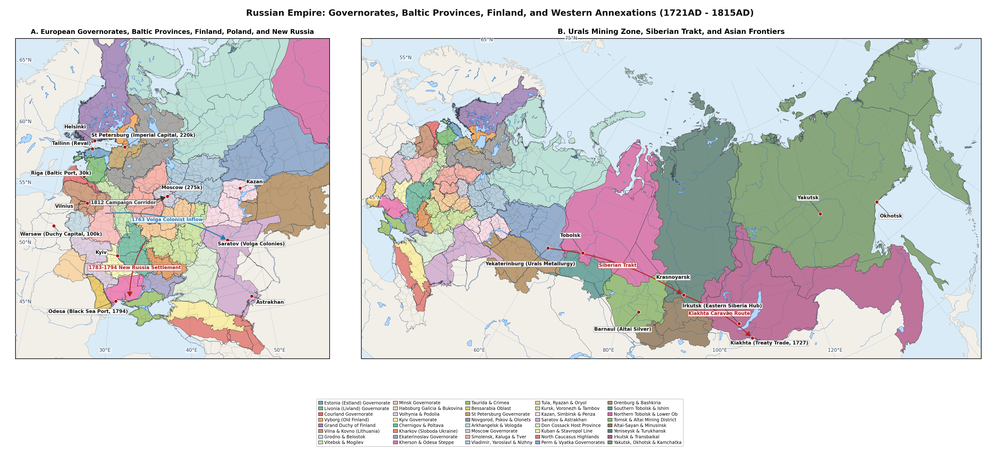

# Overview and Soul-Revision Methodology

This supplementary gazetteer compiles 224 urban settlements, fortress
towns, maritime ports, *miasteczka* (*shtetlekh*), colonist centres,
Ural/Altai metallurgical factory settlements (*gornye zavody*) and
Siberian *ostrogi* across the 40 period-authentic provincial and
frontier regions defined in imperial_russia_pre_1815.json5 (total area
18 496 636 km², growing from 23 888k in 1721AD to 51 171k in 1815AD, or
22 263k to 47 821k within the 39-region Russian Empire envelope
excluding Habsburg Galicia-Bukovina)
[\[1\]](#ref-Kabuzan1963)[\[2\]](#ref-Kabuzan1971)[\[3\]](#ref-Vodarsky1973)[\[4\]](#ref-Mironov1990Urban).
Every settlement record is stored in
imperial_russia_pre_1815_settlements.json in the six-key
population_Stadester dictionary format (name, other_names, coords,
country, key and population), keyed by <Name>-<Country> according to
modern sovereign borders (Estonia, Latvia, Finland, Lithuania, Poland,
Belarus, Ukraine, Moldova and Russia) with strictly positive integer
headcounts across up to eight benchmark years (1721, 1744, 1762, 1782,
1795, 1806, 1811 and 1815).

Town population series synthesise Imperial Soul-Revision merchant and
*meshchane* (*posad*) rolls with governorate police and
military-statistical returns reconstructed by Boris Mironov, Yaroslav
Vodarsky, Vladimir Kabuzan and Pyotr Keppen
[\[3\]](#ref-Vodarsky1973)[\[4\]](#ref-Mironov1990Urban)[\[5\]](#ref-Kabuzan1990)[\[6\]](#ref-Keppen1857),
supplemented by Baltic German *Hakenrevisionen* and Lutheran magistracy
lists [\[7\]](#ref-Hupel1774)[\[8\]](#ref-Palli1996), Swedish-Finnish
*Tabellverket* urban registers
[\[9\]](#ref-Jutikkala1965)[\[10\]](#ref-Turpeinen1979),
Polish-Lithuanian *podymne* / *kahal* and Austrian Galician
conscriptions
[\[11\]](#ref-Kuklo2009)[\[12\]](#ref-Stampfer1995)[\[13\]](#ref-Fellerer2023Galicia),
Novorossiya and Bessarabia colonist chancellery tables
[\[14\]](#ref-Skalkovsky1836)[\[15\]](#ref-Herlihy1986)[\[16\]](#ref-Bushin2011)[\[17\]](#ref-Feldman2023Bessarabia),
Ural and Altai mining-chancellery inventories
[\[18\]](#ref-Portal1950)[\[19\]](#ref-Smirnov1992UralZavody)[\[20\]](#ref-Isaev2025AltaiCabinet)
and Siberian *Trakt* and *ostrog* returns
[\[21\]](#ref-Hartley2014)[\[22\]](#ref-Forsyth1992). In keeping with
the population_Stadester specification, newly founded eighteenth- and
early nineteenth-century ports, fortresses and factory towns (such as
Ekaterinburg 1723AD, Orenburg 1735/1743AD, Barnaul 1730s,
Petropavlovsk-Kamchatsky 1740AD, Elisavetgrad 1754AD, Izhevsk 1760AD,
Katharinenstadt 1765AD, Kherson 1778AD, Mariupol 1778AD, Sevastopol
1783AD, Simferopol 1784AD, Nikolaev 1789AD, Ekaterinodar 1793AD, Odessa
1794AD and Novocherkassk 1805AD) omit pre-foundation keys in JSON and
report - prior to establishment (New in the net change column). To
ensure crisp 10pt tabular legibility within standard margins, the 40
regional tables below display the five principal revision benchmarks
(1721AD, 1762AD, 1795AD, 1811AD and 1815AD), whilst all intermediate
1744AD, 1782AD and 1806AD values remain preserved in
imperial_russia_pre_1815_settlements.json.

# Estland Governorate (Ostsee)

Table lists the catalogued settlements in Region 1 (1. Estland
Governorate (Reval; 1721AD Nystad Baltic Capitulation Province)) (area
22 637 km²), where total regional population moved from 105k in 1721AD,
reaching 228k in 1811AD and 232k in 1815AD (+121,0%)
[\[7\]](#ref-Hupel1774)[\[8\]](#ref-Palli1996)[\[23\]](#ref-Palli1980).

| Settlement | Alternative / Historical Names | Coords & Country | 1721AD | 1762AD | 1795AD | 1811AD | 1815AD | Change |
|:---|:---|:---|:---|:---|:---|:---|:---|:---|
| Reval | Tallinn; Revel | 59,44, 24,75 (Estonia) | 5,8k | 9,2k | 11,4k | 12,6k | 13k | +124,1% |
| Hapsal | Haapsalu; Gapsal | 58,94, 23,54 (Estonia) | 520 | 810 | 1,1k | 1,3k | 1,3k | +157,7% |
| Wesenberg | Rakvere; Vesenberg | 59,35, 26,36 (Estonia) | 450 | 720 | 950 | 1,1k | 1,1k | +155,6% |
| Baltischport | Paldiski; Roggersvik | 59,36, 24,05 (Estonia) | 350 | 780 | 980 | 1,1k | 1,1k | +225,7% |
| Weissenstein | Paide; Veysenshteyn | 58,89, 25,56 (Estonia) | 380 | 600 | 840 | 960 | 1k | +165,8% |

Region 1 (1. Estland Governorate (Ostsee)): Settlements and Population
Trajectories (1721AD - 1815AD).

# Livland Governorate (Riga & Dorpat)

Table lists the catalogued settlements in Region 2 (2. Livland
Governorate (Riga, Dorpat & Osel; 1721AD Nystad Baltic Province)) (area
54 235 km²), where total regional population moved from 195k in 1721AD,
reaching 605k in 1811AD and 615k in 1815AD (+215,4%)
[\[7\]](#ref-Hupel1774)[\[24\]](#ref-Jaadla2014Tartu)[\[25\]](#ref-Savikhin2011Ostsee).

| Settlement | Alternative / Historical Names | Coords & Country | 1721AD | 1762AD | 1795AD | 1811AD | 1815AD | Change |
|:---|:---|:---|:---|:---|:---|:---|:---|:---|
| Riga | Ryga; Rigas | 56,95, 24,11 (Latvia) | 11,8k | 21,2k | 30,8k | 36,5k | 36k | +205,1% |
| Dorpat | Tartu; Yuryev | 58,38, 26,73 (Estonia) | 1,8k | 3,4k | 4,7k | 6,5k | 7,1k | +294,4% |
| Pernau | Parnu; Pernov | 58,39, 24,50 (Estonia) | 1,4k | 2,5k | 3,5k | 4k | 4,2k | +200,0% |
| Arensburg | Kuressaare; Osel | 58,25, 22,50 (Estonia) | 900 | 1,5k | 2,1k | 2,4k | 2,5k | +177,8% |
| Wenden | Cesis; Kess | 57,31, 25,27 (Latvia) | 650 | 1,1k | 1,6k | 1,8k | 1,9k | +192,3% |
| Fellin | Viljandi; Vilyandi | 58,36, 25,59 (Estonia) | 520 | 920 | 1,4k | 1,6k | 1,6k | +217,3% |

Region 2 (2. Livland Governorate (Riga & Dorpat)): Settlements and
Population Trajectories (1721AD - 1815AD).

# Courland Governorate (Mitau & Libau)

Table lists the catalogued settlements in Region 3 (3. Courland
Governorate (Mitau & Libau; 1795AD Third Partition Annexation)) (area 27
588 km²), where total regional population moved from 200k in 1721AD,
reaching 435k in 1811AD and 418k in 1815AD (+109,0%)
[\[5\]](#ref-Kabuzan1990)[\[26\]](#ref-Kabuzan1992)[\[27\]](#ref-Kappeler2001).

| Settlement | Alternative / Historical Names | Coords & Country | 1721AD | 1762AD | 1795AD | 1811AD | 1815AD | Change |
|:---|:---|:---|:---|:---|:---|:---|:---|:---|
| Mitau | Jelgava; Mitava | 56,65, 23,72 (Latvia) | 5,8k | 8,6k | 11,5k | 12,9k | 12,1k | +108,6% |
| Libau | Liepaja; Libava | 56,50, 21,01 (Latvia) | 2,4k | 3,9k | 5,5k | 6,4k | 6,1k | +154,2% |
| Goldingen | Kuldiga | 56,97, 21,97 (Latvia) | 1,1k | 1,6k | 2,2k | 2,5k | 2,4k | +116,4% |
| Windau | Ventspils; Vindava | 57,39, 21,56 (Latvia) | 950 | 1,4k | 1,9k | 2,2k | 2k | +115,8% |
| Jakobstadt | Jekabpils; Yakovlev | 56,50, 25,86 (Latvia) | 850 | 1,3k | 1,8k | 2,1k | 2k | +129,4% |

Region 3 (3. Courland Governorate (Mitau & Libau)): Settlements and
Population Trajectories (1721AD - 1815AD).

# Old Finland / Vyborg Governorate

Table lists the catalogued settlements in Region 4 (4. Old Finland /
Vyborg Governorate (1721AD Nystad & 1743AD Abo; Reunited 1812AD)) (area
43 532 km²), where total regional population moved from 110k in 1721AD,
reaching 198k in 1811AD and 202k in 1815AD (+83,6%)
[\[9\]](#ref-Jutikkala1965)[\[28\]](#ref-Kashchenko2016Vyborg).

| Settlement | Alternative / Historical Names | Coords & Country | 1721AD | 1762AD | 1795AD | 1811AD | 1815AD | Change |
|:---|:---|:---|:---|:---|:---|:---|:---|:---|
| Vyborg | Viipuri; Viborg | 60,71, 28,75 (Russia) | 1,9k | 2,9k | 3,6k | 4k | 4,1k | +115,8% |
| Fredrikshamn | Hamina; Fridrikhsgam | 60,57, 27,20 (Finland) | 850 | 1,3k | 1,7k | 1,9k | 2k | +135,3% |
| Villmanstrand | Lappeenranta; Vilmanstrand | 61,06, 28,19 (Finland) | 520 | 780 | 1k | 1,1k | 1,2k | +128,8% |
| Kexholm | Priozersk; Korela | 61,04, 30,13 (Russia) | 480 | 710 | 920 | 1k | 1,1k | +120,8% |
| Nyslott | Savonlinna; Neishlot | 61,87, 28,88 (Finland) | 360 | 530 | 700 | 790 | 830 | +130,6% |

Region 4 (4. Old Finland / Vyborg Governorate): Settlements and
Population Trajectories (1721AD - 1815AD).

# Grand Duchy of Finland (1809AD)

Table lists the catalogued settlements in Region 5 (5. Grand Duchy of
Finland (Abo, Helsingfors, Tavastehus, Vasa & Uleaborg; Annexed 1809AD))
(area 333 899 km²), where total regional population moved from 390k in
1721AD, reaching 880k in 1811AD and 908k in 1815AD (+132,8%)
[\[9\]](#ref-Jutikkala1965)[\[10\]](#ref-Turpeinen1979)[\[29\]](#ref-Pitkanen1993).

| Settlement | Alternative / Historical Names | Coords & Country | 1721AD | 1762AD | 1795AD | 1811AD | 1815AD | Change |
|:---|:---|:---|:---|:---|:---|:---|:---|:---|
| Abo | Turku; Obo | 60,45, 22,27 (Finland) | 5,6k | 8,2k | 11,1k | 12,1k | 12,8k | +128,6% |
| Helsingfors | Helsinki; Gelsingfors | 60,17, 24,94 (Finland) | 1,5k | 3,6k | 5,8k | 7,1k | 9,2k | +513,3% |
| Uleaborg | Oulu | 65,01, 25,47 (Finland) | 1,4k | 2,3k | 3,5k | 3,8k | 4,1k | +192,9% |
| Bjorneborg | Pori | 61,49, 21,80 (Finland) | 1,2k | 2k | 3k | 3,2k | 3,5k | +187,5% |
| Vasa | Vaasa; Nikolaistad | 63,10, 21,62 (Finland) | 1,1k | 1,9k | 2,8k | 3k | 3,2k | +195,5% |
| Tavastehus | Hameenlinna | 60,99, 24,46 (Finland) | 650 | 1k | 1,6k | 1,8k | 2k | +200,0% |
| Kuopio | Kuopio Savonia | 62,89, 27,68 (Finland) | \- | \- | 1k | 1,2k | 1,4k | New |

Region 5 (5. Grand Duchy of Finland (1809AD)): Settlements and
Population Trajectories (1721AD - 1815AD).

# Vilna Governorate & Samogitia

Table lists the catalogued settlements in Region 6 (6. Vilna Governorate
& Samogitia / Kovno (1795AD Third Partition & 1812AD Grande Armee
Crossing)) (area 94 337 km²), where total regional population moved from
655k in 1721AD, reaching 1 220k in 1811AD and 1 110k in 1815AD (+69,5%)
[\[11\]](#ref-Kuklo2009)[\[12\]](#ref-Stampfer1995)[\[30\]](#ref-Lieven2009).

| Settlement | Alternative / Historical Names | Coords & Country | 1721AD | 1762AD | 1795AD | 1811AD | 1815AD | Change |
|:---|:---|:---|:---|:---|:---|:---|:---|:---|
| Vilna | Vilnius; Wilno | 54,69, 25,28 (Lithuania) | 19,5k | 26k | 35,5k | 42k | 36k | +84,6% |
| Kovno | Kaunas; Kowno | 54,90, 23,90 (Lithuania) | 3,8k | 5,2k | 7k | 8,3k | 6,9k | +81,6% |
| Shavli | Siauliai; Szawle | 55,93, 23,31 (Lithuania) | 1,6k | 2,4k | 3,2k | 3,8k | 3,4k | +112,5% |
| Ponevezh | Panevezys; Poniewiez | 55,73, 24,36 (Lithuania) | 1,4k | 1,9k | 2,6k | 3,1k | 2,8k | +107,4% |
| Telshi | Telsiai; Telsze | 55,98, 22,25 (Lithuania) | 1,2k | 1,8k | 2,4k | 2,8k | 2,5k | +112,5% |

Region 6 (6. Vilna Governorate & Samogitia): Settlements and Population
Trajectories (1721AD - 1815AD).

# Grodno Governorate & Belostok Oblast

Table lists the catalogued settlements in Region 7 (7. Grodno
Governorate & Belostok Oblast (1795AD Third Partition & 1807AD Treaty of
Tilsit)) (area 40 416 km²), where total regional population moved from
360k in 1721AD, reaching 760k in 1811AD and 695k in 1815AD (+93,1%)
[\[11\]](#ref-Kuklo2009)[\[31\]](#ref-Reutskaya2016Belarus)[\[32\]](#ref-Klier1986).

| Settlement | Alternative / Historical Names | Coords & Country | 1721AD | 1762AD | 1795AD | 1811AD | 1815AD | Change |
|:---|:---|:---|:---|:---|:---|:---|:---|:---|
| Grodno | Hrodna; Gardinas | 53,67, 23,81 (Belarus) | 4,2k | 6,2k | 8,6k | 10,1k | 9,1k | +116,7% |
| Brest-Litovsk | Brest; Brzesc Litewski | 52,10, 23,73 (Belarus) | 3,6k | 5,1k | 6,9k | 8k | 7,2k | +100,0% |
| Belostok | Bialystok; Belostok Oblast | 53,13, 23,17 (Poland) | 1,8k | 3,4k | 5,1k | 6,4k | 6k | +233,3% |
| Slonim | Slonim Grodno | 53,09, 25,32 (Belarus) | 2,1k | 3,2k | 4,5k | 5,3k | 4,7k | +123,8% |
| Novogrudok | Navahrudak; Nowogrodek | 53,59, 25,82 (Belarus) | 1,9k | 2,8k | 3,9k | 4,4k | 4k | +107,9% |
| Lida | Lida Grodno | 53,88, 25,30 (Belarus) | 1,4k | 2k | 2,9k | 3,3k | 3k | +110,7% |

Region 7 (7. Grodno Governorate & Belostok Oblast): Settlements and
Population Trajectories (1721AD - 1815AD).

# Vitebsk & Mogilev Governorates

Table lists the catalogued settlements in Region 8 (8. Vitebsk & Mogilev
Governorates (1772AD First Partition Eastern Belarus & 1812AD Berezina))
(area 80 648 km²), where total regional population moved from 610k in
1721AD, reaching 1 380k in 1811AD and 1 245k in 1815AD (+104,1%)
[\[2\]](#ref-Kabuzan1971)[\[30\]](#ref-Lieven2009)[\[31\]](#ref-Reutskaya2016Belarus).

| Settlement | Alternative / Historical Names | Coords & Country | 1721AD | 1762AD | 1795AD | 1811AD | 1815AD | Change |
|:---|:---|:---|:---|:---|:---|:---|:---|:---|
| Mogilev | Mahilyow; Mohylew | 53,90, 30,33 (Belarus) | 7,5k | 10,8k | 14,2k | 16,3k | 14,4k | +92,0% |
| Vitebsk | Vitsyebsk; Witebsk | 55,19, 30,20 (Belarus) | 6,2k | 9,4k | 13,2k | 15,4k | 13,1k | +111,3% |
| Shklov | Szklow; Shklow | 54,21, 30,29 (Belarus) | 3,8k | 6,1k | 9,1k | 10,5k | 9,2k | +142,1% |
| Polotsk | Polatsk; Polock | 55,49, 28,79 (Belarus) | 4,2k | 6,2k | 8,4k | 9,6k | 8,1k | +92,9% |
| Gomel | Homyel; Homel | 52,43, 30,98 (Belarus) | 2,8k | 4,6k | 6,8k | 8,1k | 7,7k | +175,0% |
| Dunaburg | Daugavpils; Dvinsk | 55,87, 26,54 (Latvia) | 1,6k | 2,5k | 3,8k | 5,2k | 4,8k | +200,0% |
| Orsha | Orsza | 54,51, 30,42 (Belarus) | 2,1k | 3,2k | 4,6k | 5,4k | 4,3k | +104,8% |

Region 8 (8. Vitebsk & Mogilev Governorates): Settlements and Population
Trajectories (1721AD - 1815AD).

# Minsk Governorate & Polesia

Table lists the catalogued settlements in Region 9 (9. Minsk Governorate
& Pripyat Polesia (1793AD Second Partition Central Belarus)) (area 94
971 km²), where total regional population moved from 430k in 1721AD,
reaching 995k in 1811AD and 920k in 1815AD (+114,0%)
[\[12\]](#ref-Stampfer1995)[\[26\]](#ref-Kabuzan1992)[\[31\]](#ref-Reutskaya2016Belarus).

| Settlement | Alternative / Historical Names | Coords & Country | 1721AD | 1762AD | 1795AD | 1811AD | 1815AD | Change |
|:---|:---|:---|:---|:---|:---|:---|:---|:---|
| Minsk | Mensk; Miensk | 53,90, 27,56 (Belarus) | 6,8k | 9,5k | 11,6k | 13,5k | 11,8k | +73,5% |
| Slutsk | Sluck | 53,03, 27,56 (Belarus) | 5,4k | 6,2k | 6,9k | 7,5k | 6,9k | +27,8% |
| Bobruisk | Babruysk; Bobrujsk | 53,14, 29,22 (Belarus) | 2,2k | 3,2k | 4,3k | 6,5k | 6,2k | +181,8% |
| Pinsk | Pinsk Polesia | 52,11, 26,10 (Belarus) | 3,4k | 4,4k | 5,3k | 6,1k | 5,7k | +67,6% |
| Mozyr | Mazyr | 52,05, 29,25 (Belarus) | 1,8k | 2,5k | 3,2k | 3,7k | 3,5k | +94,4% |
| Borisov | Barysaw; Berezina | 54,22, 28,51 (Belarus) | 2,4k | 3,2k | 3,9k | 4,6k | 3,4k | +41,7% |

Region 9 (9. Minsk Governorate & Polesia): Settlements and Population
Trajectories (1721AD - 1815AD).

# Habsburg Galicia & Bukovina

Table lists the catalogued settlements in Region 10 (10. Habsburg
Kingdom of Galicia & Lodomeria (1772AD), Bukovina (1775AD) & Carpathian
Rus) (area 70 612 km²), where total regional population moved from 1
625k in 1721AD, reaching 3 260k in 1811AD and 3 350k in 1815AD (+106,2%)
[\[11\]](#ref-Kuklo2009)[\[13\]](#ref-Fellerer2023Galicia)[\[33\]](#ref-Bohachevsky1967).

| Settlement | Alternative / Historical Names | Coords & Country | 1721AD | 1762AD | 1795AD | 1811AD | 1815AD | Change |
|:---|:---|:---|:---|:---|:---|:---|:---|:---|
| Lviv | Lemberg; Lwow | 49,84, 24,03 (Ukraine) | 25k | 30k | 38,5k | 43k | 44,5k | +78,0% |
| Brody | Brody Free City | 50,08, 25,15 (Ukraine) | 7,5k | 11,5k | 16,8k | 18,9k | 19,5k | +160,0% |
| Stanislau | Ivano-Frankivsk; Stanislawow | 48,92, 24,71 (Ukraine) | 4,8k | 6,5k | 8,5k | 9,7k | 10,1k | +110,4% |
| Tarnopol | Ternopil | 49,55, 25,59 (Ukraine) | 4,5k | 6,2k | 8,2k | 9,4k | 9,8k | +117,8% |
| Drohobych | Drogobych | 49,35, 23,50 (Ukraine) | 4,2k | 5,7k | 7,5k | 8,6k | 8,9k | +111,9% |
| Chernivtsi | Czernowitz; Cernauti | 48,29, 25,94 (Ukraine) | 1,8k | 2,5k | 5,1k | 6,3k | 6,8k | +277,8% |
| Uzhhorod | Ungvar; Uzgorod | 48,62, 22,29 (Ukraine) | 2,2k | 3,1k | 4,4k | 5,2k | 5,5k | +150,0% |

Region 10 (10. Habsburg Galicia & Bukovina): Settlements and Population
Trajectories (1721AD - 1815AD).

# Volhynia & Podolia Governorates

Table lists the catalogued settlements in Region 11 (11. Volhynia &
Podolia Governorates (1793-1795AD Partitions; Early Pale of Settlement))
(area 118 214 km²), where total regional population moved from 1 195k in
1721AD, reaching 2 870k in 1811AD and 2 960k in 1815AD (+147,7%)
[\[32\]](#ref-Klier1986)[\[34\]](#ref-Perkovsky1979)[\[35\]](#ref-Kabuzan2006).

| Settlement | Alternative / Historical Names | Coords & Country | 1721AD | 1762AD | 1795AD | 1811AD | 1815AD | Change |
|:---|:---|:---|:---|:---|:---|:---|:---|:---|
| Kamenets-Podolsky | Kamianets-Podilskyi; Kamieniec | 48,68, 26,59 (Ukraine) | 6,5k | 8,9k | 11,6k | 13,2k | 13,8k | +112,3% |
| Zhitomir | Zhytomyr; Zytomierz | 50,25, 28,66 (Ukraine) | 3,8k | 5,6k | 8,1k | 10,1k | 10,8k | +184,2% |
| Dubno | Dubno Kontrakty | 50,42, 25,73 (Ukraine) | 4,5k | 6,5k | 9,1k | 8,5k | 8,7k | +93,3% |
| Mogilev-Podolsky | Mohyliv-Podilskyi | 48,45, 27,81 (Ukraine) | 2,9k | 4,5k | 6,6k | 7,8k | 8,3k | +186,2% |
| Vinnitsa | Vinnytsia; Winnica | 49,23, 28,47 (Ukraine) | 3,1k | 4,6k | 6,4k | 7,5k | 7,9k | +154,8% |
| Lutsk | Luck | 50,75, 25,33 (Ukraine) | 3,2k | 4,3k | 5,6k | 6,4k | 6,7k | +109,4% |

Region 11 (11. Volhynia & Podolia Governorates): Settlements and
Population Trajectories (1721AD - 1815AD).

# Kyiv Governorate (Left & Right Bank)

Table lists the catalogued settlements in Region 12 (12. Kyiv
Governorate (Left-Bank City & 1793AD Right-Bank Hinterland)) (area 54
181 km²), where total regional population moved from 342k in 1721AD,
reaching 905k in 1811AD and 940k in 1815AD (+174,9%)
[\[4\]](#ref-Mironov1990Urban)[\[34\]](#ref-Perkovsky1979)[\[35\]](#ref-Kabuzan2006).

| Settlement | Alternative / Historical Names | Coords & Country | 1721AD | 1762AD | 1795AD | 1811AD | 1815AD | Change |
|:---|:---|:---|:---|:---|:---|:---|:---|:---|
| Kyiv | Kiev; Kyiv Pechersk | 50,45, 30,52 (Ukraine) | 14,8k | 18,2k | 20,9k | 22,6k | 23,4k | +58,1% |
| Berdichev | Berdychiv; Berdyczow | 49,89, 28,60 (Ukraine) | 3,2k | 6,4k | 11,2k | 14,8k | 16k | +400,0% |
| Uman | Human | 48,75, 30,22 (Ukraine) | 3,4k | 6,2k | 8,2k | 10k | 10,6k | +211,8% |
| Bila Tserkva | Belaya Tserkov; Biala Cerkiew | 49,80, 30,12 (Ukraine) | 2,8k | 4,3k | 6,1k | 7,3k | 7,7k | +175,0% |
| Cherkasy | Cherkassy | 49,44, 32,06 (Ukraine) | 2,2k | 3,3k | 4,7k | 5,6k | 5,9k | +168,2% |

Region 12 (12. Kyiv Governorate (Left & Right Bank)): Settlements and
Population Trajectories (1721AD - 1815AD).

# Little Russia: Chernigov & Poltava

Table lists the catalogued settlements in Region 13 (13. Little Russia:
Chernigov & Poltava Governorates (Hetmanate Abolished 1764-1781AD))
(area 106 759 km²), where total regional population moved from 1 555k in
1721AD, reaching 3 270k in 1811AD and 3 350k in 1815AD (+115,4%)
[\[35\]](#ref-Kabuzan2006)[\[36\]](#ref-Irtenina2022Hetmanate)[\[37\]](#ref-Moon1999).

| Settlement | Alternative / Historical Names | Coords & Country | 1721AD | 1762AD | 1795AD | 1811AD | 1815AD | Change |
|:---|:---|:---|:---|:---|:---|:---|:---|:---|
| Nezhin | Nizhyn; Niezyn | 51,05, 31,89 (Ukraine) | 10,5k | 12,8k | 14,9k | 16,1k | 16,5k | +57,1% |
| Poltava | Poltava Regiment | 49,59, 34,55 (Ukraine) | 6,8k | 8,5k | 10,5k | 12,2k | 12,8k | +88,2% |
| Kremenchug | Kremenchuk | 49,07, 33,42 (Ukraine) | 2,8k | 4,8k | 8,8k | 10,4k | 11k | +292,9% |
| Chernigov | Chernihiv | 51,50, 31,29 (Ukraine) | 5,2k | 6,7k | 8,3k | 9,4k | 9,7k | +86,5% |
| Glukhov | Hlukhiv; Hetman Capital | 51,68, 33,92 (Ukraine) | 6,4k | 8,6k | 8,4k | 8,9k | 9,1k | +42,2% |
| Starodub | Starodub Regiment | 52,58, 32,77 (Russia) | 4,6k | 5,9k | 7,3k | 8,1k | 8,3k | +80,4% |

Region 13 (13. Little Russia: Chernigov & Poltava): Settlements and
Population Trajectories (1721AD - 1815AD).

# Sloboda-Ukrainian / Kharkov Gov.

Table lists the catalogued settlements in Region 14 (14.
Sloboda-Ukrainian / Kharkov Governorate (Cossack Regiments Abolished
1765AD)) (area 57 378 km²), where total regional population moved from
402k in 1721AD, reaching 1 065k in 1811AD and 1 100k in 1815AD (+173,6%)
[\[4\]](#ref-Mironov1990Urban)[\[35\]](#ref-Kabuzan2006)[\[38\]](#ref-Bagaley1918).

| Settlement | Alternative / Historical Names | Coords & Country | 1721AD | 1762AD | 1795AD | 1811AD | 1815AD | Change |
|:---|:---|:---|:---|:---|:---|:---|:---|:---|
| Kharkov | Kharkiv; Sloboda Capital | 49,99, 36,23 (Ukraine) | 6,5k | 9,2k | 11,9k | 14,4k | 15,2k | +133,8% |
| Akhtyrka | Okhtyrka | 50,30, 34,90 (Ukraine) | 5,8k | 7,9k | 10,2k | 11,5k | 11,9k | +105,2% |
| Sumy | Sumy Regiment | 50,91, 34,80 (Ukraine) | 6,2k | 8,1k | 10,1k | 11,2k | 11,5k | +85,5% |
| Izyum | Izium | 49,22, 37,26 (Ukraine) | 3,4k | 4,7k | 6,1k | 7k | 7,3k | +114,7% |
| Chuguev | Chuhuiv | 49,84, 36,69 (Ukraine) | 3,1k | 4,4k | 6k | 6,9k | 7,2k | +132,3% |

Region 14 (14. Sloboda-Ukrainian / Kharkov Gov.): Settlements and
Population Trajectories (1721AD - 1815AD).

# Ekaterinoslav & Former Zaporizhzhia

Table lists the catalogued settlements in Region 15 (15. Ekaterinoslav
Governorate & Former Zaporozhian Lands (Sich Destroyed 1775AD)) (area 58
890 km²), where total regional population moved from 145k in 1721AD,
reaching 765k in 1811AD and 820k in 1815AD (+465,5%)
[\[39\]](#ref-Kabuzan1976Novorossiya)[\[40\]](#ref-Pakhomenko2014Mariupol1778)[\[41\]](#ref-Bessarabova2017).

| Settlement | Alternative / Historical Names | Coords & Country | 1721AD | 1762AD | 1795AD | 1811AD | 1815AD | Change |
|:---|:---|:---|:---|:---|:---|:---|:---|:---|
| Ekaterinoslav | Dnipro; Novorossiysk 1796 | 48,46, 35,05 (Ukraine) | \- | \- | 4,8k | 7,9k | 8,8k | New |
| Novomoskovsk | Samar; Samarchik | 48,63, 35,26 (Ukraine) | 2,4k | 3,5k | 5,1k | 6,2k | 6,6k | +175,0% |
| Bakhmut | Artemivsk; Bakhmut Salt | 48,60, 38,00 (Ukraine) | 1,8k | 2,7k | 4k | 4,8k | 5,1k | +183,3% |
| Mariupol | Pavlovsk; Crimean Greek Colony | 47,10, 37,54 (Ukraine) | \- | \- | 3,3k | 3,9k | 4,1k | New |
| Aleksandrovsk | Zaporizhzhia; Aleksandrovskaya Fortress | 47,84, 35,14 (Ukraine) | \- | \- | 1,9k | 2,7k | 3k | New |
| Lugansk | Luhansk; Luganskiy Zavod | 48,57, 39,31 (Ukraine) | \- | \- | 1,1k | 2,1k | 2,4k | New |

Region 15 (15. Ekaterinoslav & Former Zaporizhzhia): Settlements and
Population Trajectories (1721AD - 1815AD).

# Kherson, Nikolaev & Odessa Steppe

Table lists the catalogued settlements in Region 16 (16. Kherson /
Nikolaev Governorate & Ochakov Steppe (1774/1791AD Annexations; Odessa
1794AD)) (area 77 455 km²), where total regional population moved from
105k in 1721AD, reaching 565k in 1811AD and 620k in 1815AD (+490,5%)
[\[14\]](#ref-Skalkovsky1836)[\[15\]](#ref-Herlihy1986)[\[16\]](#ref-Bushin2011)[\[42\]](#ref-Kashirin2019).

| Settlement | Alternative / Historical Names | Coords & Country | 1721AD | 1762AD | 1795AD | 1811AD | 1815AD | Change |
|:---|:---|:---|:---|:---|:---|:---|:---|:---|
| Odessa | Odesa; Hadjibey | 46,48, 30,72 (Ukraine) | \- | 800 | 4,5k | 24k | 35k | New |
| Kherson | Kherson Admiralty | 46,64, 32,62 (Ukraine) | \- | \- | 11,2k | 13,4k | 14,2k | New |
| Nikolaev | Mykolaiv; Ingul Shipyard | 46,98, 31,99 (Ukraine) | \- | \- | 4,2k | 9,6k | 11,2k | New |
| Elisavetgrad | Kropyvnytskyi; Fort St Elizabeth | 48,51, 32,26 (Ukraine) | \- | 2,3k | 6,9k | 9,5k | 10,4k | New |
| Tiraspol | Sredinnaya Krepost | 46,84, 29,64 (Moldova) | \- | \- | 2,4k | 3,9k | 4,4k | New |
| Ochakov | Ochakiv; Ozu-Kale | 46,61, 31,55 (Ukraine) | 4,5k | 5,2k | 2,2k | 2,9k | 3,2k | -28,9% |

Region 16 (16. Kherson, Nikolaev & Odessa Steppe): Settlements and
Population Trajectories (1721AD - 1815AD).

# Taurida Governorate (Crimea 1783AD)

Table lists the catalogued settlements in Region 17 (17. Taurida
Governorate (Crimean Khanate Annexed 1783AD; Tatar Exodus & Colonist
Settlement)) (area 69 868 km²), where total regional population moved
from 370k in 1721AD, reaching 345k in 1811AD and 370k in 1815AD (0,0%)
[\[39\]](#ref-Kabuzan1976Novorossiya)[\[43\]](#ref-Williams2001)[\[44\]](#ref-Dmitriev2018CrimeaEmigration).

| Settlement | Alternative / Historical Names | Coords & Country | 1721AD | 1762AD | 1795AD | 1811AD | 1815AD | Change |
|:---|:---|:---|:---|:---|:---|:---|:---|:---|
| Sevastopol | Akhtiar; Black Sea Fleet Base | 44,62, 33,53 (Ukraine) | \- | \- | 4,5k | 11,5k | 13,5k | New |
| Bakhchisarai | Bagcesaray; Khanate Capital | 44,75, 33,86 (Ukraine) | 16,5k | 15k | 6,2k | 8,1k | 8,8k | -46,7% |
| Evpatoria | Gozlev; Kezlev | 45,19, 33,37 (Ukraine) | 9,5k | 8,5k | 4,1k | 5,7k | 6,3k | -33,7% |
| Karasubazar | Bilohirsk; Qarasuvbazar | 45,05, 34,60 (Ukraine) | 11k | 9,8k | 3,9k | 5,3k | 5,8k | -47,3% |
| Feodosia | Kaffa; Caffa | 45,03, 35,38 (Ukraine) | 18k | 14,5k | 2,3k | 4,6k | 5,4k | -70,0% |
| Simferopol | Ak-Mechet; Aqmescit | 44,95, 34,10 (Ukraine) | 2,2k | 2k | 2,4k | 4k | 4,6k | +109,1% |

Region 17 (17. Taurida Governorate (Crimea 1783AD)): Settlements and
Population Trajectories (1721AD - 1815AD).

# Bessarabia Oblast (1812AD Annexation)

Table lists the catalogued settlements in Region 18 (18. Bessarabia
Oblast (Kishinev, Bender & Budjak; Annexed at Treaty of Bucharest
1812AD)) (area 47 077 km²), where total regional population moved from
200k in 1721AD, reaching 310k in 1811AD and 385k in 1815AD (+92,5%)
[\[17\]](#ref-Feldman2023Bessarabia)[\[26\]](#ref-Kabuzan1992)[\[45\]](#ref-Bas2015Novorossiya).

| Settlement | Alternative / Historical Names | Coords & Country | 1721AD | 1762AD | 1795AD | 1811AD | 1815AD | Change |
|:---|:---|:---|:---|:---|:---|:---|:---|:---|
| Kishinev | Chisinau; Kishinyov | 47,01, 28,86 (Moldova) | 4,5k | 6k | 7,8k | 7,5k | 18k | +300,0% |
| Izmail | Ismail; Smil | 45,35, 28,83 (Ukraine) | 9k | 12k | 8,5k | 6,8k | 11,5k | +27,8% |
| Akkerman | Bilhorod-Dnistrovskyi; Cetatea Alba | 46,20, 30,34 (Ukraine) | 7,5k | 8,6k | 7,8k | 6,5k | 9,8k | +30,7% |
| Bender | Tighina; Bendery | 46,83, 29,48 (Moldova) | 8,5k | 9,5k | 7,5k | 5,2k | 7,4k | -12,9% |
| Khotin | Khotyn; Hotin | 48,51, 26,49 (Ukraine) | 5,5k | 6,5k | 6,2k | 5,1k | 6,6k | +20,0% |

Region 18 (18. Bessarabia Oblast (1812AD Annexation)): Settlements and
Population Trajectories (1721AD - 1815AD).

# Saint Petersburg Governorate

Table lists the catalogued settlements in Region 19 (19. Saint
Petersburg Governorate (Imperial Capital, Kronstadt & Ingria)) (area 62
709 km²), where total regional population moved from 260k in 1721AD,
reaching 735k in 1811AD and 760k in 1815AD (+192,3%)
[\[3\]](#ref-Vodarsky1973)[\[4\]](#ref-Mironov1990Urban)[\[46\]](#ref-Kahan1985).

| Settlement | Alternative / Historical Names | Coords & Country | 1721AD | 1762AD | 1795AD | 1811AD | 1815AD | Change |
|:---|:---|:---|:---|:---|:---|:---|:---|:---|
| Saint Petersburg | Sankt-Peterburg; Imperial Capital | 59,93, 30,34 (Russia) | 40k | 130k | 225k | 300k | 335k | +737,5% |
| Kronstadt | Kronshtadt; Kotlin Naval Base | 59,99, 29,77 (Russia) | 8,5k | 16,5k | 24,5k | 29,5k | 31k | +264,7% |
| Tsarskoe Selo | Pushkin; Sofia | 59,71, 30,40 (Russia) | 600 | 2,6k | 5,1k | 6,6k | 7,2k | +1100,0% |
| Narva | Rugodiv; Narva Ingria | 59,38, 28,18 (Estonia) | 2,4k | 3,4k | 4,2k | 4,7k | 4,9k | +104,2% |
| Shlisselburg | Oreshek; Noteburg | 59,95, 31,03 (Russia) | 1,6k | 2,7k | 3,9k | 4,7k | 4,9k | +206,2% |

Region 19 (19. Saint Petersburg Governorate): Settlements and Population
Trajectories (1721AD - 1815AD).

# Novgorod, Pskov & Olonets Govs.

Table lists the catalogued settlements in Region 20 (20. Novgorod, Pskov
& Olonets Governorates (Vyshny Volochyok Canal & Petrozavodsk
Ironworks)) (area 306 752 km²), where total regional population moved
from 1 155k in 1721AD, reaching 1 755k in 1811AD and 1 770k in 1815AD
(+53,2%)
[\[3\]](#ref-Vodarsky1973)[\[4\]](#ref-Mironov1990Urban)[\[46\]](#ref-Kahan1985).

| Settlement | Alternative / Historical Names | Coords & Country | 1721AD | 1762AD | 1795AD | 1811AD | 1815AD | Change |
|:---|:---|:---|:---|:---|:---|:---|:---|:---|
| Novgorod | Velikiy Novgorod | 58,52, 31,28 (Russia) | 7,2k | 8,5k | 10,4k | 11,5k | 11,8k | +63,9% |
| Pskov | Pleskau | 57,81, 28,35 (Russia) | 6,8k | 8,1k | 9,8k | 10,9k | 11,2k | +64,7% |
| Staraya Russa | Russa Saltworks | 57,99, 31,36 (Russia) | 4,5k | 5,6k | 7k | 7,8k | 8k | +77,8% |
| Velikie Luki | Luki | 56,34, 30,55 (Russia) | 3,1k | 3,8k | 4,7k | 5,3k | 5,4k | +74,2% |
| Petrozavodsk | Petrovskaya Sloboda; Alexandrovsk Foundry | 61,78, 34,35 (Russia) | 1,8k | 2,2k | 4,2k | 5k | 5,3k | +194,4% |
| Tikhvin | Tikhvin Canal | 59,65, 33,53 (Russia) | 2,8k | 3,5k | 4,4k | 5k | 5,2k | +85,7% |

Region 20 (20. Novgorod, Pskov & Olonets Govs.): Settlements and
Population Trajectories (1721AD - 1815AD).

# Arkhangelsk & Vologda Governorates

Table lists the catalogued settlements in Region 21 (21. Arkhangelsk &
Vologda Governorates (White Sea Pomorye, Velikiy Ustyug & Komi Pechora))
(area 1 313 985 km²), where total regional population moved from 560k in
1721AD, reaching 905k in 1811AD and 920k in 1815AD (+64,3%)
[\[2\]](#ref-Kabuzan1971)[\[46\]](#ref-Kahan1985)[\[47\]](#ref-Vodarsky1977).

| Settlement | Alternative / Historical Names | Coords & Country | 1721AD | 1762AD | 1795AD | 1811AD | 1815AD | Change |
|:---|:---|:---|:---|:---|:---|:---|:---|:---|
| Vologda | Vologda Portage | 59,22, 39,88 (Russia) | 8,8k | 10,2k | 11,8k | 12,9k | 13,2k | +50,0% |
| Arkhangelsk | Archangel; Novye Kholmogory | 64,54, 40,54 (Russia) | 6,5k | 7,5k | 10,2k | 12,4k | 12,8k | +96,9% |
| Velikiy Ustyug | Ustyug Velikiy | 60,76, 46,30 (Russia) | 7,2k | 8,2k | 9,5k | 10,4k | 10,6k | +47,2% |
| Totma | Totma Saltworks | 59,98, 42,76 (Russia) | 2,4k | 2,9k | 3,4k | 3,7k | 3,8k | +58,3% |
| Ust-Sysolsk | Syktyvkar; Komi Centre | 61,67, 50,84 (Russia) | 900 | 1,4k | 2k | 2,3k | 2,4k | +166,7% |

Region 21 (21. Arkhangelsk & Vologda Governorates): Settlements and
Population Trajectories (1721AD - 1815AD).

# Moscow Governorate (Old Capital)

Table lists the catalogued settlements in Region 22 (22. Moscow
Governorate (1771AD Plague Riot & 1812AD Napoleonic Fire/Occupation))
(area 28 080 km²), where total regional population moved from 725k in
1721AD, reaching 1 235k in 1811AD and 1 120k in 1815AD (+54,5%)
[\[4\]](#ref-Mironov1990Urban)[\[30\]](#ref-Lieven2009)[\[48\]](#ref-Alexander1980)[\[49\]](#ref-Iskhakov2013Plague1771).

| Settlement | Alternative / Historical Names | Coords & Country | 1721AD | 1762AD | 1795AD | 1811AD | 1815AD | Change |
|:---|:---|:---|:---|:---|:---|:---|:---|:---|
| Moscow | Moskva; Pervoprestolnaya | 55,76, 37,62 (Russia) | 140k | 165k | 215k | 275k | 185k | +32,1% |
| Kolomna | Kolomna Oka | 55,08, 38,78 (Russia) | 6,2k | 7,5k | 9,1k | 10,4k | 9,8k | +58,1% |
| Serpukhov | Serpukhov Textile | 54,92, 37,41 (Russia) | 4,8k | 5,9k | 7,2k | 8,6k | 8,2k | +70,8% |
| Dmitrov | Dmitrov Yakhroma | 56,34, 37,52 (Russia) | 2,4k | 2,9k | 3,6k | 4,2k | 3,9k | +62,5% |
| Mozhaysk | Mozhaisk; Borodino Uezd | 55,50, 36,03 (Russia) | 2,1k | 2,6k | 3,3k | 3,9k | 2,4k | +14,3% |

Region 22 (22. Moscow Governorate (Old Capital)): Settlements and
Population Trajectories (1721AD - 1815AD).

# Smolensk, Kaluga & Tver Govs.

Table lists the catalogued settlements in Region 23 (23. Smolensk,
Kaluga & Tver Governorates (1812AD Smolensk-Borodino-Maloyaroslavets War
Corridor)) (area 152 780 km²), where total regional population moved
from 1 720k in 1721AD, reaching 2 870k in 1811AD and 2 640k in 1815AD
(+53,5%)
[\[4\]](#ref-Mironov1990Urban)[\[30\]](#ref-Lieven2009)[\[50\]](#ref-Shelomentseva2015Smolensk1812).

| Settlement | Alternative / Historical Names | Coords & Country | 1721AD | 1762AD | 1795AD | 1811AD | 1815AD | Change |
|:---|:---|:---|:---|:---|:---|:---|:---|:---|
| Kaluga | Kaluga Oka | 54,53, 36,28 (Russia) | 12,8k | 16,5k | 20,8k | 23,6k | 23k | +79,7% |
| Tver | Tver Volga | 56,86, 35,92 (Russia) | 8,5k | 11,5k | 16,2k | 18,6k | 18,2k | +114,1% |
| Torzhok | Novy Torzhok | 57,04, 34,96 (Russia) | 5,6k | 7,4k | 9,9k | 11,4k | 11,2k | +100,0% |
| Smolensk | Smolensk Fortress | 54,78, 32,05 (Russia) | 7,8k | 10k | 12,6k | 14,2k | 9,6k | +23,1% |
| Vyazma | Vyazma Road | 55,21, 34,29 (Russia) | 5,2k | 6,8k | 8,8k | 10,1k | 6,8k | +30,8% |
| Maloyaroslavets | Maloyaroslavets 1812 | 55,01, 36,47 (Russia) | 1,4k | 1,9k | 2,4k | 2,8k | 1,6k | +17,9% |

Region 23 (23. Smolensk, Kaluga & Tver Govs.): Settlements and
Population Trajectories (1721AD - 1815AD).

# Central Industrial Non-Black-Earth

Table lists the catalogued settlements in Region 24 (24. Central
Non-Black-Earth Governorates: Vladimir, Yaroslavl, Kostroma & Nizhny
Novgorod) (area 217 281 km²), where total regional population moved from
2 420k in 1721AD, reaching 4 020k in 1811AD and 4 110k in 1815AD
(+69,8%)
[\[4\]](#ref-Mironov1990Urban)[\[37\]](#ref-Moon1999)[\[46\]](#ref-Kahan1985).

| Settlement | Alternative / Historical Names | Coords & Country | 1721AD | 1762AD | 1795AD | 1811AD | 1815AD | Change |
|:---|:---|:---|:---|:---|:---|:---|:---|:---|
| Yaroslavl | Yaroslavl Linen | 57,63, 39,88 (Russia) | 16k | 19k | 22,2k | 24k | 24,4k | +52,5% |
| Nizhny Novgorod | Makaryev Fair Hub | 56,30, 43,94 (Russia) | 10,5k | 12,4k | 14,6k | 16,2k | 16,8k | +60,0% |
| Kostroma | Kostroma Volga | 57,77, 40,93 (Russia) | 7,4k | 8,9k | 10,6k | 11,7k | 12k | +62,2% |
| Arzamas | Arzamas Leather | 55,39, 43,84 (Russia) | 4,8k | 6,1k | 7,6k | 8,5k | 8,8k | +83,3% |
| Vladimir | Vladimir Klyazma | 56,13, 40,41 (Russia) | 3,4k | 4,3k | 5,4k | 6,2k | 6,4k | +88,2% |
| Suzdal | Suzdal Opolye | 56,42, 40,45 (Russia) | 4,5k | 5,1k | 5,8k | 6,3k | 6,4k | +42,2% |

Region 24 (24. Central Industrial Non-Black-Earth): Settlements and
Population Trajectories (1721AD - 1815AD).

# Northern Black-Earth: Tula & Oryol

Table lists the catalogued settlements in Region 25 (25. Northern
Central Black-Earth Governorates: Tula, Ryazan & Oryol) (area 114 125
km²), where total regional population moved from 1 580k in 1721AD,
reaching 3 420k in 1811AD and 3 520k in 1815AD (+122,8%)
[\[2\]](#ref-Kabuzan1971)[\[4\]](#ref-Mironov1990Urban)[\[51\]](#ref-Myakisheva2016).

| Settlement | Alternative / Historical Names | Coords & Country | 1721AD | 1762AD | 1795AD | 1811AD | 1815AD | Change |
|:---|:---|:---|:---|:---|:---|:---|:---|:---|
| Tula | Tula Imperial Armoury | 54,19, 37,62 (Russia) | 16k | 22k | 28k | 31,5k | 32,5k | +103,1% |
| Oryol | Orel Grain Wharf | 52,97, 36,08 (Russia) | 9,5k | 13,8k | 18,8k | 21,8k | 22,5k | +136,8% |
| Yelets | Elets | 52,62, 38,50 (Russia) | 6,5k | 9,5k | 13,2k | 15,4k | 16k | +146,2% |
| Bolkhov | Bolkhov Merchant Town | 53,44, 36,00 (Russia) | 6,2k | 8,8k | 11,6k | 13,1k | 13,5k | +117,7% |
| Ryazan | Pereyaslavl-Ryazansky | 54,63, 39,74 (Russia) | 5,2k | 7,4k | 10,1k | 11,8k | 12,2k | +134,6% |
| Bryansk | Bryansk Arsenal | 53,24, 34,36 (Russia) | 3,8k | 5,1k | 6,8k | 7,9k | 8,2k | +115,8% |

Region 25 (25. Northern Black-Earth: Tula & Oryol): Settlements and
Population Trajectories (1721AD - 1815AD).

# Southern Black-Earth: Kursk & Voronezh

Table lists the catalogued settlements in Region 26 (26. Southern
Central Black-Earth Governorates: Kursk, Voronezh & Tambov) (area 166
565 km²), where total regional population moved from 1 510k in 1721AD,
reaching 3 940k in 1811AD and 4 120k in 1815AD (+172,8%)
[\[2\]](#ref-Kabuzan1971)[\[37\]](#ref-Moon1999)[\[51\]](#ref-Myakisheva2016).

| Settlement | Alternative / Historical Names | Coords & Country | 1721AD | 1762AD | 1795AD | 1811AD | 1815AD | Change |
|:---|:---|:---|:---|:---|:---|:---|:---|:---|
| Kursk | Korenaya Fair Hub | 51,73, 36,19 (Russia) | 10,2k | 14,5k | 18,5k | 20,7k | 21,4k | +109,8% |
| Voronezh | Voronezh Admiralty | 51,66, 39,20 (Russia) | 11k | 14k | 17,5k | 19,6k | 20,2k | +83,6% |
| Tambov | Tambov Fortress | 52,72, 41,45 (Russia) | 6,5k | 9,4k | 12,6k | 14,6k | 15,2k | +133,8% |
| Kozlov | Michurinsk | 52,90, 40,51 (Russia) | 5,8k | 8,4k | 11,5k | 13,4k | 14k | +141,4% |
| Belgorod | Belgorod Line Seat | 50,60, 36,59 (Russia) | 5,6k | 7,5k | 9,1k | 10,1k | 10,4k | +85,7% |
| Morshansk | Morshansk Tsna Wharf | 53,44, 41,81 (Russia) | 2,8k | 4,8k | 7,9k | 9,7k | 10,2k | +264,3% |

Region 26 (26. Southern Black-Earth: Kursk & Voronezh): Settlements and
Population Trajectories (1721AD - 1815AD).

# Middle Volga: Kazan, Simbirsk & Penza

Table lists the catalogued settlements in Region 27 (27. Middle Volga
Governorates: Kazan, Simbirsk & Penza (Lashmany & Finno-Turkic
Revisions)) (area 145 898 km²), where total regional population moved
from 1 420k in 1721AD, reaching 3 180k in 1811AD and 3 290k in 1815AD
(+131,7%)
[\[4\]](#ref-Mironov1990Urban)[\[5\]](#ref-Kabuzan1990)[\[52\]](#ref-Abdullin2013).

| Settlement | Alternative / Historical Names | Coords & Country | 1721AD | 1762AD | 1795AD | 1811AD | 1815AD | Change |
|:---|:---|:---|:---|:---|:---|:---|:---|:---|
| Kazan | Qazan; Kazan Admiralty | 55,80, 49,11 (Russia) | 18k | 24,5k | 29,5k | 33,4k | 34,2k | +90,0% |
| Simbirsk | Ulyanovsk; Sinbirsk | 54,31, 48,40 (Russia) | 6,5k | 9,4k | 12,2k | 14k | 14,5k | +123,1% |
| Penza | Penza Sura | 53,20, 45,02 (Russia) | 5,8k | 8,5k | 11,6k | 13,5k | 14,1k | +143,1% |
| Syzran | Syzran Volga | 53,16, 48,47 (Russia) | 3,6k | 5,6k | 8k | 9,4k | 9,8k | +172,2% |
| Saransk | Saransk Mordovia | 54,19, 45,18 (Russia) | 4,4k | 6,1k | 7,9k | 9k | 9,3k | +111,4% |
| Cheboksary | Shupashkar | 56,14, 47,25 (Russia) | 3,8k | 4,7k | 5,4k | 5,9k | 6,1k | +60,5% |

Region 27 (27. Middle Volga: Kazan, Simbirsk & Penza): Settlements and
Population Trajectories (1721AD - 1815AD).

# Lower Volga: Saratov & Astrakhan

Table lists the catalogued settlements in Region 28 (28. Saratov &
Astrakhan Governorates (1763AD Volga German Colonies & 1771AD Kalmyk
Exodus)) (area 329 069 km²), where total regional population moved from
480k in 1721AD, reaching 1 490k in 1811AD and 1 580k in 1815AD (+229,2%)
[\[53\]](#ref-Bartlett1979)[\[54\]](#ref-Galperina2013VolgaGermans)[\[55\]](#ref-Khodarkovsky1992)[\[56\]](#ref-Ochirov2012Kalmyk1771).

| Settlement | Alternative / Historical Names | Coords & Country | 1721AD | 1762AD | 1795AD | 1811AD | 1815AD | Change |
|:---|:---|:---|:---|:---|:---|:---|:---|:---|
| Astrakhan | Caspian Entrepot | 46,35, 48,03 (Russia) | 15k | 22,5k | 30k | 34,2k | 35,2k | +134,7% |
| Saratov | Saratov Kontora Hub | 51,53, 46,03 (Russia) | 8k | 13,5k | 21,5k | 26k | 27,4k | +242,5% |
| Volsk | Volgsk; Malykovka | 52,04, 47,38 (Russia) | 2,4k | 4,4k | 7,8k | 9,8k | 10,4k | +333,3% |
| Tsaritsyn | Volgograd; Tsaritsyn Line | 48,71, 44,51 (Russia) | 2,2k | 3,1k | 4,1k | 4,8k | 5,1k | +131,8% |
| Katharinenstadt | Marx; Baronsk Volga German | 51,70, 46,75 (Russia) | \- | \- | 2,1k | 3,2k | 3,5k | New |
| Sarepta | Krasnoarmeysk; Moravian Colony | 48,52, 44,55 (Russia) | \- | \- | 1,4k | 2,2k | 2,5k | New |

Region 28 (28. Lower Volga: Saratov & Astrakhan): Settlements and
Population Trajectories (1721AD - 1815AD).

# Province of the Don Cossack Host

Table lists the catalogued settlements in Region 29 (29. Province of the
Don Cossack Host (Cherkassk, Novocherkassk 1805AD & Taganrog)) (area 172
657 km²), where total regional population moved from 180k in 1721AD,
reaching 645k in 1811AD and 680k in 1815AD (+277,8%)
[\[2\]](#ref-Kabuzan1971)[\[4\]](#ref-Mironov1990Urban)[\[57\]](#ref-Sunderland2004).

| Settlement | Alternative / Historical Names | Coords & Country | 1721AD | 1762AD | 1795AD | 1811AD | 1815AD | Change |
|:---|:---|:---|:---|:---|:---|:---|:---|:---|
| Taganrog | Troitsk-na-Taganem-Roge | 47,24, 38,90 (Russia) | \- | \- | 6,5k | 9,8k | 11,2k | New |
| Nakhichevan-on-Don | Nor Nakhichevan; Crimean Armenian Colony | 47,23, 39,76 (Russia) | \- | \- | 7,4k | 9,5k | 10,2k | New |
| Novocherkassk | New Don Host Capital | 47,42, 40,09 (Russia) | \- | \- | \- | 7,8k | 9,8k | New |
| Starocherkassk | Cherkassk; Old Don Host Capital | 47,24, 40,03 (Russia) | 7,5k | 11,5k | 15,2k | 9,2k | 8,5k | +13,3% |
| Rostov-on-Don | Krepost Sv. Dimitriya Rostovskogo | 47,24, 39,70 (Russia) | \- | 1,6k | 3,8k | 5,1k | 5,6k | New |

Region 29 (29. Province of the Don Cossack Host): Settlements and
Population Trajectories (1721AD - 1815AD).

# Caucasian Line, Kuban & Stavropol

Table lists the catalogued settlements in Region 30 (30. Caucasian
Fortified Line, Black Sea Cossack Kuban (1792AD) & Georgievsk/Stavropol)
(area 112 703 km²), where total regional population moved from 120k in
1721AD, reaching 465k in 1811AD and 505k in 1815AD (+320,8%)
[\[5\]](#ref-Kabuzan1990)[\[57\]](#ref-Sunderland2004)[\[58\]](#ref-Burykina2008).

| Settlement | Alternative / Historical Names | Coords & Country | 1721AD | 1762AD | 1795AD | 1811AD | 1815AD | Change |
|:---|:---|:---|:---|:---|:---|:---|:---|:---|
| Kizlyar | Terek Wine & Silk Hub | 43,85, 46,71 (Russia) | \- | 5,5k | 9,2k | 10,7k | 11,1k | New |
| Ekaterinodar | Krasnodar; Black Sea Cossack Capital | 45,04, 38,98 (Russia) | \- | \- | 2,6k | 5,4k | 6,2k | New |
| Mozdok | Mozdok Fortress | 43,75, 44,66 (Russia) | \- | 800 | 3,9k | 5,1k | 5,4k | New |
| Stavropol | Stavropol-Kavkazskiy | 45,04, 41,97 (Russia) | \- | \- | 2,2k | 3,9k | 4,5k | New |
| Georgievsk | Caucasus Viceroyalty Seat | 44,15, 43,46 (Russia) | \- | \- | 2,4k | 3,6k | 3,9k | New |

Region 30 (30. Caucasian Line, Kuban & Stavropol): Settlements and
Population Trajectories (1721AD - 1815AD).

# North Caucasian Highlanders

Table lists the catalogued settlements in Region 31 (31. North Caucasian
Highlanders: Circassia, Kabarda, Chechnya & Dagestan Khanates) (area 149
430 km²), where total regional population moved from 780k in 1721AD,
reaching 905k in 1811AD and 910k in 1815AD (+16,7%)
[\[5\]](#ref-Kabuzan1990)[\[27\]](#ref-Kappeler2001)[\[59\]](#ref-Tovsultanov2017).

| Settlement | Alternative / Historical Names | Coords & Country | 1721AD | 1762AD | 1795AD | 1811AD | 1815AD | Change |
|:---|:---|:---|:---|:---|:---|:---|:---|:---|
| Derbent | Bab al-Abwab; Derbent Khanate | 42,06, 48,29 (Russia) | 11,5k | 10,8k | 10,6k | 11,2k | 11,5k | 0,0% |
| Tarki | Shamkhalate of Tarki | 42,95, 47,50 (Russia) | 7,5k | 8k | 8,5k | 8,7k | 8,8k | +17,3% |
| Khunzakh | Avar Khanate Seat | 42,55, 46,70 (Russia) | 4,2k | 4,6k | 5k | 5,2k | 5,3k | +26,2% |
| Anapa | Ottoman Circassian Port | 44,90, 37,32 (Russia) | \- | \- | 3,8k | 3,6k | 4,4k | New |
| Vladikavkaz | Dzaudzhikau; Darial Gateway | 43,02, 44,68 (Russia) | \- | \- | 900 | 2,3k | 2,7k | New |

Region 31 (31. North Caucasian Highlanders): Settlements and Population
Trajectories (1721AD - 1815AD).

# Perm & Vyatka Foundry Urals

Table lists the catalogued settlements in Region 32 (32. Perm & Vyatka
Governorates (Demidov-Stroganov Metallurgical Serf Foundries)) (area 491
785 km²), where total regional population moved from 685k in 1721AD,
reaching 1 845k in 1811AD and 1 920k in 1815AD (+180,3%)
[\[18\]](#ref-Portal1950)[\[19\]](#ref-Smirnov1992UralZavody)[\[46\]](#ref-Kahan1985).

| Settlement | Alternative / Historical Names | Coords & Country | 1721AD | 1762AD | 1795AD | 1811AD | 1815AD | Change |
|:---|:---|:---|:---|:---|:---|:---|:---|:---|
| Nizhny Tagil | Nizhnetagilskiy Zavod; Demidov Foundry | 57,92, 59,97 (Russia) | \- | 5,8k | 9,4k | 11,6k | 12,4k | New |
| Ekaterinburg | Yekaterinburg; Ural Mining Chancellery | 56,84, 60,61 (Russia) | \- | 6,8k | 9,6k | 11,2k | 11,8k | New |
| Izhevsk | Izhevskiy Zavod; Izh Armoury 1807 | 56,85, 53,20 (Russia) | \- | 1,8k | 4,2k | 8,8k | 10,5k | New |
| Vyatka | Khlynov; Kirov | 58,60, 49,67 (Russia) | 4,8k | 6,1k | 7,6k | 8,6k | 8,9k | +85,4% |
| Kungur | Kungur Sibirskiy Trakt | 57,43, 56,94 (Russia) | 4,5k | 5,8k | 7,1k | 7,9k | 8,1k | +80,0% |
| Perm | Yegoshikha Copper Zavod | 58,01, 56,25 (Russia) | \- | 2,4k | 5,2k | 7k | 7,5k | New |
| Solikamsk | Usolye Kamskoe; Stroganov Salt | 59,63, 56,77 (Russia) | 4,2k | 4,6k | 5k | 5,2k | 5,3k | +26,2% |

Region 32 (32. Perm & Vyatka Foundry Urals): Settlements and Population
Trajectories (1721AD - 1815AD).

# Orenburg Governorate & Bashkiria

Table lists the catalogued settlements in Region 33 (33. Orenburg
Governorate & Bashkiria (1735AD Orenburg Line & 1773-1775AD Pugachev
Rebellion)) (area 425 090 km²), where total regional population moved
from 460k in 1721AD, reaching 1 320k in 1811AD and 1 400k in 1815AD
(+204,3%)
[\[2\]](#ref-Kabuzan1971)[\[46\]](#ref-Kahan1985)[\[60\]](#ref-Shaykhislamov2018Bashkiria).

| Settlement | Alternative / Historical Names | Coords & Country | 1721AD | 1762AD | 1795AD | 1811AD | 1815AD | Change |
|:---|:---|:---|:---|:---|:---|:---|:---|:---|
| Orenburg | Orenburg Steppe Caravan Hub | 51,77, 55,10 (Russia) | \- | 6,2k | 9,5k | 11,6k | 12,2k | New |
| Ufa | Ufa Bashkiria | 54,74, 55,97 (Russia) | 3,8k | 5,1k | 6,8k | 8,4k | 8,9k | +134,2% |
| Zlatoust | Zlatoustovskiy Zavod | 55,17, 59,65 (Russia) | \- | 1,4k | 4,1k | 5,8k | 6,6k | New |
| Troitsk | Troitskaya Krepost Barter Fair | 54,10, 61,58 (Russia) | \- | 1,6k | 3,1k | 4k | 4,3k | New |
| Chelyabinsk | Chelyabinskaya Krepost | 55,16, 61,44 (Russia) | \- | 1,8k | 3k | 3,6k | 3,8k | New |
| Sterlitamak | Ashkadar Salt Pier | 53,63, 55,93 (Russia) | \- | \- | 2,1k | 3,2k | 3,5k | New |

Region 33 (33. Orenburg Governorate & Bashkiria): Settlements and
Population Trajectories (1721AD - 1815AD).

# Tobolsk South: Siberian Trakt & Ishim

Table lists the catalogued settlements in Region 34 (34. Tobolsk
Governorate South: Siberian Trakt (Tyumen, Kurgan) & Ishim Fortified
Line) (area 244 121 km²), where total regional population moved from
215k in 1721AD, reaching 528k in 1811AD and 545k in 1815AD (+153,5%)
[\[2\]](#ref-Kabuzan1971)[\[21\]](#ref-Hartley2014)[\[61\]](#ref-Korusenko2011Siberia).

| Settlement | Alternative / Historical Names | Coords & Country | 1721AD | 1762AD | 1795AD | 1811AD | 1815AD | Change |
|:---|:---|:---|:---|:---|:---|:---|:---|:---|
| Tyumen | Chimgi-Tura; Siberian Gateway | 57,15, 65,53 (Russia) | 5,5k | 7k | 8,6k | 9,7k | 10k | +81,8% |
| Omsk | Omskaya Krepost; Irtysh Line HQ | 54,99, 73,32 (Russia) | 1,2k | 2,8k | 4,8k | 6,1k | 6,5k | +441,7% |
| Tara | Tara Irtysh | 56,89, 74,37 (Russia) | 2,8k | 3,5k | 4,2k | 4,7k | 4,8k | +71,4% |
| Ishim | Korkina Sloboda; Nikolskaya Fair | 56,11, 69,49 (Russia) | 900 | 1,6k | 2,4k | 2,8k | 3k | +227,8% |
| Kurgan | Tsaryovo Gorodishche | 55,45, 65,33 (Russia) | 800 | 1,4k | 2k | 2,5k | 2,6k | +231,2% |

Region 34 (34. Tobolsk South: Siberian Trakt & Ishim): Settlements and
Population Trajectories (1721AD - 1815AD).

# Tobolsk North: Ob-Irtysh Yasak Basin

Table lists the catalogued settlements in Region 35 (35. Tobolsk & Narym
River North: Tobolsk, Berezov, Surgut & Obdorsk Yasak Tundra) (area 1
637 985 km²), where total regional population moved from 85k in 1721AD,
reaching 156k in 1811AD and 160k in 1815AD (+88,2%)
[\[21\]](#ref-Hartley2014)[\[22\]](#ref-Forsyth1992)[\[61\]](#ref-Korusenko2011Siberia).

| Settlement | Alternative / Historical Names | Coords & Country | 1721AD | 1762AD | 1795AD | 1811AD | 1815AD | Change |
|:---|:---|:---|:---|:---|:---|:---|:---|:---|
| Tobolsk | Siberian Governorate Capital | 58,20, 68,25 (Russia) | 11k | 13,5k | 15,4k | 15,5k | 15,4k | +40,0% |
| Berezov | Beryozovo; Menshikov Exile | 63,94, 65,04 (Russia) | 950 | 1,1k | 1,2k | 1,3k | 1,3k | +40,0% |
| Narym | Narymskiy Ostrog | 58,93, 81,59 (Russia) | 780 | 900 | 1k | 1,1k | 1,1k | +39,7% |
| Surgut | Surgutskiy Ostrog | 61,25, 73,40 (Russia) | 650 | 760 | 870 | 930 | 950 | +46,2% |
| Obdorsk | Salekhard; Obdorskiy Ostrog | 66,53, 66,60 (Russia) | 320 | 400 | 490 | 540 | 560 | +75,0% |

Region 35 (35. Tobolsk North: Ob-Irtysh Yasak Basin): Settlements and
Population Trajectories (1721AD - 1815AD).

# Tomsk & Altai Cabinet Silver Mines

Table lists the catalogued settlements in Region 36 (36. Tomsk
Governorate (1804AD) & Kolyvan-Voskresensk Altai Cabinet Silver Mines
(Barnaul)) (area 499 967 km²), where total regional population moved
from 95k in 1721AD, reaching 289k in 1811AD and 300k in 1815AD (+215,8%)
[\[20\]](#ref-Isaev2025AltaiCabinet)[\[21\]](#ref-Hartley2014)[\[46\]](#ref-Kahan1985).

| Settlement | Alternative / Historical Names | Coords & Country | 1721AD | 1762AD | 1795AD | 1811AD | 1815AD | Change |
|:---|:---|:---|:---|:---|:---|:---|:---|:---|
| Tomsk | Tomsk Governorate Seat 1804 | 56,50, 84,97 (Russia) | 5,2k | 6,9k | 8,7k | 10,1k | 10,5k | +101,9% |
| Barnaul | Barnaulskiy Zavod; Altai Cabinet HQ | 53,35, 83,78 (Russia) | \- | 4,2k | 7k | 7,9k | 8,2k | New |
| Zmeinogorsk | Zmeinogorskiy Rudnik; Schlangenberg Silver | 51,16, 82,20 (Russia) | \- | 2,8k | 5,4k | 6,1k | 6,3k | New |
| Biysk | Bikatunskaya Krepost | 52,54, 85,21 (Russia) | 850 | 1,8k | 2,7k | 3,1k | 3,3k | +288,2% |
| Kuznetsk | Novokuznetsk; Kuznetskiy Ostrog | 53,76, 87,11 (Russia) | 1,4k | 1,7k | 2k | 2,3k | 2,4k | +67,9% |

Region 36 (36. Tomsk & Altai Cabinet Silver Mines): Settlements and
Population Trajectories (1721AD - 1815AD).

# Altai-Sayan & Minusinsk Borderlands

Table lists the catalogued settlements in Region 37 (37. Altai-Sayan &
Minusinsk Borderlands (post-1756AD Dzungar Collapse & Qing
Tannu-Uriankhai)) (area 418 838 km²), where total regional population
moved from 75k in 1721AD, reaching 122k in 1811AD and 125k in 1815AD
(+66,7%)
[\[5\]](#ref-Kabuzan1990)[\[22\]](#ref-Forsyth1992)[\[62\]](#ref-Ekeev2020).

| Settlement | Alternative / Historical Names | Coords & Country | 1721AD | 1762AD | 1795AD | 1811AD | 1815AD | Change |
|:---|:---|:---|:---|:---|:---|:---|:---|:---|
| Ust-Kamenogorsk | Ust-Kamennaya Krepost | 49,95, 82,63 (Kazakhstan) | 450 | 1,2k | 1,9k | 2,3k | 2,4k | +433,3% |
| Minusinsk | Minusinskoe Selo | 53,71, 91,69 (Russia) | \- | 650 | 1,2k | 1,6k | 1,7k | New |
| Abakanskiy Ostrog | Krasnoturansk; Abakan Fortress | 54,32, 91,57 (Russia) | 550 | 720 | 960 | 1,1k | 1,1k | +109,1% |
| Sayanskiy Ostrog | Sayan Frontier Post | 53,25, 91,93 (Russia) | 380 | 500 | 680 | 790 | 820 | +115,8% |

Region 37 (37. Altai-Sayan & Minusinsk Borderlands): Settlements and
Population Trajectories (1721AD - 1815AD).

# Yeniseisk, Krasnoyarsk & Turukhansk

Table lists the catalogued settlements in Region 38 (38. Yeniseisk
Province: Krasnoyarsk Trakt, Angara Portage & Turukhansk Polar North)
(area 2 253 435 km²), where total regional population moved from 72k in
1721AD, reaching 138k in 1811AD and 144k in 1815AD (+100,0%)
[\[2\]](#ref-Kabuzan1971)[\[21\]](#ref-Hartley2014)[\[22\]](#ref-Forsyth1992).

| Settlement | Alternative / Historical Names | Coords & Country | 1721AD | 1762AD | 1795AD | 1811AD | 1815AD | Change |
|:---|:---|:---|:---|:---|:---|:---|:---|:---|
| Yeniseysk | Eniseysk Fur Fair | 58,45, 92,17 (Russia) | 5,2k | 5,8k | 6,3k | 6,5k | 6,6k | +26,9% |
| Krasnoyarsk | Krasny Yar | 56,02, 92,89 (Russia) | 2,4k | 3,1k | 4,1k | 4,8k | 5,1k | +112,5% |
| Achinsk | Achinskiy Ostrog | 56,27, 90,50 (Russia) | 650 | 950 | 1,5k | 1,8k | 1,9k | +195,4% |
| Kansk | Kanskiy Ostrog | 56,20, 95,72 (Russia) | 520 | 720 | 1,1k | 1,3k | 1,4k | +169,2% |
| Turukhansk | Novaya Mangazeya; Staroturukhansk | 65,79, 87,96 (Russia) | 850 | 720 | 650 | 600 | 590 | -30,6% |

Region 38 (38. Yeniseisk, Krasnoyarsk & Turukhansk): Settlements and
Population Trajectories (1721AD - 1815AD).

# Irkutsk & Transbaikal Kiakhta Frontier

Table lists the catalogued settlements in Region 39 (39. Irkutsk
Governorate & Transbaikal Frontier (1727AD Treaty of Kiakhta & Nerchinsk
Silver Katorga)) (area 2 502 734 km²), where total regional population
moved from 142k in 1721AD, reaching 243k in 1811AD and 252k in 1815AD
(+77,5%)
[\[21\]](#ref-Hartley2014)[\[22\]](#ref-Forsyth1992)[\[46\]](#ref-Kahan1985).

| Settlement | Alternative / Historical Names | Coords & Country | 1721AD | 1762AD | 1795AD | 1811AD | 1815AD | Change |
|:---|:---|:---|:---|:---|:---|:---|:---|:---|
| Irkutsk | Eastern Siberian Capital | 52,29, 104,31 (Russia) | 6,5k | 9,2k | 12k | 13,6k | 14,2k | +118,5% |
| Kiakhta | Troitskosavsk-Kiakhta; Qing Treaty Port | 50,35, 106,45 (Russia) | \- | 2,1k | 3,6k | 4,3k | 4,6k | New |
| Nerchinsk | Nerchinskiy Zavod; Silver Katorga | 51,98, 116,58 (Russia) | 1,5k | 2,3k | 3,1k | 3,5k | 3,5k | +136,7% |
| Verkhneudinsk | Ulan-Ude; Udinsk | 51,83, 107,58 (Russia) | 1,1k | 1,7k | 2,6k | 3,1k | 3,2k | +195,5% |
| Selenginsk | Selenginskiy Ostrog | 51,11, 106,87 (Russia) | 1,4k | 2k | 2,4k | 2,5k | 2,5k | +82,1% |
| Kirensk | Kirenskiy Ostrog Lena | 57,79, 108,10 (Russia) | 550 | 720 | 980 | 1,1k | 1,2k | +114,5% |

Region 39 (39. Irkutsk & Transbaikal Kiakhta Frontier): Settlements and
Population Trajectories (1721AD - 1815AD).

# Yakutsk, Okhotsk & Kamchatka Oblast

Table lists the catalogued settlements in Region 40 (40. Yakutsk,
Okhotsk Seaboard & Kamchatka Oblast (Bering Expeditions & 1768AD
Smallpox Shock)) (area 5 297 950 km²), where total regional population
moved from 155k in 1721AD, reaching 158k in 1811AD and 160k in 1815AD
(+3,2%)
[\[22\]](#ref-Forsyth1992)[\[63\]](#ref-Turaev2012Kamchatka)[\[64\]](#ref-Tolkacheva2015Kamchatka).

| Settlement | Alternative / Historical Names | Coords & Country | 1721AD | 1762AD | 1795AD | 1811AD | 1815AD | Change |
|:---|:---|:---|:---|:---|:---|:---|:---|:---|
| Yakutsk | Lenskiy Ostrog; Tuymaada | 62,04, 129,68 (Russia) | 1,8k | 2,1k | 2,6k | 3k | 3k | +69,4% |
| Okhotsk | Okhotskiy Port; Russian-American Co Port | 59,36, 143,23 (Russia) | 350 | 850 | 1,4k | 1,6k | 1,8k | +400,0% |
| Petropavlovsk-Kamchatsky | Petropavlovskaya Gavan; Avacha Bay | 53,02, 158,64 (Russia) | \- | 280 | 450 | 650 | 720 | New |
| Zashiversk | Indigirka Yasak Town | 67,45, 142,62 (Russia) | 380 | 480 | 580 | 620 | 630 | +65,8% |
| Nizhnekamchatsk | Nizhnekamchatskiy Ostrog | 56,25, 162,00 (Russia) | 650 | 620 | 420 | 480 | 500 | -23,1% |

Region 40 (40. Yakutsk, Okhotsk & Kamchatka Oblast): Settlements and
Population Trajectories (1721AD - 1815AD).

# Regional Gazetteer Summary (Regions 1-40)

Table aggregates the catalogued urban sample across all 40
period-authentic regions from 1721AD to 1815AD
[\[2\]](#ref-Kabuzan1971)[\[4\]](#ref-Mironov1990Urban)[\[6\]](#ref-Keppen1857).

| Region (Catalogued Cities) | 1721AD | 1762AD | 1795AD | 1811AD | 1815AD | Sample Change |
|:---|:---|:---|:---|:---|:---|:---|
| 1\. Estland Governorate (n=5) | 7,5k | 12,1k | 15,3k | 17k | 17,6k | +135,2% |
| 2\. Livland Governorate (n=6) | 17,1k | 30,6k | 44k | 52,9k | 53,4k | +212,5% |
| 3\. Courland Governorate (n=5) | 11,1k | 16,9k | 22,9k | 26,1k | 24,6k | +121,4% |
| 4\. Old Finland / Vyborg Governorate (n=5) | 4,1k | 6,2k | 8k | 8,8k | 9,2k | +123,4% |
| 5\. Grand Duchy of Finland (n=7) | 11,4k | 19k | 28,8k | 32,4k | 36,1k | +215,7% |
| 6\. Vilna Governorate & Samogitia / Kovno (n=5) | 27,4k | 37,2k | 50,8k | 60k | 51,6k | +88,2% |
| 7\. Grodno Governorate & Belostok Oblast (n=6) | 15k | 22,8k | 31,8k | 37,5k | 33,9k | +126,0% |
| 8\. Vitebsk & Mogilev Governorates (n=7) | 28,2k | 42,8k | 60,1k | 70,5k | 61,6k | +118,4% |
| 9\. Minsk Governorate & Pripyat Polesia (n=6) | 22k | 29k | 35,2k | 41,9k | 37,5k | +70,5% |
| 10\. Habsburg Kingdom of Galicia & Lodomeria (n=7) | 50k | 65,5k | 89k | 101,1k | 105,1k | +110,2% |
| 11\. Volhynia & Podolia Governorates (n=6) | 24k | 34,4k | 47,4k | 53,5k | 56,2k | +134,2% |
| 12\. Kyiv Governorate (n=5) | 26,4k | 38,4k | 51,1k | 60,3k | 63,6k | +140,9% |
| 13\. Little Russia: Chernigov & Poltava Governorates (n=6) | 36,3k | 47,3k | 58,2k | 65,1k | 67,4k | +85,7% |
| 14\. Sloboda-Ukrainian / Kharkov Governorate (n=5) | 25k | 34,3k | 44,3k | 51k | 53,1k | +112,4% |
| 15\. Ekaterinoslav Governorate & Former Zaporozhian Lands (n=6) | 4,2k | 6,2k | 20,1k | 27,6k | 30k | +614,3% |
| 16\. Kherson / Nikolaev Governorate & Ochakov Steppe (n=6) | 4,5k | 8,3k | 31,4k | 63,3k | 78,4k | +1642,2% |
| 17\. Taurida Governorate (n=6) | 57,2k | 49,8k | 23,4k | 39,2k | 44,4k | -22,4% |
| 18\. Bessarabia Oblast (n=5) | 35k | 42,6k | 37,8k | 31,1k | 53,3k | +52,3% |
| 19\. Saint Petersburg Governorate (n=5) | 53,1k | 155,2k | 262,7k | 345,5k | 383k | +621,3% |
| 20\. Novgorod, Pskov & Olonets Governorates (n=6) | 26,2k | 31,7k | 40,5k | 45,5k | 46,9k | +79,0% |
| 21\. Arkhangelsk & Vologda Governorates (n=5) | 25,8k | 30,1k | 36,9k | 41,7k | 42,8k | +65,9% |
| 22\. Moscow Governorate (n=5) | 155,5k | 183,9k | 238,2k | 302,1k | 209,3k | +34,6% |
| 23\. Smolensk, Kaluga & Tver Governorates (n=6) | 41,3k | 54k | 70,7k | 80,7k | 70,4k | +70,6% |
| 24\. Central Non-Black-Earth Governorates: Vladimir, Yaroslavl, Kostroma & Nizhny Novgorod (n=6) | 46,6k | 55,8k | 66,2k | 72,9k | 74,8k | +60,5% |
| 25\. Northern Central Black-Earth Governorates: Tula, Ryazan & Oryol (n=6) | 47,2k | 66,6k | 88,5k | 101,5k | 104,9k | +122,2% |
| 26\. Southern Central Black-Earth Governorates: Kursk, Voronezh & Tambov (n=6) | 41,9k | 58,6k | 77,1k | 88,1k | 91,4k | +118,1% |
| 27\. Middle Volga Governorates: Kazan, Simbirsk & Penza (n=6) | 42,1k | 58,8k | 74,6k | 85,2k | 88k | +109,0% |
| 28\. Saratov & Astrakhan Governorates (n=6) | 27,6k | 43,5k | 66,9k | 80,2k | 84,1k | +204,7% |
| 29\. Province of the Don Cossack Host (n=5) | 7,5k | 13,1k | 32,9k | 41,4k | 45,3k | +504,0% |
| 30\. Caucasian Fortified Line, Black Sea Cossack Kuban (n=5) | \- | 6,3k | 20,3k | 28,7k | 31,1k | New |
| 31\. North Caucasian Highlanders: Circassia, Kabarda, Chechnya & Dagestan Khanates (n=5) | 23,2k | 23,4k | 28,8k | 31k | 32,7k | +40,9% |
| 32\. Perm & Vyatka Governorates (n=7) | 13,5k | 33,3k | 48,1k | 60,3k | 64,5k | +377,8% |
| 33\. Orenburg Governorate & Bashkiria (n=6) | 3,8k | 16,1k | 28,6k | 36,6k | 39,3k | +934,2% |
| 34\. Tobolsk Governorate South: Siberian Trakt (n=5) | 11,2k | 16,2k | 22k | 25,8k | 26,9k | +140,2% |
| 35\. Tobolsk & Narym River North: Tobolsk, Berezov, Surgut & Obdorsk Yasak Tundra (n=5) | 13,7k | 16,7k | 19k | 19,4k | 19,3k | +41,1% |
| 36\. Tomsk Governorate (n=5) | 7,4k | 17,4k | 25,9k | 29,5k | 30,6k | +311,4% |
| 37\. Altai-Sayan & Minusinsk Borderlands (n=4) | 1,4k | 3,1k | 4,7k | 5,8k | 6,1k | +339,9% |
| 38\. Yeniseisk Province: Krasnoyarsk Trakt, Angara Portage & Turukhansk Polar North (n=5) | 9,6k | 11,3k | 13,6k | 15,1k | 15,6k | +62,3% |
| 39\. Irkutsk Governorate & Transbaikal Frontier (n=6) | 11,1k | 18k | 24,6k | 28,1k | 29,3k | +165,4% |
| 40\. Yakutsk, Okhotsk Seaboard & Kamchatka Oblast (n=5) | 3,2k | 4,4k | 5,4k | 6,3k | 6,7k | +109,1% |
| Total Gazetteer Sample (n = 224) | 1,02M | 1,46M | 2,00M | 2,41M | 2,42M | +137,4% |

Combined Urban Population across the 224 Gazetteer Settlements by 40
Period-Authentic Regions (1721AD - 1815AD).

# Sources

1.
Kabuzan, Vladimir Maksimovich.
*Narodonaselenie Rossii v XVIII - Pervoy Polovine XIX v. (Po Materialam
Reviziy) \[Population of Russia in the 18th - First Half of the 19th
Century Based on Revision Materials\]*. Izdatelstvo Akademii nauk SSSR,
1963,
<https://search.worldcat.org/search?q=Population+Russia+18th+First+Half+19th+Century+Based+Kabuzan+1963>.

2.
Kabuzan, Vladimir Maksimovich.
*Izmeneniya v Razmeshchenii Naseleniya Rossii v XVIII - Pervoy Polovine
XIX v. (Po Materialam Reviziy) \[Changes in the Distribution of the
Population of Russia in the 18th - First Half of the 19th Century\]*.
Nauka, 1971,
<https://search.worldcat.org/search?q=Changes+Distribution+Population+Russia+18th+First+Half+19th+Kabuzan+1971>.

3.
Vodarsky, Yaroslav Yevgenyevich.
*Naselenie Rossii Za 400 Let (XVI - Nachalo XX Vv.) \[Population of
Russia over 400 Years: 16th - Early 20th Centuries\]*. Prosveshchenie,
1973,
<https://search.worldcat.org/search?q=Population+Russia+over+400+Years+16th+Early+20th+Vodarsky+1973>.

4.
Mironov, Boris Nikolaevich.
*Russkiy Gorod v 1740-1860-e Gody: Demograficheskoe, Sotsialnoe i
Ekonomicheskoe Razvitie \[the Russian City in the 1740s-1860s:
Demographic, Social and Economic Development\]*. Nauka, 1990,
<https://search.worldcat.org/search?q=Russian+City+1740s+1860s+Demographic+Social+Economic+Development+Mironov+1990>.

5.
Kabuzan, Vladimir Maksimovich.
*Narody Rossii v XVIII Veke: Chislennost i Etnicheskiy Sostav \[Peoples
of Russia in the 18th Century: Population Size and Ethnic
Composition\]*. Nauka, 1990,
<https://search.worldcat.org/search?q=Peoples+Russia+18th+Century+Population+Size+Ethnic+Composition+Kabuzan+1990>.

6.
Keppen, Petr Ivanovich. *Devyataya
Reviziya: Issledovanie o Chisle Zhiteley v Rossii v 1851 Godu, s
Istoricheskimi Svedeniyami o Prezhnikh Reviziyakh \[the Ninth Revision:
Study of the Number of Inhabitants in Russia with Historical Data on
Earlier Revisions i-VIII\]*. Imperatorskaya Akademiya nauk, 1857,
<https://search.worldcat.org/search?q=Ninth+Revision+Study+Number+Inhabitants+Russia+Historical+Data+Keppen+1857>.

7.
Hupel, August Wilhelm.
*Topographische Nachrichten von Lief- Und Ehstland*. vol. 1–3, Johann
Friedrich Hartknoch, 1774,
<https://search.worldcat.org/search?q=Topographische+Nachrichten+von+Lief+und+Ehstland+Hupel+1774>.

8.
Palli, Heldur. *Eesti Rahvastiku
Ajalugu Aastani 1712 / Eesti Rahvastiku Ajalugu 1712-1799 \[History of
the Population of Estonia, 1712-1799\]*. Teaduste Akadeemia Kirjastus,
1996,
<https://search.worldcat.org/search?q=History+Population+Estonia+1712+1799+Palli+1996>.

9.
Jutikkala, Eino. “Finland’s
Population Movement in the Eighteenth Century.” *Population in History:
Essays in Historical Demography*, 1965, pp. 549-69,
<https://doi.org/10.4324/9781315127026-8>.

10.
Turpeinen, Oiva. “Fertility and
Mortality in Finland Since 1750.” *Population Studies*, vol. 33, no. 1,
1979, pp. 101-14,
<https://doi.org/10.1080/00324728.1979.10412779>.

11.
Kuklo, Cezary. *Demografia
Rzeczypospolitej Przedrozbiorowej \[Demography of the Pre-Partition
Polish-Lithuanian Commonwealth\]*. Wydawnictwo DiG, 2009,
<https://search.worldcat.org/search?q=Demography+Pre+Partition+Polish+Lithuanian+Commonwealth+Kuklo+2009>.

12.
Stampfer, Shaul. “Patterns of
Internal Jewish Migration in the Russian Empire and the 1764-1795
Censuses.” *Jews and Jewish Life in Russia and the Soviet Union*, edited
by Yaacov Ro’i, Frank Cass, 1995, pp. 28-47,
<https://scholar.google.com/scholar?q=Patterns+Internal+Jewish+Migration+Russian+Empire+1764+1795+Stampfer+1995>.

13.
Fellerer, Jan. “Studying
Historical Demography and Multilingualism in Everyday Life: The Case of
Habsburg Galicia After 1772.” *Oxford University Research Archive
Working Papers*, 2023, pp. 1-24,
<https://doi.org/10.1017/9781009236287.010>.

14.
Skalkovsky, Apollon
Aleksandrovich. *Khronologicheskoe Obozrenie Istorii Novorossiyskogo
Kraya, 1730-1823 \[Chronological Survey of the History of the
Novorossiya Region, 1730-1823\]*. vol. 1–2, Gorodskaya tipografiya,
1836,
<https://search.worldcat.org/search?q=Chronological+Survey+History+Novorossiya+Region+1730+1823+Skalkovsky+1836>.

15.
Herlihy, Patricia. *Odessa: A
History, 1794-1914*. Harvard Ukrainian Research Institute, 1986,
<https://search.worldcat.org/search?q=Odessa+History+1794+1914+Herlihy+1986>.

16.
Bushin, Viktor Sergeevich.
“Tipologiya Uezdnykh Gorodov Novorossii Posledney Chetverti XVIII -
Serediny XIX Stoletiya \[Typology of Uezd Towns of Novorossiya in the
Late 18th - Mid-19th Century\].” *Problemy Istorii, Filologii, Kultury*,
2011, pp. 84-92,
<https://cyberleninka.ru/article/n/tipologiya-uezdnyh-gorodov-novorossii-posledney-chetverti-xviii-serediny-xix-stoletiya>.

17.
Feldman, David Zinovievich.
“Mezhevye Dokumenty RGADA Kak Istochnikovaya Baza o Kolonistakh
Bessarabskoy Oblasti \[RGADA Cadastral Survey Records on Colonists of
Bessarabia After 1812\].” *Arkhivnyy Poisk*, 2023, pp. 114-29,
<https://doi.org/10.54967/978-5-6046932-9-2_2023_6_14>.

18.
Portal, Roger. *L’oural Au XVIIIe
Siècle: Étude d’histoire économique Et
Sociale*. Institut d’études slaves, 1950,
<https://search.worldcat.org/search?q=Oural+au+XVIIIe+si+ecle+Etude+histoire+economique+Portal+1950>.

19.
Smirnov, Sergey Sergeevich.
“Gosudarstvennoe Regulirovanie Truda Pripisnykh Krestyan Na Gornykh
Zavodakh Urala v XVIII - Nachale XIX Vv. \[State Regulation of Ascribed
Peasants at the Ural Metallurgical Foundries in the 18th - Early 19th
Centuries\].” *Vestnik Chelyabinskogo Gosudarstvennogo Universiteta*,
1992, pp. 28-36,
<https://cyberleninka.ru/article/n/gosudarstvennoe-regulirovanie-truda-pripisnyh-krestyan-na-gornyh-zavodah-urala-v-xviii-nachale-xix-vv>.

20.
Isaev, Viktor Viktorovich.
“Osobennosti Sistemy Gosudarstvennogo Upravleniya i Pripisnogo
Naseleniya Na Altae v XVIII - Pervoy Polovine XIX Vv. \[Cabinet
Administration and Ascribed Mining Population in the Kolyvan-Voskresensk
Altai District\].” *Uchenye Zapiski Altayskogo Filiala RANKhiGS*, 2025,
pp. 18-29, <https://doi.org/10.1093/ox->.

21.
Hartley, Janet M. *Siberia: A
History of the People*. Yale University Press, 2014,
<https://doi.org/10.12987/yale/9780300167948.001.0001>.

22.
Forsyth, James. *A History of the
Peoples of Siberia: Russia’s North Asian Colony, 1581-1990*. Cambridge
University Press, 1992,
<https://doi.org/10.1017/CBO9780511558788>.

23.
Palli, Heldur. *Estestvennoe
Dvizhenie Selskogo Naseleniya Estonii, 1650-1799 \[Natural Movement of
the Rural Population of Estonia, 1650-1799\]*. vol. 1–3, Eesti Raamat,
1980,
<https://search.worldcat.org/search?q=Natural+Movement+Rural+Population+Estonia+1650+1799+Palli+1980>.

24.
Jaadla, Hannaliis, and Martin
Klesment. “Demographic Sources and Mortality in the Lutheran Population
of Dorpat (Tartu).” *Ajalooline Ajakiri: The Estonian Historical
Journal*, 2014, pp. 151-76,
<https://doi.org/10.12697/AA.2014.2-3.01>.

25.
Savikhin, Fedor, et al. “Zaselenie
Zapadnogo Berega Chudskogo Ozera (Estoniya) v XVIII v. \[Settlement of
the Western Shore of Lake Peipus in Estland and Livland in the 18th
Century\].” *Antropologicheskiy Forum*, 2011, pp. 1-28,
<https://cyberleninka.ru/article/n/zaselenie-zapadnogo-berega-chudskogo-ozera-estoniya-v-xviii-v>.

26.
Kabuzan, Vladimir Maksimovich.
*Narody Rossii v Pervoy Polovine XIX v.: Chislennost i Etnicheskiy
Sostav \[Peoples of Russia in the First Half of the 19th Century:
Population Size and Ethnic Composition\]*. Nauka, 1992,
<https://search.worldcat.org/search?q=Peoples+Russia+First+Half+19th+Century+Population+Size+Kabuzan+1992>.

27.
Kappeler, Andreas. *The Russian
Empire: A Multiethnic History*. Pearson Longman, 2001,
<https://doi.org/10.4324/9781315736792>.

28.
Kashchenko, Sergey Grigoryevich,
and Elena Sergeevna Kashchenko. “Istoriya Vyborga i Staroy Finlyandii v
Dokumentakh i Materialakh XVIII - Nachala XIX v. \[Vyborg and Old
Finland in Archival Materials of the 18th - Early 19th Century\].”
*Uchenye Zapiski Petrozavodskogo Gosudarstvennogo Universiteta*, 2016,
pp. 109-13,
<https://cyberleninka.ru/article/n/istoriya-vyborga-i-staroy-finlyandii-v-dokumentah-i-materialah-xviii-nachala-xix-v>.

29.
Pitkänen, Kari J. *Deprivation and
Disease: Mortality During the Great Finnish Famine of the 1860s and the
War of 1808-1809*. Suomen Väestötieteen Yhdistys, 1993,
<https://doi.org/10.1007/978-3-642-48800-9_6>.

30.
Lieven, Dominic. *Russia Against
Napoleon: The Battle for Europe, 1807 to 1814*. Allen Lane, 2009,
<https://doi.org/10.52500/ldym8120>.

31.
Reutskaya, L. A. “Istoriya
Organizatsii Gorodskoy Seti i Aptek v XVI-XIX Vekakh Na Territorii
Belarusi \[Urban Network and Municipal Administration in the Belarusian
Lands from the Commonwealth to the Early Russian Empire\].” *Vestnik
Farmatsii*, 2016, pp. 88-96,
<https://cyberleninka.ru/article/n/istoriya-organizatsii-gorodskoy-seti-i-aptek-v-xvi-xix-vekah-na-territorii-belarusi>.

32.
Klier, John Doyle. *Russia Gathers
Her Jews: The Origins of the “Jewish Question” in Russia, 1772-1825*.
Northern Illinois University Press, 1986,
<https://search.worldcat.org/search?q=Russia+Gathers+Her+Jews+Origins+Jewish+Question+Russia+Klier+1986>.

33.
Bohachevsky-Chomiak, Martha. *The
Spring of a Nation: The Ukrainians in Eastern Galicia in 1848 and Early
Austrian Crownland Conscriptions*. Shevchenko Scientific Society, 1967,
<https://search.worldcat.org/search?q=Spring+Nation+Ukrainians+Eastern+Galicia+1848+Early+Austrian+Bohachevsky+1967>.

34.
Perkovsky, Arnold Leonidovich.
*Etnichna i Sotsialna Struktura Naselennia Pravoberezhnoi Ukrainy u
XVIII St. \[Ethnic and Social Structure of the Population of Right-Bank
Ukraine in the 18th Century\]*. Naukova dumka, 1979,
<https://search.worldcat.org/search?q=Ethnic+Social+Structure+Population+Right+Bank+Ukraine+18th+Perkovsky+1979>.

35.
Kabuzan, Vladimir Maksimovich.
*Ukraintsy v Mire: Dinamika Chislennosti i Rasseleniya (20-e Gody XVIII
Veka - 1989 God) \[Ukrainians in the World: Population Dynamics and
Settlement, 1720s-1989\]*. Nauka, 2006,
<https://search.worldcat.org/search?q=Ukrainians+World+Population+Dynamics+Settlement+1720s+1989+Kabuzan+2006>.

36.
Irtenina, Natalya Valerevna.
“Evolyutsiya Malorossiyskogo Kazachestva v XVIII - Nachale XX v. I
Rumyantsevskaya Opis \[Evolution of the Little Russian Cossacks in the
18th Century and the Rumyantsev General Survey\].” *Istoricheskoe
Obozrenie*, 2022, pp. 42-58,
<https://cyberleninka.ru/article/n/evolyutsiya-malorossiyskogo-kazachestva-v-xviii-nachale-xx-v-i-rumyantsevskaya-opis>.

37.
Moon, David. *The Russian
Peasantry 1600-1930: The World the Peasants Made*. Longman, 1999,
<https://doi.org/10.1093/ehr/116.465.229>.

38.
Bagaley, Dmitriy Ivanovich.
*Istoriya Slobodskoy Ukrainy \[History of Sloboda Ukraine\]*. Soyuz,
1918,
<https://search.worldcat.org/search?q=History+Sloboda+Ukraine+Bagaley+1918>.

39.
Kabuzan, Vladimir Maksimovich.
*Zaselenie Novorossii (Yekaterinoslavskoy i Khersonskoy Guberniy) v
XVIII - Pervoy Polovine XIX Veka (1719-1858 Gg.) \[Settlement of
Novorossiya in 1719-1858\]*. Nauka, 1976,
<https://search.worldcat.org/search?q=Settlement+Novorossiya+1719+1858+Kabuzan+1976>.

40.
Pakhomenko, Sergey, and Svetlana
Arabadzhi. “Pereselenie Krymskikh Khristian Mitropolita Ignatiya v
Priazove (1778-1780 Gg.) \[the 1778-1780 Relocation of Crimean Greeks
Under Metropolitan Ignatios to Mariupol\].” *Gosudarstvo, Religiya,
Tserkov v Rossii i Za Rubezhom*, 2014, pp. 166-86,
<https://cyberleninka.ru/article/n/pereselenie-krymskih-hristian-mitropolita-ignatiya-v-priazove-1778-1780-gg>.

41.
Bessarabova, Nina Vasilevna.
“Organizatsiya Upravleniya Novorossiey v 1764-1802 Gg. \[Administrative
Organisation and Settlement of New Russia in 1764-1802\].”
*Gosudarstvennoe Upravlenie. Elektronnyy Vestnik*, 2017, pp. 258-77,
<https://cyberleninka.ru/article/n/organizatsiya-upravleniya-novorossiey-v-1764-1802-gg>.

42.
Kashirin, Vasiliy Borisovich.
“Nashestvie Khana Krym-Gireya Na Elisavetgradskuyu Provintsiyu v Yanvare
1769 g. \[Khan Qirim Giray’s Raid on Elisavetgrad Province in January
1769 and Frontier Fortification\].” *Slavyanskiy Almanakh*, 2019, pp.
42-66, <https://doi.org/10.31168/2618-8570.2019.1>.

43.
Williams, Brian Glyn. *The Crimean
Tatars: The Diaspora Experience and the Forging of a Nation*. Brill,
2001, <https://doi.org/10.1163/9789004491281>.

44.
Dmitriev, Vladislav Vladimirovich.
“Rol Tavricheskikh Gubernatorov v Emigratsionnykh Protsessakh Krymskikh
Tatar v Kontse XVIII - XIX v. \[Taurida Governors and Crimean Tatar
Emigration Processes Following the 1783 Annexation\].” *Vestnik
Sankt-Peterburgskogo Universiteta. Istoriya*, 2018, pp. 713-27,
<https://doi.org/10.21638/11701/spbu02.2018.103>.

45.
Bas, Ahmet Ilker. *Demographic
Engineering: Trans-Danubian and Bulgarian Migrations from the Ottoman
Empire to Novorossiya and Bessarabia*. Bilkent University, 2015,
<https://scholar.google.com/scholar?q=Demographic+Engineering+Trans+Danubian+Bulgarian+Migrations+Ottoman+Empire+Bas+2015>.

46.
Kahan, Arcadius. *The Plow, the
Hammer, and the Knout: An Economic History of Eighteenth-Century
Russia*. University of Chicago Press, 1985,
<https://search.worldcat.org/search?q=Plow+Hammer+Knout+Economic+History+Eighteenth+Century+Russia+Kahan+1985>.

47.
Vodarsky, Yaroslav Yevgenyevich.
*Naselenie Rossii v Kontse XVII - Nachale XVIII Veka (Chislennost,
Soslovno-Klassovyy Sostav, Razmeshchenie) \[Population of Russia in the
Late 17th - Early 18th Century\]*. Nauka, 1977,
<https://doi.org/10.2307/1853555>.

48.
Alexander, John T. *Bubonic Plague
in Early Modern Russia: Public Health and Urban Disaster*. Johns Hopkins
University Press, 1980,
<https://doi.org/10.1093/oso/9780195158182.001.0001>.

49.
Iskhakov, Eduard Robertovich.
“Deyatelnost Politsii Soglasno Ukazam Ekateriny II i
Pravitelstvuyushchego Senata Po Likvidatsii Epidemii Chumy 1770-1772 Gg.
V Moskve \[State Measures During the 1770-1772 Plague Epidemic in
Moscow\].” *Nauchnyy Vestnik Omskoy Akademii MVD Rossii*, 2013, pp.
46-50,
<https://cyberleninka.ru/article/n/deyatelnost-politsii-soglasno-ukazam-ekateriny-ii-i-pravitelstvuyuschego-senata-po-likvidatsii-epidemii-chumy-1770-1772-gg-v-moskve>.

50.
Shelomentseva, Marina
Vladimirovna. “Smolensk v Voynakh: Demograficheskaya Sostavlyayushchaya
Ikh Posledstviy \[Smolensk in Wars: Demographic Consequences of the
Patriotic War of 1812 and Later Conflicts\].” *Vestnik Evraziyskoy
Nauki*, 2015, pp. 1-11, <https://doi.org/10.15862/14EVN415>.

51.
Myakisheva, Yekaterina
Aleksandrovna. “Izmeneniya Chislennosti i Soslovnogo Sostava Naseleniya
Guberniy i Uezdov Yuga Tsentralnoy Rossii v 1810-1830-e Gg. \[Population
Size and Estate Composition in the Central Black-Earth Governorates in
Revisions VI-VIII\].” *Vestnik Bryanskogo Gosudarstvennogo
Universiteta*, 2016, pp. 64-70,
<https://doi.org/10.20310/1810-0201-2016-21-12(164)-107-114>.

52.
Abdullin, Khalim Minnullovich, et
al. “Formirovanie Bazy Dannykh Istoricheskikh Istochnikov Vtoroy
Poloviny XVI - Pervoy Poloviny XIX Veka Dlya Srednego Povolzhya
\[Cadastral and Revision Sources of the Middle Volga, 16th - First Half
of the 19th Century\].” *Istoricheskaya Informatika*, 2013, pp. 45-52,
<https://cyberleninka.ru/article/n/formirovanie-bazy-dannyh-istoricheskih-istochnikov-vtoroy-poloviny-xvi-pervoy-poloviny-xix-veka-dlya-geoinformatsionnoy-sistemy>.

53.
Bartlett, Roger P. *Human Capital:
The Settlement of Foreigners in Russia, 1762-1804*. Cambridge University
Press, 1979, <https://doi.org/10.1017/cbo9780511561030>.

54.
Galperina, Yuliya Sergeevna.
“Semeynaya Struktura Nemetskikh Poseleniy Na Volge: Opyt Issledovaniya
Kolonii Gnilushka (Pfayfer) \[Household and Demographic Structure of the
Volga German Settlements\].” *Izvestiya Saratovskogo Universiteta.
Seriya Istoriya*, 2013, pp. 92-97,
<https://cyberleninka.ru/article/n/semeynaya-struktura-nemetskih-poseleniy-na-volge-opyt-issledovaniya-kolonii-gnilushka-pfayfer>.

55.
Khodarkovsky, Michael. *Where Two
Worlds Met: The Russian State and the Kalmyk Nomads, 1600-1771*. Cornell
University Press, 1992, <https://doi.org/10.7591/9781501731525>.

56.
Ochirov, Albert Vyacheslavovich.
“Politika Rossiyskogo Pravitelstva Posle Ukhoda Kalmykov v Kitay v 1771
g. \[Russian State Policy and Lower Volga Demography Following the 1771
Kalmyk Exodus to China\].” *Vestnik Tambovskogo Universiteta. Seriya:
Gumanitarnye Nauki*, 2012, pp. 278-84,
<https://cyberleninka.ru/article/n/politika-rossiyskogo-pravitelstva-posle-uhoda-kalmykov-v-kitay-v-1771-g>.

57.
Sunderland, Willard. *Taming the
Wild Field: Colonization and Empire on the Russian Steppe*. Cornell
University Press, 2004, <https://doi.org/10.7591/9781501703256>.

58.
Burykina, Lyudmila Vasilyevna.
“Osvoenie Russkimi i Ukrainskimi Poselentsami Severo-Zapadnogo Kavkaza
(Konets XVIII - Pervaya Polovina XIX Vv.) \[Settlement of the
Northwestern Caucasus by Russian and Ukrainian Colonists\].” *Vestnik
Adygeyskogo Gosudarstvennogo Universiteta*, 2008, pp. 34-42,
<https://cyberleninka.ru/article/n/osvoenie-russkimi-i-ukrainskimi-poselentsami-severo-zapadnogo-kavkaza-konets-hih-nachalo-hh-vv>.

59.
Tovsultanov, Rustam Alkhazurovich,
and Liliya Nadipovna Galimova. “Rossiysko-Chechenskie Vzaimootnosheniya
v XVIII - Pervoy Polovine XIX v. \[Russian-Chechen Relations and the
Caucasian Fortified Line in the 18th - First Half of the 19th
Century\].” *Obshchestvo: Filosofiya, Istoriya, Kultura*, 2017, pp.
65-69, <https://doi.org/10.17816/snv201761203>.

60.
Shaykhislamov, Rashit
Badretdinovich, and Bulat Akhmerovich Aznabaev. “Pomeshchichya
Kolonizatsiya Bashkirii v XVIII - Pervoy Polovine XIX v. \[Landlord
Colonisation and Revision Registration in Bashkiria and Orenburg
Governorate\].” *Vestnik Sankt-Peterburgskogo Universiteta. Istoriya*,
2018, pp. 698-712,
<https://doi.org/10.21638/11701/spbu02.2018.401>.

61.
Korusenko, Svetlana Nikolaevna,
and Nikolay Arkadyevich Tomilov. “Tatary Sibiri v XVIII - Nachale XX v.:
Rasselenie, Chislennost i Sotsialnaya Struktura \[Indigenous and Tatar
Populations of Siberia in the 18th - Early 20th Centuries\].” *Vestnik
Arkheologii, Antropologii i Etnografii*, 2011, pp. 165-72,
<https://cyberleninka.ru/article/n/tatary-sibiri-v-xviii-nachale-xx-v-rasselenie-chislennost-i-sotsialnaya-struktura>.

62.
Ekeev, Nikolay Vasilyevich.
“Nachalo Adaptatsii Altayskikh Kochevnikov k Regionalnoy
Sotsialno-Politicheskoy Sisteme Rossiyskogo Gosudarstva (1763-1822 Gg.)
\[Integration and Tribute Registration of Altai Populations in
1763-1822\].” *Vestnik Tomskogo Gosudarstvennogo Universiteta*, 2020,
pp. 120-28,
<https://cyberleninka.ru/article/n/nachalo-adaptatsii-altayskih-kochevnikov-k-regionalnoy-sotsialno-politicheskoy-sisteme-rossiyskogo-gosudarstva-1763-1822-gg>.

63.
Turaev, Vadim Anatolevich.
“Istoricheskie Posledstviya Etnokulturnykh Kontaktov i Epidemiy Na
Rossiyskom Dalnem Vostoke (XVII-XVIII Vv.) \[Demographic Consequences of
Contacts and the 1768-1769 Smallpox Epidemic in Kamchatka and
Okhotsk\].” *Rossiya i ATR*, 2012, pp. 110-22,
<https://cyberleninka.ru/article/n/istoricheskie-posledstviya-etnokulturnyh-kontaktov-i-epidemiy-na-rossiyskom-dalnem-vostoke-xvii-xviii-vv>.

64.
Tolkacheva, N. V. “Russkie Lyudi i
Korennye Narody Kamchatki v XVIII v. \[Russian Servicemen and Indigenous
Itelmen and Koryak Populations of Kamchatka in the 18th Century\].”
*Vestnik KRAUNTs. Gumanitarnye Nauki*, 2015, pp. 19-28,
<https://doi.org/10.17217/2079-0333-2015-32-100-109>.

