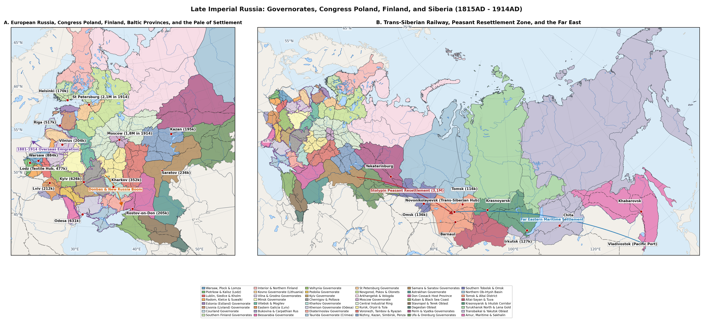
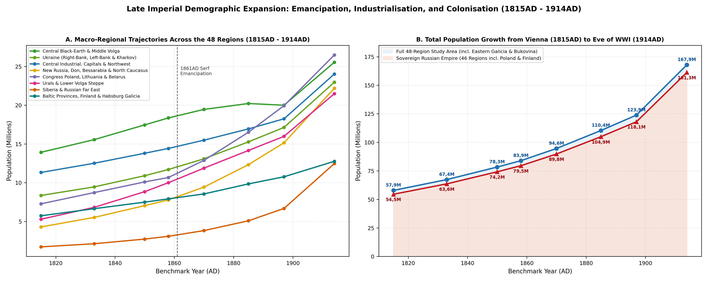
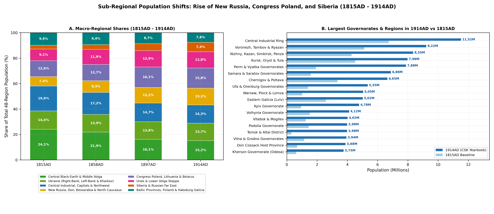
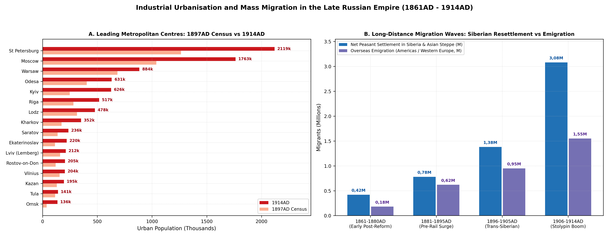

# Population Series and 48-Region Partition (1815AD - 1917AD)

Between the Final Act of the Congress of Vienna in June 1815AD and the
collapse of the Romanov monarchy in 1917AD, the population across the 48
period-authentic Governorates (*Guberniyas*), Oblasts, Finnish
Provinces, Vistula Provinces, and Austro-Hungarian Ukrainian Crownlands
covering 18 607 231 km2 (460 079 five-arcminute grid pixels, excluding
Central Asia and the Southern Caucasus) nearly tripled. Calibrated
totals rose from 57 871k (57,87M) in 1815AD to 67 360k (67,36M) at the
Eighth Soul Revision in 1833AD, 78 340k (78,34M) at the Ninth Revision
in 1850AD, 83 917k (83,92M) at the Tenth Revision in 1858AD, 94 583k
(94,58M) in 1870AD, 110 352k (110,35M) in 1885AD, 123 885k (123,89M) at
the First All-Russian Imperial Census of 28 January 1897AD, 156 225k
(156,23M) in 1910AD, and a pre-war peak of 167 945k (167,95M) on 1
January 1914AD, before First World War mobilisation, combat mortality,
and the 1915AD *bezhentsy* refugee evacuation lowered the regional
population to 165 375k (165,38M) in 1917AD
[\[1\]](#ref-Kabuzan1971)[\[2\]](#ref-Kabuzan1992)[\[3\]](#ref-Rashin1956)[\[4\]](#ref-Troinitsky1905)[\[5\]](#ref-TsSK1915)[\[6\]](#ref-Gatrell1999).

Retrofitting post-1991AD oblast or republic boundaries onto
nineteenth-century Eastern Europe and Northern Asia conceals the legal,
fiscal, and infrastructural boundaries that actually governed
demographic behaviour between 1815AD and 1917AD. Six institutional
divides structured the 48-region spatial framework shown in Figure and
tabulated in Table :

Separate Western Autonomous Polities Incorporated by 1809-1815AD: The
Congress Kingdom of Poland (Regions 1-4, comprising all ten Vistula
Governorates: Warsaw, Plock, Lomza, Piotrkow, Kalisz, Lublin, Siedlce
with the 1912AD Kholm split, Radom, Kielce, and Suwalki), the three
German-noble Ostsee Baltic Governorates (Regions 5-7: Estland, Livland,
and Courland, where landless peasant emancipation in 1816-1819AD
initiated the Empire’s earliest demographic transition), and the Grand
Duchy of Finland (Regions 8-9: all eight Finnish *lan* administered by
the Imperial Senate in Helsingfors) operated under distinct agrarian
laws, customs regimes, and statistical offices
[\[7\]](#ref-Corrsin1989)[\[8\]](#ref-CoaleAndersonHarm1979)[\[9\]](#ref-Gortfelder2023BalticFertility)[\[10\]](#ref-Pitkanen1993).

The Statutory Pale of Permanent Jewish Settlement (*Cherta postoyannoy
evreyskoy osedlosti*): Codified in 1835AD and tightened under the May
Laws of 1882AD, the Pale restricted Jewish residence to the Northwestern
Krai (Regions 10-13: Kovno, Vilna, Grodno, Minsk, Vitebsk, and Mogilev),
Bessarabia (Region 16), the Southwestern Krai (Regions 17-19: Volhynia,
Podolia, and Kyiv), Little Russia (Region 20: Chernigov and Poltava),
and Novorossiya (Regions 22-24: Kherson, Ekaterinoslav, and Taurida),
alongside separate civil regulations in Congress Poland
[\[11\]](#ref-Rowland1986)[\[12\]](#ref-Stampfer1995)[\[13\]](#ref-Perlmann2006PaleEmigration)[\[14\]](#ref-Manakov2022).

Dual-Monarchy Partition Inside Austro-Hungarian Ukraine: Across the
southwestern border, Habsburg-ruled Ukrainian lands were divided after
the 1867AD *Ausgleich* between Austrian *Cisleithania* - comprising
Eastern Galicia (Region 14: Lemberg/Lviv, Tarnopol, Stanislau, and the
Boryslav oil basin) and the Duchy of Bukovina (Czernowitz) - and
Hungarian *Transleithania* across the Subcarpathian Comitats of Bereg,
Ung, Ugocsa, and Maramaros (grouped in Region 15)
[\[15\]](#ref-OsterreichischeStatistik1912)[\[16\]](#ref-MagyarStatisztika1912)[\[17\]](#ref-Himka1988)[\[18\]](#ref-VanDrunen2013Bukovina).

Agrarian Overpopulation in the Black-Earth Core vs Industrialising
Capitals and New Russia: Post-1861AD peasant land hunger (*malozemelye*)
and the 1891-1892AD Volga-Black-Earth famine in Regions 20 and 30-32
contrasted sharply with the hyper-urbanising capitals Saint Petersburg
(Region 25) and Moscow (Region 28) and the coal-iron-grain boom across
Kherson, Ekaterinoslav, Taurida, and the Don Cossack Host (Regions 22-24
and 35)
[\[19\]](#ref-Robbins1975)[\[20\]](#ref-Friedgut1989)[\[21\]](#ref-Herlihy1986)[\[22\]](#ref-Troitskaya2017).
Disaggregation of the Caucasian War and 1864AD *Muhajir* Frontier:
Regions 36-38 separate Kuban Oblast and the Black Sea Governorate
(epicentre of the 1860-1864AD Circassian expulsion and subsequent
Cossack-Slavic settlement surge) from Stavropol Governorate and Terek
Oblast (Vladikavkaz, Grozny oilfields, and Vainakh-Ossetian highlands)
and highland Dagestan Oblast
[\[23\]](#ref-Richmond2013)[\[24\]](#ref-Jersild2002)[\[25\]](#ref-Kolesov2020Caucasus)[\[26\]](#ref-Dagestan1897Census).

Orthogonal Siberian Rail Corridors vs Northern River Trails and
1858-1860AD Priamurye: Across Regions 41-48, the dense West-East
Trans-Siberian, Altai Cabinet, and Priamurye settlement corridors
(Regions 41, 43, 45, and 48, which absorbed over 3,0M Stolypin peasant
migrants in 1906-1914AD) are explicitly separated from the bypassed
Ob-Irtysh polar river trail (Region 42), the Altai-Sayan and 1914AD
Uriankhai highlands (Region 44), the Yenisei-Turukhansk and Bodaibo Lena
gold basin (Region 46), and Transbaikal and Yakutsk Oblasts (Region 47)
[\[27\]](#ref-Treadgold1957)[\[28\]](#ref-Coquin1969)[\[29\]](#ref-Dameshek2007)[\[30\]](#ref-Stephan1994).

| Region / Governorate / Oblast | Area (km2) | 1815AD | 1833AD | 1858AD | 1885AD | 1897AD | 1914AD | 1917AD |
|:---|:---|:---|:---|:---|:---|:---|:---|:---|
| 1\. Warsaw, Plock & Lomza Gubs. | 35 957 | 1 020k | 1 280k | 1 620k | 2 650k | 3 536k | 5 050k | 4 420k |
| 2\. Piotrkow & Kalisz Gubs. | 20 156 | 720k | 940k | 1 240k | 1 980k | 2 245k | 3 320k | 2 950k |
| 3\. Lublin & Siedlce Gubs. | 27 342 | 780k | 960k | 1 180k | 1 740k | 1 933k | 2 680k | 2 080k |
| 4\. Radom, Kielce & Suwalki Gubs. | 33 393 | 780k | 950k | 1 160k | 1 680k | 2 160k | 2 600k | 2 180k |
| 5\. Estland Gub. | 22 637 | 232k | 275k | 312k | 382k | 413k | 505k | 515k |
| 6\. Livland Gub. | 54 235 | 615k | 735k | 885k | 1 185k | 1 299k | 1 565k | 1 420k |
| 7\. Courland Gub. | 27 588 | 418k | 495k | 565k | 655k | 674k | 800k | 380k |
| 8\. Southern Finland Gubs.: Nyland | 114 315 | 590k | 745k | 945k | 1 195k | 1 425k | 1 840k | 1 890k |
| 9\. Interior & Northern Finland Gubs.: Vasa, Kuopio, Sankt-Michel & Uleaborg | 263 819 | 520k | 645k | 815k | 1 015k | 1 130k | 1 400k | 1 430k |
| 10\. Kovno Gub. | 43 910 | 660k | 785k | 965k | 1 380k | 1 545k | 1 840k | 1 320k |
| 11\. Vilna & Grodno Gubs. | 85 286 | 1 145k | 1 360k | 1 650k | 2 680k | 3 195k | 3 940k | 2 880k |
| 12\. Minsk Gub. & Pripyat Polesia | 91 928 | 920k | 1 040k | 1 210k | 1 820k | 2 148k | 3 040k | 2 890k |
| 13\. Vitebsk & Mogilev Gubs. | 83 637 | 1 245k | 1 410k | 1 640k | 2 580k | 3 176k | 4 020k | 3 860k |
| 14\. Austro-Hungarian Eastern Galicia | 46 070 | 2 580k | 2 880k | 3 360k | 4 120k | 4 420k | 5 020k | 4 450k |
| 15\. Austro-Hungarian Bukovina | 24 487 | 770k | 870k | 1 030k | 1 290k | 1 400k | 1 630k | 1 500k |
| 16\. Bessarabia Gub. | 47 379 | 385k | 640k | 950k | 1 580k | 1 935k | 2 660k | 2 620k |
| 17\. Volhynia Gub. | 76 532 | 1 520k | 1 680k | 2 010k | 2 640k | 2 989k | 4 120k | 3 680k |
| 18\. Podolia Gub. | 41 427 | 1 440k | 1 620k | 1 980k | 2 650k | 3 018k | 3 980k | 3 820k |
| 19\. Kyiv Gub. | 54 181 | 940k | 1 220k | 1 780k | 2 920k | 3 559k | 4 780k | 4 840k |
| 20\. Little Russian Gubs.: Chernigov & Poltava | 106 759 | 3 350k | 3 680k | 4 340k | 4 880k | 5 076k | 6 650k | 6 720k |
| 21\. Kharkov Gub. | 57 378 | 1 100k | 1 260k | 1 590k | 2 180k | 2 492k | 3 440k | 3 510k |
| 22\. Kherson Gub. | 75 498 | 620k | 880k | 1 380k | 2 240k | 2 734k | 3 750k | 3 780k |
| 23\. Ekaterinoslav Gub. | 60 209 | 820k | 1 040k | 1 460k | 1 920k | 2 114k | 3 450k | 3 580k |
| 24\. Taurida Gub. | 69 868 | 370k | 520k | 660k | 1 080k | 1 448k | 2 060k | 2 080k |
| 25\. Saint Petersburg Gub. | 62 709 | 760k | 940k | 1 220k | 1 760k | 2 112k | 3 150k | 3 380k |
| 26\. Novgorod, Pskov & Olonets Gubs. | 306 049 | 1 770k | 1 960k | 2 260k | 2 680k | 2 853k | 3 580k | 3 680k |
| 27\. Arkhangelsk & Vologda Gubs. | 1 313 985 | 920k | 1 040k | 1 240k | 1 540k | 1 688k | 2 220k | 2 280k |
| 28\. Moscow Gub. | 28 080 | 1 120k | 1 320k | 1 620k | 2 140k | 2 431k | 3 560k | 3 820k |
| 29\. Central Industrial Ring: Vladimir, Yaroslavl, Kostroma, Tver, Smolensk & Kaluga Gubs. | 320 596 | 6 750k | 7 250k | 8 080k | 8 820k | 9 160k | 11 520k | 11 880k |
| 30\. Western Central Black-Earth Gubs.: Kursk, Oryol & Tula | 116 196 | 4 520k | 5 020k | 5 880k | 6 420k | 6 207k | 7 980k | 8 180k |
| 31\. Eastern Central Black-Earth Gubs.: Voronezh, Tambov & Ryazan | 163 112 | 5 120k | 5 720k | 6 760k | 7 280k | 7 037k | 9 220k | 9 450k |
| 32\. Middle Volga Gubs.: Nizhny Novgorod, Kazan, Simbirsk & Penza | 196 693 | 4 280k | 4 820k | 5 720k | 6 520k | 6 755k | 8 350k | 8 550k |
| 33\. Samara & Saratov Gubs. | 257 216 | 1 580k | 2 180k | 3 380k | 4 680k | 5 157k | 6 880k | 7 120k |
| 34\. Astrakhan Gub. | 157 993 | 380k | 480k | 640k | 880k | 1 004k | 1 380k | 1 410k |
| 35\. Don Cossack Host | 173 010 | 680k | 880k | 1 420k | 2 120k | 2 564k | 3 880k | 3 940k |
| 36\. Kuban Oblast & Black Sea Gub. | 100 010 | 420k | 480k | 640k | 1 380k | 1 976k | 3 060k | 3 120k |
| 37\. Stavropol Gub. & Terek Oblast | 131 162 | 545k | 640k | 860k | 1 480k | 1 807k | 2 610k | 2 650k |
| 38\. Dagestan Oblast | 30 663 | 450k | 440k | 410k | 530k | 571k | 715k | 725k |
| 39\. Perm & Vyatka Gubs. | 491 785 | 1 920k | 2 380k | 3 420k | 5 180k | 6 025k | 7 880k | 8 040k |
| 40\. Ufa & Orenburg Gubs. | 339 132 | 1 400k | 1 780k | 2 560k | 3 420k | 3 797k | 5 350k | 5 480k |
| 41\. West Siberian Trans-Siberian Belt: Southern Tobolsk | 244 121 | 545k | 680k | 990k | 1 480k | 1 740k | 3 180k | 3 320k |
| 42\. Ob-Irtysh River Trail & Polar Tundra: Tobolsk, Surgut, Berezov & Narym | 1 637 985 | 160k | 185k | 240k | 325k | 375k | 505k | 520k |
| 43\. Tomsk Railway Trunk | 499 967 | 300k | 410k | 690k | 1 340k | 1 928k | 3 980k | 4 180k |
| 44\. Altai-Sayan Highlands: Gorny Altai, Minusinsk & Uriankhai Protectorate | 418 838 | 125k | 150k | 205k | 285k | 330k | 565k | 575k |
| 45\. Central Siberian Trans-Siberian Corridor: Achinsk-Krasnoyarsk-Kansk & Irkutsk | 521 596 | 210k | 260k | 375k | 610k | 795k | 1 540k | 1 560k |
| 46\. Yenisei-Turukhansk Polar North & Bodaibo Lena Goldfields | 2 480 545 | 68k | 80k | 110k | 165k | 195k | 270k | 265k |
| 47\. Transbaikal Oblast | 6 008 677 | 278k | 320k | 415k | 680k | 942k | 1 295k | 1 305k |
| 48\. Priamurye Gov.-Gen.: Amur, Primorskaya | 1 043 120 | 30k | 35k | 55k | 195k | 372k | 1 135k | 1 150k |
| Total (All 48 Period-Authentic Regions) | 18 607 231 | 57 871k | 67 360k | 83 917k | 110 352k | 123 885k | 167 945k | 165 375k |

Regional population series in thousands and land areas across all 48
governorates, oblasts, and crownlands (1815AD - 1917AD).

# Archive Fiscal, Statistical, and Census Sources (1815AD - 1917AD)

Reconstructing provincial populations across this 102-year period
synthesises seven distinct archival and statistical series, summarised
across all ten benchmark dates in Table :

The Final Four Soul Revisions (*Revizii*, VII-X, 1815AD - 1858AD):
Following the Seventh Revision (1815-1816AD), which recorded Napoleonic
wartime losses across western and central provinces, Imperial fiscal
commissions conducted the Eighth (1833-1835AD), Ninth (1850AD), and
Tenth (1857-1858AD) Soul Revisions
[\[1\]](#ref-Kabuzan1971)[\[31\]](#ref-Kabuzan1963)[\[32\]](#ref-Ulyanova2016).
Unlike the male-only Sixth Revision of 1811AD, Revisions VII-X
registered both sexes of the tax-bearing estates (*podatnye sosloviya*).
Following V. M. Kabuzan (1971AD, 1992AD) and A. G. Troinitsky (1861AD),
raw revision returns are supplemented with Governorate statistical
committee (*gubernskie statisticheskie komitety*) police registers for
tax-exempt nobles, clergy, civil servants, regular military forces, and
Cossack hosts
[\[2\]](#ref-Kabuzan1992)[\[22\]](#ref-Troitskaya2017)[\[33\]](#ref-Troinitsky1861).

Central Statistical Committee (*TsSK MVD*) Yearbooks (1863AD - 1914AD),
established within the Ministry of Internal Affairs in 1858-1863AD under
P. P. Semenov, the *Tsentralnyy Statisticheskiy Komitet* published
periodic compilations (*Statisticheskiy vremennik Rossiyskoy imperii*)
and, from 1904AD to 1915AD, annual yearbooks (*Statisticheskiy
ezhegodnik Rossii*), combining Orthodox synodal, Lutheran, Catholic,
Jewish, and Muslim vital registration with *zemstvo* household censuses
(*podvornye perepisi*)
[\[3\]](#ref-Rashin1956)[\[5\]](#ref-TsSK1915)[\[34\]](#ref-Mironov2000).

The First All-Russian General Census of 28 January 1897AD, directed by
Semenov-Tyan-Shansky and edited by N. A. Troinitsky across 89 provincial
volumes (1899-1905AD), the 1897AD Census enumerated 125 640 021 *de
facto* residents across the Empire excluding Finland
[\[4\]](#ref-Troinitsky1905)[\[35\]](#ref-Troinitsky1905Goroda). Across
our 46 Russian, Polish, Baltic, Siberian, and Finnish regions, the
1897AD benchmark totals 118 065k (115 510k across the 44 Imperial and
Vistula regions - matching the 1897AD Census guberniya totals minus the
10,13M inhabitants of Transcaucasia and Central Asia outside this
spatial mask - plus 2 555k in the Grand Duchy of Finland), which
together with 5 820k in Austro-Hungarian Galicia, Bukovina, and
Subcarpathia yields the exact 48-region 1897AD anchor of 123 885k
[\[4\]](#ref-Troinitsky1905)[\[15\]](#ref-OsterreichischeStatistik1912)[\[36\]](#ref-FinlandStat1870_1915).

Finnish Decennial Statistical Censuses (*Tilastollinen paatoimisto*,
1815AD - 1910AD): Because the Grand Duchy of Finland retained
Swedish-era Lutheran parish population registers (*kirkonkirjat* and
*vaestotaulut* initiated in 1749AD) and established its own Central
Statistical Office in 1865AD, Regions 8-9 possess continuous
quinquennial and decennial *de jure* and *de facto* series (1 110k in
1815AD, 1 760k in 1858AD, 1 770k in 1870AD following the 1866-1868AD
famine, 2 555k in 1897AD, and 3 050k in 1910AD)
[\[36\]](#ref-FinlandStat1870_1915)[\[37\]](#ref-Luostarinen2026FinlandMortality).

Warsaw Statistical Committee (*Varshavskiy Statisticheskiy Komitet*,
1888AD - 1914AD): For the ten Vistula Governorates (Privislinskie
gubernii, Regions 1-4), civil registry books introduced under the
Napoleonic Code in 1808AD and the 40 volumes of *Trudy Varshavskogo
statisticheskogo komiteta* reconcile permanent (*postoyannoe*) and
non-permanent industrial migrant (*nepostoyannoe*) urban populations in
Warsaw, Lodz, and Sosnowiec alongside the 1897AD Census (9 874k in
1897AD; 13 650k on 1 January 1914AD)
[\[7\]](#ref-Corrsin1989)[\[38\]](#ref-WarsawStat1914)[\[39\]](#ref-Repczynska2022Lodz).

Austro-Hungarian *Volkszahlung* and Hungarian *Nepszamlalas* (1869AD -
1910AD): Regions 14-15 are anchored prior to 1857AD by Josephinian
military conscription rolls and thereafter by the modern decennial
censuses of the *k.k. Statistische Zentralkommission* in Vienna (1880,
1890, 1900, 1910AD) for Eastern Galicia and Bukovina and the *Magyar
Kiralyi Kozponti Statisztikai Hivatal* in Budapest for Subcarpathia
[\[15\]](#ref-OsterreichischeStatistik1912)[\[16\]](#ref-MagyarStatisztika1912).
The 1916-1917AD Agricultural and Urban Censuses and Tatiana Committee
Refugee Registers: Following abortive preparations for a Second Imperial
Census in 1915AD [\[40\]](#ref-Borshchik2018), the Ministry of
Agriculture and Provisional Government conducted the 1916AD and 1917AD
All-Russian Agricultural, Land, and Urban Censuses
[\[41\]](#ref-AgCensus1917)[\[42\]](#ref-Oskin2015Food1917). Combined
with the registration rolls of the Tatiana Committee and *Zemgor*
analysed by Peter Gatrell (1999AD), these returns quantify the
displacement of over 6,0M wartime refugees (*bezhentsy*) by early 1917AD
[\[6\]](#ref-Gatrell1999)[\[43\]](#ref-Krutikov2024KholmWWI).

| Benchmark & Archive Source | Poland (1-4) | Balt.-Fin. (5-9) | Pale-Bess. (10-19\*) | Habsb. (14-15) | Ukraine-Cauc. (20-24,36-38) | Heartland-Ural (25-35,39-40) | Siberia-FE (41-48) | Total (48 Regs) |
|:---|:---|:---|:---|:---|:---|:---|:---|:---|
| 1815AD (Revision VII / Vienna Act) | 3 300k | 2 375k | 8 255k | 3 350k | 7 675k | 31 200k | 1 716k | 57 871k |
| 1833AD (Revision VIII / Parish) | 4 130k | 2 895k | 9 755k | 3 750k | 8 940k | 35 770k | 2 120k | 67 360k |
| 1850AD (Revision IX / Conscript) | 4 910k | 3 337k | 11 345k | 4 150k | 10 560k | 41 320k | 2 718k | 78 340k |
| 1858AD (Revision X / 1857 Habsb.) | 5 200k | 3 522k | 12 185k | 4 390k | 11 340k | 44 200k | 3 080k | 83 917k |
| 1870AD (TsSK / 1869 A-H / Fin.) | 6 340k | 3 728k | 14 340k | 4 820k | 13 030k | 48 510k | 3 815k | 94 583k |
| 1885AD (TsSK / Zemstvo / VSK) | 8 050k | 4 432k | 18 250k | 5 410k | 15 690k | 53 440k | 5 080k | 110 352k |
| 1897AD (1st Imperial Census) | 9 874k | 4 941k | 21 565k | 5 820k | 18 218k | 56 790k | 6 677k | 123 885k |
| 1910AD (TsSK / 1910 A-H & Fin.) | 12 670k | 5 770k | 26 740k | 6 450k | 23 740k | 70 030k | 10 825k | 156 225k |
| 1914AD (TsSK / VSK Pre-WWI Peak) | 13 650k | 6 110k | 28 380k | 6 650k | 25 735k | 74 950k | 12 470k | 167 945k |
| 1917AD (Ag.-Urban Census / WWI) | 11 630k | 5 635k | 25 910k | 5 950k | 26 165k | 77 210k | 12 875k | 165 375k |

Complete 10-benchmark demographic series (1815AD - 1917AD, in thousands)
across the seven macro-institutional blocks of the 48-region partition.

# Congress Poland, the Baltic Baltic Transition, and Finland (Regions 1-9)

## Congress Kingdom of Poland: Vistula Industrialisation and 1915AD *Biezenstwo* (Regions 1-4)

Created at the Congress of Vienna in 1815AD out of the Napoleonic Duchy
of Warsaw and reorganised into ten Vistula Governorates in 1867AD,
Congress Poland (116 848 km2 across Regions 1-4) experienced the most
rapid demographic densification of any western territory in the Empire,
growing more than fourfold from 3 300k in 1815AD (28,2 per km2) to 5
200k in 1858AD, 9 874k in 1897AD, and 13 650k in 1914AD (116,8 per km2)
[\[7\]](#ref-Corrsin1989)[\[38\]](#ref-WarsawStat1914). Whereas the
November (1830-1831AD) and January (1863-1864AD) Uprisings inflicted
short-term wartime casualties, confiscations, and Siberian deportations,
Tsar Alexander II’s Polish Emancipation Ukase of 2 March 1864AD granted
freehold title to Polish, Ukrainian, and Lithuanian peasants without
direct redemption payments to landlords, unleashing high rural natural
increase (1,6-1,9% per year)
[\[2\]](#ref-Kabuzan1992)[\[44\]](#ref-Meerkerk2023Agrarian).

Simultaneously, the abolition of the Russo-Polish customs barrier
(1851AD), the completion of the Warsaw-Vienna (1848AD) and Warsaw-Saint
Petersburg (1862AD) railways, and the 1877AD Imperial gold tariff turned
Congress Poland into the premier textile and coal-metallurgical workshop
for the Russian market
[\[7\]](#ref-Corrsin1989)[\[39\]](#ref-Repczynska2022Lodz)[\[45\]](#ref-Liczbinska2025Lodz):

Region 1 (Warsaw, Plock & Lomza Governorates) rose from 1 020k (1815AD)
to 3 536k (1897AD) and 5 050k (1914AD), anchored by Warsaw, the Empire’s
third metropolis (0k in 1815AD to 162,8k in 1858AD to 683,7k in 1897AD
to 884,5k in 1914AD, 36,9% Jewish in 1914AD), alongside the Zyrardow
linen complex (6k) and Vistula river ports Wloclawek (4k) and Plock (2k)
[\[7\]](#ref-Corrsin1989)[\[38\]](#ref-WarsawStat1914). Region 2
(Piotrkow & Kalisz Governorates) surged nearly fivefold from 720k
(1815AD) to 2 245k (1897AD) and 3 320k (1914AD). Designated a factory
settlement in 1820AD when it held fewer than 800 inhabitants, Lodz
expanded to 29,5k (1858AD), 314,0k (1897AD), and 477,9k (1914AD, over
550k with satellite mill suburbs Pabianice and Zgierz), while the
Dabrowa Basin along the Silesian border transformed fishing and mining
hamlets into Sosnowiec (5k in 1914AD, chartered only in 1902AD),
Czestochowa (9k), and Bendzin (8k)
[\[39\]](#ref-Repczynska2022Lodz)[\[45\]](#ref-Liczbinska2025Lodz).

Region 3 (Lublin & Siedlce Governorates) and Region 4 (Radom, Kielce &
Suwalki Governorates) grew from 780k each in 1815AD to 2 680k and 2 600k
in 1914AD, despite heavy peasant overseas emigration from Suwalki and
Kalisz during the 1890-1913AD “Brazilian Fever” and North American
steamship boom [\[46\]](#ref-BylyeGody2023BrazilEmigration). In June
1912AD, St Petersburg detached the eastern Ukrainian-Uniate *uezds* of
Lublin and Siedlce to form Kholm Governorate (Chelm, 24,6k) directly
subordinated to Kiev [\[43\]](#ref-Krutikov2024KholmWWI). During the
German-Austrian offensive of summer 1915AD, Russian military
scorched-earth orders triggered the catastrophic *biezenstwo* (Great
Retreat), evacuating over 2,0M residents eastward and slashing Regions
1-4 from 13 650k (1914AD) to 11 630k (1917AD), with Region 3 losing
-22,4% (2 680k to 2 080k) and Kalisz shelled to ruins in August 1914AD
(4k to 29,0k)
[\[6\]](#ref-Gatrell1999)[\[43\]](#ref-Krutikov2024KholmWWI).

## Baltic Baltic Governorates: Early Fertility Transition and Riga’s Rise (Regions 5-7)

In Estland (Region 5), Livland (Region 6), and Courland (Region 7),
Alexander I’s peasant emancipation acts of 1816AD (Estland), 1817AD
(Courland), and 1819AD (Livland) abolished serfdom four decades before
inner Russia while leaving arable land in the hands of Baltic German
baronial manors (*Ritterschaften*) until mid-century tenant-purchase
reforms (1849-1860s)
[\[9\]](#ref-Gortfelder2023BalticFertility)[\[47\]](#ref-Bogov2017Livland).
Combined with near-universal Lutheran catechism literacy (92-96% adult
literacy in 1897AD versus 21% Empire-wide) and a West European
late-marriage pattern (*Hajnal* line), the three Baltic provinces
pioneered the first sustained marital fertility transition in the
Russian Empire, with Princeton European Fertility Project indices
($`I_g`$) falling by more than 10% across Estland, Livland, and Courland
between the 1860s and 1880s - forty to fifty years ahead of Central
Russia
[\[8\]](#ref-CoaleAndersonHarm1979)[\[9\]](#ref-Gortfelder2023BalticFertility)[\[48\]](#ref-Gortfelder2020TartuFertility).

Consequently, natural growth across Regions 5-7 was moderate (1 265k in
1815AD -\> 1 762k in 1858AD -\> 2 386k in 1897AD -\> 2 870k in 1914AD),
while urban-industrial concentration was intense: Riga (Region 6) grew
from 36,0k (1815AD) to 282,2k (1897AD) and 517,5k (1914AD) as the
Empire’s leading timber-export port and rubber, chemical,
electrotechnical, and railcar manufacturing centre (Provodnik,
Russo-Balt); Reval/Tallinn (Region 5) surged to 137,6k (1914AD) and
159,0k (1917AD) around Peter the Great’s Naval Fortress shipyards;
Dorpat/Tartu (48,6k) anchored Baltic scholarship; and Libau/Liepaja
(Region 7, 90,7k in 1914AD) served as the ice-free home port of the
Russian American Line, dispatching 40k-70k Pale and Baltic emigrants
annually to New York
[\[13\]](#ref-Perlmann2006PaleEmigration)[\[47\]](#ref-Bogov2017Livland).
In spring-summer 1915AD, the German *Niemen Army* occupied Courland
(Region 7), driving half its population into interior Russia (800k in
1914AD -\> 380k in 1917AD, -52,5%), while the evacuation of Riga’s
machinery and 300k+ factory workers and families halved Riga to 210,0k
and lowered Livland (Region 6) from 1 565k to 1 420k
[\[6\]](#ref-Gatrell1999).

## Grand Duchy of Finland and the 1866-1868AD Great Hunger Years (Regions 8-9)

Autonomous since the Diet of Porvoo (1809AD) and enlarged by the
reincorporation of Old Finland (Viipuri/Vyborg Governorate) in 1812AD,
the Grand Duchy of Finland (378 134 km2 across Regions 8-9) expanded
steadily from 1 110k in 1815AD (590k in coastal/southern Region 8; 520k
in interior/northern Region 9) to 1 760k in 1858AD
[\[36\]](#ref-FinlandStat1870_1915)[\[49\]](#ref-Jantti2005Finland).
This pre-industrial trajectory suffered Europe’s last major peacetime
subsistence catastrophe during the Finnish Great Hunger Years (*Suuret
nalkavuodet*, 1866-1868AD). Following wet summers and a devastating
early September frost in 1867AD that destroyed rye and barley harvests
across Ostrobothnia, Savo, and Kainuu while Senate Finance Head J. V.
Snellman prioritized defence of the newly introduced silver *markka*,
winter destitution, vagrant relief crowding, and epidemic typhus,
dysentery, and relapsing fever killed ~150k people (~8,0% of Finland’s
population, pushing national crude death rates to 77,6 per 1 000 in
1868AD)
[\[10\]](#ref-Pitkanen1993)[\[37\]](#ref-Luostarinen2026FinlandMortality)[\[50\]](#ref-Pasanen2022FinlandFamine)[\[51\]](#ref-Mansukoski2016Finland).
In our series, Region 9 (Vasa, Kuopio, Sankt-Michel & Uleaborg) falls
directly from 815k (1858AD) to 805k (1870AD), while Region 8 (Nyland,
Abo-Bjorneborg, Tavastehus & Vyborg) stagnates (945k -\> 965k).

After 1870AD, completion of the Riihimaki-Saint Petersburg Railway
(1870AD), dairy specialisation, and steam-sawmill, pulp, and paper
industrialisation propelled Finland from 1 770k (1870AD) to 2 555k
(1897AD), 3 240k (1914AD), and 3 320k (1917AD, spared frontline combat
before 1918AD), led by Helsingfors/Helsinki (4,8k in 1815AD -\> 84,5k in
1897AD -\> 187,5k in 1917AD), Abo/Turku (54,6k), Tammerfors/Tampere
(45,2k), and Viipuri/Vyborg (29,3k), even as ~300k rural Finns (above
all from Vasa Governorate in Region 9) emigrated to North America
between 1880AD and 1914AD
[\[36\]](#ref-FinlandStat1870_1915)[\[49\]](#ref-Jantti2005Finland).

| Region (1-9) | 1815AD | 1850AD | 1858AD | 1870AD | 1897AD | 1910AD | 1914AD | 1917AD |
|:---|:---|:---|:---|:---|:---|:---|:---|:---|
| 1\. Warsaw, Plock & Lomza Gubs. | 1 020k | 1 520k | 1 620k | 1 980k | 3 536k | 4 680k | 5 050k | 4 420k |
| 2\. Piotrkow & Kalisz Gubs. | 720k | 1 160k | 1 240k | 1 560k | 2 245k | 3 050k | 3 320k | 2 950k |
| 3\. Lublin & Siedlce Gubs. | 780k | 1 120k | 1 180k | 1 420k | 1 933k | 2 480k | 2 680k | 2 080k |
| 4\. Radom, Kielce & Suwalki Gubs. | 780k | 1 110k | 1 160k | 1 380k | 2 160k | 2 460k | 2 600k | 2 180k |
| 5\. Estland Gub. | 232k | 302k | 312k | 338k | 413k | 475k | 505k | 515k |
| 6\. Livland Gub. | 615k | 835k | 885k | 1 005k | 1 299k | 1 480k | 1 565k | 1 420k |
| 7\. Courland Gub. | 418k | 545k | 565k | 615k | 674k | 765k | 800k | 380k |
| 8\. Southern Finland Gubs.: Nyland | 590k | 890k | 945k | 965k | 1 425k | 1 720k | 1 840k | 1 890k |
| 9\. Interior & Northern Finland Gubs.: Vasa, Kuopio, Sankt-Michel & Uleaborg | 520k | 765k | 815k | 805k | 1 130k | 1 330k | 1 400k | 1 430k |

Population trajectories across Congress Poland, the Baltic governorates,
and the Grand Duchy of Finland in thousands (1815AD - 1917AD).

# The Pale of Settlement, Bessarabia, and Austro-Hungarian Ukraine (Regions 10-19)

## Northwestern Krai: Lithuania, Belarus, and Shtetl Urbanisation (Regions 10-13)

Across the Lithuanian and Belarusian governorates of the Northwestern
Krai (304 761 km2, Regions 10-13), total population expanded from 3 970k
in 1815AD to 5 465k in 1858AD, 10 064k in 1897AD, and 12 840k in 1914AD
[\[2\]](#ref-Kabuzan1992)[\[4\]](#ref-Troinitsky1905)[\[52\]](#ref-Potrosova2021)[\[53\]](#ref-Krotok2024):

Region 10 (Kovno Governorate, created 1843AD across ethnic
Samogitia/Lithuania) grew from 660k (1815AD) to 1 545k (1897AD) and 1
840k (1914AD). Intense post-1863AD Russification (including the
1864-1904AD Latin-press ban), lack of heavy industry outside
Kovno/Kaunas (9k to 91,4k) and Shavli/Siauliai (5k), and early peasant
parcellation triggered massive transatlantic emigration (~250k-300k
ethnic Lithuanians and Litvak Jews to Pennsylvania coal mines, Chicago,
Scotland, and South America in 1880-1914AD) before the 1915AD German
*Ober Ost* occupation cut Kovno’s population by -28,3% to 1 320k in
1917AD
[\[6\]](#ref-Gatrell1999)[\[13\]](#ref-Perlmann2006PaleEmigration)[\[54\]](#ref-Gierowska2020Lithuania).

Region 11 (Vilna & Grodno Governorates) (1 145k to 3 195k in 1897AD to 3
940k in 1914AD), Region 12 (Minsk Governorate & Pripyat Polesia) (920k
to 2 148k to 3 040k), and Region 13 (Vitebsk & Mogilev Governorates,
including the Catholic Latgalian *uezds* of Dvinsk, Rezhitsa, and
Lyutsin) (1 245k to 3 176k to 4 020k) formed the classic *shtetl*
(*mestechko*) heartland of the Pale
[\[11\]](#ref-Rowland1986)[\[14\]](#ref-Manakov2022)[\[55\]](#ref-Ovseychik2024).
After Alexander III’s May Laws of 3 May 1882AD barred new Jewish rural
residence and leases, Jewish populations (8-17,5% provincial shares)
exceeded 50-65% inside Vilna (5k to 204,3k), the Bialystok
woollen-textile boomtown (0k to 91,5k, site of the June 1906AD pogrom),
Dvinsk/Daugavpils (7k to 112,8k), Minsk (9k to 117,6k), Vitebsk (9k to
108,9k), Gomel (8k to 104,5k), Grodno (9k to 61,6k), and Brest-Litovsk
(6k to 57,4k, burned and evacuated to 16,5k in August 1915AD)
[\[13\]](#ref-Perlmann2006PaleEmigration)[\[56\]](#ref-Shtakser2009PaleYouth).
Between 1906AD and 1914AD, overcrowded Belarusian villages in Mogilev,
Vitebsk, and Minsk also sent over 340k peasant settlers to Siberia
[\[57\]](#ref-Kryuchek2017), while the 1915AD front line split Region 11
(3 940k to 2 880k, -26,9%) from rear-echelon Stavka headquarters Mogilev
[\[6\]](#ref-Gatrell1999).

## Bessarabia, the Southwestern Krai, and Transatlantic Emigration (Regions 16-19)

Annexed from the Ottoman Principality of Moldavia by the Treaty of
Bucharest (1812AD), Bessarabia Governorate (Region 16, 47 379 km2)
expanded nearly sevenfold from 385k in 1815AD to 950k in 1858AD, 1 935k
in 1897AD, and 2 660k in 1914AD (2 620k in 1917AD), propelled by
state-sponsored Bulgarian, Gagauz, German, Ukrainian, and Russian
settlement across the southern Budjak steppe alongside a Moldovan rural
majority and fast-growing Kishinev/Chisinau (14,5k -\> 108,5k in 1897AD
-\> 128,7k in 1914AD), Bender (31,8k), Akkerman (28,3k), and Ismail
(22,3k)
[\[4\]](#ref-Troinitsky1905)[\[58\]](#ref-Prutyan2026)[\[59\]](#ref-Kapustin2026).
Southern Bessarabia (Cahul, Bolgrad, and Ismail uezds) was ceded to
Moldavia/Romania under the 1856AD Treaty of Paris and re-annexed by
Russia at the 1878AD Congress of Berlin; in April 1903AD, the Kishinev
Pogrom (49 killed), followed by the October 1905AD pogrom wave (Odessa,
Kyiv, Bialystok), triggered the peak 1903-1914AD surge of Russian-Jewish
transatlantic emigration (~1,25M arrivals in the United States in
1903-1914AD out of ~2,0M total Pale emigrants in 1881-1914AD)
[\[12\]](#ref-Stampfer1995)[\[13\]](#ref-Perlmann2006PaleEmigration)[\[60\]](#ref-Klier1995).

In the Southwestern Krai (Regions 17-19: Volhynia, Podolia, and Kyiv
Governorates), abolition of Polish noble autonomy after 1831/1863AD and
capital-intensive sugar-beet agro-industrialisation (accounting for over
80% of Imperial refined sugar output under the Brodsky, Tereshchenko,
and Bobrinsky estates) supported Europe’s densest black-earth rural
populations [\[61\]](#ref-Perkovsky1979)[\[62\]](#ref-Zinovev2022).
Volhynia (Region 17) grew from 1 520k (1815AD) to 2 989k (1897AD) and 4
120k (1914AD) before 1915-1916AD Southwestern Front combat and the
Russian Army’s deportation of ~150k Volhynian Germans and border Jews
lowered it to 3 680k (1917AD); Podolia (Region 18) rose from 1 440k to 3
018k (1897AD, 72,8 per km2) and 3 980k (1914AD); and Kyiv Governorate
(Region 19) quintupled from 940k (1815AD) to 3 559k (1897AD) and 4 780k
(1914AD -\> 4 840k in 1917AD with wartime rear-area inflows), led by
Kyiv (23,5k in 1815AD -\> 247,7k in 1897AD -\> 626,3k in 1914AD)
[\[4\]](#ref-Troinitsky1905)[\[6\]](#ref-Gatrell1999).

## Austro-Hungarian Galicia, Bukovina, and Subcarpathian Rus (Regions 14-15)

Across the Habsburg border, imperial abolition of *Robota* labour
obligations during the Revolutions of 1848AD emancipated Ukrainian
(*Ruthenian*) smallholders in Eastern Galicia (Region 14: 2 580k in
1815AD -\> 3 360k in 1858AD -\> 4 420k in 1897AD -\> 5 020k in 1914AD)
and Bukovina & Hungarian Subcarpathian Rus (Region 15: 770k -\> 1 030k
-\> 1 400k -\> 1 630k)
[\[15\]](#ref-OsterreichischeStatistik1912)[\[16\]](#ref-MagyarStatisztika1912)[\[17\]](#ref-Himka1988).
Despite the turn-of-the-century Boryslav-Drohobych petroleum boom
(Drohobych 36,5k, Boryslav 16,8k, making Galicia the world’s
third-largest oil producer in 1909AD) and the flowering of Lemberg/Lviv
(44,5k -\> 212,0k) and Czernowitz/Chernivtsi (7,2k -\> 94,0k)
[\[18\]](#ref-VanDrunen2013Bukovina)[\[63\]](#ref-Lylo2025GaliciaLviv),
extreme dwarf-plot subdivision (\>80% of peasant holdings under 5 ha)
drove over 400k Galician, Bukovinian, and Transcarpathian Ukrainians and
Jews to homestead in Western Canada (Manitoba, Saskatchewan, Alberta) or
enter American industrial towns between 1885AD and 1914AD. Between
August 1914AD and 1917AD, four sweeping Russo-Austrian offensives across
Galicia and the Carpathian passes, Austro-Hungarian military executions
and internment of suspected Russophiles at Thalerhof (Graz), and Russian
occupation deportations reduced Region 14 from 5 020k to 4 450k (-11,4%)
and Region 15 from 1 630k to 1 500k (-8,0%) [\[6\]](#ref-Gatrell1999).

| Region (10-19) | 1815AD | 1850AD | 1870AD | 1885AD | 1897AD | 1910AD | 1914AD | 1917AD |
|:---|:---|:---|:---|:---|:---|:---|:---|:---|
| 10\. Kovno Gub. | 660k | 915k | 1 120k | 1 380k | 1 545k | 1 760k | 1 840k | 1 320k |
| 11\. Vilna & Grodno Gubs. | 1 145k | 1 560k | 2 020k | 2 680k | 3 195k | 3 780k | 3 940k | 2 880k |
| 12\. Minsk Gub. & Pripyat Polesia | 920k | 1 150k | 1 420k | 1 820k | 2 148k | 2 820k | 3 040k | 2 890k |
| 13\. Vitebsk & Mogilev Gubs. | 1 245k | 1 560k | 1 980k | 2 580k | 3 176k | 3 820k | 4 020k | 3 860k |
| 14\. Austro-Hungarian Eastern Galicia | 2 580k | 3 180k | 3 680k | 4 120k | 4 420k | 4 880k | 5 020k | 4 450k |
| 15\. Austro-Hungarian Bukovina | 770k | 970k | 1 140k | 1 290k | 1 400k | 1 570k | 1 630k | 1 500k |
| 16\. Bessarabia Gub. | 385k | 860k | 1 160k | 1 580k | 1 935k | 2 480k | 2 660k | 2 620k |
| 17\. Volhynia Gub. | 1 520k | 1 880k | 2 240k | 2 640k | 2 989k | 3 820k | 4 120k | 3 680k |
| 18\. Podolia Gub. | 1 440k | 1 840k | 2 220k | 2 650k | 3 018k | 3 740k | 3 980k | 3 820k |
| 19\. Kyiv Gub. | 940k | 1 580k | 2 180k | 2 920k | 3 559k | 4 520k | 4 780k | 4 840k |

Population series across Lithuania, Belarus, Austro-Hungarian Ukraine,
Bessarabia, and Right-Bank Ukraine in thousands (1815AD - 1917AD).

# Novorossiya, the Heartland, the 1891-1892AD Famine, and the Caucasus (Regions 20-40)

## Crimean War, New Russia Coal-Steel Miracle, and Agrarian Heartland (Regions 20-35, 39-40)

Across the southern Ukrainian and Pontic-Azov steppes, demographic
growth combined agrarian colonisation with late-Imperial heavy
industrialisation:

Left-Bank *Malorossiya* and Sloboda Ukraine (Regions 20-21): Chernigov &
Poltava (Region 20: 3 350k to 5 076k in 1897AD to 6 650k in 1914AD)
suffered acute post-1861AD allotment shrinkage and became the Empire’s
No. 1 peasant donor zone to Siberia and the Far East
[\[27\]](#ref-Treadgold1957), whereas Kharkov Governorate (Region 21: 1
100k to 2 492k to 3 440k) boomed around Kharkov (8k to 174,0k to
258,0k), locomotive works, and southern rail administration
[\[62\]](#ref-Zinovev2022)[\[64\]](#ref-Bagaley1918). Novorossiya and
the Don Cossack Host (Regions 22-24, 35): In Taurida Governorate (Region
24), the Crimean War (1853-1856AD) besieged and depopulated Sevastopol
(0k in 1833AD to 11,2k in 1858AD) and triggered the 1860-1862AD Crimean
Tatar and Nogai exodus (~180k-200k *muhajirs* emigrating to the Ottoman
Empire, visibly flattening Region 24 from 640k in 1850AD to 660k in
1858AD), before mainland Tavria grain farming and naval reconstruction
lifted Taurida to 1 448k (1897AD) and 2 060k (1914AD)
[\[40\]](#ref-Borshchik2018)[\[65\]](#ref-Williams2001)[\[66\]](#ref-Konstantinova2010).
To the north and west, Kherson Governorate (Region 22: 620k to 2 734k to
3 750k, led by grain-export metropolis Odessa 35,0k to 403,8k to 630,0k
and shipyard Nikolaev 108,8k)
[\[21\]](#ref-Herlihy1986)[\[67\]](#ref-Zipperstein1985), Ekaterinoslav
Governorate (Region 23: 820k to 2 114k to 3 450k), and the Don Cossack
Host (Region 35: 680k to 2 564k to 3 880k, led by Rostov-on-Don 204,8k
and Taganrog 78,6k) experienced Europe’s fastest heavy-industrial
transformation after the Catherine Railway (1884AD) linked Krivoy Rog
hematite iron ore with Donbas coking coal around John Hughes’s
Yuzovka/Donetsk (9k in 1870AD to 28,1k in 1897AD to 54,0k in 1914AD),
Ekaterinoslav (4k), Lugansk (0k), and Mariupol (0k)
[\[20\]](#ref-Friedgut1989)[\[68\]](#ref-Konstantinova2009)[\[69\]](#ref-Matveicheva2014)[\[70\]](#ref-Oleynikov2014)[\[71\]](#ref-Agafonov2017)[\[72\]](#ref-Kolomeytseva2018).

Capitals, Central Industrial Ring, Black-Earth Crisis & 1891-1892AD
Famine (Regions 25-34, 39-40): While Saint Petersburg Governorate
(Region 25: 760k to 2 112k to 3 150k in 1914AD to 3 380k in 1917AD; city
2,12M to 2,30M with wartime Putilov munitions expansion) and Moscow
Governorate (Region 28: 1 120k to 2 431k to 3 560k to 3 820k; city 1,76M
to 1,85M) absorbed millions of peasant *otkhodniki* from
Novgorod-Pskov-Olonets (Region 26), Arkhangelsk-Vologda (Region 27,
where Romanov-on-Murman/Murmansk was founded at the terminus of the
Murman Railway in 1916AD), and the Central Industrial Ring (Region 29: 6
750k to 11 520k, including textile boomtown Ivanovo-Voznesensk 146,0k)
[\[3\]](#ref-Rashin1956)[\[73\]](#ref-Veremenko2026Capitals)[\[74\]](#ref-Krivonozhenko2020),
the Central Black-Earth (Regions 30-31) and Middle/Lower Volga (Regions
32-34) suffered recurrent Malthusian and epidemic shocks. Following
severe autumn-spring drought across seventeen chernozem and Volga
provinces, the 1891-1892AD Famine and Cholera Pandemic caused ~400k-500k
excess deaths (compounded by typhus and the 1892AD Caspian-Volga cholera
wave striking Astrakhan, Saratov, Samara, Simbirsk, Kazan, Voronezh, and
Tambov)
[\[19\]](#ref-Robbins1975)[\[75\]](#ref-Wheatcroft1991)[\[76\]](#ref-AstrakhanCholera1892_2023)[\[77\]](#ref-Corporaal2024Famines).
Combined with accelerating peasant out-migration, net population in
Western Black-Earth (Region 30: Kursk, Oryol, Tula) and Eastern
Black-Earth (Region 31: Voronezh, Tambov, Ryazan) actually contracted
between 1885AD and the 1897AD Census (6 420k to 6 207k and 7 280k to 7
037k) before recovering to 7 980k and 9 220k by 1914AD
[\[78\]](#ref-Myakisheva2016)[\[79\]](#ref-Myakisheva2018)[\[80\]](#ref-Hoch1986).
Farther east, Samara & Saratov (Region 33: 1 580k to 5 157k to 6 880k,
home to \>400k Volga Germans and grain ports Saratov 235,9k, Samara
143,8k, and Tsaritsyn 101,0k), Perm & Vyatka (Region 39: 1 920k to 6
025k to 7 880k, Ekaterinburg 70,0k and Izhevsk arsenal), and Ufa &
Orenburg (Region 40: 1 400k to 3 797k to 5 350k, Chelyabinsk 70,5k
Trans-Siberian migration gateway) sustained rapid colonisation
[\[81\]](#ref-Doenninghaus2011)[\[82\]](#ref-Solovyov2013)[\[83\]](#ref-Kyshpanakov2026)[\[84\]](#ref-Akhtyamova2016).

## The Caucasian War and the 1864AD Circassian *Muhajir* Crisis (Regions 36-38)

Across the North Caucasus (261 835 km2, Regions 36-38),
nineteenth-century demography was bifurcated by the Caucasian War
(1817-1864AD). In the east, three decades of mountain warfare against
Imam Shamil’s Caucasian Imamate (1829-1859AD, ending at Gunib) depressed
Dagestan Oblast (Region 38) from 450k (1815AD) to 410k (1858AD) before
railway-port links through Petrovsk-Port/Makhachkala (24,8k) and Derbent
(32,7k) restored growth to 571k (1897AD) and 715k (1914AD)
[\[24\]](#ref-Jersild2002)[\[26\]](#ref-Dagestan1897Census)[\[85\]](#ref-DagestanDemography2015).
In the northwest, the final conquest of Circassia (1860-1864AD,
culminating at Kbaada in May 1864AD) entailed the systematic expulsion
and Black Sea embarkation mortality of ~500k-650k+ Circassians (Adyghe),
Ubykhs, and Abazas (*muhajirstvo*) to the Ottoman Empire
[\[23\]](#ref-Richmond2013)[\[25\]](#ref-Kolesov2020Caucasus).
Immediately thereafter, land grants to Kuban Cossacks and land-hungry
Ukrainian and Russian *inogorodnie* peasants propelled Kuban Oblast &
Black Sea Governorate (Region 36) nearly fivefold from 640k (1858AD) to
1 976k (1897AD) and 3 060k (1914AD, anchored by Ekaterinodar 107,1k and
cement-grain port Novorossiysk 66,7k), while Stavropol & Terek (Region
37) surged from 860k (1858AD) to 1 807k (1897AD) and 2 610k (1914AD),
driven by Vladikavkaz (79,3k) and the Grozny petroleum boom (15,6k -\>
38,2k -\> 45,0k in 1917AD)
[\[86\]](#ref-Burykina2008)[\[87\]](#ref-Parshina2023)[\[88\]](#ref-Tovsultanov2017).

| Region (20-40) | 1815AD | 1850AD | 1870AD | 1885AD | 1897AD | 1910AD | 1914AD | 1917AD |
|:---|:---|:---|:---|:---|:---|:---|:---|:---|
| 20\. Little Russian Gubs.: Chernigov & Poltava | 3 350k | 4 120k | 4 620k | 4 880k | 5 076k | 6 280k | 6 650k | 6 720k |
| 21\. Kharkov Gub. | 1 100k | 1 480k | 1 820k | 2 180k | 2 492k | 3 220k | 3 440k | 3 510k |
| 22\. Kherson Gub. | 620k | 1 220k | 1 680k | 2 240k | 2 734k | 3 480k | 3 750k | 3 780k |
| 23\. Ekaterinoslav Gub. | 820k | 1 320k | 1 680k | 1 920k | 2 114k | 3 060k | 3 450k | 3 580k |
| 24\. Taurida Gub. | 370k | 640k | 780k | 1 080k | 1 448k | 1 880k | 2 060k | 2 080k |
| 25\. Saint Petersburg Gub. | 760k | 1 120k | 1 420k | 1 760k | 2 112k | 2 860k | 3 150k | 3 380k |
| 26\. Novgorod, Pskov & Olonets Gubs. | 1 770k | 2 160k | 2 440k | 2 680k | 2 853k | 3 380k | 3 580k | 3 680k |
| 27\. Arkhangelsk & Vologda Gubs. | 920k | 1 180k | 1 360k | 1 540k | 1 688k | 2 080k | 2 220k | 2 280k |
| 28\. Moscow Gub. | 1 120k | 1 520k | 1 820k | 2 140k | 2 431k | 3 220k | 3 560k | 3 820k |
| 29\. Central Industrial Ring: Vladimir, Yaroslavl, Kostroma, Tver, Smolensk & Kaluga Gubs. | 6 750k | 7 820k | 8 450k | 8 820k | 9 160k | 10 850k | 11 520k | 11 880k |
| 30\. Western Central Black-Earth Gubs.: Kursk, Oryol & Tula | 4 520k | 5 620k | 6 220k | 6 420k | 6 207k | 7 520k | 7 980k | 8 180k |
| 31\. Eastern Central Black-Earth Gubs.: Voronezh, Tambov & Ryazan | 5 120k | 6 420k | 7 120k | 7 280k | 7 037k | 8 680k | 9 220k | 9 450k |
| 32\. Middle Volga Gubs.: Nizhny Novgorod, Kazan, Simbirsk & Penza | 4 280k | 5 420k | 6 120k | 6 520k | 6 755k | 7 920k | 8 350k | 8 550k |
| 33\. Samara & Saratov Gubs. | 1 580k | 2 960k | 3 980k | 4 680k | 5 157k | 6 420k | 6 880k | 7 120k |
| 34\. Astrakhan Gub. | 380k | 580k | 740k | 880k | 1 004k | 1 280k | 1 380k | 1 410k |
| 35\. Don Cossack Host | 680k | 1 220k | 1 680k | 2 120k | 2 564k | 3 520k | 3 880k | 3 940k |
| 36\. Kuban Oblast & Black Sea Gub. | 420k | 580k | 860k | 1 380k | 1 976k | 2 760k | 3 060k | 3 120k |
| 37\. Stavropol Gub. & Terek Oblast | 545k | 780k | 1 120k | 1 480k | 1 807k | 2 380k | 2 610k | 2 650k |
| 38\. Dagestan Oblast | 450k | 420k | 470k | 530k | 571k | 680k | 715k | 725k |
| 39\. Perm & Vyatka Gubs. | 1 920k | 3 020k | 4 180k | 5 180k | 6 025k | 7 380k | 7 880k | 8 040k |
| 40\. Ufa & Orenburg Gubs. | 1 400k | 2 280k | 2 980k | 3 420k | 3 797k | 4 920k | 5 350k | 5 480k |

Population series across Left-Bank and Southern Ukraine, European
Russia, the Volga, the North Caucasus, and the Urals in thousands
(1815AD - 1917AD).

# Siberia and the Far East: Rail vs River Partition & Priamurye (Regions 41-48)

Across the 13 354 849 km2 expanse of Siberia and the Russian Far East
(Regions 41-48), aggregate population expanded more than sevenfold from
1 716k in 1815AD to 3 080k in 1858AD, 6 677k in 1897AD, 12 470k in
1914AD, and 12 875k in 1917AD
[\[27\]](#ref-Treadgold1957)[\[28\]](#ref-Coquin1969)[\[29\]](#ref-Dameshek2007)[\[89\]](#ref-Forsyth1992).
As visualised in Figure A and quantified in Table , this colonization
was sharply bifurcated between the Trans-Siberian Railway and Priamurye
agricultural corridors (Regions 41, 43, 45, 48) and the northern
riverine, gold-mining, and indigenous *yasak* basins (Regions 42, 44,
46, 47):

The Trans-Siberian Railway (1891-1916AD) and Stolypin Peasant Migration
(1906-1914AD, Regions 41, 43, 45), initiated simultaneously at
Vladivostok and Chelyabinsk in 1891AD and reinforced after 1906AD by
Prime Minister P. A. Stolypin’s Resettlement Administration
(*Pereselencheskoe upravlenie*, offering cheap *khutor*/*otrub* land
credits, agronomic depots, and subsidized fourth-class rail cars),
peasant migration across the Urals exceeded 5,0M gross (\>3,5M net)
settlers between 1896AD and 1914AD, peaking in 1907-1909AD (665k-759k
migrants per year)
[\[27\]](#ref-Treadgold1957)[\[28\]](#ref-Coquin1969)[\[90\]](#ref-Belyanin2010)[\[91\]](#ref-Khramkov2009).
Region 43 (Tomsk Railway Trunk & Altai Imperial Cabinet Lands) was the
No. 1 Stolypin magnet in the entire Empire, surging nearly fourteenfold
from 300k (1815AD) to 1 928k (1897AD), 3 980k (1914AD), and 4 180k
(1917AD) as settlers poured onto fertile chernozem leased from the
Tsar’s Cabinet around Barnaul (1k to 61,0k), Biysk (5k), and the Ob
bridge rail boomtown of Novonikolaevsk/Novosibirsk (founded 1893AD; 7,8k
in 1897AD to 85,0k in 1914AD to 107,0k in 1917AD), overtaking university
seat Tomsk (7k)
[\[90\]](#ref-Belyanin2010)[\[92\]](#ref-Bryukhanova2023AltaiMigration).
Similarly, Region 41 (Southern Tobolsk & Omsk Trans-Siberian Belt) grew
from 545k (1815AD) to 1 740k (1897AD) and 3 180k (1914AD, led by Omsk
37,4k to 135,8k and Danish-cooperative butter hub Kurgan 38,5k)
[\[93\]](#ref-Tychinskikh2019)[\[94\]](#ref-Zverev2020)[\[95\]](#ref-Semenov2024),
and Region 45 (Central Trans-Siberian Corridor) rose from 210k to 1 540k
(Krasnoyarsk 87,5k, Irkutsk 129,7k) [\[96\]](#ref-Bryukhanova2021).

Bypassed River Trails, the 1912AD Lena Goldfields, and 1914AD Uriankhai
(Regions 42, 44, 46, 47): By contrast, Region 42 (Ob-Irtysh River North:
Tobolsk, Berezov, Surgut, Obdorsk, Narym) grew modestly (160k to 375k to
505k), with old guberniya capital Tobolsk stagnating at 20,4k to 24,5k
once bypassed 250 km to the south by the railway. Region 44 (Altai-Sayan
Highlands & Uriankhai) rose from 125k to 565k (1914AD), incorporating
Minusinsk settlers, Altai pastoralists [\[97\]](#ref-Ekeev2020), and the
Uriankhai Krai (Tuva) placed under formal Imperial Russian protectorate
in April 1914AD with its new administrative post at Belotsarsk (Kyzyl).
Region 46 (Yenisei-Turukhansk Polar North & Lena Goldfields) (68k to
195k to 270k) combined stagnating river-town Yeniseysk (5k to 11,9k)
with the remote Vitim-Olekma placer camps around Bodaibo (8k), where
troops shot \>200 striking Lena Goldfields (Lenzoloto) miners on 4 April
1912AD. Region 47 (Transbaikal & Yakutsk Oblasts) (278k to 942k to 1
295k) united Buryat and Sakha (*Yakut*) pastoralists (~225k Yakuts and
~180k Transbaikal Buryats in 1897AD), Nerchinsk *katorga* mines, Yakutsk
(8k), and railway junction Chita (5k to 79,2k)
[\[89\]](#ref-Forsyth1992)[\[98\]](#ref-Korusenko2011).

1858-1860AD Priamurye Annexation and Sakhalin (Region 48), acquired from
Qing China via Governor-General N. N. Muravyov-Amursky’s Treaty of Aigun
(1858AD) and N. P. Ignatyev’s Convention of Peking (1860AD), the
Priamurye Governor-Generalship (Amur, Primorskaya, and Sakhalin, 1 043
120 km2) soared nearly fortyfold from 30k indigenous Tungusic/Nivkh
inhabitants (1815AD) and 55k (1858AD) to 372k (1897AD) and 1 135k
(1914AD to 1 150k in 1917AD)
[\[30\]](#ref-Stephan1994)[\[99\]](#ref-Golovnev2021FarEast). Growth was
driven by Amur and Ussuri Cossacks, \>250k Ukrainian peasants from
Poltava, Chernigov, and Kyiv sailing via Odessa Volunteer Fleet
(*Dobroflot*) steamers and the Chinese Eastern (1903AD) and Amur
(1916AD) Railways into the Ussuri “Green Wedge” (*Zelenyy Klyn* around
Nikolsk-Ussuriysky 47,4k), Vladivostok (5k to 108,0k wartime Allied
supply port), Blagoveshchensk (5k), and Khabarovsk (3k). On Sakhalin,
secured wholly in exchange for the Kurils under the 1875AD Treaty of
Saint Petersburg (1k penal exiles and guards in 1897AD centred on
Aleksandrovsky Post), defeat in the Russo-Japanese War (1904-1905AD)
forced the cession of Southern Sakhalin (Karafuto, south of 50°N) under
the September 1905AD Treaty of Portsmouth [\[30\]](#ref-Stephan1994).

| Region (41-48) | 1815AD | 1850AD | 1858AD | 1870AD | 1897AD | 1910AD | 1914AD | 1917AD |
|:---|:---|:---|:---|:---|:---|:---|:---|:---|
| 41\. West Siberian Trans-Siberian Belt: Southern Tobolsk | 545k | 880k | 990k | 1 180k | 1 740k | 2 780k | 3 180k | 3 320k |
| 42\. Ob-Irtysh River Trail & Polar Tundra: Tobolsk, Surgut, Berezov & Narym | 160k | 220k | 240k | 275k | 375k | 465k | 505k | 520k |
| 43\. Tomsk Railway Trunk | 300k | 580k | 690k | 920k | 1 928k | 3 420k | 3 980k | 4 180k |
| 44\. Altai-Sayan Highlands: Gorny Altai, Minusinsk & Uriankhai Protectorate | 125k | 185k | 205k | 240k | 330k | 495k | 565k | 575k |
| 45\. Central Siberian Trans-Siberian Corridor: Achinsk-Krasnoyarsk-Kansk & Irkutsk | 210k | 330k | 375k | 460k | 795k | 1 320k | 1 540k | 1 560k |
| 46\. Yenisei-Turukhansk Polar North & Bodaibo Lena Goldfields | 68k | 98k | 110k | 135k | 195k | 245k | 270k | 265k |
| 47\. Transbaikal Oblast | 278k | 380k | 415k | 510k | 942k | 1 180k | 1 295k | 1 305k |
| 48\. Priamurye Gov.-Gen.: Amur, Primorskaya | 30k | 45k | 55k | 95k | 372k | 920k | 1 135k | 1 150k |

Population series across the eight Siberian and Far Eastern regions in
thousands, contrasting rail corridors and northern river basins
(1815AD - 1917AD).

# Sources

1.
Kabuzan, Vladimir Maksimovich.
*Izmeneniya v Razmeshchenii Naseleniya Rossii v XVIII - Pervoy Polovine
XIX v. (Po Materialam Reviziy) \[Changes in the Distribution of the
Population of Russia in the 18th - First Half of the 19th Century\]*.
Nauka, 1971,
<https://search.worldcat.org/search?q=Changes+Distribution+Population+Russia+18th+First+Half+19th+Kabuzan+1971>.

2.
Kabuzan, Vladimir Maksimovich.
*Narody Rossii v Pervoy Polovine XIX v.: Chislennost i Etnicheskiy
Sostav \[Peoples of Russia in the First Half of the 19th Century:
Population Size and Ethnic Composition\]*. Nauka, 1992,
<https://search.worldcat.org/search?q=Peoples+Russia+First+Half+19th+Century+Population+Size+Kabuzan+1992>.

3.
Rashin, Adolf Grigoryevich.
*Naselenie Rossii Za 100 Let (1811-1913 Gg.): Statisticheskie Ocherki
\[Population of Russia over 100 Years, 1811-1913: Statistical Essays\]*.
Gosudarstvennoe statisticheskoe izdatelstvo, 1956,
<https://search.worldcat.org/search?q=Population+Russia+over+100+Years+1811+1913+Statistical+Rashin+1956>.

4.
Troinitsky, Nikolay
Aleksandrovich. *Obshchiy Svod Po Imperii Rezultatov Razrabotki Dannykh
Pervoy Vseobshchey Perepisi Naseleniya, Proizvedennoy 28 Yanvarya 1897
Goda \[General Summary for the Empire of the Results of the First
General Census of Population of 28 January 1897\]*. vol. 1–2,
Tsentralnyy statisticheskiy komitet MVD, 1905,
<https://www.demoscope.ru/weekly/ssp/rus1897_01.php>.

5.
Tsentralnyy statisticheskiy
komitet MVD. *Statisticheskiy Yezhegodnik Rossii 1914 g. (God
Odinnadtsatyy) \[Statistical Yearbook of Russia for 1914\]*. Tsentralnyy
statisticheskiy komitet MVD, 1915,
<https://www.prlib.ru/collections>.

6.
Gatrell, Peter. *A Whole Empire
Walking: Refugees in Russia During World War i*. Indiana University
Press, 1999, <https://doi.org/10.2979/4146.0>.

7.
Corrsin, Stephen D. *Warsaw Before
the First World War: Poles and Jews in the Third City of the Russian
Empire, 1880-1914*. East European Monographs / Columbia University
Press, 1989, <https://doi.org/10.2307/j.ctv1rmj5z.12>.

8.
Coale, Ansley J., et al. *Human
Fertility in Russia Since the Nineteenth Century*. Princeton University
Press, 1979, <https://doi.org/10.1515/9781400867783>.

9.
Gortfelder, Mark, and Hannaliis
Jaadla. “Determinants of Fertility During the Fertility Transition in
Estonia: A Spatial Analysis.” *Spatial Demography*, vol. 11, 2023, pp.
1-29, <https://doi.org/10.1007/s40980-023-00116-6>.

10.
Pitkänen, Kari J. *Deprivation and
Disease: Mortality During the Great Finnish Famine of the 1860s*. Suomen
väestötieteen yhdistys, 1993,
<https://doi.org/10.1007/978-3-642-48800-9_6>.

11.
Rowland, Richard H. “Geographical
Patterns of the Jewish Population in the Pale of Settlement of Late
Nineteenth Century Russia.” *Jewish Social Studies*, vol. 48, no. 3/4,
1986, pp. 207-34, <https://www.jstor.org/stable/4467338>.

12.
Stampfer, Shaul. “Patterns of
Internal Jewish Migration in the Russian Empire.” *Jews and Jewish Life
in Russia and the Soviet Union*, edited by Yaacov Ro’i, Frank Cass,
1995, pp. 28-47,
<https://scholar.google.com/scholar?q=Patterns+Internal+Jewish+Migration+Russian+Empire+Stampfer+1995>.

13.
Perlmann, Joel. *The Local
Geographic Origins of Russian-Jewish Immigrants, Circa 1900*. Levy
Economics Institute Working Paper No. 465, 2006,
<https://doi.org/10.2139/ssrn.922120>.

14.
Manakov, Andrey Gennadyevich, and
Tatyana Alekseevna Korotaeva. “Sdvigi v Rasselenii Evreev:
Kartograficheskiy Analiz Po Materialam Perepisi 1897 g. \[Shifts in the
Settlement of Jews in the Pale of Settlement: Cartographic Analysis
Based on the 1897 Census\].” *Pskovskiy Regionologicheskiy Zhurnal*,
2022, pp. 54-70,
<https://cyberleninka.ru/article/n/sdvigi-v-rasselenii-evreev-kartograficheskiy-analiz-po-materialam-perepisi-1897-g>.

15.
K. K. Statistische
Zentralkommission. *Die Ergebnisse Der Volkszählung Vom 31. Dezember
1910 in Den Im Reichsrate Vertretenen königreichen Und ländern (Galizien
Und Bukowina)*. vol. 1, Karl Gerolds Sohn, 1912,
<https://alex.onb.ac.at/abba.htm>.

16.
Magyar Királyi Központi
Statisztikai Hivatal. *A Magyar Szent Korona Országainak 1910.
évi népszámlálása \[the 1910 Census of the
Lands of the Hungarian Holy Crown: Comitats Bereg, Ung, Ugocsa, and
máramaros\]*. vol. 42, Pesti Könyvnyomda, 1912,
<https://search.worldcat.org/search?q=1910+Census+Lands+Hungarian+Holy+Crown+Comitats+Bereg+1912>.

17.
Himka, John-Paul. *Galician
Villagers and the Ukrainian National Movement in the Nineteenth
Century*. Macmillan, 1988,
<https://doi.org/10.1007/978-1-349-19386-8>.

18.
Drunen, H. F. van. *A Sanguine
Bunch: Regional Identification and Ethno-Demographic Composition in
Habsburg Bukovina, 1774-1919*. University of Amsterdam, 2013,
<https://scholar.google.com/scholar?q=Sanguine+Bunch+Regional+Identification+Ethno+Demographic+Composition+Habsburg+van+2013>.

19.
Robbins, Richard G. *Famine in
Russia, 1891-1892: The Imperial Government Responds to a Crisis*.
Columbia University Press, 1975,
<https://doi.org/10.7312/robb91090>.

20.
Friedgut, Theodore H. *Iuzovka and
Revolution, Volume i: Life and Work in Russia’s Donbass, 1869-1924*.
Princeton University Press, 1989,
<https://doi.org/10.1515/9781400860401>.

21.
Herlihy, Patricia. *Odessa: A
History, 1794-1914*. Harvard Ukrainian Research Institute, 1986,
<https://search.worldcat.org/search?q=Odessa+History+1794+1914+Herlihy+1986>.

22.
Troitskaya, Irina Alekseyevna, and
Galina Nikolayevna Ulyanova. “Sotsialnaya i Territorialnaya Mobilnost
Moskovskikh Kuptsov Po Skazkam VIII (1833-1834) i x (1857-1858) Reviziy
\[Social and Territorial Mobility of Moscow Merchants According to
Revisions VIII and x\].” *Demograficheskoe Obozrenie*, vol. 4, no. 2,
2017, pp. 61-82,
<https://cyberleninka.ru/article/n/sotsialnaya-i-territorialnaya-mobilnost-moskovskih-kuptsov-po-skazkam-viii-1833-1834-i-x-1857-1858-reviziy>.

23.
Richmond, Walter. *The Circassian
Genocide*. Rutgers University Press, 2013,
<https://doi.org/10.36019/9780813560694>.

24.
Jersild, Austin. *Orientalism and
Empire: North Caucasus Mountain Peoples and the Georgian Frontier,
1845-1917*. McGill-Queen’s University Press, 2002,
<https://doi.org/10.1515/9780773569966>.

25.
Kolesov, Vladimir. “The Mountain
Jews, the Uryms, the Cherkesohays: North-Western Caucasus Groups in the
Middle of the 19th Century.” *Judaic-Slavic Journal*, no. 2, 2020, pp.
95-118, <https://doi.org/10.31168/2658-3364.2020.2.05>.

26.
Mirzabekov, Mirzabek Yakhyaevich.
“Materialy Pervoy Vseobshchey Perepisi Naseleniya Rossiyskoy Imperii
1897 g. Kak Istochnik Po Izucheniyu Istoriko-Demograficheskikh
Protsessov v Dagestanskoy Oblasti \[Materials of the 1897 All-Russian
Census on Dagestan Oblast\].” *Istoriya, Arkheologiya i Etnografiya
Kavkaza*, 2017, pp. 74-85,
<https://cyberleninka.ru/article/n/materialy-pervoy-vseobschey-perepisi-naseleniya-rossiyskoy-imperii-1897-g-kak-istochnik-po-izucheniyu-istoriko-demograficheskih-protsessov-v-dagestanskoy-oblasti>.

27.
Treadgold, Donald W. *The Great
Siberian Migration: Government and Peasant in Resettlement from
Emancipation to the First World War*. Princeton University Press, 1957,
<https://doi.org/10.1515/9781400877645>.

28.
Coquin, François-Xavier. *La
Sibérie: Peuplement Et Immigration Paysanne Au XIXe Siècle*. Institut
d’Études Slaves, 1969,
<https://search.worldcat.org/search?q=La+Sib+erie+Peuplement+et+immigration+paysanne+au+1969>.

29.
Dameshek, Lev Mikhaylovich, and
Anatoliy Viktorovich Remnev. *Sibir v Sostave Rossiyskoy Imperii
\[Siberia Within the Russian Empire\]*. Novoe literaturnoe obozrenie,
2007,
<https://search.worldcat.org/search?q=Siberia+within+Russian+Empire+Dameshek+2007>.

30.
Stephan, John J. *The Russian Far
East: A History*. Stanford University Press, 1994,
<https://doi.org/10.1515/9781503615458>.

31.
Kabuzan, Vladimir Maksimovich.
*Narodonaselenie Rossii v XVIII - Pervoy Polovine XIX v. (Po Materialam
Reviziy) \[Population of Russia in the 18th - First Half of the 19th
Century Based on Revision Materials\]*. Izdatelstvo Akademii nauk SSSR,
1963,
<https://search.worldcat.org/search?q=Population+Russia+18th+First+Half+19th+Century+Based+Kabuzan+1963>.

32.
Ulyanova, Galina Nikolayevna, and
Irina Alekseyevna Troitskaya. “Revizskiye Skazki Kak Istochnik v
Istoriografii 1970-Kh - 2010-Kh Godov \[Poll-Tax Revision Lists as a
Source in the Historiography of the 1970s-2010s\].” *Istoricheskiy
Zhurnal: Nauchnye Issledovaniya*, 2016, pp. 412-22,
<https://cyberleninka.ru/article/n/revizskie-skazki-kak-istochnik-v-istoriografii-1970-h-2010-h-godov>.

33.
Troinitsky, Aleksandr
Grigoryevich. *Krepostnoe Naselenie v Rossii, Po 10-y Narodnoy Perepisi:
Statisticheskoe Issledovanie \[the Serf Population in Russia According
to the 10th National Revision\]*. Tipografiya Karla Vulfa, 1861,
<https://www.prlib.ru/collections>.

34.
Mironov, Boris Nikolaevich. *The
Social History of Imperial Russia, 1700-1917*. vol. 1–2, Westview Press,
2000, <https://doi.org/10.4324/9780429499456>.

35.
Troinitsky, Nikolay
Aleksandrovich. *Goroda i Poseleniya v Uezdakh, Imeyushchie 2000 i Bolee
Zhiteley \[Towns and Settlements in Uezds Having 2000 or More
Inhabitants: 1897 Census\]*. Tsentralnyy statisticheskiy komitet MVD,
1905, <https://www.demoscope.ru/weekly/ssp/rus1897_01.php>.

36.
Tilastollinen paatoimisto /
Statistiska Centralbyran. *Suomen Virallinen Tilasto VI: Vaestotilastoa
1815-1915 \[Official Statistics of Finland Series VI: Decennial
Population Censuses and Vital Statistics of the Eight Finnish
Governorates, 1815-1915\]*. Kejserliga Senatens Tryckeri, 1915,
<https://www.doria.fi/handle/10024/67150>.

37.
Luostarinen, Sara, et al. “Sources
and Databases on Mortality and Morbidity in Finland, 1750-1950.”
*Historical Life Course Studies*, vol. 16, 2026, pp. 1-24,
<https://doi.org/10.52024/hlcs25577>.

38.
Varshavskiy statisticheskiy
komitet. *Trudy Varshavskogo Statisticheskogo Komiteta: Sostoyanie
Naseleniya v 10 Guberniyakh Tsarstva Polskogo k 1 Yanvarya 1914 g.
\[Proceedings of the Warsaw Statistical Committee: Population of the 10
Vistula Governorates on 1 January 1914\]*. vol. 40, Tipografiya
Varshavskogo uchebnogo okruga, 1914,
<https://search.worldcat.org/search?q=Proceedings+Warsaw+Statistical+Committee+Population+10+Vistula+Governorates+Varshavskiy+1914>.

39.
Repczyńska-Górczak, Helena, et al.
“Population Registry Cards for Inhabitants of Lodz as a Source of
Information about the City’s Population in the 19th and Early 20th
Century.” *Studia Historiae Oeconomicae*, vol. 40, no. 1, 2022, pp.
85-108, <https://doi.org/10.14746/sho.2022.40.1.005>.

40.
Borshchik, Natalya Dmitrievna.
“Istoriya Podgotovki II Vserossiyskoy Perepisi Naseleniya Rossiyskoy
Imperii 1915 g. V Tavricheskoy Gubernii \[Preparation of the Second
All-Russian Imperial Census of 1915 in Taurida Governorate\].” *Uchenye
Zapiski Krymskogo Federalnogo Universiteta*, 2018, pp. 32-44,
<https://cyberleninka.ru/article/n/istoriya-podgotovki-ii-vserossiyskoy-perepisi-naseleniya-rossiyskoy-imperii-1915-g-v-tavricheskoy-gubernii>.

41.
Vserossiyskaya
selskokhozyaystvennaya i gorodskaya perepis. *Pogubernskie Itogi
Vserossiyskoy Selskokhozyaystvennoy i Pozemelnoy Perepisi 1917 Goda Po
52 Guberniyam i Oblastyam \[Provincial Totals of the 1917 All-Russian
Agricultural and Urban Census\]*. Tsentralnoe statisticheskoe
upravlenie, 1921,
<https://search.worldcat.org/search?q=Provincial+Totals+1917+All+Russian+Agricultural+Urban+Census+Vserossiyskaya+1921>.

42.
Oskin, Maksim Viktorovich.
“Prodovolstvennyy Vopros v Rossii v 1917 Godu \[Food Supply, Wartime
Urban Inflow, and the 1916-1917 Censuses in Russia\].” *Nauchnye
Vedomosti BelGU. Istoriya*, 2015, pp. 122-29,
<https://cyberleninka.ru/article/n/prodovolstvennyy-vopros-v-rossii-v-1917-godu>.

43.
Krutikov, Anton Alekseevich.
“Historical Fate of Kholmshchina During the First World War and the 1915
Refugee Evacuation.” *Perspektivy*, no. 2, 2024, pp. 80-100,
<https://doi.org/10.32726/2411-3417-2024-2-80-100>.

44.
Nederveen Meerkerk, Elise van, and
Rolf Bauer. *Global Agricultural Workers from the 17th to the 21st
Century*. Brill, 2023, <https://doi.org/10.1163/9789004529427>.

45.
Liczbińska, Grażyna, and Renata
Koziarska-Kasperczyk. “Industrial Urban Life and Death: Social and
Environmental Influences on Mortality in 19th-Century Lodz.” *Romanian
Journal of Population Studies*, vol. 19, no. 2, 2025, pp. 5-28,
<https://doi.org/10.24193/RJPS.2025.2.01>.

46.
Degtyarev, Sergey Ivanovich, and
Lyubov Georgievna Polyakova. “Emigration from the Russian Empire to
Brazil in the Late 19th and Early 20th Centuries.” *Bylye Gody*, vol.
18, no. 2, 2023, pp. 842-51,
<https://doi.org/10.13187/bg.2023.2.842>.

47.
Bogov, Vladimir Alekseevich.
“Mezhetnicheskie Protivorechiya i Pravitelstvennaya Politika v
Liflyandii XIX v. \[Interethnic Relations and Demographic Policy in
19th-Century Livland Governorate\].” *Vestnik Pskovskogo
Gosudarstvennogo Universiteta*, 2017, pp. 45-54,
<https://cyberleninka.ru/article/n/mezhetnicheskie-protivorechiya-i-pravitelstvennaya-politika-v-liflyandii-xix-v>.

48.
Gortfelder, Mark, et al.
“Socio-Economic Status and Fertility in an Urban Context at the End of
the Nineteenth Century: A Linked Records Study from Tartu, Estonia.”
*The History of the Family*, vol. 25, no. 1, 2020, pp. 51-73,
<https://doi.org/10.1080/1081602x.2020.1712661>.

49.
Jäntti, Markus, et al. *Growth and
Equity in Finland: Nineteenth-Century Industrialisation and Demographic
Modernisation*. World Bank / UNU-WIDER, 2005,
<https://doi.org/10.1596/9125>.

50.
Pasanen, Tiia-Maria, et al. “A
Bayesian Spatio-Temporal Analysis of Markets During the Finnish 1860s
Famine.” *Journal of the Royal Statistical Society Series C*, vol. 71,
no. 5, 2022, pp. 1501-22,
<https://doi.org/10.48550/arXiv.2106.06268>.

51.
Mansukoski, Liina. *Secular Trends
in Human Skeletal Growth in a 19th and Early 20th Century Finnish
Population*. Durham University, 2016,
<https://etheses.durham.ac.uk/id/eprint/11395>.

52.
Potrosova, Ye. S. “Statisticheskie
Materialy Kak Istochniki Izucheniya Naseleniya Na Territorii Belarusi Vo
Vtoroy Polovine XIX v. \[Statistical Materials as Sources for Studying
the Population of Belarus in the Second Half of the 19th Century\].”
*Trudy BGTU. Seriya 6: Istoriya, Filosofiya*, 2021, pp. 38-43,
<https://cyberleninka.ru/article/n/statisticheskie-materialy-kak-istochniki-izucheniya-naseleniya-na-territorii-belarusi-vo-vtoroy-polovine-xix-v>.

53.
Krotok, Roman Nikolaevich.
“Territorialnye Razlichiya v Konfessionalnoy Strukture Naseleniya
Severo-Zapadnogo Kraya Po Itogam Perepisi Naseleniya Rossiyskoy Imperii
1897 Goda \[Territorial Differences in the Confessional Structure of the
Northwestern Krai in the 1897 Census\].” *Pskovskiy Regionologicheskiy
Zhurnal*, 2024, pp. 85-101,
<https://cyberleninka.ru/article/n/territorialnye-razlichiya-v-konfessionalnoy-strukture-naseleniya-severo-zapadnogo-kraya-po-itogam-perepisi-naseleniya-rossiyskoy-imperii-1897-goda>.

54.
Gierowska-Kałłaur, Joanna.
“Demographic and Political Shifts in Lithuania at the Close of the First
World War.” *Studia z Dziejow Rosji i Europy Srodkowo-Wschodniej*, vol.
54, 2020, pp. 27-48, <https://doi.org/10.12775/SDR.2019.EN4.02>.

55.
Ovseychik, Vladimir Yevgenyevich.
“Staroobryadtsy Yugo-Vostochnoy Belarusi v Seredine XIX - Nachale XX v.:
Osobennosti Rasseleniya i Dinamika Chislennosti \[Old Believers of
Southeastern Belarus in the Mid-19th - Early 20th Century: Settlement
Patterns and Population Dynamics\].” *Vestnik Polotskogo
Gosudarstvennogo Universiteta*, 2024, pp. 24-35,
<https://doi.org/10.33876/2311-0546/2024-1/33-43>.

56.
Shtakser, Inna. “Pale of the
Settlement Working-Class Jewish Youth and Adoption of Revolutionary
Identity During the 1905 Revolution.” *The Carl Beck Papers in Russian
and East European Studies*, no. 2002, 2009, pp. 1-44,
<https://doi.org/10.5195/cbp.2009.146>.

57.
Kryuchek, Petr Stepanovich.
“Krestyanskie Pereseleniya Iz Belarusi v Gody Stolypinskoy Agrarnoy
Reformy \[Peasant Resettlements from Belarus to Siberia During the
Stolypin Agrarian Reform\].” *Trudy BGTU. Seriya 6: Istoriya,
Filosofiya*, 2017, pp. 41-46,
<https://cyberleninka.ru/article/n/krestyanskie-pereseleniya-iz-belarusi-v-gody-stolypinskoy-agrarnoy-reformy>.

58.
Prutyan, Georgiy Zakharevich.
“Kolonizatsiya Bessarabii Gagauzami v XIX Veke v Kontekste
Russko-Turetskikh Otnosheniy \[Colonisation of Southern Bessarabia and
Budjak in the 19th Century\].” *Vestnik RUDN. Istoriya Rossii*, 2026,
pp. 18-31,
<https://cyberleninka.ru/article/n/kolonizatsiya-bessarabii-gagauzami-v-xix-veke-v-kontekste-russko-turetskih-otnosheniy>.

59.
Kapustin, Sergey Vasilevich.
“Usloviya Priema i Rasseleniya Nemetskikh Kolonistov v Bessarabii v XIX
v. \[Reception and Settlement of German Colonists in Novorossiya and
Bessarabia in the 19th Century\].” *Izvestiya Saratovskogo
Universiteta*, 2026, pp. 45-54,
<https://doi.org/10.48137/23116412_2026_3_136>.

60.
Klier, John Doyle. *Imperial
Russia’s Jewish Question, 1855-1881*. Cambridge University Press, 1995,
<https://search.worldcat.org/search?q=Imperial+Russia+Jewish+Question+1855+1881+Klier+1995>.

61.
Perkovsky, Arnold Leonidovich.
*Etnichna i Sotsialna Struktura Naselennia Pravoberezhnoi Ukrainy u
XVIII St. \[Ethnic and Social Structure of the Population of Right-Bank
Ukraine in the 18th Century\]*. Naukova dumka, 1979,
<https://search.worldcat.org/search?q=Ethnic+Social+Structure+Population+Right+Bank+Ukraine+18th+Perkovsky+1979>.

62.
Zinovev, Vasiliy Pavlovich, and
Sergey Georgievich Sulyak. “Urbanizatsiya i Etnodemograficheskie
Protsessy Na Ukraine v Kontse XIX - Nachale XXI v. \[Urbanisation and
Ethnodemographic Processes in Ukraine from the 1897 Census to the Early
21st Century\].” *Rusin*, vol. 68, 2022, pp. 238-65,
<https://doi.org/10.17223/18572685/69/3>.

63.
Lylo, Ihor. “Urban Consumption and
Society in Late Habsburg Lwow, 1908.” *Folia Historica Cracoviensia*,
vol. 31, 2025, pp. 105-24, <https://doi.org/10.15633/fhc.31105>.

64.
Bagaley, Dmitriy Ivanovich.
*Istoriya Slobodskoy Ukrainy \[History of Sloboda Ukraine\]*. Soyuz,
1918,
<https://search.worldcat.org/search?q=History+Sloboda+Ukraine+Bagaley+1918>.

65.
Williams, Brian Glyn. *The Crimean
Tatars: The Diaspora Experience and the Forging of a Nation*. Brill,
2001, <https://doi.org/10.1163/9789004491281>.

66.
Konstantinova, Viktoriya
Nikolaevna. “Gendernyy Aspekt Struktury Gorodskogo Naseleniya
Tavricheskoy Gubernii v Kontse XIX Veka \[Urban Population Structure of
Taurida Governorate in the Late 19th Century Based on the 1897
Census\].” *Problemy Istorii, Filologii, Kultury*, 2010, pp. 112-19,
<https://cyberleninka.ru/article/n/gendernyy-aspekt-struktury-gorodskogo-naseleniya-tavricheskoy-gubernii-v-kontse-xix-veka>.

67.
Zipperstein, Steven J. *The Jews
of Odessa: A Cultural History, 1794-1881*. Stanford University Press,
1985,
<https://search.worldcat.org/search?q=Jews+Odessa+Cultural+History+1794+1881+Zipperstein+1985>.

68.
Konstantinova, Viktoriya
Nikolaevna. “Gorodskoe Naselenie Rossiyskoy Imperii Kontsa XIX Veka: Na
Primere Ekaterinoslavskoy Gubernii \[Urban Population of the Russian
Empire in the Late 19th Century: The Case of Ekaterinoslav
Governorate\].” *Problemy Istorii, Filologii, Kultury*, 2009, pp.
134-41,
<https://cyberleninka.ru/article/n/gorodskoe-naselenie-rossiyskoy-imperii-kontsa-xix-veka-na-primere-ekaterinoslavskoy-gubernii>.

69.
Matveicheva, Yuliya Olegovna.
“Modernizatsiya Donetskogo Regiona v Kontekste Kulturnoy Politiki
Rossiyskoy Imperii (Vtoraya Polovina XIX - Nachalo XX Vv.)
\[Modernisation and Industrial Urbanisation of the Donbas Region in the
Late 19th - Early 20th Century\].” *Nauchnye Vedomosti BelGU*, 2014, pp.
128-34,
<https://cyberleninka.ru/article/n/modernizatsiya-donetskogo-regiona-v-kontekste-kulturnoy-politiki-rossiyskoy-imperii-vtoraya-polovina-xix-nachalo-xx-vv>.

70.
Oleynikov, Valeriy Vladimirovich.
“Politiko-Pravovye Vzglyady v Yuzovke Dooktyabrskogo Perioda
\[Demographic and Industrial Development of Yuzovka in the Pre-1917
Period\].” *Vestnik Donetskogo Natsionalnogo Universiteta*, 2014, pp.
88-96,
<https://cyberleninka.ru/article/n/politiko-pravovye-vzglyady-v-yuzovke-dooktyabrskogo-perioda>.

71.
Agafonov, Anatoliy Ivanovich. “Ot
Zemli Donskogo Voyska k Oblasti Voyska Donskogo (Seredina XIX - Nachalo
XX Veka) \[from the Land of the Don Host to the Don Host Oblast,
Mid-19th - Early 20th Century\].” *Novoe Proshloe / The New Past*, 2017,
pp. 44-59, <https://doi.org/10.23683/0321-3056-2017-3-28-37>.

72.
Kolomeytseva, Mariya Andreyevna.
“Demograficheskie Protsessy v Srede Krestyanstva Dona v Kontse XIX v.
\[Demographic Processes Among the Peasantry of the Don Region in the
Late 19th Century\].” *Vestnik RGGU*, 2018, pp. 53-64,
<https://doi.org/10.22162/2619-0990-2018-38-4-53-62>.

73.
Veremenko, Valentina
Aleksandrovna, and Yuliya Viktorovna Sutula. “Sanitary Supervision and
Child Mortality in the Capitals of the Russian Empire in the Second Half
of the 19th - Early 20th Century.” *Historia Provinciae - The Journal of
Regional History*, vol. 10, no. 2, 2026, pp. 412-56,
<https://doi.org/10.23859/2587-8344-2026-10-2-3>.

74.
Krivonozhenko, Aleksandr
Fedorovich. “Bezhentsy v Karelii Vo Vremya Pervoy Mirovoy Voyny
\[Refugees in Karelia and Olonets Governorate During the First World
War\].” *Uchenye Zapiski Petrozavodskogo Gosudarstvennogo Universiteta*,
2020, pp. 66-73, <https://doi.org/10.15393/uchz.art.2020.551>.

75.
Wheatcroft, Stephen G. “Crises and
the Condition of the Peasantry in Late Imperial Russia.” *Peasant
Economy, Culture, and Politics of European Russia, 1800-1921*, Princeton
University Press, 1991, pp. 128-72,
<https://doi.org/10.1515/9781400861248.128>.

76.
Ryazantsev, Sergey Vasilevich, and
Aleksey Viktorovich Smirnov. “The Demographic, Social, and Economic
Aftermath of the Cholera Epidemic in Astrakhan in 1892.” *Bylye Gody*,
vol. 18, no. 4, 2023, pp. 1982-92,
<https://doi.org/10.13187/bg.2023.4.1982>.

77.
Corporaal, Marguérite, and Ingrid
J. J. de Zwarte. *Famines and the Making of Heritage: Nineteenth-Century
European and Russian Subsistence Crises*. Routledge, 2024,
<https://doi.org/10.4324/9781003391524>.

78.
Myakisheva, Yekaterina
Aleksandrovna. “Izmeneniya Chislennosti i Soslovnogo Sostava Naseleniya
Guberniy i Uezdov Yuga Tsentralnoy Rossii v 1810-1830-e Gg. \[Changes in
Population Size and Estate Composition in the Southern Central
Black-Earth Governorates in the 1810s-1830s\].” *Vestnik Bryanskogo
Gosudarstvennogo Universiteta*, 2016, pp. 64-70,
<https://doi.org/10.20310/1810-0201-2016-21-12(164)-107-114>.

79.
Myakisheva, Yekaterina
Aleksandrovna. “Osobennosti Sotsialno-Demograficheskikh Pokazateley i
Professionalnogo Sostava Tambovskoy, Voronezhskoy i Ryazanskoy Guberniy
Po Materialam Pervoy Vseobshchey Perepisi Naseleniya 1897 g.
\[Socio-Demographic Indicators of Tambov, Voronezh, and Ryazan
Governorates in the 1897 Census\].” *Manuskript*, 2018, pp. 35-41,
<https://doi.org/10.20310/1810-0201-2018-23-1(171)-124-135>.

80.
Hoch, Steven L. *Serfdom and
Social Control in Russia: Petrovskoe, a Village in Tambov*. University
of Chicago Press, 1986, <https://doi.org/10.2307/130604>.

81.
Doenninghaus, Viktor. “Zemelnye
Otnosheniya i Agrarnaya Reforma v Nemetskikh Koloniyakh Povolzhya
(1861-1914) \[Land Relations and Demographic Growth in the Volga German
Colonies\].” *Vestnik RGGU*, 2011, pp. 112-28,
<https://cyberleninka.ru/article/n/chto-russkomu-horosho-to-nemtsu-smert-zemelnye-otnosheniya-i-agrarnaya-reforma-v-nemetskih-koloniyah-povolzhya-1900-1914>.

82.
Solovyov, V. Yu., et al.
“Osobennosti Dorevolyutsionnogo Issledovaniya Etnokonfessionalnoy
Tematiki (Na Primere Saratovskoy Gubernii) \[Pre-Revolutionary
Ethno-Confessional Statistics of Saratov Governorate\].” *Izvestiya
Saratovskogo Universiteta*, 2013, pp. 85-91,
<https://cyberleninka.ru/article/n/osobennosti-dorevolyutsionnogo-issledovaniya-etnokonfessionalnoy-tematiki-na-primere-saratovskoy-gubernii>.

83.
Kyshpanakov, Vladimir
Alekseyevich. “Kalmyki Astrakhanskoy Gubernii v Zerkale Perepisi 1897 g.
\[The Kalmyks of Astrakhan Governorate in the Mirror of the 1897
Census\].” *Oriental Studies*, 2026, pp. 62-75,
<https://doi.org/10.53315/1995-0713-2026-71-3-44-56>.

84.
Akhtyamova, Alsu Vazikhovna.
“Sotsialnaya Struktura Tatar v Gorodakh Ufimskoy Gubernii (Po Materialam
Pervoy Vseobshchey Perepisi Naseleniya 1897 g.) \[Social Structure of
Tatars in the Towns of Ufa Governorate in the 1897 Census\].”
*Istoricheskie, Filosofskie, Politicheskie i Yuridicheskie Nauki*, 2016,
pp. 26-30,
<https://cyberleninka.ru/article/n/sotsialnaya-struktura-tatar-v-gorodah-ufimskoy-gubernii-po-materialam-pervoy-vseobschey-perepisi-naseleniya-1897-g>.

85.
Ibragimov, Magomed-Rasul
Magomedovich. “Rasselenie Naseleniya i Migratsionnye Protsessy v
Dagestane Vo Vtoroy Polovine XIX - Nachale XX v. \[Population Settlement
and Migration Processes in Dagestan in the Second Half of the 19th -
Early 20th Century\].” *Vestnik Instituta Istorii, Arkheologii i
Etnografii DNTs RAN*, 2015, pp. 82-94,
<https://cyberleninka.ru/article/n/rasselenie-naseleniya-i-migratsionnye-protsessy-v-dagestane-vo-vtoroy-polovine-xix-nachale-xx-v>.

86.
Burykina, Lyudmila Vasilyevna.
“Osvoenie Russkimi i Ukrainskimi Poselentsami Severo-Zapadnogo Kavkaza
(Konets XVIII - Pervaya Polovina XIX Vv.) \[Settlement of the
Northwestern Caucasus by Russian and Ukrainian Colonists\].” *Vestnik
Adygeyskogo Gosudarstvennogo Universiteta*, 2008, pp. 34-42,
<https://cyberleninka.ru/article/n/osvoenie-russkimi-i-ukrainskimi-poselentsami-severo-zapadnogo-kavkaza-konets-hih-nachalo-hh-vv>.

87.
Parshina, Natalya Viktorovna. “K
Voprosu o Provedenii Sudebnoy Reformy Na Territorii Kubanskogo
Kazachyego Voyska Vo Vtoroy Polovine XIX Veka \[Administrative and
Demographic Development of the Kuban Cossack Host in the Second Half of
the 19th Century\].” *Obshchestvo: Filosofiya, Istoriya, Kultura*, 2023,
pp. 78-84, <https://doi.org/10.24412/2309-152-2023-1-27-35>.

88.
Tovsultanov, Rustam Alkhazurovich,
and Liliya Nadipovna Galimova. “Rossiysko-Chechenskie Vzaimootnosheniya
v XVIII - Pervoy Polovine XIX v. \[Russian-Chechen Relations and the
Caucasian Fortified Line in the 18th - First Half of the 19th
Century\].” *Obshchestvo: Filosofiya, Istoriya, Kultura*, 2017, pp.
65-69, <https://doi.org/10.17816/snv201761203>.

89.
Forsyth, James. *A History of the
Peoples of Siberia: Russia’s North Asian Colony, 1581-1990*. Cambridge
University Press, 1992,
<https://doi.org/10.1017/CBO9780511558788>.

90.
Belyanin, Dmitriy Nikolaevich.
“Organizatsiya Krestyanskikh Pereseleniy Na Kazennye Zemli Sibiri v
XIX - Nachale XX Vv. \[Organisation of Peasant Resettlement to State
Lands in Siberia in the 19th - Early 20th Centuries\].” *Vestnik
Tomskogo Gosudarstvennogo Universiteta*, 2010, pp. 78-84,
<https://cyberleninka.ru/article/n/organizatsiya-krestyanskih-pereseleniy-na-kazennye-zemli-sibiri-v-xix-nachale-xx-vv>.

91.
Khramkov, Aleksandr Andreevich.
“Stolypinskie Reformy v Sibiri v Otsenkakh Sovremennykh Istorikov
\[Stolypin Resettlement Reforms in Siberia in the Assessments of Modern
Historians\].” *Izvestiya Altayskogo Gosudarstvennogo Universiteta*,
2009, pp. 204-10,
<https://cyberleninka.ru/article/n/stolypinskie-reformy-v-sibiri-v-otsenkah-sovremennyh-istorikov>.

92.
Bryukhanova, Elena Aleksandrovna,
et al. “The Migration Processes in Altai in the Early 20th Century:
Information Potential of Statistical Sources.” *Vestnik Permskogo
Universiteta. Istoriya*, no. 3, 2023, pp. 117-27,
<https://doi.org/10.17072/2219-3111-2023-3-117-127>.

93.
Tychinskikh, Zaytuna
Aptrashitovna. “Istoriko-Demograficheskaya Kharakteristika Tatarskogo
Naseleniya Tobolskoy Gubernii v Poreformennyy Period (Po Materialam
Pervoy Vseobshchey Perepisi 1897 g.) \[Demographic Characteristics of
the Population of Tobolsk Governorate Based on the 1897 Census\].”
*Zolotoordynskoe Obozrenie*, vol. 7, no. 1, 2019, pp. 138-57,
<https://doi.org/10.17223/15617793/447/22>.

94.
Zverev, Vladimir Aleksandrovich,
and Svetlana Valeryevna Kosygina. “Dinamika Chislennosti i
Vosproizvodstvo Naseleniya Tobolskoy Gubernii Vo Vremya Pervoy Mirovoy
Voyny \[Population Dynamics and Reproduction in Tobolsk Governorate
During the First World War\].” *Vestnik Tomskogo Gosudarstvennogo
Universiteta*, 2020, pp. 105-14,
<https://doi.org/10.31518/2618-9100-2020-1-13>.

95.
Semenov, Yuriy Vladimirovich.
“Etnicheskiy Sostav i Osobennosti Dislokatsii Voinskikh Formirovaniy v
Zapadnoy Sibiri Po Itogam Pervoy Vseobshchey Perepisi Naseleniya 1897 g.
\[Garrisons and Urban Centres of Western Siberia in the 1897 Census\].”
*Vestnik Tomskogo Gosudarstvennogo Universiteta*, 2024, pp. 142-51,
<https://doi.org/10.17223/19988613/90/5>.

96.
Bryukhanova, Elena Aleksandrovna,
et al. “Musulmanskoe Naselenie v Gorodakh Sibiri: Po Materialam Perepisi
1897 Goda \[Urban Populations of Siberian Towns in the 1897 Census\].”
*Vestnik Tomskogo Gosudarstvennogo Universiteta*, 2021, pp. 95-104,
<https://doi.org/10.46539/jfs.v6i4.338>.

97.
Ekeev, Nikolay Vasilyevich.
“Nachalo Adaptatsii Altayskikh Kochevnikov k Regionalnoy
Sotsialno-Politicheskoy Sisteme Rossiyskogo Gosudarstva (1763-1822 Gg.)
\[Integration and Tribute Registration of Altai Populations in
1763-1822\].” *Vestnik Tomskogo Gosudarstvennogo Universiteta*, 2020,
pp. 120-28,
<https://cyberleninka.ru/article/n/nachalo-adaptatsii-altayskih-kochevnikov-k-regionalnoy-sotsialno-politicheskoy-sisteme-rossiyskogo-gosudarstva-1763-1822-gg>.

98.
Korusenko, Svetlana Nikolaevna,
and Nikolay Arkadyevich Tomilov. “Tatary Sibiri v XVIII - Nachale XX v.:
Rasselenie, Chislennost i Sotsialnaya Struktura \[Indigenous and Tatar
Populations of Siberia in the 18th - Early 20th Centuries: Settlement
and Population Size\].” *Vestnik Omskogo Universiteta. Seriya
Istoricheskie Nauki*, 2011, pp. 165-72,
<https://cyberleninka.ru/article/n/tatary-sibiri-v-xviii-nachale-xx-v-rasselenie-chislennost-i-sotsialnaya-struktura>.

99.
Golovnev, Ivan Andreevich. “Images
of the Far Eastern Colonization of the 19th-20th Centuries.” *Vestnik
Permskogo Universiteta. Istoriya*, no. 4, 2021, pp. 141-52,
<https://doi.org/10.17072/2219-3111-2021-4-141-152>.

