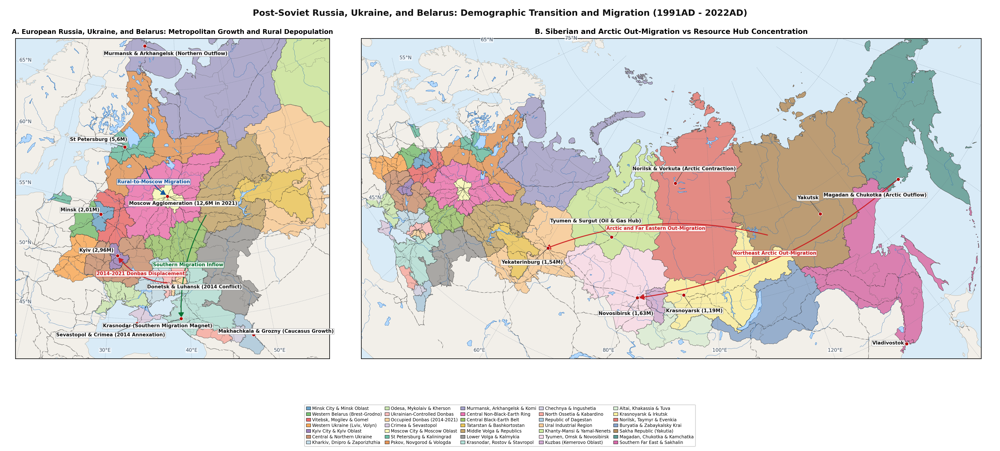
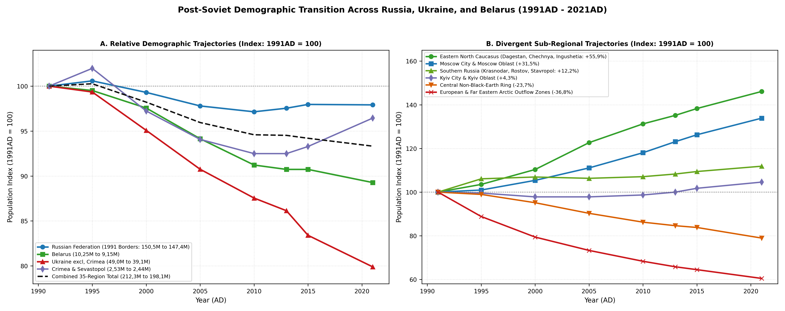
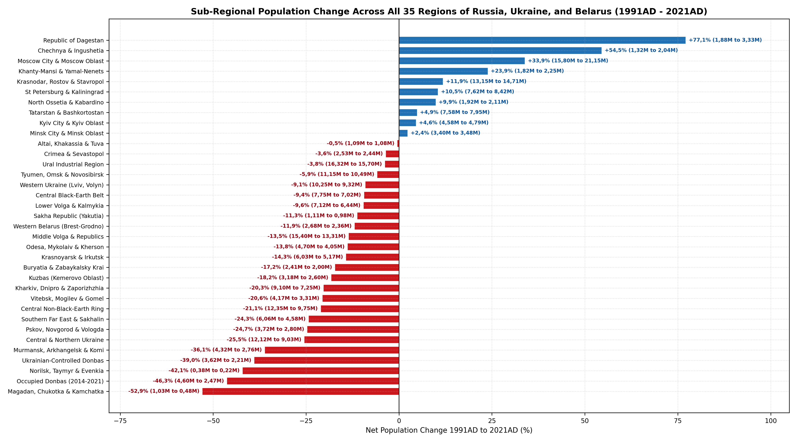
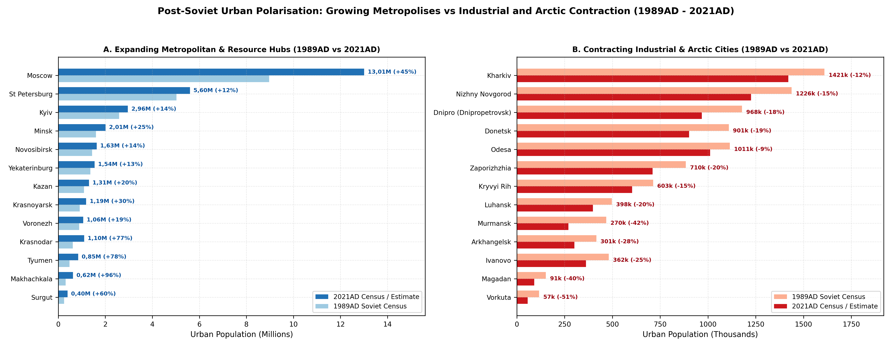

# Population Estimates and Census Sources (1991-2021AD)

The dissolution of the Union of Soviet Socialist Republics in December
1991AD inaugurated a thirty-year demographic transformation across the
East Slavic and Northern Eurasian space comprising the Republic of
Belarus, Ukraine, and the Russian Federation (1991-2021AD). At the
1991AD transition from the late Soviet era (224 550k across the seven
European and Northern Eurasian Union Republics), the restoration of
independence to the Estonian (1 568k), Latvian (2 658k), Lithuanian (3
704k), and Moldavian (4 360k) Republics removed 12 290k outside the
post-Soviet RU-UA-BY study envelope, leaving an exact 1991AD baseline
population of 212 260k (212,26M) across the 35 demographic regions (17
969 007 km2: 10 250k across Regions 1-3 in Belarus, 51 500k across
Regions 4-11 within the internationally recognised 1991AD borders of
Ukraine, and 150 510k across Regions 12-35 in the Russian Federation).
This total peaked briefly at 212 820k (212,82M) in 1995AD during the
initial wave of post-Soviet repatriation from Central Asia and the South
Caucasus
[\[1\]](#ref-goskomstat1990itogi1989)[\[2\]](#ref-rosstat2022demyearbook)[\[3\]](#ref-ukrstat2021naselennia)[\[4\]](#ref-belstat2020perepis2019).
Over the ensuing quarter-century (1995-2021AD), this territorial expanse
experienced an unprecedented peacetime demographic contraction alongside
an acute spatial reordering of its urban and rural settlement hierarchy.
By late 2021AD - on the eve of the full-scale Russian invasion of
Ukraine in February 2022AD - the combined population across the 35
regions had fallen by -14 180k (-14,18M, or -6,7% relative to 1991AD) to
198 080k (198,08M), comprising 9 150k (-10,7%) in Belarus (Regions 1-3),
41 560k (-19,3%) across the 1991AD territories of Ukraine (Regions 4-11,
including 2 210k in Government-Controlled Donbas Reg. 9, 2 470k in
Pre-2022 Occupied Donbas Reg. 10, and 2 440k in Annexed Crimea and
Sevastopol Reg. 11), and 147 370k (-2,1%) across the Russian Federation
(Regions 12-35)
[\[3\]](#ref-ukrstat2021naselennia)[\[4\]](#ref-belstat2020perepis2019)[\[5\]](#ref-rosstat2022perepis2021)[\[6\]](#ref-dubilet2020assessment2019).

Population series for 1991AD - 2021AD rest on three national statistical
systems that diverged in census frequency and territorial coverage after
1991AD [\[7\]](#ref-clem2016censuses).

The Russian Federation (Regions 12-35, Goskomstat Rossii / Rosstat):
Following the 1989AD All-Union Census (147 022k permanent residents,
rising to 150 510k in the 1991AD regional baseline and 151 390k in
1995AD), Rosstat conducted three post-Soviet national enumerations: the
All-Russian Population Census of 9 October 2002AD (145 167k)
[\[8\]](#ref-rosstat2004perepis2002), the All-Russian Population Census
of 14 October 2010AD (142 857k) [\[9\]](#ref-rosstat2012perepis2010),
and the delayed All-Russian Population Census of 1 October - 14 November
2021AD (147 182k including Crimea/Sevastopol, or 147 370k within Regions
12-35)
[\[5\]](#ref-rosstat2022perepis2021)[\[10\]](#ref-rosstat2015krym2014).
As demographic analysts led by Anatoly Vishnevsky, Sergei Zakharov,
Evgueni Andreev, and Nikita Mkrtchyan have demonstrated, the 2002AD and
2021AD censuses relied heavily on administrative police-registration
records (*registratsiya*) in metropolitan Moscow (Region 12), Saint
Petersburg (Region 13), and the North Caucasus (Regions 22-24),
requiring careful cross-checking against civil vital-registration
ledgers (ZAGS births and deaths), intercensal retrospective adjustments,
and municipal migration matrices
[\[11\]](#ref-vishnevsky2006demograficheskaya)[\[12\]](#ref-zakharov2008fertility)[\[13\]](#ref-andreev2003health)[\[14\]](#ref-smirnov2026landscape).

Ukraine (Regions 4-11, Derzhstat Ukrainy & Ptoukha Institute): After the
1989AD Soviet census (51 452k permanent residents, rising through CIS
return migration to 52,2M in 1993AD), independent Ukraine conducted only
a single traditional door-to-door enumeration: the First All-Ukrainian
Population Census of 5 December 2001AD (48 457k)
[\[15\]](#ref-ukrstat2003perepis2001). Following the March 2014AD
Russian annexation of Crimea and Sevastopol (Region 11) and the outbreak
of the War in Donbas (April 2014AD), which split Donetsk and Luhansk
oblasts along a 427 km Line of Contact between Government-Controlled
Donbas (Region 9) and Pre-2022 Occupied Donbas (Region 10), Ukrainian
demographic series were maintained through annual Ukrstat
vital-registration balances [\[3\]](#ref-ukrstat2021naselennia), Ptoukha
Institute reconstructions (Libanova, Gladun, Levchuk), and the December
2019AD Electronic Population Assessment (37 289k on
government-controlled territory, or 41 560k across all eight Ukrainian
regions Regions 4-11 in 2021AD)
[\[6\]](#ref-dubilet2020assessment2019)[\[16\]](#ref-libanova2014ukraine)[\[17\]](#ref-gladun2020ukraine)[\[18\]](#ref-perelliharris2023ukraine).

The Republic of Belarus (Regions 1-3, Minstat / Belstat): Belarus
conducted full decennial enumerations on 16 February 1999AD (10 045k)
[\[19\]](#ref-belstat2000perepis1999), 14 October 2009AD (9 504k)
[\[20\]](#ref-belstat2010perepis2009), and 4-30 October 2019AD (9 413k,
declining to 9 150k present population across Regions 1-3 by late 2021AD
under COVID-19 excess mortality and post-2020AD emigration)
[\[4\]](#ref-belstat2020perepis2019)[\[21\]](#ref-shakhotska2009belarus)[\[22\]](#ref-antipova2013belarus).

# The 35 Regions and Trajectories (1991-2021AD)

Rather than aggregating the post-Soviet space into broad pre-industrial
ecological zones, this synthesis partitions Belarus (Regions 1-3),
Ukraine (Regions 4-11), and the Russian Federation (Regions 12-35) into
35 demographic regions that explicitly separate. The three North
Caucasus ethno-demographic regimes: Chechnya & Ingushetia (Region 22,
First and Second Chechen Wars 1994-2009AD, Nazran IDP surge, and
post-war rebound), North Ossetia (1992AD Prigorodny conflict),
Kabardino-Balkaria & Karachay-Cherkessia (Region 23), and the Republic
of Dagestan (Region 24, high-fertility natural increase and
Makhachkala-Kaspiysk urban boom).

The three 2014-2021AD Ukrainian conflict and annexation zones:
Government-Controlled Donbas (Region 9), Pre-2022 Occupied Donbas
(Region 10), and Annexed Crimea & Sevastopol (Region 11).

And the ten disaggregated Asian Russian corridors and polar zones
(Regions 26-35), separating the West-East Trans-Siberian and Pacific
Corridors (West Siberian Trans-Siberian Belt \[Reg. 27\], Kuzbass Coal
Basin \[Reg. 28\], East Siberian Trans-Siberian Corridor \[Reg. 30\],
Buryatia & Zabaykalsky \[Reg. 32\], and Southern Far East & Pacific
Corridor \[Reg. 35\]) from the Southern Siberian Indigenous Republics
(Altai, Khakassia & Tuva \[Reg. 29\]) and the Northern Hydrocarbon/Polar
Zones (Yugra & Yamal Hydrocarbon Arctic \[Reg. 26\], Norilsk, Taymyr &
Evenkia \[Reg. 31\], Sakha Republic / Yakutia \[Reg. 33\], and Extreme
Northeast Arctic Exodus: Magadan, Chukotka & Kamchatka \[Reg. 34\]).

Figure illustrates the trajectories of ten representative regions
alongside the indexed national curves (1991AD = 100), while Table
documents the complete benchmark series (1991AD, 1995AD, 2000AD, 2005AD,
2010AD, 2013AD, 2015AD, and 2021AD) across all 35 regions.

| Post-Soviet Region (1-35) | 1991AD | 1995AD | 2000AD | 2005AD | 2010AD | 2013AD | 2015AD | 2021AD | Change |
|:---|:---|:---|:---|:---|:---|:---|:---|:---|:---|
| 1\. Minsk City & Minsk Oblast Metropolitan Magnet | 3 400k | 3 390k | 3 360k | 3 320k | 3 340k | 3 380k | 3 420k | 3 480k | +2,4% |
| 2\. Western Belarus: Brest & Grodno Oblasts | 2 680k | 2 690k | 2 650k | 2 560k | 2 470k | 2 440k | 2 430k | 2 360k | -11,9% |
| 3\. Eastern & Southeastern Belarus: Vitebsk, Mogilev & Gomel Oblasts | 4 170k | 4 120k | 3 990k | 3 770k | 3 540k | 3 480k | 3 450k | 3 310k | -20,6% |
| 4\. Western Ukraine | 10 250k | 10 280k | 10 050k | 9 780k | 9 620k | 9 580k | 9 560k | 9 320k | -9,1% |
| 5\. Kyiv City & Kyiv Metropolitan Oblast | 4 580k | 4 560k | 4 480k | 4 480k | 4 520k | 4 580k | 4 660k | 4 790k | +4,6% |
| 6\. Central & Northern Ukraine Depopulation Belt | 12 120k | 11 990k | 11 390k | 10 690k | 10 080k | 9 770k | 9 660k | 9 030k | -25,5% |
| 7\. Kharkiv, Dnipropetrovsk & Zaporizhzhia Industrial East | 9 100k | 9 020k | 8 580k | 8 120k | 7 780k | 7 620k | 7 650k | 7 250k | -20,3% |
| 8\. Ukrainian Black Sea Littoral | 4 700k | 4 680k | 4 480k | 4 320k | 4 220k | 4 180k | 4 160k | 4 050k | -13,8% |
| 9\. Government-Controlled Donbas | 3 620k | 3 580k | 3 350k | 3 120k | 2 950k | 2 860k | 2 450k | 2 210k | -39,0% |
| 10\. Occupied Donbas / ORDLO | 4 600k | 4 540k | 4 230k | 3 930k | 3 700k | 3 590k | 2 700k | 2 470k | -46,3% |
| 11\. Crimea & Sevastopol | 2 530k | 2 580k | 2 460k | 2 380k | 2 340k | 2 340k | 2 360k | 2 440k | -3,6% |
| 12\. Moscow City & Moscow Oblast Post-Soviet Hyper-Centralisation Core | 15 800k | 15 950k | 16 650k | 17 550k | 18 650k | 19 450k | 19 950k | 21 150k | +33,9% |
| 13\. Saint Petersburg, Leningrad Oblast & Kaliningrad Exclave | 7 620k | 7 550k | 7 420k | 7 380k | 7 520k | 7 750k | 7 950k | 8 420k | +10,5% |
| 14\. Depopulating Northwest: Pskov, Novgorod, Vologda & Republic of Karelia | 3 720k | 3 660k | 3 480k | 3 260k | 3 080k | 3 010k | 2 960k | 2 800k | -24,7% |
| 15\. European Arctic Exodus Zone: Murmansk, Arkhangelsk, Komi & Nenets AO | 4 320k | 3 990k | 3 630k | 3 380k | 3 150k | 3 030k | 2 970k | 2 760k | -36,1% |
| 16\. Central Non-Black-Earth Mortality & Shrinkage Ring | 12 350k | 12 220k | 11 750k | 11 150k | 10 650k | 10 450k | 10 350k | 9 750k | -21,1% |
| 17\. Central Black-Earth Belt | 7 750k | 7 980k | 7 850k | 7 580k | 7 380k | 7 320k | 7 300k | 7 020k | -9,4% |
| 18\. Republics of Tatarstan & Bashkortostan | 7 580k | 7 850k | 7 890k | 7 840k | 7 860k | 7 910k | 7 950k | 7 950k | +4,9% |
| 19\. Middle Volga Oblasts | 15 400k | 15 680k | 15 350k | 14 750k | 14 250k | 14 050k | 13 950k | 13 315k | -13,5% |
| 20\. Lower Volga | 7 120k | 7 370k | 7 270k | 7 040k | 6 860k | 6 810k | 6 770k | 6 440k | -9,6% |
| 21\. Southern Russian Sunbelt Magnet | 13 150k | 13 950k | 14 060k | 13 980k | 14 080k | 14 240k | 14 390k | 14 710k | +11,9% |
| 22\. Chechnya & Ingushetia | 1 320k | 1 180k | 1 120k | 1 520k | 1 690k | 1 790k | 1 860k | 2 040k | +54,5% |
| 23\. North Ossetia | 1 920k | 1 980k | 2 080k | 2 110k | 2 120k | 2 110k | 2 110k | 2 110k | +9,9% |
| 24\. Republic of Dagestan | 1 880k | 2 140k | 2 450k | 2 650k | 2 910k | 3 020k | 3 110k | 3 330k | +77,1% |
| 25\. Ural Industrial Belt | 16 320k | 16 470k | 16 290k | 15 870k | 15 610k | 15 540k | 15 500k | 15 700k | -3,8% |
| 26\. Khanty-Mansi | 1 820k | 1 810k | 1 880k | 1 990k | 2 055k | 2 130k | 2 165k | 2 255k | +23,9% |
| 27\. West Siberian Trans-Siberian Belt | 11 150k | 11 220k | 11 030k | 10 720k | 10 545k | 10 550k | 10 595k | 10 495k | -5,9% |
| 28\. Kuzbass Coal-Metallurgical Basin | 3 180k | 3 100k | 2 980k | 2 860k | 2 760k | 2 740k | 2 720k | 2 600k | -18,2% |
| 29\. Southern Siberian Republics: Altai, Khakassia & Tuva | 1 090k | 1 080k | 1 060k | 1 040k | 1 045k | 1 055k | 1 065k | 1 085k | -0,5% |
| 30\. East Siberian Trans-Siberian & Angara-Yenisei Corridor | 6 030k | 5 940k | 5 710k | 5 460k | 5 315k | 5 295k | 5 290k | 5 170k | -14,3% |
| 31\. Norilsk, Taymyr & Evenkia Polar De-Population Zone | 380k | 330k | 290k | 260k | 235k | 225k | 220k | 220k | -42,1% |
| 32\. Republic of Buryatia | 2 410k | 2 380k | 2 290k | 2 190k | 2 080k | 2 060k | 2 050k | 1 995k | -17,2% |
| 33\. Sakha Republic | 1 110k | 1 030k | 960k | 950k | 958k | 955k | 960k | 985k | -11,3% |
| 34\. Extreme Northeast Arctic Exodus Zone | 1 030k | 770k | 630k | 560k | 530k | 515k | 505k | 485k | -52,9% |
| 35\. Southern Far East & Pacific Corridor | 6 060k | 5 760k | 5 340k | 5 100k | 4 877k | 4 805k | 4 755k | 4 585k | -24,3% |
| Sub-Total: Republic of Belarus (Regions 1-3) | 10 250k | 10 200k | 10 000k | 9 650k | 9 350k | 9 300k | 9 300k | 9 150k | -10,7% |
| Sub-Total: Ukraine \[1991AD Borders\] (Regions 4-11) | 51 500k | 51 230k | 49 020k | 46 820k | 45 210k | 44 520k | 43 200k | 41 560k | -19,3% |
| Sub-Total: Russian Federation \[1991AD Borders\] (Regions 12-35) | 150 510k | 151 390k | 149 460k | 147 190k | 146 210k | 146 810k | 147 445k | 147 370k | -2,1% |
| Total Post-Soviet Space (Regions 1-35) | 212 260k | 212 820k | 208 480k | 203 660k | 200 770k | 200 630k | 199 945k | 198 080k | -6,7% |

Population trajectories across the thirty-five post-Soviet regions of
Belarus, Ukraine, and the Russian Federation from 1991AD to 2021AD (in
thousands).

As Table demonstrates, the 35-region partition exposes six structural
demographic regimes across 1991AD - 2021AD
[\[14\]](#ref-smirnov2026landscape)[\[23\]](#ref-silvagni2012regional)[\[24\]](#ref-zubarevich2013four).

Three Belarusian Demographic Zones (Regions 1-3: 10 250k -\> 9 150k,
-10,7%): Region 1 (Minsk City & Minsk Oblast Metropolitan Magnet)
expanded by +2,4% (3 400k -\> 3 480k) as Minsk city (1,61M -\> 2,01M)
absorbed youth migrants from across the republic; Region 2 (Western
Belarus: Brest & Grodno Oblasts) contracted moderately by -11,9% (2 680k
-\> 2 360k); and Region 3 (Eastern & Southeastern Belarus: Vitebsk,
Mogilev & Gomel Oblasts) suffered a -20,6% contraction (4 170k -\> 3
310k) driven by post-Chernobyl resettlement in Gomel and Mogilev and
severe rural ageing across Vitebsk
[\[21\]](#ref-shakhotska2009belarus)[\[22\]](#ref-antipova2013belarus).

Eight Ukrainian Demographic and Conflict Zones (Regions 4-11: 51 500k
-\> 41 560k, -19,3%): Only Region 5 (Kyiv City & Kyiv Metropolitan
Oblast) recorded net growth (4 580k -\> 4 790k, +4,6%). Region 4
(Western Ukraine: Galicia, Volhynia, Bukovina & Zakarpattia) fell by
-9,1% (10 250k -\> 9 320k) as higher natural fertility cushioned
circular EU labour emigration; Region 8 (Ukrainian Black Sea Littoral:
Odesa, Mykolaiv & Kherson) declined by -13,8% (4 700k -\> 4 050k);
Region 7 (Kharkiv, Dnipropetrovsk & Zaporizhzhia Industrial East)
contracted by -20,3% (9 100k -\> 7 250k, briefly rising from 7 620k in
2013AD to 7 650k in 2015AD as the primary reception belt for Donbas
IDPs); and Region 6 (Central & Northern Ukraine Depopulation Belt)
plunged by -25,5% (12 120k -\> 9 030k) due to extreme rural ageing (CDR
\> 19-22 per 1 000 in Chernihiv and Sumy). In the conflict zones, Region
11 (Crimea & Sevastopol, annexed March 2014AD) stood at 2 440k in 2021AD
(-3,6% vs 1991AD, rising from 2 340k in 2013AD via Russian
military/civilian inflow), whereas the severed Donbas coal basin
suffered catastrophic depopulation along the 2014-2021AD Minsk Line of
Contact: Region 9 (Government-Controlled Donbas: Mariupol, Kramatorsk,
Sievierodonetsk) fell by -39,0% (3 620k in 1991AD -\> 2 860k in 2013AD
-\> 2 210k in 2021AD) and Region 10 (Pre-2022 Occupied Donbas:
Donetsk-Makiivka-Horlivka & Luhansk-Alchevsk) collapsed by -46,3% (4
600k in 1991AD -\> 3 590k in 2013AD -\> 2 470k in 2021AD)
[\[16\]](#ref-libanova2014ukraine)[\[17\]](#ref-gladun2020ukraine)[\[25\]](#ref-unhcr2021donbas).

Metropolitan, Sunbelt, Hydrocarbon, and Petrochemical Growth Magnets in
Russia (Regions 12, 13, 18, 21, and 26): Five Russian non-Caucasus
regions expanded significantly: Region 12 (Moscow City & Moscow Oblast
Megaregion) surged by +33,9% (15 800k -\> 21 150k, +5,35M), Region 26
(Khanty-Mansi/Yugra & Yamalo-Nenets Hydrocarbon Autonomous Okrugs) by
+23,9% (1 820k -\> 2 255k), Region 21 (Southern Russian Sunbelt Magnet:
Krasnodar, Rostov, Stavropol & Adygea) by +11,9% (13 150k -\> 14 710k,
+1,56M), Region 13 (Saint Petersburg, Leningrad Oblast & Kaliningrad
Exclave) by +10,5% (7 620k -\> 8 420k), and Region 18 (Republics of
Tatarstan & Bashkortostan) by +4,9% (7 580k -\> 7 950k)
[\[24\]](#ref-zubarevich2013four)[\[26\]](#ref-karachurina2018centripetal)[\[27\]](#ref-mkrtchyan2020suburban).

Disaggregated North Caucasus Republics (Regions 22, 23, and 24): Region
24 (Republic of Dagestan) recorded the highest sustained expansion in
the post-Soviet space at +77,1% (1 880k -\> 3 330k), driven by
above-replacement fertility and the Makhachkala-Kaspiysk urban boom
[\[28\]](#ref-belozerov2005ethnodemographic). Region 22 (Chechnya &
Ingushetia) plunged from 1 320k (1991AD) to 1 120k (2000AD) during the
First and Second Chechen Wars and the permanent exodus of ethnic
Russians from Grozny, before rebounding through Vainakh natural increase
($`TFR \approx 2{,}5 - 2{,}8`$), the Nazran IDP expansion, and federal
reconstruction to 2 040k in 2021AD (+54,5%)
[\[29\]](#ref-tishkov2004chechnya)[\[30\]](#ref-vendina2007wars).
Between them, Region 23 (North Ossetia-Alania, Kabardino-Balkaria &
Karachay-Cherkessia) absorbed both the 1992AD Prigorodny conflict and
Georgian-South Ossetian refugee inflows, growing by +9,9% (1 920k -\> 2
110k).

Polar and Arctic De-Population Zones (Regions 15, 31, 33, and 34):
Disaggregating the Russian North reveals the extreme gradient of the
post-Soviet *Severnyy ottok* (“Northern Outflow”): Region 34 (Extreme
Northeast Arctic Exodus Zone: Magadan -65%, Chukotka -70% & Kamchatka)
lost more than half its population at -52,9% (1 030k -\> 485k); Region
31 (Norilsk, Taymyr & Evenkia Polar De-Population Zone) fell by -42,1%
(380k -\> 220k); and Region 15 (European Arctic Exodus Zone: Murmansk,
Arkhangelsk, Komi & Nenets AO) fell by -36,1% (4 320k -\> 2 760k). By
contrast, Region 33 (Sakha Republic / Yakutia) declined by only -11,3%
(1 110k -\> 985k, recovering from a 2005AD trough of 950k) because high
indigenous Sakha fertility and the rapid growth of Yakutsk (187k -\>
355k, +89,8%) partially offset the collapse of northern Russian mining
towns
[\[31\]](#ref-heleniak1999outmigration)[\[32\]](#ref-heleniak2009growth)[\[33\]](#ref-mkrtchyan2015western).

Trans-Siberian Corridors, Southern Siberian Republics, and European
Interior Shrinkage Belts (Regions 14, 16-17, 19-20, 25, 27-30, 32, and
35): In European Russia, severe ageing and rural depopulation drove
Region 14 (Depopulating Northwest & Karelia) down by -24,7% (3 720k -\>
2 800k) and Region 16 (Central Non-Black-Earth Mortality & Shrinkage
Ring) down by -21,1% (12 350k -\> 9 750k), alongside declines in Middle
Volga & Finno-Ugric Republics (Region 19: -13,5%), Lower Volga &
Kalmykia (Region 20: -9,6%), Central Black-Earth (Region 17: -9,4%), and
the Ural Industrial Belt (Region 25: -3,8%). Across southern Siberia and
the Pacific corridor, Region 29 (Southern Siberian Republics: Altai,
Khakassia & Tuva) held virtually stable at -0,5% (1 090k -\> 1 085k) as
high indigenous Tuvan and Altai fertility
($`TFR \approx 2{,}5 - 3{,}0`$) offset ethnic Russian out-migration,
while Region 27 (West Siberian Trans-Siberian Belt) fell by only -5,9%
(11 150k -\> 10 495k) thanks to the boom of Tyumen (+77,6%) and
Novosibirsk (+13,7%). By contrast, coal-mine closures drove Region 28
(Kuzbass / Kemerovo Oblast) down by -18,2% (3 180k -\> 2 600k), while
Zapadnyy dreyf out-migration reduced Region 30 (East Siberian
Trans-Siberian Corridor: Krasnoyarsk & Irkutsk) by -14,3% (6 030k -\> 5
170k), Region 32 (Buryatia & Zabaykalsky Krai) by -17,2% (2 410k -\> 1
995k), and Region 35 (Southern Far East & Pacific Corridor: Primorye,
Khabarovsk, Amur, Jewish AO & Sakhalin) by -24,3% (6 060k -\> 4 585k)
[\[34\]](#ref-hill2003siberian)[\[35\]](#ref-zubarevich2019monogoroda)[\[36\]](#ref-contrerasluna2019asiatic).

# The 1990s Mortality Crisis and Migration (1991-2006AD)

The defining demographic shock of the immediate post-Soviet transition
(1991-2006AD) was the simultaneous collapse of period fertility and
surge in adult working-age mortality across Russia, Ukraine, and
Belarus - a scissors-like divergence of vital rates termed the “Russian
Cross” (*Russkiy Krest*) and “Ukrainian Cross”
[\[11\]](#ref-vishnevsky2006demograficheskaya)[\[12\]](#ref-zakharov2008fertility)[\[37\]](#ref-shkolnikov2004reversal)[\[38\]](#ref-mesle2012mortality).
Figure plots the crude birth rate (CBR) and crude death rate (CDR) of
Russia and Ukraine (1990-2021AD) alongside the net percentage population
change across all 35 regions, while Table summarises decadal vital
rates, life expectancy at birth ($`e_0`$), cumulative natural decrease,
and net migration balances.

| Country & Demographic Period | CBR / CDR (per 1 000) | Total Fertility Rate (TFR) | Male / Female e0 (Years) | Cumulative Natural Balance | Net Migration Balance |
|:---|:---|:---|:---|:---|:---|
| Russian Federation: Late Soviet Baseline (1989-1991AD) | 13,4 / 11,2 | 1,89 | 63,8 / 74,3 | +680k | +490k |
| Russian Federation: Acute Transition & Hyperinflation Crisis (1992-1999AD) | 9,3 / 14,5 | 1,16 (1999AD trough) | 57,6 / 71,2 (1994AD) | -5 820k | +3 650k (CIS return wave) |
| Russian Federation: Second Mortality Wave & Early Recovery (2000-2006AD) | 9,8 / 15,8 | 1,30 | 58,9 / 72,0 (2003AD) | -5 960k | +1 180k |
| Russian Federation: Pronatalist Recovery & Parity Window (2007-2016AD) | 12,6 / 13,6 | 1,76 (2015AD peak) | 66,5 / 77,1 (2016AD) | -1 450k (+83k in 2013-2015) | +2 650k |
| Russian Federation: Structural Decline & COVID-19 Shock (2017-2021AD) | 10,4 / 13,9 (16,7 in 2021) | 1,50 | 65,5 / 74,5 (2021AD) | -2 520k (-1 043k in 2021) | +980k |
| Ukraine \[1991AD Borders\]: Late Soviet Baseline (1989-1991AD) | 12,6 / 12,1 | 1,85 | 65,6 / 74,9 | +95k | +240k |
| Ukraine: Hyperinflation, Fertility Collapse & Emigration (1992-2001AD) | 9,1 / 14,8 | 1,08 (2001AD world low) | 61,2 / 72,8 (1996AD) | -2 980k | -1 150k |
| Ukraine: Post-2001 Depopulation & Pre-War Stabilisation (2002-2013AD) | 10,1 / 15,6 | 1,46 | 62,3 / 74,1 | -3 120k | -380k |
| Ukraine: Donbas War, Emigration & COVID-19 Shock (2014-2021AD) | 9,2 / 15,4 (18,5 in 2021) | 1,22 (1,16 in 2021AD) | 65,2 / 74,4 (2021AD) | -2 180k (-442k in 2021) | -1 450k (Donbas/EU outflow) |
| Republic of Belarus: Late Soviet Baseline (1989-1991AD) | 13,9 / 10,7 | 1,91 | 66,3 / 75,6 | +92k | +35k |
| Republic of Belarus: Post-Soviet Depopulation & Rural Ageing (1992-2005AD) | 9,6 / 13,8 | 1,25 (2003AD trough) | 62,2 / 74,1 (2002AD) | -580k | +110k |
| Republic of Belarus: Stabilisation & COVID-19 Shock (2006-2021AD) | 11,1 / 13,2 (16,4 in 2021) | 1,45 (1,72 in 2015AD) | 67,3 / 77,7 | -480k | -95k |

Vital rates, total fertility rate, life expectancy at birth, cumulative
natural balance, and net migration across Russia, Ukraine, and Belarus
(1989AD - 2021AD).

## Hyperinflation, Fertility Postponement, and Lowest-Low Fertility (1991AD - 2004AD)

Prior to the Soviet collapse, period fertility across all three East
Slavic republics hovered near replacement
($`TFR \approx 1{,}85 - 2{,}01`$ in 1988-1990AD), supported by early
universal marriage (mean age at first birth ~22,5 years) and state
housing allocation
[\[11\]](#ref-vishnevsky2006demograficheskaya)[\[12\]](#ref-zakharov2008fertility).
Price liberalisation in January 1992AD, hyperinflation (\>2 500% in
Russia in 1992AD and \>10 000% in Ukraine in 1993AD), the collapse of
real wages by 40-60%, mass enterprise wage arrears, and the closure of
municipal childcare facilities triggered an immediate collapse in second
and higher-order births
[\[18\]](#ref-perelliharris2023ukraine)[\[39\]](#ref-billingsley2009casualties).

In the Russian Federation (Regions 12-35), live births fell by nearly
half from 2 160k (CBR = 14,6 per 1 000) in 1989AD to 1 215k (CBR = 8,3
per 1 000) in 1999AD, driving the total fertility rate down to an
all-time low of $`TFR = 1{,}157`$ in 1999AD (0,92 in Saint Petersburg
Region 13 and 1,01 in Moscow Region 12)
[\[2\]](#ref-rosstat2022demyearbook)[\[12\]](#ref-zakharov2008fertility).

In Ukraine (Regions 4-11), live births plummeted from 691k (13,4 per 1
000) in 1989AD to 376k (7,7 per 1 000) in 2001AD, with $`TFR`$ reaching
1,08 in 2001AD - then the lowest national fertility rate recorded
anywhere in the world (0,89 in Kyiv Region 5 and 0,91-0,95 across the
Donbas Regions 9-10 and Industrial East Region 7)
[\[16\]](#ref-libanova2014ukraine)[\[18\]](#ref-perelliharris2023ukraine).

In Belarus (Regions 1-3), live births declined from 153k (15,0 per 1
000) in 1989AD to 88,5k (8,9 per 1 000) in 2002-2003AD, with $`TFR`$
bottoming at 1,25
[\[20\]](#ref-belstat2010perepis2009)[\[21\]](#ref-shakhotska2009belarus).

As Sergei Zakharov has shown, this fertility trough resulted from the
intersection of an acute economic crisis with the onset of the Second
Demographic Transition: young cohorts born in the 1970s and 1980s
abandoned the Soviet pattern of universal childbearing at ages 20-23,
shifting toward delayed marriage and older maternal schedules even as
older cohorts halted parity progression after their first child
[\[12\]](#ref-zakharov2008fertility)[\[40\]](#ref-yastrebov2021echo).

## The Working-Age Male Mortality Surge (1992AD - 2005AD)

Simultaneously with the collapse of births, mortality surged across all
three countries between 1992AD and 1994AD, followed by a brief recovery
in 1995-1998AD and a second severe mortality wave after the August
1998AD rouble default that peaked in 2003AD
[\[13\]](#ref-andreev2003health)[\[37\]](#ref-shkolnikov2004reversal)[\[41\]](#ref-bhattacharya2012gorbachev).
With the repeal of the state alcohol monopoly in 1992AD, the
proliferation of cheap untaxed vodka and toxic industrial alcohol
surrogates (*samogon*, colognes, and medicinal tinctures), psychosocial
stress from rapid privatisation, and the deterioration of cardiovascular
care produced a catastrophic surge in premature deaths among men aged
25-59
[\[42\]](#ref-leon2007izhevsk)[\[43\]](#ref-brainerd2001reform)[\[44\]](#ref-shkolnikov2013components).

Between 1991AD and 1994AD, annual deaths in Russia rose from 1 691k
(11,4 per 1 000) to 2 301k (15,7 per 1 000, exceeding 21-24 per 1 000 in
Region 14 Depopulating Northwest - Pskov and Novgorod - and Region 16
Central Non-Black-Earth Shrinkage Ring - Tver, Tula, and Ivanovo), while
Russian male life expectancy collapsed by -7,3 years in sixty months to
57,6 years in 1994AD (compared to 71,2 years for Russian women - a
gender life-expectancy gap of 13,6 years)
[\[13\]](#ref-andreev2003health)[\[37\]](#ref-shkolnikov2004reversal).

Following the 1998AD financial crash, Russian deaths climbed even higher
to 2 366k (16,4 per 1 000) in 2003AD (male e0 = 58,9 years).
Epidemiological case-control investigations, notably the Izhevsk Family
Study (Region 19) led by David Leon, Vladimir Shkolnikov, and Evgueni
Andreev, demonstrated that hazardous binge drinking of spirits and
non-beverage alcohols accounted for 43% of all deaths among working-age
Russian men
[\[38\]](#ref-mesle2012mortality)[\[42\]](#ref-leon2007izhevsk)[\[43\]](#ref-brainerd2001reform).

In Ukraine, annual deaths rose from 630k (12,1 per 1 000) in 1990AD to
792k (15,2 per 1 000) in 1995-1996AD and 765k (16,2 per 1 000) in
2005-2006AD (reaching 20-23 per 1 000 across Region 6 Central & Northern
Ukraine in Chernihiv and Sumy oblasts), with male life expectancy
falling to 61,2 years
[\[38\]](#ref-mesle2012mortality)[\[45\]](#ref-rudnytskyi2015demography).
Across 1992-2006AD inclusive, cumulative excess deaths over births
(natural decrease) reached -11,78M in the Russian Federation, -5,62M in
Ukraine, and -0,75M in Belarus - a combined vital deficit of -18,15M
lives in fifteen years
[\[2\]](#ref-rosstat2022demyearbook)[\[3\]](#ref-ukrstat2021naselennia)[\[20\]](#ref-belstat2010perepis2009).

## CIS Return Migration, Jewish Aliyah, German Aussiedler, and Ukrainian Emigration (1991-2010AD)

Why did the Russian Federation’s population contract by only -2,1%
across 1991-2021AD (150 510k -\> 147 370k) despite over -14M in
cumulative natural decrease, whereas Ukraine’s population plunged by
-19,3% (51 500k -\> 41 560k)? The answer lies in three intersecting
international migration streams
[\[32\]](#ref-heleniak2009growth)[\[46\]](#ref-locher2002migration)[\[47\]](#ref-karacay2025diaspora).

The Great CIS Repatriation Wave into Russia (1992-2002AD): Between
1992AD and 2002AD, Russia recorded a net migratory gain of +4,83M
permanent settlers (peaking at +845k net in 1994AD alone, driving
Russia’s regional total from 150 510k in 1991AD up to 151 390k in
1995AD) from Kazakhstan (+1,85M), Central Asia (+1,42M), the South
Caucasus (+820k), and the Baltics (+390k)
[\[46\]](#ref-locher2002migration)[\[48\]](#ref-abylkalikov2013waves).
These repatriates settled heavily in Region 21 (Southern Russian
Sunbelt) (Krasnodar, Stavropol, Rostov: 13 150k -\> 13 950k in 1995AD),
Region 17 (Central Black-Earth) (Belgorod, Voronezh: 7 750k -\> 7 980k
in 1995AD), Region 19 (Middle Volga) (Samara: 15 400k -\> 15 680k),
Region 20 (Lower Volga) (Saratov, Volgograd: 7 120k -\> 7 370k), and
Region 27 (West Siberian Trans-Siberian Belt) (Novosibirsk, Omsk, Altai
Krai: 11 150k -\> 11 220k), offsetting ~55% of Russia’s natural
population decline during the 1990s.

Post-Soviet Jewish *Aliyah* and Ethnic German *Aussiedler* Emigration
(1989-2005AD): Simultaneously, the lifting of Soviet exit restrictions
triggered the permanent emigration of \>1,15M post-Soviet Jews (*Aliyah*
to Israel alongside emigration to the United States and Germany) and
\>1,85M ethnic Germans (*Spätaussiedler* to the Federal Republic of
Germany)
[\[32\]](#ref-heleniak2009growth)[\[46\]](#ref-locher2002migration).
Across Ukraine (Regions 5-8), the Jewish population fell from 486k
(1989AD) to 103k (2001AD Census), particularly in Kyiv (Reg. 5), Odesa
(Reg. 8), Kharkiv (Reg. 7), and Dnipro (Reg. 7); in Belarus (Regions 1
and 3), from 112k (1989AD) to 28k (1999AD); and in Russia, from 551k
(1989AD) to 230k (2002AD) and 83k (2021AD), including the emigration of
over half the Jewish population of Birobidzhan / Jewish Autonomous
Oblast (Region 35)
[\[1\]](#ref-goskomstat1990itogi1989)[\[8\]](#ref-rosstat2004perepis2002)[\[15\]](#ref-ukrstat2003perepis2001).
Concurrently, over 450k ethnic Russian Germans emigrated directly from
the German national districts of Omsk Oblast (Azovo) and Altai Krai
(Halbstadt) in Region 27, Saratov and Volgograd (Region 20), and the
Urals (Region 25) to Germany, while another \>900k Kazakhstan Germans
transited through West Siberia and the Volga
[\[46\]](#ref-locher2002migration).

Ukrainian Return Wave (1991-1993AD) Followed by Structural Emigration
(1994-2021AD): Ukraine initially experienced a brief positive net
migration inflow of +540k in 1991-1993AD - including ~250k Crimean
Tatars returning from Uzbek deportation to Region 11 (Crimea) (2 530k
-\> 2 580k in 1995AD)
[\[15\]](#ref-ukrstat2003perepis2001)[\[16\]](#ref-libanova2014ukraine).
From 1994AD onward, however, deeper economic contraction turned Ukraine
into a major net emigration country, losing \>1,4M residents to net
emigration in 1994-2001AD and 2,0M-3,0M labour migrants across Region 4
(Western Ukraine EU Migration Corridor) and Region 6 (Central Ukraine)
during the 2000s and 2010s
[\[18\]](#ref-perelliharris2023ukraine)[\[49\]](#ref-smutchak2023collapse)[\[50\]](#ref-burdonosova2026ukraine).

# Northern Exodus and Urban Polarisation (1991-2021AD)

Alongside aggregate natural decrease, the thirty years between 1991AD
and 2021AD witnessed a profound spatial polarisation of settlement
across the 35 regions of Russia, Ukraine, and Belarus
[\[14\]](#ref-smirnov2026landscape)[\[24\]](#ref-zubarevich2013four)[\[26\]](#ref-karachurina2018centripetal)[\[51\]](#ref-kauffmann2013urban).
Soviet central planning had dispersed tens of millions of workers into
high-latitude Arctic mining towns, Siberian timber and defence
settlements, and single-enterprise industrial towns (*monogoroda*)
through northern wage coefficients (*severnye nadbavki*) and subsidised
supply lines (*severnyy zavoz*)
[\[31\]](#ref-heleniak1999outmigration)[\[34\]](#ref-hill2003siberian).
When price liberalisation in 1992AD exposed the true transport and
heating costs of high-latitude and single-factory settlements, two
complementary migratory processes reshaped the Eurasian map: (a) a
sustained East-to-West and North-to-South internal exodus (*Zapadnyy
dreyf* / “Western Drift” and *Severnyy ottok* / “Northern Outflow”) out
of Region 34 (Extreme Northeast Arctic Exodus Zone), Region 31 (Norilsk,
Taymyr & Evenkia), Region 15 (European Arctic Exodus Zone), and Region
35 (Southern Far East & Pacific Corridor), and (b) centripetal
metropolitan hyper-concentration into Region 12 (Moscow Megaregion),
Region 13 (Saint Petersburg & Kaliningrad), Region 21 (Southern Russian
Sunbelt), Region 26 (Yugra & Yamal Hydrocarbon Arctic), Region 1 (Minsk
Magnet), and Region 5 (Kyiv Metropolis)
[\[33\]](#ref-mkrtchyan2015western)[\[52\]](#ref-makhrova2016moscow)[\[53\]](#ref-slepukhina2012urbanization).
Figure contrasts expanding metropolitan and sunbelt poles against
contracting Arctic, coal-mining, and conflict-affected cities
(1989-2021AD), while Table documents representative regional and urban
shifts across the 35-region partition.

| Trajectory Category & Settlement / Region (1-35) | 1989/1991AD | 2001/2002AD | 2010AD | 2021AD | Net Change |
|:---|:---|:---|:---|:---|:---|
| Extreme Northeast Exodus: Magadan, Chukotka & Kamchatka (Region 34) | 1 030k (Chukotka 164k, Magadan 392k) | 630k (Chukotka 54k, Magadan 183k) | 530k (Chukotka 51k, Magadan 157k) | 485k (Chukotka 50k, Magadan 136k) | -52,9% (Kadykchan abandoned) |
| Polar De-Population: Norilsk, Taymyr & Evenkia (Region 31) | 380k (Norilsk aggl. 265k) | 290k (Norilsk 215k) | 235k (Norilsk 175k) | 220k (Norilsk 175k, Igarka 3,6k) | -42,1% (Igarka -80,7%) |
| European Arctic Exodus: Murmansk, Arkhangelsk, Komi & Nenets AO (Region 15) | 4 320k (Murmansk 468k, Vorkuta 116k) | 3 630k (Murmansk 336k, Vorkuta 85k) | 3 150k (Murmansk 307k, Vorkuta 71k) | 2 760k (Murmansk 270k, Vorkuta 57k) | -36,1% (Vorkuta -50,9%) |
| Southern Far East Corridor: Primorye, Khabarovsk, Amur & Sakhalin (Region 35) | 6 060k (Vladivostok 634k) | 5 340k (Vladivostok 595k) | 4 877k (Vladivostok 592k) | 4 585k (Vladivostok 601k) | -24,3% (Amur -27,5%) |
| Yakutia Indigenous Urbanisation vs Mining Shrinkage (Region 33) | 1 110k (Yakutsk 187k, Tiksi 11,6k) | 960k (Yakutsk 211k, Tiksi 5,9k) | 958k (Yakutsk 270k, Tiksi 5,1k) | 985k (Yakutsk 355k, Tiksi 4,2k) | -11,3% (Yakutsk +89,8%) |
| Kuzbass Coal Restructuring: Kemerovo, Novokuznetsk & Prokopyevsk (Region 28) | 3 180k (Prokopyevsk 274k) | 2 980k (Prokopyevsk 225k) | 2 760k (Prokopyevsk 210k) | 2 600k (Prokopyevsk 178k) | -18,2% (Prokopyevsk -35,0%) |
| Ural Industrial Belt Monogoroda: Nizhny Tagil, Zlatoust & Berezniki (Region 25) | 16 320k (N. Tagil 440k, Berezniki 201k) | 16 290k (N. Tagil 390k, Berezniki 173k) | 15 610k (N. Tagil 362k, Berezniki 156k) | 15 700k (N. Tagil 339k, Berezniki 138k) | -3,8% (Yekaterinburg +13,0%) |
| Central Non-Black-Earth Shrinkage Ring: Ivanovo, Tula & Tver (Region 16) | 12 350k (Ivanovo 481k, Tula 540k) | 11 750k (Ivanovo 432k, Tula 481k) | 10 650k (Ivanovo 408k, Tula 501k) | 9 750k (Ivanovo 362k, Tula 473k) | -21,1% (Ivanovo -24,7%) |
| Metropolitan Hyper-Concentration: Moscow City & Oblast Megaregion (Region 12) | 15 800k (Moscow city 8 967k) | 17 001k (Moscow city 10 383k) | 18 650k (Moscow city 11 504k) | 21 150k (Moscow city 13 010k) | +33,9% (Moscow +45,1%) |
| Moscow Ring Boomtowns: Balashikha, Khimki, Mytishchi & Krasnogorsk (Region 12) | 539k combined | 586k combined | 765k combined | 1 221k (Balashikha 521k) | +126,5% (Balashikha +285,9%) |
| Baltic & Northwest Core: Saint Petersburg, Leningrad & Kaliningrad (Region 13) | 7 620k (StP 5 024k) | 7 420k (StP 4 661k) | 7 520k (StP 4 880k) | 8 420k (StP 5 602k; Murino 89k) | +10,5% (StP +11,5%) |
| Southern Sunbelt Magnet: Krasnodar, Sochi, Rostov & Stavropol (Region 21) | 13 150k (Krasnodar 621k) | 14 060k (Krasnodar 646k) | 14 080k (Krasnodar 745k) | 14 710k (Krasnodar 1 099k) | +11,9% (Krasnodar +77,0%) |
| Arctic Hydrocarbon Magnet: Surgut, Nizhnevartovsk & Novy Urengoy (Region 26) | 1 820k (Surgut 248k) | 1 880k (Surgut 285k) | 2 055k (Surgut 307k) | 2 255k (Surgut 396k, Kh.-Mansiysk 107k) | +23,9% (Surgut +59,7%) |
| West Siberian Trans-Siberian Boom Poles: Tyumen & Novosibirsk (Region 27) | 11 150k (Tyumen 477k, Novosib. 1 437k) | 11 030k (Tyumen 511k, Novosib. 1 426k) | 10 545k (Tyumen 582k, Novosib. 1 474k) | 10 495k (Tyumen 847k, Novosib. 1 634k) | -5,9% (Tyumen +77,6%) |
| Caucasus & South Siberian High-TFR Capitals: Makhachkala (Reg. 24) & Kyzyl (Reg. 29) | 1 880k Reg. 24 (Makhachkala 318k; Kyzyl 87k) | 2 450k Reg. 24 (Makhachkala 462k; Kyzyl 104k) | 2 910k Reg. 24 (Makhachkala 572k; Kyzyl 110k) | 3 330k Reg. 24 (Makhachkala 623k; Kyzyl 125k) | +77,1% Reg. 24 (Makhachkala +95,9%) |
| East Slavic Capitals: Kyiv Metropolis (Region 5) & Minsk Magnet (Region 1) | 7 980k (4 580k + 3 400k) | 7 840k (4 480k + 3 360k) | 7 860k (4 520k + 3 340k) | 8 270k (4 790k + 3 480k) | +3,6% (Minsk city +25,1%) |

Spatial polarisation across the thirty-five post-Soviet regions
comparing northern and industrial shrinkage with metropolitan and
sunbelt growth (1989AD - 2021AD).

## The Northern Outflow (*Severnyy Ottok*) and Siberian Corridors (Regions 15, 26-35)

Disaggregating Asian Russia and the European North into eleven regions
(Region 15 and Regions 26-35) reveals why treating Siberia and the Far
East as a single block obscures three radically different demographic
trajectories
[\[31\]](#ref-heleniak1999outmigration)[\[32\]](#ref-heleniak2009growth)[\[33\]](#ref-mkrtchyan2015western)[\[34\]](#ref-hill2003siberian).

Extreme Northeast and Polar De-Population Zones (Regions 34, 31 & 15):
Across Region 34 (Extreme Northeast Arctic Exodus Zone: Magadan,
Chukotka & Kamchatka), population collapsed by -52,9% from 1 030k
(1991AD) to 485k (2021AD): Chukotka Autonomous Okrug lost -69,5% (164k
-\> 50k), Magadan Oblast lost -65,3% (392k -\> 136k), and Kamchatka Krai
fell from 472k to 292k (-38,1%; Petropavlovsk-Kamchatsky 269k -\> 165k).
Dozens of Kolyma and Chukotka mining towns - including Iultin, Valkumey,
and the coal town of Kadykchan (10,3k in 1989AD, completely abandoned
after its 1996AD heating-plant explosion) - were shuttered, while
Susuman shrank from 17k to 4,3k and Magadan city from 152k to 90k
(-40,8%)
[\[31\]](#ref-heleniak1999outmigration)[\[34\]](#ref-hill2003siberian).
In Region 31 (Norilsk, Taymyr & Evenkia Polar De-Population Zone) (380k
-\> 220k, -42,1%), the Arctic nickel city of Norilsk contracted from
265k to 175k (-34,0%), Dudinka from 32k to 19,6k, timber port Igarka by
-80,7% (18,8k -\> 3,6k), and Tura in Evenkia from 7,5k to 4,4k.
Similarly, Region 15 (European Arctic Exodus Zone: Murmansk,
Arkhangelsk, Komi & Nenets AO) lost -1,56M residents (-36,1%, 4 320k -\>
2 760k), led by Vorkuta (116k -\> 57k, -50,9%), Inta (60k -\> 20k,
-66,7%), Murmansk (468k -\> 270k, -42,3%), Apatity (88k -\> 50k),
Arkhangelsk (416k -\> 301k), and Severodvinsk (249k -\> 157k)
[\[32\]](#ref-heleniak2009growth)[\[35\]](#ref-zubarevich2019monogoroda).

Indigenous Urbanisation and High-Fertility Southern Siberian Republics
(Regions 33, 29 & 32): In Region 33 (Sakha Republic / Yakutia) (1 110k
in 1991AD -\> 950k in 2005AD -\> 985k in 2021AD, -11,3%), the exodus of
\>250k ethnic Russians from northern gold, tin, and coal settlements
(Tiksi 11,6k -\> 4,2k, Neryungri 82k -\> 57k, Ust-Nera) was largely
counterbalanced by high rural Sakha (Yakut) fertility and rapid
migration into the capital Yakutsk, which nearly doubled from 187k
(1989AD) to 355k (2021AD, +89,8%)
[\[14\]](#ref-smirnov2026landscape)[\[33\]](#ref-mkrtchyan2015western).
Even more strikingly, Region 29 (Southern Siberian Republics: Altai,
Khakassia & Tuva) held virtually constant (1 090k -\> 1 085k, -0,5%): in
the Tuva Republic, where ethnic Russian out-migration during the early
1990s reduced the Russian share from 32,0% (1989AD) to 10,1% (2021AD),
Russia’s highest total fertility rate ($`TFR \approx 2{,}7 - 3{,}0`$)
propelled Kyzyl up by +43,7% (87k -\> 125k) alongside Gorno-Altaysk (47k
-\> 65k, +39,3%) and Abakan (156k -\> 185k)
[\[5\]](#ref-rosstat2022perepis2021). In Region 32 (Buryatia &
Zabaykalsky Krai) (2 410k -\> 1 995k, -17,2%), indigenous Buryat
rural-urban migration expanded Ulan-Ude from 353k to 438k (+24,1%) even
as Zabaykalsky Krai (Chita, Krasnokamensk) contracted sharply.

West-East Trans-Siberian Corridors vs. Arctic Hydrocarbon Growth
(Regions 26, 27, 28, 30 & 35): In Region 26 (Khanty-Mansi/Yugra &
Yamalo-Nenets Hydrocarbon Autonomous Okrugs), oil and gas extraction
drove population up by +23,9% (1 820k -\> 2 255k), led by Surgut (248k
-\> 396k, +59,7%), Nizhnevartovsk (245k -\> 283k), Novy Urengoy (95k -\>
107k), Noyabrsk (100k), Khanty-Mansiysk (34k -\> 107k, +214,7%), and
Salekhard (32k -\> 48k). Along the West Siberian Trans-Siberian Belt
(Region 27: 11 150k -\> 10 495k, -5,9%), rural shrinkage in Omsk and
Altai Krai (Rubtsovsk, Biysk) was offset by the boom of Tyumen (477k -\>
847k, +77,6%), Novosibirsk (1 437k -\> 1 634k), and university capital
Tomsk (506k -\> 556k). By contrast, post-Soviet mine closures in Region
28 (Kuzbass Coal-Metallurgical Basin: Kemerovo Oblast) reduced regional
population by -18,2% (3 180k -\> 2 600k; Prokopyevsk 274k -\> 178k,
Kiselevsk 128k -\> 83k, Novokuznetsk 600k -\> 537k)
[\[35\]](#ref-zubarevich2019monogoroda). Further east, Region 30 (East
Siberian Trans-Siberian Corridor: Krasnoyarsk & Irkutsk) fell by -14,3%
(6 030k -\> 5 170k) despite Krasnoyarsk city crossing the million
threshold (913k -\> 1 188k, +30,1%), while Region 35 (Southern Far East
& Pacific Corridor: Primorye, Khabarovsk, Amur, Jewish AO & Sakhalin)
declined by -24,3% (6 060k -\> 4 585k), with Komsomolsk-on-Amur
shrinking from 318k to 238k (-25,2%) while Khabarovsk (601k -\> 617k)
and Vladivostok (634k -\> 601k) absorbed regional rural youth
[\[33\]](#ref-mkrtchyan2015western)[\[36\]](#ref-contrerasluna2019asiatic).

## Monogoroda Shrinkage and Metropolitan Hyper-Concentration (Regions 1, 5, 12-14, 16-21 & 25)

In European Russia, Ukraine, and Belarus, Natalya Zubarevich’s “Four
Russias” framework captures the stark divergence between shrinking
industrial/rural peripheries and booming metropolitan cores
[\[24\]](#ref-zubarevich2013four)[\[26\]](#ref-karachurina2018centripetal)[\[35\]](#ref-zubarevich2019monogoroda)[\[54\]](#ref-zubarevich2010regioni).

Interior Shrinkage and 19 400+ Abandoned Villages (Regions 14, 16-17,
19-20 & 25): Across Region 14 (Depopulating Northwest & Karelia:
-24,7%), Region 16 (Central Non-Black-Earth Mortality & Shrinkage Ring:
-21,1%), and Region 19 (Middle Volga & Finno-Ugric/Chuvash Republics:
-13,5%), industrial cities contracted steadily (Ivanovo 481k -\> 362k,
Tula 540k -\> 473k, Rybinsk 251k -\> 177k, Dzerzhinsk 285k -\> 219k,
Nizhny Novgorod 1 438k -\> 1 226k), while rural “spatial compression”
(*szhatie prostranstva*) left over 19 400 Russian rural villages
completely uninhabited (*derevni bez naseleniya*) by 2021AD
[\[5\]](#ref-rosstat2022perepis2021)[\[55\]](#ref-nefedova2010compression).
In Region 25 (Ural Industrial Belt: 16 320k -\> 15 700k, -3,8%), the
growth of Yekaterinburg (1 367k -\> 1 544k) and Chelyabinsk (1 148k -\>
1 190k) contrasted with steep declines in metallurgical and potash
*monogoroda* (Nizhny Tagil -23,0%, Zlatoust -22,1%, Berezniki -31,3%,
Orsk -30,8%).

Metropolitan Hyper-Concentration (Regions 12, 13, 21, 18, 1 & 5):
Conversely, Region 12 (Moscow City & Moscow Oblast Megaregion) surged by
+5,35M (+33,9%, 15 800k -\> 21 150k), concentrating 14,4% of the Russian
Federation’s entire population within Moscow city (8,97M -\> 13,01M) and
its MKAD commuter belt (Balashikha 135k -\> 521k \[+285,9%\], Podolsk
315k, Khimki 257k, Mytishchi 255k, Korolev 228k, Lyubertsy 224k,
Krasnogorsk 188k, Odintsovo 181k, Domodedovo 152k)
[\[27\]](#ref-mkrtchyan2020suburban)[\[52\]](#ref-makhrova2016moscow).
Region 13 (Saint Petersburg, Leningrad & Kaliningrad) grew by +10,5% (7
620k -\> 8 420k; Saint Petersburg 5,60M, suburb Murino 5k -\> 89k,
Kaliningrad 490k), Region 21 (Southern Russian Sunbelt) by +11,9% (13
150k -\> 14 710k; Krasnodar 621k -\> 1 099k \[+77,0%\], Sochi 466k,
Stavropol 547k, Rostov-on-Don 1 142k), Region 18 (Tatarstan &
Bashkortostan) by +4,9% (7 580k -\> 7 950k; Kazan 1 309k, Ufa 1 145k),
Region 1 (Minsk Magnet) by +2,4% (3 400k -\> 3 480k; Minsk 1,61M -\>
2,01M), and Region 5 (Kyiv Metropolis) by +4,6% (4 580k -\> 4 790k; Kyiv
2,59M -\> 2,96M, Brovary 109k, Irpin 62k, Bucha 37k).

# Chechen Wars and North Caucasus Demography (Regions 22, 23 & 24)

In sharp contrast to the ageing East Slavic interior, the three
disaggregated North Caucasus regions - Region 22 (Chechnya &
Ingushetia), Region 23 (North Ossetia-Alania, Kabardino-Balkaria &
Karachay-Cherkessia), and Region 24 (Republic of Dagestan) - experienced
both the most destructive military conflicts on Russian territory since
1945AD and the fastest long-term demographic growth across the entire
35-region partition (+54,5% in Region 22, +9,9% in Region 23, and +77,1%
in Region 24)
[\[28\]](#ref-belozerov2005ethnodemographic)[\[29\]](#ref-tishkov2004chechnya)[\[30\]](#ref-vendina2007wars).
Table summarises the principal post-Soviet armed conflicts, casualties,
and forced migration flows across both the North Caucasus (Regions
22-24, 1992-2009AD) and Ukraine (Regions 9-11, 2014-2021AD).

| Conflict / Territorial Event & Region | Primary Cities & Settlement Impact | Estimated War Deaths | Forced Displacement & Regional Population Shift |
|:---|:---|:---|:---|
| East Prigorodny Conflict (Region 23 North Ossetia / Region 22 Ingushetia, Oct-Nov 1992AD) | Vladikavkaz suburbs (Kambileevskoye, Chermen, Kurtat), Beslan; Nazran & Sunzha IDP camps | ~600 killed (plus 334 killed in Sep 2004 Beslan school siege) | ~40k-60k ethnic Ingush displaced from Prigorodny District to Ingushetia; ~35k South Ossetian refugees into Reg. 23 |
| First Chechen War (Dec 1994AD - Aug 1996AD) & Interwar Ichkeria (Region 22) | Grozny (400k in 1989 -\> \<90k in Feb 1995 siege); Gudermes, Argun, Shali, Samashki | ~35 000 - 50 000+ military & civilian deaths | Region 22 fell 1 320k (1991) -\> 1 180k (1995); permanent exodus of \>220k ethnic Russians from Chechnya |
| Second Chechen War & Counter-Insurgency (Aug 1999AD - Apr 2009AD, Region 22) | Grozny (reduced to ~50k-60k in Jan 2000; rebuilt to 211k by 2002, 272k by 2010); Urus-Martan | ~25 000 - 40 000+ military & civilian deaths | Region 22 bottomed at 1 120k (2000) -\> 2 040k (2021, +54,5%); ~350k Chechen IDPs fled to Ingushetia (Nazran 18k -\> 125k) |
| Dagestan Demographic Transition & Urban Boom (Region 24, 1991-2021AD) | Makhachkala (318k-\>623k, +95,9%); Khasavyurt (70k-\>155k); Derbent (78k-\>125k); Kaspiysk (60k-\>121k) | 1999 Botlikh/Kadar incursion & low-level insurgency | Region 24 surged from 1 880k (1991) to 3 330k (2021, +77,1%) via high natural increase & mountain-to-piedmont migration |
| Annexation of Crimea & Sevastopol (Region 11, Feb-Mar 2014AD - 2021AD) | Sevastopol (344k in 2014 -\> 548k in 2021 Census); Simferopol (341k); Kerch (155k); Yevpatoria (108k) | \<10 direct deaths during Mar 2014 takeover | Region 11: ~60k-100k Ukrainian/Tatar IDPs out vs ~250k-800k Russian settler/military/resident inflow (2 340k -\> 2 440k) |
| War in Donbas: Partition of Region 9 (GCA) vs Region 10 (Pre-2022 Occupied Donbas, 2014-2021AD) | 427 km Contact Line: Reg. 10 Occupied (Donetsk 905k, Luhansk 399k, Makiivka, Horlivka) vs Reg. 9 Ukrainian-Held (Mariupol 431k, Kramatorsk 150k, Sievierodonetsk 101k) | ~14 400 killed (3 404+ civilians, ~4 400 Ukrainian forces, ~6 500 separatist/Russian forces) | Reg. 9 fell 2 860k (2013) -\> 2 210k (2021); Reg. 10 fell 3 590k (2013) -\> 2 470k (2021); 1,46M IDPs to Regs 5/7 + ~1,0M to Russia |

Major armed conflicts, urban devastation, estimated war deaths, and
forced displacement in the North Caucasus and Ukraine from 1992AD to
2021AD.

Region 22: Chechnya and Ingushetia (1 320k in 1991AD -\> 1 120k in
2000AD -\> 2 040k in 2021AD, +54,5%): At the 1989AD Soviet census, the
unified Checheno-Ingush ASSR contained 1 270k inhabitants (1 320k in
1991AD), including 735k ethnic Chechens, 164k Ingush, and 294k ethnic
Russians (23,1%), who were heavily concentrated in Grozny (399,6k)
[\[1\]](#ref-goskomstat1990itogi1989)[\[29\]](#ref-tishkov2004chechnya).
During the First (1994-1996AD) and Second (1999-2009AD) Chechen Wars,
urban siege warfare devastated Grozny (\<60k residents in early 2000AD),
Gudermes, Argun, Shali, and Urus-Martan, driving Region 22 down to 1
180k (1995AD) and 1 120k (2000AD)
[\[29\]](#ref-tishkov2004chechnya)[\[30\]](#ref-vendina2007wars). Over
320k-350k+ Chechen IDPs crossed into Ingushetia (joining 40k-60k ethnic
Ingush earlier expelled from Prigorodny District in 1992AD), causing
Nazran to swell nearly sevenfold from 18,2k (1989AD) to 125,1k in the
2002AD Census (122k in 2021AD alongside new republic capital Magas 15k)
[\[8\]](#ref-rosstat2004perepis2002)[\[30\]](#ref-vendina2007wars). Over
250k+ ethnic Russians permanently departed Chechnya and Ingushetia for
Region 21 (Southern Russian Sunbelt), reducing the Russian share in
Chechnya to 1,2% (2021AD). Conversely, post-2004AD federal
reconstruction rebuilt Grozny (211k in 2002AD -\> 272k in 2010AD -\>
329k in 2021AD), while high Vainakh fertility
($`TFR \approx 2{,}5 - 2{,}8`$) and young age structure (median age ~24
years) propelled Region 22 to 2 040k (1 511k in Chechnya and 510k in
Ingushetia in the 2021AD Census) [\[5\]](#ref-rosstat2022perepis2021).

Region 23: North Ossetia-Alania, Kabardino-Balkaria &
Karachay-Cherkessia (1 920k -\> 2 110k, +9,9%): In October-November
1992AD, the East Prigorodny armed conflict outside Vladikavkaz killed
~600 people and displaced 40k-60k ethnic Ingush from Prigorodny District
into Ingushetia (Region 22), while North Ossetia (Vladikavkaz 300k -\>
296k, Beslan 33k -\> 36k, site of the tragic September 2004AD school
siege) simultaneously absorbed \>35k ethnic Ossetian refugees fleeing
the 1991-1992AD South Ossetian war in Georgia
[\[28\]](#ref-belozerov2005ethnodemographic)[\[30\]](#ref-vendina2007wars).
Across Kabardino-Balkaria (Nalchik 235k -\> 247k, Prokhladny 58k -\>
60k) and Karachay-Cherkessia (Cherkessk 113k -\> 113k), moderate
indigenous natural increase offset gradual ethnic Russian out-migration,
stabilising Region 23 at 2 110k (2005-2021AD).

Region 24: Republic of Dagestan (1 880k -\> 3 330k, +77,1%): Alone among
all 35 regions, Dagestan (Region 24) nearly doubled its population
across 1991-2021AD (+1,45M), driven by sustained natural increase
($`TFR \approx 1{,}9 - 2{,}4`$ coupled with low adult mortality, CDR
~5,5-7,0 per 1 000) and massive internal resettlement of Avar, Dargin,
Lezgin, Kumyk, and Lak mountain villagers down to the Caspian coastal
plain
[\[5\]](#ref-rosstat2022perepis2021)[\[28\]](#ref-belozerov2005ethnodemographic).
Consequently, Makhachkala nearly doubled from 318k (1989AD) to 623k
(2021AD, +95,9%, or \>1,0M in its wider agglomeration), while Khasavyurt
surged by +121,4% (70k -\> 155k), Kaspiysk by +101,7% (60k -\> 121k),
and Derbent by +60,3% (78k -\> 125k).

# Crimea, the Donbas War, and COVID-19 (2014-2021AD)

The final septennium of the 1991-2021AD epoch was defined by the armed
conflict and territorial partition of Crimea (Region 11) and the Donbas
(Regions 9 and 10) in 2014-2021AD, followed by the catastrophic
2020-2021AD COVID-19 excess mortality wave
[\[17\]](#ref-gladun2020ukraine)[\[25\]](#ref-unhcr2021donbas)[\[56\]](#ref-kobak2021excess)[\[57\]](#ref-timonin2022covid).

## Region 11: Annexation of Crimea and Sevastopol (2014AD - 2021AD)

Following the Russian annexation of the Autonomous Republic of Crimea
and Sevastopol (Region 11) in February-March 2014AD, the peninsula’s
benchmark population shifted from 2 340k (2013AD) to 2 360k (2015AD) and
2 440k (2021AD benchmark; 2 482,5k in the October 2021AD Russian Census)
[\[5\]](#ref-rosstat2022perepis2021)[\[10\]](#ref-rosstat2015krym2014).
Between 60k and 100k Ukrainian citizens and Crimean Tatars relocated as
IDPs to mainland Ukraine (Regions 4, 5, and 8), whereas 250k-350k+
permanent Russian military personnel, federal civil servants, and
mainland retirees (and up to 500k-800k cumulative gross arrivals
including construction workers and unregistered temporary residents
across 2014-2021AD) moved onto the peninsula, driving Sevastopol up from
344k (2014AD) to 548k (2021AD) alongside Simferopol (341k), Kerch
(155k), and Yevpatoria (108k)
[\[17\]](#ref-gladun2020ukraine)[\[50\]](#ref-burdonosova2026ukraine).

## Regions 9 and 10: The War in Donbas and the 427-Kilometre Contact Line (2014AD - 2021AD)

In April 2014AD, armed conflict erupted across Donetsk and Luhansk
oblasts (6 450k combined residents in 2013AD), severing the integrated
Donbas coal-and-steel conurbation along a fortified 427 km Line of
Contact (Minsk II) into two distinct demographic zones
[\[3\]](#ref-ukrstat2021naselennia)[\[17\]](#ref-gladun2020ukraine)[\[25\]](#ref-unhcr2021donbas).

Region 10 (Pre-2022 Occupied Donbas: 4 600k in 1991AD -\> 3 590k in
2013AD -\> 2 470k in 2021AD, -46,3%): Encompassing the occupied urban
core of Donetsk (965k in 2013AD -\> ~905k nominal / \<850k de facto in
2021AD), Luhansk (426k -\> ~399k), Makiivka (353k -\> ~335k), Horlivka
(256k -\> ~235k), Alchevsk (111k -\> 105k), Yenakiieve (82k -\> 75k),
and Kadiivka / Stakhanov (77k -\> 72k). Between 2013AD and 2015AD alone,
Region 10 lost -890k inhabitants (-24,8%) through mass flight, followed
by acute natural decrease (CDR \> 21 per 1 000 vs CBR \< 5,5 per 1 000)
that reduced its present population to 2 470k by 2021AD
[\[17\]](#ref-gladun2020ukraine).

Region 9 (Government-Controlled Donbas: 3 620k in 1991AD -\> 2 860k in
2013AD -\> 2 210k in 2021AD, -39,0%): Encompassing Ukrainian-controlled
Mariupol (459k -\> 431k), provisional Donetsk oblast seat Kramatorsk
(163k -\> 150k), Sloviansk (117k -\> 106k), provisional Luhansk oblast
seat Sievierodonetsk (109k -\> 101k), Lysychansk (104k -\> 93k),
Kostiantynivka (76k -\> 68k), Bakhmut (77k -\> 71k), and Pokrovsk (65k
-\> 60k).

Casualties and Mass Displacement (2014-2021AD): Up to 31 December
2021AD, the Donbas conflict killed ~14 400 people and displaced over
2,5M residents: 1,46M registered IDPs relocated within
government-controlled Ukraine - above all into neighbouring Region 7
(Kharkiv, Dnipropetrovsk & Zaporizhzhia) (whose population briefly rose
from 7 620k in 2013AD to 7 650k in 2015AD) and Region 5 (Kyiv
Metropolis) (4 580k -\> 4 660k in 2015AD) - while ~1,0M refugees and
migrants moved into the Russian Federation (Region 21 Rostov/Krasnodar,
Region 17 Voronezh/Belgorod, and Region 12 Moscow) and Belarus (Regions
1-3)
[\[17\]](#ref-gladun2020ukraine)[\[18\]](#ref-perelliharris2023ukraine)[\[25\]](#ref-unhcr2021donbas).

## The COVID-19 Pandemic Excess Mortality Shock (2020AD - 2021AD)

After a brief 2013-2015AD vital-rate parity window in Russia (+83k
natural increase), structural birth decline returned after 2016AD as the
small cohorts born in the 1990s entered childbearing age, followed in
2020-2021AD by the COVID-19 pandemic
[\[40\]](#ref-yastrebov2021echo)[\[56\]](#ref-kobak2021excess)[\[57\]](#ref-timonin2022covid)[\[58\]](#ref-scholey2022covid).

Russian Federation (Regions 12-35): Registered deaths surged from 1 798k
(2019AD) to 2 139k (2020AD) and 2 442k (2021AD, 16,7 per 1 000),
producing 1,07M - 1,15M cumulative excess deaths, driving annual natural
decline to a post-WWII record of -1 043k (-1,04M) in 2021AD alone, and
reducing Russia’s total population across Regions 12-35 from 148 075k
(2018AD) to 147 370k (2021AD)
[\[57\]](#ref-timonin2022covid)[\[58\]](#ref-scholey2022covid).

Ukraine (Regions 4-11) and Belarus (Regions 1-3): In Ukraine, ~185k
COVID-19 excess deaths pushed annual natural decline to -442k in 2021AD
(CDR = 18,5 per 1 000 vs CBR = 7,3 per 1 000), reducing Regions 4-11
from 42 330k (2018AD) to 41 560k (2021AD)
[\[3\]](#ref-ukrstat2021naselennia)[\[18\]](#ref-perelliharris2023ukraine).
In Belarus, ~70k-85k excess deaths and post-2020AD emigration reduced
Regions 1-3 from 9 250k (2018AD) to 9 150k (2021AD), bringing the entire
35-region post-Soviet space to 198 080k (198,08M) on the eve of the
February 2022AD invasion
[\[4\]](#ref-belstat2020perepis2019)[\[56\]](#ref-kobak2021excess).

# Sources

1.
Goskomstat SSSR. *Itogi
Vsesoyuznoy Perepisi Naseleniya 1989 Goda: Chislennost i Razmeshchenie
Naseleniya SSSR*. Finansy i statistika, 1990,
<https://www.demoscope.ru/weekly/ssp/census.php>.

2.
Rosstat. *Demograficheskiy
Ezhegodnik Rossii 2022: Statisticheskiy Sbornik*. Rosstat, 2022,
<https://rosstat.gov.ru/folder/12781>.

3.
Derzhstat Ukrainy. *Naselennia
Ukrainy Za 2020 Rik: Demohrafichnyi Shchorichnyk; Chiselnist Nayavnoho
Naselennia Ukrainy Na 1 Sichnia 2021 Roku*. Derzhavna sluzhba statystyky
Ukrainy, 2021, <https://www.ukrstat.gov.ua/>.

4.
Belstat. *Itogi Perepisi
Naseleniya Respubliki Belarus 2019 Goda: V 7 Tomakh*. Natsionalnyy
statisticheskiy komitet Respubliki Belarus, 2020,
<https://www.belstat.gov.by/>.

5.
Rosstat. *Itogi Vserossiyskoy
Perepisi Naseleniya 2020 Goda (Po Sostoyaniyu Na 1 Oktyabrya 2021 Goda).
Tom 1: Chislennost i Razmeshchenie Naseleniya*. Rosstat, 2022,
<https://rosstat.gov.ru/folder/12781>.

6.
Dubilet, Dmytro, et al. *Otsinka
Chyselnosti Nayavnoho Naselennia Ukrainy Stanom Na 1 Hrudnia 2019 Roku
(Electronic Population Assessment)*. Cabinet of Ministers of Ukraine;
Ptoukha Institute for Demography; Social Studies, 2020,
<https://idss.org.ua>.

7.
Clem, Ralph S. *Research Guide to
the Russian and Soviet Censuses*. Cornell University Press, 2016,
<https://doi.org/10.7591/9781501707087>.

8.
Rosstat. *Itogi Vserossiyskoy
Perepisi Naseleniya 2002 Goda: V 14 Tomakh. Tom 1: Chislennost i
Razmeshchenie Naseleniya*. IIC Statistika Rossii, 2004,
<https://rosstat.gov.ru/folder/12781>.

9.
Rosstat. *Itogi Vserossiyskoy
Perepisi Naseleniya 2010 Goda: V 11 Tomakh. Tom 1: Chislennost i
Razmeshchenie Naseleniya*. IIC Statistika Rossii, 2012,
<https://rosstat.gov.ru/folder/12781>.

10.
Rosstat. *Itogi Perepisi
Naseleniya v Krymskom Federalnom Okruge 2014 Goda*. Rosstat, 2015,
<https://rosstat.gov.ru/folder/12781>.

11.
Vishnevsky, Anatoly G.
*Demograficheskaya Modernizatsiya Rossii, 1900–2000*. Novoe izdatelstvo,
2006,
<https://search.worldcat.org/search?q=Demograficheskaya+modernizatsiya+Rossii+1900+2000+Vishnevsky+2006>.

12.
Zakharov, Sergei V. “Russian
Federation: From the First to Second Demographic Transition.”
*Demographic Research*, vol. 19, 2008, pp. 907-72,
<https://doi.org/10.4054/DemRes.2008.19.24>.

13.
Andreev, Evgueni M., et al.
“Health Expectancy in the Russian Federation: A New Perspective on the
Health Divide in Europe.” *Bulletin of the World Health Organization*,
vol. 81, no. 11, 2003, pp. 778-87,
<https://pmc.ncbi.nlm.nih.gov/articles/PMC2572496>.

14.
Smirnov, Andrey V. “Migration
Landscape of Russia: Typology of Municipalities and Patterns of Spatial
Population Mobility.” *Population and Economics*, vol. 10, no. 1, 2026,
pp. 1-28, <https://doi.org/10.3897/popecon.10.e146614>.

15.
Derzhkomstat Ukrainy.
*Vseukrainskyi Perepys Naselennia 2001 Roku: Kilkist Ta Terytorialne
Rozmishchennia Naselennia Ukrainy*. Derzhkomstat Ukrainy, 2003,
<https://www.ukrstat.gov.ua/>.

16.
Libanova, Ella M., et al.
*Naselennia Ukrainy: Imperatyvy Demohrafichnoho Starinnia Ta
Depopuliatsii*. Ptoukha Institute for Demography; Social Studies, NAS of
Ukraine, 2014,
<https://search.worldcat.org/search?q=Naselennia+Ukrainy+Imperatyvy+demohrafichnoho+starinnia+ta+depopuliatsii+Libanova+2014>.

17.
Gladun, Oleksandr M. “Demographic
Losses and Migration Shifts in Ukraine Under Conditions of Armed
Conflict in Donbas (2014–2020).” *Demography and Social Economy*, vol.
40, no. 2, 2020, pp. 3-24, <https://dse.org.ua/en/archive>.

18.
Perelli-Harris, Brienna, and
Yuliya Hilevych. “The Triple Burden of Depopulation in Ukraine:
Examining Perceptions of Population Decline.” *Vienna Yearbook of
Population Research*, vol. 21, 2023, pp. 1-28,
<https://doi.org/10.1553/p-azcj-d4f4>.

19.
Minstat Respubliki Belarus. *Itogi
Perepisi Naseleniya Respubliki Belarus 1999 Goda*. Minstat RB, 2000,
<https://www.belstat.gov.by/>.

20.
Belstat. *Perepis Naseleniya
Respubliki Belarus 2009 Goda: Chislennost, Sostav i Razmeshchenie
Naseleniya*. Natsionalnyy statisticheskiy komitet Respubliki Belarus,
2010, <https://www.belstat.gov.by/>.

21.
Shakhotska, Lyudmila P.
*Demograficheskiy Potentsial Respubliki Belarus: Analiz i Perspektivy
Razvitiya*. Belorusskaya nauka, 2009,
<https://search.worldcat.org/search?q=Demograficheskiy+potentsial+Respubliki+Belarus+Analiz+perspektivy+razvitiya+Shakhotska+2009>.

22.
Antipova, Ekaterina A. *Geografiya
Selskogo Rasseleniya Belarusi: Prostranstvenno-Vremennie
Zakonomernosti*. BGU, 2013,
<https://search.worldcat.org/search?q=Geografiya+selskogo+rasseleniya+Belarusi+Prostranstvenno+vremennie+zakonomernosti+Antipova+2013>.

23.
Silvagni, Maria Giulia. *Patterns
of Regional Differentiation in Post-Soviet Russia*. University of
Bologna, 2012,
<https://scholar.google.com/scholar?q=Patterns+Regional+Differentiation+Post+Soviet+Russia+Silvagni+2012>.

24.
Zubarevich, Natalya V. “Four
Russias: Human Potential and Social Differentiation of Russian Regions
and Cities.” *Regional Research of Russia*, vol. 3, no. 4, 2013, pp.
321-34, <https://doi.org/10.1057/9781137336910_4>.

25.
UNHCR Ukraine, and Ministry of
Social Policy of Ukraine. *Registration of Internal Displacement and
Conflict-Affected Population Along the Donbas Contact Line (2014–2021)*.
United Nations High Commissioner for Refugees, 2021,
<https://data.unhcr.org/en/situations/ukraine>.

26.
Karachurina, Liliya B., and Nikita
V. Mkrtchyan. “The Role of Migration in Enhancing Settlement Pattern
Contrasts at the Municipal Level in Russia.” *Regional Research of
Russia*, vol. 8, no. 3, 2018, pp. 258-70,
<https://doi.org/10.1134/s2079970516040080>.

27.
Mkrtchyan, Nikita V. “Migration in
the Moscow Agglomeration: Suburban Boom and Core Polarisation.”
*Regional Research of Russia*, vol. 10, no. 2, 2020, pp. 192-204,
<https://doi.org/10.1134/S2079970520020094>.

28.
Belozerov, Vitaly S.
*Etnodemograficheskie Protsessy Na Severnom Kavkaze*. Izdatelstvo SGU,
2005,
<https://search.worldcat.org/search?q=Etnodemograficheskie+protsessy+Severnom+Kavkaze+Belozerov+2005>.

29.
Tishkov, Valery A. *Chechnya: Life
in a War-Torn Society*. University of California Press, 2004,
<https://doi.org/10.1525/9780520930209>.

30.
Vendina, Olga I., et al. “The Wars
in Chechnya and Their Effects on Neighboring Regions.” *Eurasian
Geography and Economics*, vol. 48, no. 2, 2007, pp. 178-201,
<https://doi.org/10.2747/1538-7216.48.2.178>.

31.
Heleniak, Timothy. “Out-Migration
and Depopulation of the Russian North During the 1990s.” *Post-Soviet
Geography and Economics*, vol. 40, no. 3, 1999, pp. 155-205,
<https://doi.org/10.1080/10889388.1999.10641111>.

32.
Heleniak, Timothy. “The Role of
Attachment to Place in Migration Decisions of the Population of the
Russian North.” *Polar Geography*, vol. 32, no. 1-2, 2009, pp. 31-60,
<https://doi.org/10.1080/10889370903000398>.

33.
Mkrtchyan, Nikita V. “Migration
Inside Russia: The Western Drift and Centripetal Concentration.”
*Regional Research of Russia*, vol. 5, no. 4, 2015, pp. 340-52,
<https://doi.org/10.1134/S2079970515040115>.

34.
Hill, Fiona, and Clifford G.
Gaddy. *The Siberian Curse: How Communist Planners Left Russia Out in
the Cold*. Brookings Institution Press, 2003,
<https://search.worldcat.org/search?q=Siberian+Curse+How+Communist+Planners+Left+Russia+Out+Hill+2003>.

35.
Zubarevich, Natalya V.
“Transformation of Russian Single-Industry Towns (Monogoroda) in the
Post-Soviet Period.” *Voprosy Ekonomiki*, no. 8, 2019, pp. 105-22,
<https://doi.org/10.32609/0042-8736-2017-7-46-61>.

36.
Contreras-Luna, Rafael. “Moscow’s
Great Power Dilemmas: The Role of Asiatic Russia and Far Eastern
Depopulation.” *International Journal of Asia Pacific Studies*, vol. 15,
no. 2, 2019, pp. 1-29,
<https://doi.org/10.21315/ijaps2019.15.2.1>.

37.
Shkolnikov, Vladimir M., et al.
“Mortality Reversal in Russia: The Story so Far.” *Hygiea
Internationalis*, vol. 4, no. 1, 2004, pp. 29-80,
<https://doi.org/10.3384/hygiea.1403-8668.044129>.

38.
Mesle, France, and Jacques Vallin.
*Mortality and Causes of Death in 20th-Century Ukraine*. Springer, 2012,
<https://doi.org/10.1007/978-94-007-2433-4>.

39.
Billingsley, Sunnee. *Casualties
of Turbulent Economic Transition: Premature Mortality and Foregone
Fertility in the Post-Communist Countries*. Universitat Pompeu Fabra,
2009,
<https://scholar.google.com/scholar?q=Casualties+Turbulent+Economic+Transition+Premature+Mortality+Foregone+Fertility+Billingsley+2009>.

40.
Yastrebov, Gordey A. “The
Demographic Echo of War and Educational Attainment in Soviet and
Post-Soviet Russia.” *Demographic Research*, vol. 45, 2021, pp. 731-64,
<https://doi.org/10.4054/DemRes.2021.45.22>.

41.
Bhattacharya, Jay, et al. *The
Gorbachev Anti-Alcohol Campaign and Russia’s Mortality Crisis*. National
Bureau of Economic Research, 2012,
<https://doi.org/10.3386/w18589>.

42.
Leon, David A., et al. “Hazardous
Alcohol Drinking and Premature Mortality in Russia: A Population Based
Case-Control Study.” *The Lancet*, vol. 369, no. 9578, 2007, pp.
2001-09, <https://doi.org/10.1016/s0140-6736(07)60941-6>.

43.
Brainerd, Elizabeth. “Economic
Reform and Mortality in the Former Soviet Union: A Study of the Suicide
Epidemic in the 1990s.” *European Economic Review*, vol. 45, no. 4-6,
2001, pp. 1007-19, <https://doi.org/10.2139/ssrn.265620>.

44.
Shkolnikov, Vladimir M., et al.
“Components and Possible Determinants of the Decrease in Russian
Mortality in 2004–2010.” *Demographic Research*, vol. 28, 2013, pp.
917-50, <https://doi.org/10.4054/DemRes.2013.28.32>.

45.
Rudnytskyi, Omelian, et al.
“Demography of a Man-Made Human Catastrophe: The Case of Massive Famine
and Long-Term Demographic Shrinkage in Ukraine.” *Canadian Studies in
Population*, vol. 42, no. 1-2, 2015, pp. 53-80,
<https://doi.org/10.15407/dse2015.03.003>.

46.
Locher, Lilo. *Migration in the
Soviet Successor States*. Institute for the Study of Labor (IZA), 2002,
<https://doi.org/10.2139/ssrn.341560>.

47.
Karacay, Aysem Biriz.
“Contextualizing Russian Diaspora and Post-Soviet Emigration
Trajectories.” *International Journal of Social Sciences*, vol. 9, no.
37, 2025, pp. 1-22, <https://doi.org/10.52096/usbd.9.37.19>.

48.
Abylkalikov, Salavat I. “The Waves
of Internal Migration in Russia.” *Academic Journal of Interdisciplinary
Studies*, vol. 2, no. 8, 2013, pp. 228-32,
<https://doi.org/10.5901/ajis.2013.v2n9p572>.

49.
Smutchak, Zinaida. “Consequences
of Demographic Collapse in Ukraine.” *Innovative Economics and
Management*, vol. 10, no. 2, 2023, pp. 45-54,
<https://doi.org/10.46361/2449-2604.10.3.2023.14-23>.

50.
Burdonosova, Maryna A.
“Demographic Crisis and Population Displacement in Post-1991 Ukraine.”
*Knowledge Education Law Management*, vol. 2, 2026, pp. 112-25,
<https://doi.org/10.51647/kelm.2026.2.19>.

51.
Kauffmann, Albrecht. *The Russian
Urban System in Transition: The View of New Economic Geography*.
European Regional Science Association (ERSA), 2013,
<https://www.ersa.org>.

52.
Makhrova, Alla G., et al. “Moscow
Agglomeration: Urbanisation, Suburbanisation, and Post-Suburban Seasonal
Dacha Mobility.” *Regional Research of Russia*, vol. 6, no. 4, 2016, pp.
332-44, <https://doi.org/10.1134/S2079970516010081>.

53.
Slepukhina, Irina. *Regional
Policy and Urbanization in Contemporary Russia*. European Regional
Science Association (ERSA), 2012, <https://www.ersa.org>.

54.
Zubarevich, Natalya V. *Regiony
Rossii: Neravenstvo, Krizis, Modernizatsiya*. Nezavisimyy institut
sotsialnoy politiki, 2010,
<https://search.worldcat.org/search?q=Regiony+Rossii+Neravenstvo+krizis+modernizatsiya+Zubarevich+2010>.

55.
Nefedova, Tatyana G., and Andrey
I. Treivish. “Cities and Rural Countryside in Russia: Compression and
Polarisation of Socio-Economic Space.” *Regional Research of Russia*,
vol. 1, no. 1, 2010, pp. 23-36,
<https://doi.org/10.1134/S2079970511010096>.

56.
Kobak, Dmitry. “Excess Mortality
in Russia During the COVID-19 Pandemic in 2020–2021.” *Significance*,
vol. 18, no. 3, 2021, pp. 16-19,
<https://doi.org/10.5604/01.3001.0015.0351>.

57.
Timonin, Sergey, et al. “Excess
Mortality in Russia and Its Regions Compared to High Income Countries
During the COVID-19 Pandemic, 2020–2021.” *Population Health Metrics*,
vol. 20, no. 1, 2022, pp. 1-15,
<https://doi.org/10.1016/j.ssmph.2021.101006>.

58.
Scholey, Jonas, et al. “Life
Expectancy Changes Since COVID-19.” *Nature Human Behaviour*, vol. 6,
2022, pp. 1649-59, <https://doi.org/10.1038/s41562-022-01450-3>.

