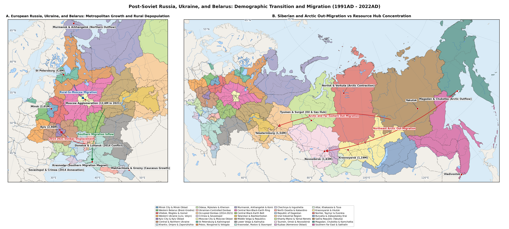

```{=latex}
\emergencystretch=1.5em
```

# Methodology

This gazetteer compiles 234 individual urban settlements across the 35 demographic regions of the post-Soviet East Slavic and Eurasian space (Belarus Regions 1-3, Ukraine Regions 4-11 including the 2014-2021AD Donbas Minsk Line of Contact split between Government-Controlled Donbas Region 9 and Pre-2022 Occupied Donbas Region 10 plus Annexed Crimea & Sevastopol Region 11, and the Russian Federation Regions 12-35 including disaggregated North Caucasus Regions 22-24 and Siberian/Arctic Regions 26-35) from the dissolution of the USSR (1991AD) to the eve of the full-scale Russo-Ukrainian war (2021AD). Each settlement entry records geographic coordinates, historical and alternative toponyms, sovereign country attribution (Belarus, Ukraine, or Russia within internationally recognised 1991AD borders), and positive integer population series across five benchmark slices (1991AD, 2002AD, 2010AD, 2014AD, and 2021AD).

For each settlement, population figures are anchored in official post-Soviet census enumerations and demographic yearbooks: the 1999AD, 2009AD, and 2019AD Population Censuses of the Republic of Belarus (Belstat) [@belstat2000perepis1999; @belstat2010perepis2009; @belstat2020perepis2019], the 2001AD All-Ukrainian Population Census, 2014-2021AD Ukrstat annual municipal series, and 2019AD Electronic Assessment [@ukrstat2003perepis2001; @ukrstat2021naselennia; @dubilet2020assessment2019], and the 2002AD, 2010AD, and 2021AD All-Russian Population Censuses (Rosstat) [@rosstat2004perepis2002; @rosstat2012perepis2010; @rosstat2022perepis2021]. For settlements abandoned during the post-Soviet northern exodus, such as the Kolyma coal-mining town of Kadykchan in Region 34 (10.300 in 1991AD and 875 in 2002AD), population series are reported up to their final inhabited benchmark prior to complete evacuation.

<div class="figure" style="text-align: center">

<p class="caption">plot of chunk fig1-md-only</p>
</div>

# Results

## Minsk Metropolitan Magnet (Belarus)

Table \ref{tab:reg1-sites} lists the catalogued urban settlements in Region 1 (Minsk City & Minsk Oblast Metropolitan Magnet), where total regional population shifted from 3,4M in 1991AD to 3,48M in 2021AD (+2,4%) [@belstat2020perepis2019; @ukrstat2021naselennia; @rosstat2022perepis2021].

Table: Urban settlements and benchmark population trajectories in Region 1 from 1991AD to 2021AD.

|Settlement |Alternative / Historical Names |Coords & Country       |1991AD |2002AD |2010AD |2014AD |2021AD |Change |
|:----------|:------------------------------|:----------------------|:------|:------|:------|:------|:------|:------|
|Minsk      |Mensk; Miensk                  |53,9, 27,56 (Belarus)  |1,63M  |1,73M  |1,84M  |1,92M  |2,01M  |+23%   |
|Borisov    |Barysaw; Barysau               |54,23, 28,5 (Belarus)  |147k   |150k   |147k   |145k   |136k   |-7,5%  |
|Soligorsk  |Salihorsk                      |52,79, 27,54 (Belarus) |95k    |101k   |102k   |105k   |100k   |+5,3%  |
|Molodechno |Maladzyechna                   |54,32, 26,85 (Belarus) |92k    |97k    |94k    |94k    |90k    |-2,2%  |

## Western Belarus Border Belt (Brest & Grodno)

Table \ref{tab:reg2-sites} lists the catalogued urban settlements in Region 2 (Western Belarus: Brest & Grodno Oblasts), where total regional population shifted from 2,68M in 1991AD to 2,36M in 2021AD (-11,9%) [@belstat2020perepis2019; @ukrstat2021naselennia; @rosstat2022perepis2021].

Table: Urban settlements and benchmark population trajectories in Region 2 from 1991AD to 2021AD.

|Settlement  |Alternative / Historical Names |Coords & Country       |1991AD |2002AD |2010AD |2014AD |2021AD |Change |
|:-----------|:------------------------------|:----------------------|:------|:------|:------|:------|:------|:------|
|Grodno      |Hrodna; Gardinas               |53,67, 23,81 (Belarus) |284k   |310k   |328k   |356k   |357k   |+25,7% |
|Brest       |Brest-Litovsk; Berastse        |52,1, 23,73 (Belarus)  |269k   |294k   |310k   |331k   |340k   |+26,4% |
|Baranovichi |Baranavichy                    |53,13, 26,01 (Belarus) |165k   |168k   |168k   |178k   |173k   |+4,8%  |
|Pinsk       |Pinau; Polesia Capital         |52,12, 26,1 (Belarus)  |122k   |130k   |130k   |136k   |125k   |+2,5%  |
|Lida        |Lyda                           |53,88, 25,3 (Belarus)  |93k    |99k    |98k    |100k   |103k   |+10,8% |

## Eastern Belarus & Chernobyl Belt

Table \ref{tab:reg3-sites} lists the catalogued urban settlements in Region 3 (Eastern & Southeastern Belarus: Vitebsk, Mogilev & Gomel Oblasts), where total regional population shifted from 4,17M in 1991AD to 3,31M in 2021AD (-20,6%) [@belstat2020perepis2019; @ukrstat2021naselennia; @rosstat2022perepis2021].

Table: Urban settlements and benchmark population trajectories in Region 3 from 1991AD to 2021AD.

|Settlement  |Alternative / Historical Names |Coords & Country       |1991AD |2002AD |2010AD |2014AD |2021AD |Change |
|:-----------|:------------------------------|:----------------------|:------|:------|:------|:------|:------|:------|
|Gomel       |Homyel; Homel                  |52,43, 30,98 (Belarus) |506k   |481k   |484k   |512k   |504k   |-0,4%  |
|Mogilev     |Mahilyow; Mahiliou             |53,9, 30,33 (Belarus)  |363k   |361k   |358k   |371k   |355k   |-2,2%  |
|Vitebsk     |Vitsebsk; Viciebsk             |55,19, 30,2 (Belarus)  |354k   |343k   |348k   |363k   |360k   |+1,7%  |
|Bobruisk    |Babruysk; Babruisk             |53,14, 29,22 (Belarus) |233k   |221k   |215k   |218k   |209k   |-10,3% |
|Orsha       |Vorsha                         |54,51, 30,42 (Belarus) |125k   |122k   |117k   |116k   |104k   |-16,8% |
|Mozyr       |Mazyr                          |52,05, 29,25 (Belarus) |103k   |110k   |109k   |112k   |105k   |+1,9%  |
|Novopolotsk |Navapolatsk                    |55,53, 28,64 (Belarus) |95k    |105k   |98k    |101k   |96k    |+1,1%  |
|Polotsk     |Polatsk; Polotesk              |55,49, 28,79 (Belarus) |78k    |82k    |83k    |85k    |80k    |+2,6%  |
|Zhlobin     |Zhlobyn                        |52,89, 30,02 (Belarus) |59k    |72k    |76k    |75k    |77k    |+30,5% |

## Western Ukraine & Transcarpathia

Table \ref{tab:reg4-sites} lists the catalogued urban settlements in Region 4 (Western Ukraine (Galicia, Volhynia, Bukovina & Zakarpattia)), where total regional population shifted from 10,25M in 1991AD to 9,32M in 2021AD (-9,1%) [@belstat2020perepis2019; @ukrstat2021naselennia; @rosstat2022perepis2021].

Table: Urban settlements and benchmark population trajectories in Region 4 from 1991AD to 2021AD.

|Settlement      |Alternative / Historical Names |Coords & Country       |1991AD |2002AD |2010AD |2014AD |2021AD |Change |
|:---------------|:------------------------------|:----------------------|:------|:------|:------|:------|:------|:------|
|Lviv            |Lvov; Lemberg                  |49,84, 24,03 (Ukraine) |798k   |733k   |734k   |729k   |717k   |-10,2% |
|Chernivtsi      |Chernovtsy; Czernowitz         |48,29, 25,94 (Ukraine) |259k   |241k   |252k   |262k   |265k   |+2,3%  |
|Rivne           |Rovno                          |50,62, 26,25 (Ukraine) |239k   |249k   |250k   |250k   |245k   |+2,5%  |
|Ivano-Frankivsk |Ivano-Frankovsk; Stanyslaviv   |48,92, 24,71 (Ukraine) |226k   |218k   |224k   |227k   |238k   |+5,3%  |
|Ternopil        |Ternopol; Tarnopol             |49,55, 25,59 (Ukraine) |218k   |228k   |218k   |217k   |225k   |+3,2%  |
|Lutsk           |Luchesk                        |50,75, 25,33 (Ukraine) |206k   |209k   |211k   |216k   |217k   |+5,3%  |
|Uzhhorod        |Uzhgorod; Ungvar               |48,62, 22,29 (Ukraine) |120k   |117k   |116k   |115k   |115k   |-4,2%  |
|Mukachevo       |Mukacheve; Munkacs             |48,44, 22,72 (Ukraine) |86k    |82k    |84k    |85k    |86k    |0%     |
|Drohobych       |Drogobych                      |49,35, 23,5 (Ukraine)  |80k    |79k    |78k    |77k    |75k    |-6,2%  |

## Kyiv Metropolis & Suburban Ring

Table \ref{tab:reg5-sites} lists the catalogued urban settlements in Region 5 (Kyiv City & Kyiv Metropolitan Oblast), where total regional population shifted from 4,58M in 1991AD to 4,79M in 2021AD (+4,6%) [@belstat2020perepis2019; @ukrstat2021naselennia; @rosstat2022perepis2021].

Table: Urban settlements and benchmark population trajectories in Region 5 from 1991AD to 2021AD.

|Settlement   |Alternative / Historical Names |Coords & Country       |1991AD |2002AD |2010AD |2014AD |2021AD |Change |
|:------------|:------------------------------|:----------------------|:------|:------|:------|:------|:------|:------|
|Kyiv         |Kiev                           |50,45, 30,52 (Ukraine) |2,63M  |2,61M  |2,79M  |2,87M  |2,96M  |+12,4% |
|Bila Tserkva |Belaya Tserkov                 |49,8, 30,12 (Ukraine)  |204k   |200k   |209k   |211k   |208k   |+2%    |
|Brovary      |Brovari                        |50,51, 30,79 (Ukraine) |85k    |87k    |96k    |99k    |109k   |+28,2% |
|Irpin        |Irpen                          |50,52, 30,24 (Ukraine) |39k    |40k    |41k    |44k    |62k    |+59%   |
|Bucha        |Bucha Kyiv Oblast              |50,54, 30,21 (Ukraine) |26k    |28,5k  |27,5k  |30k    |37k    |+42,3% |

## Central & Northern Ukraine

Table \ref{tab:reg6-sites} lists the catalogued urban settlements in Region 6 (Central & Northern Ukraine Depopulation Belt (Chernihiv, Sumy, Poltava, Cherkasy, Vinnytsia, Zhytomyr, Khmelnytskyi, Kirovohrad)), where total regional population shifted from 12,12M in 1991AD to 9,03M in 2021AD (-25,5%) [@belstat2020perepis2019; @ukrstat2021naselennia; @rosstat2022perepis2021].

Table: Urban settlements and benchmark population trajectories in Region 6 from 1991AD to 2021AD.

|Settlement          |Alternative / Historical Names |Coords & Country       |1991AD |2002AD |2010AD |2014AD |2021AD |Change |
|:-------------------|:------------------------------|:----------------------|:------|:------|:------|:------|:------|:------|
|Vinnytsia           |Vinnitsa                       |49,23, 28,47 (Ukraine) |381k   |357k   |369k   |372k   |371k   |-2,6%  |
|Poltava             |Poltava Oblast Centre          |49,59, 34,55 (Ukraine) |320k   |318k   |300k   |296k   |283k   |-11,6% |
|Chernihiv           |Chernigov                      |51,5, 31,29 (Ukraine)  |306k   |305k   |297k   |296k   |285k   |-6,9%  |
|Cherkasy            |Cherkassy                      |49,44, 32,06 (Ukraine) |302k   |295k   |287k   |285k   |272k   |-9,9%  |
|Zhytomyr            |Zhitomir                       |50,25, 28,66 (Ukraine) |298k   |284k   |272k   |271k   |263k   |-11,7% |
|Sumy                |Sumi                           |50,91, 34,8 (Ukraine)  |298k   |293k   |272k   |269k   |259k   |-13,1% |
|Kropyvnytskyi       |Kirovohrad; Yelisavetgrad      |48,51, 32,26 (Ukraine) |278k   |254k   |236k   |233k   |222k   |-20,1% |
|Khmelnytskyi        |Khmelnitsky; Proskuriv         |49,42, 26,99 (Ukraine) |245k   |254k   |261k   |266k   |274k   |+11,8% |
|Kremenchuk          |Kremenchug                     |49,07, 33,42 (Ukraine) |241k   |234k   |228k   |226k   |217k   |-10%   |
|Kamianets-Podilskyi |Kamenets-Podolsky              |48,68, 26,59 (Ukraine) |105k   |99k    |103k   |102k   |98k    |-6,7%  |
|Konotop             |Konotop Sumy Oblast            |51,24, 33,2 (Ukraine)  |97k    |93k    |90k    |88k    |85k    |-12,4% |
|Shostka             |Shostka Sumy Oblast            |51,86, 33,47 (Ukraine) |94k    |87k    |80k    |79k    |73k    |-22,3% |
|Uman                |Human                          |48,75, 30,22 (Ukraine) |92k    |89k    |87k    |86k    |82k    |-10,9% |
|Nizhyn              |Nezhin                         |51,05, 31,89 (Ukraine) |81k    |77k    |74k    |73k    |67k    |-17,3% |

## Kharkiv, Dnipro & Zaporizhzhia

Table \ref{tab:reg7-sites} lists the catalogued urban settlements in Region 7 (Kharkiv, Dnipropetrovsk & Zaporizhzhia Industrial East), where total regional population shifted from 9,1M in 1991AD to 7,25M in 2021AD (-20,3%) [@belstat2020perepis2019; @ukrstat2021naselennia; @rosstat2022perepis2021].

Table: Urban settlements and benchmark population trajectories in Region 7 from 1991AD to 2021AD.

|Settlement   |Alternative / Historical Names |Coords & Country       |1991AD |2002AD |2010AD |2014AD |2021AD |Change |
|:------------|:------------------------------|:----------------------|:------|:------|:------|:------|:------|:------|
|Kharkiv      |Kharkov                        |49,99, 36,23 (Ukraine) |1,62M  |1,47M  |1,45M  |1,45M  |1,42M  |-12,2% |
|Dnipro       |Dnipropetrovsk; Yekaterinoslav |48,46, 35,05 (Ukraine) |1,19M  |1,06M  |1M     |993k   |968k   |-18,6% |
|Zaporizhzhia |Zaporozhye; Aleksandrovsk      |47,84, 35,14 (Ukraine) |897k   |815k   |780k   |766k   |710k   |-20,8% |
|Kryvyi Rih   |Krivoy Rog                     |47,91, 33,39 (Ukraine) |724k   |669k   |670k   |652k   |603k   |-16,7% |
|Kamianske    |Dniprodzerzhynsk               |48,52, 34,62 (Ukraine) |284k   |256k   |244k   |241k   |229k   |-19,4% |
|Melitopol    |Melitopol Zaporizhzhia         |46,85, 35,37 (Ukraine) |176k   |160k   |158k   |157k   |150k   |-14,8% |
|Nikopol      |Nikopol Dnieper                |47,57, 34,4 (Ukraine)  |159k   |136k   |122k   |117k   |105k   |-34%   |
|Berdiansk    |Berdyansk                      |46,76, 36,8 (Ukraine)  |135k   |122k   |117k   |115k   |107k   |-20,7% |
|Pavlohrad    |Pavlograd                      |48,53, 35,87 (Ukraine) |134k   |119k   |111k   |110k   |103k   |-23,1% |
|Lozova       |Lozovaya                       |48,89, 36,31 (Ukraine) |73k    |64k    |59k    |58k    |54k    |-26%   |
|Izium        |Izyum                          |49,21, 37,26 (Ukraine) |64k    |56k    |52k    |51k    |46k    |-28,1% |

## Ukrainian Black Sea Littoral

Table \ref{tab:reg8-sites} lists the catalogued urban settlements in Region 8 (Ukrainian Black Sea Littoral (Odesa, Mykolaiv & Kherson Oblasts)), where total regional population shifted from 4,7M in 1991AD to 4,05M in 2021AD (-13,8%) [@belstat2020perepis2019; @ukrstat2021naselennia; @rosstat2022perepis2021].

Table: Urban settlements and benchmark population trajectories in Region 8 from 1991AD to 2021AD.

|Settlement |Alternative / Historical Names |Coords & Country       |1991AD |2002AD |2010AD |2014AD |2021AD |Change |
|:----------|:------------------------------|:----------------------|:------|:------|:------|:------|:------|:------|
|Odesa      |Odessa                         |46,48, 30,72 (Ukraine) |1,11M  |1,03M  |1,01M  |1,02M  |1,01M  |-8,6%  |
|Mykolaiv   |Nikolaev                       |46,98, 31,99 (Ukraine) |512k   |514k   |501k   |495k   |470k   |-8,2%  |
|Kherson    |Cherson                        |46,64, 32,62 (Ukraine) |365k   |328k   |304k   |298k   |279k   |-23,6% |

## Donbas (Government-Controlled Area, 2014-2021AD)

Table \ref{tab:reg9-sites} lists the catalogued urban settlements in Region 9 (Government-Controlled Donbas (Mariupol, Kramatorsk, Sievierodonetsk 2014-2021AD)), where total regional population shifted from 3,62M in 1991AD to 2,21M in 2021AD (-39%) [@belstat2020perepis2019; @ukrstat2021naselennia; @rosstat2022perepis2021].

Table: Urban settlements and benchmark population trajectories in Region 9 from 1991AD to 2021AD.

|Settlement      |Alternative / Historical Names |Coords & Country       |1991AD |2002AD |2010AD |2014AD |2021AD |Change |
|:---------------|:------------------------------|:----------------------|:------|:------|:------|:------|:------|:------|
|Mariupol        |Zhdanov                        |47,1, 37,54 (Ukraine)  |522k   |492k   |469k   |459k   |431k   |-17,4% |
|Kramatorsk      |Kramatorskaya                  |48,74, 37,58 (Ukraine) |199k   |181k   |167k   |163k   |150k   |-24,6% |
|Sloviansk       |Slavyansk; Tor                 |48,85, 37,62 (Ukraine) |136k   |125k   |119k   |117k   |106k   |-22,1% |
|Sievierodonetsk |Severodonetsk                  |48,95, 38,49 (Ukraine) |133k   |120k   |111k   |109k   |101k   |-24,1% |
|Lysychansk      |Lisichansk                     |48,9, 38,43 (Ukraine)  |126k   |115k   |106k   |103k   |93k    |-26,2% |
|Kostiantynivka  |Konstantinovka                 |48,53, 37,7 (Ukraine)  |108k   |95k    |80k    |76k    |68k    |-37%   |
|Bakhmut         |Artemivsk; Artemovsk           |48,6, 38 (Ukraine)     |91k    |83k    |79k    |77k    |71k    |-22%   |
|Pokrovsk        |Krasnoarmiisk                  |48,28, 37,18 (Ukraine) |73k    |69k    |66k    |65k    |60k    |-17,8% |

## Occupied Donbas (2014AD - 2021AD)

Table \ref{tab:reg10-sites} lists the catalogued urban settlements in Region 10 (Pre-2022 Occupied Donbas: Donetsk-Makiivka-Horlivka and Luhansk-Alchevsk), where total regional population shifted from 4,6M in 1991AD to 2,47M in 2021AD (-46,3%) [@belstat2020perepis2019; @ukrstat2021naselennia; @rosstat2022perepis2021].

Table: Urban settlements and benchmark population trajectories in Region 10 from 1991AD to 2021AD.

|Settlement |Alternative / Historical Names |Coords & Country       |1991AD |2002AD |2010AD |2014AD |2021AD |Change |
|:----------|:------------------------------|:----------------------|:------|:------|:------|:------|:------|:------|
|Donetsk    |Yuzovka; Stalino               |48,02, 37,8 (Ukraine)  |1,12M  |1,02M  |968k   |950k   |905k   |-19,3% |
|Luhansk    |Lugansk; Voroshilovgrad        |48,57, 39,31 (Ukraine) |504k   |463k   |434k   |424k   |399k   |-20,8% |
|Makiivka   |Makeyevka; Dmitrievsk          |48,05, 37,93 (Ukraine) |427k   |390k   |360k   |352k   |335k   |-21,5% |
|Horlivka   |Gorlovka                       |48,33, 38,09 (Ukraine) |338k   |292k   |263k   |254k   |235k   |-30,5% |
|Alchevsk   |Kommunarsk; Voroshilovsk       |48,47, 38,8 (Ukraine)  |126k   |119k   |113k   |110k   |105k   |-16,7% |
|Yenakiieve |Yenakiyevo                     |48,23, 38,2 (Ukraine)  |120k   |104k   |87k    |81k    |75k    |-37,5% |
|Kadiivka   |Stakhanov; Sergo               |48,57, 38,65 (Ukraine) |112k   |90k    |79k    |77k    |72k    |-35,7% |

## Annexed Crimea & Sevastopol (2014-2021AD)

Table \ref{tab:reg11-sites} lists the catalogued urban settlements in Region 11 (Crimea & Sevastopol (March 2014AD Russian Annexation & Demographic Shift)), where total regional population shifted from 2,53M in 1991AD to 2,44M in 2021AD (-3,6%) [@belstat2020perepis2019; @ukrstat2021naselennia; @rosstat2022perepis2021].

Table: Urban settlements and benchmark population trajectories in Region 11 from 1991AD to 2021AD.

|Settlement |Alternative / Historical Names |Coords & Country       |1991AD |2002AD |2010AD |2014AD |2021AD |Change |
|:----------|:------------------------------|:----------------------|:------|:------|:------|:------|:------|:------|
|Sevastopol |Sebastopol; Akhtiar            |44,62, 33,53 (Ukraine) |366k   |342k   |340k   |393k   |548k   |+49,7% |
|Simferopol |Aqmescit                       |44,95, 34,1 (Ukraine)  |353k   |344k   |336k   |332k   |341k   |-3,4%  |
|Kerch      |Panticapaeum; Kerc             |45,36, 36,47 (Ukraine) |178k   |158k   |147k   |147k   |155k   |-12,9% |
|Yevpatoria |Yevpatoriya; Kezlev            |45,19, 33,37 (Ukraine) |111k   |106k   |107k   |106k   |108k   |-2,7%  |

## Moscow Megaregion (City & Oblast)

Table \ref{tab:reg12-sites} lists the catalogued urban settlements in Region 12 (Moscow City & Moscow Oblast Post-Soviet Hyper-Centralisation Core), where total regional population shifted from 15,8M in 1991AD to 21,15M in 2021AD (+33,9%) [@belstat2020perepis2019; @ukrstat2021naselennia; @rosstat2022perepis2021].

Table: Urban settlements and benchmark population trajectories in Region 12 from 1991AD to 2021AD.

|Settlement  |Alternative / Historical Names       |Coords & Country      |1991AD |2002AD |2010AD |2014AD |2021AD |Change  |
|:-----------|:------------------------------------|:---------------------|:------|:------|:------|:------|:------|:-------|
|Moscow      |Moskva                               |55,76, 37,62 (Russia) |9M     |10,38M |11,5M  |12,11M |13,01M |+44,5%  |
|Podolsk     |Podolsk Moscow Oblast                |55,43, 37,54 (Russia) |208k   |181k   |188k   |219k   |315k   |+51,4%  |
|Lyubertsy   |Lyubertsy Moscow Ring                |55,68, 37,9 (Russia)  |165k   |157k   |173k   |185k   |224k   |+35,8%  |
|Korolev     |Kaliningrad Moscow Oblast; Naukograd |55,92, 37,85 (Russia) |160k   |143k   |183k   |188k   |228k   |+42,5%  |
|Mytishchi   |Mytishchi Moscow Ring                |55,91, 37,73 (Russia) |155k   |160k   |173k   |183k   |255k   |+64,5%  |
|Balashikha  |Balashikha-Zheleznodorozhny          |55,81, 37,96 (Russia) |138k   |148k   |215k   |247k   |521k   |+277,5% |
|Khimki      |Khimki Moscow Ring                   |55,9, 37,43 (Russia)  |135k   |141k   |207k   |226k   |257k   |+90,4%  |
|Odintsovo   |Odintsovo Moscow Ring                |55,68, 37,26 (Russia) |127k   |135k   |139k   |140k   |181k   |+42,5%  |
|Krasnogorsk |Krasnogorsk Moscow Oblast            |55,83, 37,33 (Russia) |91k    |92k    |117k   |132k   |188k   |+106,6% |
|Domodedovo  |Domodedovo Moscow Oblast             |55,44, 37,77 (Russia) |56k    |56k    |96k    |108k   |152k   |+171,4% |

## Saint Petersburg, Leningrad & Kaliningrad

Table \ref{tab:reg13-sites} lists the catalogued urban settlements in Region 13 (Saint Petersburg, Leningrad Oblast & Kaliningrad Exclave), where total regional population shifted from 7,62M in 1991AD to 8,42M in 2021AD (+10,5%) [@belstat2020perepis2019; @ukrstat2021naselennia; @rosstat2022perepis2021].

Table: Urban settlements and benchmark population trajectories in Region 13 from 1991AD to 2021AD.

|Settlement       |Alternative / Historical Names |Coords & Country      |1991AD |2002AD |2010AD |2014AD |2021AD |Change   |
|:----------------|:------------------------------|:---------------------|:------|:------|:------|:------|:------|:--------|
|Saint Petersburg |Leningrad; Sankt-Peterburg     |59,93, 30,34 (Russia) |5,04M  |4,66M  |4,88M  |5,13M  |5,6M   |+11,3%   |
|Kaliningrad      |Konigsberg; Koenigsberg        |54,71, 20,45 (Russia) |408k   |430k   |432k   |449k   |490k   |+20,1%   |
|Murino           |Murino Vsevolozhsky            |60,05, 30,45 (Russia) |5,4k   |5k     |7k     |13k    |89k    |+1548,1% |

## Depopulating Northwest & Karelia

Table \ref{tab:reg14-sites} lists the catalogued urban settlements in Region 14 (Depopulating Northwest: Pskov, Novgorod, Vologda & Republic of Karelia), where total regional population shifted from 3,72M in 1991AD to 2,8M in 2021AD (-24,7%) [@belstat2020perepis2019; @ukrstat2021naselennia; @rosstat2022perepis2021].

Table: Urban settlements and benchmark population trajectories in Region 14 from 1991AD to 2021AD.

|Settlement      |Alternative / Historical Names |Coords & Country      |1991AD |2002AD |2010AD |2014AD |2021AD |Change |
|:---------------|:------------------------------|:---------------------|:------|:------|:------|:------|:------|:------|
|Cherepovets     |Cherepovets Metallurgical      |59,13, 37,9 (Russia)  |315k   |312k   |312k   |317k   |305k   |-3,2%  |
|Vologda         |Vologda North                  |59,22, 39,89 (Russia) |289k   |293k   |302k   |308k   |314k   |+8,7%  |
|Petrozavodsk    |Petroskoi; Karelia Capital     |61,78, 34,35 (Russia) |271k   |266k   |262k   |272k   |235k   |-13,3% |
|Veliky Novgorod |Novgorod                       |58,52, 31,27 (Russia) |234k   |217k   |219k   |220k   |224k   |-4,3%  |
|Pskov           |Pleskov                        |57,81, 28,35 (Russia) |206k   |203k   |203k   |207k   |193k   |-6,3%  |

## European Russian Arctic Exodus Zone

Table \ref{tab:reg15-sites} lists the catalogued urban settlements in Region 15 (European Arctic Exodus Zone: Murmansk, Arkhangelsk, Komi & Nenets AO), where total regional population shifted from 4,32M in 1991AD to 2,76M in 2021AD (-36,1%) [@belstat2020perepis2019; @ukrstat2021naselennia; @rosstat2022perepis2021].

Table: Urban settlements and benchmark population trajectories in Region 15 from 1991AD to 2021AD.

|Settlement   |Alternative / Historical Names |Coords & Country      |1991AD |2002AD |2010AD |2014AD |2021AD |Change |
|:------------|:------------------------------|:---------------------|:------|:------|:------|:------|:------|:------|
|Murmansk     |Romanov-on-Murman              |68,96, 33,08 (Russia) |472k   |336k   |307k   |299k   |270k   |-42,8% |
|Arkhangelsk  |Archangel                      |64,54, 40,52 (Russia) |419k   |356k   |349k   |350k   |301k   |-28,2% |
|Severodvinsk |Molotovsk                      |64,56, 39,83 (Russia) |251k   |202k   |192k   |187k   |157k   |-37,5% |
|Syktyvkar    |Ust-Sysolsk; Komi Capital      |61,67, 50,84 (Russia) |236k   |230k   |235k   |242k   |221k   |-6,4%  |
|Vorkuta      |Vorkutinskoe Koltso            |67,5, 64,05 (Russia)  |116k   |85k    |71k    |62k    |57k    |-50,9% |
|Ukhta        |Chibyu; Komi Oil-Gas Centre    |63,57, 53,68 (Russia) |113k   |103k   |100k   |99k    |80k    |-29,2% |
|Apatity      |Apatity Kola Peninsula         |67,56, 33,4 (Russia)  |88k    |64k    |59k    |57k    |50k    |-43,2% |
|Inta         |Inta Pechora Coal Basin        |66,03, 60,17 (Russia) |60k    |41k    |32k    |28k    |20k    |-66,7% |

## Central Non-Black-Earth Ring

Table \ref{tab:reg16-sites} lists the catalogued urban settlements in Region 16 (Central Non-Black-Earth Mortality & Shrinkage Ring), where total regional population shifted from 12,35M in 1991AD to 9,75M in 2021AD (-21,1%) [@belstat2020perepis2019; @ukrstat2021naselennia; @rosstat2022perepis2021].

Table: Urban settlements and benchmark population trajectories in Region 16 from 1991AD to 2021AD.

|Settlement |Alternative / Historical Names |Coords & Country      |1991AD |2002AD |2010AD |2014AD |2021AD |Change |
|:----------|:------------------------------|:---------------------|:------|:------|:------|:------|:------|:------|
|Yaroslavl  |Yaroslavl Upper Volga          |57,63, 39,88 (Russia) |636k   |613k   |592k   |602k   |577k   |-9,3%  |
|Tula       |Tula Arms Core                 |54,19, 37,62 (Russia) |541k   |481k   |501k   |491k   |473k   |-12,6% |
|Ryazan     |Pereyaslavl-Ryazansky          |54,63, 39,74 (Russia) |525k   |522k   |525k   |530k   |529k   |+0,8%  |
|Ivanovo    |Ivanovo-Voznesensk             |57, 40,97 (Russia)    |482k   |432k   |408k   |409k   |362k   |-24,9% |
|Bryansk    |Debryansk                      |53,24, 34,36 (Russia) |456k   |432k   |416k   |408k   |379k   |-16,9% |
|Tver       |Kalinin                        |56,86, 35,92 (Russia) |455k   |409k   |404k   |411k   |416k   |-8,6%  |
|Vladimir   |Vladimir-na-Klyazme            |56,13, 40,41 (Russia) |353k   |316k   |345k   |350k   |350k   |-0,8%  |
|Smolensk   |Smolensk Upper Dnieper         |54,78, 32,04 (Russia) |346k   |325k   |327k   |331k   |317k   |-8,4%  |
|Kaluga     |Kaluga Oka                     |54,53, 36,28 (Russia) |345k   |335k   |325k   |334k   |337k   |-2,3%  |
|Kostroma   |Kostroma Upper Volga           |57,77, 40,93 (Russia) |281k   |279k   |269k   |273k   |267k   |-5%    |
|Rybinsk    |Andropov; Shcherbakov          |58,05, 38,86 (Russia) |252k   |223k   |201k   |195k   |177k   |-29,8% |

## Central Black-Earth Belt (Chernozemye)

Table \ref{tab:reg17-sites} lists the catalogued urban settlements in Region 17 (Central Black-Earth Belt (Belgorod-Voronezh CIS Returnee Magnet, Kursk, Lipetsk, Tambov)), where total regional population shifted from 7,75M in 1991AD to 7,02M in 2021AD (-9,4%) [@belstat2020perepis2019; @ukrstat2021naselennia; @rosstat2022perepis2021].

Table: Urban settlements and benchmark population trajectories in Region 17 from 1991AD to 2021AD.

|Settlement  |Alternative / Historical Names |Coords & Country      |1991AD |2002AD |2010AD |2014AD |2021AD |Change |
|:-----------|:------------------------------|:---------------------|:------|:------|:------|:------|:------|:------|
|Voronezh    |Voronezh Don Basin             |51,66, 39,2 (Russia)  |900k   |849k   |890k   |1,01M  |1,06M  |+17,6% |
|Lipetsk     |Lipetsk Metallurgical          |52,61, 39,6 (Russia)  |460k   |506k   |509k   |510k   |496k   |+7,8%  |
|Kursk       |Kursk Seim Basin               |51,73, 36,19 (Russia) |433k   |412k   |415k   |431k   |440k   |+1,6%  |
|Orel        |Oryol                          |52,97, 36,06 (Russia) |345k   |333k   |318k   |317k   |303k   |-12,2% |
|Belgorod    |Belgorod Chernozem             |50,6, 36,59 (Russia)  |311k   |337k   |356k   |379k   |340k   |+9,3%  |
|Tambov      |Tambov Tsna Basin              |52,72, 41,45 (Russia) |311k   |294k   |280k   |285k   |262k   |-15,8% |
|Stary Oskol |Oskol Metallurgical            |51,3, 37,84 (Russia)  |181k   |216k   |221k   |221k   |222k   |+22,7% |

## Volga-Kama Core (Tatarstan & Bashkortostan)

Table \ref{tab:reg18-sites} lists the catalogued urban settlements in Region 18 (Republics of Tatarstan & Bashkortostan), where total regional population shifted from 7,58M in 1991AD to 7,95M in 2021AD (+4,9%) [@belstat2020perepis2019; @ukrstat2021naselennia; @rosstat2022perepis2021].

Table: Urban settlements and benchmark population trajectories in Region 18 from 1991AD to 2021AD.

|Settlement         |Alternative / Historical Names |Coords & Country      |1991AD |2002AD |2010AD |2014AD |2021AD |Change |
|:------------------|:------------------------------|:---------------------|:------|:------|:------|:------|:------|:------|
|Kazan              |Qazan; Tatarstan Capital       |55,8, 49,11 (Russia)  |1,1M   |1,1M   |1,14M  |1,19M  |1,31M  |+18,6% |
|Ufa                |Bashkortostan Capital          |54,74, 55,97 (Russia) |1,1M   |1,04M  |1,06M  |1,1M   |1,15M  |+4,4%  |
|Naberezhnye Chelny |Brezhnev; KAMAZ City           |55,74, 52,4 (Russia)  |512k   |510k   |513k   |522k   |548k   |+7%    |
|Sterlitamak        |Sterlitamak Bashkortostan      |53,63, 55,93 (Russia) |252k   |264k   |273k   |277k   |277k   |+9,9%  |
|Nizhnekamsk        |Nizhnekamsk Petrochemical      |55,64, 51,82 (Russia) |197k   |226k   |234k   |235k   |241k   |+22,3% |

## Middle Volga & Finno-Ugric Republics

Table \ref{tab:reg19-sites} lists the catalogued urban settlements in Region 19 (Middle Volga Oblasts (Samara, Nizhny Novgorod, Kirov, Ulyanovsk, Penza) & Chuvash/Mari/Mordovia/Udmurtia), where total regional population shifted from 15,4M in 1991AD to 13,31M in 2021AD (-13,5%) [@belstat2020perepis2019; @ukrstat2021naselennia; @rosstat2022perepis2021].

Table: Urban settlements and benchmark population trajectories in Region 19 from 1991AD to 2021AD.

|Settlement      |Alternative / Historical Names     |Coords & Country      |1991AD |2002AD |2010AD |2014AD |2021AD |Change |
|:---------------|:----------------------------------|:---------------------|:------|:------|:------|:------|:------|:------|
|Nizhny Novgorod |Gorky; Gorkiy                      |56,33, 44,01 (Russia) |1,45M  |1,31M  |1,25M  |1,26M  |1,23M  |-15,2% |
|Samara          |Kuybyshev                          |53,2, 50,1 (Russia)   |1,25M  |1,16M  |1,17M  |1,17M  |1,17M  |-6,3%  |
|Tolyatti        |Stavropol-on-Volga; AvtoVAZ City   |53,51, 49,42 (Russia) |655k   |703k   |720k   |718k   |685k   |+4,6%  |
|Ulyanovsk       |Simbirsk                           |54,31, 48,4 (Russia)  |648k   |636k   |615k   |617k   |617k   |-4,8%  |
|Izhevsk         |Ustinov; Udmurtia Capital          |56,85, 53,21 (Russia) |647k   |632k   |628k   |637k   |623k   |-3,7%  |
|Penza           |Penza Sura Basin                   |53,2, 45,02 (Russia)  |546k   |518k   |517k   |521k   |501k   |-8,2%  |
|Kirov           |Vyatka; Khlynov                    |58,6, 49,67 (Russia)  |445k   |458k   |474k   |487k   |468k   |+5,2%  |
|Cheboksary      |Shupashkar; Chuvashia Capital      |56,15, 47,25 (Russia) |436k   |441k   |454k   |469k   |497k   |+14%   |
|Saransk         |Mordovia Capital                   |54,19, 45,18 (Russia) |320k   |305k   |297k   |299k   |315k   |-1,6%  |
|Dzerzhinsk      |Rastyapino                         |56,24, 43,46 (Russia) |286k   |261k   |241k   |234k   |219k   |-23,4% |
|Yoshkar-Ola     |Tsaryovokokshaysk; Mari El Capital |56,63, 47,9 (Russia)  |249k   |257k   |249k   |260k   |281k   |+12,9% |

## Lower Volga Valley & Kalmykia

Table \ref{tab:reg20-sites} lists the catalogued urban settlements in Region 20 (Lower Volga (Saratov, Volgograd, Astrakhan) & Republic of Kalmykia), where total regional population shifted from 7,12M in 1991AD to 6,44M in 2021AD (-9,6%) [@belstat2020perepis2019; @ukrstat2021naselennia; @rosstat2022perepis2021].

Table: Urban settlements and benchmark population trajectories in Region 20 from 1991AD to 2021AD.

|Settlement |Alternative / Historical Names |Coords & Country      |1991AD |2002AD |2010AD |2014AD |2021AD |Change |
|:----------|:------------------------------|:---------------------|:------|:------|:------|:------|:------|:------|
|Volgograd  |Tsaritsyn; Stalingrad          |48,71, 44,51 (Russia) |1,01M  |1,01M  |1,02M  |1,02M  |1,03M  |+2,1%  |
|Saratov    |Saratov Lower Volga            |51,53, 46,03 (Russia) |911k   |873k   |838k   |841k   |901k   |-1,1%  |
|Astrakhan  |Xacitarxan; Itil Delta         |46,35, 48,04 (Russia) |512k   |505k   |521k   |531k   |476k   |-7%    |
|Volzhsky   |Volzhsky Hydro City            |48,79, 44,78 (Russia) |278k   |313k   |314k   |326k   |321k   |+15,5% |
|Balakovo   |Balakovo Saratov Volga         |52,03, 47,8 (Russia)  |201k   |200k   |200k   |195k   |184k   |-8,5%  |
|Engels     |Pokrovsk Lower Volga           |51,48, 46,12 (Russia) |184k   |194k   |202k   |218k   |225k   |+22,3% |
|Elista     |Stepnoy; Kalmykia Capital      |46,31, 44,26 (Russia) |93k    |104k   |104k   |104k   |103k   |+10,8% |

## Southern Russian Sunbelt (Kuban, Don & Stavropol)

Table \ref{tab:reg21-sites} lists the catalogued urban settlements in Region 21 (Southern Russian Sunbelt Magnet (Krasnodar, Rostov, Stavropol & Adygea)), where total regional population shifted from 13,15M in 1991AD to 14,71M in 2021AD (+11,9%) [@belstat2020perepis2019; @ukrstat2021naselennia; @rosstat2022perepis2021].

Table: Urban settlements and benchmark population trajectories in Region 21 from 1991AD to 2021AD.

|Settlement    |Alternative / Historical Names |Coords & Country      |1991AD |2002AD |2010AD |2014AD |2021AD |Change |
|:-------------|:------------------------------|:---------------------|:------|:------|:------|:------|:------|:------|
|Rostov-on-Don |Rostov-na-Donu                 |47,24, 39,7 (Russia)  |1,03M  |1,07M  |1,09M  |1,11M  |1,14M  |+11,1% |
|Krasnodar     |Yekaterinodar                  |45,04, 38,98 (Russia) |631k   |646k   |745k   |806k   |1,1M   |+74,2% |
|Sochi         |Sochi Black Sea Resort         |43,59, 39,72 (Russia) |344k   |329k   |343k   |399k   |466k   |+35,5% |
|Stavropol     |Voroshilovsk                   |45,04, 41,97 (Russia) |328k   |355k   |399k   |420k   |547k   |+66,8% |
|Taganrog      |Taganrog Azov Sea              |47,24, 38,9 (Russia)  |293k   |282k   |258k   |254k   |245k   |-16,4% |
|Shakhty       |Aleksandrovsk-Grushevsky       |47,71, 40,21 (Russia) |227k   |223k   |240k   |237k   |226k   |-0,4%  |
|Novorossiysk  |Sudzhuk-Kale                   |44,72, 37,77 (Russia) |189k   |232k   |242k   |257k   |262k   |+38,6% |
|Novocherkassk |Don Cossack Capital            |47,42, 40,09 (Russia) |189k   |171k   |169k   |173k   |164k   |-13,2% |
|Volgodonsk    |Atommash City                  |47,51, 42,15 (Russia) |181k   |166k   |171k   |170k   |168k   |-7,2%  |
|Armavir       |Armavir Kuban                  |44,99, 41,12 (Russia) |162k   |194k   |189k   |192k   |187k   |+15,4% |
|Maykop        |Myequape; Adygea Capital       |44,61, 40,1 (Russia)  |154k   |157k   |144k   |145k   |143k   |-7,1%  |
|Pyatigorsk    |Caucasian Mineral Waters       |44,05, 43,06 (Russia) |131k   |141k   |143k   |146k   |146k   |+11,5% |
|Kislovodsk    |Narzan Spa                     |43,91, 42,72 (Russia) |116k   |130k   |129k   |130k   |128k   |+10,3% |

## Chechnya & Ingushetia (Chechen War Zone)

Table \ref{tab:reg22-sites} lists the catalogued urban settlements in Region 22 (Chechnya & Ingushetia (1994-2009AD Chechen Wars, Nazran IDP Surge & Post-War Rebound)), where total regional population shifted from 1,32M in 1991AD to 2,04M in 2021AD (+54,5%) [@belstat2020perepis2019; @ukrstat2021naselennia; @rosstat2022perepis2021].

Table: Urban settlements and benchmark population trajectories in Region 22 from 1991AD to 2021AD.

|Settlement  |Alternative / Historical Names   |Coords & Country      |1991AD |2002AD |2010AD |2014AD |2021AD |Change  |
|:-----------|:--------------------------------|:---------------------|:------|:------|:------|:------|:------|:-------|
|Grozny      |Solzha-Gala; Chechnya Capital    |43,32, 45,7 (Russia)  |388k   |211k   |272k   |280k   |329k   |-15,2%  |
|Gudermes    |Gümse; Gudermes Railway Junction |43,35, 46,1 (Russia)  |39k    |34k    |46k    |50k    |64k    |+64,1%  |
|Urus-Martan |Urus-Martan Chechnya             |43,13, 45,54 (Russia) |35k    |40k    |49k    |54k    |63k    |+80%    |
|Shali       |Shali Chechnya                   |43,15, 45,9 (Russia)  |26k    |40k    |48k    |50k    |55k    |+111,5% |
|Nazran      |Nazran Ingushetia IDP Hub        |43,23, 44,76 (Russia) |19k    |125k   |93k    |106k   |122k   |+542,1% |

## North Ossetia, Kabardino-Balkaria & Karachay

Table \ref{tab:reg23-sites} lists the catalogued urban settlements in Region 23 (North Ossetia (1992AD Prigorodny Conflict), Kabardino-Balkaria & Karachay-Cherkessia), where total regional population shifted from 1,92M in 1991AD to 2,11M in 2021AD (+9,9%) [@belstat2020perepis2019; @ukrstat2021naselennia; @rosstat2022perepis2021].

Table: Urban settlements and benchmark population trajectories in Region 23 from 1991AD to 2021AD.

|Settlement  |Alternative / Historical Names |Coords & Country      |1991AD |2002AD |2010AD |2014AD |2021AD |Change |
|:-----------|:------------------------------|:---------------------|:------|:------|:------|:------|:------|:------|
|Vladikavkaz |Ordzhonikidze; Dzaudzhikau     |43,03, 44,68 (Russia) |306k   |316k   |312k   |307k   |296k   |-3,3%  |
|Nalchik     |Nalchik Kabardino-Balkaria     |43,49, 43,61 (Russia) |240k   |275k   |240k   |239k   |247k   |+2,9%  |
|Cherkessk   |Batalpashinsk                  |44,22, 42,06 (Russia) |115k   |116k   |129k   |124k   |113k   |-1,7%  |
|Prokhladny  |Прохладный; Prokhladnaya       |43,76, 44,03 (Russia) |58k    |61,8k  |59,6k  |58,1k  |59,9k  |+3,3%  |
|Beslan      |Беслан; Prigorodny District    |43,18, 44,53 (Russia) |33k    |35,5k  |36,7k  |37k    |35,9k  |+8,9%  |

## Republic of Dagestan (Caspian Boom)

Table \ref{tab:reg24-sites} lists the catalogued urban settlements in Region 24 (Republic of Dagestan (Post-Soviet Natural Increase & Makhachkala-Kaspiysk Urban Boom)), where total regional population shifted from 1,88M in 1991AD to 3,33M in 2021AD (+77,1%) [@belstat2020perepis2019; @ukrstat2021naselennia; @rosstat2022perepis2021].

Table: Urban settlements and benchmark population trajectories in Region 24 from 1991AD to 2021AD.

|Settlement  |Alternative / Historical Names |Coords & Country      |1991AD |2002AD |2010AD |2014AD |2021AD |Change  |
|:-----------|:------------------------------|:---------------------|:------|:------|:------|:------|:------|:-------|
|Makhachkala |Petrovsk-Port; Anji            |42,98, 47,5 (Russia)  |332k   |462k   |572k   |578k   |623k   |+87,7%  |
|Derbent     |Bab al-Abwab; Chora            |42,06, 48,29 (Russia) |81k    |101k   |119k   |120k   |125k   |+54,3%  |
|Khasavyurt  |Khasavyurt Dagestan            |43,25, 46,59 (Russia) |74k    |122k   |131k   |135k   |155k   |+109,5% |
|Kaspiysk    |Dvigatelstroy                  |42,88, 47,64 (Russia) |62k    |78k    |100k   |105k   |121k   |+95,2%  |

## Ural Industrial Belt (Sverdlovsk to Orenburg)

Table \ref{tab:reg25-sites} lists the catalogued urban settlements in Region 25 (Ural Industrial Belt (Sverdlovsk, Chelyabinsk, Perm, Orenburg & Kurgan)), where total regional population shifted from 16,32M in 1991AD to 15,7M in 2021AD (-3,8%) [@belstat2020perepis2019; @ukrstat2021naselennia; @rosstat2022perepis2021].

Table: Urban settlements and benchmark population trajectories in Region 25 from 1991AD to 2021AD.

|Settlement    |Alternative / Historical Names |Coords & Country      |1991AD |2002AD |2010AD |2014AD |2021AD |Change |
|:-------------|:------------------------------|:---------------------|:------|:------|:------|:------|:------|:------|
|Yekaterinburg |Sverdlovsk                     |56,84, 60,61 (Russia) |1,38M  |1,29M  |1,35M  |1,41M  |1,54M  |+12,3% |
|Chelyabinsk   |Tankograd                      |55,16, 61,44 (Russia) |1,15M  |1,08M  |1,13M  |1,17M  |1,19M  |+3,7%  |
|Perm          |Molotov                        |58,01, 56,25 (Russia) |1,09M  |1M     |991k   |1,03M  |1,03M  |-5,5%  |
|Orenburg      |Chkalov                        |51,77, 55,1 (Russia)  |552k   |549k   |548k   |560k   |544k   |-1,4%  |
|Magnitogorsk  |Magnitka                       |53,41, 58,98 (Russia) |444k   |419k   |408k   |415k   |411k   |-7,4%  |
|Nizhny Tagil  |Tagil Ural Steel               |57,91, 59,98 (Russia) |439k   |390k   |362k   |357k   |339k   |-22,8% |
|Kurgan        |Tsaryovo Gorodishche           |55,44, 65,34 (Russia) |363k   |346k   |334k   |326k   |311k   |-14,3% |
|Orsk          |Orenburg Fortress              |51,23, 58,48 (Russia) |273k   |251k   |239k   |233k   |189k   |-30,8% |
|Zlatoust      |Zlatoust South Urals           |55,17, 59,65 (Russia) |208k   |195k   |175k   |171k   |162k   |-22,1% |
|Berezniki     |Berezniki Upper Kama           |59,41, 56,82 (Russia) |201k   |173k   |157k   |150k   |138k   |-31,3% |

## Yugra & Yamal Hydrocarbon Arctic

Table \ref{tab:reg26-sites} lists the catalogued urban settlements in Region 26 (Khanty-Mansi (Yugra) & Yamalo-Nenets Hydrocarbon Autonomous Okrugs), where total regional population shifted from 1,82M in 1991AD to 2,25M in 2021AD (+23,9%) [@belstat2020perepis2019; @ukrstat2021naselennia; @rosstat2022perepis2021].

Table: Urban settlements and benchmark population trajectories in Region 26 from 1991AD to 2021AD.

|Settlement      |Alternative / Historical Names |Coords & Country      |1991AD |2002AD |2010AD |2014AD |2021AD |Change  |
|:---------------|:------------------------------|:---------------------|:------|:------|:------|:------|:------|:-------|
|Surgut          |Surgut Yugra Oil Core          |61,25, 73,42 (Russia) |259k   |285k   |307k   |332k   |396k   |+52,9%  |
|Nizhnevartovsk  |Samotlor Oil Capital           |60,93, 76,55 (Russia) |247k   |239k   |252k   |266k   |283k   |+14,6%  |
|Novy Urengoy    |Yamal Gas Capital              |66,08, 76,63 (Russia) |95k    |94k    |104k   |116k   |107k   |+12,6%  |
|Noyabrsk        |Ноябрьск; Yamalo-Nenets AO     |63,2, 75,45 (Russia)  |90k    |96,4k  |110,6k |107,4k |100,2k |+11,3%  |
|Khanty-Mansiysk |Ostyako-Vogulsk; Samarovo      |61, 69 (Russia)       |35k    |54k    |80k    |93k    |107k   |+205,7% |
|Salekhard       |Салехард; Obdorsk              |66,53, 66,6 (Russia)  |32,3k  |36,8k  |42,5k  |47,9k  |47,9k  |+48,3%  |

## West Siberian Trans-Siberian Corridor

Table \ref{tab:reg27-sites} lists the catalogued urban settlements in Region 27 (West Siberian Trans-Siberian Belt (Tyumen City Boom, Omsk, Novosibirsk, Tomsk & Altai Krai)), where total regional population shifted from 11,15M in 1991AD to 10,49M in 2021AD (-5,9%) [@belstat2020perepis2019; @ukrstat2021naselennia; @rosstat2022perepis2021].

Table: Urban settlements and benchmark population trajectories in Region 27 from 1991AD to 2021AD.

|Settlement  |Alternative / Historical Names |Coords & Country      |1991AD |2002AD |2010AD |2014AD |2021AD |Change |
|:-----------|:------------------------------|:---------------------|:------|:------|:------|:------|:------|:------|
|Novosibirsk |Novonikolayevsk                |55,01, 82,94 (Russia) |1,45M  |1,43M  |1,47M  |1,55M  |1,63M  |+13%   |
|Omsk        |Omsk Irtysh                    |54,99, 73,32 (Russia) |1,17M  |1,13M  |1,15M  |1,17M  |1,13M  |-3,5%  |
|Barnaul     |Barnaul Upper Ob               |53,35, 83,78 (Russia) |607k   |601k   |612k   |633k   |631k   |+4%    |
|Tomsk       |Tomsk University City          |56,5, 84,97 (Russia)  |506k   |488k   |525k   |557k   |556k   |+9,9%  |
|Tyumen      |Chimgi-Tura                    |57,15, 65,53 (Russia) |491k   |511k   |582k   |679k   |847k   |+72,5% |
|Biysk       |Biysk Altai Gateway            |52,54, 85,21 (Russia) |234k   |219k   |210k   |204k   |184k   |-21,4% |
|Rubtsovsk   |Rubtsovsk Altai Krai           |51,5, 81,21 (Russia)  |172k   |163k   |147k   |147k   |127k   |-26,2% |
|Tobolsk     |Historic Siberian Capital      |58,2, 68,25 (Russia)  |96k    |93k    |100k   |98k    |100k   |+4,2%  |

## Kuzbass Coal-Metallurgical Basin (Kemerovo)

Table \ref{tab:reg28-sites} lists the catalogued urban settlements in Region 28 (Kuzbass Coal-Metallurgical Basin (Kemerovo Oblast Post-Soviet Mine Closures)), where total regional population shifted from 3,18M in 1991AD to 2,6M in 2021AD (-18,2%) [@belstat2020perepis2019; @ukrstat2021naselennia; @rosstat2022perepis2021].

Table: Urban settlements and benchmark population trajectories in Region 28 from 1991AD to 2021AD.

|Settlement   |Alternative / Historical Names |Coords & Country      |1991AD |2002AD |2010AD |2014AD |2021AD |Change |
|:------------|:------------------------------|:---------------------|:------|:------|:------|:------|:------|:------|
|Novokuznetsk |Stalinsk; Kuznetsk             |53,76, 87,12 (Russia) |602k   |550k   |548k   |550k   |537k   |-10,8% |
|Kemerovo     |Shcheglovsk                    |55,35, 86,09 (Russia) |521k   |485k   |533k   |544k   |553k   |+6,1%  |
|Prokopyevsk  |Prokopyevsk Kuzbass Coal       |53,91, 86,72 (Russia) |274k   |225k   |210k   |201k   |178k   |-35%   |
|Kiselevsk    |Kiselevsk Kuzbass Coal         |53,99, 86,64 (Russia) |128k   |106k   |98k    |93k    |83k    |-35,2% |

## Southern Siberian Republics (Altai, Khakassia & Tuva)

Table \ref{tab:reg29-sites} lists the catalogued urban settlements in Region 29 (Southern Siberian Republics: Altai, Khakassia & Tuva (High Indigenous TFR & Russian Outflow)), where total regional population shifted from 1,09M in 1991AD to 1,08M in 2021AD (-0,5%) [@belstat2020perepis2019; @ukrstat2021naselennia; @rosstat2022perepis2021].

Table: Urban settlements and benchmark population trajectories in Region 29 from 1991AD to 2021AD.

|Settlement    |Alternative / Historical Names     |Coords & Country      |1991AD |2002AD |2010AD |2014AD |2021AD |Change |
|:-------------|:----------------------------------|:---------------------|:------|:------|:------|:------|:------|:------|
|Abakan        |Ust-Abakanskoye; Khakassia Capital |53,72, 91,43 (Russia) |157k   |165k   |165k   |173k   |185k   |+17,8% |
|Kyzyl         |Belotsarsk; Khem-Beldyr            |51,72, 94,44 (Russia) |87k    |104k   |110k   |114k   |125k   |+43,7% |
|Chernogorsk   |Черногорск; Khakassia              |53,82, 91,28 (Russia) |80k    |73,1k  |72,1k  |73,2k  |75,7k  |-5,3%  |
|Gorno-Altaysk |Горно-Алтайск; Ulala               |51,96, 85,96 (Russia) |46,9k  |53,5k  |56,9k  |61,4k  |65,3k  |+39,3% |

## East Siberian Trans-Siberian Corridor

Table \ref{tab:reg30-sites} lists the catalogued urban settlements in Region 30 (East Siberian Trans-Siberian & Angara-Yenisei Corridor (Krasnoyarsk & Irkutsk)), where total regional population shifted from 6,03M in 1991AD to 5,17M in 2021AD (-14,3%) [@belstat2020perepis2019; @ukrstat2021naselennia; @rosstat2022perepis2021].

Table: Urban settlements and benchmark population trajectories in Region 30 from 1991AD to 2021AD.

|Settlement  |Alternative / Historical Names |Coords & Country       |1991AD |2002AD |2010AD |2014AD |2021AD |Change |
|:-----------|:------------------------------|:----------------------|:------|:------|:------|:------|:------|:------|
|Krasnoyarsk |Krasny Yar Yenisei             |56,02, 92,89 (Russia)  |924k   |909k   |974k   |1,03M  |1,19M  |+28,6% |
|Irkutsk     |Irkutsk Angara-Baikal          |52,29, 104,31 (Russia) |639k   |593k   |588k   |613k   |617k   |-3,4%  |
|Angarsk     |Angarsk Petrochemical          |52,54, 103,89 (Russia) |269k   |247k   |234k   |229k   |221k   |-17,8% |
|Bratsk      |Bratsk Angara Hydro            |56,15, 101,63 (Russia) |259k   |259k   |246k   |239k   |224k   |-13,5% |

## Norilsk, Taymyr & Evenkia Polar Zone

Table \ref{tab:reg31-sites} lists the catalogued urban settlements in Region 31 (Norilsk, Taymyr & Evenkia Polar De-Population Zone), where total regional population shifted from 380k in 1991AD to 220k in 2021AD (-42,1%) [@belstat2020perepis2019; @ukrstat2021naselennia; @rosstat2022perepis2021].

Table: Urban settlements and benchmark population trajectories in Region 31 from 1991AD to 2021AD.

|Settlement |Alternative / Historical Names |Coords & Country       |1991AD |2002AD |2010AD |2014AD |2021AD |Change |
|:----------|:------------------------------|:----------------------|:------|:------|:------|:------|:------|:------|
|Norilsk    |Norilsk-Talnakh-Kayerkan       |69,36, 88,19 (Russia)  |265k   |213k   |175k   |177k   |175k   |-34%   |
|Dudinka    |Дудинка; Taymyr Port           |69,41, 86,18 (Russia)  |32,1k  |25,1k  |22,2k  |22k    |19,6k  |-39,1% |
|Igarka     |Игарка; Turukhansky Krai       |67,47, 86,58 (Russia)  |18,8k  |8,6k   |6,2k   |5,3k   |3,6k   |-80,7% |
|Tura       |Тура; Evenkia Capital          |64,28, 100,22 (Russia) |7,5k   |5,8k   |5,5k   |5,5k   |4,4k   |-40,8% |

## Republic of Buryatia & Zabaykalsky Krai

Table \ref{tab:reg32-sites} lists the catalogued urban settlements in Region 32 (Republic of Buryatia (Ulan-Ude Rural-Urban Shift) & Zabaykalsky Krai), where total regional population shifted from 2,41M in 1991AD to 2M in 2021AD (-17,2%) [@belstat2020perepis2019; @ukrstat2021naselennia; @rosstat2022perepis2021].

Table: Urban settlements and benchmark population trajectories in Region 32 from 1991AD to 2021AD.

|Settlement     |Alternative / Historical Names             |Coords & Country       |1991AD |2002AD |2010AD |2014AD |2021AD |Change |
|:--------------|:------------------------------------------|:----------------------|:------|:------|:------|:------|:------|:------|
|Chita          |Transbaikal Capital                        |52,03, 113,5 (Russia)  |376k   |317k   |324k   |336k   |334k   |-11,2% |
|Ulan-Ude       |Verkhneudinsk; Buryatia Capital            |51,83, 107,58 (Russia) |366k   |359k   |404k   |421k   |438k   |+19,7% |
|Krasnokamensk  |Краснокаменск; Priargunsky Uranium Combine |50,1, 118,04 (Russia)  |67k    |55,9k  |55,7k  |54,3k  |51,1k  |-23,7% |
|Severobaykalsk |Северобайкальск; BAM Capital               |55,64, 109,32 (Russia) |28,6k  |25,4k  |24,9k  |24,1k  |24,2k  |-15,3% |

## Sakha Republic (Yakutia)

Table \ref{tab:reg33-sites} lists the catalogued urban settlements in Region 33 (Sakha Republic (Yakutia: Yakutsk Boom vs Arctic Mining Settlement Collapse)), where total regional population shifted from 1,11M in 1991AD to 985k in 2021AD (-11,3%) [@belstat2020perepis2019; @ukrstat2021naselennia; @rosstat2022perepis2021].

Table: Urban settlements and benchmark population trajectories in Region 33 from 1991AD to 2021AD.

|Settlement |Alternative / Historical Names |Coords & Country       |1991AD |2002AD |2010AD |2014AD |2021AD |Change |
|:----------|:------------------------------|:----------------------|:------|:------|:------|:------|:------|:------|
|Yakutsk    |Tuymaada; Sakha Capital        |62,04, 129,68 (Russia) |193k   |211k   |270k   |294k   |355k   |+83,9% |
|Neryungri  |South Yakutia Coal Hub         |56,66, 124,72 (Russia) |76k    |66k    |62k    |58k    |53k    |-30,3% |
|Mirny      |Mir Diamond Pipe City          |62,54, 113,96 (Russia) |39k    |40k    |37k    |35k    |34k    |-12,8% |
|Tiksi      |Тикси; Arctic Lena Port        |71,64, 128,87 (Russia) |11,6k  |5,9k   |5,1k   |4,6k   |4,2k   |-64%   |

## Extreme Northeast Arctic Exodus Zone

Table \ref{tab:reg34-sites} lists the catalogued urban settlements in Region 34 (Extreme Northeast Arctic Exodus Zone (Magadan -65%, Chukotka -70% & Kamchatka)), where total regional population shifted from 1,03M in 1991AD to 485k in 2021AD (-52,9%) [@belstat2020perepis2019; @ukrstat2021naselennia; @rosstat2022perepis2021].

Table: Urban settlements and benchmark population trajectories in Region 34 from 1991AD to 2021AD.

|Settlement               |Alternative / Historical Names   |Coords & Country       |1991AD |2002AD |2010AD |2014AD |2021AD |Change    |
|:------------------------|:--------------------------------|:----------------------|:------|:------|:------|:------|:------|:---------|
|Petropavlovsk-Kamchatsky |Avacha Bay Port                  |53,04, 158,66 (Russia) |273k   |198k   |180k   |183k   |165k   |-39,6%    |
|Magadan                  |Nagayevo Bay; Kolyma Gateway     |59,57, 150,81 (Russia) |155k   |99k    |96k    |94k    |90k    |-41,9%    |
|Anadyr                   |Novo-Mariinsk; Chukotka Capital  |64,73, 177,52 (Russia) |17k    |11k    |13k    |14k    |13k    |-23,5%    |
|Susuman                  |Susuman Upper Kolyma Gold        |62,78, 148,15 (Russia) |17k    |7,8k   |5,8k   |5,1k   |4,3k   |-74,7%    |
|Kadykchan                |Kadykchan Kolyma Coal Ghost Town |63,09, 147,06 (Russia) |10,3k  |875    |-      |-      |-      |Abandoned |

## Southern Far East & Pacific Corridor

Table \ref{tab:reg35-sites} lists the catalogued urban settlements in Region 35 (Southern Far East & Pacific Corridor (Primorye, Khabarovsk, Amur, Jewish AO & Sakhalin)), where total regional population shifted from 6,06M in 1991AD to 4,58M in 2021AD (-24,3%) [@belstat2020perepis2019; @ukrstat2021naselennia; @rosstat2022perepis2021].

Table: Urban settlements and benchmark population trajectories in Region 35 from 1991AD to 2021AD.

|Settlement         |Alternative / Historical Names |Coords & Country       |1991AD |2002AD |2010AD |2014AD |2021AD |Change |
|:------------------|:------------------------------|:----------------------|:------|:------|:------|:------|:------|:------|
|Vladivostok        |Pacific Fleet Port             |43,12, 131,89 (Russia) |648k   |595k   |592k   |603k   |601k   |-7,3%  |
|Khabarovsk         |Khabarovka Amur                |48,48, 135,07 (Russia) |613k   |583k   |577k   |601k   |617k   |+0,7%  |
|Komsomolsk-on-Amur |Komsomolsk-na-Amure            |50,55, 137,01 (Russia) |319k   |281k   |264k   |255k   |239k   |-25,1% |
|Blagoveshchensk    |Ust-Zeysky; Amur Capital       |50,29, 127,53 (Russia) |211k   |219k   |214k   |220k   |241k   |+14,2% |
|Nakhodka           |Nakhodka Pacific Port          |42,82, 132,89 (Russia) |165k   |149k   |160k   |156k   |140k   |-15,2% |
|Yuzhno-Sakhalinsk  |Vladimirovka; Toyohara         |46,96, 142,74 (Russia) |164k   |175k   |182k   |193k   |182k   |+11%   |
|Ussuriysk          |Nikolsk-Ussuriysky; Voroshilov |43,8, 131,95 (Russia)  |162k   |158k   |158k   |167k   |180k   |+11,1% |
|Birobidzhan        |Tikhonkaya; Jewish AO Capital  |48,79, 132,92 (Russia) |86k    |77k    |75k    |75k    |70k    |-18,6% |

# Appendix

## 35-Region Gazetteer Summary (1991AD - 2021AD)

Table \ref{tab:regional-summary} summarises the number of catalogued urban settlements (n = 234) and their combined urban sample population across all 35 regions from 1991AD to 2021AD. Across the entire sample of 234 primary and secondary cities, combined urban population rose from 98,92M in 1991AD to 104,2M in 2021AD (+5,3%), reflecting the concentration of post-Soviet populations into major metropolitan agglomerations (Regions 1, 5, 12, 13, 18, 21, 24, 26) even as rural countrysides, conflict zones (Regions 9, 10, 22), and Northern/coal-mining *monogoroda* (Regions 15, 28, 31, 34, 35) contracted sharply.

Table: Combined urban sample population across the 234 catalogued settlements by thirty-five post-Soviet regions from 1991AD to 2021AD.

|Region (Catalogued Cities)                                                                                                                   |1991AD |2002AD |2010AD |2014AD |2021AD |Sample Change |
|:--------------------------------------------------------------------------------------------------------------------------------------------|:------|:------|:------|:------|:------|:-------------|
|1. Minsk City & Minsk Oblast Metropolitan Magnet (n = 4)                                                                                     |1,97M  |2,08M  |2,18M  |2,27M  |2,34M  |+18,7%        |
|2. Western Belarus: Brest & Grodno Oblasts (n = 5)                                                                                           |933k   |1M     |1,03M  |1,1M   |1,1M   |+17,7%        |
|3. Eastern & Southeastern Belarus: Vitebsk, Mogilev & Gomel Oblasts (n = 9)                                                                  |1,92M  |1,9M   |1,89M  |1,95M  |1,89M  |-1,4%         |
|4. Western Ukraine (Galicia, Volhynia, Bukovina & Zakarpattia) (n = 9)                                                                       |2,23M  |2,16M  |2,17M  |2,18M  |2,18M  |-2,2%         |
|5. Kyiv City & Kyiv Metropolitan Oblast (n = 5)                                                                                              |2,99M  |2,97M  |3,16M  |3,25M  |3,38M  |+13%          |
|6. Central & Northern Ukraine Depopulation Belt (Chernihiv, Sumy, Poltava, Cherkasy, Vinnytsia, Zhytomyr, Khmelnytskyi, Kirovohrad) (n = 14) |3,14M  |3,04M  |2,96M  |2,94M  |2,85M  |-9,1%         |
|7. Kharkiv, Dnipropetrovsk & Zaporizhzhia Industrial East (n = 11)                                                                           |5,45M  |4,93M  |4,77M  |4,71M  |4,5M   |-17,5%        |
|8. Ukrainian Black Sea Littoral (Odesa, Mykolaiv & Kherson Oblasts) (n = 3)                                                                  |1,98M  |1,87M  |1,81M  |1,81M  |1,76M  |-11,2%        |
|9. Government-Controlled Donbas (Mariupol, Kramatorsk, Sievierodonetsk 2014-2021AD) (n = 8)                                                  |1,39M  |1,28M  |1,2M   |1,17M  |1,08M  |-22,2%        |
|10. Occupied Donbas / ORDLO (Donetsk-Makiivka-Horlivka & Luhansk-Alchevsk 2014-2021AD) (n = 7)                                               |2,75M  |2,47M  |2,3M   |2,25M  |2,13M  |-22,6%        |
|11. Crimea & Sevastopol (March 2014AD Russian Annexation & Demographic Shift) (n = 4)                                                        |1,01M  |950k   |930k   |978k   |1,15M  |+14,3%        |
|12. Moscow City & Moscow Oblast Post-Soviet Hyper-Centralisation Core (n = 10)                                                               |10,24M |11,6M  |12,99M |13,74M |15,33M |+49,7%        |
|13. Saint Petersburg, Leningrad Oblast & Kaliningrad Exclave (n = 3)                                                                         |5,45M  |5,1M   |5,32M  |5,59M  |6,18M  |+13,4%        |
|14. Depopulating Northwest: Pskov, Novgorod, Vologda & Republic of Karelia (n = 5)                                                           |1,31M  |1,29M  |1,3M   |1,32M  |1,27M  |-3,3%         |
|15. European Arctic Exodus Zone: Murmansk, Arkhangelsk, Komi & Nenets AO (n = 8)                                                             |1,75M  |1,42M  |1,34M  |1,32M  |1,16M  |-34,1%        |
|16. Central Non-Black-Earth Mortality & Shrinkage Ring (n = 11)                                                                              |4,67M  |4,37M  |4,31M  |4,33M  |4,18M  |-10,4%        |
|17. Central Black-Earth Belt (Belgorod-Voronezh CIS Returnee Magnet, Kursk, Lipetsk, Tambov) (n = 7)                                         |2,94M  |2,95M  |2,99M  |3,16M  |3,12M  |+6,1%         |
|18. Republics of Tatarstan & Bashkortostan (n = 5)                                                                                           |3,16M  |3,15M  |3,23M  |3,32M  |3,52M  |+11,3%        |
|19. Middle Volga Oblasts (Samara, Nizhny Novgorod, Kirov, Ulyanovsk, Penza) & Chuvash/Mari/Mordovia/Udmurtia (n = 11)                        |6,93M  |6,68M  |6,61M  |6,68M  |6,61M  |-4,7%         |
|20. Lower Volga (Saratov, Volgograd, Astrakhan) & Republic of Kalmykia (n = 7)                                                               |3,19M  |3,2M   |3,2M   |3,23M  |3,24M  |+1,6%         |
|21. Southern Russian Sunbelt Magnet (Krasnodar, Rostov, Stavropol & Adygea) (n = 13)                                                         |3,97M  |4,09M  |4,26M  |4,44M  |4,92M  |+23,9%        |
|22. Chechnya & Ingushetia (1994-2009AD Chechen Wars, Nazran IDP Surge & Post-War Rebound) (n = 5)                                            |507k   |450k   |508k   |540k   |633k   |+24,9%        |
|23. North Ossetia (1992AD Prigorodny Conflict), Kabardino-Balkaria & Karachay-Cherkessia (n = 5)                                             |752k   |804,3k |777,3k |765,1k |751,9k |0%            |
|24. Republic of Dagestan (Post-Soviet Natural Increase & Makhachkala-Kaspiysk Urban Boom) (n = 4)                                            |549k   |763k   |922k   |938k   |1,02M  |+86,5%        |
|25. Ural Industrial Belt (Sverdlovsk, Chelyabinsk, Perm, Orenburg & Kurgan) (n = 10)                                                         |6,1M   |5,7M   |5,69M  |5,82M  |5,86M  |-3,9%         |
|26. Khanty-Mansi (Yugra) & Yamalo-Nenets Hydrocarbon Autonomous Okrugs (n = 6)                                                               |758,3k |805,3k |896,2k |962,4k |1,04M  |+37,3%        |
|27. West Siberian Trans-Siberian Belt (Tyumen City Boom, Omsk, Novosibirsk, Tomsk & Altai Krai) (n = 8)                                      |4,72M  |4,64M  |4,8M   |5,03M  |5,2M   |+10,3%        |
|28. Kuzbass Coal-Metallurgical Basin (Kemerovo Oblast Post-Soviet Mine Closures) (n = 4)                                                     |1,52M  |1,37M  |1,39M  |1,39M  |1,35M  |-11,4%        |
|29. Southern Siberian Republics: Altai, Khakassia & Tuva (High Indigenous TFR & Russian Outflow) (n = 4)                                     |370,9k |395,6k |404,1k |421,6k |451,1k |+21,6%        |
|30. East Siberian Trans-Siberian & Angara-Yenisei Corridor (Krasnoyarsk & Irkutsk) (n = 4)                                                   |2,09M  |2,01M  |2,04M  |2,12M  |2,25M  |+7,6%         |
|31. Norilsk, Taymyr & Evenkia Polar De-Population Zone (n = 4)                                                                               |323,4k |252,6k |208,9k |209,8k |202,6k |-37,3%        |
|32. Republic of Buryatia (Ulan-Ude Rural-Urban Shift) & Zabaykalsky Krai (n = 4)                                                             |837,6k |757,4k |808,6k |835,4k |847,4k |+1,2%         |
|33. Sakha Republic (Yakutia: Yakutsk Boom vs Arctic Mining Settlement Collapse) (n = 4)                                                      |319,6k |322,9k |374,1k |391,6k |446,2k |+39,6%        |
|34. Extreme Northeast Arctic Exodus Zone (Magadan -65%, Chukotka -70% & Kamchatka) (n = 5)                                                   |472,3k |316,7k |294,8k |296,1k |272,3k |-42,3%        |
|35. Southern Far East & Pacific Corridor (Primorye, Khabarovsk, Amur, Jewish AO & Sakhalin) (n = 8)                                          |2,37M  |2,24M  |2,22M  |2,27M  |2,27M  |-4,1%         |
|Total Gazetteer Sample (n = 234)                                                                                                             |91,07M |89,29M |91,3M  |93,74M |96,49M |+6%           |

# Sources

::: {#refs}
:::
