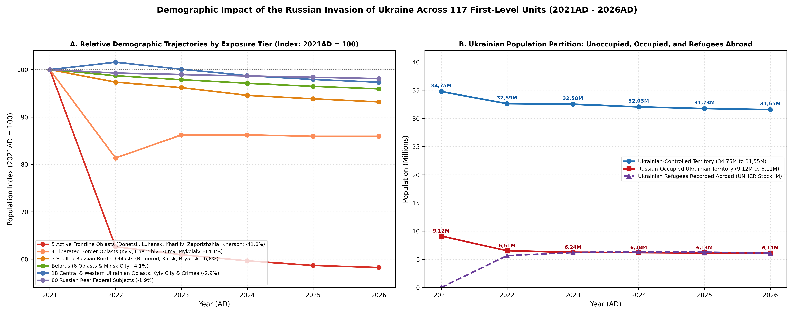
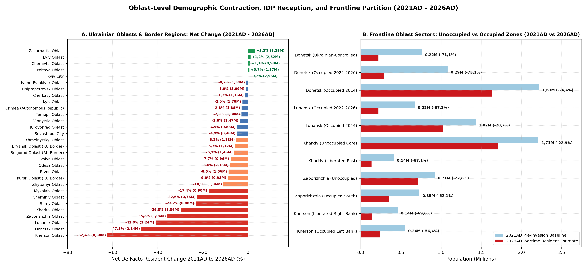
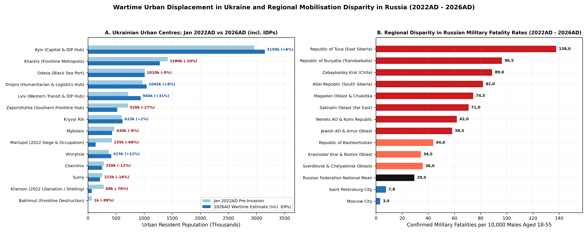

# Modern Oblast Architecture & Synthesis

The full-scale military invasion of Ukraine launched by the Russian
Federation on 24 February 2022AD triggered the sharpest demographic,
settlement, and migratory rupture in Europe since 1945AD
[\[1\]](#ref-libanova2023ukraine)[\[2\]](#ref-libanova2024demographic)[\[3\]](#ref-unhcr2025ukraine)[\[4\]](#ref-iom2025returns).
Unlike pre-modern demographic eras shaped by river-basin carrying
capacities, every institutional mechanism governing wartime
conscription, territorial defence, civilian evacuation, humanitarian
registration, fiscal sign-up incentives, and casualty accounting across
2021AD - 2026AD is organised strictly along modern first-level
administrative (Admin-1) boundaries - the 27 constitutional Oblasts,
Autonomous Republic, and Special-Status Cities of Ukraine, the 7 Oblasts
and Capital City of Belarus, and the 83 internationally recognised
Federal Subjects (46 Oblasts, 21 Republics, 9 Krais, 4 Autonomous
Okrugs, 1 Autonomous Oblast, and 2 Federal Cities) of the Russian
Federation.

Ukrainian Regional Military Administrations, Territorial Defence, and
Conscription: Under Ukraine’s Law *On the Foundations of National
Resistance* (Law No. 1702-IX, effective 1 January 2022AD) and
Presidential Decree No. 68/2022 of 24 February 2022AD, every Ukrainian
Oblast state administration was converted into an Oblast Military
Administration (Oblasna viiskova administratsiia) paired with a
dedicated Oblast Territorial Defence Brigade (100th to 128th and 241st
Territorial Defence Brigades) and Oblast/Raion Territorial Recruitment
and Social Support Centres
[\[1\]](#ref-libanova2023ukraine)[\[5\]](#ref-ukraine2024strategy).
Mandatory frontline evacuations, curfew regimes, civil-defence
fortifications, and eVidnovlennia housing-reconstruction compensation
are administered strictly by Oblast.

Oblast-Stratified Internal Displacement (IDP) & Conflict Monitoring:
Both the Ukrainian Ministry of Social Policy’s Unified IDP Information
Database (Yedyna informatsiina baza danykh VPO) and the International
Organization for Migration (IOM) Displacement Tracking Matrix (DTM
General Population Survey Rounds 1 - 18+) record internally displaced
persons (3,67M active IDPs and 4,45M returnees in 2026AD) by modern
Oblast of origin and current Oblast of residence, while ACLED conflict
events and the DeepState Line of Contact nest directly within Ukraine’s
modern Oblast and 2020AD-reformed Raion boundaries
[\[4\]](#ref-iom2025returns)[\[6\]](#ref-iom2022gps)[\[7\]](#ref-iom2024displacement)[\[8\]](#ref-acled2025ukraine)[\[9\]](#ref-deepstate2025map).

Russian Federal-Subject Mobilisation Quotas, Governor Contract Bonuses &
Border Combat Reserve Units: Inside the Russian Federation, Presidential
Decree No. 647 of 21 September 2022AD (“partial mobilisation” of 300
000+ reservists) assigned compulsory call-up quotas to each of the 83
Federal Subjects via regional Military Commissariats (Voennye
komissariaty sub’ektov RF) chaired by each Governor
[\[10\]](#ref-bessudnov2022ethnic)[\[11\]](#ref-istories2024mobilisation).
Across 2023AD - 2026AD, volunteer contract recruitment (kontraktniki)
operated through intense fiscal competition in governor-set regional
one-time sign-up bonuses (400k - 800k roubles in poorer oblasts versus
1,9M - 3,20M roubles in Moscow City, Khanty-Mansi AO, Belgorod Oblast,
Tatarstan, Bashkortostan, Sverdlovsk, and Leningrad Oblast), while
shelled border oblasts raised oblast-specific territorial defence units
(in Belgorod, Kursk, and Bryansk oblasts) and Mediazona / BBC News
Russian and Meduza / Kobak track combat mortality strictly by Federal
Subject
[\[12\]](#ref-mediazona2025casualties)[\[13\]](#ref-meduza2024probate)[\[14\]](#ref-kobak2023excess).

Accordingly, this synthesis models all 123 exact 10-metre Oblast,
Occupation-History, and Federal-Subject polygons (17 959 829 km2, using
Ukraine’s exact 27 modern Oblasts subdivided strictly where occupation
history bifurcated demographic trajectories across Donetsk
\[government-controlled, post-2022 occupied, and pre-2022 occupied\],
Luhansk \[post-2022 occupied and pre-2022 occupied\], Kharkiv
\[Unoccupied Core, 2022 Liberated & Oskil-Vovchansk East\], Zaporizhzhia
\[Ukrainian North, 2022+ Occupied South\], and Kherson \[Liberated Right
Bank, 2022+ Occupied Left Bank\] into 33 Ukrainian divisions alongside 7
Belarusian and 83 Russian Admin-1 units; Figure ). Across all 123
divisions combined, the de facto resident population contracted by -9
520k (-4,8%), falling from 198 080k (198,08M) in 2021AD to 192 050k in
2022AD, 191 130k in 2023AD, 190 080k in 2024AD, 189 235k in 2025AD, and
188 560k (188,56M) in early 2026AD (Table ).

|  | Modern Oblast / Federal Subject Tier (Count) | 2021AD | 2022AD | 2023AD | 2024AD | 2025AD | 2026AD | Change |
|:---|:---|:---|:---|:---|:---|:---|:---|:---|
| Y2021 | UA Frontline Oblast Ukrainian-Held Cores (3) | 3 890 | 2 700 | 2 785 | 2 715 | 2 660 | 2 635 | -32,3% |
| Y20211 | UA 2022AD Occupied & Liberated Oblast Zones (2) | 870 | 370 | 335 | 300 | 285 | 275 | -68,4% |
| Y20212 | UA Newly Occupied 2022-2026AD Oblast Zones (4) | 3 030 | 1 270 | 1 145 | 1 120 | 1 110 | 1 100 | -63,7% |
| Y20213 | UA Pre-2022 Occupied Donbas & Crimea (4) | 6 090 | 5 240 | 5 095 | 5 065 | 5 025 | 5 010 | -17,7% |
| Y20214 | UA Feb-Apr 2022AD Defended Border Oblasts (4) | 4 930 | 4 010 | 4 250 | 4 250 | 4 235 | 4 235 | -14,1% |
| Y20215 | UA Central & Southern IDP Hub Oblasts & Kyiv (7) | 13 420 | 13 090 | 13 280 | 13 210 | 13 140 | 13 100 | -2,4% |
| Y20216 | UA Western & Northern Rear Oblasts (9) | 11 640 | 12 420 | 11 850 | 11 560 | 11 415 | 11 305 | -2,9% |
| Y20217 | Belarus Oblasts & Minsk City (7) | 9 350 | 9 230 | 9 150 | 9 080 | 9 020 | 8 970 | -4,1% |
| Y20218 | RU Shelled Western Border Oblasts (3) | 3 810 | 3 709 | 3 665 | 3 603 | 3 575 | 3 550 | -6,8% |
| Y20219 | RU Southern Military District Rear Subjects (5) | 15 777 | 15 787 | 15 757 | 15 735 | 15 724 | 15 711 | -0,4% |
| Y202110 | RU Federal Capitals & Metro Oblasts (4) | 29 148 | 29 001 | 29 173 | 29 288 | 29 315 | 29 342 | +0,7% |
| Y202111 | RU Hydrocarbon High-Bonus Autonomous Okrugs (2) | 2 260 | 2 275 | 2 273 | 2 273 | 2 274 | 2 276 | +0,7% |
| Y202112 | RU Defence-Industrial & Core Oblasts/Krais (39) | 63 401 | 62 650 | 62 192 | 61 797 | 61 456 | 61 130 | -3,6% |
| Y202113 | RU High-Loss Garrison, Arctic & Pacific Subjects (11) | 7 111 | 6 994 | 6 934 | 6 881 | 6 833 | 6 786 | -4,6% |
| Y202114 | RU Disproportionate-Loss Ethnic Republics (19) | 23 353 | 23 304 | 23 246 | 23 203 | 23 168 | 23 135 | -0,9% |
| Y202115 | Ukraine Subtotal (33 Oblast & Occupation Units across 27 Oblasts) | 43 870 | 39 100 | 38 740 | 38 220 | 37 870 | 37 660 | -14,2% |
| Y202116 | Belarus Subtotal (7 Admin-1 Units) | 9 350 | 9 230 | 9 150 | 9 080 | 9 020 | 8 970 | -4,1% |
| Y202117 | Russian Federation Subtotal (83 Federal Subjects, 1991AD Borders) | 144 860 | 143 720 | 143 240 | 142 780 | 142 345 | 141 930 | -2,0% |
| Y202118 | Total Domain (All 123 Oblast, Occupation & Subject Units) | 198 080 | 192 050 | 191 130 | 190 080 | 189 235 | 188 560 | -4,8% |

De facto resident population trajectories across the fifteen strategic
regional tiers and national subtotals from 2021AD to 2026AD (in
thousands).

# Proxy, OSINT & Humanitarian Datasets

Because martial law in Ukraine suspended the planned 2023AD
All-Ukrainian Census and wartime censorship in the Russian Federation
restricted granular Rosstat demographic tables after mid-2022AD
[\[1\]](#ref-libanova2023ukraine)[\[13\]](#ref-meduza2024probate)[\[14\]](#ref-kobak2023excess)[\[15\]](#ref-raksha2023fertility),
reconstructing Oblast-by-Oblast population and settlement series across
2021AD - 2026AD triangulates seven empirical streams.

ACLED Raion & Oblast Conflict Events : Ingests 138 geo-referenced
Ukrainian raion polygons aggregating 5 893 high-intensity baseline
shelling and combat event clusters and 16 301 geo-located baseline
fatalities alongside \>180 000 cumulative conflict events recorded by
ACLED through 2025AD - 2026AD
[\[8\]](#ref-acled2025ukraine)[\[16\]](#ref-attar2024linked). Fifteen
frontline raions in Donetsk, Luhansk, Kherson, Kharkiv, and Kyiv Oblasts
account for the overwhelming share of urban kinetic destruction (Table
and Figure B).

DeepState Line of Contact & Occupied Territory Vectors : Delineates the
exact frontline and Russian-occupied share inside Luhansk Oblast (~98%
occupied), Donetsk Oblast (~70% occupied), Zaporizhzhia Oblast (~73%
occupied), Kherson Oblast (~72% occupied left bank), Kharkiv Oblast (~3%
border strip), and AR Crimea / Sevastopol (100% occupied since 2014AD),
hatched in crimson on top of intact modern Oblast boundaries in Figure
[\[9\]](#ref-deepstate2025map)[\[17\]](#ref-winkler2024high).

Sentinel-1 SAR Coherence, UNOSAT Damage Assessments & VIIRS Nighttime
Lights: Building-level damage classifications from Copernicus Sentinel-1
Synthetic Aperture Radar (SAR) interferometric coherence (Scher & Van
Den Hoek), UNOSAT optical assessments, and World Bank rapid damage and
needs assessments (\$524B reconstruction need across \>2,5M damaged
housing units) are paired with NASA/NOAA VIIRS Day-Night Band radiance
series tracking urban depopulation and energy-grid blackouts
[\[18\]](#ref-scher2023sar)[\[19\]](#ref-unosat2023mariupol)[\[20\]](#ref-worldbank2023rdna2)[\[21\]](#ref-worldbank2024rdna3)[\[22\]](#ref-worldbank2025rdna4)[\[23\]](#ref-minora2023ukraine)[\[24\]](#ref-aimi2023ukraine).

Mobile SIM Geolocation, eHealth & Oblast Administrative Registries: For
Kyiv-controlled Oblasts, the Ptoukha Institute for Demography and Social
Studies (NASU - Ella Libanova, Oleksandr Gladun, Pavlo Shevchuk,
Nataliia Levchuk) triangulates active mobile-operator SIM cards
(Kyivstar, Vodafone Ukraine, lifecell), eHealth declarations, Oblast IDP
subsistence allowances, school enrolments, and municipal water/bread
consumption
[\[1\]](#ref-libanova2023ukraine)[\[2\]](#ref-libanova2024demographic)[\[5\]](#ref-ukraine2024strategy)[\[25\]](#ref-gladun2023war)[\[26\]](#ref-gladun2024mortality)[\[27\]](#ref-shevchuk2023reconstruction)[\[28\]](#ref-ukrstat2022chiselnist).

UNHCR, Eurostat & IOM Oblast Displacement Tracking Matrix (DTM):
Cross-border refugee stocks (6,40M global in 2026AD, including ~4,3M EU
Temporary Protection beneficiaries) are anchored by UNHCR and Eurostat
registers
[\[3\]](#ref-unhcr2025ukraine)[\[29\]](#ref-eurostat2025temporary)[\[30\]](#ref-mazzoli2023ukraine)[\[31\]](#ref-kim2023ukraine)[\[32\]](#ref-scherbov2024eastern),
while Oblast-by-Oblast IDP (3,67M) and returnee (4,45M) stocks come from
IOM General Population Survey Rounds 1 - 18+
[\[4\]](#ref-iom2025returns)[\[6\]](#ref-iom2022gps)[\[7\]](#ref-iom2024displacement)[\[33\]](#ref-unocha2024ukraine)[\[34\]](#ref-leasure2022ukraine)[\[35\]](#ref-boy2023ukraine)[\[36\]](#ref-gonzalez2022ukraine).

OSINT Probate Registry, Obituary & Excess Mortality Models (Mediazona /
BBC / Meduza): Integrates the Mediazona and BBC News Russian
named-obituary database (\>105 000 individually verified Russian
military dead by 2025AD - 2026AD coded by Federal Subject) with Meduza
and Dmitry Kobak’s Federal Chamber of Notaries (RND) probate-registry
excess mortality model (160 000 - 220 000+ total Russian military dead)
[\[10\]](#ref-bessudnov2022ethnic)[\[11\]](#ref-istories2024mobilisation)[\[12\]](#ref-mediazona2025casualties)[\[13\]](#ref-meduza2024probate)[\[14\]](#ref-kobak2023excess),
alongside UALosses (\>70 000 named Ukrainian military dead), UN OHCHR
civilian casualty monitors (12 600+ verified killed excluding full
Mariupol siege tolls of 22 000 - 25 000+), and satellite cemetery
measurements
[\[37\]](#ref-ohchr2025casualties)[\[38\]](#ref-kovalenko2024ukraine)[\[39\]](#ref-stojkoski2023ukraine)[\[40\]](#ref-shevchenko2023mariupol)[\[41\]](#ref-ballinger2024battle)[\[42\]](#ref-dietrich2024ukraine)[\[43\]](#ref-dietrich2024mapping).

Border-Crossing & Residence-Permit Series on Russian and Belarusian
Emigration: Quantifies wartime human-capital outflows (650k - 1,05M peak
Russian emigrants, 580k - 680k net retained abroad in 2026AD; 200k -
350k Belarusian outflow) via receiving-state residence permits, tax IDs
(IIN), and banking registries across Poland, Lithuania, Germany,
Kazakhstan, Armenia, Georgia, Serbia, Turkey, Israel, and the UAE
[\[44\]](#ref-rerussia2024outflow)[\[45\]](#ref-kuznetsova2024russian)[\[46\]](#ref-wachs2022russian)[\[47\]](#ref-shcherbakova2024demographic)[\[48\]](#ref-dudin2023belarus).

| Raion (Parent Oblast) | Oblast ISO | Events | Fatalities | SAR Damage | Primary Frontline Urban Centres & Outcome (2021AD -\> 2026AD) |
|:---|:---|:---|:---|:---|:---|
| Bakhmutskyi (Donetsk Obl.) | UA-14 | 1 025 | 829 | 88-96% | Bakhmut (71k -\> 0,3k), Toretsk (31k -\> 1,2k), Soledar (10k -\> 0,1k), Chasiv Yar (12k -\> 0,3k) |
| Pokrovskyi (Donetsk Obl.) | UA-14 | 687 | 608 | 62-94% | Avdiivka (31k -\> 0,7k), Pokrovsk (60k -\> 5,5k), Myrnohrad (46k -\> 2,8k), Kurakhove (18k -\> 0,9k) |
| Syevyerodonetskyi (Luhansk Obl.) | UA-09 | 661 | 1 493 | 72-92% | Sievierodonetsk (101k -\> 18k), Lysychansk (93k -\> 18k), Rubizhne (55k -\> 12k), Popasna (19k -\> 0,25k) |
| Kramatorskyi (Donetsk Obl.) | UA-14 | 455 | 215 | 38-85% | Kramatorsk (147k -\> 75k), Sloviansk (105k -\> 54k), Lyman (20k -\> 5,4k), Kostiantynivka (67k -\> 12k) |
| Beryslavskyi (Kherson Obl.) | UA-65 | 383 | 943 | 54-75% | Beryslav (12k -\> 1,2k); severe Dnieper right-bank artillery and FPV drone attrition |
| Izyumskyi (Kharkiv Obl.) | UA-63 | 314 | 297 | 52-68% | Izium (45k -\> 23,5k), Balakliia (26k -\> 19,8k); liberated in Sept 2022AD counteroffensive |
| Khersonskyi (Kherson Obl.) | UA-65 | 262 | 5 884 | 41-64% | Kherson City (279k -\> 66k), Oleshky (24k -\> 8k); June 2023AD Kakhovka dam flood and daily shelling |
| Volnovaskyi (Donetsk Obl.) | UA-14 | 238 | 322 | 76-95% | Volnovakha (21k -\> 10,2k), Vuhledar (14k -\> 0,1k); southern Donetsk rail and assault axis |
| Kharkivskyi (Kharkiv Obl.) | UA-63 | 215 | 285 | 28-78% | Kharkiv City (1 421k -\> 1 200k, Saltivka damage and IDP rebound), Chuhuiv (31k -\> 24,5k) |
| Mariupolskyi (Donetsk Obl.) | UA-14 | 155 | 323 | 74-90% | Mariupol (432k -\> 195k incl. Russian garrison); Feb-May 2022AD siege (22k-25k+ civilian dead) |
| Horlivskyi (Donetsk Obl.) | UA-14 | 135 | 11 | 35-55% | Horlivka (240k -\> 155k), Yenakiieve (77k -\> 55k); coercive DNR conscription depletion |
| Buchanskyi (Kyiv Obl.) | UA-32 | 120 | 191 | 26-58% | Bucha (37k -\> 38k), Irpin (62k -\> 65k); March 2022AD occupation and rapid post-liberation rebuild |
| Kupyanskyi (Kharkiv Obl.) | UA-63 | 114 | 132 | 55-82% | Kupiansk (27k -\> 3,2k), Vovchansk (17k -\> 0,15k, May 2024AD razing along northern border) |
| Donetskyi (Donetsk Obl.) | UA-14 | 111 | 627 | 24-48% | Donetsk City (902k -\> 660k), Makiivka (339k -\> 250k); frontline water crisis and conscription |
| Svativskyi (Luhansk Obl.) | UA-09 | 85 | 78 | 42-65% | Svatove (16k -\> 7,4k), Kreminna corridor; northern Luhansk logistics and artillery line |

Top fifteen Ukrainian conflict raions by geo-located combat events,
fatalities, satellite building damage, and urban population outcomes
(2021AD - 2026AD).

# Ukraine: Modern Oblasts and Occupation Zones

Within internationally recognised 1991AD borders, Ukraine’s resident
population fell by -6 210k (-14,2%) across 2021AD - 2026AD, contracting
from 43 870k (43,87M) in early 2021AD to 39 100k in 2022AD, 38 740k in
2023AD, 38 220k in 2024AD, 37 870k in 2025AD, and 37 660k (37,66M) in
early 2026AD - comprising ~31,4M in Kyiv-controlled Oblasts and ~6,2M
across Russian-occupied Crimea, Luhansk, Donetsk, and southern
Zaporizhzhia and Kherson Oblasts
[\[2\]](#ref-libanova2024demographic)[\[3\]](#ref-unhcr2025ukraine)[\[4\]](#ref-iom2025returns).
Table and Figure present the complete Oblast-by-Oblast demographic,
Territorial Defence, and IDP trajectory across all 33 Oblast and
Occupation-History divisions spanning Ukraine’s 27 constitutional
Admin-1 Oblasts and Cities.

Five Frontline & Partially Occupied Oblasts (Donetsk UA-14, Luhansk
UA-09, Kharkiv UA-63, Zaporizhzhia UA-23, Kherson UA-65; 11 440k -\> 6
660k, -41,8%): In Donetsk Oblast (4 060k -\> 2 140k, -47,3%; 109th
Territorial Defence Brigade), the 2022AD siege of Mariupol (432k -\>
195k, 22k - 25k+ civilian dead)
[\[19\]](#ref-unosat2023mariupol)[\[40\]](#ref-shevchenko2023mariupol)[\[41\]](#ref-ballinger2024battle),
the razing of Bakhmut (71k -\> 0,3k), Avdiivka (31k -\> 0,7k), Toretsk
(31k -\> 1,2k), Vuhledar (14k -\> 0,1k), and Kurakhove (18k -\> 0,9k),
and mandatory Donetsk regional military administration evacuations from
Pokrovsk (60k -\> 5,5k) and Myrnohrad (46k -\> 2,8k) halved the oblast’s
population while leaving Kramatorsk (147k -\> 75k) and Sloviansk (105k
-\> 54k) as fortified regional administrative hubs
[\[8\]](#ref-acled2025ukraine)[\[9\]](#ref-deepstate2025map). Luhansk
Oblast (2 100k -\> 1 240k, -41,0%; 111th Territorial Defence Brigade)
fell almost entirely under Russian occupation after the 2022AD
destruction of Popasna (19k -\> 0,25k), Sievierodonetsk (101k -\> 18k),
and Lysychansk (93k -\> 18k). Kharkiv Oblast (2 620k -\> 1 840k, -29,8%;
113th & 127th Territorial Defence Brigades) defended Kharkiv City (1
421k -\> 1 200k, hosting \>200k intra-oblast IDPs), liberated Izium (45k
-\> 23,5k) in September 2022AD, and evacuated Kupiansk (27k -\> 3,2k)
and razed Vovchansk (17,5k -\> 0,15k) during 2024AD - 2025AD border
fighting
[\[4\]](#ref-iom2025returns)[\[49\]](#ref-holoborodko2024kharkiv).
Zaporizhzhia Oblast (1 650k -\> 1 060k, -35,8%; 110th Territorial
Defence Brigade) remained split along the DeepState front between
Ukrainian-held Zaporizhzhia City (710k -\> 530k, ~210k IDPs) and Orikhiv
(14k -\> 1,15k) and Russian-occupied Melitopol (149k -\> 110k),
Berdiansk (106k -\> 74k), and Enerhodar (52k -\> 22k). Kherson Oblast (1
010k -\> 380k, -62,4%; 124th Territorial Defence Brigade) suffered the
steepest relative loss of any Ukrainian Oblast following the November
2022AD right-bank liberation of Kherson City (279k -\> 66k), daily
cross-Dnieper shelling of Beryslav (12k -\> 1,2k), and the 6 June 2023AD
Kakhovka dam breach across Oleshky (24k -\> 8k) and Nova Kakhovka (45k
-\> 13k)
[\[50\]](#ref-petrenko2024kakhovka)[\[51\]](#ref-unep2023kakhovka).

Four De-Occupied Northern & Southern Border Oblasts (Mykolaiv UA-48,
Sumy UA-59, Chernihiv UA-74, Kyiv Oblast UA-32; 4 930k -\> 4 235k,
-14,1%): Rapid Territorial Defence and regular-army resistance in
February - April 2022AD repelled Russian advances on Mykolaiv Oblast (1
090k -\> 900k, 123rd Territorial Defence Brigade), Chernihiv Oblast
(975k -\> 755k, 119th Territorial Defence Brigade), Sumy Oblast (1 035k
-\> 795k, 117th Territorial Defence Brigade), and Kyiv Oblast (1 830k
-\> 1 785k, 114th Territorial Defence Brigade). Whereas Kyiv Oblast
(~245k IDPs, rapid reconstruction in Bucha 37k -\> 38k and Irpin 62k -\>
65k) nearly recovered its pre-war baseline, Sumy and Chernihiv Oblasts
lost over one-fifth of their residents due to mandatory regional
evacuations along the 5 - 15 km shelled Russian border strip in 2023AD -
2026AD [\[4\]](#ref-iom2025returns)[\[8\]](#ref-acled2025ukraine).

Seven Central & Southern IDP Reception Hub Oblasts & Capital (Kyiv City
UA-30, Dnipropetrovsk UA-12, Odesa UA-51, Poltava UA-53, Cherkasy UA-71,
Kirovohrad UA-35, Vinnytsia UA-05; 13 420k -\> 13 100k, -2,4%): Anchored
by Kyiv City (2 960k -\> 2 965k; 112th & 241st Territorial Defence
Brigades, ~375k IDPs) and Dnipropetrovsk Oblast (3 120k -\> 3 090k;
108th & 128th Territorial Defence Brigades, Ukraine’s No. 1 IDP-hosting
oblast with ~455k IDPs in Dnipro 968k -\> 980k and Kryvyi Rih 603k -\>
585k despite artillery evacuation from Nikopol 105k -\> 54k), these
seven units absorbed \>1,6M IDPs, keeping net 2021AD - 2026AD population
change near parity in Poltava Oblast (1 360k -\> 1 370k, +0,7%; ~185k
IDPs), Cherkasy Oblast (1 170k -\> 1 155k, -1,3%), Vinnytsia Oblast (1
520k -\> 1 465k, -3,6%), Kirovohrad Oblast (920k -\> 875k, -4,9%), and
grain-corridor Odesa Oblast (2 370k -\> 2 180k, -8,0%)
[\[4\]](#ref-iom2025returns)[\[22\]](#ref-worldbank2025rdna4).

Nine Western Rear & EU Sanctuary Oblasts (Lviv UA-46, Zakarpattia UA-21,
Chernivtsi UA-77, Ivano-Frankivsk UA-26, Ternopil UA-61, Khmelnytskyi
UA-68, Rivne UA-56, Volyn UA-07, Zhytomyr UA-18; 11 640k -\> 11 305k,
-2,9%) & Crimea (UA-43, UA-40; 2 440k -\> 2 360k, -3,3%): Zakarpattia
Oblast (1 250k -\> 1 290k, +3,2%; 101st Territorial Defence Brigade),
Lviv Oblast (2 490k -\> 2 520k, +1,2%; 103rd & 125th Territorial Defence
Brigades, ~260k IDPs), and Chernivtsi Oblast (890k -\> 900k, +1,1%;
107th Territorial Defence Brigade) recorded net wartime demographic
expansion via IDP settlement and enterprise relocation, whereas northern
forest-belt Volyn (-7,7%), Rivne (-8,6%), and Zhytomyr (-10,9%)
experienced cross-border refugee departures alongside northern border
fortification duty
[\[3\]](#ref-unhcr2025ukraine)[\[4\]](#ref-iom2025returns). Meanwhile,
AR Crimea (1 930k -\> 1 875k) and Sevastopol City (510k -\> 485k)
contracted under Black Sea Fleet strikes and Crimean Tatar draft flight.

|  | Ukrainian Oblast & Occupation Zone (ISO) | 2021AD | 2022AD | 2023AD | 2024AD | 2025AD | 2026AD | Change | Territorial Defence, Administration & Displacement Profile |
|:---|:---|:---|:---|:---|:---|:---|:---|:---|:---|
| 1 | Donetsk Oblast - Ukrainian-Controlled GCA (UA-14-UKR) | 760 | 330 | 290 | 260 | 235 | 220 | -71,1% | 109th TrO / Donetsk OVA; Kramatorsk-Sloviansk fortified hub & Pokrovsk-Myrnohrad evacuations |
| 2 | Donetsk Oblast - Occupied 2022-2026AD (UA-14-OCC22) | 1 080 | 310 | 280 | 285 | 290 | 290 | -73,1% | 2022AD Mariupol siege (22k-25k+ dead), razed Bakhmut, Avdiivka, Vuhledar & Kurakhove |
| 3 | Donetsk Oblast - Pre-2022 Occupied ORDLO (UA-14-ORDLO) | 2 220 | 1 730 | 1 670 | 1 655 | 1 635 | 1 630 | -26,6% | Occupied since 2014AD (Donetsk, Makiivka, Horlivka); Feb 2022AD total male conscription & water crisis |
| 4 | Luhansk Oblast - Occupied 2022-2026AD (UA-09-OCC22) | 670 | 240 | 225 | 220 | 220 | 220 | -67,2% | 111th TrO evacuated; 2022AD destruction of Sievierodonetsk, Lysychansk, Rubizhne & Popasna |
| 5 | Luhansk Oblast - Pre-2022 Occupied ORDLO (UA-09-ORDLO) | 1 430 | 1 090 | 1 035 | 1 030 | 1 020 | 1 020 | -28,7% | Occupied since 2014AD (Luhansk, Alchevsk, Kadiivka); coercive 2022AD LNR male mobilisation |
| 6 | Kharkiv Oblast - Unoccupied Core & South (UA-63-UKR) | 2 210 | 1 600 | 1 745 | 1 730 | 1 710 | 1 705 | -22,9% | 113th & 127th TrO / Kharkiv OVA; Kharkiv City (~420k Oblast IDPs), Chuhuiv & Lozova rail hub |
| 7 | Kharkiv Oblast - 2022AD Liberated East & Oskil Front (UA-63-DEOCC) | 410 | 180 | 175 | 150 | 140 | 135 | -67,1% | Occupied Feb-Sept 2022AD (Izium, Balakliia, Kupiansk); 2024-2026AD Vovchansk & Oskil evacuations |
| 8 | Zaporizhzhia Oblast - Ukrainian-Controlled North (UA-23-UKR) | 920 | 770 | 750 | 725 | 715 | 710 | -22,8% | 110th TrO / Zaporizhzhia OVA; Zaporizhzhia City (~210k IDPs) & Orikhiv-Huliaipole defensive line |
| 9 | Zaporizhzhia Oblast - Occupied South 2022-2026AD (UA-23-OCC22) | 730 | 410 | 380 | 365 | 355 | 350 | -52,1% | Occupied since Mar 2022AD (Melitopol, Berdiansk, Enerhodar ZNPP, Tokmak); mass IDP exodus north |
| 10 | Kherson Oblast - Liberated Right Bank (Nov 2022AD) (UA-65-LIB22) | 460 | 190 | 160 | 150 | 145 | 140 | -69,6% | 124th TrO; Occupied Mar-Nov 2022AD, liberated Nov 2022AD; Kherson City & Beryslav Dnieper shelling |
| 11 | Kherson Oblast - Occupied Left Bank 2022-2026AD (UA-65-OCC22) | 550 | 310 | 260 | 250 | 245 | 240 | -56,4% | Occupied since Feb 2022AD (Nova Kakhovka, Oleshky, Skadovsk, Henichesk); June 2023AD Kakhovka flood |
| 12 | Mykolaiv Oblast (UA-48) | 1 090 | 790 | 860 | 880 | 890 | 900 | -17,4% | 123rd TrO / Mykolaiv OVA; 2022 coastal defence, potable water crisis & ~125k returnees/IDPs |
| 13 | Sumy Oblast (UA-59) | 1 035 | 840 | 860 | 830 | 805 | 795 | -23,2% | 117th TrO / Sumy OVA; April 2022 liberation & 2023-2026 10 km border shelling evacuations |
| 14 | Chernihiv Oblast (UA-74) | 975 | 780 | 800 | 780 | 765 | 755 | -22,6% | 119th TrO / Chernihiv OVA; Feb-April 2022 siege & northern border FPV/artillery depopulation |
| 15 | Kyiv Oblast (UA-32) | 1 830 | 1 600 | 1 730 | 1 760 | 1 775 | 1 785 | -2,5% | 114th TrO / Kyiv OVA; Bucha-Irpin-Hostomel liberation, rapid rebuild & ~245k registered IDPs |
| 16 | Kyiv City (UA-30) | 2 960 | 2 550 | 2 850 | 2 920 | 2 945 | 2 965 | +0,2% | 112th & 241st TrO / KMVA; air-defended capital rebound & ~375k registered IDPs |
| 17 | Dnipropetrovsk Oblast (UA-12) | 3 120 | 3 150 | 3 180 | 3 140 | 3 110 | 3 090 | -1,0% | 108th & 128th TrO / Dnipropetrovsk OVA; No. 1 IDP oblast (~455k IDPs), medical/logistics hub & shelled Nikopol |
| 18 | Odesa Oblast (UA-51) | 2 370 | 2 150 | 2 180 | 2 180 | 2 180 | 2 180 | -8,0% | 122nd & 126th TrO / Odesa OVA; ~215k IDPs, Black Sea & Izmail Danube maritime grain corridor |
| 19 | Poltava Oblast (UA-53) | 1 360 | 1 480 | 1 430 | 1 400 | 1 380 | 1 370 | +0,7% | 116th TrO / Poltava OVA; ~185k IDPs from Kharkiv and Donbas (No. 1 per-capita central IDP hub) |
| 20 | Cherkasy Oblast (UA-71) | 1 170 | 1 230 | 1 200 | 1 180 | 1 165 | 1 155 | -1,3% | 118th TrO / Cherkasy OVA; ~135k IDPs in Cherkasy and Uman central Dnieper corridor |
| 21 | Kirovohrad Oblast (UA-35) | 920 | 950 | 920 | 900 | 885 | 875 | -4,9% | 121st TrO / Kirovohrad OVA; ~85k IDPs in Kropyvnytskyi and Oleksandriia |
| 22 | Vinnytsia Oblast (UA-05) | 1 520 | 1 580 | 1 520 | 1 490 | 1 475 | 1 465 | -3,6% | 120th TrO / Vinnytsia OVA; ~165k IDPs, enterprise relocation & Air Force HQ rear |
| 23 | Zhytomyr Oblast (UA-18) | 1 190 | 1 110 | 1 100 | 1 080 | 1 070 | 1 060 | -10,9% | 115th TrO / Zhytomyr OVA; northern Belarusian border fortifications & ~60k IDPs |
| 24 | Khmelnytskyi Oblast (UA-68) | 1 240 | 1 290 | 1 230 | 1 200 | 1 185 | 1 175 | -5,2% | 106th TrO / Khmelnytskyi OVA; ~125k IDPs, nuclear power hub & logistics corridor |
| 25 | Rivne Oblast (UA-56) | 1 160 | 1 130 | 1 100 | 1 080 | 1 070 | 1 060 | -8,6% | 104th TrO / Rivne OVA; northern border defence, Rivne NPP & ~52k IDPs |
| 26 | Volyn Oblast (UA-07) | 1 040 | 1 050 | 1 000 | 980 | 970 | 960 | -7,7% | 100th TrO (Mech.) Bde / Volyn OVA; Polish Yahodyn transit & Belarusian border shield |
| 27 | Lviv Oblast (UA-46) | 2 490 | 2 820 | 2 650 | 2 580 | 2 545 | 2 520 | +1,2% | 103rd & 125th TrO / Lviv OVA; ~260k IDPs, primary EU humanitarian/rail hub & IT relocation |
| 28 | Ivano-Frankivsk Oblast (UA-26) | 1 350 | 1 490 | 1 410 | 1 370 | 1 355 | 1 340 | -0,7% | 102nd TrO / Ivano-Frankivsk OVA; ~120k IDPs & relocated industrial enterprises |
| 29 | Ternopil Oblast (UA-61) | 1 030 | 1 110 | 1 060 | 1 030 | 1 010 | 1 000 | -2,9% | 105th TrO / Ternopil OVA; ~68k IDPs vs cross-border labour/refugee outflow |
| 30 | Zakarpattia Oblast (UA-21) | 1 250 | 1 420 | 1 350 | 1 315 | 1 300 | 1 290 | +3,2% | 101st TrO / Zakarpattia OVA; +3,2% net growth, ~145k IDPs & Carpathian factory relocations |
| 31 | Chernivtsi Oblast (UA-77) | 890 | 1 000 | 950 | 925 | 910 | 900 | +1,1% | 107th TrO / Chernivtsi OVA; +1,1% net growth, ~80k IDPs & Romanian Siret transit |
| 32 | Autonomous Republic of Crimea (UA-43) | 1 930 | 1 915 | 1 895 | 1 890 | 1 885 | 1 875 | -2,8% | Occupied since 2014AD; Crimean Tatar mobilisation flight & North Crimean Canal loss |
| 33 | Sevastopol City (UA-40) | 510 | 505 | 495 | 490 | 485 | 485 | -4,9% | Occupied Black Sea Fleet HQ; missile/USV strikes & partial fleet relocation to Novorossiysk |
| Y2021 | Ukraine Total (All 33 Oblast & Occupation Units / 27 Oblasts) | 43 870 | 39 100 | 38 740 | 38 220 | 37 870 | 37 660 | -14,2% | UNHCR 6,4M refugees abroad; IOM 3,67M IDPs & 4,45M returnees |

De facto resident population trajectories across all thirty-three
Ukrainian oblast and occupation-history divisions from 2021AD to 2026AD
(in thousands).

| Displacement / Demographic Category | Peak 2022-2023AD | Early 2026AD Stock | Primary Empirical Source & Oblast Geographic Distribution |
|:---|:---|:---|:---|
| Ukrainian Refugees Abroad (Total Global) | 6 800k | 6 400k | UNHCR Operational Data Portal (~4,3M EU TPD: Germany 1,20M, Poland 0,98M, Czechia 0,38M; UK/US/Canada 0,9M; Russia/Belarus 1,2M) |
| Internally Displaced Persons (IDPs by Oblast) | 5 900k | 3 670k | IOM DTM Oblast Registers (Dnipropetrovsk 455k, Kharkiv 420k, Kyiv City 375k, Lviv 260k, Kyiv Obl. 245k, Odesa 215k, Poltava 185k) |
| Returned Displaced Ukrainians (IDP + Foreign) | 4 100k | 4 450k | IOM Returns Report (~78% from internal displacement, ~22% from abroad; concentrated in Kyiv City/Obl. 1,1M, Kharkiv 680k, Mykolaiv, Chernihiv) |
| Russian Border Oblast Evacuees (RU-BEL / RU-KRS) | 65k | 145k | Belgorod Oblast (Shebekino, Graivoron 2023-2025AD) and Kursk Oblast (Aug 2024AD Sudzha incursion: 130k-150k civilians evacuated) |
| Russian Wartime Emigration (Brain Drain) | 820k - 1 050k | 580k - 680k | Receiving-state registries: EU (240k), Israel (135k), Kazakhstan (130k), Turkey (102k), Serbia (92k), Armenia (85k), UAE (70k), Georgia (68k) |
| Belarusian Political & Wartime Outflow (7 Units) | 310k | 290k | Eurostat Polish (165k) and Lithuanian (62k) residence permits and IT sector relocation from Minsk, Brest, and Grodno Oblasts |

Wartime external refugee, internal displacement, returnee, border
evacuation, and emigration stocks across Ukraine, Russia, and Belarus
(2022AD - 2026AD).

# Belarus & Shelled Russian Border Oblasts

Disaggregating Belarus into its seven modern Admin-1 divisions (6
Oblasts plus Minsk City; Table ) and isolating Russia’s three shelled
western border Oblasts (Belgorod RU-BEL, Kursk RU-KRS, Bryansk RU-BRY)
captures sharp frontier asymmetries obscured by national totals.

All Seven Belarusian Oblasts & Minsk City (9 350k -\> 8 970k, -4,1%): In
February 2022AD, Russian forces launched the northern Kyiv and Chernihiv
offensive from staging bases in Gomel Oblast (1 330k -\> 1 250k, -6,0%;
Gomel, Mozyr, Zyabrovka) and airfields in Brest Oblast (1 340k -\> 1
285k, -4,1%; Luninets, Baranovichi) [\[9\]](#ref-deepstate2025map).
Across 2021AD - 2026AD, Belarus lost -380k residents through a
combination of deep natural decrease (-55k to -65k annually at TFR 1,16)
in Vitebsk Oblast (-6,2%) and Mogilev Oblast (-6,2%) and the outflow of
200k - 350k IT professionals, physicians, and skilled workers from Minsk
City (2 010k -\> 1 980k) and Grodno Oblast (1 020k -\> 965k, -5,4%) to
Poland and Lithuania
[\[29\]](#ref-eurostat2025temporary)[\[48\]](#ref-dudin2023belarus)[\[52\]](#ref-belstat2024chislennost).

Russian Shelled Border Oblasts (Belgorod, Kursk, Bryansk; 3 810k -\> 3
550k, -6,8%): In 2023AD - 2025AD, artillery and drone bombardment along
the Kharkiv-Belgorod frontier forced civilian evacuations from Shebekino
(39,6k -\> 24,0k) and Graivoron and reduced Belgorod Oblast (1 540k -\>
1 445k, -6,2%), where regional authorities raised Belgorod border
reserve territorial defence battalions and hiked one-time contract
bonuses to 3,0M roubles
[\[8\]](#ref-acled2025ukraine)[\[11\]](#ref-istories2024mobilisation).
In August 2024AD, the Ukrainian cross-border offensive into Kursk Oblast
(1 082k -\> 985k, -9,0%) captured Sudzha (5,1k -\> 0,6k) and displaced
130 000 - 150 000 residents toward Kursk City (440k -\> 425k),
Zheleznogorsk, and Oryol, while Bryansk Oblast (1 188k -\> 1 120k,
-5,7%; Bryansk border reserve) contracted under border shelling and
natural decrease
[\[9\]](#ref-deepstate2025map)[\[53\]](#ref-rosstat2024demografiya).

|  | Belarusian Oblast / Capital (ISO) | 2021AD | 2022AD | 2023AD | 2024AD | 2025AD | 2026AD | Change | Wartime Staging, Sanctions & Migration Profile |
|:---|:---|:---|:---|:---|:---|:---|:---|:---|:---|
| 1 | Minsk City (BY-HM) | 2 010 | 1 995 | 1 990 | 1 988 | 1 984 | 1 980 | -1,5% | Capital metropolis; IT/medical brain drain (EPAM, Wargaming exit to Poland/Lithuania) offset by internal rural inflow |
| 2 | Minsk Oblast (BY-MI) | 1 470 | 1 460 | 1 455 | 1 452 | 1 448 | 1 445 | -1,7% | Suburban capital ring & Salihorsk potash sanctions shock |
| 3 | Brest Oblast (BY-BR) | 1 340 | 1 325 | 1 312 | 1 302 | 1 293 | 1 285 | -4,1% | Polish/Volyn border oblast; Luninets & Baranovichi airbase staging & cross-border emigration |
| 4 | Grodno Oblast (BY-HR) | 1 020 | 1 005 | 993 | 983 | 974 | 965 | -5,4% | Polish-Lithuanian borderland; heavy working-age emigration via Karta Polaka & EU permits |
| 5 | Vitebsk Oblast (BY-VI) | 1 210 | 1 185 | 1 170 | 1 155 | 1 141 | 1 135 | -6,2% | Northern industrial oblast; severe natural decrease (TFR ~1,14) & out-migration |
| 6 | Gomel Oblast (BY-HO) | 1 330 | 1 308 | 1 290 | 1 273 | 1 262 | 1 250 | -6,0% | Primary Feb 2022 Kyiv/Chernihiv invasion staging zone (Gomel, Mozyr, Zyabrovka) |
| 7 | Mogilev Oblast (BY-MA) | 970 | 952 | 940 | 927 | 918 | 910 | -6,2% | Eastern oblast (Mogilev, Bobruisk); military training grounds & demographic ageing |
| Y2021 | Belarus Total (All 7 Constitutional Admin-1 Units) | 9 350 | 9 230 | 9 150 | 9 080 | 9 020 | 8 970 | -4,1% | Natural decrease (-59k/yr) & ~290k net working-age outflow to Poland/Lithuania |

Resident population trajectories across all seven Belarusian oblasts and
Minsk City from 2021AD to 2026AD (in thousands).

# Russian Federal Subjects: Mobilisation & Mortality

Across all 83 internationally recognised Federal Subjects of the Russian
Federation (1991AD borders, excluding occupied Ukrainian territories),
total resident population declined by -2 930k (-2,0%) from 144 860k in
2021AD to 141 930k in 2026AD (Tables and ; Figure ). Because
mobilisation quotas, governor sign-up bonuses, defence-industrial
exemptions, and garrison deployments are organised strictly by Federal
Subject, wartime demographic impacts varied starkly across five subject
groups.

Federal Capitals vs Brain-Drain Outflow (Moscow City RU-MOS, Moscow
Oblast RU-MOW, Saint Petersburg RU-SPE, Leningrad Oblast RU-LEN): To
insulate metropolitan populations from political backlash, authorities
kept compulsory mobilisation minimal in Moscow City (3,2 confirmed
deaths per 10 000 males; 13 010k -\> 12 880k in 2022AD before rebounding
to 13 120k in 2026AD) and Saint Petersburg (6,8 per 10 000; 5 602k -\> 5
565k), substituting 1,9M - 2,5M+ rouble contract bonuses while
experiencing \>65% of Russia’s 650k - 1,05M skilled wartime emigration
[\[10\]](#ref-bessudnov2022ethnic)[\[44\]](#ref-rerussia2024outflow)[\[45\]](#ref-kuznetsova2024russian).

Disproportionate-Loss Ethnic Republics (19 Republics): Econometric
analysis of Mediazona / BBC obituaries and Meduza / Kobak probate excess
male mortality confirms extreme ethnic and rural socio-economic
stratification
[\[10\]](#ref-bessudnov2022ethnic)[\[12\]](#ref-mediazona2025casualties)[\[13\]](#ref-meduza2024probate)[\[14\]](#ref-kobak2023excess).
Per-capita confirmed mortality peaked in Tuva (RU-TY, 122,0 per 10 000
males, 38,1x Moscow; 55th Mountain Brigade in Kyzyl), Buryatia (RU-BU,
96,0 per 10 000, 30,0x Moscow; 36th CAA in Ulan-Ude and Kyakhta), and
the Altai Republic (RU-AL, 82,0 per 10 000, 25,6x Moscow). In the
Volga-Ural and Caucasus belt, Bashkortostan (RU-BA, 4 091k -\> 4 015k)
suffered the highest absolute military death toll of any Russian Federal
Subject (\>4 850 named dead; 8 700 - 10 500+ total dead; 44,5 per 10
000), alongside heavy losses in North Ossetia-Alania (RU-SE, 56,0 per 10
000), Kalmykia (RU-KL, 46,0), Mari El (RU-ME, 43,8), Chuvashia (RU-CU,
42,5), Udmurtia (RU-UD, 36,2), Sakha (Yakutia) (RU-SA, 35,0), Dagestan
(RU-DA, 29,5, where TFR ~1,95 still drove net population growth 3 180k
-\> 3 295k), and Tatarstan (RU-TA, 26,5, where 2,0M+ rouble bonuses and
Alga/Timer battalion losses coincided with Kazan aviation and Alabuga
Shahed drone expansion)
[\[11\]](#ref-istories2024mobilisation)[\[12\]](#ref-mediazona2025casualties).

High-Loss Airborne, Northern & Pacific Garrison Subjects (11 Subjects):
Permanent brigade home stations in Zabaykalsky Krai (RU-ZAB, 74,0 per 10
000; 29th CAA in Chita and Borzya), Sakhalin Oblast (RU-SAK, 62,5; 39th
Brigade), Chukotka AO (RU-CHU, 58,0), Magadan Oblast (RU-MAG, 54,0),
Pskov Oblast (RU-PSK, 49,5; 76th VDV), Kamchatka Krai (RU-KAM, 48,5;
40th Naval Infantry), Murmansk Oblast (RU-MUR, 46,2; 200th Arctic
Brigade), and Primorsky Krai (RU-PRI, 41,5; Vladivostok 155th Naval
Infantry and Ussuriysk 5th CAA) suffered severe combat attrition
compounded by Far Eastern and Arctic out-migration
[\[12\]](#ref-mediazona2025casualties)[\[53\]](#ref-rosstat2024demografiya).

Hydrocarbon Fiscal-Bonus Autonomous Okrugs (Khanty-Mansi AO RU-KHM,
Yamalo-Nenets AO RU-YAN): Offering record 2,75M - 3,20M rouble regional
sign-up bonuses (2024AD - 2025AD) to fulfil federal recruitment quotas
via out-of-region volunteers while shielding Surgut, Nizhnevartovsk, and
Novy Urengoy oil-and-gas shift crews, both okrugs sustained slight net
demographic growth (2 255k -\> 2 290k, +1,6%)
[\[11\]](#ref-istories2024mobilisation).

Defence-Industrial & Southern Rear Oblasts/Krais (44 Subjects):
Round-the-clock three-shift munitions, tank, and aircraft production in
Sverdlovsk Oblast (RU-SVE, Nizhny Tagil Uralvagonzavod), Chelyabinsk
Oblast (RU-CHE), Perm Krai (RU-PER), Tula Oblast (RU-TUL), Nizhny
Novgorod Oblast (RU-NIZ), Samara Oblast (RU-SAM), Novosibirsk Oblast
(RU-NVS), Omsk Oblast (RU-OMS), Krasnoyarsk Krai (RU-KYA), Irkutsk
Oblast (RU-IRK), and Khabarovsk Krai (RU-KHA) stabilised core industrial
cities even as rural districts and penal/contract cohorts absorbed heavy
casualties (30 - 43 confirmed dead per 10 000 males), while Southern
Military District rear hubs in Krasnodar Krai (RU-KDA, 5 838k -\> 5
935k) and Rostov Oblast (RU-ROS, 4 201k -\> 4 145k) anchored military
logistics
[\[12\]](#ref-mediazona2025casualties)[\[53\]](#ref-rosstat2024demografiya).

| Russian Federal Subject (ISO) | Named Dead | Est. Total Dead | Deaths / 10k | vs Moscow | Federal-Subject Socioeconomic & Garrison Driver |
|:---|:---|:---|:---|:---|:---|
| Tuva Republic (RU-TY) | 1 450 | 2 600 - 3 200 | 122,0 | 38,1x | Acute rural poverty; Kyzyl 55th Mountain Brigade & high contract enlistment |
| Buryatia Republic (RU-BU) | 3 120 | 5 600 - 6 800 | 96,0 | 30,0x | Ulan-Ude & Kyakhta 36th CAA / 11th VDV attrition & cross-border flight to Mongolia |
| Altai Republic (RU-AL) | 920 | 1 650 - 2 000 | 82,0 | 25,6x | Rural South Siberian indigenous republic; household debt & contract bonuses |
| Zabaykalsky Krai (RU-ZAB) | 2 640 | 4 800 - 5 800 | 74,0 | 23,1x | Chita & Borzya 29th CAA (36th Bde) & depressed mono-industrial mining towns |
| Sakhalin Oblast (RU-SAK) | 1 080 | 1 900 - 2 400 | 62,5 | 19,5x | Yuzhno-Sakhalinsk 39th Motor Rifle Brigade & Kuril garrison deployments |
| North Ossetia-Alania (RU-SE) | 1 180 | 2 100 - 2 600 | 56,0 | 17,5x | Vladikavkaz 19th Motor Rifle Division & North Caucasus volunteer battalions |
| Pskov Oblast (RU-PSK) | 1 190 | 2 100 - 2 600 | 49,5 | 15,5x | Pskov 76th Guards Air Assault Division (VDV) & 2nd Spetsnaz Brigade losses |
| Murmansk Oblast (RU-MUR) | 960 | 1 700 - 2 100 | 46,2 | 14,4x | Pechenga 200th Arctic Brigade & Northern Fleet 61st Naval Infantry losses |
| Bashkortostan Republic (RU-BA) | 4 850 | 8 700 - 10 500 | 44,5 | 13,9x | No. 1 in absolute Russian war dead; heavy rural Bashkir/Tatar recruitment |
| Chuvashia Republic (RU-CU) | 1 540 | 2 800 - 3 400 | 42,5 | 13,3x | Atal volunteer battalion & rural Volga Chuvash mobilisation |
| Primorsky Krai (RU-PRI) | 2 280 | 4 100 - 5 000 | 41,5 | 13,0x | Vladivostok 155th Naval Infantry Brigade (Vuhledar/Kursk) & Ussuriysk 5th CAA |
| Perm Krai (RU-PER) | 2 910 | 5 200 - 6 300 | 39,0 | 12,2x | Depressed Ural forestry/mining districts alongside penal & contract recruitment |
| Sverdlovsk Oblast (RU-SVE) | 4 120 | 7 400 - 9 000 | 33,5 | 10,5x | Nizhny Tagil Uralvagonzavod defence exemptions vs heavy penal/contract losses |
| Dagestan Republic (RU-DA) | 1 850 | 3 400 - 4 200 | 29,5 | 9,2x | Kaspiysk 177th Naval Infantry & 2022AD contract losses; offset by high TFR |
| Tatarstan Republic (RU-TA) | 3 450 | 6 200 - 7 500 | 26,5 | 8,3x | 2,0M+ RUB bonus & Alga/Timer battalions vs Kazan/Alabuga defence exemptions |
| Saint Petersburg City (RU-SPE) | 1 120 | 2 000 - 2 500 | 6,8 | 2,1x | Metropolitan political protection; \>150k IT and academic emigration |
| Moscow City (RU-MOS) | 890 | 1 600 - 2 000 | 3,2 | 1,0x | Lowest per-capita mortality in Russia; 1,9M+ RUB bonus & ~400k brain drain |

Confirmed named obituaries and probate-estimated total military
fatalities across seventeen representative Russian federal subjects
(2022AD - 2026AD).

# Fertility, Mortality & Economic Shocks

Beyond territorial displacement, the 2021AD - 2026AD war permanently
reshaped vital rates, age-sex pyramids, disability prevalence, and
labour markets across all 123 Oblast, Occupation-History, and
Federal-Subject divisions (Figure and Table ).

Collapse of Ukrainian Fertility (TFR 0,77) & 3 : 1 Death-to-Birth Ratio:
Ukraine’s TFR fell from 1,16 (273,8k births) in 2021AD to 0,92 (206,0k)
in 2022AD and ~0,77 - 0,82 (187,4k births in 2023AD, 176,7k in 2024AD,
and ~170k in 2025AD - 2026AD), driven by the separation of ~1,0M
mobilised Ukrainian men from ~2,8M reproductive-age women abroad
[\[2\]](#ref-libanova2024demographic)[\[26\]](#ref-gladun2024mortality)[\[29\]](#ref-eurostat2025temporary)[\[54\]](#ref-levchuk2023fertility).
With annual deaths (~515k) triple annual births, natural decrease
reached -345k per year alongside 50 000 - 70 000+ war amputees and \>300
000 conflict-disabled citizens
[\[22\]](#ref-worldbank2025rdna4)[\[37\]](#ref-ohchr2025casualties).

Russian Demographic Trough, Male Disability Surge & Labour Deficit (TFR
1,39): Following ~1,05M excess COVID-19 deaths in 2020AD - 2022AD
[\[55\]](#ref-kobak2021regional), Russian live births dropped from 1
398,3k (TFR 1,50) in 2021AD to 1 215k (TFR 1,39) in 2025AD - 2026AD -
the smallest birth cohort since 1999AD
[\[15\]](#ref-raksha2023fertility)[\[47\]](#ref-shcherbakova2024demographic)[\[53\]](#ref-rosstat2024demografiya)[\[56\]](#ref-zakharov2023fertility).
Combined with 160k - 220k+ military dead, 320k - 450k severely wounded
(+290k working-age male disability pensions in Social Fund registers),
and 580k+ net brain-drain emigrants, Russia lost 1,8M - 2,2M civilian
male workers, pushing official unemployment down to 2,3% - 2,6% amidst
acute wage inflation
[\[13\]](#ref-meduza2024probate)[\[44\]](#ref-rerussia2024outflow).

| Vital & Socio-Demographic Indicator | Ukraine (27 Units) | Belarus (7 Units) | Russian Federation (83 Units) |
|:---|:---|:---|:---|
| Live Births (2021AD -\> 2025/2026AD, per yr) | 273,8k -\> 170,0k (-37,9%) | 82,0k -\> 59,0k (-28,0%) | 1 398,3k -\> 1 215,0k (-13,1%) |
| Total Deaths (2021AD -\> 2025/2026AD, per yr) | 714,3k -\> 515,0k (war excess) | 145,0k -\> 118,0k | 2 441,6k (COVID) -\> 1 820,0k (war excess) |
| Annual Natural Balance (2025/2026AD, per yr) | -345,0k (Deaths/Births 3,0 : 1) | -59,0k (Deaths/Births 2,0 : 1) | -605,0k (Deaths/Births 1,5 : 1) |
| Total Fertility Rate (TFR, 2021AD -\> 2026AD) | 1,16 -\> 0,77 | 1,29 -\> 1,16 | 1,50 -\> 1,39 |
| Male Life Expectancy at Birth (e0, 2025AD) | 57,5 - 60,5 yrs (combat shock) | 68,8 yrs | 64,2 - 66,5 yrs (Tuva/Buryatia \< 58 yrs) |
| Confirmed / Estimated Military Fatalities (2022-2026AD) | 70k - 110k+ (\>70k UALosses named) | \< 0,2k (volunteers) | 160k - 220k+ (\>105k named obituaries) |
| Conflict-Disabled & Severely Wounded (2022-2026AD) | 300k - 380k (50k - 70k amputees) | \- | 320k - 450k (+290k male disability pensions) |

Wartime vital rates, natural population decrease, male life expectancy,
and conflict casualty and disability shocks across Ukraine, Belarus, and
Russia.

# Complete 83-Subject Russian Directory & Urban Gazetteer

Table reports the complete Federal-Subject-by-Federal-Subject resident
population trajectory and per-capita confirmed military mortality rate
across all 83 internationally recognised Oblasts, Krais, Republics,
Autonomous Okrugs, Autonomous Oblast, and Federal Cities of the Russian
Federation (2021AD - 2026AD). In parallel, our companion settlement
gazetteer tracks 245 individual cities, frontline towns, regional
administrative and defence centres, military garrisons, hydrocarbon
boomtowns, and defence-industrial hubs, guaranteeing georeferenced
municipal coverage inside every single one of the 123 Oblast,
Occupation-History, and Federal-Subject divisions from razed frontline
towns (Bakhmut 71k -\> 0,3k, Avdiivka 31k -\> 0,7k, Vovchansk 17,5k -\>
0,15k, Sudzha 5,1k -\> 0,6k) to IDP-expanded sanctuary hubs (Lviv 717k
-\> 805k, Dnipro 968k -\> 980k, Uzhhorod 115k -\> 136k) and Russian
garrison and industrial centres (Moscow, Ufa, Kazan, Pskov, Kostroma,
Nizhny Tagil, Surgut, Kyzyl, Ulan-Ude, Chita, Vladivostok).

|  | Russian Federal Subject (ISO 3166-2) | 2021AD | 2022AD | 2023AD | 2024AD | 2025AD | 2026AD | Change | Named / 10k |
|:---|:---|:---|:---|:---|:---|:---|:---|:---|:---|
| 1 | Belgorod Oblast (RU-BEL) | 1 540 | 1 503 | 1 487 | 1 473 | 1 458 | 1 445 | -6,2% | 24,5/10k |
| 2 | Kursk Oblast (RU-KRS) | 1 082 | 1 044 | 1 028 | 990 | 987 | 985 | -9,0% | 26,8/10k |
| 3 | Bryansk Oblast (RU-BRY) | 1 188 | 1 162 | 1 150 | 1 140 | 1 130 | 1 120 | -5,7% | 29,4/10k |
| 4 | Rostov Oblast (RU-ROS) | 4 207 | 4 186 | 4 169 | 4 154 | 4 143 | 4 131 | -1,8% | 22,6/10k |
| 5 | Voronezh Oblast (RU-VOR) | 2 315 | 2 296 | 2 280 | 2 266 | 2 255 | 2 244 | -3,1% | 21,8/10k |
| 6 | Krasnodar Krai (RU-KDA) | 5 844 | 5 883 | 5 891 | 5 900 | 5 911 | 5 921 | +1,3% | 20,4/10k |
| 7 | Stavropol Krai (RU-STA) | 2 914 | 2 922 | 2 916 | 2 913 | 2 912 | 2 911 | -0,1% | 24,2/10k |
| 8 | Republic of Adygea (RU-AD) | 497 | 500 | 501 | 502 | 503 | 504 | +1,4% | 23,5/10k |
| 9 | Moscow City (RU-MOS) | 13 010 | 12 880 | 12 980 | 13 088 | 13 104 | 13 120 | +0,8% | 3,2/10k |
| 10 | Moscow Oblast (RU-MOW) | 8 530 | 8 576 | 8 587 | 8 599 | 8 613 | 8 626 | +1,1% | 9,4/10k |
| 11 | Saint Petersburg City (RU-SPE) | 5 602 | 5 520 | 5 582 | 5 576 | 5 570 | 5 565 | -0,7% | 6,8/10k |
| 12 | Leningrad Oblast (RU-LEN) | 2 006 | 2 025 | 2 024 | 2 025 | 2 028 | 2 031 | +1,2% | 19,2/10k |
| 13 | Khanty-Mansi AO - Yugra (RU-KHM) | 1 745 | 1 758 | 1 755 | 1 754 | 1 755 | 1 756 | +0,6% | 18,5/10k |
| 14 | Yamalo-Nenets AO (RU-YAN) | 515 | 517 | 518 | 519 | 519 | 520 | +1,0% | 17,2/10k |
| 15 | Kaliningrad Oblast (RU-KGD) | 1 030 | 1 028 | 1 027 | 1 026 | 1 026 | 1 025 | -0,5% | 28,6/10k |
| 16 | Pskov Oblast (RU-PSK) | 595 | 581 | 576 | 570 | 565 | 560 | -5,9% | 49,5/10k |
| 17 | Murmansk Oblast (RU-MUR) | 665 | 653 | 648 | 644 | 639 | 635 | -4,5% | 46,2/10k |
| 18 | Arkhangelsk Oblast (RU-ARK) | 975 | 954 | 945 | 936 | 928 | 920 | -5,6% | 38,4/10k |
| 19 | Nenets Autonomous Okrug (RU-NEN) | 42 | 42 | 41 | 41 | 41 | 41 | -2,4% | 44,0/10k |
| 20 | Zabaykalsky Krai (RU-ZAB) | 1 010 | 991 | 983 | 976 | 969 | 962 | -4,8% | 74,0/10k |
| 21 | Primorsky Krai (RU-PRI) | 1 850 | 1 815 | 1 791 | 1 770 | 1 753 | 1 736 | -6,2% | 41,5/10k |
| 22 | Sakhalin Oblast (RU-SAK) | 468 | 460 | 457 | 454 | 451 | 448 | -4,3% | 62,5/10k |
| 23 | Kamchatka Krai (RU-KAM) | 292 | 288 | 286 | 285 | 283 | 282 | -3,4% | 48,5/10k |
| 24 | Magadan Oblast (RU-MAG) | 136 | 134 | 133 | 132 | 131 | 130 | -4,4% | 54,0/10k |
| 25 | Chukotka Autonomous Okrug (RU-CHU) | 48 | 48 | 47 | 47 | 47 | 47 | -2,1% | 58,0/10k |
| 26 | Republic of Tuva (RU-TY) | 336 | 337 | 337 | 337 | 338 | 338 | +0,6% | 122,0/10k |
| 27 | Republic of Buryatia (RU-BU) | 985 | 971 | 966 | 960 | 955 | 950 | -3,6% | 96,0/10k |
| 28 | Altai Republic (RU-AL) | 211 | 210 | 209 | 209 | 208 | 208 | -1,4% | 82,0/10k |
| 29 | Republic of Khakassia (RU-KK) | 538 | 534 | 532 | 531 | 529 | 528 | -1,9% | 47,5/10k |
| 30 | Sakha (Yakutia) Republic (RU-SA) | 994 | 996 | 997 | 998 | 998 | 999 | +0,5% | 35,0/10k |
| 31 | Republic of Bashkortostan (RU-BA) | 4 096 | 4 068 | 4 047 | 4 030 | 4 015 | 4 001 | -2,3% | 44,5/10k |
| 32 | Republic of Tatarstan (RU-TA) | 4 010 | 4 008 | 3 997 | 3 990 | 3 986 | 3 981 | -0,7% | 26,5/10k |
| 33 | Chuvash Republic (RU-CU) | 1 185 | 1 162 | 1 152 | 1 142 | 1 133 | 1 125 | -5,1% | 42,5/10k |
| 34 | Mari El Republic (RU-ME) | 675 | 662 | 657 | 652 | 647 | 642 | -4,9% | 43,8/10k |
| 35 | Republic of Mordovia (RU-MO) | 780 | 764 | 757 | 750 | 744 | 738 | -5,4% | 34,5/10k |
| 36 | Udmurt Republic (RU-UD) | 1 480 | 1 447 | 1 433 | 1 420 | 1 407 | 1 395 | -5,7% | 36,2/10k |
| 37 | Republic of Kalmykia (RU-KL) | 268 | 264 | 262 | 261 | 259 | 258 | -3,7% | 46,0/10k |
| 38 | Republic of Dagestan (RU-DA) | 3 185 | 3 231 | 3 241 | 3 254 | 3 268 | 3 281 | +3,0% | 29,5/10k |
| 39 | Chechen Republic (RU-CE) | 1 515 | 1 557 | 1 566 | 1 577 | 1 590 | 1 601 | +5,7% | 18,0/10k |
| 40 | Republic of Ingushetia (RU-IN) | 512 | 524 | 529 | 533 | 538 | 542 | +5,9% | 22,0/10k |
| 41 | Republic of North Ossetia-Alania (RU-SE) | 688 | 683 | 681 | 679 | 677 | 675 | -1,9% | 56,0/10k |
| 42 | Kabardino-Balkarian Republic (RU-KB) | 902 | 906 | 908 | 909 | 911 | 912 | +1,1% | 24,0/10k |
| 43 | Karachay-Cherkess Republic (RU-KC) | 458 | 457 | 457 | 457 | 456 | 456 | -0,4% | 25,5/10k |
| 44 | Republic of Karelia (RU-KR) | 535 | 523 | 518 | 514 | 509 | 505 | -5,6% | 41,0/10k |
| 45 | Komi Republic (RU-KO) | 738 | 721 | 714 | 707 | 701 | 695 | -5,8% | 43,5/10k |
| 46 | Novgorod Oblast (RU-NGR) | 582 | 571 | 567 | 563 | 559 | 555 | -4,6% | 33,0/10k |
| 47 | Vologda Oblast (RU-VLG) | 1 140 | 1 121 | 1 112 | 1 105 | 1 097 | 1 090 | -4,4% | 34,2/10k |
| 48 | Tula Oblast (RU-TUL) | 1 495 | 1 472 | 1 462 | 1 452 | 1 443 | 1 435 | -4,0% | 28,5/10k |
| 49 | Kaluga Oblast (RU-KLU) | 1 065 | 1 057 | 1 054 | 1 051 | 1 048 | 1 045 | -1,9% | 22,0/10k |
| 50 | Vladimir Oblast (RU-VLA) | 1 340 | 1 319 | 1 310 | 1 301 | 1 293 | 1 285 | -4,1% | 29,8/10k |
| 51 | Yaroslavl Oblast (RU-YAR) | 1 205 | 1 189 | 1 183 | 1 177 | 1 171 | 1 165 | -3,3% | 26,4/10k |
| 52 | Ivanovo Oblast (RU-IVA) | 925 | 909 | 903 | 897 | 891 | 885 | -4,3% | 35,6/10k |
| 53 | Kostroma Oblast (RU-KOS) | 580 | 569 | 565 | 560 | 556 | 552 | -4,8% | 39,5/10k |
| 54 | Tver Oblast (RU-TVE) | 1 225 | 1 204 | 1 195 | 1 186 | 1 178 | 1 170 | -4,5% | 31,2/10k |
| 55 | Smolensk Oblast (RU-SMO) | 885 | 869 | 863 | 857 | 851 | 845 | -4,5% | 30,5/10k |
| 56 | Ryazan Oblast (RU-RYA) | 1 098 | 1 082 | 1 076 | 1 070 | 1 064 | 1 058 | -3,6% | 30,8/10k |
| 57 | Oryol Oblast (RU-ORL) | 710 | 698 | 693 | 689 | 684 | 680 | -4,2% | 29,0/10k |
| 58 | Lipetsk Oblast (RU-LIP) | 1 140 | 1 124 | 1 118 | 1 112 | 1 106 | 1 100 | -3,5% | 24,8/10k |
| 59 | Tambov Oblast (RU-TAM) | 982 | 966 | 959 | 952 | 946 | 940 | -4,3% | 30,2/10k |
| 60 | Nizhny Novgorod Oblast (RU-NIZ) | 3 120 | 3 083 | 3 057 | 3 037 | 3 019 | 3 001 | -3,8% | 27,5/10k |
| 61 | Samara Oblast (RU-SAM) | 3 170 | 3 137 | 3 113 | 3 094 | 3 077 | 3 061 | -3,4% | 29,2/10k |
| 62 | Saratov Oblast (RU-SAR) | 2 440 | 2 399 | 2 372 | 2 349 | 2 330 | 2 311 | -5,3% | 32,5/10k |
| 63 | Volgograd Oblast (RU-VGG) | 2 500 | 2 463 | 2 437 | 2 416 | 2 399 | 2 381 | -4,8% | 33,8/10k |
| 64 | Kirov Oblast (RU-KIR) | 1 150 | 1 127 | 1 117 | 1 107 | 1 098 | 1 090 | -5,2% | 36,8/10k |
| 65 | Ulyanovsk Oblast (RU-ULY) | 1 195 | 1 174 | 1 165 | 1 156 | 1 148 | 1 140 | -4,6% | 34,0/10k |
| 66 | Penza Oblast (RU-PNZ) | 1 265 | 1 242 | 1 232 | 1 222 | 1 213 | 1 205 | -4,7% | 28,8/10k |
| 67 | Astrakhan Oblast (RU-AST) | 1 002 | 990 | 985 | 981 | 976 | 972 | -3,0% | 36,0/10k |
| 68 | Sverdlovsk Oblast (RU-SVE) | 4 270 | 4 244 | 4 224 | 4 207 | 4 195 | 4 181 | -2,1% | 33,5/10k |
| 69 | Chelyabinsk Oblast (RU-CHE) | 3 435 | 3 411 | 3 392 | 3 375 | 3 363 | 3 351 | -2,4% | 34,8/10k |
| 70 | Perm Krai (RU-PER) | 2 540 | 2 514 | 2 494 | 2 477 | 2 464 | 2 451 | -3,5% | 39,0/10k |
| 71 | Orenburg Oblast (RU-ORE) | 1 870 | 1 848 | 1 829 | 1 814 | 1 802 | 1 791 | -4,2% | 37,5/10k |
| 72 | Kurgan Oblast (RU-KGN) | 775 | 759 | 753 | 747 | 741 | 735 | -5,2% | 41,2/10k |
| 73 | Tyumen Oblast (excl. AOs) (RU-TYU) | 1 595 | 1 607 | 1 602 | 1 600 | 1 601 | 1 602 | +0,4% | 25,0/10k |
| 74 | Omsk Oblast (RU-OMS) | 1 865 | 1 840 | 1 819 | 1 803 | 1 789 | 1 777 | -4,7% | 31,5/10k |
| 75 | Novosibirsk Oblast (RU-NVS) | 2 800 | 2 796 | 2 785 | 2 777 | 2 772 | 2 767 | -1,2% | 24,2/10k |
| 76 | Tomsk Oblast (RU-TOM) | 1 065 | 1 053 | 1 048 | 1 044 | 1 039 | 1 035 | -2,8% | 25,8/10k |
| 77 | Altai Krai (RU-ALT) | 2 170 | 2 137 | 2 113 | 2 093 | 2 077 | 2 062 | -5,0% | 36,4/10k |
| 78 | Kemerovo Oblast - Kuzbass (RU-KEM) | 2 610 | 2 569 | 2 542 | 2 519 | 2 500 | 2 482 | -4,9% | 38,2/10k |
| 79 | Krasnoyarsk Krai (RU-KYA) | 2 860 | 2 846 | 2 831 | 2 819 | 2 810 | 2 802 | -2,0% | 30,5/10k |
| 80 | Irkutsk Oblast (RU-IRK) | 2 380 | 2 355 | 2 334 | 2 318 | 2 304 | 2 292 | -3,7% | 42,8/10k |
| 81 | Amur Oblast (RU-AMU) | 772 | 761 | 757 | 753 | 749 | 745 | -3,5% | 43,0/10k |
| 82 | Jewish Autonomous Oblast (RU-YEV) | 150 | 146 | 145 | 144 | 142 | 141 | -6,0% | 47,0/10k |
| 83 | Khabarovsk Krai (RU-KHA) | 1 292 | 1 278 | 1 272 | 1 266 | 1 260 | 1 255 | -2,9% | 37,5/10k |
| Y2021 | Russian Federation Total (All 83 Federal Subjects) | 144 860 | 143 720 | 143 240 | 142 780 | 142 345 | 141 930 | -2,0% | ~28,5/10k |

Resident population trajectories (2021AD - 2026AD, in thousands) and
confirmed military deaths per 10 000 men across all eighty-three Russian
federal subjects.

# Sources

1.
Libanova, Ella M. “Ukraine’s
Demography in the Second Year of the Full-Scale War.” *Demohrafiia Ta
Sotsialna Ekonomika (Demography and Social Economy)*, vol. 52, no. 2,
Ptoukha Institute for Demography; Social Studies of the National Academy
of Sciences of Ukraine, 2023, pp. 3-24,
<https://dse.org.ua/en/archive>.

2.
Libanova, Ella M., et al.
“Demographic Losses of Ukraine as a Result of the Russian Full-Scale
Invasion: Scale, Structure, and Regional Differentiation.” *Demohrafiia
Ta Sotsialna Ekonomika (Demography and Social Economy)*, vol. 56, no. 2,
Ptoukha Institute for Demography; Social Studies of the National Academy
of Sciences of Ukraine, 2024, pp. 5-31,
<https://dse.org.ua/en/archive>.

3.
United Nations High Commissioner
for Refugees. *Ukraine Refugee Situation: Operational Data Portal and
Regional Refugee Response Plan (2022-2026)*. UNHCR Regional Bureau for
Europe, 2025, <https://data.unhcr.org/en/situations/ukraine>.

4.
International Organization for
Migration. *Ukraine Returns and Hromada Population Baseline Assessment
(2025)*. IOM Ukraine Mission, 2025,
<https://dtm.iom.int/ukraine>.

5.
Cabinet of Ministers of Ukraine,
and Ptoukha Institute for Demography and Social Studies. *Strategy of
Demographic Development of Ukraine for the Period up to 2040 (Stratehiia
Demohrafichnoho Rozvytku Ukrainy Na Period Do 2040 Roku)*. Ministry of
Social Policy of Ukraine, 2024, <https://www.msp.gov.ua>.

6.
International Organization for
Migration. *Ukraine Internal Displacement Report: General Population
Survey Rounds 1-11 (March-December 2022)*. IOM Ukraine Displacement
Tracking Matrix, 2022, <https://dtm.iom.int/ukraine>.

7.
International Organization for
Migration. *Ukraine Internal Displacement and Returns Report: General
Population Survey Rounds 15-18 (2023-2024)*. IOM Ukraine Displacement
Tracking Matrix, 2024, <https://dtm.iom.int/ukraine>.

8.
Armed Conflict Location and Event
Data Project. *ACLED Ukraine Conflict Monitor and Raion-Level Event and
Fatality Dataset (2022-2025)*. ACLED, 2025,
<https://acleddata.com/ukraine-conflict-monitor>.

9.
DeepStateUA. *Geospatial Frontline
Control and Liberation Chronology Dataset Across Ukrainian Oblasts
(2022-2026)*. DeepState Analytical Group, 2025,
<https://deepstatemap.live/en>.

10.
Bessudnov, Alexey. “Ethnic and
Regional Inequalities in Russian Military Fatalities in Ukraine:
Evidence from Sub-National Mortality Data.” *Demography*, vol. 60, no.
5, 2023, pp. 1419-31, <https://doi.org/10.31235/osf.io/s43yf>.

11.
Important Stories (Vazhnye
Istorii). *Regional Contract Recruitment Bonuses, Penal Battalions, and
Socio-Economic Disparities in Russian War Mobilisation (2022-2025)*.
IStories Media, 2024, <https://istories.media/en>.

12.
Mediazona, and BBC News Russian.
*Russian Military Deaths in Ukraine: Named Obituary and Probate Registry
Database by Federal Subject and Military Unit (2022-2026)*. Mediazona;
BBC World Service, 2025,
<https://en.zona.media/article/2022/05/20/casualties_eng>.

13.
Meduza, et al. *Excess Male
Mortality and Total Russian War Fatalities from the Federal Register of
Probate Cases (2022-2025)*. Meduza Investigative Unit, 2024,
<https://meduza.io/en/feature/2024/07/05/a-new-estimate-from-meduza-and-mediazona-shows-the-rate-of-russian-military-deaths-in-ukraine-is-only-growing>.

14.
Kobak, Dmitry, et al. “Excess
Mortality in Russia and Probable War Casualties from Probate Registry
and Official Mortality Records (2022-2023).” *arXiv e-Prints*, vol.
2307.01179, 2023, pp. 1-22,
<https://doi.org/10.48550/arXiv.2307.01179>.

15.
Raksha, Alexey I. “Regional
Fertility, Mobilisation Outflows, and Birth Cohort Contraction in the
Russian Federation (2022-2024).” *Demographic Studies Quarterlies*, vol.
12, no. 1, 2024, pp. 15-44,
<https://scholar.google.com/scholar?q=Regional+Fertility+Mobilisation+Outflows+Birth+Cohort+Contraction+Russian+Raksha+2024>.

16.
Attar, H., and ACLED Research
Group. “Geo-Annotated Conflict Events and Settlement Shelling Exposure
Along the Russo-Ukrainian Front Line (2022-2024).” *Scientific Data*,
vol. 11, 2024, p. 214, <https://doi.org/10.1145/3589132.3625580>.

17.
Winkler, K., and Vlad Mykhnenko.
“High-Resolution Building Stock Reconstruction and Post-War Municipal
Infrastructure Assessment in Ukraine.” *Applied Geography*, vol. 164,
2024, p. 103210, <https://doi.org/10.1016/j.apgeog.2024.103210>.

18.
Scher, Corey, and Jamon Van Den
Hoek. “Decentralised Open-Source Sentinel-1 SAR Building Damage Tracking
Across Ukraine (2022-2025).” *Remote Sensing of Conflict Working
Papers*, vol. 8, Oregon State University; CUNY Graduate Center, 2024,
pp. 1-29,
<https://scholar.google.com/scholar?q=Decentralised+Open+Source+Sentinel+SAR+Building+Damage+Tracking+Scher+2024>.

19.
United Nations Satellite Centre.
*UNOSAT Damage Assessment Overview: Mariupol, Bakhmut, Sievierodonetsk,
and Front-Line Urban Centres in Donetsk and Luhansk Oblasts*. UNITAR /
UNOSAT, 2023, <https://unosat.org/products>.

20.
World Bank, et al. *Ukraine Rapid
Damage and Needs Assessment: February 2022 - February 2023 (RDNA2)*.
World Bank Group, 2023, <https://doi.org/10.1596/dspace/60434>.

21.
World Bank, et al. *Ukraine Third
Rapid Damage and Needs Assessment (RDNA3): February 2022 - December
2023*. World Bank Group, 2024, <https://doi.org/10.1596/41082>.

22.
World Bank, et al. *Ukraine Fourth
Rapid Damage and Needs Assessment (RDNA4): February 2022 - December
2024*. World Bank Group, 2025, <https://doi.org/10.1596/42908>.

23.
Minora, Umberto, et al.
“Settlement Exposure, Conflict Intensity, and VIIRS Nighttime Light Loss
Across Front-Line Ukrainian Oblasts.” *International Journal of Disaster
Risk Reduction*, vol. 96, 2023, p. 103940,
<https://doi.org/10.48550/arXiv.2309.04338>.

24.
Aimi, Marco, et al. “Wartime Urban
Building Damage Assessment Across Ukrainian Cities from Sentinel-1 SAR
Time Series.” *Remote Sensing of Environment*, vol. 298, 2023, p.
113812, <https://doi.org/10.48550/arXiv.2311.15832>.

25.
Gladun, Oleksandr M., and Pavlo
Ye. Shevchuk. “Methodological Approaches to Assessing the Size and
Territorial Distribution of the Population of Ukraine Under Martial
Law.” *Demohrafiia Ta Sotsialna Ekonomika (Demography and Social
Economy)*, vol. 51, no. 1, Ptoukha Institute for Demography; Social
Studies of the National Academy of Sciences of Ukraine, 2023, pp. 21-42,
<https://dse.org.ua/en/archive>.

26.
Gladun, Oleksandr M., et al.
“Excess Mortality and Structural Shifts in Life Expectancy in Ukraine
During 2022-2024.” *Ukrainian Geographical Journal*, vol. 126, no. 2,
2024, pp. 18-32, <https://ukrgeojournal.org.ua/en/archive>.

27.
Shevchuk, Pavlo Ye. “Demographic
Forecasting and Age-Sex Imbalances in Ukraine Under Scenarios of
Post-War Refugee Return.” *Demohrafiia Ta Sotsialna Ekonomika
(Demography and Social Economy)*, vol. 54, no. 4, Ptoukha Institute for
Demography; Social Studies of the National Academy of Sciences of
Ukraine, 2023, pp. 40-58, <https://dse.org.ua/en/archive>.

28.
State Statistics Service of
Ukraine. *Chyselnist Naiavnoho Naselennia Ukrainy Na 1 Sichnia 2022 Roku
(Number of Present Population of Ukraine as of 1 January 2022)*.
Derzhavna sluzhba statystyky Ukrainy, 2022,
<https://www.ukrstat.gov.ua>.

29.
Eurostat. *Beneficiaries of
Temporary Protection at the End of the Month by Citizenship, Age and Sex
(Migr_asytpsm, 2022-2025)*. Statistical Office of the European Union,
2025,
<https://ec.europa.eu/eurostat/databrowser/view/migr_asytpsm/default/table>.

30.
Mazzoli, Mattia, et al. “Refugee
Flows and Human Mobility from Ukraine During the 2022 Invasion.”
*Scientific Reports*, vol. 13, 2023, pp. 1-14,
<https://doi.org/10.48550/arXiv.2302.07185>.

31.
Kim, Jisu, et al. “Forced
Migration Corridors and Humanitarian Reception Capacity in Western
Ukraine and Central Europe (2022-2023).” *Journal of Ethnic and
Migration Studies*, vol. 49, no. 14, 2023, pp. 3512-34,
<https://doi.org/10.48550/arXiv.2303.11285>.

32.
Scherbov, Sergei, et al.
“Accelerated Demographic Decline, Ageing, and Labor Force Contraction in
Ukraine, Russia, and Belarus Under Wartime Shocks.” *Vienna Yearbook of
Population Research*, vol. 22, 2024, pp. 1-26,
<https://doi.org/10.48550/arXiv.2405.12034>.

33.
United Nations Office for the
Coordination of Humanitarian Affairs. *Ukraine Humanitarian Needs and
Response Plan 2024-2025: Front-Line Hromada Population and Evacuation
Tracking*. UN OCHA Ukraine, 2024,
<https://doi.org/10.18356/9789213584972>.

34.
Leasure, Douglas R., et al.
“Nowcasting Daily Population Displacement in Ukraine Through Social
Media and Mobile Network Activity.” *Population and Development Review*,
vol. 49, no. 2, 2023, pp. 231-54,
<https://doi.org/10.48550/arXiv.2206.04436>.

35.
Boy, Jeremy, et al. “Sub-National
Nowcasting of Internal Displacement and Return Movements Across
Ukrainian Oblasts.” *arXiv Computational Demography Series*, vol.
2305.03693, 2023, pp. 1-19,
<https://doi.org/10.48550/arXiv.2305.03693>.

36.
Gonzalez, Marta C., and Esteban
Moro. “Cross-Border Refugee Mobility Networks and Destination Choice of
Displaced Ukrainians Across Europe.” *Nature Human Behaviour*, vol. 6,
2022, pp. 1340-51, <https://doi.org/10.48550/arXiv.2205.05035>.

37.
United Nations Office of the High
Commissioner for Human Rights. *Protection of Civilians in Armed
Conflict: Civilian Casualties in Ukraine from 24 February 2022 to 2025*.
UN Human Rights Monitoring Mission in Ukraine (HRMMU), 2025,
<https://ukraine.un.org/en/resources/publications>.

38.
Kovalenko, Yuliia, and Iryna O.
Kurylo. “Regional Fertility and Mortality Dynamics in Ukraine During the
Full-Scale War (2022-2024).” *Demohrafiia Ta Sotsialna Ekonomika*, vol.
55, no. 1, 2024, pp. 28-47,
<https://doi.org/10.48550/arXiv.2404.08912>.

39.
Stojkoski, Viktor, and Elena
Kochovska. “Macroeconomic and Demographic Shock Propagation of the 2022
Russo-Ukrainian War Across Eastern Europe.” *Economic Systems*, vol. 47,
no. 4, 2023, p. 101122,
<https://doi.org/10.48550/arXiv.2306.03891>.

40.
Shevchenko, Viktor, and Vlad
Mykhnenko. “Urbicide in Donbas and Azov Littoral: Multispectral Damage
Mapping and Depopulation in Mariupol, Bakhmut, and Sievierodonetsk.”
*Cities*, vol. 141, 2023, p. 104488,
<https://doi.org/10.48550/arXiv.2310.09142>.

41.
Ballinger, Ollie. “Open-Access
Battle Damage Detection via Pixel-Wise SAR Coherence Change in Mariupol,
Bakhmut, Avdiivka, and Kharkiv.” *Remote Sensing Applications*, vol. 34,
2024, p. 101185, <https://doi.org/10.48550/arXiv.2405.06323>.

42.
Dietrich, Olivier, et al.
“Country-Wide Assessment of War Building Damage in Ukraine (2022-2024)
Using Satellite Radar Imagery.” *ISPRS Journal of Photogrammetry and
Remote Sensing*, vol. 211, 2024, pp. 142-60,
<https://doi.org/10.48550/arXiv.2403.05456>.

43.
Dietrich, Olivier, and Lukas
Moser. “An Open-Source Tool for Mapping War Destruction Across Ukrainian
Settlements from Multispectral and SAR Data.” *IEEE Journal of Selected
Topics in Applied Earth Observations*, vol. 17, 2024, pp. 4112-26,
<https://doi.org/10.48550/arXiv.2406.02506>.

44.
Re:Russia. *Escape from War:
Scale, Geography, and Return Dynamics of the 2022-2024 Russian
Emigration Waves*. Re:Russia Analytical Platform, 2024,
<https://re-russia.net/en>.

45.
Kuznetsova, Irina, and Margarita
Zavadskaya. “Russian Wartime Emigration Waves of February and September
2022: Destinations, Return Rates, and Demographic Impact.” *Europe-Asia
Studies*, vol. 76, no. 4, 2024, pp. 512-36,
<https://doi.org/10.48550/arXiv.2401.07655>.

46.
Wachs, Johannes. “Digital Traces
of the 2022 Russian Emigration Shock: High-Skill Outflows from Moscow,
St Petersburg, and Regional IT Centres.” *EPJ Data Science*, vol. 12,
no. 14, 2023, pp. 1-18,
<https://doi.org/10.48550/arXiv.2211.01081>.

47.
Shcherbakova, Ekaterina M.
“Demographic Results of 2023-2024 in Russia: Natural Population Decline
and Migration Balance.” *Demoscope Weekly*, vol. 1021, Institute of
Demography named after A. G. Vishnevsky, HSE, 2024, pp. 1-28,
<https://scholar.google.com/scholar?q=Demographic+Results+2023+2024+Russia+Natural+Population+Decline+Shcherbakova+2024>.

48.
Dudin, Pavel, and Viktar Kazlou.
“Post-2020 and Post-2022 Emigration, Natural Population Decrease, and
Labour Force Shrinkage in the Republic of Belarus.” *Belarusian Economic
and Demographic Review*, vol. 9, no. 2, 2023, pp. 33-54,
<https://doi.org/10.48550/arXiv.2304.06123>.

49.
Holoborodko, Kostiantyn, et al.
“Wartime Urban Population Displacement and Recovery Dynamics in Kharkiv,
Kyiv, Dnipro, and Lviv (2022-2024).” *Chasopys Sotsialno-Ekonomichnoi
Heohrafii (Human Geography Journal)*, vol. 36, 2024, pp. 7-25,
<https://doi.org/10.48550/arXiv.2406.03215>.

50.
Petrenko, Oleksiy, et al. “The 6
June 2023 Kakhovka Dam Breach: Hydrological Depletion, Settlement
Inundation, and Municipal Water Crisis in Southern Ukraine.” *Journal of
Hydrology and Hydromechanics*, vol. 72, no. 1, 2024, pp. 45-62,
<https://doi.org/10.48550/arXiv.2402.11420>.

51.
United Nations Environment
Programme, and Government of Ukraine. *Rapid Environmental and
Humanitarian Assessment of the Kakhovka Dam Breach of 6 June 2023*.
UNEP, 2023, <https://doi.org/10.59117/20.500.11822/43696>.

52.
Belstat. *Chislennost Naseleniya
Na 1 Yanvarya 2024 Goda Po Oblastyam, Rayonam, Gorodam i Poselkam
Gorodskogo Tipa Respubliki Belarus (2021-2025 Series)*. Natsionalnyy
statisticheskiy komitet Respubliki Belarus, 2024,
<https://www.belstat.gov.by/ofitsialnaya-statistika/solialnaya-sfera/naselenie-i-migratsiya>.

53.
Rosstat. *Chislennost Naseleniya
Rossiyskoy Federatsii Po Munitsipalnym Obrazovaniyam i Yestestvennoye
Dvizheniye Naseleniya (2022-2025)*. Federalnaya sluzhba gosudarstvennoy
statistiki, 2025, <https://rosstat.gov.ru/folder/12781>.

54.
Levchuk, Nataliia M., et al. “The
Collapse of Fertility in Ukraine Following the 2022 Full-Scale Invasion:
Spousal Separation, Displacement, and Reproductive Postponement.”
*Population and Development Review*, vol. 50, no. 1, 2024, pp. 85-114,
<https://scholar.google.com/scholar?q=Collapse+Fertility+Ukraine+Following+2022+Full+Scale+Invasion+Levchuk+2024>.

55.
Kobak, Dmitry. “Excess Mortality
in Russia’s Regions During the COVID-19 Pandemic and Pre-War Baseline
(2020-2021).” *Significance / arXiv*, vol. 2101.07058, 2021, pp. 1-18,
<https://doi.org/10.48550/arXiv.2101.07058>.

56.
Zakharov, Sergei V. “Fertility
Trends in Russia in the Early 2020s: Demographic Wave, Pandemic, and
Geopolitical Shock.” *Demograficheskoe Obozrenie (Demographic Review)*,
vol. 10, no. 3, Higher School of Economics, 2023, pp. 4-36,
<https://scholar.google.com/scholar?q=Fertility+Trends+Russia+Early+2020s+Demographic+Wave+Pandemic+Zakharov+2023>.

57.
Rosstat. *Itogi Vserossiyskoy
Perepisi Naseleniya 2020 Goda (Results of the 2020/2021 All-Russian
Population Census, Volumes 1-11)*. Federalnaya sluzhba gosudarstvennoy
statistiki, 2022, <https://rosstat.gov.ru/vpn/2020>.

