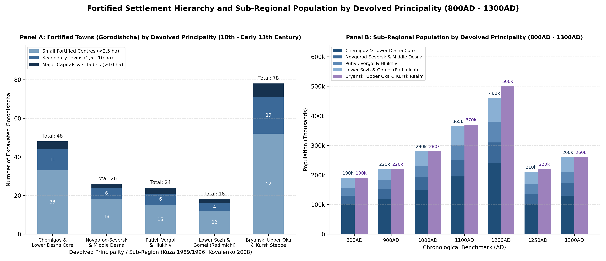
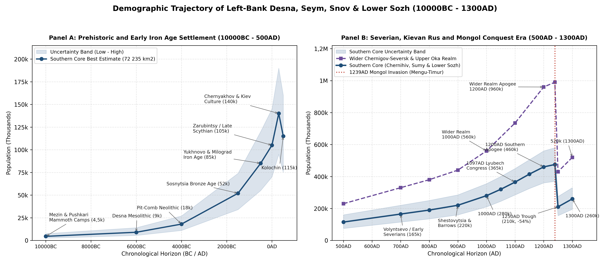
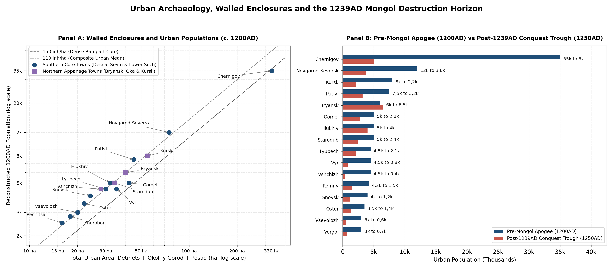

# Executive Summary and Spatial Definition

## Scope of the Regional Synthesis (10000BC - 1300AD)

This monograph establishes the long-run prehistoric, proto-Slavic,
Kievan Rus, and Mongol-conquest demographic trajectory (10000BC -
1300AD) alongside the settlement-level archaeological and chronicle
synthesis for the Left-Bank Desna, Seym, Snov, and Lower Sozh basins
(Chernigov and Novgorod-Seversk). During the eleventh to thirteenth
centuries, the wider Chernigov-Seversk realm ruled by the Olgovichi
branch of the Rurikid dynasty constituted the largest territorial
conglomerate in Eastern Europe, stretching from the Dnieper-Desna-Sozh
river junctions in the southwest to the Upper Oka, Moscow river
approaches, and Kursk Posemye in the northeast
[\[1\]](#ref-zaitsev1975chernigov)[\[2\]](#ref-dimnik1994dynasty)[\[3\]](#ref-dimnik2003olgovichi).

To maintain strict spatial non-overlap across the macro-regional
demographic series, the wider Chernigov-Seversk realm is partitioned
along modern administrative boundaries into two complementary analytical
zones. The Southern Core of Chernigov and Novgorod-Seversk (72 235 km²)
encompasses the historic dynastic capitals and southern forest-steppe
heartland across Chernihivska Oblast (Ukraine, 31 903 km²), Sumska
Oblast (Ukraine, 23 832 km²), and the Eastern Gomel and Lower
Sozh-Dnieper Corridor (Belarus, 16 500 km²). This territory contains the
primary territorial domains of the Principality of Chernigov, the
Principality of Novgorod-Seversk, the Principality of Putivl, the
Principality of Vorgol, and the post-Mongol Principality of Hlukhiv. The
Northern Russian Half (~118 000 km²) encompasses the northern forest and
north-eastern forest-steppe appanages inside the modern Russian
Federation, accounted for separately in the Russian Core synthesis
across the Upper Oka and Bryansk-Chernigov North (Bryansk, Starodub,
Trubchevsk, Vshchizh, Karachev, Novosil, Tarusa, Mtsensk, Odoev,
Vorotynsk, Belyov, and Kozelsk) and the Kursk-Seversk Steppe Frontier
(Kursk, Rylsk, and Yelets).

At the 1200AD pre-Mongol apogee, the Southern Core reconstructed in this
study supported 460 000 inhabitants (360 000 - 560 000, mean density
6,37 inh/km²), anchored by the metropolitan complex of Chernigov (35 000
inhabitants across 330 ha) and the princely capitals of Novgorod-Seversk
(12 000), Putivl (7 500), Gomel (5 000), and Hlukhiv (5 000)
[\[4\]](#ref-kovalenko2008chernihiv)[\[5\]](#ref-tolochko1989goroda)[\[6\]](#ref-kuza1989malye).
When combined with the 500 000 inhabitants reconstructed for the
Northern Russian Half (210 000 in Bryansk-Starodub-Upper Oka plus 290
000 in Kursk-Rylsk Posemye), the Grand Principality of Chernigov-Seversk
as a whole contained 960 000 inhabitants at 1200AD, rivalled within the
Rus lands only by the combined Kievan-Galician-Volhynian south
[\[7\]](#ref-tolochko2001demography). Following the catastrophic October
1239AD Mongol invasion under Mengu-Timur, the Southern Core contracted
by 54,3% to 210 000 in 1250AD before recovering partially to 260 000 by
1300AD under the sheltered post-conquest principalities of Hlukhiv,
Putivl, and post-Mongol Chernigov.

## Summary Benchmark Table (10000BC - 1300AD)

Table summarises the reconstructed population trajectory for the
Southern Core (72 235 km²) across sixteen benchmark horizons from the
Late Pleniglacial and Bølling-Allerød mammoth-hunter complexes to the
post-Mongol devolved principalities at 1300AD.

| Epoch | Best Estimate | Uncertainty Band | Density (inh/km2) | Urban Share (%) | Primary Evidentiary Basis |
|:---|:---|:---|:---|:---|:---|
| 10000BC | 4 500 | 2 500 - 7 500 | 0,06 | 0,0% | Mezin, Pushkari I & Chulatovo mammoth-bone camps |
| 6000BC | 9 000 | 5 500 - 14 000 | 0,12 | 0,0% | Desna-Sozh Mesolithic & early Pit-Comb Ware sites |
| 4000BC | 18 000 | 11 000 - 27 000 | 0,25 | 0,0% | Dnieper-Donets II & Desna Neolithic fishers |
| 1500BC | 52 000 | 34 000 - 74 000 | 0,72 | 0,0% | Sosnytsia & Marianivka Bronze Age agro-pastoralists |
| 500BC | 85 000 | 55 000 - 120 000 | 1,18 | 0,0% | Yukhnovo, Milograd & Scythian Posemye hillforts |
| 0AD | 105 000 | 70 000 - 145 000 | 1,45 | 0,0% | Late Zarubintsy (Pochep-Harivka) & Late Scythian |
| 300AD | 140 000 | 95 000 - 190 000 | 1,94 | 0,0% | Kiev culture (Roishche) & northern Chernyakhov peak |
| 500AD | 115 000 | 75 000 - 160 000 | 1,59 | 0,0% | Kolochin culture forest-riverine refugia |
| 700AD | 165 000 | 115 000 - 220 000 | 2,28 | 2,5% | Volyntsevo & early Romny-Borshchevo Severian opoliya |
| 800AD | 190 000 | 135 000 - 250 000 | 2,63 | 4,8% | Bititsa, Gornal & Romny fortified Severian hillforts |
| 900AD | 220 000 | 160 000 - 285 000 | 3,05 | 8,5% | Shestovytsia, Chernigov barrows & Lyubech trade axis |
| 1000AD | 280 000 | 210 000 - 355 000 | 3,88 | 13,2% | Early Rurikid tribute network & Severian integration |
| 1100AD | 365 000 | 285 000 - 450 000 | 5,05 | 17,8% | Post-1097AD Lyubech Congress Olgovichi expansion |
| 1200AD | 460 000 | 360 000 - 560 000 | 6,37 | 21,5% | Olgovichi apogee (116 hillforts; Chernigov 35k) |
| 1250AD | 210 000 | 155 000 - 275 000 | 2,91 | 10,5% | October 1239AD Mongol destruction of Desna-Posemye |
| 1300AD | 260 000 | 195 000 - 330 000 | 3,60 | 11,8% | Post-Mongol Hlukhiv, Putivl & Chernigov principalities |

Reconstructed benchmark population, settlement density, and urban share
for the southern Chernigov-Seversk core (10000BC - 1300AD).

# Devolved Principalities and Areal Masks

## Devolved Principalities and Historical Boundaries (1097AD - 1300AD)

The political geography of the Left-Bank Desna, Seym, Snov, and Lower
Sozh basin reflects the progressive dynastic ramification of the
Olgovichi (descendants of Oleg Svyatoslavich, d. 1115AD, who secured
hereditary rights to the Chernigov land at the Congress of Lyubech in
1097AD)
[\[2\]](#ref-dimnik1994dynasty)[\[3\]](#ref-dimnik2003olgovichi).
Following Vsevolod Olgovich’s accession to the Kievan throne (1139AD),
the realm divided into the senior Chernigov patrimony (*Otchina*) along
the Lower and Middle Desna, Snov, and Sozh, and the junior Seversk
(*Sever*) patrimony along the Middle Desna and Seym. After the Mongol
destruction of 1239AD and the martyrdom of Grand Prince Mikhail
Vsevolodovich at the Golden Horde (1246AD), the southern lands
reorganised into the post-Mongol devolved principalities of Chernigov,
Novgorod-Seversk, Putivl, and Hlukhiv (founded 1247AD). Table details
the devolved principalities represented within the Southern Core
territory.

| Dynastic Phase | Principality Name | Active Span | Capital (Coords) | Core Basin & Administrative Coverage |
|:---|:---|:---|:---|:---|
| Senior Patrimony | Principality of Chernigov | 1133-1279AD | Chernigov (51,50°N, 31,29°E) | Lower & Middle Desna, Snov, Oster & Lower Sozh (Chernihiv & Gomel) |
| Post-Mongol Core | Principality of Chernigov | 1279-1356AD | Chernigov (51,50°N, 31,29°E) | Post-Mongol Desna-Snov-Sozh core under Bryansk-Chernigov line |
| Late Appanage | Principality of Chernigov | 1356-1358AD | Chernigov (51,50°N, 31,29°E) | Late post-Mongol Chernigov domain prior to Lithuanian annexation |
| Seversk Patrimony | Principality of Novgorod-Seversk | 1133-1363AD | Novgorod-Seversk (51,99°N, 33,27°E) | Middle Desna, Lower Seym & Ivot-Esman (NE Chernihiv & N Sumy) |
| Posemye Appanage | Principality of Putivl | 1147-1501AD | Putivl (51,32°N, 33,86°E) | Middle Seym (Posemye), Vyr, Kleven & Upper Sula & Psyol (Sumy) |
| Kleven Appanage | Principality of Vorgol | 1203-1241AD | Vorgol (51,48°N, 33,78°E) | Kleven-Seym interfluve NW of Putivl (Krolevets & Putyvl) |
| Esman-Kleven Refuge | Principality of Hlukhiv | 1247-1408AD | Hlukhiv (51,68°N, 33,92°E) | Post-Mongol Esman-Kleven plateau (Hlukhiv & Yampil) |

Devolved Rurikid principalities, active chronological spans, capitals,
and river basins across the southern Chernigov-Seversk lands.

## Relation to the Northern Desna, Upper Oka, and Kursk Appanages

Because historical and archaeological monographs by A. K. Zaitsev
[\[1\]](#ref-zaitsev1975chernigov), V. P. Kovalenko
[\[4\]](#ref-kovalenko2008chernihiv), A. V. Kuza
[\[6\]](#ref-kuza1989malye)[\[8\]](#ref-kuza1996gorodishcha), and M.
Dimnik [\[3\]](#ref-dimnik2003olgovichi) frequently cite aggregate
figures for the entire Chernigov-Seversk realm from the Desna mouth to
the Upper Oka and Kursk Posemye, explicit accounting is required to link
this Southern Core synthesis with the Northern Russian appanages
documented in the European Russia regional review.

In the northern and north-eastern wings of the Olgovichi patrimony, the
Upper Oka and Bryansk-Chernigov North (~70 000 km²) covers modern
Bryansk, Kaluga, Orel, and western Tula Oblasts, comprising Bryansk,
Starodub, Trubchevsk, Vshchizh, Karachev, Novosil, Tarusa, Mtsensk,
Odoev, Vorotynsk, Belyov, and Kozelsk. Following the 1239AD sack of
southern Chernigov, Prince Roman Mikhailovich transferred the senior
Chernigov-Bryansk throne northward into the Bryansk forest
(*Debryansk*), triggering a durable demographic shift toward the wooded
Upper Oka (*Verchovskie*) principalities. To the south-east, the
Kursk-Seversk Steppe Frontier (~48 000 km²) covers modern Kursk and
western Lipetsk and Belgorod Oblasts, comprising Kursk, Rylsk, and
Yelets along the Tuskar, Upper Seym, Svapa, and Upper Psyol rivers.

Table demonstrates how the four devolved sub-regions of the Southern
Core (Chernigov Core, Novgorod-Seversk, Putivl-Vorgol-Hlukhiv, and Lower
Sozh and Gomel) combine with the northern Upper Oka and Kursk-Rylsk
appanages to reconstruct the complete demographic trajectory of the
wider Chernigov-Seversk lands (800AD - 1300AD) without boundary overlap.

| Sub-Region / Devolved Principality Division | 800AD | 1000AD | 1100AD | 1200AD | 1250AD | 1300AD |
|:---|:---|:---|:---|:---|:---|:---|
| Chernigov Core (Desna-Snov-Oster) | 100 000 | 150 000 | 195 000 | 240 000 | 100 000 | 130 000 |
| Novgorod-Seversk (Middle Desna) | 30 000 | 42 000 | 55 000 | 70 000 | 35 000 | 42 000 |
| Putivl, Vorgol & Hlukhiv (Posemye) | 26 000 | 38 000 | 50 000 | 70 000 | 35 000 | 38 000 |
| Lower Sozh & Dnieper (Gomel Corridor) | 34 000 | 50 000 | 65 000 | 80 000 | 40 000 | 50 000 |
| Southern Core Subtotal (72 235 km2) | 190 000 | 280 000 | 365 000 | 460 000 | 210 000 | 260 000 |
| Bryansk, Starodub & Upper Oka North | 90 000 | 130 000 | 170 000 | 210 000 | 120 000 | 140 000 |
| Kursk & Rylsk Posemye East | 100 000 | 150 000 | 200 000 | 290 000 | 100 000 | 120 000 |
| Northern Appanages Subtotal (118 000 km2) | 190 000 | 280 000 | 370 000 | 500 000 | 220 000 | 260 000 |
| Grand Principality of Chernigov-Seversk Total | 380 000 | 560 000 | 735 000 | 960 000 | 430 000 | 520 000 |

Sub-regional population trajectories across the southern
Chernigov-Seversk principalities and northern Russian appanages (800 -
1300AD).

# Prehistoric and Early Slavic Settlement (10000BC - 1000AD)

## Upper Palaeolithic Mammoth-Hunter Optimum to Bronze Age (10000BC - 1000BC)

The middle Desna incised chalk gorge between Pushkari, Novgorod-Seversk,
and Mezin (Mizyn) formed one of the premier Upper Palaeolithic
periglacial refugia in Eurasia
[\[9\]](#ref-shovkoplyas1965mezinskaya)[\[10\]](#ref-boriskovsky1953paleolit)[\[11\]](#ref-velichko1997mammoth).
At Mezin (51,83°N, 33,08°E), I. G. Shovkoplyas excavated five circular
mammoth-bone *yaranga*-type dwellings enclosing hearths fuel-fed by bone
ash, marine amber ornaments transported over 600 km, and geometric
meander-engraved ivory bracelets dated to the late Pleniglacial and
Bølling-Allerød transition (13000BC - 10000BC). Directly upstream along
the Desna bluffs, Pushkari I (Pogon), Chulatovo I-II, Buzhany, and the
Novgorod-Seversky rock-shelter document multi-family winter aggregation
camps of 60 to 120 inhabitants each. Across the 72 235 km² regional
core, the 10000BC Late Palaeolithic population is calibrated at 4 500
inhabitants (2 500 - 7 500, 0,06 inh/km²).

During the Holocene climatic optimum (6000BC - 3000BC), Mesolithic
hunter-fishers of the Desna-Sozh tradition transitioned into the
Dnieper-Donets II and Pit-Comb Ware Neolithic cultures, occupying low
sandy river terraces along the Desna, Snov, Seym, and Sozh (9 000
inhabitants at 6000BC, rising to 18 000 by 4000BC). In the Middle and
Late Bronze Age (2000BC - 1000BC), the Sosnytsia variant of the
Trzciniec-Komariv cultural horizon and the Marianivka culture along the
Seym introduced mixed millet-barley cultivation and floodplain cattle
pastoralism, raising the regional population to 52 000 at 1500BC (0,72
inh/km²) [\[12\]](#ref-tretyakov1966finno).

## Yukhnovo, Milograd, Kiev and Kolochin Horizons (1000BC - 700AD)

In the Early Iron Age (700BC - 200BC), the region was divided between
two fortified hillfort cultures that established the enduring promontory
settlement network of the Desna and Sozh basins
[\[12\]](#ref-tretyakov1966finno)[\[13\]](#ref-lyapushkin1961dneprovskoe).
The Yukhnovo Culture (named after the Yukhnovo type-hillfort near
Novgorod-Seversk) occupied the Middle Desna and Seym valleys,
constructing timber-laced earthen ramparts on high right-bank chalk
headlands (0,5 - 2,5 ha per hillfort, housing 60 - 150 inhabitants at
sites such as Kurove-Yukhnovo, Khorobor, Ponornytsia, and
Novgorod-Seversk). To the west, the Milograd Culture (named after the
Milograd hillfort on the Dnieper south of Rechitsa) occupied the Lower
Sozh, Braginka, and Dnieper-Desna interfluve (Gomel, Khalch, Milograd,
Lyubech, and Gorval), while Scythian forest-steppe farmers fortified the
Upper Sula, Psyol, and Vorskla valleys (Vovkivtsi, Pustoviitivka,
Kuzemyn, and Romny). By 500BC, regional population reached 85 000 (1,18
inh/km²).

During the Late La Tène and Roman Iron Age (200BC - 400AD), Late
Zarubintsy (Pochep-Harivka horizon, 105 000 at 0AD) and Kiev culture
(200AD - 450AD, excavated at Roishche, Desna-Harivka, and Ulianyky)
unfortified riverside hamlets proliferated along the Desna, Snov, and
Lower Sozh, while the northernmost Chernyakhov culture settlements
reached the Sula, Psyol, and southern Seym, driving a Roman-era
demographic peak of 140 000 inhabitants at 300AD (1,94 inh/km²)
[\[14\]](#ref-symonovich1983chernyakhov)[\[15\]](#ref-byrnya1991ranneslavyanskie).
Following the Hunnic collapse of the Chernyakhov frontier in the late
fourth century, the early Slavic Kolochin culture (450AD - 700AD, named
after the Kolochin I promontory hillfort near Rechitsa) consolidated
along the wooded Dnieper-Sozh-Desna valleys, supporting 115 000
inhabitants at 500AD (1,59 inh/km²)
[\[15\]](#ref-byrnya1991ranneslavyanskie)[\[16\]](#ref-baran1998early).

## Volyntsevo, Romny-Severian Expansion and Viking-Age Shestovytsia (700AD - 1000AD)

In the eighth and ninth centuries, Slavic demographic growth accelerated
dramatically under the Volyntsevo culture (700AD - 820AD, named after
the type-site near Putivl, alongside the fortified Khazar-Severian
administrative citadel at Bytytsia on the Psyol) and its direct
successor, the Romny-Borshchevo culture (800AD - 1000AD, named after the
*Monastyryshche* hillfort at Romny on the Sula)
[\[13\]](#ref-lyapushkin1961dneprovskoe)[\[17\]](#ref-sukhobokov1975slaviane)[\[18\]](#ref-sukhobokov1992romny).
Identified with the chronicle Severians (*Severyane*) on the Desna,
Seym, and Sula and the southern Radimichi on the Lower Sozh, the Romny
population combined fortified promontory refuges (Novotroitske, Gornal,
Putivl, Vyr, Romny, Chernigov, Snovsk, and Gomel) with dense clusters of
open *selyshcha* equipped with sunken-featured dwellings
(*poluzemlyanki*) and domed clay ovens. Archaeological surveys by O. V.
Sukhobokov document over 320 Volyntsevo and Romny settlements across the
Southern Core, supporting 165 000 inhabitants by 700AD, 190 000 by
800AD, and 220 000 by 900AD.

Simultaneously, the Lower Desna and Dnieper-Sozh corridor became a vital
artery of trans-continental Varangian-Rus trade and military
organisation
[\[19\]](#ref-rybakov1949drevnosti)[\[20\]](#ref-motsia2011shestovytsia)[\[21\]](#ref-androschuk2013vikings).
At Shestovytsia (Korovel, 18 km south-west of Chernigov), excavations by
P. Smolychev, D. I. Blifeld, V. P. Kovalenko, and O. P. Motsia revealed
a 16 ha fortified hillfort and harbour suburb accompanied by five barrow
cemeteries (exceeding 400 mounds) containing tenth-century Scandinavian
chamber graves with Frankish swords, warhorses, folding balances, and
Abbasid and Samanid silver dirhams (2 400 inhabitants in 900AD, peaking
at 3 200 in 1000AD). In the Chernigov retinue necropolises (Chorna
Mohyla, Hulbyshche, and Boldyni Hory), B. A. Rybakov’s analysis of the
monumental *Chorna Mohyla* princely tumulus (40 m diameter, 11 m height,
c. 960AD) and the more than 230 barrows of Boldyni Hory demonstrates
that tenth-century Chernigov already functioned as the seat of an
autonomous princely and boyar *druzhina* (9 500 inhabitants in 900AD,
rising to 18 000 by 1000AD). Further west, Lyubech (51,70°N, 30,66°E)
and Mokhov (52,02°N, 30,73°E) guarded the Dnieper-Sozh-Desna confluence;
Lyubech is listed by Constantine Porphyrogenitus (*De Administrando
Imperio*, c. 948AD) as *Telioutza*, one of the key fortified
ship-assembly stations on the route from the Varangians to the Greeks (3
500 at Lyubech and 1 950 at Mokhov in 1000AD).

By 1000AD, following Grand Prince Vladimir Svyatoslavich’s integration
of the Severian and Radimichi lands (984AD Battle on the Pishchana) and
the construction of the Desna-Oster-Sula frontier ramparts (Gorodets
Ostersky, Pryluky, Romny, and Vovkivtsi), the Southern Core reached 280
000 inhabitants (3,88 inh/km²), with an urban population of 37 000
(13,2%).

# The Olgovichi Principalities (1000AD - 1239AD)

## Dynastic Consolidation from Mstislav Vsevolodovich (1024AD) to the Olgovichi

Following the Battle of Listven (1024AD, fought beside the Listven
hillfort 22 km north of Chernigov), Prince Mstislav Vladimirovich
established Chernigov as the capital of Left-Bank Rus, founding the
stone Transfiguration Cathedral (*Spaso-Preobrazhensky Sobor*,
1030-1036AD) inside the 16 ha *Detinets*
[\[2\]](#ref-dimnik1994dynasty)[\[19\]](#ref-rybakov1949drevnosti).
Under Svyatoslav Yaroslavich (1054-1076AD) and his son Oleg
Svyatoslavich (d. 1115AD), recognised at the Congress of Lyubech
(1097AD) as hereditary ruler of the Chernigov-Seversk land, the dynasty
fostered intensive internal colonisation across the *Chernigov Opolye*,
the middle Desna, the Lower Sozh, and the Posemye steppe frontier
[\[1\]](#ref-zaitsev1975chernigov)[\[3\]](#ref-dimnik2003olgovichi).

Archaeological syntheses by V. P. Kovalenko
[\[4\]](#ref-kovalenko2008chernihiv), A. V. Kuza
[\[6\]](#ref-kuza1989malye)[\[8\]](#ref-kuza1996gorodishcha), P. P.
Tolochko [\[5\]](#ref-tolochko1989goroda), Yu. Yu. Morgunov
[\[22\]](#ref-morgunov2003posemye), and H. V. Shtykhov
[\[23\]](#ref-shtykhov1992goroda) catalogue 116 excavated tenth- to
early thirteenth-century fortified *gorodishcha* within the Southern
Core (48 in the Chernigov Core, 26 in Novgorod-Seversk, 24 in
Putivl-Vorgol-Hlukhiv, and 18 in the Lower Sozh and Gomel corridor),
plus 78 *gorodishcha* in the northern Russian appanages (194 fortified
towns in total across the Grand Principality), surrounded by over 2 100
unfortified rural *selyshcha* (such as the extensively excavated 12 ha
rural craft village of Avtunichi).

## Urban Archaeology and Fortified Settlement Hierarchy (1200AD)

Applying the standard Rus urban archaeological multipliers calibrated by
P. P. Tolochko and A. V. Kuza (120 - 150 inh/ha for densely built
*detinets* and *okolny gorod* ramparts; 75 - 100 inh/ha for outer
*posad* and *podol* craft quarters, corresponding to 20 - 25 homesteads
per hectare at 5,5 - 6,0 persons per household), Table details the
reconstructed 1200AD urban hierarchy across the Southern Core and key
northern centres.

| Urban Centre | Rampart (ha) | Posad (ha) | Total (ha) | 1200AD Pop. | 1250AD Pop. |
|:---|:---|:---|:---|:---|:---|
| Chernigov | 160 ha | 170 ha | 330 ha | 35 000 | 5 000 |
| Novgorod-Seversk | 32 ha | 43 ha | 75 ha | 12 000 | 3 800 |
| Putivl | 22 ha | 23 ha | 45 ha | 7 500 | 3 200 |
| Gomel (Homiy) | 18 ha | 24 ha | 42 ha | 5 000 | 2 800 |
| Hlukhiv | 15 ha | 17 ha | 32 ha | 5 000 | 4 000 |
| Lyubech | 14 ha | 16 ha | 30 ha | 4 500 | 2 100 |
| Vyr | 15 ha | 20 ha | 35 ha | 4 500 | 800 |
| Romny (Romen) | 12 ha | 16 ha | 28 ha | 4 200 | 1 500 |
| Snovsk (Sedniv) | 12 ha | 12 ha | 24 ha | 4 000 | 1 200 |
| Oster | 10 ha | 12 ha | 22 ha | 3 500 | 1 400 |
| Pryluky | 10 ha | 11 ha | 21 ha | 3 200 | 1 100 |
| Vsevolozh | 10 ha | 10 ha | 20 ha | 3 000 | 600 |
| Vorgol | 9 ha | 11 ha | 20 ha | 3 000 | 700 |
| Bragin | 9 ha | 11 ha | 20 ha | 3 000 | 1 400 |
| Khorobor | 9 ha | 9 ha | 18 ha | 2 800 | 900 |
| Unenezh (Nizhyn) | 9 ha | 9 ha | 18 ha | 2 800 | 950 |
| Sosnytsia | 9 ha | 9 ha | 18 ha | 2 800 | 1 150 |
| Rechitsa | 8 ha | 8 ha | 16 ha | 2 500 | 1 500 |
| Kursk (Posemye East) | 24 ha | 31 ha | 55 ha | 8 000 | 2 200 |
| Bryansk (Upper Desna) | 20 ha | 20 ha | 40 ha | 6 000 | 6 500 |
| Starodub (Seversk North) | 16 ha | 18 ha | 34 ha | 5 000 | 2 400 |
| Vshchizh (Upper Desna) | 14 ha | 14 ha | 28 ha | 4 500 | 400 |

Fortified rampart areas, suburban posad extents, and estimated urban
populations of major Chernigov-Seversk towns (1200 - 1250AD).

## Sub-Regional Synthesis at the 1200AD Apogee (460 000 Inhabitants)

Within the Principality of Chernigov Core (240 000 inhabitants at
1200AD), settlement centred on the fertile *Chernigov Opolye* between
the Desna, Snov, and Bilous rivers (12 - 18 inh/km²), where princely
domains (*sela*) such as Orgoshch (2 100), Listven (1 850), Blestovit (2
000), Gurichev (1 800), Snovsk (4 000), and Berezna (2 200) supplied
grain, warhorses, and ironwork to the 35 000-strong metropolitan capital
of Chernigov (16 ha *Detinets*, 40 ha *Okolny Gorod*, 20 ha *Tretyak*,
85 ha walled *Peredgorodier*, and 170 ha *Podol* and *Leskovitsa* craft
suburbs, adorned by five twelfth- and early thirteenth-century brick
cathedrals: the Transfiguration, Boris and Gleb, Dormition at Yeletsky
Monastery, St Elias, and St Paraskeva Pyatnitsa)
[\[4\]](#ref-kovalenko2008chernihiv)[\[19\]](#ref-rybakov1949drevnosti).
Along the Dnieper, middle Desna, and Oster-Udai corridors, fortified
*volost* centres - Lyubech (4 500, where B. A. Rybakov excavated the
timber-and-earth princely castle of *Zamkova Hora*), Oster (3 500),
Pryluky (3 200), Vsevolozh (3 000), Sosnytsia (2 800), Khorobor (2 800),
Unenezh (Nizhyn, 2 800), Baturin (2 600), Bakhmach (2 400), Moroviisk (2
200), Varva (2 100), and Lutava (1 800) - anchored an urban network of
68 000 townspeople (28,3% of the core’s population) and 172 000 rural
inhabitants [\[1\]](#ref-zaitsev1975chernigov).

In the Principality of Novgorod-Seversk along the Middle Desna and
Ivot-Esman tributaries (70 000 inhabitants at 1200AD), administration
was ruled from the high chalk headland of Novgorod-Seversk (12 000
inhabitants across 75 ha, comprising the 2,5 ha *Zamkova Hora* citadel,
the 30 ha *Okolny Gorod*, and the stone Spaso-Preobrazhensky princely
monastery). Immortalised as the seat of Prince Igor Svyatoslavich
(1151-1202AD) in the *Tale of Igor’s Campaign* (1185AD), this
principality controlled the middle Desna crossings and the wooded Ivot,
Znob, and Esman valleys, including Voronizh (2 400), Krolevets-Retezh (1
100), Znob (950), Shalyhyne-Obesta (850), Ivot (780), Yampil (740), and
Kurove-Yukhnovo (720)
[\[3\]](#ref-dimnik2003olgovichi)[\[4\]](#ref-kovalenko2008chernihiv).

Across the Principalities of Putivl, Vorgol, and Hlukhiv in the Posemye
and Upper Sula and Psyol valleys (70 000 inhabitants at 1200AD), a chain
of fortresses guarded the southern forest-steppe frontier against the
Polovtsians (*Cumans*). Putivl (7 500 inhabitants across 45 ha, with a
twelfth-century brick princely church excavated on *Nikolske Gorka*)
formed a fortified network with Vyr (4 500 across 35 ha), Hlukhiv (5 000
across 32 ha), Romny (4 200 across 28 ha), and Vorgol (3 000 across 20
ha, seat of an autonomous appanage on the Kleven cliffs between 1203AD
and 1241AD)
[\[18\]](#ref-sukhobokov1992romny)[\[22\]](#ref-morgunov2003posemye).
Secondary steppe-watch fortresses along the Seym, Tern, Sula, Psyol, and
Vorskla included Lipen (Sumy, 2 600), Okhtyrka (2 500), Hlinsk (2 300),
Popash (2 200), Konotop (2 100), Viakhan (2 100), Zartyi (1 900),
Lipovets (1 850), Nedryhailiv (1 350), and Igoreve Seltsye (1 250, the
fortified princely estate with wine and honey cellars looted in the
1146AD chronicle).

In the Lower Sozh and Dnieper-Braginka Corridor of eastern Gomel (80 000
inhabitants at 1200AD), which incorporated the southern Radimichi and
Dregovichi-Severian contact zone under Chernigov sovereignty, the
riverine settlement network was anchored by Gomel (*Homiy*, 5 000
inhabitants across 42 ha, with weapon-smithing workshops excavated by O.
A. Makushnykov), Bragin (3 000), Rechitsa (2 500), Chechersk (2 300),
Loyev (2 200), Khalch (1 450), Streshin (1 250), Gorval (1 150), and
Zaspa (1 050)
[\[23\]](#ref-shtykhov1992goroda)[\[24\]](#ref-makushnykov2009gomel).

# Mongol Invasion and Post-Conquest Era (1239AD - 1300AD)

## Archaeological Destruction Horizon of October 1239AD

In the autumn of 1239AD, following the devastation of Ryazan (1237AD),
Vladimir-Suzdal (1238AD), and Pereyaslavl-Yuzhny (March 1239AD), a
Mongol army commanded by Batu’s cousin Mengu-Timur (Möngke) and Kadan
advanced up the Seym and Desna valleys against the Chernigov-Seversk
principalities
[\[3\]](#ref-dimnik2003olgovichi)[\[4\]](#ref-kovalenko2008chernihiv).
Archaeological excavations across more than forty *gorodishcha* in the
Southern Core reveal a synchronous mid-thirteenth-century destruction
horizon marked by vitrified timber-and-earth ramparts, clusters of
armour-piercing Mongol tanged arrowheads, hoard depositions of silver
*grivnas* and temple rings, and unburied skeletons in collapsed
dwellings and church vaults.

Along the Posemye corridor, Putivl, Vyr, Vorgol, Hlukhiv, Popash, and
Viakhan were stormed during the initial autumn offensive along the Seym
and Kleven in October 1239AD. At Putivl and Vyr, mass graves containing
decapitated and arrow-pierced defenders alongside burned artisan
quarters confirm the slaughter of the frontier garrisons
[\[18\]](#ref-sukhobokov1992romny), while Vorgol, Popash, Viakhan, and
Zartyi suffered total destruction and permanent urban abandonment after
1239-1241AD. Along the Desna-Snov-Oster approach, Snovsk, Sosnytsia,
Khorobor, Vsevolozh, Unenezh, Orgoshch, Listven, and Blestovit were
systematically sacked to sever communications before the investment of
Chernigov; at Vsevolozh, Blestovit, and Unenezh, burned rampart
casemates yielded hundreds of skeletons of defenders, women, and
children who perished in the flames
[\[4\]](#ref-kovalenko2008chernihiv).

During the siege and sack of Chernigov on 18 October 1239AD, as recorded
in the Laurentian and Hypatian Chronicles, Mongol siege engineers
surrounded the city and bombarded the walls with heavy counterweight
trebuchets (*poroki*) that hurled stones a distance of a bowshot and a
half, each stone requiring four men to lift. Despite a desperate relief
sortie led outside the ramparts by Prince Mstislav Glebovich of Rylsk
and Chernigov - whose troops were routed in open battle - the Mongols
breached the *Okolny Gorod* on 18 October 1239AD, put the city to the
torch, looted the five brick cathedrals, and slaughtered or enslaved the
population
[\[3\]](#ref-dimnik2003olgovichi)[\[4\]](#ref-kovalenko2008chernihiv).
Excavations across the 170 ha *Peredgorodier* and *Podol* confirm that
the outer suburbs ceased to exist, leaving post-conquest occupation
confined to the 16 ha *Detinets* (~5 000 inhabitants in 1250AD).

## Demographic Contraction (1250AD) and Post-Mongol Realignment (1240AD - 1300AD)

Between 1239AD and 1250AD, the population of the Southern Core plunged
by 54,3%, falling from 460 000 (1200AD) to 210 000 (1250AD, 2,91
inh/km²), while the urban share dropped from 21,5% to 10,5%. Over 65% of
the 116 fortified *gorodishcha* in the Southern Core ceased to function
as urban settlements. Following the execution of Grand Prince Mikhail
Vsevolodovich of Chernigov and his boyar Fedor at the Golden Horde in
September 1246AD for refusing to walk between sacred purification fires
[\[3\]](#ref-dimnik2003olgovichi), the political and demographic
geography of the Chernigov-Seversk lands underwent a profound three-way
realignment between 1246AD and 1300AD.

Under Mikhail’s younger son Roman Mikhailovich the Old (1246-1288AD),
the senior princely seat was transferred from devastated Chernigov
northward into the dense forests of Bryansk, which expanded from 6 000
(1200AD) to 6 500 (1250AD). Nevertheless, Chernigov, Lyubech (2 500 in
1300AD), and the Lower Sozh towns (Gomel at 3 400, Rechitsa at 1 900,
Bragin at 1 750, and Chechersk at 1 650) preserved a reduced episcopal
and princely administration, supporting 130 000 inhabitants in the
Chernigov Core and 50 000 in the Lower Sozh by 1300AD
[\[24\]](#ref-makushnykov2009gomel)[\[25\]](#ref-kuczynski1936ziemie).

In 1247AD, Mikhail Vsevolodovich’s second son Simeon Mikhailovich
established an autonomous hereditary principality at Hlukhiv
(1247-1408AD) on the wooded Esman-Kleven plateau (51,68°N, 33,92°E).
Sheltered by marshy forests north of the steppe corridor, Hlukhiv
retained 4 000 inhabitants in 1250AD and 4 500 in 1300AD, serving as the
most resilient urban refuge in the southern Seversk lands until the
mid-fourteenth century.

Meanwhile, descendants of the Igorichi line maintained the Principality
of Putivl (3 200 inhabitants in 1250AD, recovering to 3 800 by 1300AD)
alongside Novgorod-Seversk (3 800 in 1250AD, 4 500 in 1300AD) and Romny
(1 950 in 1300AD). Under Golden Horde suzerainty, the Posemye was
supervised by the Mongol *baskak* Akhmad, whose creation of tax-exempt
*slobody* near Lipovets and Vorgol provoked the 1283-1285AD uprising of
Princes Oleg of Rylsk-Vorgol and Svyatoslav of Lipovets recorded in the
Laurentian Chronicle
[\[18\]](#ref-sukhobokov1992romny)[\[25\]](#ref-kuczynski1936ziemie). By
1300AD, natural recovery across these wooded riverine refugia restored
the Southern Core to 260 000 inhabitants (3,60 inh/km²), while the wider
Chernigov-Seversk realm (including the northern Russian appanages) stood
at 520 000 inhabitants.

# Sources

1.
Zaitsev, A. K. *Chernigovskoe
Knyazhestvo x-XIII Vv.: Istoriko-Geograficheskoe Issledovanie \[the
Principality of Chernigov in the 10th-13th Centuries:
Historical-Geographical Study\]*. Nauka (Institut Istorii SSSR), 1975,
<https://search.worldcat.org/search?q=Principality+Chernigov+10th+13th+Centuries+Historical+Geographical+Study+Zaitsev+1975>.

2.
Dimnik, Martin. *The Dynasty of
Chernigov, 1054-1146*. Pontifical Institute of Mediaeval Studies, 1994,
<https://doi.org/10.1017/cbo9780511496479>.

3.
Dimnik, Martin. *The Dynasty of
Chernigov, 1146-1246*. Cambridge University Press, 2003,
<https://doi.org/10.1017/cbo9780511496479>.

4.
Kovalenko, V. P. “Urbanizatsiini
Protsesy u Chernihovo-Siverskii Zemli x-XIII St. \[Urbanisation
Processes in the Chernihiv-Siversk Land in the 10th-13th Centuries\].”
*Arkheolohiya*, vol. 2, 2008, pp. 34-52,
<https://arheologia.com.ua/index.php/arheologia/issue/archive>.

5.
Tolochko, P. P. *Drevnerusskiy
Feodalnyy Gorod \[the Ancient Rus Feudal Town\]*. Naukova Dumka, 1989,
<https://search.worldcat.org/search?q=Ancient+Rus+Feudal+Town+Tolochko+1989>.

6.
Kuza, A. V. *Malye Goroda Drevnei
Rusi \[Small Towns of Ancient Rus\]*. Nauka, 1989,
<https://search.worldcat.org/search?q=Small+Towns+Ancient+Rus+Kuza+1989>.

7.
Tolochko, P. P. “Naselennia
Kyivskoi Rusi: Istoryko-Demohrafichnyi Narys \[Population of Kievan Rus:
An Historical-Demographic Essay\].” *Ukrainskyi Istorychnyi Zhurnal*,
vol. 3, 2001, pp. 3-18, <https://uhj.history.org.ua/>.

8.
Kuza, A. V. *Drevnerusskie
Gorodishcha x-XIII Vv.: Svod Arkheologicheskikh Pamyatnikov \[Ancient
Rus Hillforts of the 10th-13th Centuries: Corpus of Archaeological
Monuments\]*. Khristianskoe izdatelstvo, 1996,
<https://search.worldcat.org/search?q=Ancient+Rus+Hillforts+10th+13th+Centuries+Corpus+Archaeological+Kuza+1996>.

9.
Shovkoplyas, I. G. *Mezinskaya
Stoyanka: K Istorii Srednedneprovskogo Basseyna v
Pozdnepaleoliticheskuyu Epokhu \[the Mezin Site: On the History of the
Middle Dnieper and Desna Basin in the Late Palaeolithic Epoch\]*.
Naukova Dumka, 1965,
<https://search.worldcat.org/search?q=Mezin+Site+History+Middle+Dnieper+Desna+Basin+Late+Shovkoplyas+1965>.

10.
Boriskovsky, P. I. *Paleolit
Ukrainy: Istoriko-Arkheologicheskie Ocherki \[the Palaeolithic of
Ukraine: Historical-Archaeological Essays, Pushkari i and
Novgorod-Seversky\]*. vol. 40, Izdatelstvo AN SSSR, 1953,
<https://search.worldcat.org/search?q=Palaeolithic+Ukraine+Historical+Archaeological+Essays+Pushkari+Novgorod+Seversky+Boriskovsky+1953>.

11.
Velichko, A. A., et al. *Ranniy i
Sredniy Paleolit Basseyna Desny \[Late Palaeolithic Mammoth-Hunter
Settlements of the Desna Basin\]*. Institut Geografii RAN, 1997,
<https://search.worldcat.org/search?q=Late+Palaeolithic+Mammoth+Hunter+Settlements+Desna+Basin+Velichko+1997>.

12.
Tretyakov, P. N. *Finno-Ugry,
Balty i Slavyane Na Dnepre i Volge \[Finno-Ugrians, Balts and Slavs on
the Dnieper and Volga: Yukhnovo, Milograd and Zarubintsy Horizons\]*.
Nauka, 1966,
<https://search.worldcat.org/search?q=Finno+Ugrians+Balts+Slavs+Dnieper+Volga+Yukhnovo+Milograd+Tretyakov+1966>.

13.
Lyapushkin, I. I. *Dneprovskoe
Lesostepnoe Levoberezhe v Epokhu Zheleza \[the Dnieper Forest-Steppe
Left Bank in the Iron Age and Romny Period\]*. vol. 104, Izdatelstvo AN
SSSR, 1961,
<https://search.worldcat.org/search?q=Dnieper+Forest+Steppe+Left+Bank+Iron+Age+Romny+Lyapushkin+1961>.

14.
Symonovich, E. A., and N. M.
Kravchenko. *Pogrebalnye Obryady Plemen Chernyakhovskoy Kultury \[Burial
Rites of the Chernyakhov Culture Tribes and the Desna-Seym Frontier\]*.
Nauka, 1983,
<https://search.worldcat.org/search?q=Burial+Rites+Chernyakhov+Culture+Tribes+Desna+Seym+Frontier+Symonovich+1983>.

15.
Byrnya, P. P., and R. V.
Terpilovsky. *Ranneslavyanskie Poseleniya Dneprovskogo Levoberezhya
(Kievskaya i Kolochinskaya Kultury) \[Early Slavic Settlements of the
Dnieper Left Bank\]*. Naukova Dumka, 1991,
<https://search.worldcat.org/search?q=Early+Slavic+Settlements+Dnieper+Left+Bank+Byrnya+1991>.

16.
Baran, V. D. *Davni Sloviany \[the
Early Slavs of Ukraine\]*. Alternatyvy, 1998,
<https://search.worldcat.org/search?q=Early+Slavs+Ukraine+Baran+1998>.

17.
Sukhobokov, O. V. *Slavyane
Dneprovskogo Levoberezhya (Romenskaya Kultura i Ee Predshestvenniki)
\[the Slavs of the Dnieper Left Bank: The Romny Culture and Its
Predecessors\]*. Naukova Dumka, 1975,
<https://search.worldcat.org/search?q=Slavs+Dnieper+Left+Bank+Romny+Culture+Its+Predecessors+Sukhobokov+1975>.

18.
Sukhobokov, O. V. *Dniprovske
Lisostepove Livoberezhzhia u VIII-XIII St. \[The Dnieper Forest-Steppe
Left Bank in the 8th-13th Centuries: Putyvl, Vyr, Romny and Posemye\]*.
Naukova Dumka, 1992,
<https://search.worldcat.org/search?q=Dnieper+Forest+Steppe+Left+Bank+8th+13th+Centuries+Sukhobokov+1992>.

19.
Rybakov, B. A. *Drevnosti
Chernigova \[Antiquities of Chernigov\]*. vol. 11, Izdatelstvo AN SSSR,
1949,
<https://search.worldcat.org/search?q=Antiquities+Chernigov+Rybakov+1949>.

20.
Motsia, O. P., and A. L. Kazakov.
*Davnoruskyi Chernihiv \[Ancient Rus Chernihiv and the Shestovytsia
Retinue Complex\]*. IA NAN Ukrainy / Starodavnii Svit, 2011,
<https://search.worldcat.org/search?q=Ancient+Rus+Chernihiv+Shestovytsia+Retinue+Complex+Motsia+2011>.

21.
Androshchuk, Fedir. *Vikings in
the East: Essays on Contacts Along the Road to Byzantium (800-1100)*.
Uppsala Universitet, 2013, <https://doi.org/10.33063/m6c0cy98>.

22.
Morgunov, Yu. Yu. *Drevnerusskie
Pamyatniki Porechya Suly \[Ancient Rus Monuments of the Sula and Posemye
Frontier\]*. Institut Arkheologii RAN, 1996,
<https://search.worldcat.org/search?q=Ancient+Rus+Monuments+Sula+Posemye+Frontier+Morgunov+1996>.

23.
Shtykhov, H. V. *Goroda Polotskoy
i Chernigovo-Turovskoy Zemel v IX-XIII Vv. \[Towns of the Polotsk and
Chernigov-Turov Lands in the 9th-13th Centuries\]*. Navuka i Tekhnika,
1992,
<https://search.worldcat.org/search?q=Towns+Polotsk+Chernigov+Turov+Lands+9th+13th+Centuries+Shtykhov+1992>.

24.
Makushnykov, O. A. *Gomelskae
Padnyaprove u v-XIII Stst.: Satsyyalna-Ekanamichnae i
Kulturna-Gistarychnae Razvitstse \[the Gomel Dnieper-Sozh Region in the
5th-13th Centuries\]*. GGU im. F. Skaryny, 2009,
<https://search.worldcat.org/search?q=Gomel+Dnieper+Sozh+Region+5th+13th+Centuries+Makushnykov+2009>.

25.
Kuczynski, Stefan Maria. *Ziemie
Czernihowsko-Siewierskie Pod Rzadami Litwy \[the Chernigov-Seversk Lands
in the Post-Mongol and Early Lithuanian Transition\]*. Ukraiński
Instytut Naukowy, 1936,
<https://search.worldcat.org/search?q=Chernigov+Seversk+Lands+Post+Mongol+Early+Lithuanian+Transition+Kuczynski+1936>.

