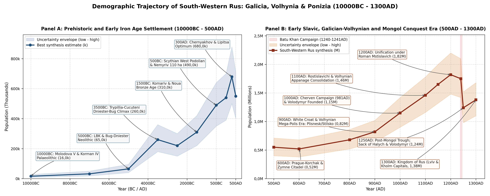
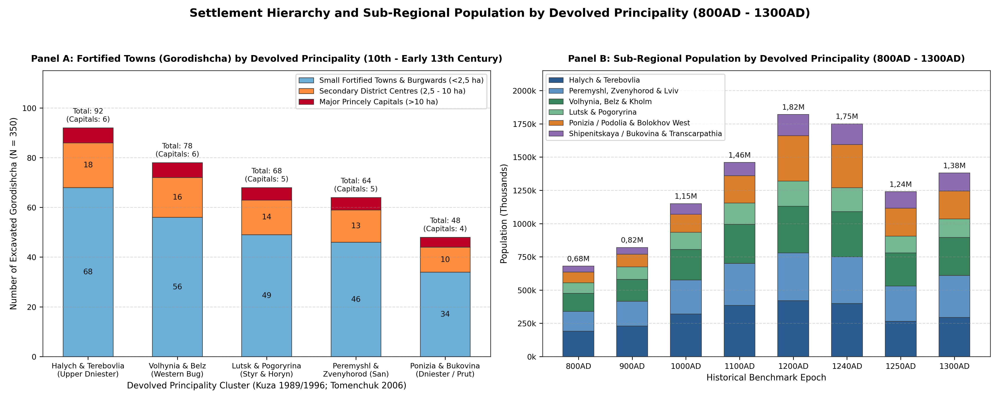
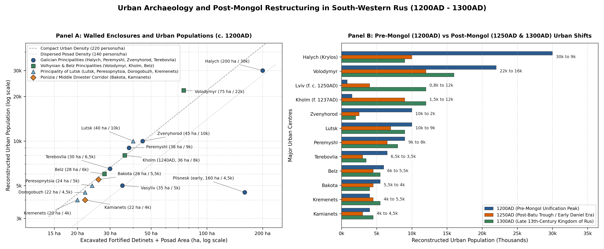

# Executive Summary and Geographic Scope

This literature review establishes the empirical baseline and
settlement-level demographic reconstruction for Galicia and Volhynia in
South-Western Rus, book-ended chronologically from the Upper
Palaeolithic (10000BC) to the Mongol Conquests (1240-1241AD campaign of
Batu Khan across Volhynia and Galicia) and the immediate post-conquest
Romanovichi Kingdom of Galicia-Volhynia (Kingdom of Rus, 1250AD -
1300AD)
[\[1\]](#ref-krypyakevych1984galicia)[\[2\]](#ref-kotlyar1998galician)[\[3\]](#ref-vojtovych2011borders).
Geographically, the region spans nine modern western and right-bank
Ukrainian oblasts (~176 200 km²) across the Upper and Middle Dniester,
Western Bug, San, Styr, Horyn, Upper Pripyat, Upper Prut, and Upper
Tisza river basins. Historically, this territory formed the
south-western march of unified Kievan Rus (981-1133AD) and subsequently
partitioned into the Rostislavichi Galician principalities, the
Monomakhovichi and Romanovichi Volhynian principalities, and the unified
Kingdom of Galicia-Volhynia (1199-1341AD).

The Rostislavichi Galician principalities (49 600 km² across Lvivska,
Ivano-Frankivska, Ternopilska, and the San-Cherven strip) encompassed
the Principality of Peremyshl (1133-1142AD, 49,78°N, 22,77°E), the
Principality of Zvenyhorod (1133-1142AD, 49,73°N, 24,25°E), the
Principality of Terebovlia (1133-1142AD, 49,30°N, 25,69°E), and the
unified Principality of Halych (1133-1200AD, 49,12°N, 24,73°E),
consolidated by Vladimirko Volodarevich (1141-1144AD) and Yaroslav
Osmomysl (1153-1187AD) around the 200 ha metropolitan complex of Halych
(*Krylos*, 30,0k at 1200AD)
[\[4\]](#ref-pasternak1944halych)[\[5\]](#ref-petehyrych2006galicia)[\[6\]](#ref-tomenchuk2006halych).
To the north, the Monomakhovichi and Romanovichi Volhynian
principalities (40 190 km² across Volynska, Rivnenska, and the Left-Bank
Western Bug) encompassed the Principality of Volhynia (1133-1200AD,
50,85°N, 24,32°E) centred on Volodymyr (*Vladimir-Volynsky*, 75 ha,
22,0k at 1200AD) and Daniel’s royal capital at Kholm (*Chelm*, 8,0k in
1240AD and 12,0k in 1300AD), the Principality of Lutsk (1158-1324AD,
50,75°N, 25,33°E) across the Styr, Ikva, and Horyn (*Pogoryrina*) basins
(*Lutsk* 10,0k, *Peresopnytsia* 5,0k, *Dorogobuzh* 4,5k, *Kremenets*
4,0k, *Iziaslavl*), and the Principality of Belz (1171-1367AD, 50,38°N,
24,01°E; *Belz* 6,0k, *Busk* 4,0k)
[\[2\]](#ref-kotlyar1998galician)[\[3\]](#ref-vojtovych2011borders)[\[7\]](#ref-tersky2006lutsk).
To the south and east, Ponizia (Podolia), Shipenitskaya Zemlya,
Transcarpathia, and the southern frontier marches (86 410 km² across
Khmelnytska, Vinnytska, Chernivetska, and Zakarpatska) encompassed the
Middle Dniester canyon of Ponizia (*Bakota* 26 ha, 5,5k; *Kamianets* 22
ha, 4,0k; *Ushitsa*, *Kalius*, *Kuchelmin*), the Western Bolokhov Land
(*Medzhybizh* 4,0k, *Bozhsky*), Shipenitskaya Zemlya in Northern
Bukovina (*Lenkivtsi* or *Chern* on the Prut 3,5k, *Khotyn*),
Subcarpathian Rus (*Uzhhorod* or *Ungvar* 3,5k, *Mukachevo*), and
historical dynastic links to the Pontic-Crimean outposts of Tmutarakan
(988-1100sAD) and Mangup (*Theodoro*, 1204-1300AD)
[\[8\]](#ref-vinokur1997bakota)[\[9\]](#ref-timoshchuk1982bukovina)[\[10\]](#ref-vojtovych2000dynastii).

Across the Holocene and pre-Mongol medieval era, South-Western Rus
experienced four major demographic cycles prior to Batu Khan’s
1240-1241AD campaign: (i) the Trypillia-Cucuteni Dniester-Prut-Bug
Eneolithic climax (c. 3500BC, 260,0k) anchored by *Bilche-Zolote
(Verteba)*, *Koshylivtsi*, *Bodaki*, *Zalishchyky*, and *Stina*
[\[11\]](#ref-videiko2004trypillia); (ii) the Vysotska and Early
Scythian West Podolian hillfort horizon (c. 500BC, 490,0k) centred on
the 110 ha giant rampart hillfort at *Nemyriv*, *Severynivka*, and
*Hryhorivka* [\[12\]](#ref-smirnova1990nemyriv); (iii) the Chernyakhov,
Lipitsa, Przeworsk, and Carpathian Tumuli Culture optimum (c. 300AD,
680,0k)
[\[13\]](#ref-magomedov2001chernyakhov)[\[14\]](#ref-baran1998earlyslavs);
and (iv) the Galician-Volhynian urban and rural apogee (1000AD -
1200AD), when 350 fortified *gorodishcha* and rich sub-Carpathian
salt-boiling centres supported 1,15M in 1000AD, 1,46M in 1100AD, and
1,82M in 1200AD
[\[6\]](#ref-tomenchuk2006halych)[\[15\]](#ref-tolochko2001demography)[\[16\]](#ref-kuza1996gorodishcha).
Following the 1240-1241AD Mongol destruction of Volodymyr, Halych,
Zvenyhorod, Iziaslavl, and Kolodyazhyn, regional population contracted
to a post-conquest trough of 1,24M in 1250AD (-31,9% from 1200AD),
before recovering under King Daniel Romanovich (crowned 1253AD), Lev
Danilovich, and Yuri I Lvovich around the new royal capitals of *Kholm*
and *Lviv* to 1,38M in 1300AD
[\[5\]](#ref-petehyrych2006galicia)[\[17\]](#ref-kotlyar2002chronicle).

# Prehistoric and Iron Age Settlement (10000BC - 500AD)

## Upper Palaeolithic, Neolithic, and Trypillia-Cucuteni Eneolithic (10000BC - 1500BC)

Unlike the glaciated northern forest basins of European Russia, the deep
limestone canyons of the Middle Dniester, Prut, and upper Volhynian
uplands functioned as one of Europe’s primary periglacial refugia
throughout the terminal Pleistocene (10000BC)
[\[18\]](#ref-chernysh1987molodova). Multilayered open-air camp
complexes at Molodova I and Molodova V, Korman IV, Babin I, and
Voronovitsa along the Dniester canyon, together with the Korolevo
sequence on the Tisza in Transcarpathia and Kulychivka (at Kremenets) in
Volhynia, preserve continuous Magdalenian and Epigravettian mammoth- and
reindeer-hunter horizons supporting a 10000BC regional population of
16,0k (16 000, range 8,0k - 28,0k) [\[18\]](#ref-chernysh1987molodova).

During the Early Holocene (6500BC - 4500BC), indigenous Mesolithic
fisher-foragers of the Bug-Dniester Culture (*Soroky*, *Bazkiv Ostriv*,
*Pechera*, and *Sokoltsi* on the Southern Bug) adopted early ceramics
and domesticated plants through interaction with Linearbandkeramik (LBK)
agriculturalists advancing along the Carpathian piedmont into the Upper
Dniester and Western Bug loess terraces (*Nezvysko*, *Torskie*, *Zymne*,
*Kotiv*, and *Rivne*) [\[11\]](#ref-videiko2004trypillia). By 5000BC,
permanent LBK longhouse villages and Bug-Dniester riverine settlements
supported 65,0k (65 000) inhabitants.

Between 4200BC and 3000BC, the Dniester-Prut-Southern Bug plateaus and
southern Volhynian uplands formed the western heartland of the
Trypillia-Cucuteni Culture (Stages BI-BII and CI-CII), with over 800
documented settlements [\[11\]](#ref-videiko2004trypillia). Along the
Upper and Middle Dniester loess terraces, multiphase promontory
settlements and ritual labyrinth caves flourished at Bilche-Zolote
(Verteba Cave, 2,5k), Koshylivtsi-Oboz (2,5k), Zalishchyky (2,2k),
Nezvysko (1,8k), Horodnytsia (1,8k), Buchach (1,6k), and Polivanov Yar
(1,5k) [\[11\]](#ref-videiko2004trypillia). In the Volhynian-Horyn
flint-mining and workshop zone, Late Trypillian (CI-CII) fortified
promontory settlements at Bodaki on the Horyn (2,0k), Zymne, Khoriv, and
Lystvyn mined and exported high-grade Turonian dark flint blades across
the Carpathian-Pontic region [\[11\]](#ref-videiko2004trypillia).
Further east along the Podolian and Southern Bug corridor, large
concentric-plan settlements at Stina (3,0k), Nemyriv (2,2k), and
Klishchiv (2,0k) bridged the Dniester valley and the Bug-Dnieper
mega-site zone.

At the 3500BC Eneolithic benchmark, the regional population reached
260,0k (260 000, range 180,0k - 360,0k). During the Early and Middle
Bronze Age (2500BC - 1200BC), pastoral Corded Ware (*Pidkarpatska
kultura shnurovoi keramiky*), Komariv (centred on *Komariv* near Halych,
exploiting sub-Carpathian salt springs and Transylvanian bronze trade),
and Noua communities expanded across the Carpathian piedmont and
Volhynian forest-steppe, raising regional population to 310,0k (310 000)
at 1500BC [\[6\]](#ref-tomenchuk2006halych).

## Scythian West Podolian Hillforts and the Chernyakhov Optimum (500BC - 500AD)

In the Early Iron Age (700BC - 300BC), the Hallstatt-influenced Vysotska
Culture (Lvivska and Ternopilska oblasts) and the Early Scythian West
Podolian Group along the Middle Dniester and Southern Bug erected
monumental earthen-rampart hillforts [\[12\]](#ref-smirnova1990nemyriv).
The paramount regional stronghold was the Nemyriv Giant Hillfort
(*Nemyrivske horodyshche*, 48,97°N, 28,84°E), enclosed by 9 m-high
ramparts (5,5 km perimeter) encompassing 110 ha, with Milesian and Attic
black-glazed pottery (6th - 5th centuries BC) and an estimated
population of 4,5k (4 500) [\[12\]](#ref-smirnova1990nemyriv). Alongside
sister hillforts at Severynivka (2,5k), Hryhorivka (2,2k), Chornoliska,
and Vysotske, South-Western Rus supported 490,0k (490 000) inhabitants
at 500BC.

During the Roman Imperial period (100AD - 400AD), the Lipitsa
(Dacian-Thracian salt-workers of the Upper Dniester), Przeworsk,
Wielbark (along the Western Bug and Styr), Carpathian Tumuli, and
Zubrytska cultures coalesced in the 3rd - 4th centuries AD into the
provincial-Roman agricultural expansion of the Chernyakhov Culture
[\[13\]](#ref-magomedov2001chernyakhov)[\[14\]](#ref-baran1998earlyslavs).
Excavations at Ripniv II, Lepesivka, Bovshiv, Demianiv,
Cherneliv-Ruskyi, Bakota, and Sokol document heavy iron-shod plough
cultivation, rotary querns, glass-working kilns, and Roman denarius
hoards, driving the regional population to an antique optimum of 680,0k
(680 000) at 300AD [\[13\]](#ref-magomedov2001chernyakhov).

# Early Slavic and Galician-Volhynian Era (600AD - 1300AD)

## Prague-Korchak Strongholds and Tribal Mega-Polis Centres (600AD - 980AD)

Following the post-Chernyakhov restructuring (5th - 6th centuries AD),
the Upper Dniester, Western Bug, and Styr-Horyn basins became the
primary core of the Early Slavic Prague-Korchak Culture (520,0k regional
population at 600AD)
[\[14\]](#ref-baran1998earlyslavs)[\[19\]](#ref-aulikh1972zymne). At
Zymne on the Luha River near Volodymyr (50,80°N, 24,33°E), V. V. Aulikh
excavated a 6th - 7th century AD timber-palisaded citadel (1,5k
inhabitants) yielding non-ferrous jewellery moulds, iron weapons,
silvered belt mounts, and Byzantine coins of Justinian I and Justin II
(527-578AD), destroyed during the Avar wars against the *Duliby*
[\[19\]](#ref-aulikh1972zymne). Contemporaneous early Slavic settlements
flourished at Ripniv, Bovshiv, Zelene, Krylos, and Rashkiv
[\[14\]](#ref-baran1998earlyslavs).

During the Luka-Raikovetska tribal era (800AD 680,0k; 900AD 820,0k), the
White Croats, Volhynians, Buzhany, and Tivertsi constructed monumental
polycentric hillforts (*gorodishcha*): Plisnesk (160 ha across seven
defensive rampart lines, 6,0k in 900AD)
[\[20\]](#ref-fylypchuk2012plisnesk), Stilsko (200 ha enclosure on the
Kolodnytsia with 10 km of ramparts, 7,0k in 900AD), Old Halych
(*Krylos*, 4,5k in 900AD), Revne (2,5k), Volyn (*Grudek*, 3,5k), Cherven
(3,0k), Busk (*Buzhsk*, 2,5k), and Peremyshl (3,5k)
[\[2\]](#ref-kotlyar1998galician)[\[6\]](#ref-tomenchuk2006halych)[\[9\]](#ref-timoshchuk1982bukovina).
After Grand Prince Vladimir the Great’s 981AD Cherven campaign, his
992AD Croat campaign, and the foundation of Volodymyr (988AD), regional
population reached 1,15M (1 150,0k) at 1000AD
[\[2\]](#ref-kotlyar1998galician).

## Devolved Principalities of Halych, Peremyshl, Zvenyhorod, Terebovlia, Volhynia, Lutsk, and Belz (1084AD - 1200AD)

Between 1084AD (when the Rostislavichi brothers established independent
rule in Peremyshl, Zvenyhorod, and Terebovlia, ratified at the 1097AD
Council of Liubech) and 1199AD (when Roman Mstislavich united Galicia
and Volhynia), South-Western Rus developed the densest network of
fortified towns in Kievan Rus, with 350 excavated *gorodishcha*
catalogued by A. V. Kuza and B. P. Tomenchuk: 92 in Halych and
Terebovlia, 64 in Peremyshl and Zvenyhorod, 78 in Volhynia and Belz, 68
in Lutsk and Pogoryrina, and 48 in Ponizia and Bukovina
[\[6\]](#ref-tomenchuk2006halych)[\[16\]](#ref-kuza1996gorodishcha)[\[21\]](#ref-kuza1989malye).

In the Galician lands, the Principality of Halych (1133-1200AD, 49,12°N,
24,73°E) was unified by Vladimirko Volodarevich (1141-1144AD) and
Yaroslav Osmomysl (1153-1187AD). Its capital at Halych (*Krylos*)
encompassed a 200 ha polycentric agglomeration along the Lukva and
Dniester featuring the white-stone Dormition Cathedral (1157AD) and
St. Panteleimon Church, housing 30,0k (30 000) inhabitants at 1200AD
[\[4\]](#ref-pasternak1944halych)[\[5\]](#ref-petehyrych2006galicia)[\[6\]](#ref-tomenchuk2006halych),
supported by the sub-Carpathian salt-boiling centres of Kolomyia (3,5k),
Zudechev (Zhydachiv, 3,0k), Sudova Vyshnia (2,5k), Drohobych (2,2k),
Dolyna (2,0k), and the rock fortress of Tustan (1,2k). The Principality
of Peremyshl (1133-1142AD, 49,78°N, 22,77°E) was centred on Peremyshl
(*Przemysl*, 38 ha *detinets* with a stone rotunda, *palatium*, and
*posad*, 9,0k at 1200AD), alongside Yaroslav (3,5k), Sanok (2,5k), and
Sambir (2,2k) [\[5\]](#ref-petehyrych2006galicia). The Principality of
Zvenyhorod (1133-1142AD, 49,73°N, 24,25°E) was centred on Zvenyhorod (45
ha citadel and waterlogged *posad* yielding Birch-Bark Letters Nos. 1-3,
10,0k at 1200AD) and Plisnesk (4,5k in 1200AD), and after c. 1256AD was
superseded by Lviv (12,0k by 1300AD)
[\[5\]](#ref-petehyrych2006galicia)[\[20\]](#ref-fylypchuk2012plisnesk).
The Principality of Terebovlia (1133-1142AD, 49,30°N, 25,69°E) was
centred on Terebovlia (30 ha, 6,5k at 1200AD), Vasyliv on the Dniester
(35 ha with a white-stone church, 5,0k at 1200AD), Mykulyntsi (2,2k),
Zbarazh (2,0k), and Onut (1,8k)
[\[1\]](#ref-krypyakevych1984galicia)[\[9\]](#ref-timoshchuk1982bukovina).

In the Volhynian and southern borderlands, the Principality of Volhynia
(1133-1200AD, 50,85°N, 24,32°E) was centred on Volodymyr
(*Vladimir-Volynsky*, 75 ha rampart and *posad* complex with the 1160AD
Mstislav Dormition Cathedral, 22,0k at 1200AD), Kholm (*Chelm*, Daniel’s
royal capital from c. 1237AD, 36 ha, 8,0k at 1240AD and 12,0k at
1300AD), Cherven (3,5k), Ugrovesk (2,8k), Liuboml (2,5k), Vsevolozh
(2,2k), Suteisk (2,0k), and Volyn (*Grudek*, 1,8k)
[\[2\]](#ref-kotlyar1998galician)[\[22\]](#ref-rappoport1967military).
The Principality of Lutsk (1158-1324AD, 50,75°N, 25,33°E) was centred on
Lutsk (*Luchsk*, 40 ha, 10,0k at 1200AD), Peresopnytsia (24 ha, 5,0k),
Dorogobuzh-on-Horyn (22 ha, 4,5k), Kremenets (20 ha, 4,0k), Iziaslavl
(2,8k in 1200AD; burned 1241AD horizon excavated by M. K. Karger), Dubno
(2,8k), Shumsk (2,8k), Ostroh (2,5k), Chortoryisk (2,2k), Danyliv
(2,0k), Stepan (2,0k), and Peremyl (2,0k)
[\[7\]](#ref-tersky2006lutsk)[\[23\]](#ref-karger1964iziaslavl). The
Principality of Belz (1171-1367AD, 50,38°N, 24,01°E) was centred on Belz
(28 ha, 6,0k at 1200AD), Busk (*Buzhsk*, 22 ha, 4,0k), and Sokal (1,8k)
[\[5\]](#ref-petehyrych2006galicia). Finally, Ponizia (Podolia),
Shipenitskaya Zemlya, and Transcarpathia were centred on Bakota (26 ha,
5,5k), Kamianets (22 ha, 4,0k), Medzhybizh (4,0k), Bozhsky (3,5k),
Lenkivtsi (*Chern*) on the Prut (3,5k), Uzhhorod (*Ungvar*, 3,5k),
Ushitsa (3,0k), Khotyn (3,0k), Kalius (2,5k), Mukachevo (2,5k), and
Kuchelmin (2,0k), alongside the Pontic outposts of Tmutarakan (8,0k in
1050-1100AD) and Mangup (*Theodoro*, 6,5k in 1250-1300AD)
[\[8\]](#ref-vinokur1997bakota)[\[9\]](#ref-timoshchuk1982bukovina).

## The 1240-1241AD Mongol Conquests and the Post-Conquest Kingdom of Rus (1240AD - 1300AD)

On the eve of Batu Khan’s western campaign (1240AD), the unified
Romanovichi realm supported 1,75M (1 750,0k) inhabitants, down slightly
from the 1,82M 1200AD unification peak due to the 1205-1238AD boyar and
Hungarian wars of succession. During the winter campaign of December
1240AD - March 1241AD, Mongol armies stormed and burned Iziaslavl,
Kolodyazhyn, Volodymyr, Halych, Zvenyhorod, Peresopnytsia, and
Terebovlia, reducing the regional population to a post-conquest trough
of 1,24M (1 240,0k) in 1250AD (-31,9% below 1200AD)
[\[17\]](#ref-kotlyar2002chronicle)[\[23\]](#ref-karger1964iziaslavl).
However, because the cliff fortresses of Kremenets and Danyliv, the new
royal capital at Kholm, Bakota in Ponizia, and the Carpathian mountain
valleys survived intact, King Daniel Romanovich (crowned *Rex Russiae*
at Dorohychyn in 1253AD), Vasilko Romanovich, Lev Danilovich (who made
Lviv the supreme capital in 1272AD), and Yuri I Lvovich spearheaded a
rapid demographic and urban recovery across the Kingdom of Rus, reaching
1,38M (1 380,0k) by 1300AD
[\[1\]](#ref-krypyakevych1984galicia)[\[5\]](#ref-petehyrych2006galicia)[\[22\]](#ref-rappoport1967military).

# Cross-Regional Synthesis (1000AD - 1300AD)

To ensure full demographic consistency across the historical dataset,
Table 3 cross-references South-Western Rus (Galicia and Volhynia) with
the northern and eastern Rus principalities documented in the companion
European Russia regional review
[\[3\]](#ref-vojtovych2011borders)[\[15\]](#ref-tolochko2001demography)[\[21\]](#ref-kuza1989malye).

# Sources

1.
Krypiakevych, Ivan P.
*Halytsko-Volynske Kniazivstvo*. Naukova Dumka, 1984,
<https://search.worldcat.org/search?q=Halytsko+Volynske+kniazivstvo+Krypiakevych+1984>.

2.
Kotlyar, Mykola F. *Formirovanie
Territorii i Vozniknovenie Gorodov Galitsko-Volynskoy Rusi IX - XIII
Vv.* Naukova Dumka, 1998,
<https://search.worldcat.org/search?q=Formirovanie+territorii+vozniknovenie+gorodov+Galitsko+Volynskoy+Rusi+IX+Kotlyar+1998>.

3.
Voitovych, Leontii V.
*Halytsko-Volynski Etuzy: Kordony, Udily Ta Demohrafichnyi Potentsial
Kniazivstva*. Lvivskyi natsionalnyi universytet imeni Ivana Franka,
2011,
<https://search.worldcat.org/search?q=Halytsko+Volynski+etuzy+kordony+udily+ta+demohrafichnyi+potentsial+Voitovych+2011>.

4.
Pasternak, Yaroslav. *Staryi
Halych: Arkheolohichno-Istorychni Doslidy u 1850 - 1943 Rr.* Ukrainske
Vydavnytstvo, 1944,
<https://search.worldcat.org/search?q=Staryi+Halych+Arkheolohichno+istorychni+doslidy+1850+1943+rr+Pasternak+1944>.

5.
Petehyrych, Volodymyr M.
*Mistobuduvannia Ta Arkheolohiia Serednovichnykh Mist Halytsko-Volynskoi
Rusi (Zvenyhorod, Belz, Halych, Peremyshl)*. Instytut ukrainoznavstva
im. I. Krypiakevycha NAN Ukrainy, 2006,
<https://search.worldcat.org/search?q=Mistobuduvannia+ta+arkheolohiia+serednovichnykh+mist+Halytsko+Volynskoi+Rusi+Petehyrych+2006>.

6.
Tomenchuk, Bohdan P. *Arkheolohiia
Horodyshch Halytskoi Zemli: Halytsko-Bukovynske Prykarpattia*.
Prykarpatskyi natsionalnyi universytet imeni Vasylia Stefanyka, 2006,
<https://search.worldcat.org/search?q=Arkheolohiia+horodyshch+Halytskoi+zemli+Halytsko+Bukovynske+Prykarpattia+Tomenchuk+2006>.

7.
Tersky, Sviatoslav V. *Luchesk x -
XV St.* Vydavnytstvo Natsionalnoho universytetu Lvivska politekhnika,
2006,
<https://search.worldcat.org/search?q=Luchesk+XV+st+Tersky+2006>.

8.
Vinokur, Ion S., and Petro A.
Horishnii. *Bakota: Stolytsia Davnoruskoho Ponyzzia*. Tsentr
Podillieznavstva, 1997,
<https://search.worldcat.org/search?q=Bakota+Stolytsia+davnoruskoho+Ponyzzia+Vinokur+1997>.

9.
Timoshchuk, Boris O. *Davnoruska
Bukovyna (x - Persha Polovyna XIV St.)*. Naukova Dumka, 1982,
<https://search.worldcat.org/search?q=Davnoruska+Bukovyna+persha+polovyna+XIV+st+Timoshchuk+1982>.

10.
Voitovych, Leontii V. *Kniazivski
Dynastii Skhidnoi Yevropy (Kinets IX - Pochatok XVI St.): Sklad,
Suspilna i Politychna Rol*. Instytut ukrainoznavstva im. I.
Krypiakevycha NAN Ukrainy, 2000,
<https://search.worldcat.org/search?q=Kniazivski+dynastii+Skhidnoi+Yevropy+kinets+IX+pochatok+XVI+Voitovych+2000>.

11.
Videiko, Mykhailo Yu.
*Entsyklopediia Trypilskoi Tsyvilizatsii (Dniester-Prut-Southern Bug
Regional Synthesis)*. Ukrpolihrafmediia, 2004,
<https://search.worldcat.org/search?q=Entsyklopediia+Trypilskoi+tsyvilizatsii+Dniester+Prut+Southern+Bug+Regional+Videiko+2004>.

12.
Smirnova, Galina I. *Pamyatniki
Srednego Podnestrovya v Khronologicheskoy Skheme Ranneskifskoy Kultury
(Nemyrivskoe Gorodishche)*. Izd-vo Gosudarstvennogo Ermitazha, 1990,
<https://search.worldcat.org/search?q=Pamyatniki+Srednego+Podnestrovya+khronologicheskoy+skheme+ranneskifskoy+kultury+Nemyrivskoe+Smirnova+1990>.

13.
Magomedov, Boris V.
*Chernyakhovskaya Kultura: Problema Etnosa*. Monumenta Studia Gothica,
2001,
<https://search.worldcat.org/search?q=Chernyakhovskaya+kultura+Problema+etnosa+Magomedov+2001>.

14.
Baran, Volodymyr D. *Davni
Sloviany (Ukrayina Kriz Viky, Vol. 3)*. Alternatyvy, 1998,
<https://search.worldcat.org/search?q=Davni+sloviany+Ukrayina+kriz+viky+Vol+Baran+1998>.

15.
Tolochko, Petro P. “Demohrafichni
Rozrakhunky Naselennia Kyivskoi Rusi.” *Arkheolohiia*, vol. 3, 2001, pp.
12-29,
<https://arheologia.com.ua/index.php/arheologia/issue/archive>.

16.
Kuza, Andrei V. *Drevnerusskie
Gorodishcha x - XIII Vv.: Svod Arkheologicheskikh Pamyatnikov*.
Khristianskoe izdatelstvo, 1996,
<https://search.worldcat.org/search?q=Drevnerusskie+gorodishcha+XIII+vv+Svod+arkheologicheskikh+pamyatnikov+Kuza+1996>.

17.
Kotlyar, Mykola F.
*Halytsko-Volynskyi Litopys: Doslidzhennia, Tekst, Komentar*. Naukova
Dumka, 2002,
<https://search.worldcat.org/search?q=Halytsko+Volynskyi+litopys+doslidzhennia+tekst+komentar+Kotlyar+2002>.

18.
Chernysh, Aleksandr P. *Etalonnaya
Mnogosloynaya Stoyanka Molodova v: Arkheologiya*. Nauka, 1987,
<https://search.worldcat.org/search?q=Etalonnaya+mnogosloynaya+stoyanka+Molodova+Arkheologiya+Chernysh+1987>.

19.
Aulikh, Vitold V. *Zymnivske
Horodyshche - Slovianska Pamiatka VI - VII St. N.e. V Zakhidnii Volyni*.
Naukova Dumka, 1972,
<https://search.worldcat.org/search?q=Zymnivske+horodyshche+slovianska+pamiatka+VI+VII+st+Zakhidnii+Aulikh+1972>.

20.
Fylypchuk, Mykhailo A. *Plisneskyi
Arkheolohichnyi Kompleks: Stan i Perspektyvy Doslidzhennia*. Lvivskyi
natsionalnyi universytet imeni Ivana Franka, 2012,
<https://search.worldcat.org/search?q=Plisneskyi+arkheolohichnyi+kompleks+stan+perspektyvy+doslidzhennia+Fylypchuk+2012>.

21.
Kuza, Andrei V. *Malye Goroda
Drevney Rusi*. Nauka, 1989,
<https://search.worldcat.org/search?q=Malye+goroda+Drevney+Rusi+Kuza+1989>.

22.
Rappoport, Pavel A. *Voennoe
Zodchestvo Zapadnorusskikh Zemel x - XIV Vv. (Materialy i Issledovaniya
Po Arkheologii SSSR, No. 140)*. Nauka, 1967,
<https://search.worldcat.org/search?q=Voennoe+zodchestvo+zapadnorusskikh+zemel+XIV+vv+Materialy+issledovaniya+Rappoport+1967>.

23.
Karger, Mikhail K. “Drevnerusskiy
Gorod Izyaslavl v Svete Arkheologicheskikh Issledovaniy 1957–1964 Gg.”
*Tezisy Dokladov Vsesoyuznoy Arkheologicheskoy Sessii*, 1964, pp. 14-19,
<https://cyberleninka.ru/article/n/drevnerusskiy-gorod-izyaslavl-v-svete-arheologicheskih-issledovaniy-1957-1964-gg>.

