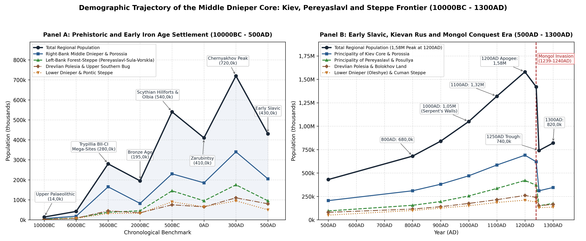
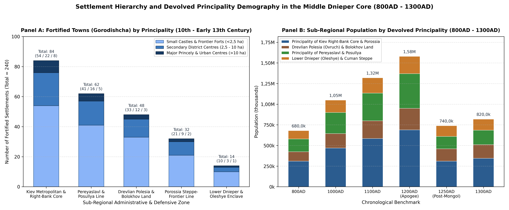
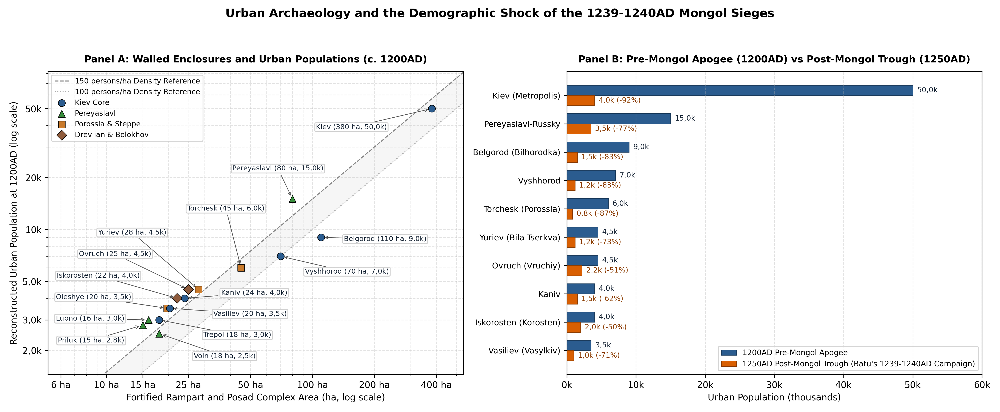

# Executive Summary and Geographic Scope

This literature review establishes the empirical baseline and
settlement-level demographic reconstruction for the Principalities of
Kiev and Pereyaslavl in the Middle Dnieper Core, book-ended
chronologically from the Upper Palaeolithic (10000BC) to the Mongol
Conquests (1239-1240AD) and the immediate post-conquest devolved
appanage trough (1250AD - 1300AD). Geographically, the region
encompasses the Middle Dnieper forest-steppe, the southern
Pripyat-Teterev-Uzh Polesian woodlands, the Upper Southern Bug basin,
and the Lower Dnieper Pontic Steppe corridor (~265 000 km² across modern
central and southern Ukraine). Historically, this territory formed the
metropolitan core of unified Kievan Rus (863-1133AD) and subsequently
partitioned into two sovereign Rurikid principalities and their steppe
marches during the era of feudal devolution (1133-1300AD).

The Principality of Kiev (1133-1322AD, ~95 000 km²) occupied the
Right-Bank Middle Dnieper upland plateau and the Irpin, Stuhna, Ros
(*Porossia*), Teterev, Uzh, and Sluch river basins (including the
Drevlian Ovruch Volost), together with the autonomous agricultural
buffer of the Bolokhov Land on the Upper Southern Bug and Horyn
headwaters. Across the river, the Principality of Pereyaslavl
(1133-1364AD, ~68 000 km²) occupied the Left-Bank Middle Dnieper
chernozem forest-steppe across the Trubezh, Supoy, Oster, Sula
(*Posullya*), Khorol, Psyol, Vorskla, and Upper Seversky Donets basins,
functioning as the primary eastern bulwark of Southern Rus against the
Pecheneg, Tork, and Polovtsian (Cuman) confederations. To the south, the
Lower Dnieper Emporium and Pontic Steppe Frontier (~102 000 km²)
encompassed the Dnieper Rapids (*Porohy*), the Khortytsia-Protolche
river crossing, the Kievan maritime enclave of Oleshye (46,62°N,
32,62°E) at the Dnieper-Bug estuary, and the pastoral winter pastures
(*zimovniki*) of the Black Sea steppe between the Lower Southern Bug and
the Molochnaya-Azov littoral.

Across the Holocene and pre-Mongol medieval era, the Middle Dnieper core
experienced four distinct demographic cycles prior to the catastrophe of
1239-1240AD: (i) the Eneolithic Trypillia BII-CI proto-urban mega-site
phenomenon (c. 3600BC) in the Ros-Southern Bug interfluve, when regional
population reached 280,0k
[\[1\]](#ref-videiko2004)[\[2\]](#ref-diachenko2012); (ii) the Scythian
forest-steppe hillfort and Greek Pontic colonial expansion (c. 500BC),
peaking at 540,0k around the giant rampart complex of Belsk (*Gelonus*,
4 020 ha) and the Milesian polis of Olbia
[\[3\]](#ref-shramko1987)[\[4\]](#ref-kryzhitsky1999); (iii) the
Chernyakhov Culture agricultural optimum (c. 300AD), which sustained
720,0k inhabitants across dense open-settlement networks prior to the
Hunnic crisis [\[5\]](#ref-magomedov2001); and (iv) the Kievan Rus urban
and rural apogee (1000AD - 1200AD), when the construction of over 950 km
of timber-and-earth *Zmiyevy Valy* (Serpent’s Walls) and 240 fortified
*gorodishcha* supported a regional population of 1,05M in 1000AD, 1,32M
in 1100AD, and 1,58M in 1200AD
[\[6\]](#ref-tolochko1983)[\[7\]](#ref-kuza1996)[\[8\]](#ref-kuchera1999)[\[9\]](#ref-motsia2007).
Batu Khan’s storming of Pereyaslavl in March 1239AD and the siege of
Kiev in November-December 1240AD inflicted an immediate demographic
collapse of -53,2% from the 1200AD apogee, reducing the regional
population to 740,0k in 1250AD before partial rural and small-town
recovery brought the Golden Horde *baskak*-administered appanages to
820,0k by 1300AD [\[10\]](#ref-ivakin1996)[\[11\]](#ref-dawson1955).

# Prehistoric and Early Iron Age Settlement (10000BC - 500AD)

## Upper Palaeolithic, Neolithic, and the Trypillia BII-CI Mega-Site Phenomenon (10000BC - 2000BC)

Human settlement in the Middle Dnieper valley during the terminal
Pleistocene (10000BC) was anchored by Epigravettian mammoth-hunter base
camps occupying periglacial loess river terraces along the Dnieper, Ros,
Supoy, and Udai valleys. Excavations at Mezhirich (near Kaniv),
Dobranichevka, Gontsy (on the Udai), and Kirillovskaya (in the Podol
district of Kiev) reveal circular mammoth-bone dwellings housing winter
aggregations of 30 - 60 hunter-gatherers
[\[1\]](#ref-videiko2004)[\[12\]](#ref-tolochko1972). Across the Middle
and Lower Dnieper basin, seasonal band territories support a
reconstructed Upper Palaeolithic population of 14,0k (14 000) at
10000BC. Following the Mesolithic-Neolithic transition (6000BC),
represented by the Bug-Dniester Culture on the Right Bank and the
Dnieper-Donets Culture along the Dnieper Rapids (Nikolskoye, Vovnigi,
Dereivka) and Left-Bank tributaries, mixed foraging, fishing, and
incipient stockbreeding communities expanded regional carrying capacity
to 42,0k (42 000).

During the Middle and Late Eneolithic (4200BC - 3200BC), the
forest-steppe interfluve between the Southern Bug, the Hnylyi Tikych,
and the Ros-Dnieper line became the demographic centre of gravity of Old
Europe with the rise of the Cucuteni-Trypillia Culture (Stages BII and
CI, peaking around 3600BC). Geomagnetic surveys and excavations directed
by V. A. Kruts, M. Yu. Videiko, and international teams have documented
a cluster of concentric proto-urban mega-sites (*gigant-poseleniia*) in
the Cherkasy-Uman plateau that functioned as fortified agro-towns during
periods of inter-group competition and steppe encroachment
[\[1\]](#ref-videiko2004)[\[2\]](#ref-diachenko2012)[\[13\]](#ref-kruts1989).
Talianky (48,80°N, 30,53°E, Stage CI, c. 3700-3500BC) covered 450 ha
with ~2 700 geomagnetic house anomalies arranged in concentric ovals;
accounting for synchronous house-use horizons (75-80% contemporaneous
occupation at 5 - 7 persons per two-storey *ploshchadka* dwelling),
Talianky housed 15,0k (15 000) inhabitants at 3600BC. Maidanetske
(48,82°N, 30,69°E) enclosed 200 ha with ~2 000 - 2 300 structures
arranged in four concentric rings and public assembly buildings
(*mega-structures*), supporting 10,0k (10 000) inhabitants. Nebelivka
(48,64°N, 30,56°E) formed a 260 ha Stage BII mega-site with a perimeter
ditch, two-storey temple complex, and ~1 450 dwellings, supporting 9,0k
(9 000) inhabitants. Companion nucleated centres flourished at Dobrovody
(48,77°N, 30,38°E, 250 ha, 8,5k), Sushkivka (120 ha, 4,5k), Vesely Kut
(150 ha, 5,0k), Kosenivka (120 ha, 4,0k), Chichirkozovka (100 ha, 3,5k),
and the eponymous Trypillia (Tripolye) complex on the Middle Dnieper
bluffs (2,5k), alongside Late Trypillia CII Sofievka and Chapayevka
cemeteries on the Kievan Dnieper terraces [\[1\]](#ref-videiko2004).

Aggregating the Uman-Cherkasy mega-site cluster (~65,0k in nucleated
settlements \>80 ha), the Right-Bank Middle Dnieper and Teterev
agricultural villages (~145,0k), and Early Usatovo and Lower Dnieper
pastoral communities (~70,0k), the regional population reached an
Eneolithic optimum of 280,0k (280 000) at 3600BC. With the aridification
of the late fourth millennium BC and the expansion of Yamnaya
(Pit-Grave), Catacomb, and Middle Dnieper Corded Ware pastoralists by
2000BC, nucleated mega-sites dissolved into mobile steppe kurgan
communities and smaller riverside settlements (such as the
copper-working and horse-breeding centre at Dereivka and fortified river
bluffs at Pustynka), stabilising regional population at 195,0k (195 000)
in 2000BC.

## Scythian Forest-Steppe Giant Hillforts, Greek Poleis, and the Chernyakhov Optimum (500BC - 500AD)

In the Early Iron Age (700BC - 300BC), the synergistic trade of
forest-steppe grain, hides, wax, and slaves for Milesian Greek wine,
olive oil, and metalwork through the Lower Bug-Dnieper estuary
transformed the Middle Dnieper into the agricultural heartland of
Herodotus’s Scythian ploughmen (*Skolotoi*) and Geloni and Budini
[\[3\]](#ref-shramko1987)[\[14\]](#ref-daragan2017). This era produced
two monumental urban phenomena at the 500BC benchmark. Across the
forest-steppe giant hillforts (*gorodishcha-giganty*) on the Left-Bank
Vorskla watershed, the Belsk Hillfort (identified by B. A. Shramko with
Herodotus’s Gelonus, 50,09°N, 34,63°E) enclosed 4 020 ha within 33,8 km
of earthen ramparts uniting the Western (72 ha), Eastern (65,2 ha), and
Kuzeminsk (15,4 ha) citadels, housing bronze-casting, iron-smelting, and
Greek pottery workshops with an estimated population of 12,0k (12 000)
[\[3\]](#ref-shramko1987). On the Right Bank and Left-Bank Sula-Trubezh
rivers stood a ring of massive fortified centres: Trakhtemyriv on the
Kaniv Dnieper bend (500 ha, 4,5k), Khotiv on the southern outskirts of
Kiev (31 ha, 2,5k), Motronyn in the Cherkasy Cold Ravine (200 ha, 4,0k),
Pastyrskoye (25 ha, 2,5k), Nemirov on the Southern Bug (110 ha, 4,0k),
Basovka on the Upper Sula (170 ha, 3,0k), and Knyazha Hora (1,8k)
[\[14\]](#ref-daragan2017). Simultaneously, along the Lower Bug-Dnieper
littoral, Milesian colonists in the mid-7th to early 6th centuries BC
founded Pontic Olbia (Parutino, 46,69°N, 31,90°E, 50 ha stone-walled
upper and lower city plus a 100+ rural *chora* network along the
Berezan-Bug-Dnieper liman), which reached 15,0k (15 000) inhabitants in
the urban core at 500BC, complemented by the island emporium of Berezan
(Borysthenes, 2,5k), Nikonion (2,0k), and Glubokaya Pristan (1,2k)
[\[4\]](#ref-kryzhitsky1999).

Together with dense open agricultural *selishcha* across the
Kiev-Cherkasy plateau and royal Scythian pastoralist winter complexes in
the Lower Dnieper (precursors to Kamenskoye Gorodishche, 1 200 ha, which
peaked in the 4th century BC at 6,0k), the Middle and Lower Dnieper
supported 540,0k (540 000) inhabitants at 500BC.

Following the Sarmatian disruption of the 3rd-2nd centuries BC, the
Zarubintsy Culture (200BC - 100AD, named after the cemetery near
Trakhtemyriv and Pereyaslavl, with key settlements at Pilipenkova Hora
at Kaniv, Chodosovka, Liutezh iron-smelting works north of Kiev, and
Subotiv) maintained a riverine demographic base of 410,0k (410 000) at
0AD alongside the late Scythian stone fortresses of the Lower Dnieper
(Zolota Balka, Gavrilovka, Lyubimovka, Znamenskoye)
[\[15\]](#ref-oblomsky2002). During the Late Roman Climatic Optimum
(250AD - 375AD), the multi-ethnic Chernyakhov Culture introduced heavy
iron ploughshares, rotary querns, and wheel-thrown grey-ware pottery
across more than 1 200 documented unfortified valley settlements in the
Kiev, Pereyaslavl, and Cherkasy forest-steppe (Obukhiv, Zhukivtsi,
Chernyakhiv, Bilozerka, Kompaniiets, and Velikaya Bugaevka).
Archaeological synthesis by B. V. Magomedov estimates an average village
size of 15 - 25 homesteads (90 - 150 inhabitants) spaced every 2 - 4 km
along minor streams, driving the regional population to a pre-medieval
peak of 720,0k (720 000) at 300AD [\[5\]](#ref-magomedov2001). The
Hunnic invasion of 375AD and the collapse of Pontic Roman trade networks
triggered sharp settlement contraction; by 500AD, the Early Slavic
Prague-Korchak Culture (in the Right-Bank Polesian and Teterev
woodlands) and the Penkovka Culture (associated with the *Antae* along
the Ros, Tyasmin, Sula, and Psyol) alongside the early hilltop
settlement on Starokyivska Hora (Kiev, 1,5k at 500AD) and the
metallurgical craft centre of Pastyrskoye (2,5k in the 6th-7th centuries
AD) sustained 430,0k (430 000) inhabitants
[\[16\]](#ref-baran1988)[\[17\]](#ref-sedov1982).

# Early Slavic and Unified Kievan Rus (500AD - 1133AD)

## Luka-Raikovetska, Volyntsevo, and the Rise of Kiev (800AD - 900AD)

During the 8th and 9th centuries AD (800AD benchmark), Eastern Slavic
agrarian colonisation accelerated on both banks of the Middle Dnieper.
On the Right Bank, the Luka-Raikovetska Culture established fortified
tribal centres (*grady*) and dense rural clusters across the Polanian
(*Poliane*), Drevlian (*Drevliane*), and Ulichian (*Ulichi*) lands,
including Starokyivska Hora, Zamkova Hora, and the earliest
dendrochronologically dated log structures in Podol (887AD horizon at
Kiev, 5,0k in 800AD, rising to 12,0k in 900AD)
[\[6\]](#ref-tolochko1983)[\[18\]](#ref-sahaydak1991), Iskorosten
(Korosten) on the Uzh (1,8k in 800AD), Malyn, Raiky, and Monastyrek on
the Kaniv Dnieper bend (1,2k). On the Left Bank, the Volyntsevo-Romny
Culture of the Severians (*Severiane*) occupied the
Desna-Seim-Sula-Psyol forest-steppe (Opishnia, Bititsa 2,0k, Romny or
*Romen* 1,2k, Donets 1,0k), operating initially within the tributary
orbit of the Khazar Khaganate before Oleg of Novgorod’s consolidation of
the Dnieper axis in 882AD
[\[19\]](#ref-sukhobokov1992)[\[20\]](#ref-franklin1996). Regional
population recovered to 680,0k (680 000) at 800AD and reached 840,0k
(840 000) at 900AD as Scandinavian-Slavic *druzhina* retinues organised
the *polyudie* winter tribute circuit linking the Drevlian, Polanian,
and Severian river systems to the Byzantine trade treaties of 907AD and
911AD.

## Vladimir the Great, Yaroslav the Wise, and the Serpent’s Walls (1000AD - 1100AD)

The conversion of Rus under Vladimir Svyatoslavich (980-1015AD) and the
architectural and legal consolidation under Yaroslav the Wise
(1019-1054AD) transformed the demographic landscape of the Middle
Dnieper through state-directed frontier engineering and military
colonisation. As recorded in the *Primary Chronicle* (*Povest’
vremennykh let*, sub anno 988AD and 991AD), Vladimir declared that it
was not good that there were so few towns around Kiev, and
systematically constructed concentric defensive lines along the Stuhna,
Irpin, Trubezh, Oster, Ros, and Sula rivers, staffing them with leading
warriors relocated from the Slovenes of Novgorod, the Krivichi, the
Chud, and the Vyatichi
[\[21\]](#ref-tikhomirov1956)[\[22\]](#ref-morgunov2009).

Archaeological excavations by M. P. Kuchera across the Serpent’s Walls
(*Zmiyevy Valy*) demonstrate that between the late 10th and mid-11th
centuries, the Kievan state erected over 950 km of continuous
timber-laced earthen ramparts (10 - 12 m high, fronted by 5 - 6 m
ditches) arranged in six echelons: the Vita-Bobrytsia, Stuhna,
Irpin-Teterev, Ros (Porossia), Pereyaslavl-Trubezh, and Sula (Posullya)
lines [\[8\]](#ref-kuchera1999). Shielded behind these ramparts, rural
*selishcha* density tripled between 950AD and 1100AD. At the 1000AD
benchmark (1,05M regional total), Kiev expanded from Vladimir’s 10 ha
*Detinets* (hosting the Church of the Tithes, completed 996AD) and the
artisans’ quarter of *Podol* to 28,0k (28 000) inhabitants, surrounded
by the newly fortified royal residences and garrison towns of Belgorod
(110 ha enclosure founded 991AD, 6,0k), Vyshhorod (70 ha, 5,0k),
Vasiliev (Vasylkiv, 2,5k), Trepol (Trypillia, 2,0k), Vitichev (1,8k),
and the Left-Bank capital of Pereyaslavl-Russky (80 ha fortified complex
built 992AD, 8,0k) [\[6\]](#ref-tolochko1983)[\[23\]](#ref-kuza1989). By
the 1100AD benchmark (1,32M regional total), under Yaroslav the Wise
(who built the 70 ha *City of Yaroslav* enclosed by 3,5 km of 16 m-high
ramparts, the Golden Gate, and St Sophia Cathedral in 1037AD, and
founded the Porossia frontier line along the Ros in 1032AD around Yuriev
or Bila Tserkva, Torchesk, and Korsun) and Vladimir Monomakh (who led
the anti-Polovtsian coalitions from Pereyaslavl after the Congresses of
Lyubech in 1097AD and Dolobsk in 1103AD), Kiev reached 40,0k (40 000)
inhabitants and Pereyaslavl-Russky reached 12,0k (12 000)
[\[9\]](#ref-motsia2007)[\[24\]](#ref-tolochko1989).

# Devolved Principalities at Apogee (1133AD - 1240AD)

Following the death of Mstislav the Great (1132AD), the unified realm
devolved into autonomous dynastic lands. In our 1200AD benchmark,
representing the demographic zenith of pre-Mongol Southern Rus, the
Middle and Lower Dnieper region attained 1 580 000 (1,58M) inhabitants
across 240 archaeologically verified fortified settlements
(*gorodishcha*) catalogued by A. V. Kuza
[\[7\]](#ref-kuza1996)[\[23\]](#ref-kuza1989) and O. P. Motsia
[\[9\]](#ref-motsia2007) and over 2 800 open rural villages
(*selishcha*).

## Principality of Kiev: Metropolitan Core, Right-Bank Ring, Porossia, Drevlian Land, and Bolokhov (~950,0k at 1200AD)

### The Kievan Metropolis (45,0k - 50,0k at 1200AD)

Detailed planimetric and stratigraphic reconstructions by P. P. Tolochko
[\[6\]](#ref-tolochko1983)[\[12\]](#ref-tolochko1972)[\[24\]](#ref-tolochko1989),
M. A. Sahaydak [\[18\]](#ref-sahaydak1991), and H. Yu. Ivakin
[\[10\]](#ref-ivakin1996) establish that late 12th- and early
13th-century Kiev comprised a polycentric urban agglomeration spanning
360 - 400 ha (380 ha standard benchmark). The Upper City (*Gora*, ~98
ha) consisted of *Vladimir’s City* (10-12 ha, princely *dvor* chambers,
stone churches, and boyar compounds), *Yaroslav’s City* (70 ha,
metropolitan cathedral of St Sophia, St Irene, St George, and dense
residential quarters), *Izyaslav-Svyatopolk’s City* (8 ha, St Michael’s
Golden-Domed Monastery), and *Kopyrev Konets* (8 ha on the northwestern
spur). Below the bluffs, the Lower City (*Podol*, 180 - 200 ha) has been
investigated through dendrochronological excavations across *Kontraktova
Ploshcha*, *Zhytniy Rynok*, *Verkhniy Val*, and *Nyzhniy Val*, revealing
standardised 300 - 600 m² fenced urban homesteads (*usadby*) containing
2 - 3 log dwellings, craft workshops (glass-making, bone-carving,
enamelling, shoemaking, smithing), and merchant warehouses (*pirohy*).
Allowing 3 500 - 4 000 active homesteads across *Podol* at 6 persons per
household yields 22,0k - 25,0k residents in the Lower City alone
[\[18\]](#ref-sahaydak1991). Surrounding the core lay suburban monastic
and princely satellites (~80 - 100 ha), including the *Kievo-Pecherskaya
Lavra* (Caves Monastery), the princely residence of *Berestovo*, *Klov*,
*Dorogozhichi*, *Vydubychi*, *Kyrylivska*, *Kitaevo* (35 ha fortified
complex on the southern Dnieper hills), and *Gnilets*.

Combining Upper City boyar and clerical households (~15,0k), *Podol*
artisan and merchant homesteads (~24,0k), *Kopyrev Konets*, and the
suburban districts (~9,0k - 11,0k), Tolochko’s authoritative estimate of
50,0k (50 000) inhabitants at 1200AD (equivalent to ~131,6 persons/ha
across 380 ha) places Kiev among the largest metropolises of
12th-century Europe alongside Constantinople, Paris, and London
[\[24\]](#ref-tolochko1989)[\[25\]](#ref-raffensperger2012).

### The Right-Bank Kievan Ring and Stuhna-Dnieper Corridor

Protecting the southern and western approaches to Kiev stood a dense
network of princely seats, custom ports, and fortress-towns (84
fortified *gorodishcha* in the Kiev Core zone: 8 major \>10 ha, 22
secondary 2,5-10 ha, and 54 small \<2,5 ha castles). Belgorod
(Bilhorodka) on the Irpin (50,39°N, 30,23°E, 110 ha *detinets* and
*okolny gorod*, episcopal see and favourite secondary capital of Rurik
Rostislavich) supported 9,0k (9 000) inhabitants at 1200AD. Vyshhorod
(50,58°N, 30,49°E, 70 ha cliffside citadel and potter’s *posad*, shrine
of SS Boris and Gleb) housed 7,0k (7 000), while Kaniv (49,75°N,
31,47°E, 24 ha, strategic Dnieper crossing and assembly point against
the Cumans, with the stone Church of St George built in 1144AD) reached
4,0k (4 000). Additional fortified centres included Vasiliev (Vasylkiv)
on the Stuhna (20 ha, 3,5k), Trepol (Trypillia, 18 ha Dnieper cliff
fortress controlling the Stuhna mouth, 3,0k), Roden on *Knyazha Hora*
(16 ha craft town near Kaniv, 2,5k), Vitichev (14 ha beacon fortress on
the Dnieper, 2,2k), Zarub (1,5k), Chuchin (12 ha, 1,8k), Khalep (1,4k),
Svyatoslavl, Ivan-Gorod (1,5k), Tumasch (1,4k), Kitaigorod (1,5k), and
Zvenyhorod-Kievan (1,6k) [\[7\]](#ref-kuza1996)[\[9\]](#ref-motsia2007).

### The Porossia Steppe-Frontier Line (Chorni Klobuky Federates)

Along the Ros River valley (80 km south of Kiev), the Kievan grand
princes settled semi-nomadic Turkic federates, the Chorni Klobuky
(“Black Hoods”, uniting the Torks, Berendei, Kovui, Turpei, and remnant
Pechenegs), as hereditary border cavalry endowed with fortified towns
(32 *gorodishcha* in the Porossia zone: 2 major, 9 secondary, 21 small)
[\[9\]](#ref-motsia2007)[\[22\]](#ref-morgunov2009). Torchesk (49,68°N,
30,63°E, identified with the 45 ha *Olshanitsa* or *Sharki* complex on
the Gorokhovatka-Ros) served as the capital of the Black Hoods and
appanage seat of Mstislav the Bold (1193-1207AD), supporting 6,0k (6
000) inhabitants at 1200AD. Yuriev (Bila Tserkva, 49,79°N, 30,11°E, 28
ha *Zamkova Hora* and *posad*, episcopal seat of the Bishop of Yuriev)
housed 4,5k (4 500), flanked by Korsun on the Ros (49,42°N, 31,26°E, 16
ha, 2,8k), Boguslavl (49,55°N, 30,87°E, 15 ha, 2,5k), Volodarev
(Volodarka, 1,8k), Rostovets (1,8k), Dveren (1,5k), Polksten (1,5k),
Bakhmutov (1,2k), Sakkov (1,1k), and Borovyi (1,0k). Together, the
Right-Bank Kiev Core and Porossia frontier supported 690,0k (690 000)
inhabitants at 1200AD.

### Drevlian Polesia (Ovruch Volost) and the Bolokhov Land (~260,0k at 1200AD)

Northwest and southwest of the Kievan core lay two distinct sub-regions
encompassing 48 fortified *gorodishcha* (3 major \>10 ha, 12 secondary
2,5-10 ha, 33 small \<2,5 ha). In Drevlian Polesia, settlement was
centred on Ovruch (Vruchiy, 51,32°N, 28,80°E, 25 ha, brick Church of St
Basil built by Rurik Rostislavich c. 1190AD, 4,5k at 1200AD) and
Iskorosten (Korosten, 50,95°N, 28,64°E, four-citadel complex on the Uzh,
22 ha, 4,0k). As demonstrated by A. P. Tomashevsky
[\[26\]](#ref-tomashevsky2008), the Ovruch ridge was the sole European
source of pink pyrophyllite slate, surrounded by over 40 specialised
workshop villages (*Nagorany*, *Kamenka*, *Korenevka*) manufacturing
slate spindle-whorls (*priaslitsa*) and sarcophagi exported across all
of Rus, Poland, and Volga Bulgaria. Secondary Drevlian centres included
Vozvyagl (Zviahel) on the Sluch (16 ha, 2,8k), Malyn (1,8k), Kotelnich
(2,0k), Zhytomyr (1,8k), Horodsk (*Gorodesk*, 2,0k), Michesk (Radomyshl,
1,6k), Ushchesk (Ushomyr, 1,5k), and Chornobyl (1,5k at the Pripyat-Uzh
confluence). To the southwest, the Bolokhov Land (*Bolokhovskaia
Zemlia*, 1150-1257AD) occupied the fertile forest-steppe plateau of the
Upper Southern Bug, Sluch, and Horyn between the principalities of Kiev,
Galicia-Volhynia, and the Cuman steppe. Governed by autonomous local
elites (*knyaztsi bolokhovskie*), its fortified towns, including
Bolokhov (Lyubar, 15 ha, 2,5k), Gubin (12 ha, 2,0k), Kudin (1,8k), Kobud
(1,6k), Derevich (1,6k), Bozhsky (*Bozhesk*, 2,0k), Mezhibozhye
(Medzhybizh, 2,2k), and Dyadkov (1,4k), were renowned for intensive
wheat and millet cultivation
[\[9\]](#ref-motsia2007)[\[27\]](#ref-rappoport1967).

## Principality of Pereyaslavl: Left-Bank Forest-Steppe and the Posullya Rampart Line (~420,0k at 1200AD)

East of the Dnieper, the Principality of Pereyaslavl served throughout
the 11th to early 13th centuries as the coveted ancestral patrimony of
the Monomakhovichi and the primary military shield of Southern Rus
[\[19\]](#ref-sukhobokov1992)[\[28\]](#ref-morgunov2003). Archaeological
surveys by Yu. Yu. Morgunov and O. V. Sukhobokov record 62 fortified
*gorodishcha* across the Pereyaslavl land (5 major \>10 ha, 16 secondary
2,5-10 ha, 41 small \<2,5 ha). Located at the confluence of the Alta and
Trubezh rivers, the capital of Pereyaslavl-Russky (Pereiaslav, 50,07°N,
31,46°E) comprised a 10 ha *Detinets* (containing Bishop Ephraim’s
monumental stone Cathedral of St Michael built in 1089AD, stone
episcopal gates, bathhouse, and princely palace) and a 70 ha fortified
*Okolny Gorod* plus unfortified riverside *posady* (80 ha walled core,
~100 ha total complex), supporting 15,0k (15 000) inhabitants at 1200AD
[\[6\]](#ref-tolochko1983)[\[7\]](#ref-kuza1996).

Stretching 180 km from the Dnieper estuary of the Sula to the Upper Sula
border with the Kursk-Putivl Severians, the Posullya defensive line
comprised 18 inter-visible timber-and-earth *gorodishcha* anchored at
the mouth by the fortified harbour-citadel of Voin (Voinska Hreblia, 18
ha with an artificial dredged interior ship-harbour, 2,5k at 1200AD),
followed upstream by Zheldi (1,4k), Rimiv (14 ha, besieged by Konchak in
1185AD, 2,2k), Lukoml (13 ha, 2,0k), Lubno (Lubny, 16 ha, founded by
Monomakh, 3,0k), Khorol (2,0k), Sneporod (12 ha, 1,8k), Ksniatin (13 ha,
2,0k), Sinets (1,5k), Romen (Romny, 15 ha, 2,5k), and Glinsk (1,5k)
[\[28\]](#ref-morgunov2003). Behind the Sula line in the interior
Trubezh-Supoy-Oster basins lay Priluk (Pryluky) on the Udai (15 ha,
2,8k), Nosivka (2,2k), Oster (Gorodets-Ostersky, 14 ha, founded by
Monomakh in 1098AD with St Michael’s *Yurievska Bozhnytsia*, 2,5k),
Baruch (1,8k), Bronnitsa (1,6k), Pesochen (1,5k), and Zholnin (1,4k),
while the southeastern forest-steppe corridor along the Psyol, Vorskla,
and Seversky Donets hosted Ltava (Poltava, 49,58°N, 34,56°E, 14 ha on
*Ivanova Hora*, mentioned 1174AD, 2,2k), Goltav (1,5k), Nizhegolsk
(1,4k), and the easternmost frontier fortress of Donets (49,85°N,
36,21°E, Khorosheve hillfort south of modern Kharkiv, where Igor
Svyatoslavich escaped from Polovtsian captivity in 1185AD, 2,0k)
[\[19\]](#ref-sukhobokov1992)[\[29\]](#ref-dimnik2003).

## Lower Dnieper Emporium (Oleshye) and the Polovtsian Steppe Frontier (~210,0k at 1200AD)

South of the Porossia and Posullya ramparts extended the Pontic Steppe
(*Pole Polovetskoe*), where 14 fortified river-island and delta trading
stations coexisted with the seasonal camps (*vezhi* and winter
*zimovniki*) of the Dnieper Polovtsian confederations (the Burchevichi
and Lukomorie hordes led by Khans Kobyak, Bonyak, and Kotyan)
[\[9\]](#ref-motsia2007). At Oleshye (46,62°N, 32,62°E, on Veliky
Potemkin Island opposite modern Kherson and Oleshky), the maritime
gateway of Kievan Rus occupied a 20 ha waterlogged port settlement
yielding thousands of Byzantine amphorae, lead seals of Kievan princes
and Greek officials, glass bracelets, and ship fittings, where Kievan
military flotillas met Byzantine merchants and newly consecrated
Metropolitans, supporting 3,5k (3 500) permanent inhabitants at 1200AD.
Upstream at Khortytsia (Protolche, 47,82°N, 35,07°E), the strategic
assembly point below the Dnieper Rapids (*Khortytskyi Ostrov* and
*Protolche* ford), where the Rus princes mustered before the 1103AD
Suten and 1223AD Kalka campaigns, supported 1,8k inhabitants at 1200AD,
alongside Berestovo (Beloberezhye, 1,2k) at the Kinburn spit and Cuman
winter towns along the Samara, Orel, and Molochnaya rivers (210,0k total
sub-regional population at 1200AD).

# Mongol Conquests and Post-Siege Era (1239AD - 1300AD)

## Batu Khan’s Campaigns of 1239-1240AD and the Destruction of Southern Rus

Following the initial reconnaissance raid of Jebe and Subutai and the
disastrous defeat of the Kievan, Galician, Chernigov, and Smolensk
princes at the Battle of the Kalka River (31 May 1223AD), where Grand
Prince Mstislav Romanovich of Kiev and 10 000 Kievan warriors perished,
the Middle Dnieper principalities entered the 1240AD benchmark with a
slightly reduced population of 1,42M (1 420 000). The full-scale Mongol
invasion of Southern Rus unfolded in two devastating winter-spring
campaigns
[\[6\]](#ref-tolochko1983)[\[10\]](#ref-ivakin1996)[\[29\]](#ref-dimnik2003).

In March 1239AD, Mongol armies under Möngke and Batu breached the
Posullya ramparts, burning Rimiv, Voin, Lubno, Lukoml, and Priluk, and
stormed Pereyaslavl-Russky on 3 March 1239AD. As recorded in the
*Laurentian* and *Hypatian Chronicles*, St Michael’s Cathedral was
demolished, Bishop Simeon was killed, and the city’s population was
slaughtered or led into captivity. Archaeological excavation across the
Pereyaslavl *Detinets* and *Posullya* hillforts reveals a continuous
1239AD conflagration horizon containing thousands of Mongol-type
rhomboid armour-piercing arrowheads, unburied skeletons in burned
cellars, and buried treasure hoards (*klady*) that were never recovered
[\[28\]](#ref-morgunov2003). After Möngke’s reconnaissance of Kiev from
*Pesochen (Gorodok)* on the Left Bank in late 1239AD, Batu Khan’s main
army crossed the Dnieper in autumn 1240AD, overrunning the Porossia
federate towns (Torchesk, Yuriev, Korsun, Vitichev, Vasiliev, Belgorod,
and Vyshhorod). Defended by Daniel of Galicia’s *voivode* Dmitr, Kiev
was surrounded by Mongol siege engines (*poroki*), which breached the
Lyadskie Gates of Yaroslav’s City before a final stand around the Church
of the Tithes, which collapsed under the weight of refugees on 6
December 1240AD.

Mass graves excavated by M. K. Karger, P. P. Tolochko, and H. Yu. Ivakin
in the Kiev Upper City (over 2 000 skeletons in sanitary pits near the
Church of the Tithes and St Sophia, alongside intact burned workshops
with slain artisans inside) confirm the scale of the urban catastrophe
[\[6\]](#ref-tolochko1983)[\[10\]](#ref-ivakin1996). When the Papal
envoy Giovanni da Pian del Carpine (John of Plano Carpini) passed
through the Kievan land and visited Kiev in February 1246AD, he left an
eyewitness account of the post-conquest landscape:

> *“They attacked Rus, where they made great havoc, destroying cities
> and fortresses and slaughtering men; and they laid siege to Kiev, the
> capital of Rus; after they had besieged the city for a long time, they
> took it and put the inhabitants to death. When we were journeying
> through that land we came across countless skulls and bones of dead
> men lying about on the ground. Kiev had been a very large and densely
> populated town, but now it has been reduced almost to nothing, for
> there are at the present time scarce two hundred houses there and the
> inhabitants are kept in complete slavery.”* [\[11\]](#ref-dawson1955)

Allowing for Carpini’s ~200 taxable household compounds (*dvory*) on
*Podol* plus surviving clerical and suburban households around the Caves
Monastery and *Kopyrev Konets*, H. Yu. Ivakin reconstructs Kiev’s
population at 3,5k - 4,5k (4,0k benchmark) in 1250AD, representing a
-92,0% collapse from its 1200AD peak of 50,0k [\[10\]](#ref-ivakin1996).

## The Bolokhov Exception (1240-1257AD) and Late 13th-Century Recovery (1250AD - 1300AD)

Archaeological and chronicle evidence shows that demographic loss during
the 1239-1240AD invasion was spatially uneven across the Middle Dnieper
sub-regions. Severe depopulation occurred in the exposed forest-steppe
(-64% in Pereyaslavl and Posullya; -55% in Kiev Core and Porossia):
along the Sula and Ros frontier lines, nearly 80% of fortified
*gorodishcha* (Voin, Rimiv, Sneporod, Torchesk, Roden, Vitichev) were
permanently abandoned after 1239-1240AD
[\[7\]](#ref-kuza1996)[\[28\]](#ref-morgunov2003). At the 1250AD
post-conquest trough, the total regional population stood at 740,0k (740
000): 310,0k in the Right-Bank Kiev Core and Porossia, 150,0k in the
Drevlian and Bolokhov lands, 150,0k in the Principality of Pereyaslavl,
and 130,0k in the Lower Dnieper and steppe zone.

Greater demographic resilience prevailed in forested Drevlian Polesia
and the Bolokhov Land. The marshy woodlands of the Teterev-Uzh-Pripyat
basin (Ovruch, Iskorosten, Chornobyl, Zhytomyr) sheltered rural refugees
fleeing the Dnieper corridor. Simultaneously, the princes and towns of
the Bolokhov Land (Bolokhov, Gubin, Kudin, Kobud, Bozhsky) escaped
destruction in 1240AD by submitting directly to the Mongols as
*Tataropoli* (“Tatar-tribute ploughmen”), sowing wheat and millet for
Batu’s troops until King Daniel Romanovich of Galicia-Volhynia launched
punitive expeditions in 1241AD and 1255-1257AD that razed the Bolokhov
ramparts and Vozvyagl
[\[9\]](#ref-motsia2007)[\[27\]](#ref-rappoport1967).

Following the Golden Horde imperial censuses (*chislo*) of 1257-1259AD
and 1273AD under Mengu-Timur, the devolved Principalities of Kiev and
Pereyaslavl were administered by local Rurikid and Putivl-Olgovichi
princes alongside Golden Horde *baskaki* (governors and tax-collectors).
Although Metropolitan Maximus transferred the practical residence of the
Metropolitanate of All Rus from Kiev to Vladimir-on-the-Klyazma in
1299AD, Ivakin’s excavations demonstrate steady late 13th-century craft
and commercial revival in Kievan *Podol*, *Pechersk*, and the castle on
*Zamkova Hora* (8,5k inhabitants at 1300AD), Pereyaslavl (4,5k), Ovruch
(3,0k), Iskorosten (2,6k), Kaniv (2,2k), and Yuriev (2,0k), bringing the
regional population to 820,0k (820 000) at 1300AD prior to the
Lithuanian conquest under Gediminas in the 1320s AD
[\[10\]](#ref-ivakin1996).

# Cross-Regional Demographic Synthesis (1000AD - 1300AD)

To ensure full demographic consistency across the historical dataset,
the table below cross-references the Middle Dnieper Core (Kiev and
Pereyaslavl) with the northern and eastern Rus principalities documented
in the companion European Russia regional review
[\[21\]](#ref-tikhomirov1956)[\[23\]](#ref-kuza1989)[\[30\]](#ref-vernadsky1948).

This synthesis highlights the fundamental structural shift of the 12th
and 13th centuries: while the Middle Dnieper Core (1,58M at 1200AD)
remained the single most densely populated and urbanised territory of
the Rus world up to the eve of the Mongol invasion, containing two of
the five largest cities (Kiev 50,0k and Pereyaslavl 15,0k) and 240
fortified *gorodishcha*, its open forest-steppe geography left it
uniquely exposed to the 1239-1240AD Mongol siege campaigns and
subsequent nomadic raids. Whereas the total population of European
Russia contracted by -27,3% (3,85M to 2,80M) between 1200AD and 1250AD
(buffered by the uninvaded Novgorod-Pskov and Smolensk lands) and
recovered to 80,5% of its pre-Mongol peak by 1300AD (3,10M), the Middle
Dnieper Core suffered a -53,2% contraction (1,58M to 740,0k in 1250AD)
and stood at 51,9% of its pre-Mongol apogee (820,0k) at the 1300AD
benchmark.

# Sources

1.
Videiko, Mykhailo Yuriiovych.
*Encyclopedia of Trypillia Civilization, Volumes 1-2*.
Ukrpolihrafmediia, 2004,
<https://search.worldcat.org/search?q=Encyclopedia+Trypillia+Civilization+Volumes+Videiko+2004>.

2.
Diachenko, Aleksandr, and
Francesco Menotti. “The Gravity Model: Monitoring the Formation and
Development of the Tripolye Culture Giant-Settlements in Ukraine.”
*Journal of Archaeological Science*, vol. 39, no. 8, 2012, pp. 2810-17,
<https://doi.org/10.1016/j.jas.2012.04.025>.

3.
Shramko, Boris Andreevich.
*Belskoe Gorodishche Skifskoi Epokhi (Gorod Gelon) \[the Belsk Hillfort
of the Scythian Epoch (the City of Gelonus)\]*. Naukova Dumka, 1987,
<https://search.worldcat.org/search?q=Belsk+Hillfort+Scythian+Epoch+City+Gelonus+Shramko+1987>.

4.
Kryzhitsky, Sergei Dmitrievich, et
al. *Olviia: Antychnoe Gosudarstvo v Severnom Prichernomore \[Olbia: An
Ancient State in the Northern Black Sea Region\]*. Instytut Arkheolohii
NAN Ukrainy, 1999,
<https://search.worldcat.org/search?q=Olbia+Ancient+State+Northern+Black+Sea+Region+Kryzhitsky+1999>.

5.
Magomedov, Boris Viktorovych.
*Cherniakhovskaia Kultura: Problema Etnosa \[the Chernyakhov Culture:
The Problem of Ethnos\]*. UMCS, 2001,
<https://search.worldcat.org/search?q=Chernyakhov+Culture+Problem+Ethnos+Magomedov+2001>.

6.
Tolochko, Petro Petrovych.
*Drevnii Kiev \[Ancient Kiev\]*. Naukova Dumka, 1983,
<https://doi.org/10.2307/129285>.

7.
Kuza, Andrei Vasilievich.
*Drevnerusskie Gorodishcha x-XIII Vv.: Svod Arkheologicheskikh
Pamiatnikov \[Old Rus Fortified Settlements of the 10th-13th Centuries:
Corpus of Archaeological Monuments\]*. Khristianskoe Izdatelstvo, 1996,
<https://search.worldcat.org/search?q=Old+Rus+Fortified+Settlements+10th+13th+Centuries+Corpus+Kuza+1996>.

8.
Kuchera, Mykhailo Petrovych.
*Zmiievi Valy Serednoho Podniprov’ia \[the Serpent’s Walls of the Middle
Dnieper Region\]*. Instytut Arkheolohii NAN Ukrainy, 1999,
<https://search.worldcat.org/search?q=Serpent+Walls+Middle+Dnieper+Region+Kuchera+1999>.

9.
Motsia, Oleksandr Petrovych.
*Pivdenna Rus’ska Zemlia v IX-XIII St. \[The Southern Rus Land in the
9th-13th Centuries\]*. Instytut Arkheolohii NAN Ukrainy, 2007,
<https://search.worldcat.org/search?q=Southern+Rus+Land+9th+13th+Centuries+Motsia+2007>.

10.
Ivakin, Hlib Yuriiovych.
*Istorychnyi Rozvytok Kyieva XIII - Seredyny XVI St.
(Istoryko-Topohrafichni Narysy) \[Historical Development of Kiev from
the 13th to the Mid-16th Century\]*. Instytut Arkheolohii NAN Ukrainy,
1996,
<https://search.worldcat.org/search?q=Historical+Development+Kiev+13th+Mid+16th+Century+Ivakin+1996>.

11.
Dawson, Christopher. *The Mongol
Mission: Narratives and Letters of the Franciscan Missionaries in
Mongolia and China in the Thirteenth and Fourteenth Centuries*. Sheed;
Ward, 1955,
<https://search.worldcat.org/search?q=Mongol+Mission+Narratives+Letters+Franciscan+Missionaries+Mongolia+China+Dawson+1955>.

12.
Tolochko, Petro Petrovych.
*Istorychna Topohrafiia Starodavnoho Kyieva \[Historical Topography of
Ancient Kiev\]*. Naukova Dumka, 1972,
<https://search.worldcat.org/search?q=Historical+Topography+Ancient+Kiev+Tolochko+1972>.

13.
Kruts, Volodymyr Afanasiiovych. “K
Istorii Naseleniia Tripolskoi Kultury v Mezhdureche Yuzhnogo Buga i
Dnepra \[on the History of the Population of the Trypillia Culture in
the Southern Bug and Dnieper Interfluve\].” *Pervobytnaia Arkheologiia:
Materialy i Issledovaniia*, 1989, pp. 117-32,
<https://cyberleninka.ru/article/n/k-istorii-naseleniia-tripolskoi-kultury-v-mezhdureche-yuzhnogo-buga-i-dnepra>.

14.
Daragan, Marina N. “Large
Fortified Settlements of the Scythian Time in the Ukrainian
Forest-Steppe.” *Ancient Civilizations from Scythia to Siberia*, vol.
23, 2017, pp. 57-116,
<https://doi.org/10.1163/15700577-12341312>.

15.
Oblomsky, Andrei Mikhailovich.
*Dneprovskoe Lesostepnoe Levoberezhe v Pozdnerimskoe i Gunnskoe Vremia
\[the Dnieper Forest-Steppe Left Bank in the Late Roman and Hunnic
Periods\]*. Nauka, 2002,
<https://search.worldcat.org/search?q=Dnieper+Forest+Steppe+Left+Bank+Late+Roman+Hunnic+Oblomsky+2002>.

16.
Baran, Volodymyr Danylovych.
*Prazhskaia Kultura Podnestrovia (Po Materialam Poseleniia u s. Rashkov)
\[the Prague Culture of the Dniester Region\]*. Naukova Dumka, 1988,
<https://search.worldcat.org/search?q=Prague+Culture+Dniester+Region+Baran+1988>.

17.
Sedov, Valentin Vasilievich.
*Vostochnye Slaviane v VI-XIII Vv. \[The Eastern Slavs in the 6th-13th
Centuries\]*. Nauka, 1982,
<https://search.worldcat.org/search?q=Eastern+Slavs+6th+13th+Centuries+Sedov+1982>.

18.
Sahaydak, Mykhailo Andriyovych.
*Davnokyivskyi Podil: Problemy Topohrafii, Stratyhrafii, Khronolohii
\[Ancient Kievan Podol: Problems of Topography, Stratigraphy,
Chronology\]*. Naukova Dumka, 1991,
<https://search.worldcat.org/search?q=Ancient+Kievan+Podol+Problems+Topography+Stratigraphy+Chronology+Sahaydak+1991>.

19.
Sukhobokov, Oleh Vasylovych.
*Dniprovske Lisostepove Livoberezhzhia u VIII-XIII St. \[The Dnieper
Forest-Steppe Left Bank in the 8th-13th Centuries\]*. Naukova Dumka,
1992,
<https://search.worldcat.org/search?q=Dnieper+Forest+Steppe+Left+Bank+8th+13th+Centuries+Sukhobokov+1992>.

20.
Franklin, Simon, and Jonathan
Shepard. *The Emergence of Rus 750-1200*. Longman, 1996,
<https://doi.org/10.4324/9781315836898>.

21.
Tikhomirov, Mikhail Nikolaevich.
*Drevnerusskie Goroda \[Old Russian Towns\]*. Gosudarstvennoe
Izdatelstvo Politicheskoi Literatury, 1956,
<https://search.worldcat.org/search?q=Old+Russian+Towns+Tikhomirov+1956>.

22.
Morgunov, Yurii Yurievi.
*Drevo-Zemlianye Ukrepleniia Yuzhnoi Rusi x-XIII Vekov
\[Timber-and-Earth Fortifications of Southern Rus in the 10th-13th
Centuries\]*. Nauka, 2009,
<https://search.worldcat.org/search?q=Timber+Earth+Fortifications+Southern+Rus+10th+13th+Centuries+Morgunov+2009>.

23.
Kuza, Andrei Vasilievich. *Malye
Goroda Drevnei Rusi \[Small Towns of Ancient Rus\]*. Nauka, 1989,
<https://search.worldcat.org/search?q=Small+Towns+Ancient+Rus+Kuza+1989>.

24.
Tolochko, Petro Petrovych.
“Naselennia Kyieva x-XIII St. \[Population of Kiev in the 10th-13th
Centuries\].” *Istoriia Kyieva, Tom 1: Starodavnii i Serednovichnyi
Kyiv*, Naukova Dumka, 1989, pp. 108-24,
<https://scholar.google.com/scholar?q=Population+Kiev+10th+13th+Centuries+Tolochko+1989>.

25.
Raffensperger, Christian.
*Reimagining Europe: Kievan Rus in the Medieval World*. Harvard
University Press, 2012,
<https://doi.org/10.4159/harvard.9780674065468>.

26.
Tomashevsky, Andriy Petrovych.
“Ovrutska Volost u Strukturi Kyivskoi Zemli x-XIII St. \[The Ovruch
Volost in the Structure of the Kievan Land in the 10th-13th
Centuries\].” *Arkheolohiia*, vol. 2, 2008, pp. 38-54,
<https://arheologia.com.ua/index.php/arheologia/issue/archive>.

27.
Rappoport, Pavel Aleksandrovich.
*Voennoe Zodchestvo Zapadnorusskikh Zemel x-XIV Vv. \[Military
Architecture of the West Russian Lands in the 10th-14th Centuries\]*.
Nauka, 1967,
<https://search.worldcat.org/search?q=Military+Architecture+West+Russian+Lands+10th+14th+Centuries+Rappoport+1967>.

28.
Morgunov, Yurii Yurievi.
*Drevnerusskie Pamiatniki Porechia Suly \[Old Rus Monuments of the Sula
River Basin\]*. Kurskii Gosudarstvennyi Областной Muzei Arkheologii,
2003,
<https://search.worldcat.org/search?q=Old+Rus+Monuments+Sula+River+Basin+Morgunov+2003>.

29.
Dimnik, Martin. *The Dynasty of
Chernigov, 1146-1246*. Cambridge University Press, 2003,
<https://doi.org/10.1017/cbo9780511496479>.

30.
Vernadsky, George. *Kievan
Russia*. Yale University Press, 1948,
<https://search.worldcat.org/search?q=Kievan+Russia+Vernadsky+1948>.

