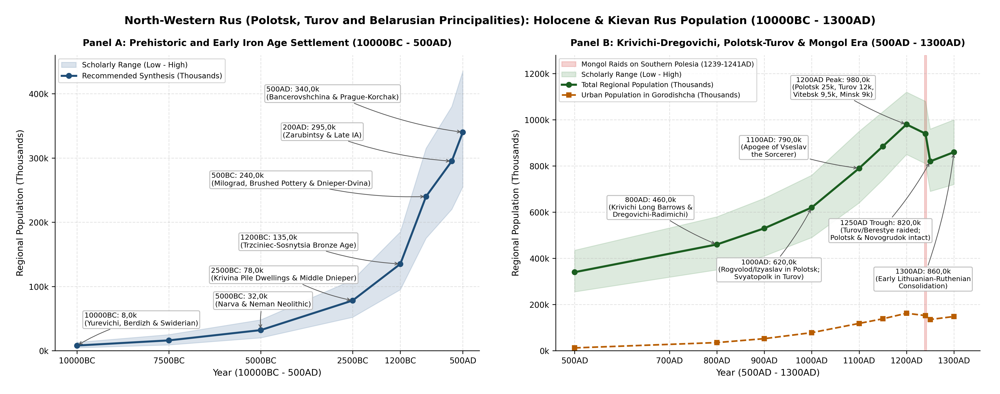
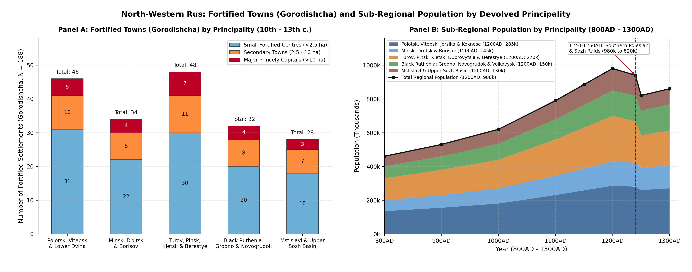
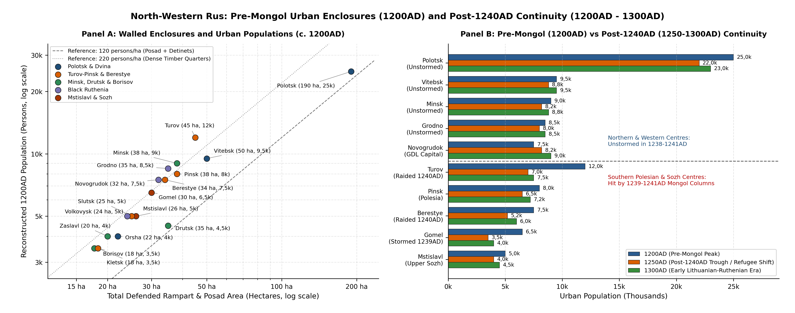

# Executive Summary and Geographic Scope

This literature review establishes the Holocene, Iron Age, Kievan Rus,
and immediate post-Mongol demographic series (10000BC - 1300AD) together
with the fortified urban settlement hierarchy for North-Western Rus
(Polotsk, Turov, and Belarusian Rus). Geographically, this region
encompasses the 207 600 km² basin network of modern Belarus across the
Upper Dnieper, Berezina, Sozh, Pripyat, Western Dvina, Upper Neman, and
Western Bug-Mukhavets watersheds, alongside the historical Polotsk
tributary principalities of the lower Western Dvina (*Jersika* or
*Gerzike* and *Koknese* or *Kukenois* in Latgale and Selonia) and the
southern Pripyat-Horyn Polesian appanages of *Dubrovytsia* and *Stepan*.

Strictly book-ended at the Mongol Conquests (1238-1241AD) and the
immediate post-conquest devolved principalities (1240AD - 1300AD), this
regional synthesis harmonises directly with the northern and eastern
European Russia synthesis (specifically *Novgorod-Pskov* at 310,0k in
1000AD and 480,0k in 1200AD, and *Smolensk and the Upper Dnieper* east
of 31,0°E at 220,0k in 1000AD and 340,0k in 1200AD). Across the Kievan
Rus and appanage eras (980AD - 1300AD), North-Western Rus comprised five
interconnected dynastic and hydrographic clusters
[\[1\]](#ref-shtykhov1992goroda)[\[2\]](#ref-zagorulsky2001arkheologiya)[\[3\]](#ref-lysenko2004drevniy)[\[4\]](#ref-kuza1989malye).

The first cluster comprised the Polotsk-Vitebsk and Lower Dvina
principalities, forming the senior Izyaslavichi patrimony along the
Western Dvina (Daugava) river, encompassing the core Principality of
Polotsk (1001-1241AD), the Principality of Vitebsk (1102-1321AD) with
*Orsha* and *Kopys*, and the lower Dvina tributary principalities of
Jersika (1001-1210AD) and Koknese (1191-1210AD)
[\[5\]](#ref-shtykhov1975drevniy)[\[6\]](#ref-alekseev1966polotskaya)[\[7\]](#ref-tarasov1998polotsk)[\[8\]](#ref-mugurevics1965vostochnaya).
The second cluster comprised the southern Izyaslavichi principalities of
Minsk, Drutsk, and Borisov across the Minsk Upland and the Upper
Berezina, Svisloch, and Upper Drut portages, including the Principality
of Minsk (1102-1327AD, relocated from the 10th-11th century *Menka*
complex to the Svisloch-Nemiga *Zamchishche* after 1067AD), the
Principality of Drutsk (1102-1251AD), and the Principality of Borisov
(1102-1301AD), alongside *Zaslavl* (*Izyaslavl*), *Logoisk*
(*Logozhsk*), and *Svisloch-on-Berezina*
[\[1\]](#ref-shtykhov1992goroda)[\[9\]](#ref-zagorulsky1982vozniknovenie).
The third cluster spanned the Turov-Pinsk principalities and Berestye
Land in Pripyat Polesia along the alluvial corridor of the Pripyat,
Pina, Yaselda, Sluch, Lan, Ptich, and Horyn rivers, comprising the
Principality of Turov (1133-1341AD), the Principality of Pinsk
(1175-1321AD), the Principality of Kletsk (1148-1401AD) with *Slutsk*
and *Kopyl*, the Principality of Dubrovytsia (1175-1301AD), and the
Western Bug-Mukhavets March of Berestye (*Brest*) and Kamenets
[\[3\]](#ref-lysenko2004drevniy)[\[10\]](#ref-lysenko1974goroda)[\[11\]](#ref-lysenko1985berestye).
The fourth cluster encompassed Black Ruthenia (*Chornaya Rus*) in the
Slavic-Baltic contact zone along the Upper Neman, Shchara, and Rossa
rivers, anchored by the Principality of Grodno (*Goroden*, 1128-1201AD),
the Principality of Novogrudok (1201-1241AD), and the Principality of
Volkovysk (1201-1241AD) with *Slonim*, *Zditovo-on-Molchad*, and
*Turiisk-on-Neman*
[\[12\]](#ref-voronin1954drevnee)[\[13\]](#ref-gurevich1981drevniy)[\[14\]](#ref-zverugo1989verkhnee).
The fifth cluster comprised the Principality of Mstislavl (1181-1198AD)
on the Vikhra river, together with the western Smolensk and northern
Chernigov-Radimichi towns west of 31,0°E (*Propoisk* or *Prupoi*,
*Krichev*, *Luchin*, *Shklov*, *Mogilev*, *Radoml*, *Chechersk*,
*Rechitsa*, and *Gomel* or *Homiy*)
[\[15\]](#ref-alekseev1980smolenskaya)[\[16\]](#ref-sedov1982vostochnye).

# Prehistoric and Iron Age Foundations (10000BC - 500AD)

## Final Palaeolithic and Mesolithic Recolonisation (26000BC - 5000BC)

Human settlement across the Belarusian river basins began during the
interstadials of the Late Pleistocene prior to the Last Glacial Maximum
(26000BC - 21000BC). The two canonical Upper Palaeolithic mammoth-hunter
base camps of Belarus are Yurevichi (Yuravichy, Kalinkovichi Raion) on a
high terrace of the lower Pripyat river (c. 24500BC) and Berdizh
(Berdydzh, Chechersk Raion) on the Sozh river (c. 21500BC), where
semi-subterranean dwellings framed with mammoth skulls, tusks, and long
bones of *Mammuthus primigenius* were excavated by K. M. Polikarpovich
and V. D. Budko
[\[2\]](#ref-zagorulsky2001arkheologiya)[\[17\]](#ref-charniauski1997arkhealogiya).
Following the retreat of the Poozerie (Valdai or Weichselian) ice sheet
from northern Vitebsk around 12000BC - 10000BC, Final Palaeolithic
reindeer-hunting bands of the Swiderian, Lyngby, and Grensk cultures
colonised the sandy outwash plains and glacial lake margins of the
Neman, Pripyat, Upper Dnieper, Sozh, and Western Dvina valleys (*Grensk*
and *Korma* on the Sozh, *Ankovichi* in the Poozerie, *Borok* on the
Neman). At the 10000BC benchmark, regional carrying capacity across the
tundra-parkland corridor is estimated at 8 000 inhabitants (8,0k; range
4,5k - 13,0k, 0,04 per km²) [\[17\]](#ref-charniauski1997arkhealogiya).

During the Boreal and Atlantic Mesolithic (8000BC - 5000BC), rising
temperatures and the spread of mixed pine-birch and broad-leaved
oak-hornbeam forests supported denser semi-sedentary
hunter-fisher-forager populations grouped into three archaeological
provinces: the Kunda culture in the lake-rich Belarusian Poozerie
(Western Dvina basin), the Janislawice (Neman) Mesolithic across the
Neman and Western Bug basins, and the Sozh and Upper Dnieper Mesolithic
in eastern Belarus [\[17\]](#ref-charniauski1997arkhealogiya). Over 400
Mesolithic camps have been catalogued along lacustrine terraces and
river confluences.

## Neolithic Cultures and the Krivina Peat-Bog Pile Dwellings (5000BC - 2500BC)

The Neolithic transition (5000BC - 2200BC) witnessed a four-fold
expansion in regional settlement density (32 000 inhabitants at 5000BC,
rising to 78 000 by 2500BC), driven by intensive lacustrine fishing,
waterfowl trapping, and the progressive adoption of stockbreeding and
millet-barley-emmer cultivation
[\[2\]](#ref-zagorulsky2001arkheologiya)[\[17\]](#ref-charniauski1997arkhealogiya).
In the Vitebsk Poozerie, the Narva and Usvyaty cultures are renowned for
waterlogged pile-dwelling settlements in the Krivina peat-bog
micro-region (Beshenkovichi and Senno Raions: *Asavets 2*, *Asavets 7*,
*Kryvina 1*, *Aztsy*) excavated by M. M. Charniauski; exceptional
organic preservation at *Asavets* yielded wooden fish-weirs, dugout
canoes, horn hoes, Baltic amber ornaments, and carved bone and wooden
anthropomorphic figurines [\[17\]](#ref-charniauski1997arkhealogiya).
Across the Upper Neman and Western Bug, the Neman Culture produced
pointed-bottom and flat-bottom vessels tempered with plant fibres and
crushed granite (*Kamen*, *Rusakovo*, *Dobry Bor*), together with the
vast subterranean Krasnoselsky flint-mining complex on the Rossa river
near Volkovysk, where over 1 000 vertical shafts up to 6 - 9 m deep were
sunk into Cretaceous chalk strata with antler picks to extract dark
flint nodules for polished axe production across the Baltic-Dnieper
region [\[17\]](#ref-charniauski1997arkhealogiya). Simultaneously, the
Dnieper-Donets Culture (in Pripyat Polesia and the Lower Sozh) and the
Upper Dnieper Culture (in Eastern Belarus) concentrated in permanent
riverine villages along the Pripyat, Yaselda, Berezina, and Sozh rivers
(*Litvinovichi*, *Strumen*, *Grodno-Neman*).

## Bronze Age and Iron Age Hillfort Cultures (2500BC - 500AD)

During the Late Eneolithic and Bronze Age (2500BC - 700BC),
Indo-European pastoralist-agriculturalist groups of the Middle Dnieper
Culture (2400BC - 1500BC, a core branch of the Corded Ware or Battle-Axe
horizon, with major barrow and flat cemeteries at *Strelitsa* and
*Khodosovichi* near Rogachev), Polesian and Strzyzow groups, and the
North Belarusian and Trzciniec-Sosnytsia cultures (1500BC - 1000BC)
cleared riverine terraces for cattle, swine, and sheep-goat husbandry
alongside bronze-casting workshops using imported Carpathian and Alpine
copper [\[17\]](#ref-charniauski1997arkhealogiya). Regional population
expanded from 78 000 (78,0k) at 2500BC to 135 000 (135,0k) at 1200BC.

The Early and Middle Iron Age (700BC - 400AD) introduced local bog-iron
smelting (*bloomery furnaces*) and transformed the Belarusian landscape
into a dense network of over 1 100 fortified timber-and-earth hillforts
(*gorodishcha*). Belarusian archaeologists divide the Iron Age into
three latitudinal zones that directly prefigure early medieval
Baltic-Slavic ethnocultural geography
[\[18\]](#ref-mitrofanov1978zhelezny)[\[19\]](#ref-pobol1983arkheologicheskie)[\[20\]](#ref-isaenko1999arkhealogiya).
In northern Belarus and the Vitebsk Poozerie, the Dnieper-Dvina Culture
(700BC - 400AD) spanned the Western Dvina and upper Dnieper basins
(*Polotsk-Gorodishche*, *Vitebsk-Zamkovaya Gora*, *Lukoml*, *Novye
Bateki*), where inhabitants occupied strongly fortified promontory
hillforts (0,3 - 1,2 ha) with concentric earthen ramparts and timber
palisades, subsisting on forest-fallow (*podseka*) agriculture,
stockbreeding, and ironworking [\[20\]](#ref-isaenko1999arkhealogiya).
Across central and north-western Belarus, the Brushed Pottery Culture
(*Kultura Shtrikhovannoy Keramiki*, 700BC - 400AD) occupied the Minsk
Upland and Upper Neman basin (*Malyshki*, *Zazony*, *Viazynka*,
*Novogrudok*, *Slonim*), where excavations by A. G. Mitrofanov
documented multi-room post-built longhouses inside ring-forts
[\[18\]](#ref-mitrofanov1978zhelezny). In southern Belarus across the
Pripyat and Lower Berezina-Sozh valleys, the Milograd Culture (700BC -
100BC) and Zarubintsy Culture (200BC - 200AD) spanned Gomel, southern
Mogilev, and Brest Polesia (*Milograd*, *Goroshkov*, *Chaplin*,
*Mokhov*, *Voronino*, *Otverzhichi*); unlike the small northern
hillforts, Milograd and Polesian Zarubintsy communities built larger
lowland enclosures (2 - 8 ha) and open agricultural villages (3 - 10 ha)
equipped with iron ard-shares (*ralniki*), sickles, and rotary querns
[\[19\]](#ref-pobol1983arkheologicheskie)[\[20\]](#ref-isaenko1999arkhealogiya).

At the 500BC benchmark, the \>1 100 fortified hillforts and associated
open *selyshcha* supported 240 000 inhabitants (240,0k; range 175,0k -
315,0k), rising to 295 000 (295,0k) by 200AD during the Zarubintsy and
Wielbark contact phase. Across the Late Roman and Migration periods
(200AD - 500AD), interaction between early Slavic agriculturalists and
local Baltic substrata generated the Kiev, Kolochin (in the Sozh basin,
named after the *Kolochin* hillfort near Rechitsa),
Bancerovshchina-Tushemlya (central and northern Belarus, named after the
*Bancerovshchina* hillfort on the Svisloch near Minsk), and
Prague-Korchak (Pripyat Polesia, such as *Snyadin*, *Petrikov*, and
*Bereztsy*) horizons, bringing the 500AD regional population to 340 000
(340,0k; range 255,0k - 435,0k)
[\[20\]](#ref-isaenko1999arkhealogiya)[\[21\]](#ref-sedov1970slavyane).

# Early Slavic and Kievan Rus Principalities (500AD - 1240AD)

## Tribal Confederations: Krivichi, Dregovichi, Radimichi, and Baltic Substrata (500AD - 980AD)

Between the 6th and 10th centuries, the *Primary Chronicle* (*Povest
Vremennykh Let*) and barrow (*kurgan*) archaeology record the
crystallisation of three major East Slavic tribal unions across Belarus,
progressively assimilating local Baltic (East Lithuanian, Yotvingian or
Sudovian, and Latgalian-Selonian) populations
[\[2\]](#ref-zagorulsky2001arkheologiya)[\[16\]](#ref-sedov1982vostochnye)[\[21\]](#ref-sedov1970slavyane).
The Polotsk-Smolensk Krivichi (*Polochane*) settled along the Western
Dvina, Polota, Drissa, Ulla, Kasplya, and Upper Berezina rivers,
archaeologically marked by elongated Long Barrows (*Dlinnye Kurgany*,
6th - 9th centuries) containing multiple cremation burials, followed in
the 9th - 11th centuries by hemispherical barrows with distinctive
bronze bracelet-like temple rings (*brasletoobraznye visochnye koltsa*)
[\[1\]](#ref-shtykhov1992goroda)[\[21\]](#ref-sedov1970slavyane). The
Dregovichi (*Drygavichy*) occupied the Pripyat basin north to the Minsk
Upland (overlapping with the Krivichi along the Svisloch-Berezina
watershed at *Zaslavl*, *Minsk*, *Logoisk*, and *Borisov*), where burial
mounds are distinguished by large granulated silver and bronze bead
temple rings (*krupnozernistye businnye koltsa*) and timber mortuary
chambers (*domoviny*)
[\[10\]](#ref-lysenko1974goroda)[\[16\]](#ref-sedov1982vostochnye). The
Radimichi settled along the Sozh, Pronya, Iput, Besed, and Ostyor rivers
in eastern Belarus (with major tribal hillforts at *Radoml*, *Propoisk*
or *Prupoi*, and *Gomel* or *Homiy*), identified by seven-rayed bronze
temple rings (*semiluchevye visochnye koltsa*)
[\[15\]](#ref-alekseev1980smolenskaya)[\[16\]](#ref-sedov1982vostochnye).
Along the western and north-western fringes, Yotvingians (*Yatvyagi*),
Lithuanians (*Litva*), Latgalians, and Selonians occupied the Upper
Neman (*Grodno*, *Novogrudok*, *Volkovysk*, *Slonim*, *Lida*, *Krevo*)
and Lower Western Dvina (*Braslav*, *Jersika*, *Koknese*, *Asote*)
borderlands, where mixed Slavic-Baltic stone-ring barrows (*kamennye
mogilniki*) attest to bilingual frontier symbiosis
[\[8\]](#ref-mugurevics1965vostochnaya)[\[13\]](#ref-gurevich1981drevniy)[\[14\]](#ref-zverugo1989verkhnee).

Regional population expanded from 460 000 (460,0k) at 800AD to 530 000
(530,0k) at 900AD and 620 000 (620,0k) at 1000AD, comparing directly
with 310 000 in *Novgorod-Pskov* and 220 000 in *Eastern Smolensk*
within European Russia.

## The Izyaslavichi Principalities of the Polotsk Land (1001AD - 1241AD)

Unlike the southern and eastern principalities of Kievan Rus, the
Principality of Polotsk (1001-1241AD, 55,49°N, 28,80°E) established
permanent dynastic autonomy under the Izyaslavichi (*Rogvolodovichi*),
descendants of Prince Rogvolod (d. 978AD), his daughter Rogneda, and her
son by Vladimir the Great, Izyaslav Vladimirovich (d. 1001AD)
[\[5\]](#ref-shtykhov1975drevniy)[\[6\]](#ref-alekseev1966polotskaya).
Under Bryachislav Izyaslavich (1003-1044AD) and Vseslav Bryachislavich
the Sorcerer (1044-1101AD), Polotsk controlled the entire Western Dvina
trade artery from the Vitebsk-Smolensk portages down to the Gulf of
Riga, erecting the monumental seven-domed Cathedral of St. Sophia in
Polotsk (c. 1050s) as a direct architectural and ideological counterpart
to Kiev and Novgorod
[\[5\]](#ref-shtykhov1975drevniy)[\[7\]](#ref-tarasov1998polotsk).

Stratigraphic excavations in Polotsk (*Polatsk*) by G. V. Shtykhov
(1975, 1992) and historical-topographical reconstructions by S. V.
Tarasov (1998) reveal one of the largest urban agglomerations of
pre-Mongol Eastern Europe
[\[5\]](#ref-shtykhov1975drevniy)[\[7\]](#ref-tarasov1998polotsk). The
urban core evolved from an initial hillfort (*Gorodishche*, 9th - 10th
centuries, 2,5 ha) on the Polota river, succeeded in the late 10th
century by the Upper Castle (*Verkhny Zamok* or *Detinets*, 11,0 ha) at
the Polota-Dvina confluence housing St. Sophia Cathedral and the
princely court, and expanded across the Great Posad (*Velikiy Posad*,
11th - 12th centuries), the Lower Castle (*Nizhny Zamok* or *Zapadnaya
Dvina Posad*, 63,0 ha), Zapolotye (west of the Polota), Ostrov (island
quarter), the Euphrosyne Suburb (around the 1128AD Saviour-Euphrosyne
Monastery founded by St. Euphrosyne of Polotsk, with the frescoed Church
of the Transfiguration built by Master Ioann), and the Belchitsy
princely residence on the left bank of the Dvina. By 1200AD, the
contiguous settled footprint of Polotsk reached 180 - 200 ha (190,0 ha
central synthesis), supporting 22 000 - 28 000 inhabitants (25 000
recommended) across 3 800 - 4 200 urban homesteads (*dvory*), surrounded
by satellite towns at Lukoml (3 500), Logoisk (*Logozhsk*, 3 500),
Zaslavl (*Izyaslavl*, 20,0 ha, 4 000), Braslav (*Bryachislavl*, 3 000),
Usvyaty (2 800), and Svisloch-on-Berezina (2 500)
[\[1\]](#ref-shtykhov1992goroda)[\[4\]](#ref-kuza1989malye)[\[7\]](#ref-tarasov1998polotsk).

After the death of Vseslav the Sorcerer in 1101AD, the Polotsk Land
devolved into six appanage principalities (*udely*), each stimulating
secondary urban growth. The Principality of Minsk (1102-1327AD, 53,90°N,
27,56°E) was founded by Gleb Vseslavich (d. 1119AD); E. M. Zagorulsky’s
excavations demonstrated that early *Mensk* originated in the 10th-11th
centuries at the Menka archaeological complex (Gorodishche village, 16
km west of modern Minsk on the Menka river, comprising a 1,5 ha two-part
ramparted *gorodishche* and a 40,0 ha open *selyshche* peaking at 2 400
inhabitants in 1000AD). Following the 1067AD Battle on the Nemiga River
recorded in the *Primary Chronicle* and the *Tale of Igor’s Campaign*,
the fortress was transferred to the Minsk Zamchishche at the
Svisloch-Nemiga confluence (3,0 ha timber-laced rampart enclosing an
unfinished 11th-century dressed-limestone church, surrounded by 35,0 ha
of waterlogged *posad* log streets), reaching 38,0 ha and 9 000
inhabitants (8 000 - 10 500) at 1200AD
[\[2\]](#ref-zagorulsky2001arkheologiya)[\[9\]](#ref-zagorulsky1982vozniknovenie).
The Principality of Vitebsk (1102-1321AD, 55,19°N, 30,20°E), held by
Svyatoslav and Davyd Vseslavich at the Vitba-Western Dvina junction,
comprised the *Verkhny Zamok* (Zamkovaya Gora), *Nizhny Zamok*, and
*Uzgorier* posads (50,0 ha total), housed the 1140s Church of the
Annunciation (built of alternating brick *plinthos* and dressed dolomite
blocks), yielded the late 13th-century birch-bark letter of Stepan, and
supported 9 500 inhabitants (8 000 - 11 000) at 1200AD, alongside the
Dnieper portage fortress of Orsha (*Rsha*, 1067AD, 22,0 ha, 4 000
inhabitants) and Kopys (1059AD, 2 800)
[\[1\]](#ref-shtykhov1992goroda)[\[6\]](#ref-alekseev1966polotskaya).

In the central portage zone, the Principality of Drutsk (1102-1251AD,
54,34°N, 29,75°E) was ruled by Rogvolod Borisovich (fl. 1144-1171AD,
patron of the 1178AD *Drutsk Gospel* and the inscribed *Boris Stones* on
the Dvina), where excavations by L. V. Alekseev documented a 2,5 ha
detinets, a 9,5 ha *okolny gorod*, and 23,0 ha of posads (35,0 ha total,
4 500 inhabitants) [\[6\]](#ref-alekseev1966polotskaya). The
Principality of Borisov (1102-1301AD, 54,23°N, 28,52°E) was founded on
the Berezina river in 1102AD by Prince Boris Vseslavich at Stary Borisov
(18,0 ha complex, 3 500 inhabitants) [\[1\]](#ref-shtykhov1992goroda).
Downriver in Latgale and Selonia, the tributary principalities of
Jersika (1001-1210AD, 56,25°N, 26,19°E) and Koknese (1191-1210AD,
56,64°N, 25,42°E) controlled the lower Western Dvina; according to Henry
of Livonia’s *Chronicon Livoniae*, Orthodox Prince Visvaldis (Vsevolod)
of Jersika ruled from the 1,5 ha cliff-top hillfort and 12,0 ha posad of
*Jersika (Gerzike)* (2 500 inhabitants) until Bishop Albert of Riga and
the Livonian Brothers of the Sword stormed and burned its Orthodox
churches in 1209AD, while Prince Vyachko (Vetseke) of Koknese held the
Dvina-Perse promontory fortress of *Koknese (Kukenois)* (10,0 ha, 2 000
inhabitants) until burning his own castle in 1208AD
[\[6\]](#ref-alekseev1966polotskaya)[\[8\]](#ref-mugurevics1965vostochnaya).

## The Turov-Pinsk Principalities and Berestye Land (1133AD - 1300AD)

Across southern Belarus, the Pripyat river and its ten navigable
tributaries formed the Land of Turov and Pinsk. First attested under
Prince Tury in 980AD and ruled in the 11th century as the senior throne
of the Kievan heir apparent (Svyatopolk Vladimirovich, Izyaslav
Yaroslavich, Svyatopolk Izyaslavich), Turov (1133-1341AD, 52,07°N,
27,74°E) secured permanent dynastic independence under Vyacheslav
Vladimirovich and Yuri Yaropolkovich (d. c. 1167AD) after withstanding a
ten-week coalition siege in 1158AD
[\[3\]](#ref-lysenko2004drevniy)[\[10\]](#ref-lysenko1974goroda).

P. F. Lysenko’s excavations (1961-1968, 1992-2003) at Turov (*Turau*) on
the Pripyat documented the 2,5 ha *Zamkova Hora* detinets (containing
the brick foundations of the 1170s Cathedral of the Dormition, 29,3 x
17,9 m, seat of the celebrated homilist Bishop Cyril of Turov,
c. 1130-1182AD, together with four lead patriarchal and episcopal seals
and carved Ovruch slate sarcophagi), the 12,5 ha *Okolny Gorod*, and
30,0 ha of alluvial posads (45,0 ha total complex, 12 000 inhabitants at
1200AD), flanked by Mozyr (16,5 ha, 3 500), David-Gorodok (14,0 ha, 3
000), Rogachev (14,0 ha, 3 000), Bragin (11,5 ha, 2 800), and Strelsk (1
800) [\[3\]](#ref-lysenko2004drevniy).

In the late 12th century, Yuri Yaropolkovich’s sons partitioned the
Polesian basin into multiple appanages. The Principality of Pinsk
(1175-1321AD, 52,11°N, 26,10°E) was located at the Pina-Strumen-Pripyat
confluence (*Pinsk* or *Pinesk*, 1097AD), where a 3,2 ha detinets, 10,8
ha *okolny gorod*, and 24,0 ha posad (38,0 ha total) supported 8 000
inhabitants (6 500 - 9 500) at 1200AD, alongside *Nobel* (1 600) and
*Pogost* (1 400) [\[10\]](#ref-lysenko1974goroda). The Principality of
Kletsk (1148-1401AD, 53,06°N, 26,63°E) and Slutsk (*Sluchesk*, 1116AD,
53,03°N, 27,56°E) anchored the fertile northern Polesian forest-steppe
fringe across the loess islands of the Kletsk-Slutsk-Kopyl-Nesvizh
ridge, where Slutsk on the Sluch river (25,0 ha, 5 000 inhabitants),
Kletsk on the Lan river (18,0 ha, 3 500 inhabitants), and Kopyl (10,0
ha, 2 500 inhabitants) formed major agricultural and craft centres
[\[10\]](#ref-lysenko1974goroda). South of the Pripyat, the Principality
of Dubrovytsia (1175-1301AD, 51,57°N, 26,56°E) served as the seat of
Prince Gleb Yuryevich (fl. 1183-1190AD, who fought at the Battle of the
Kayala in 1185AD) on the Horyn river (18,0 ha, 3 500 inhabitants),
linked with Stepan (2 200) and Vysotsk (1 250)
[\[10\]](#ref-lysenko1974goroda). On the western edge of Polesia at the
Western Bug-Mukhavets confluence, the Berestye Land (*Beresteyskaya
Zemlya*) centred on Berestye (*Brest*, 1019AD), which served as the
strategic customs and military gateway between Turov, Volhynia, Mazovia,
and Yatvingia. Between 1969 and 1981, P. F. Lysenko excavated 1 800 m²
of the waterlogged *Hospital Island* detinets (4 - 7 m cultural layer),
uncovering 12 chronological tiers of pine log-corduroy streets (11th -
13th centuries) and over 220 log cabins preserved up to 12 logs (1,8 m)
in height complete with doorways, windows, and oak shingles
[\[11\]](#ref-lysenko1985berestye). Berestye covered 34,0 ha (7 500
inhabitants) at 1200AD, guarded to the north by Kamenets (1276AD, where
Volhynian Prince Vladimir Vasilkovich and architect Aleksa erected the
30 m brick Tower of Kamenets or *Belaya Vezha*, 3 000 inhabitants by
1300AD), Kobrin (2 000), and Zditov (1 650)
[\[11\]](#ref-lysenko1985berestye).

## Black Ruthenia (Upper Neman) and the Western Smolensk-Sozh Corridor (1128AD - 1241AD)

Along the Upper Neman river, Slavic colonisation by Dregovichi,
Volhynians, and Krivichi into Yotvingian and Lithuanian territory
created the principalities of Black Ruthenia (*Chornaya Rus*)
[\[12\]](#ref-voronin1954drevnee)[\[13\]](#ref-gurevich1981drevniy)[\[14\]](#ref-zverugo1989verkhnee).
The Principality of Grodno (*Goroden*, 1128-1201AD, 53,69°N, 23,83°E)
was ruled by Prince Vsevolodko Davydovich (d. 1141AD, husband of
Vladimir Monomakh’s daughter Agafia) and his sons Boris and Gleb;
excavated by J. Jodkowski and N. N. Voronin (1954), Grodno (35,0 ha, 8
500 inhabitants) developed an autonomous school of monumental masonry
exemplified by the Kalozha Church of SS. Boris and Gleb (c. 1180s), the
Lower Church, and the Princely Palace on *Staraya Gora*, featuring walls
inlaid with polished granite boulders and glazed polychrome ceramic
crosses
[\[12\]](#ref-voronin1954drevnee)[\[14\]](#ref-zverugo1989verkhnee). The
Principality of Novogrudok (1201-1241AD, 53,60°N, 25,82°E) occupied the
high *Zamkovaya Gora* and *Maly Zamok* hills (323 m elevation), where F.
D. Gurevich’s excavations (1956-1985) revealed an exceptionally wealthy
12th-13th-century boyar and goldsmith quarter on the *Okolny Gorod*
containing two-storey timber mansions equipped with glazed window glass,
frescoed plaster interiors, Byzantine amphorae, Syrian enamelled glass
goblets, and gold and silver casting matrices (32,0 ha total complex, 7
500 inhabitants at 1200AD, rising to 9 000 by 1300AD as Mindaugas’s
early capital) [\[13\]](#ref-gurevich1981drevniy). The Principality of
Volkovysk (1201-1241AD, 53,16°N, 24,45°E) comprised the fortified hills
of *Shvedskaya Gora*, *Zamchishche*, and *Muravelnik* (24,0 ha, 5 000
inhabitants per Ya. G. Zverugo 1989), alongside Slonim (*Uslonim*, 12,0
ha, 3 500), Turiisk-on-Neman (1 600), and Zditovo-on-Molchad (1 500)
[\[14\]](#ref-zverugo1989verkhnee).

In eastern Belarus, the Principality of Mstislavl (1181-1198AD, 54,02°N,
31,73°E) and the Upper Dnieper-Sozh corridor were anchored by Mstislavl,
founded in 1135AD by Smolensk Prince Rostislav Mstislavich (d. 1167AD)
on the Vikhra river and named after his father Mstislav the Great.
Excavations by L. V. Alekseev and M. A. Tkachev on *Zamkovaya Gora*
(26,0 ha total complex, 5 000 inhabitants at 1200AD) recovered a
birch-bark fragment, a princely seal, and rich 12th-century craft
layers. Together with Krichev (1136AD, 3 000), Propoisk (*Prupoi*,
1136AD, 2 800), Rechitsa (2 500), Chechersk (1159AD, 2 000), Luchin (1
850), Shklov (1 750), Mogilev (1 950), and Gomel (*Homiy*, 1142AD, 30,0
ha, 6 500 inhabitants on the lower Sozh), this eastern Belarusian
corridor held 130 000 inhabitants in 1200AD, separate from the 340 000
inhabitants of eastern Smolensk east of 31,0°E in European Russia
[\[15\]](#ref-alekseev1980smolenskaya).

# Mongol Raids and Lithuanian-Ruthenian Era (1238AD - 1300AD)

## Asymmetric Impact of the 1239-1241AD Campaigns: Southern Polesia vs Northern Polotsk and Black Ruthenia

A defining structural feature of North-Western Rus demographic history
is the sharp north-south divergence during Batu Khan’s Western Campaign
(1237-1241AD)
[\[1\]](#ref-shtykhov1992goroda)[\[2\]](#ref-zagorulsky2001arkheologiya)[\[3\]](#ref-lysenko2004drevniy).
Across southern Polesia and the Lower Sozh, destruction layers date
directly to 1239-1241AD: during the autumn of 1239AD, Mangu’s and Batu’s
columns operating against the Chernigov Principality stormed Gomel
(*Homiy*), where excavations on the Sozh promontory revealed burned
timber fortifications, weapons caches, and skeletal remains in 1239AD
destruction horizons (6 500 in 1200AD falling to 3 500 in 1250AD). In
the winter of 1240-1241AD, following the fall of Kiev, Mongol
detachments advancing westwards toward Vladimir-in-Volhynia and Poland
struck the southern Pripyat corridor, sacking Turov (12 000 to 7 000),
Mozyr (3 500 to 2 100), Bragin (2 800 to 1 500), Dubrovytsia (3 500 to 2
200), and Berestye (7 500 to 5 200), where the *Hypatian Chronicle*
records unburied corpses lying across the fields between Vladimir and
Berestye in early 1241AD
[\[3\]](#ref-lysenko2004drevniy)[\[11\]](#ref-lysenko1985berestye).
Subsequent punitive expeditions led by the Mongol general Burundai
(1258-1259AD) passed through Polesia and compelled Volhynian and local
forces to dismantle fortifications along the southern frontier.

Conversely, protected by the dense marshy forests of the
Berezina-Pripyat Polesian lowland and the upper Dnieper watershed,
Polotsk (25 000 to 22 000 to 23 000), Vitebsk (9 500 to 8 800 to 9 500),
Minsk (9 000 to 8 200 to 8 800), Drutsk (4 500 to 4 100 to 4 300),
Borisov (3 500 to 3 200 to 3 400), Grodno (8 500 to 8 000 to 8 500),
Novogrudok (7 500 to 8 200 to 9 000), and Volkovysk (5 000 to 4 700 to 5
100) were never besieged or stormed during the 1237-1241AD invasion
[\[1\]](#ref-shtykhov1992goroda)[\[7\]](#ref-tarasov1998polotsk)[\[13\]](#ref-gurevich1981drevniy).
While trade disruptions along the Dnieper-Black Sea route and Livonian
crusader pressure on the lower Dvina (*Jersika* and *Koknese* having
fallen to Riga in 1208-1209AD) trimmed Polotsk’s long-distance commerce,
northern and western Belarus absorbed artisan and boyar refugees fleeing
the devastated Middle Dnieper and southern Rus principalities.

## Transition into the Early Lithuanian-Ruthenian Realm (1240s - 1300AD)

In the immediate aftermath of the 1238-1241AD Mongol campaigns, the
unstormed urban network and boyar *veche* institutions of Black Ruthenia
and the Polotsk Land catalysed the formation of the early Grand Duchy of
Lithuania (1240s - 1300AD)
[\[13\]](#ref-gurevich1981drevniy)[\[22\]](#ref-lowmianski1983studia)[\[23\]](#ref-ochmanski1982historia).
By the mid-1240s, Novogrudok, Grodno, Volkovysk, and Slonim in Black
Ruthenia formed the military, fiscal, and artisanal heartland of
Mindaugas (d. 1263AD) and his Orthodox son Vaišvilkas (*Voishalk*,
1264-1267AD), who founded the Lavrishevo Monastery on the Neman near
Novogrudok. Archaeological strata in late 13th-century Novogrudok show
continuous expansion of its boyar and craft quarters from 7 500
inhabitants in 1200AD to 8 200 in 1250AD and 9 000 in 1300AD
[\[13\]](#ref-gurevich1981drevniy).

In Polotsk and Vitebsk, through dynastic marriages and *veche* treaties
preserving autonomous Polotsk law (*starina*), Mindaugas’s nephew
Tautvilas (*Tovtivil*, Prince of Polotsk c. 1252-1263AD), Gerdenis
(1264-1267AD, signatory of the 1264AD Polotsk-Vitebsk trade treaty with
Riga and Gotland), and Prince Konstantin Bezrukii (c. 1270s-1290s)
maintained Polotsk (23 000 in 1300AD) and Vitebsk (9 500 in 1300AD) as
self-governing principalities allied with Lithuania against the Livonian
Order and the Golden Horde
[\[1\]](#ref-shtykhov1992goroda)[\[7\]](#ref-tarasov1998polotsk)[\[22\]](#ref-lowmianski1983studia).
Across North-Western Rus as a whole, total population dipped by -16,3%
from its 1200AD pre-Mongol peak of 980 000 (980,0k) to 820 000 (820,0k)
at the 1250AD post-conquest trough, before recovering to 860 000
(860,0k; range 720,0k - 1 000,0k, 4,14 per km²) by 1300AD
(Polotsk-Vitebsk-Minsk-Drutsk-Borisov 408,0k,
Turov-Pinsk-Kletsk-Dubrovytsia-Berestye 205,0k, Black Ruthenia 155,0k,
Mstislavl and Upper Sozh 92,0k), providing the intact demographic
foundation of the Lithuanian-Ruthenian state at the close of the 13th
century
[\[22\]](#ref-lowmianski1983studia)[\[23\]](#ref-ochmanski1982historia).

# Sources

1.
Shtykhov, Georgiy Vasilevich.
*Goroda Polotskoy Zemli (IX-XIII Vv.)*. Navuka i Tekhnika, 1992,
<https://search.worldcat.org/search?q=Goroda+Polotskoy+zemli+IX+XIII+vv+Shtykhov+1992>.

2.
Zagorulsky, Eduard Mikhailovich.
*Arkheologiya Belarusi*. BGU, 2001,
<https://search.worldcat.org/search?q=Arkheologiya+Belarusi+Zagorulsky+2001>.

3.
Lysenko, Petr Fedorovich. *Drevniy
Turov*. Belorusskaya Nauka, 2004,
<https://search.worldcat.org/search?q=Drevniy+Turov+Lysenko+2004>.

4.
Kuza, Andrey Vasilevich. *Malye
Goroda Drevney Rusi*. Nauka, 1989,
<https://search.worldcat.org/search?q=Malye+goroda+Drevney+Rusi+Kuza+1989>.

5.
Shtykhov, Georgiy Vasilevich.
*Drevniy Polotsk IX-XIII Vv.* Nauka i Tekhnika, 1975,
<https://search.worldcat.org/search?q=Drevniy+Polotsk+IX+XIII+vv+Shtykhov+1975>.

6.
Alekseev, Leonid Vasilevich.
*Polotskaya Zemlya: Ocherki Istorii Severnoy Belorussii v IX-XIII Vv.*
Nauka, 1966,
<https://search.worldcat.org/search?q=Polotskaya+zemlya+Ocherki+istorii+severnoy+Belorussii+IX+XIII+Alekseev+1966>.

7.
Tarasov, Sergey Vasilevich.
*Polatsk IX-XVII St.: Gistarychnaya Tapagrafiya i Demagrafiya*.
Belaruskaya Navuka, 1998,
<https://search.worldcat.org/search?q=Polatsk+IX+XVII+st+Gistarychnaya+tapagrafiya+demagrafiya+Tarasov+1998>.

8.
Mugurevics, Evalds. *Vostochnaya
Latviya i Sosednie Zemli v x-XIII Vv.* Zinatne, 1965,
<https://search.worldcat.org/search?q=Vostochnaya+Latviya+sosednie+zemli+XIII+vv+Mugurevics+1965>.

9.
Zagorulsky, Eduard Mikhailovich.
*Vozniknovenie Minska*. Izdatelstvo BGU, 1982,
<https://search.worldcat.org/search?q=Vozniknovenie+Minska+Zagorulsky+1982>.

10.
Lysenko, Petr Fedorovich. *Goroda
Turovskoy Zemli*. Nauka i Tekhnika, 1974,
<https://search.worldcat.org/search?q=Goroda+Turovskoy+zemli+Lysenko+1974>.

11.
Lysenko, Petr Fedorovich.
*Berestye*. Nauka i Tekhnika, 1985,
<https://search.worldcat.org/search?q=Berestye+Lysenko+1985>.

12.
Voronin, Nikolay Nikolaevich.
*Drevnee Grodno (Po Materialam Arkheologicheskikh Raskopok 1932-1949
Gg.)*. Izdatelstvo AN SSSR, 1954,
<https://search.worldcat.org/search?q=Drevnee+Grodno+materialam+arkheologicheskikh+raskopok+1932+1949+gg+Voronin+1954>.

13.
Gurevich, Frida Davydovna.
*Drevniy Novogrudok: Posad i Okolny Gorod*. Nauka, 1981,
<https://search.worldcat.org/search?q=Drevniy+Novogrudok+Posad+okolny+gorod+Gurevich+1981>.

14.
Zverugo, Yaroslav Genrikhovich.
*Verkhnee Ponemanye v IX-XIII Vv.* Navuka i Tekhnika, 1989,
<https://search.worldcat.org/search?q=Verkhnee+Ponemanye+IX+XIII+vv+Zverugo+1989>.

15.
Alekseev, Leonid Vasilevich.
*Smolenskaya Zemlya v IX-XIII Vv.: Ocherki Istorii Smolenshchiny i
Vostochnoy Belorussii*. Nauka, 1980,
<https://search.worldcat.org/search?q=Smolenskaya+zemlya+IX+XIII+vv+Ocherki+istorii+Smolenshchiny+Alekseev+1980>.

16.
Sedov, Valentin Vasilevich.
*Vostochnye Slavyane v VI-XIII Vv.* Nauka, 1982,
<https://search.worldcat.org/search?q=Vostochnye+slavyane+VI+XIII+vv+Sedov+1982>.

17.
Charniauski, Mikhail Mikhailavich,
and Uladzimir Fedaravich Isaenko. *Arkhealogiya Belarusi, Tom 1: Kamenny
i Bronzavy Vyaki*. Belaruskaya Navuka, 1997,
<https://search.worldcat.org/search?q=Arkhealogiya+Belarusi+Tom+Kamenny+bronzavy+vyaki+Charniauski+1997>.

18.
Mitrofanov, Aleksey Grigorevich.
*Zhelezny Vek Sredney Belorussii (VII v. Do n.e. - VIII v. N.e.)*. Nauka
i Tekhnika, 1978,
<https://search.worldcat.org/search?q=Zhelezny+vek+Sredney+Belorussii+VII+VIII+Mitrofanov+1978>.

19.
Pobol, Leonid Davydovich.
*Arkheologicheskie Pamyatniki Belorussii: Zhelezny Vek*. Nauka i
Tekhnika, 1983,
<https://search.worldcat.org/search?q=Arkheologicheskie+pamyatniki+Belorussii+Zhelezny+vek+Pobol+1983>.

20.
Shadyra, Vadzim Iosifavich, and
Valiantsina Siargeeuna Viargey. *Arkhealogiya Belarusi, Tom 2: Zhaliezny
Vek i Rannyae Syarednyavechcha*. Belaruskaya Navuka, 1999,
<https://search.worldcat.org/search?q=Arkhealogiya+Belarusi+Tom+Zhaliezny+vek+rannyae+syarednyavechcha+Shadyra+1999>.

21.
Sedov, Valentin Vasilevich.
*Slavyane Verkhnego Podneprovya i Podvinya*. Nauka, 1970,
<https://search.worldcat.org/search?q=Slavyane+Verkhnego+Podneprovya+Podvinya+Sedov+1970>.

22.
Lowmianski, Henryk. *Studia Nad
Dziejami Wielkiego Ksiestwa Litewskiego*. Wydawnictwo Naukowe UAM, 1983,
<https://search.worldcat.org/search?q=Studia+nad+dziejami+Wielkiego+Ksiestwa+Litewskiego+Lowmianski+1983>.

23.
Ochmanski, Jerzy. *Historia
Litwy*. Ossolineum, 1982,
<https://search.worldcat.org/search?q=Historia+Litwy+Ochmanski+1982>.

