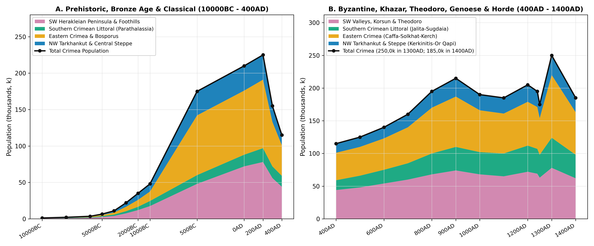
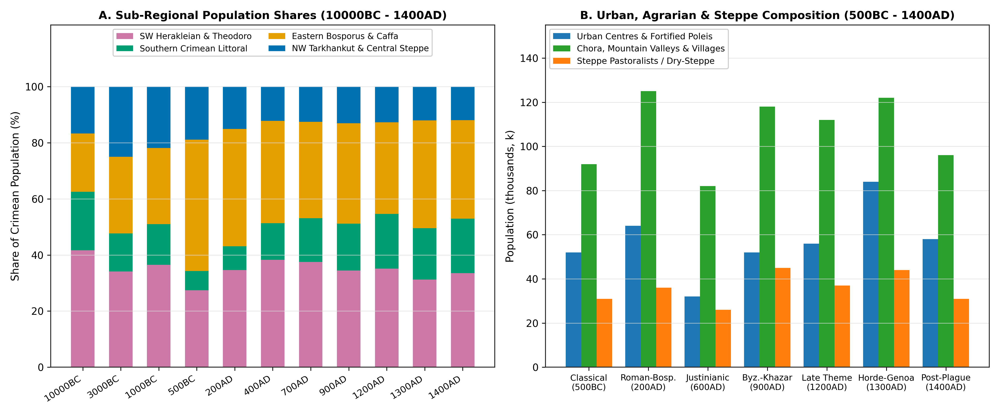
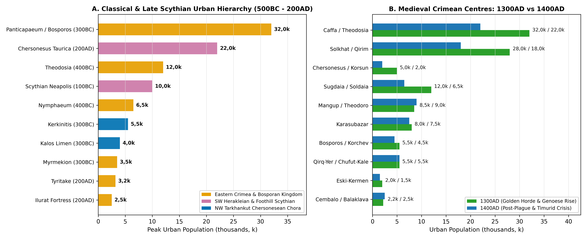

# Regional Subdivisions and Geographic Scope

This literature review compiles the demographic and settlement history
of the Crimean Peninsula (*Taurica*, ~26 945 km² land area; 505
5-arcminute grid cells covering 30 488 km² including coastal cells) from
the Final Pleistocene and Early Holocene (10000BC) to the late Golden
Horde, Genoese, and Theodorite benchmark of 1400AD (post-1400AD
developments under the independent Crimean Khanate, Ottoman Eyâlet of
Kefe, and Imperial eras require separate regime handling). Bounded by
the Black Sea (*Pontus Euxinus*) to the west and south, the shallow Sea
of Azov (*Palus Maeotis*) and the hypersaline Sivash lagoon system to
the north-east, and the Kerch Strait (*Kimmerian Bosporus*) to the east,
Crimea connects to the Pontic steppe via the 7 km-wide Perekop Isthmus
(*Taphros* / *Or Qapi*) and the narrow Arabat Spit. Internally, the
peninsula divides along natural topographic and hydrological boundaries
into three primary ecological belts: the northern and central dry-steppe
plain (~72% of land area), the three parallel cuestas of the Crimean
Mountains (the Outer, Inner, and Main *Yayla* ranges, rising to 1 545 m
at Roman-Kosh) dissected by the Chorna, Belbek, Kacha, Alma, Salgir, and
Biyuk-Karasu valleys, and the sheltered sub-Mediterranean southern
littoral south-east of the Main Yayla crest.

To align the regional spatial modelling strictly with natural
topographic, hydrological, and historical boundaries, this synthesis
partitions Crimea into four physiographic sub-regions (Table ). The
South-Western Herakleian Peninsula, Premontane Valleys, and Cave-Town
Principality of Theodoro (~5 800 km² land area; 75 grid cells) is
bounded on the south-east by the crest of the Western Main Yayla Ridge
(north of the Baidar-Balaklava coastal scarp) and encompasses the
Herakleian Peninsula (*Chersonesus Taurica* / *Korsun*), the Chorna,
Belbek, Kacha, Alma, and Upper Salgir foothill valleys, the cuesta
table-mountains (*mesas*) of the Inner Range (Mangup-Doros, Eski-Kermen,
Chufut-Kale / *Qirq-Yer*, Bakla, Tepe-Kermen, Kachi-Kalyon, and
Kalamita), and the Bakhchisaray and Simferopol (*Scythian Neapolis*)
basins.

The Southern Crimean Littoral and Main Yayla Mountain Range (~2 750 km²
land area; 33 grid cells) is bounded naturally on the north-west by the
watershed crest of the Main Yayla Range (Ai-Petri, Yalta, Babugan,
Chatyr-Dag, Demerdzhi, and Karabi *Yaylas*), encompassing the narrow
sub-Mediterranean coastal amphitheatres from Cembalo (Symbolon /
Balaklava) and Foros eastward past Simeiz, Alupka, Charax, Oreanda,
Jalita (Yalta), Gorzouvitai (Gurzuf), Partenit, Lambat, and Aluston
(*Lusta* / Alushta) to Sugdaia (*Soldaia* / Sudak); historically this
zone was administered as the Byzantine *Parathalassia* (*Klimata*) and
the Genoese *Capitanate of Gotthia*.

Eastern Crimea, the Salgir-Biyuk-Karasu Valley, the Caffa-Solkhat Basin,
and the Kerch Bosporus (~6 650 km² land area; 162 grid cells) is bounded
on the north-west by the diagonal course of the Salgir River channel
toward the Sivash lagoon, encompassing the Biyuk-Karasu valley
(Karasubazar), the Golden Horde regional capital of Solkhat (*Qirim* /
Staryi Krym), the Feodosia (*Theodosia* / *Caffa*) bay and
Karadag-Koktebel (*Tepsen*) littoral, and the European heartland of the
Bosporan Kingdom on the Kerch Peninsula (Panticapaeum / *Bosporos* /
*Korchev*, Nymphaeum, Myrmekion, Tyritake, Kimmerikon, Kytaia, Akra, and
the fortified rural *chora* behind the Uzunlarsky and Tyritake
ramparts). Finally, the North-Western Tarkhankut Peninsula, Central
Crimean Steppe, and Perekop-Sivash Isthmus (~11 745 km² land area; 235
grid cells) is bounded on the south-east by the Salgir River channel and
on the south by the Outer Cuesta foothills, encompassing the limestone
coastline of the Tarkhankut Peninsula and the North-Western Chersonesean
*chora* (Kerkinitis, Kalos Limen, Chaika, Belyaus, Panskoye I, Masliny,
Kara-Tobe, Kulchuk, and Tarpanchi), the central Crimean dry steppe, and
the northern fortified gateway at Perekop (*Taphros* / *Or Qapi*) and
the Sivash lagoons.

| Sub-Region | Area (% Share) | Principal Urban & Archaeological Centres | Key Benchmark Populations |
|:---|:---|:---|:---|
| South-Western Herakleian, Foothills & Theodoro | 5 800 km² (21,5%) | Chersonesus (Korsun), Scythian Neapolis, Mangup (Theodoro), Qirq-Yer (Chufut-Kale), Eski-Kermen, Kalamita | 17,5k (1000BC); 78,0k (200AD); 74,0k (900AD); 78,0k (1300AD); 62,0k (1400AD) |
| Southern Crimean Littoral & Main Yayla | 2 750 km² (10,2%) | Cembalo (Symbolon), Foros, Charax, Jalita (Yalta), Gorzouvitai (Gurzuf), Partenit, Aluston, Sugdaia (Soldaia) | 7,0k (1000BC); 19,0k (200AD); 36,0k (900AD); 46,0k (1300AD); 36,0k (1400AD) |
| Eastern Crimea, Caffa-Solkhat & Bosporus | 6 650 km² (24,7%) | Panticapaeum (Bosporos/Korchev), Theodosia (Caffa), Solkhat (Qirim), Karasubazar, Nymphaeum, Ilurat, Tepsen | 13,0k (1000BC); 94,0k (200AD); 77,0k (900AD); 96,0k (1300AD); 65,0k (1400AD) |
| North-Western Tarkhankut & Central Steppe | 11 745 km² (43,6%) | Kerkinitis, Kalos Limen, Belyaus, Panskoye I, Masliny, Chaika, Kara-Tobe, Kulchuk, Or Qapi (Taphros/Perekop) | 10,5k (1000BC); 34,0k (200AD); 28,0k (900AD); 30,0k (1300AD); 22,0k (1400AD) |
| Total Crimean Peninsula (10000BC - 1400AD) | 26 945 km² (100,0%) | 171 Georeferenced Pre-1400AD Settlements in Regional Gazetteer | 48,0k (1000BC); 225,0k (200AD); 215,0k (900AD); 250,0k (1300AD); 185,0k (1400AD) |

Physiographic and historical sub-regions of Crimea (~26 945 km²) with
principal urban centres and benchmark populations (10000BC - 1400AD).

# Prehistoric Foragers, Pastoralists and Early Iron Age Tauri (10000BC - 1000BC)

## Terminal Pleistocene, Shan-Koba / Murzak-Koba Mesolithic and Neolithic (10000BC - 5000BC)

During the Late Glacial and Early Holocene transition (10000BC -
8000BC), when the Black Sea stood 60 to 80 metres below its present
level as the freshwater Neoeuxine lake, human settlement in Crimea
concentrated in the sheltered limestone rock-shelters (*grottoes*) of
the Inner Cuesta and Chornaya-Belbek-Kacha-Zuya river gorges
[\[1\]](#ref-cherkasov2014)[\[2\]](#ref-chabai2004). Continuity from
Upper Palaeolithic sites such as Buran-Kaya III (on the Burulcha River),
Siuren I (on the Belbek), Kabazi II, Zaskalnaya, and Kiik-Koba gave rise
to two sequential Mesolithic archaeological complexes documented by G.
A. Bonch-Osmolovsky, S. N. Bibikov, and D. Ya. Telegin
[\[3\]](#ref-cherkasov2018)[\[4\]](#ref-telegin1985).

The Shan-Koba Culture (Final Pleistocene to Early Preboreal,
c. 10000-7500BC) is characterised by lunate geometric microliths and
intensive hunting of red deer, saiga antelope, wild boar, and
forest-steppe equids across rock-shelters at Shan-Koba, Fatma-Koba Layer
6, Grot Skalisty (on the Bodrak), Zamil-Koba I, and Buran-Kaya III
[\[3\]](#ref-cherkasov2018). Across the peninsula’s river canyons and
expanded coastal plain, seasonal foraging bands (35 - 80 persons per
multi-family rock-shelter aggregation) supported an estimated regional
population of 1,2k (1 200) at 10000BC, rising to 2,1k (2 100) by 8000BC
as Boreal warming expanded oak-pistachio woodlands across the foothill
valleys.

The subsequent Murzak-Koba (Tardigravettian / Tardenoisian) Culture
(7500-5500BC) and Crimean Neolithic (6000-5000BC) are documented by
excavations at Murzak-Koba (in the Chornaya gorge, famous for its double
Mesolithic burial showing ritual finger-phalange amputation),
Fatma-Koba, Laspi VII on the southern coast, Tash-Air I in the Kacha
canyon, Kaya-Arasy near Bakhchisaray, At-Bash on the Ai-Petri *Yayla*,
and Frontovoye I on the Kerch Peninsula. These assemblages demonstrate a
shift toward trapeziform microliths, *Helix* land-snail harvesting,
coastal fishing, and incipient swine and ovicaprid domestication
[\[1\]](#ref-cherkasov2014)[\[3\]](#ref-cherkasov2018)[\[4\]](#ref-telegin1985).
By 6000BC, Crimean population reached 3,5k (3 500), nearly doubling to
6,5k (6 500) at 5000BC with the establishment of permanent Neolithic
open-air villages at Tash-Air I, Kaya-Arasy, Alekseevka on the
Tarkhankut Peninsula, and Frontovoye.

## Eneolithic, Kemi-Oba Megalithic Culture and the Bronze Age - Tauri Transition (4000BC - 1000BC)

Between 4000BC and 2000BC, Crimea became a contact zone between Pontic
steppe kurgan pastoralists (Sredny Stog, Yamnaya, and Catacomb cultures)
and North Caucasian metalworking traditions
[\[5\]](#ref-shchepinsky1966)[\[6\]](#ref-bezborodykh2018). During the
Early and Middle Bronze Age (3200-2200BC), the indigenous Kemi-Oba
Culture (named after the kurgan sanctuary near Bilohirsk excavated by A.
A. Shchepinsky) occupied the premontane valleys from Sevastopol to the
Salgir and Biyuk-Karasu basins. Kemi-Oba communities constructed
timber-and-stone cist graves painted with polychrome ochre geometric
friezes, erected anthropomorphic stone stelae (*Bakhchi-Eli* and
*Kazanki*), and practised mixed valley-bottom agriculture and
transhumant *Yayla* grazing
[\[5\]](#ref-shchepinsky1966)[\[6\]](#ref-bezborodykh2018). Combining
Kemi-Oba foothill settlements (7,50k in 3000BC and 12,0k in 2000BC in
the south-western premontane zone) with Yamnaya and Catacomb kurgan
groups across the Kerch Peninsula (Kamenka-Bosporan and Planerskoye) and
Tarkhankut-Sivash steppes, total Crimean population rose from 11,0k at
4000BC to 22,0k at 3000BC and 35,0k at 2000BC.

During the Late Bronze Age and Early Iron Age transition (1500-800BC),
Sabatinovka and Belozerka agricultural villages in the steppe coexisted
with the Kizil-Koba Culture of the Crimean Mountains and foothills,
universally identified by Kh. I. Kris and V. A. Kolotukhin with the
historical Tauri (*Tauroi*) described by Herodotus (*Histories*
IV.99-103) and Euripides
[\[7\]](#ref-kris1981)[\[8\]](#ref-kolotukhin1996)[\[9\]](#ref-kruglov2025).
Anchored by the 12 ha fortified promontory settlement of Uch-Bash
overlooking the Chornaya mouth near Inkerman (0,9k - 1,2k inhabitants),
the type-site of Kizil-Koba (*Krasnaya Peshchera*) in the Upper Salgir
valley, Druzhnoye, Tash-Dzhargan, and megalithic stone-box
(*ashchechnye*) cemeteries across the Baidar valley and Southern Coast
(Malorechenskoye, Oreanda, Simeiz, and Gurzuf), the Tauri and
pre-colonial steppe communities sustained a regional population of 48,0k
(48 000) at 1000BC (17,5k in the south-western foothills, 7,00k along
the southern coast, 13,0k in eastern Crimea, and 10,5k across the
north-western steppe).

# Classical Antiquity: Greek Poleis, Bosporan Chora and the Late Scythian Kingdom (500BC - 400AD)

## The European Bosporan Kingdom and the Chersonesean Chora (500BC - 0AD)

Greek maritime colonisation in the sixth and fifth centuries BC
triggered the first great demographic expansion in Crimean history,
lifting total population from 48,0k in 1000BC to 175,0k in 500BC and
210,0k at 0AD
[\[10\]](#ref-maslennikov1998)[\[11\]](#ref-shcheglov1978)[\[12\]](#ref-carter2000).
Two distinct colonial systems reshaped the peninsula.

In the European Bosporus of eastern Crimea (82,0k at 500BC; 88,0k at
0AD; 94,0k at 200AD), Milesian colonists founded Panticapaeum (modern
Kerch) on Mount Mithridates c. 600BC, which became the capital of the
Archaeanactid (480BC) and Spartocid (438-108BC) dynasties of the
Bosporan Kingdom. At its Classical-Hellenistic and early Roman zenith,
Panticapaeum enclosed ~100 ha of terraced acropolis, agora, craft
quarters, and harbour suburbs housing 22,0k to 28,0k inhabitants
[\[10\]](#ref-maslennikov1998)[\[13\]](#ref-evdokimov2011). Flanking the
capital along the Kerch Strait and Azov-Black Sea coasts stood a dense
urban network: Theodosia (annexed by Leucon I c. 380BC as a major
grain-exporting port capable of berthing 100 ships, 6,0k at 500BC),
Nymphaeum (4,5k), Myrmekion (3,5k), Tyritake (3,2k - 4,0k, famed for its
fish-salting vats), Kimmerikon (2,5k - 3,0k), Kytaia (2,2k - 2,9k),
Porthmion (1,8k), Akra (1,5k - 1,9k), and Zenon’s Chersonesus (1,4k -
2,1k). Shielded behind the monumental earthen Tyritake and Uzunlarsky
Ramparts (36 km long from the Sea of Azov to Lake Uzunlar), the Kerch
interior supported over 280 rural estates and fortified towns
(Andreevka-Yuzhnaya, Generalskoye-Zapadnoye, Polyanka, Zolotoe,
Tasunovo, Mikhailovka, Artesian, and Ilurat), supplying Athens with 400
000 *medimnoi* (~16 500 tonnes) of wheat annually under Leucon I
[\[10\]](#ref-maslennikov1998)[\[14\]](#ref-abramzon2016).

In Dorian Chersonesus Taurica and the North-Western Crimean Chora (48,0k
and 33,0k at 500BC), Heraclea Pontica founded Chersonesus Taurica in
422/421BC on Quarantine Bay (following an earlier sixth-century Ionian
emporium). Chersonesus expanded across a 38 ha orthogonal grid enclosed
by ashlar walls, supporting 4,5k inhabitants in 500BC and rising to
16,0k in 0AD and 20,0k in 200AD
[\[15\]](#ref-zedgenidze2015)[\[16\]](#ref-zubar1994). On the Herakleian
Peninsula (~10 000 ha), G. M. Nikolaenko and J. C. Carter’s surveys have
mapped 415 stone-walled cadastral land-lots (*kleroi* of 26,5 ha each,
subdivided into vineyards and orchards with fortified *pyrgoi* farmhouse
towers), supporting an immediate suburban *chora* population of 6,0k -
8,0k [\[12\]](#ref-carter2000)[\[17\]](#ref-nikolaenko1999). In the
mid-fourth century BC, Chersonesus incorporated the North-Western
Crimean Chora along the Tarkhankut coast, including the older Ionian
polis of Kerkinitis (Yevpatoria, 8,5 ha, 4,2k at 500BC), Kalos Limen
(Chornomorske, 2,5k - 2,8k), and dozens of fortified coastal estates and
grain-collecting stations at Panskoye I, Belyaus, Chaika, Masliny,
Kara-Tobe, Kulchuk, Tarpanchi, and Dzhangul
[\[11\]](#ref-shcheglov1978)[\[18\]](#ref-antonov2017)[\[19\]](#ref-antonov2021).

## The Late Scythian Kingdom, Mithridates VI and the Roman Military Protectorate (200BC - 400AD)

Under pressure from Sarmatian tribes crossing the Don in the third and
second centuries BC, Royal Scythian elites consolidated the Late
Scythian State in Crimea (*Scythia Minor*), establishing their fortified
capital at Scythian Neapolis (*Kermen-Chuk*, a 20 ha stone-walled
citadel on the Petrovskaya rocks in modern Simferopol, housing King
Skilurus’s mausoleum, megaron palace, and ashlar granaries, with 7,5k -
8,0k inhabitants in 0AD - 200AD)
[\[20\]](#ref-vysotskaya1979)[\[21\]](#ref-popova2011)[\[22\]](#ref-puzdrovsky2007).
Late Scythian kings Skilurus and Palakus overran the North-Western
Chersonesean *chora* (occupying Kerkinitis, Kalos Limen, Chaika,
Belyaus, and Tarpanchi) and constructed a chain of over 50 fortified
*gorodishcha* along the Alma, Kacha, Belbek, and Salgir foothill rivers,
led by the coastal port-citadel of Ust-Alma (Palakion, 6 ha, 3,5k -
4,0k), Kermen-Kyr (Chabion, 2,8k), Bulganak (Khaboi, 2,5k), Alma-Kermen
(2,2k), Belogorsk-Ak-Kaya (2,8k), Zayachye (1,5k), and Dobroye (1,6k)
[\[18\]](#ref-antonov2017)[\[21\]](#ref-popova2011)[\[23\]](#ref-khodyreva2026).

Intervention by Mithridates VI Eupator’s general Diophantus (110-107BC)
rescued Chersonesus and integrated Crimea into the Pontic Empire before
Roman hegemony was established after 63BC [\[16\]](#ref-zubar1994).
Under the Principate (first to third centuries AD), Rome stationed
vexillations of Legions *I Italica*, *V Macedonica*, and *XI Claudia*
along with the *Classis Flavia Moesica* at the Chersonesus citadel,
Balaklava-Kadykovka (Symbolon), and the cliff-top fortress of Charax on
Cape Ai-Todor (1,8k troops and *canabae* residents at 200AD)
[\[16\]](#ref-zubar1994)[\[24\]](#ref-pavlenkov2024). Simultaneously,
the Bosporan Kingdom under the Sarmatian-descended Tibulii-Sauromates
dynasty constructed heavy stone fortresses across the Kerch interior to
guard against steppe incursions (Ilurat at 2,6k, Artesian at 2,1k,
Mikhailovka at 1,8k, and Tasunovo at 1,3k), bringing Crimea to its
classical demographic apogee of 225,0k (225 000) in 200AD (78,0k in the
south-western zone, 19,0k on the southern coast, 94,0k in the eastern
Bosporan zone, and 34,0k across the north-western steppe)
[\[10\]](#ref-maslennikov1998)[\[13\]](#ref-evdokimov2011).

The Gothic and Borani naval raids of 252-275AD (which sacked Tanais,
Gorgippia, Ilurat, Myrmekion, and the Late Scythian foothill citadels)
and the subsequent Hunnic invasion across the Kerch Strait in 370-376AD
(which destroyed the Bosporan rural *chora*, Scythian Neapolis, and
Ust-Alma) triggered a severe Late Antique demographic trough
[\[23\]](#ref-khodyreva2026)[\[25\]](#ref-aibabin1999). Regional
population contracted to 155,0k in 300AD and bottomed out at 115,0k in
400AD (-48,9% below the 200AD peak), as survivors retreated behind the
walls of Chersonesus and Bosporos or migrated into the forested valleys
of the Crimean Mountains (where the Alanic-Gothic cemeteries of Neyzats,
Opushki, Druzhnoye, Suuk-Su, and Luchistoye mark the genesis of medieval
Crimean Gothia) [\[25\]](#ref-aibabin1999).

# Medieval Crimea: Byzantine Cherson, Gothia, Khazar Tudunate, Kievan Rus, Golden Horde and Genoese Gazaria (500AD - 1400AD)

## Early Byzantine Reconquest, the Cave-Towns of Gothia and the Khazar / Saltovo-Mayaki Boom (500AD - 900AD)

Under Emperor Justinian I (527-565AD) and Maurice (582-602AD), Byzantium
refortified Chersonesus (*Cherson*) and Bosporos, erected the coastal
castles of Aluston (Alushta) and Gorzouvitai (Gurzuf), and constructed
the *Long Walls* closing the mountain passes around the Gothic-Alanic
federate territory of *Dory*
[\[25\]](#ref-aibabin1999)[\[26\]](#ref-aibabin2017). Across the Inner
Cuesta of south-western Crimea, Byzantine military engineers and local
Christianised Gothic-Alanic communities founded the monumental cliff-top
“cave-towns” (*peshchernye goroda*): Mangup-Doros (the 90 ha mesa
plateau capital, rising from 2,5k in 500AD to 7,0k in 900AD),
Eski-Kermen (18 ha plateau with a three-aisled basilica and rock-cut
casemates, rising from 2,8k in 600AD to 5,2k in 900AD), Chufut-Kale
(*Qirq-Yer*, 3,2k in 900AD), Bakla (3,4k in 900AD), Tepe-Kermen (2,4k),
Kachi-Kalyon (2,1k), Kyz-Kermen (1,8k in 800AD), and Kalamita (Inkerman,
2,0k)
[\[26\]](#ref-aibabin2017)[\[27\]](#ref-gertsen1990)[\[28\]](#ref-myts1991).
Regional population recovered steadily from 125,0k in 500AD to 140,0k in
600AD and 160,0k in 700AD.

During the eighth and ninth centuries AD, the establishment of the
Khazar Khaganate and its Crimean governorate (administered by the Khazar
*tudun* at Bosporos, Sugdaia, and periodically Cherson) ushered in the
Saltovo-Mayaki demographic expansion documented by I. A. Baranov and A.
I. Aibabin [\[29\]](#ref-baranov1990)[\[30\]](#ref-aibabin2013).
Semi-nomadic Proto-Bulgarian and Alanic pastoralists sedentarised across
over 260 open villages, potteries, and vineyards in Eastern and Foothill
Crimea. Sugdaia (Sudak) emerged as a major trans-Pontic emporium (7,5k
in 800AD and 9,0k in 900AD), flanked by the sprawling 18 ha coastal
craft and monastic centre of Tepsen (Koktebel, 3,4k in 900AD),
Kordon-Oba (1,8k), Otuz (Shchebetovka, 1,4k), Geroevskoye, and Ptashkino
on the Kerch Peninsula
[\[29\]](#ref-baranov1990)[\[31\]](#ref-gorbunov2024). In Byzantine
Cherson (elevated to the capital of the *Theme of Klimata / Cherson*
under Emperor Theophilos in 833/841AD), urban population reached 11,5k -
12,0k in 800-900AD
[\[32\]](#ref-romanchuk2005)[\[33\]](#ref-yakobson1964). Total Crimean
population climbed to 195,0k in 800AD and attained an early medieval
peak of 215,0k in 900AD (74,0k in the south-west, 36,0k on the southern
coast, 77,0k in the east, and 28,0k in the north-west).

## Kievan Rus Korsun and Korchev, Pecheneg-Cuman Steppe Raids and the 1200AD Recovery (900AD - 1250AD)

The arrival of the Pechenegs in the Pontic steppes (c. 900-960AD) and
Prince Svyatoslav Igorevich’s destruction of the Khazar Khaganate
(965AD) disrupted open Saltovo-Mayaki villages in Eastern Crimea and the
Kerch steppe (including the burning of Tepsen and Kordon-Oba), causing
regional population to contract to 190,0k in 1000AD and 185,0k in 1100AD
[\[29\]](#ref-baranov1990)[\[34\]](#ref-chkhaidze2010). Simultaneously,
Crimea was drawn directly into the political and ecclesiastical orbit of
Kievan Rus.

During the Korsun campaign of Vladimir the Great in 988-989AD, following
a multi-month siege that severed the city’s water pipes, Grand Prince
Vladimir Svyatoslavich captured Byzantine Cherson (*Korsun*), accepted
baptism in the city’s episcopal complex, married the Porphyrogenita
princess Anna, and returned Korsun to Emperor Basil II as his bride-gift
while transferring priests, icons, and bronze quadriga statues to Kiev
[\[32\]](#ref-romanchuk2005)[\[33\]](#ref-yakobson1964). Throughout the
eleventh and twelfth centuries, Korsun (10,0k in 1000AD; 8,0k - 8,5k in
1100-1200AD) functioned as the premier Byzantine-Rus trade staple
(*Korsuniane* merchants in Kiev and Novgorod). Across the Kerch Strait,
in the Rus Principality of Tmutarakan and Korchev (988-1094AD), the
Rurikid princes of Tmutarakan (Mstislav Vladimirovich, Gleb
Svyatoslavich, Rostislav Vladimirovich, and Oleg Svyatoslavich) ruled
Korchev (ancient Bosporos / Kerch, 7,5k in 1000AD; 6,5k - 7,0k in
1100-1200AD), as commemorated by Prince Gleb’s famous 1068AD *Tmutarakan
Stone* measuring the 14 000-fathom ice crossing between Tmutarakan and
Korchev [\[34\]](#ref-chkhaidze2010).

By 1200AD, under the stable commercial condominium of the Polovtsians
(Cumans), the Empire of Trebizond, and the Seljuk Sultanate of Rum,
Sugdaia (*Surozh* in Russian chronicles) reached 11,0k inhabitants as
the chief silk-and-fur port of the Black Sea, while the fortified
mountain towns of Gothia (Mangup at 7,0k, Eski-Kermen at 4,8k,
Chufut-Kale at 3,8k, Bakla at 3,0k, Aluston at 3,5k, and Gorzouvitai at
2,8k) expanded, lifting total Crimean population to 205,0k in 1200AD
[\[28\]](#ref-myts1991)[\[33\]](#ref-yakobson1964).

## The Mongol Invasions, Golden Horde Solkhat, Genoese Gazaria and the Principality of Theodoro (1223AD - 1400AD)

Mongol armies under Jebe and Subutai raided Sugdaia in January 1223AD,
followed by Batu’s conquest of the Crimean steppe in 1238-1239AD and
Nogai’s devastating punitive campaign of 1299AD (which sacked Korsun,
Eski-Kermen, Bakla, and Sugdaia to avenge the killing of his grandson
Aktaji) [\[33\]](#ref-yakobson1964)[\[35\]](#ref-myts2024). While the
initial Mongol shock reduced Crimean population from 195,0k in 1240AD to
a brief trough of 175,0k in 1250AD, the integration of Crimea into the
trans-Eurasian *Pax Mongolica* as the western maritime gateway of the
Golden Horde (*Ulus of Jochi*) generated an unprecedented urban and
commercial boom by 1300AD (250,0k regional total).

Established in the sheltered Agarmysh valley of eastern Crimea as the
seat of the Golden Horde *tumen-bashi* (governor of the Crimean *ulus*),
Solkhat (*Qirim*, from which the entire peninsula took its name) grew
into a 300 ha walled Islamic and multi-confessional metropolis featuring
the Mosque of Sultan Baybars (1287-1288AD), the Mosque and Madrasa of
Uzbek Khan (1314AD), Armenian and Greek churches, caravanserais, mints,
and hydraulic pipe networks
[\[35\]](#ref-myts2024)[\[36\]](#ref-useinov2022)[\[37\]](#ref-karpov2000).
At its 1300-1340AD zenith, Solkhat housed 28,0k (28 000) inhabitants
(18,0k in 1400AD), complemented by the rising inland market city of
Karasubazar (Bilohirsk, 8,0k in 1300AD and 7,5k in 1400AD) and the
fortified cliff-top residence at Chufut-Kale (*Qirq-Yer*) and Eski-Yurt
/ Salachik in the Bakhchisaray valley (5,5k and 3,5k in 1300-1400AD)
[\[38\]](#ref-inalcik1996)[\[39\]](#ref-fisher1978)[\[40\]](#ref-vodarsky2003)[\[41\]](#ref-prokhorov2011).

In Genoese Gazaria, following commercial concessions granted at ancient
Theodosia by Mengu-Timur Khan in 1266AD, the Republic of Genoa
transformed Caffa (Feodosia) into a massive double-walled maritime city
enclosing 90 ha (a citadel and outer *burgh* with 26 towers protecting
11 000 - 15 000 urban plots and suburban *borghi* populated by
Armenians, Greeks, Italians, Tatars, Jews, and Rus)
[\[37\]](#ref-karpov2000)[\[42\]](#ref-ozturk2019)[\[43\]](#ref-ozturk2000)[\[44\]](#ref-bocharov2017).
Prior to the outbreak of the Black Death during Janibeg Khan’s siege of
Caffa in 1346AD, Caffa housed 32,0k - 40,0k inhabitants at the
1300-1345AD peak (bringing the eastern Crimean sub-region to 96,0k in
1300AD). Genoa further acquired Cembalo (Balaklava, 1343/1357AD, 2,2k in
1300AD and 2,5k in 1400AD), Soldaia (Sudak, 1365AD, with its 18 coastal
villages and monumental 14-tower fortress, 12,0k in 1300AD and 6,5k in
1400AD), Vosporo (Kerch, 5,5k in 1300AD and 4,5k in 1400AD), and the
coastal castles of the *Capitanate of Gotthia* (Aluston / *Lusta* at
4,0k, Gorzouvitai at 3,2k, Partenit at 2,6k, Jalita / Yalta at 3,0k, and
Foros at 1,6k)
[\[28\]](#ref-myts1991)[\[31\]](#ref-gorbunov2024)[\[44\]](#ref-bocharov2017)[\[45\]](#ref-kurnikova2026).

In the south-western mountains and Belbek-Kacha-Chorna valleys, the
Greek-Gothic dynasty of the Gabrades consolidated the Christian
Principality of Theodoro, expanding the citadel and three-line defensive
walls of Mangup (8,5k in 1300AD and 9,0k at the 1400AD benchmark),
constructing the port fortress of Kalamita (Inkerman, 2,5k in 1400AD) to
rival Genoese Cembalo, and fortifying the eastern border castle of Funa
at the foot of Mount Demerdzhi alongside Syuyren, Kermenchik, and
Chorgun
[\[27\]](#ref-gertsen1990)[\[28\]](#ref-myts1991)[\[35\]](#ref-myts2024).

## The 1346AD Black Death, Golden Horde Civil Wars and the 1400AD Cutoff

Recurrent waves of bubonic plague after Janibeg’s 1346AD siege of Caffa,
internecine warfare within the Golden Horde during the *Great Troubles*
(*Velikaya Zamolnya*, 1359-1380AD, when Mamai controlled the Crimean
*ulus*), and the campaigns of Timur (1395-1396AD) and Edigu (who
besieged Korsun and sacked its remaining quarters in 1399AD) reduced
Crimea’s population from 250,0k in 1300AD to 185,0k at the 1400AD
terminal benchmark (62,0k in the south-west, 36,0k on the southern
coast, 65,0k in the east, and 22,0k in the north-west; with urban
populations at Caffa 22,0k, Solkhat 18,0k, Mangup 9,0k, Karasubazar
7,5k, Soldaia 6,5k, Qirq-Yer 5,5k, Vosporo 4,5k, Cembalo 2,5k, and
Korsun 2,0k)
[\[35\]](#ref-myts2024)[\[42\]](#ref-ozturk2019)[\[46\]](#ref-troynitsky1904)[\[47\]](#ref-borshchik2018).
Because the subsequent secession of the independent Crimean Khanate
under Haji I Giray (1441AD) and the Ottoman conquest of Caffa, Soldaia,
and Mangup (1475AD) initiated a distinct early modern fiscal and
demographic regime, this literature review and its companion spatial
calibration terminate at 1400AD.

# Master Regional Population Estimates (10000BC - 1400AD)

Table synthesises the complete benchmark population trajectory for
Crimea (~26 945 km²) and its four natural sub-regions from 10000BC to
1400AD.

| Year | SW & Theodoro | South Coast | East & Bosporus | NW & Steppe | Total Pop. | Historical & Archaeological Context |
|:---|:---|:---|:---|:---|:---|:---|
| 10000BC | 0,50k | 0,25k | 0,25k | 0,20k | 1,2k | Upper Palaeolithic / Early Shan-Koba Grottoes (Kiik-Koba, Siuren I, Buran-Kaya III) |
| 8000BC | 0,85k | 0,45k | 0,45k | 0,35k | 2,1k | Boreal Shan-Koba Mesolithic Foragers (Shan-Koba, Fatma-Koba, Grot Skalisty) |
| 6000BC | 1,40k | 0,75k | 0,75k | 0,60k | 3,5k | Atlantic Murzak-Koba Mesolithic & Early Neolithic (Murzak-Koba, Laspi VII, Zamil-Koba) |
| 5000BC | 2,50k | 1,20k | 1,50k | 1,30k | 6,5k | Crimean Neolithic Expansion (Tash-Air I, Kaya-Arasy, Frontovoye I, At-Bash) |
| 4000BC | 4,00k | 1,80k | 2,80k | 2,40k | 11,0k | Eneolithic Steppe & Foothill Pastoralism (Sredny Stog & Early Copper Age) |
| 3000BC | 7,50k | 3,00k | 6,00k | 5,50k | 22,0k | Early Bronze Age Kemi-Oba Megalithic & Yamnaya Cultures (Kemi-Oba, Bakhchi-Eli) |
| 2000BC | 12,0k | 4,50k | 9,50k | 9,00k | 35,0k | Middle Bronze Age Catacomb & Late Kemi-Oba Settlements (Kamenka, Planerskoye) |
| 1000BC | 17,5k | 7,00k | 13,0k | 10,5k | 48,0k | Late Bronze / Early Iron Age Tauri Kizil-Koba Culture (Uch-Bash, Kizil-Koba) |
| 500BC | 48,0k | 12,0k | 82,0k | 33,0k | 175,0k | Archaic-Classical Greek Colonisation (Panticapaeum, Chersonesus, Theodosia, Kerkinitis) |
| 0AD | 72,0k | 16,0k | 88,0k | 34,0k | 210,0k | Hellenistic-Roman Transition & Late Scythian State (Scythian Neapolis, Ust-Alma) |
| 200AD | 78,0k | 19,0k | 94,0k | 34,0k | 225,0k | Roman Protectorate & Bosporan Apogee (Charax, Chersonesus 20k, Panticapaeum 28k) |
| 300AD | 56,0k | 16,0k | 61,0k | 22,0k | 155,0k | Post-Gothic Raid Contraction (Destruction of Tanais, Ilurat & Scythian Foothill Forts) |
| 400AD | 44,0k | 15,0k | 42,0k | 14,0k | 115,0k | Post-Hunnic Trough (370-376AD Collapse of Bosporan Chora & Migration into Mountains) |
| 500AD | 48,0k | 18,0k | 44,0k | 15,0k | 125,0k | Early Byzantine Reconquest under Anastasius & Justinian I (Aluston, Gorzouvitai, Doros) |
| 600AD | 54,0k | 21,0k | 48,0k | 17,0k | 140,0k | Byzantine Exarchate & Rise of Gothic Cave-Towns (Mangup, Eski-Kermen, Chufut-Kale) |
| 700AD | 60,0k | 25,0k | 55,0k | 20,0k | 160,0k | Early Khazar Condominium & Crimean Tudunate (Cherson, Bosporos, Sugdaia) |
| 800AD | 68,0k | 32,0k | 70,0k | 25,0k | 195,0k | Saltovo-Mayaki Sedentarisation Boom (260+ Eastern & Foothill Villages, Tepsen) |
| 900AD | 74,0k | 36,0k | 77,0k | 28,0k | 215,0k | Byzantine Theme of Klimata / Cherson & Khazar Apogee (Cherson 12k, Sugdaia 9k) |
| 1000AD | 68,0k | 34,0k | 64,0k | 24,0k | 190,0k | Kievan Rus Korsun Campaign (988AD) & Tmutarakan-Korchev Principality (Post-Khazar Shift) |
| 1100AD | 65,0k | 35,0k | 61,0k | 24,0k | 185,0k | Cuman (Polovtsian) Steppe Hegemony & Byzantine-Rus Trade at Korsun and Korchev |
| 1200AD | 72,0k | 40,0k | 67,0k | 26,0k | 205,0k | Pre-Mongol Commercial Recovery (Sugdaia/Surozh 11k, Mangup 7k, Korsun 8k) |
| 1240AD | 69,0k | 38,0k | 64,0k | 24,0k | 195,0k | Initial Mongol Incursions (1223AD & 1238-1239AD Steppe Campaigns) |
| 1250AD | 63,0k | 35,0k | 56,0k | 21,0k | 175,0k | Post-Conquest Transition & Early Ulus of Jochi Reorganisation |
| 1300AD | 78,0k | 46,0k | 96,0k | 30,0k | 250,0k | Golden Horde Solkhat (28k) & Genoese Caffa (32k) Maritime Apogee (despite 1299AD Raid) |
| 1400AD | 62,0k | 36,0k | 65,0k | 22,0k | 185,0k | Post-1346AD Black Death, Horde Civil Wars & 1395-1399AD Timur/Edigu Raids; Theodoro Peak |

Master benchmark population estimates for Crimea across its four
physiographic sub-regions from 10000BC to 1400AD.

# Sources

1.
Cherkasov, Aleksey Vladimirovich.
“Antropologicheskie Ostanki Paleolita v Krymu: K Istorii i Istoriografii
Izucheniya.” *Vestnik Tomskogo Gosudarstvennogo Universiteta*, no. 384,
2014, pp. 122-28,
<https://cyberleninka.ru/article/n/antropologicheskie-ostanki-paleolita-v-krymu-k-istorii-i-istoriografii-izucheniya>.

2.
Chabai, Victor P., et al. *The
Middle Paleolithic and Early Upper Paleolithic of Eastern Crimea*.
ERAUL, 2004, <https://doi.org/10.1007/978-1-4020-5302-3_11>.

3.
Cherkasov, Aleksey Vladimirovich.
“K Probleme Izucheniya Mezolita v Otechestvennoy Istoriografii
1920-1980-Kh Gg. (Po Materialam Krymskikh Issledovaniy).” *Vestnik
Nizhegorodskogo Universiteta Im. N. I. Lobachevskogo*, no. 5, 2018, pp.
73-79,
<https://cyberleninka.ru/article/n/k-probleme-izucheniya-mezolita-v-otechestvennoy-istoriografii-1920-1980-h-gg-po-materialam-krymskih-issledovaniy>.

4.
Telegin, D. Ya. *Pamyatniki Epokhi
Mezolita Na Territorii Ukrainskoy SSR*. Naukova Dumka, 1985,
<https://search.worldcat.org/search?q=Pamyatniki+epokhi+mezolita+territorii+Ukrainskoy+SSR+Telegin+1985>.

5.
Shchepinsky, A. A. “Kultury
Eneolita i Bronzy v Krymu.” *Sovetskaya Arkheologiya*, no. 2, 1966, pp.
10-23,
<https://cyberleninka.ru/article/n/kultury-eneolita-i-bronzy-v-krymu>.

6.
Bezborodykh, Vitaliy Ivanovich,
and Sergey Vladimirovich Vasilyev. “Cherepa Epokhi Ranney i Sredney
Bronzy Iz Kryma.” *Izvestiya Irkutskogo Gosudarstvennogo Universiteta.
Seriya: Geoarkheologiya. Etnologiya. Antropologiya*, vol. 25, 2018, pp.
112-29, <https://doi.org/10.26516/2227-2380.2018.25.143>.

7.
Kris, Kh. I. *Kizil-Kobinskaya
Kultura i Tavry*. Nauka, 1981,
<https://search.worldcat.org/search?q=Kizil+kobinskaya+kultura+tavry+Kris+1981>.

8.
Kolotukhin, V. A. *Gorniy Krym v
Epokhu Pozdney Bronzy - Nachale Zheleznogo Veka: Etnokulturnye
Protsessy*. Yuzhnogorodskie Vedomosti, 1996,
<https://search.worldcat.org/search?q=Gorniy+Krym+epokhu+pozdney+bronzy+nachale+zheleznogo+veka+Kolotukhin+1996>.

9.
Kruglov, Evgeniy Anastasovich. “Iz
Predystorii Arteka: Ot Tavrov Evripida k Chitatelyam a. P. Chekhova i
Arkadiya Gaydara.” *Izvestiya UFITS RAN. Seriya: Istoriya. Filologiya.
Kultura*, vol. 2, 2025, pp. 45-58,
<https://doi.org/10.31833/sifk/2025.2.1.02>.

10.
Maslennikov, A. A. *Ellinskaya
Khora Na Krayu Oykumeny: Selskaya Territoriya Evropeyskogo Bospora v
Antichnuyu Epokhu*. Indrik, 1998,
<https://search.worldcat.org/search?q=Ellinskaya+khora+krayu+Oykumeny+Selskaya+territoriya+evropeyskogo+Bospora+Maslennikov+1998>.

11.
Shcheglov, A. N. *Severo-Zapadniy
Krym v Antichnuyu Epokhu*. Nauka, 1978,
<https://search.worldcat.org/search?q=Severo+Zapadniy+Krym+antichnuyu+epokhu+Shcheglov+1978>.

12.
Carter, Joseph Coleman, et al.
“The Chora of Chersonesos in Crimea, Ukraine.” *American Journal of
Archaeology*, vol. 104, no. 4, 2000, pp. 707-41,
<https://doi.org/10.2307/507154>.

13.
Evdokimov, Denis Olegovich.
“Izmeneniya v Sostave Selskogo Naseleniya Bosporskogo Tsarstva v Pervye
Veka Nashey Ery.” *Problemy Istorii, Filologii, Kultury*, no. 4, 2011,
pp. 138-49,
<https://cyberleninka.ru/article/n/izmeneniya-v-sostave-selskogo-naseleniya-bosporskogo-tsarstva-v-pervye-veka-nashey-ery>.

14.
Abramzon, Mikhail Grigoryevich,
and Sergey Nikolaevich Ostapenko. “Klad Mednykh Bosporskikh Monet IV-i
Vv. Do n. E. S Antichnogo Poseleniya Veselovka 5.” *Problemy Istorii,
Filologii, Kultury*, no. 2, 2016, pp. 192-205,
<https://doi.org/10.18503/1992-0431-2016-2-52-260-267>.

15.
Zedgenidze, Angelina Andreevna.
“Problema Sakralnykh Mest Khory Khersonesa Tavricheskogo.” *Znanie.
Ponimanie. Umenie*, no. 4, 2015, pp. 168-76,
<https://doi.org/10.17805/zpu.2015.1.17>.

16.
Zubar, V. M. *Khersones
Tavricheskiy i Rimskaya Imperiya: Ocherki Voenno-Politicheskoy Istorii*.
Kievskaya Akademiya Evrobiznesa, 1994,
<https://search.worldcat.org/search?q=Khersones+Tavricheskiy+Rimskaya+imperiya+Ocherki+voenno+politicheskoy+istorii+Zubar+1994>.

17.
Nikolaenko, G. M. *Khora
Khersonesa Tavricheskogo: Zemelniy Kadastr IV-III Vv. Do n. E.* National
Preserve of Tauric Chersonesos, 1999,
<https://doi.org/10.1163/9789004496446_036>.

18.
Antonov, Egor Evgenyevich. “Rannie
Poseleniya Pozdnikh Skifov v Severo-Zapadnom Krymu.” *Problemy Istorii,
Filologii, Kultury*, no. 2, 2017, pp. 185-202,
<https://doi.org/10.18503/1992-0431-2017-3-99>.

19.
Antonov, Egor Evgenyevich.
“Piramidalniy Poyas Kreposti Tarpanchi (Severo-Zapadniy Krym).”
*Problemy Istorii, Filologii, Kultury*, no. 3, 2021, pp. 114-29,
<https://doi.org/10.18503/1992-0431-2021-1-71-109>.

20.
Vysotskaya, T. N. *Neapol -
Stolitsa Gosudarstva Pozdnikh Skifov*. Naukova Dumka, 1979,
<https://search.worldcat.org/search?q=Neapol+stolitsa+gosudarstva+pozdnikh+skifov+Vysotskaya+1979>.

21.
Popova, E. A. “Pozdneskifskaya
Kultura: Istoriya Izucheniya, Problemy, Gipotezy.” *Vestnik Moskovskogo
Universiteta. Seriya 8: Istoriya*, no. 1, 2011, pp. 85-98,
<https://cyberleninka.ru/article/n/pozdneskifskaya-kultura-istoriya-izucheniya-problemy-gipotezy>.

22.
Puzdrovsky, A. E. *Krymskaya
Skifiya II v. Do n. E. - III v. N. E.: Etnopoliticheskie Protsessy*.
Biznes-Inform, 2007,
<https://search.worldcat.org/search?q=Krymskaya+Skifiya+II+III+Etnopoliticheskie+protsessy+Puzdrovsky+2007>.

23.
Khodyreva, Darya Sergeevna.
“Odontologicheskaya Kharakteristika Trekh Individov Iz Gunnskikh
Pogrebeniy Kryma (Na Primere Antichnykh Mogilnikov Ust-Alma i Belyaus).”
*Vestnik Moskovskogo Universiteta. Seriya 23: Antropologiya*, no. 1,
2026, pp. 74-86, <https://doi.org/10.55959/MSU2074-8132-26-1-13>.

24.
Pavlenkov, Nikita Romanovich, and
Aleksandr Evgenyevich Smirnitsky. “Rimskiy Garnizon v Tavrike i
Khersonese v i-III Vv. N. e.” *Voenno-Istoricheskiy Zhurnal*, no. 5,
2024, pp. 88-97,
<https://cyberleninka.ru/article/n/rimskiy-garnizon-v-tavrike-i-hersonese-v-i-iii-vv-n-e>.

25.
Aibabin, Aleksandr Ilyich.
*Etnicheskaya Istoriya Rannevizantiyskogo Kryma*. DAR, 1999,
<https://search.worldcat.org/search?q=Etnicheskaya+istoriya+rannevizantiyskogo+Kryma+Aibabin+1999>.

26.
Aibabin, Aleksandr Ilyich. “O
Reforme Sistemy Upravleniya Vladeniyami Vizantii v Krymu v Posledney
Chetverti VI Veka.” *Vestnik Volgogradskogo Gosudarstvennogo
Universiteta. Seriya 4: Istoriya*, vol. 22, no. 5, 2017, pp. 38-51,
<https://doi.org/10.15688/jvolsu4.2017.5.4>.

27.
Gertsen, A. G. “Krepostnoy Ansambl
Mangupa.” *Materialy Po Arkheologii, Istorii i Etnografii Tavrii*, vol.
1, 1990, pp. 87-166,
<https://cyberleninka.ru/article/n/krepostnoy-ansambl-mangupa>.

28.
Myts, Viktor Leonidovich.
*Ukrepleniya Tavriki x-XV Vv.* Naukova Dumka, 1991,
<https://search.worldcat.org/search?q=Ukrepleniya+Tavriki+XV+vv+Myts+1991>.

29.
Baranov, I. A. *Tavrika v Epokhu
Rannego Srednevekovya (Saltovo-Mayatskaya Kultura)*. Naukova Dumka,
1990,
<https://search.worldcat.org/search?q=Tavrika+epokhu+rannego+srednevekovya+saltovo+mayatskaya+kultura+Baranov+1990>.

30.
Aibabin, Aleksandr Ilyich.
“Arkheologicheskoe Nasledie Khazar Vremeni Sozdaniya Kaganata.”
*Materialy Po Arkheologii, Istorii i Etnografii Tavrii*, vol. 18, 2013,
pp. 275-311,
<https://cyberleninka.ru/article/n/arheologicheskoe-nasledie-hazar-vremeni-sozdaniya-kaganata>.

31.
Gorbunov, Pavel Andreevich.
“Poberezhye Yugo-Vostochnogo Kryma v Kontekste Podvodnykh
Arkheologicheskikh Issledovaniy.” *Gidrokosmos*, vol. 2, no. 1, 2024,
pp. 32-54, <https://doi.org/10.24412/2949-3838-2024-56-16-30>.

32.
Romanchuk, Alla I. *Studien Zur
Geschichte Und Archaeologie Des Byzantinischen Cherson*. Brill, 2005,
<https://doi.org/10.1163/9789047404682>.

33.
Yakobson, A. L. *Srednevekoviy
Krym: Ocherki Istorii i Istorii Materialnoy Kultury*. Nauka, 1964,
<https://search.worldcat.org/search?q=Srednevekoviy+Krym+Ocherki+istorii+istorii+materialnoy+kultury+Yakobson+1964>.

34.
Chkhaidze, Viktor Nikolaevich.
“Tmutarakan - Vladenie Drevnerusskogo Gosudarstva v 80-e Gg. X - 90-e
Gg. XI Vekov.” *Vestnik Moskovskogo Gorodskogo Pedagogicheskogo
Universiteta. Seriya: Istoricheskie Nauki*, no. 1, 2010, pp. 20-37,
<https://cyberleninka.ru/article/n/tmutarakan-vladenie-drevnerusskogo-gosudarstva-v-80-e-gg-x-90-e-gg-xi-vekov>.

35.
Myts, Viktor Leonidovich. “Krym v
XIII-XV Vekakh: Problemy Interpretatsii Sobytiy v Istorii i
Arkheologii.” *Arkheologiya Evraziyskikh Stepey*, no. 2, 2024, pp.
144-62, <https://doi.org/10.24852/2587-6112.2024.5.60.67>.

36.
Useinov, Memedula Adilovich.
“Novye Nakhodki Musulmanskikh Nadgrobiy XIII v. Na Territorii g. Stariy
Krym.” *Krymskoe Istoricheskoe Obozrenie*, no. 2, 2022, pp. 112-25,
<https://doi.org/10.22378/kio.2022.2.166-175>.

37.
Karpov, S. P. *Prichernomorye v
Srednie Veka*. vol. 4, Aleteya, 2000,
<https://search.worldcat.org/search?q=Prichernomorye+srednie+veka+Karpov+2000>.

38.
Inalcik, Halil. “Sources and
Studies on the History of the Black Sea: Kefe Defterleri.” *Journal of
Turkish Studies*, vol. 20, 1996, pp. 61-108,
<https://scholar.google.com/scholar?q=Sources+Studies+History+Black+Sea+Kefe+Defterleri+Inalcik+1996>.

39.
Fisher, Alan W. *The Crimean
Tatars*. Hoover Institution Press, 1978,
<https://search.worldcat.org/search?q=Crimean+Tatars+Fisher+1978>.

40.
Vodarsky, Ya. E., et al.
*Naselenie Kryma v Kontse XVIII - Kontse XX Vekov (Chislennost,
Razmeshchenie, Etnicheskiy Sostav)*. IRI RAN, 2003,
<https://search.worldcat.org/search?q=Naselenie+Kryma+kontse+XVIII+kontse+XX+vekov+Chislennost+Vodarsky+2003>.

41.
Prokhorov, D. A. “Khozyaystvennaya
Deyatelnost i Osnovnye Zanyatiya Krymskikh Karaimov v XIII-XVIII Vv.:
Razvitie Remesel, Promyslov i Torgovli.” *Bosporskie Issledovaniya*,
vol. 25, 2011, pp. 346-78,
<https://cyberleninka.ru/article/n/hozyaystvennaya-deyatelnost-i-osnovnye-zanyatiya-krymskih-karaimov-v-xiii-xviii-vv-razvitie-remesel-promyslov-i-torgovli>.

42.
Ozturk, Yucel. “An Eastern
European Capital City of Caffa from Golden Horde Period to Ottoman
Empire.” *Krymskoe Istoricheskoe Obozrenie*, no. 2, 2019, pp. 48-77,
<https://doi.org/10.22378/kio.2019.1.45-70>.

43.
Ozturk, Yucel. *Osmanli
Hakimiyetinde Kefe, 1475-1600*. Kultur Bakanligi Yayinlari, 2000,
<https://search.worldcat.org/search?q=Osmanli+Hakimiyetinde+Kefe+1475+1600+Ozturk+2000>.

44.
Bocharov, S. G. *Genoese Gazaria
and the Golden Horde*. Archaeopress, 2017,
<https://search.worldcat.org/search?q=Genoese+Gazaria+Golden+Horde+Bocharov+2017>.

45.
Kurnikova, Oksana Mikhaylovna.
“Krepost Taman v Strukture Osmanskoy Provintsii Kefe v XVI-XVIII
Vekakh.” *Vostochniy Arkhiv*, no. 1, 2026, pp. 15-26,
<https://doi.org/10.31696/2072-5795-2026-2-5-11>.

46.
Troynitsky, N. A. *Pervaya
Vseobshchaya Perepis Naseleniya Rossiyskoy Imperii 1897 g. Vyp. XLI:
Tavricheskaya Guberniya*. Tsentralniy statisticheskiy komitet MVD, 1904,
<https://www.demoscope.ru/weekly/ssp/rus1897_01.php>.

47.
Borshchik, Natalya Dmitrievna.
“Istoriya Podgotovki II Vserossiyskoy Perepisi Naseleniya Rossiyskoy
Imperii 1915 g. V Tavricheskoy Gubernii.” *Uchenye Zapiski Krymskogo
Federalnogo Universiteta Imeni V. I. Vernadskogo. Istoricheskie Nauki*,
vol. 4, no. 3, 2018, pp. 21-31,
<https://cyberleninka.ru/article/n/istoriya-podgotovki-ii-vserossiyskoy-perepisi-naseleniya-rossiyskoy-imperii-1915-g-v-tavricheskoy-gubernii>.

