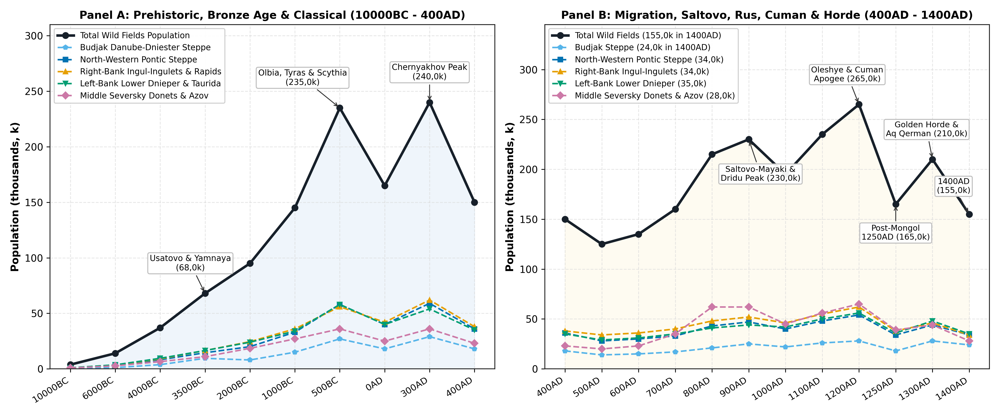
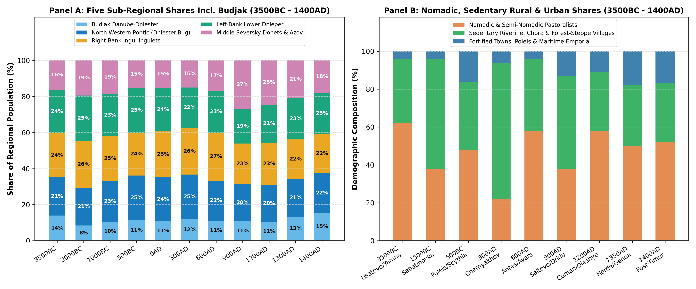
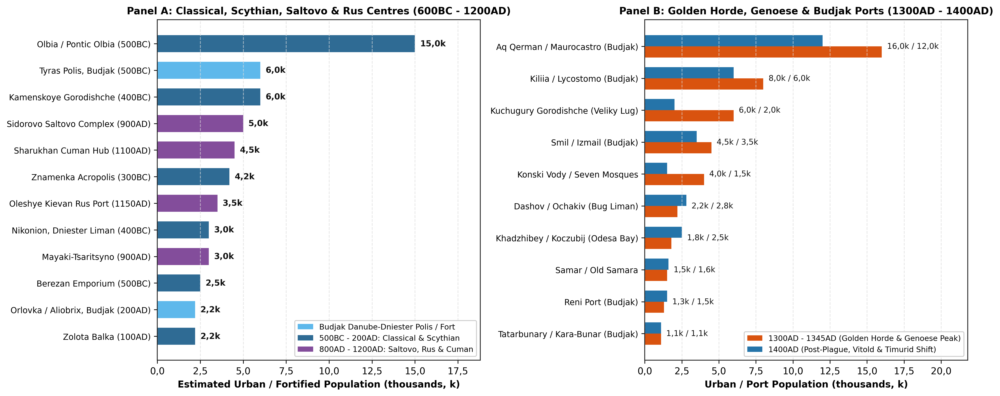

# Geographical Definition, Ecological Regimes, and Five-Part Natural Sub-Regional Partition

## Spatial Boundaries and Natural Steppe Hydrological Corridors

The analytical region designated as the Wild Fields (historical Polish
*Dzikie Pola*, Latin *Loca Deserta*, Ukrainian *Dyke Pole*, and the
western wing of *Desht-i Kipchak*) encompasses the entire southern
Ukrainian Pontic-Azov steppe zone north of the Perekop Isthmus and south
of the forest-steppe ecotone, spanning approximately 238 000 km² (4 011
5-arcminute grid cells covering 231 135 km² of land and estuarine cell
area) between $`45{,}2^\circ\text{N}`$ and $`49{,}9^\circ\text{N}`$
latitude and $`28{,}2^\circ\text{E}`$ and $`40{,}2^\circ\text{E}`$
longitude [\[1\]](#ref-ivanova2010)[\[2\]](#ref-kabuzan1976). This
literature review and its companion dasymetric calibration cover the
period from the Pleistocene-Holocene transition (10000BC) to the late
Golden Horde, Genoese, Moldavian, and Lithuanian benchmark of 1400AD;
post-1400AD developments (the Ottoman-Tatar frontier, Zaporozhian
*Siches*, and Imperial/Modern colonisation) require separate regime
handling. The Crimean Peninsula south of Perekop and Chongar (~26 945
km²) is treated in the companion Crimean synthesis, while the
forest-steppe principalities of Galicia-Volhynia, Kiev-Pereyaslavl, and
Chernigov-Seversk bound the Wild Fields along the natural forest-steppe
line to the north.

Across the Holocene (10000BC - 1400AD), demographic carrying capacity in
the Wild Fields was governed by the contrast between two ecological
zones. The first zone comprised the open interfluvial feather-grass
steppe (*plakor*), consisting of gently undulating loess plateaus
covered by *Stipa-Festuca* chernozems and southern chestnut soils
receiving 350 - 480 mm of annual precipitation; prior to modern deep
well-drilling, these interfluvial watersheds lacked permanent summer
surface water and functioned primarily as meridian grazing corridors for
mobile pastoralists [\[1\]](#ref-ivanova2010)[\[3\]](#ref-kulkova2023).
The second zone comprised the incised river valleys, rapids, floodplain
forests (*plavni*), freshwater lakes, and coastal estuaries (*limany*).
Here, the great southward-flowing rivers, including the Lower Danube
(Chilia/Kiliia arm) and its Budjak lakes (Yalpug, Kugurlui, Katlabukh,
Kitai, Kagul), the Dniester (*Tyras*), Tiligul, Southern Bug
(*Hypanis*), Ingul, Ingulets, Lower Dnieper (*Borysthenes*) with its
nine granite rapids (*Porohy*) and the *Veliky Lug* (“Great Meadow”)
gallery forest, Samara, Orel, Konka, Molochnaya, Kalmius, Mius, and
Middle Seversky Donets, carved sheltered micro-ecologies rich in gallery
timber, fresh water, anadromous sturgeon and cyprinid fisheries, winter
reed-bed fodder, and defensive bluffs
[\[4\]](#ref-olenkovskiy2010)[\[5\]](#ref-bylkova2010)[\[6\]](#ref-kravchenko2020)[\[7\]](#ref-skalkovsky1846).

## Five-Part Natural Sub-Regional Framework (Including Budjak)

To ensure that both the dasymetric areal mask and vector cartography
(Figure and Table ) follow strict natural hydrological and ecological
boundaries while treating Budjak as a distinct historical-demographic
region, the 238 000 km² domain is partitioned into five natural
sub-regions.

Sub-region I encompasses Budjak (Danube-Prut-Dniester Steppe and Liman,
~13 100 km²; 227 grid cells), bounded naturally by the Lower Danube
River and Chilia Delta on the south, the Prut confluence and Moldovan
border on the west, the Black Sea coast (with the Sasyk, Shagany,
Alibey, and Burnas lagoons) on the south-east, and the Dniester River
and Dniester Liman on the north-east. Unlike the interior continental
steppe, Budjak combines an open interior *plakor* (drained by the
Kogilnik, Chaga, Sarata, and Khadzhider rivers) with two
high-carrying-capacity maritime-fluvial interfaces: the Danube
floodplain lakes (Kagul, Yalpug, Katlabukh, Kitai) and the western bank
of the Dniester Liman. Consequently, Budjak served continuously as the
primary demographic bridge between the Balkan-Danubian world (Gumelnita,
Getae, Roman Lower Moesia, First and Second Bulgarian Empire *Dridu*
culture, Byzantium, Genoese *Lycostomo*, and Moldavia) and the Pontic
steppe (Yamnaya/Nerushai, Scythians, Sarmatians, Pechenegs, Cumans, and
Golden Horde *Aq Qerman*)
[\[8\]](#ref-bruyako1993)[\[9\]](#ref-subbotin2000)[\[10\]](#ref-rabinovich1999)[\[11\]](#ref-boguslavskiy2014).

Sub-region II spans the North-Western Pontic Steppe (Dniester-Bug
Interfluve and Tiligul-Berezan-Bug Liman, ~45 400 km²; 475 grid cells),
bounded naturally on the south-west by the Dniester River and Liman, on
the north by the Kodyma River and forest-steppe ecotone, on the
north-east by the Southern Bug River (*Hypanis*) and Bug Liman, and on
the south by the Black Sea coast. Historically, it formed the core of
the Eneolithic Usatovo complex (Usatovo, Mayaki), the Milesian Greek
*poleis* and *chora* networks of Olbia, Berezan, Nikonion, and Koshary,
dense Chernyakhov coastal villages (Koblevo, Kamenka-Anchekrak),
Tivertsi and Ulichi forest-steppe frontier settlements, and the late
fourteenth-century ports of Khadzhibey (*Koczubij*) and Dashov
(*Ochakiv*)
[\[12\]](#ref-kryzhitsky1999)[\[13\]](#ref-kryzhitsky1989)[\[14\]](#ref-dyachenko2010)[\[15\]](#ref-dobrolyubskiy1999).

Sub-region III covers the Right-Bank Bug-Dnieper Interfluve,
Ingul-Ingulets Uplands, and Dnieper Rapids Right Bank (~56 000 km²; 922
grid cells), bounded naturally on the west by the Southern Bug River, on
the north by the forest-steppe ecotone along the Dnieper Upland, and on
the east and south-east by the Dnieper River (*Borysthenes*) and
Dnieper-Bug Estuary. Encompassing the Syniukha, Ingul, Ingulets, Visun,
Saksahan, and Bazavluk basins, this sub-region hosted the Dereivka
Eneolithic enclosure, the Sabatinovka and Ingul Catacomb Bronze Age
heartland, the Royal Scythian giant kurgans (Chertomlyk, Tovsta Mohyla,
Alexandropol), and the chain of Late Scythian right-bank stone
fortresses (Zolota Balka, Gavrilovka, Krasny Mayak, Konsulovskoye,
Nikolaevka-Kazatskoye)
[\[5\]](#ref-bylkova2010)[\[16\]](#ref-chernienko2014)[\[17\]](#ref-daragan2021).

Sub-region IV comprises the Left-Bank Lower Dnieper, Veliky Lug,
Samara-Orel, and Northern Taurida Steppe (~61 500 km²; 1 107 grid
cells), bounded on the west by the Dnieper River channel, on the north
by the Orel (*Oril*) River and forest-steppe ecotone, on the east by the
Dnieper-Donets and Azov Upland watershed (Berda River divide), and on
the south by the Black Sea, Perekop-Sivash, and Sea of Azov. It
contained the Vasylivka Mesolithic cemeteries, the Kamyana Mohyla
sanctuary, the Mikhailovka Yamnaya stone citadel, the 1 200 ha Scythian
city of Kamenskoye Gorodishche, the Voznesenka princely camp, the Kievan
Rus ports of Oleshye, Protolche (Khortytsia), and Igren-Samar, and the
Golden Horde cities of Velyki Kuchugury, Mamai-Surka, and Konski Vody
[\[18\]](#ref-grakov1954)[\[19\]](#ref-dovzhenok1961)[\[20\]](#ref-bocharov2015)[\[21\]](#ref-vorotyntsev2018).

Sub-region V encompasses the Middle Seversky Donets, Donets Ridge, and
Kalmius-Mius Azov Basin (~62 000 km²; 1 280 grid cells), bounded on the
west by the Dnieper-Donets and Azov Upland watershed, on the north-west
by the forest-steppe ecotone, on the east by the
Aidar-Derkul-Donets-Mius basin frontier, and on the south by the Sea of
Azov. Spanning the chalk bluffs of the Middle Seversky Donets and Oskol
valleys, the elevated Donets Ridge (*Donetskiy Kryazh*), and the
Kalmius-Mius coastal slope, this eastern sector supported the
Amvrosievka Palaeolithic camp, the Mariupol Neolithic cemetery, the
Bronze Age copper mines of Kartamysh, the eighth- to tenth-century
Khazar-Alanic-Bulgar urban network of the *Saltovo-Mayaki* culture
(Sidorovo, Mayaki-Tsaritsyno, Sukhaya Gomolsha, Mokhnach), the
Polovtsian winter capitals of Sharukhan, Sugrov, and Balin, and the
Golden Horde and Italian Azov port at Belosaraiskaya (*Porto Pisano*)
[\[6\]](#ref-kravchenko2020)[\[22\]](#ref-inkov2007)[\[23\]](#ref-koloda2015).

# Prehistoric Foragers, Eneolithic Horse-Keepers, and Bronze Age Agro-Pastoralists (10000BC - 1000BC)

## Epigravettian, Mesolithic, and Neolithic Fluvial Refugia (10000BC - 4500BC)

At the Pleistocene-Holocene transition (10000BC), the retreat of
periglacial tundra-steppe and the drowning of the exposed north-western
Black Sea shelf into brackish *liman* estuaries concentrated Upper
Palaeolithic Epigravettian and Early Mesolithic bands along limestone
canyon gorges, the Budjak coastal rivers, and granite river rapids
[\[4\]](#ref-olenkovskiy2010)[\[14\]](#ref-dyachenko2010).
Archaeological surveys synthesised by Stanko and Olenkovskiy across the
Southern Bug (Anetovka II, 47,72°N, 31,13°E in Sub-region II), the
Krynka-Mius basin (Amvrosievka bison kill site and bone bed, 47,79°N,
38,48°E in Sub-region V), and the Lower Dnieper document specialised
communal hunting of steppe bison (*Bison priscus*), wild horse (*Equus
ferus*), and saiga antelope [\[4\]](#ref-olenkovskiy2010). During the
Kukrek and Grebeniki Mesolithic horizons (8000BC), large base camps such
as Mirnoe (45,58°N, 29,46°E in Sub-region I: Budjak), the sandstone
rock-shelter sanctuary of Kamyana Mohyla (46,95°N, 35,47°E in Sub-region
IV) on the Molochnaya River, and the communal cemeteries along the
Dnieper Rapids (Vasylivka I-III, Voloske, Igren VIII, containing 30 -
50+ burials per necropolis) demonstrate incipient territoriality around
high-yield fishing weirs. At 10000BC, total regional population across
238 000 km² is estimated at 3,8k (0,30k in Budjak \[I\], 0,80k in NW
Pontic \[II\], 0,95k in Right-Bank \[III\], 0,95k in Left-Bank \[IV\],
and 0,80k in Middle Donets \[V\]), rising to 6,8k by 8000BC.

During the Neolithic Atlantic climatic optimum (6000BC - 5000BC), four
ceramic-using traditions established riverine and estuarine villages
across the five sub-regions. Along the shores of Lakes Yalpug, Kagul,
and Katlabukh in Budjak (Sub-region I, 6000 - 4500BC), early
agro-foraging communities interacted with Balkan Starcevo-Cris and
Linearbandkeramik groups, lifting Budjak’s population from 1,1k at
6000BC to 1,9k at 5000BC
[\[9\]](#ref-subbotin2000)[\[14\]](#ref-dyachenko2010). In Sub-regions
II and III (6200 - 5000BC), the Bug-Dniester Culture concentrated along
the Southern Bug rapids between Savran, Migeya, and Bazkov Ostrov
(48,03°N, 30,96°E), combining impressed pottery, flint sickle blades,
and early domesticates [\[14\]](#ref-dyachenko2010). Across Sub-regions
III and IV (6000 - 4500BC), the Sursko-Dnieper and Dnieper-Donets II
complexes were anchored on the islands and banks of the Dnieper Rapids
(Surskoy Island, Nikolskoye, Vovnigi with 130+ skeletons) and the
Samara-Orel confluence [\[24\]](#ref-telegin1986). In Sub-region V
(5500 - 4500BC), the Lower Don-Azov and Mariupol horizon was exemplified
by the 122-burial red-ochre corridor cemetery at Mariupol (47,09°N,
37,56°E) at the mouth of the Kalmius River. Total Wild Fields population
doubled from 14,0k at 6000BC to 24,0k at 5000BC.

## Bolgrad-Aldeni (Gumelnita), Sredny Stog, and Usatovo Maritime Chiefdoms (4500BC - 3000BC)

Between 4500BC and 3000BC, the spread of Balkan-Carpathian copper
metallurgy and steppe horse management reshaped the region, with Budjak
(Sub-region I) and the Dniester-Bug corridor (Sub-region II) acting as
the primary demographic engines
[\[9\]](#ref-subbotin2000)[\[25\]](#ref-rassamakin2000)[\[26\]](#ref-anthony2007).
In Sub-region I (4500 - 3000BC), as excavated by Subbotin around Lakes
Yalpug, Kagul, Katlabukh, and Kitai (Bolhrad, Ozernoye, Etulia VI,
Plavni, Nagornoye, Suvorovo, Chervonyi Yar, and Orlovka/Kartal),
sedentary Balkan Chalcolithic farmers of the Bolgrad-Aldeni variant of
the Gumelnita Culture established dense tell-like villages of 20 - 40
wattle-and-daub houses in south-western Budjak (4200 - 3800BC, 3,8k in
Sub-region I at 4000BC)
[\[9\]](#ref-subbotin2000)[\[27\]](#ref-govedarica2010). In the
mid-fourth millennium (3500 - 3000BC), interaction between late
Cucuteni-Trypillia CII, Cernavoda I, and the Budjak Culture
(*Budzhakskaya kultura*, represented by thousands of Yamnaya/Usatovo
kurgan burials at Nerushai, Semenovka, Mayaki, Trapovka, Borisovka,
Sarata, and Tarutyne) raised Budjak’s population to 9,5k at 3500BC and
8,5k at 3000BC [\[1\]](#ref-ivanova2010)[\[9\]](#ref-subbotin2000).

East of the Dniester Liman in Sub-region II (3500 - 3000BC) around the
Khadjibey and Kuialnyk estuaries, fortified limestone-built centres of
the Usatovo complex at Usatovo (46,53°N, 30,66°E) and Mayaki (46,41°N,
30,27°E) presided over 14,5k inhabitants at 3500BC
[\[14\]](#ref-dyachenko2010). Combined with Budjak (9,5k), the western
maritime steppes (Sub-regions I and II) held 24,0k inhabitants (35,3% of
the Wild Fields total). Along the Dnieper Rapids and Lower Dnieper in
Sub-regions III, IV, and V (4000 - 3000BC), Sredny Stog horse-keeping
communities at Dereivka (48,91°N, 33,68°E, Sub-region III) and the
three-phase stone-walled Yamnaya stronghold at Mikhailovka (47,29°N,
33,95°E, Sub-region IV) anchored expanding wagon-pastoral lineages
across the Ingulets, Molochnaya, and Seversky Donets, lifting total
regional population from 37,0k at 4000BC to 68,0k at 3500BC and 75,0k at
3000BC [\[24\]](#ref-telegin1986)[\[26\]](#ref-anthony2007).

## Catacomb, Babino, and the Sabatinovka-Srubnaya Sedentary Boom (3000BC - 1000BC)

During the Middle Bronze Age Catacomb (*Ingul* and *Donets* variants,
2800 - 2000BC) and Babino (*Mnogovalikovaya*, 2200 - 1800BC) horizons,
pastoral density rose steadily to 95,0k at 2000BC (8,0k in Budjak \[I\],
20,0k in NW Pontic \[II\], 24,5k in Right-Bank \[III\], 24,0k in
Left-Bank \[IV\], and 18,5k in Middle Donets \[V\])
[\[1\]](#ref-ivanova2010)[\[9\]](#ref-subbotin2000).

The prehistoric Bronze Age culminated during the Late Bronze Age
Sabatinovka-Noua (1600 - 1200BC, Sub-regions I-IV), Srubnaya (1600 -
1100BC, Sub-regions IV-V), and Belozerka (1200 - 950BC) horizons
[\[16\]](#ref-chernienko2014)[\[28\]](#ref-chernienko2000)[\[29\]](#ref-sekerskaya1999).
In Budjak (Sub-region I), over 200 Late Bronze Age
Sabatinovka-Coslogeni-Noua and Belozerka (Tudora-type) settlements lined
the Kogilnik, Sarata, Alkaliya, and Danube lake shores
(Zhovtneve/Karakurt, Ogorodnoye, Suvorovo, Tatarbunary, Diviziya, Tuzly,
Shabo, and Tudora), supporting 15,0k inhabitants at 1000BC
[\[9\]](#ref-subbotin2000)[\[29\]](#ref-sekerskaya1999). In Sub-region
II (Dniester-Bug Interfluve, 33,0k at 1000BC), multi-roomed
limestone-foundation villages such as Sabatinovka (48,15°N, 30,22°E),
Voronovka II, and Tashlyk practised intensive cattle-and-millet mixed
farming [\[16\]](#ref-chernienko2014). Across the Right-Bank
Ingul-Ingulets (Sub-region III, 36,0k), Left-Bank Lower Dnieper
(Sub-region IV, 34,0k), and Donets-Azov Copper Province (Sub-region V,
27,0k), hundreds of stone-built villages (Zmiivka, Novokievka, Staryi
Krym Ingul) flourished alongside the Srubnaya copper-mining and
bronze-casting complexes of the Bakhmut basin (Kartamysh, Usovo Ozero,
Kapitanovo in Sub-region V), bringing total Wild Fields population to
145,0k at 1000BC [\[3\]](#ref-kulkova2023)[\[28\]](#ref-chernienko2000).

# Classical Greek Poleis, Royal Scythia, Late Scythian Fortresses, and the Chernyakhov Horizon (700BC - 400AD)

## Greek Poleis and Chora Networks in Budjak (Sub-Region I) and the Dniester-Bug Liman (Sub-Region II)

Beginning in the mid-seventh century BC (~647BC), Milesian Greek
colonisation established dense urban and rural *chora* networks across
both Sub-region I (Budjak) and Sub-region II (Dniester-Bug Interfluve)
[\[8\]](#ref-bruyako1993)[\[12\]](#ref-kryzhitsky1999)[\[30\]](#ref-bruyako2025).
In Sub-region I (Budjak, supporting 27,0k at 500BC, 18,0k at 0AD, and
29,0k at 300AD), Milesian colonists on the rocky western promontory of
the Dniester Liman (modern Bilhorod-Dnistrovskyi) founded Tyras
(~600BC), which grew into a fortified, coin-minting *polis* of 6,0k
inhabitants at 500BC - 300BC, surrounded by a dense western Dniester
Liman *chora* (Shabo, Zatoka, Mologa II, Pivdenne I, Belenkoye)
[\[8\]](#ref-bruyako1993)[\[31\]](#ref-turovskiy2014). At the
southwestern corner of Budjak overlooking the Danube crossing at the
Kartal narrows (near Reni), the fortified Geto-Scythian and later
Roman-era emporium of Orlovka/Kartal (ancient Aliobrix, 45,32°N,
28,44°E, accompanied by Novoselskoye and Reni) controlled riverine trade
between the Danube Delta, the Prut, and the interior Budjak steppe
(1,5k - 2,2k inhabitants, where gold staters of Cyzicus and later Roman
legionary bricks of *Legio V Macedonica* and *Classis Flavia Moesica*
are attested) [\[8\]](#ref-bruyako1993)[\[32\]](#ref-gudkova1999).

In Sub-region II (Dniester-Bug Interfluve, supporting 58,0k at 500BC,
40,0k at 0AD, and 59,0k at 300AD), Berezan (~647BC, 2,5k) and Pontic
Olbia (~600BC, 50 - 55 ha walled upper and lower city with 12,0k - 15,0k
urban residents) on the Bug-Dnieper Liman anchored over 150 rural
*chora* villages (*Shirokaya Balka*, *Kozyrka*, *Chertovatoe VII*,
*Viktorovka I*, *Staraya Bogdanovka II*, *Didova Khata*) housing 20,0k -
25,0k Greco-Scythian grain cultivators
[\[12\]](#ref-kryzhitsky1999)[\[13\]](#ref-kryzhitsky1989)[\[33\]](#ref-marchenko1999).
On the eastern bank of the Dniester Liman opposite Tyras, Nikonion
(Roksolany, 3,0k at 500 - 400BC) and its *chora* (Nadlimanskoye) linked
the Dniester trade to Koshary (Odessos, 1,4k at the Tiligul mouth) and
the Odessa Bay settlements (Zhevakhova Gora, Luzanovka)
[\[15\]](#ref-dobrolyubskiy1999)[\[34\]](#ref-lisetskiy2011).

## Royal Scythia, Kamenskoye Gorodishche, Late Scythian Fortresses, and the Chernyakhov Peak (500BC - 400AD)

In the interior steppes of Sub-regions III, IV, and V, fifth- and
fourth-century BC Royal Scythia reached its demographic zenith along the
Lower Dnieper Rapids and *Veliky Lug* (*Gerrhus*)
[\[17\]](#ref-daragan2021)[\[18\]](#ref-grakov1954). At Kamenskoye
Gorodishche (47,48°N, 34,42°E in Sub-region IV, enclosing 1 200 ha with
its 32 ha Znamenka acropolis and the 800-burial Mamai-Hora necropolis),
a resident metallurgical and administrative population of 6,0k (plus
3,5k - 4,2k at Znamenka) operated alongside the Royal Scythian Giant
Kurgans of Sub-region III (Chertomlyk, Tovsta Mohyla, Alexandropol) and
Sub-region IV (Solokha, Melitopol, Gaimanova Mohyla)
[\[17\]](#ref-daragan2021)[\[18\]](#ref-grakov1954). In Sub-region V
(Middle Seversky Donets and Azov, 36,0k at 500BC), Scythian
forest-steppe hillforts (Velikaya Gomolsha, Koropovye Khutora) and Azov
coastal camps linked the Donets corridor to the Royal Scythians. Total
Wild Fields population reached a classical peak of 235,0k at 500BC
(27,0k in Budjak \[I\], 58,0k in NW Pontic \[II\], 56,0k in Right-Bank
\[III\], 58,0k in Left-Bank \[IV\], and 36,0k in Middle Donets \[V\]).

Following the third-century BC Sarmatian advance (which lowered regional
population to 165,0k at 0AD), sedentary agriculture rebounded between
250BC and 200AD along both banks of the Lower Dnieper gorge (Sub-regions
III and IV) via 16 bastioned stone fortresses (Zolota Balka, Krasny
Mayak, Gavrilovka, Konsulovskoye, Nikolaevka-Kazatskoye, Lvove, Sabinka,
and Hannivka in Sub-region III; Lyubimovka, Znamenskoye, Gornostaevka,
and Kairy in Sub-region IV)
[\[5\]](#ref-bylkova2010)[\[35\]](#ref-popova2011)[\[36\]](#ref-movsesyan2010)[\[37\]](#ref-lysenko2026).
Simultaneously, Roman vexillations stationed at Tyras and
Orlovka/Aliobrix (Sub-region I) and Olbia (Sub-region II) stabilised the
coastal zone, lifting regional population to 205,0k at 200AD
[\[38\]](#ref-polin2017).

Under the multi-ethnic Chernyakhov Culture (250 - 375AD), hundreds of
stone-built and timber villages covered Budjak (29,0k in Sub-region I at
Bolhrad-Yalpug, Etulia, Chervonyi Yar, Kubei, Nagornoye, Belenkoye, and
Mologa II), the Dniester-Bug Liman (59,0k in Sub-region II at Koblevo,
Kamenka-Anchekrak, and Ranconia), the Right-Bank Ingul-Ingulets and
Rapids (62,0k in Sub-region III at Bashmachka and Snihurivka), the
Left-Bank Lower Dnieper (54,0k in Sub-region IV), and the Donets
corridor (36,0k in Sub-region V), reaching an antique high-water mark of
240,0k at 300AD before the Hunnic invasion of 375AD reduced the Wild
Fields to 150,0k at 400AD (18,0k in I, 36,0k in II, 38,0k in III, 35,0k
in IV, and 23,0k in V)
[\[32\]](#ref-gudkova1999)[\[39\]](#ref-shchukin1999)[\[40\]](#ref-prikhodnyuk2000).

# Early Medieval Nomads, the Balkan-Danubian Dridu Culture in Budjak, the Saltovo-Mayaki Boom, and the Cuman-Rus Condominium (400AD - 1240AD)

## Antae/Penkovka Rapids Refugia, Voznesenka, and the Early Medieval Trough (400AD - 750AD)

Between 400AD and 700AD, as Kutrigur and Utigur Bulgars, Avars, and Old
Great Bulgaria under Khan Kubrat traversed the open steppes, regional
population bottomed out at 125,0k in 500AD (14,0k in Budjak \[I\], 28,0k
in II, 34,0k in III, 29,0k in IV, 20,0k in V) before recovering to
135,0k in 600AD and 160,0k in 700AD
[\[40\]](#ref-prikhodnyuk2000)[\[41\]](#ref-pleshivenko2000). Sedentary
life persisted along the Lower Danube and Dniester crossings of Budjak
(Orlovka/Kartal, Novoselskoye) and the granite islands of the Dnieper
Rapids (Voloshskoye, Igren-Samar, Balka Kantsyrka, and the c. 700AD
princely memorial camp at Voznesenka in Sub-region IV)
[\[41\]](#ref-pleshivenko2000).

## The Balkan-Danubian (Dridu) Boom in Budjak (Sub-Region I) and the Saltovo-Mayaki Urban Surge on the Donets (Sub-Region V) (750AD - 965AD)

During the eighth through tenth centuries (750 - 965AD), the two
opposite wings of the Wild Fields, Sub-region I (Budjak) in the
south-west and Sub-region V (Middle Seversky Donets) in the north-east,
experienced parallel sedentary demographic booms. Following Asparukh’s
crossing of the *Onglos* in southern Budjak (680AD) and the
consolidation of the First Bulgarian Empire north of the Danube,
archaeological surveys around Lakes Yalpug, Kugurlui, Katlabukh, Kitai,
and Kagul have documented over 70 eighth- to tenth-century sedentary
Balkan-Danubian (*Dridu* or *Pliska-Preslav*) villages (Suvorovo I-VI,
Bogatoye, Ogorodnoye, Kholmskoye, Chervonyi Yar, Plavni, Etulia,
Nagornoye, Safyany/Izmail, and Orlovka/Kartal), protected to the north
by the monumental earthen Lower Trajan’s Wall (*Nizhniy Trayanov Val*,
stretching 126 km from the Prut at Vadul-lui-Isac across Lakes Kagul,
Yalpug, and Katlabukh to Lake Sasyk)
[\[9\]](#ref-subbotin2000)[\[10\]](#ref-rabinovich1999)[\[42\]](#ref-titova2008).
Inhabited by mixed Bulgar-Slavic-Vlach agriculturalists and fishermen,
Budjak sustained 21,0k inhabitants at 800AD and 25,0k at 900AD (~1,91
persons/km², the highest density of any sub-region in the Wild Fields).

Along the Lower Dniester, Southern Bug, and Dnieper Rapids in
Sub-regions II, III, and IV (47,0k, 52,0k, and 44,0k at 900AD), East
Slavic Tivertsi and Ulichi settlements (Belenkoye, Palanca, Peresechen
Steppe, Chern, Voznesensk, Igren-Samar) traded down the rivers toward
the Black Sea [\[19\]](#ref-dovzhenok1961)[\[42\]](#ref-titova2008).
Simultaneously, in Sub-region V (62,0k at 800 - 900AD) under the *Pax
Chazarica*, Alanic and Proto-Bulgar settlers constructed over 250
fortified and open settlements of the Saltovo-Mayaki urban network along
the Seversky Donets and Oskol valleys, led by the 120 ha Sidorovo
Complex (49,00°N, 37,59°E, 5,0k inhabitants), Mayaki-Tsaritsyno (3,0k),
Sukhaya Gomolsha (2,6k), Mokhnach (2,5k), Netailovka (2,2k), Teplinskoye
(2,0k), Zlivki (1,4k), and Krivaya Luka (1,3k)
[\[6\]](#ref-kravchenko2020)[\[23\]](#ref-koloda2015)[\[43\]](#ref-pletneva1967)[\[44\]](#ref-kravchenko2018)[\[45\]](#ref-kravchenko2022).
Across all five sub-regions, Wild Fields population climbed to 215,0k in
800AD and 230,0k in 900AD.

## Pechenegs, Kievan Rus Ports (Oleshye, Protolche, Maurocastro), and the Cuman Apogee (965AD - 1240AD)

Pecheneg migrations and Prince Sviatoslav’s 965AD destruction of
Khazaria burned the Donets *Saltovo* forts and disrupted open *Dridu*
villages in Budjak, lowering regional population to 195,0k at 1000AD
(22,0k in Budjak \[I\], 40,0k in II, 46,0k in III, 42,0k in IV, 45,0k in
V) [\[6\]](#ref-kravchenko2020)[\[46\]](#ref-pletneva1990). During the
eleventh and twelfth centuries (1055 - 1223AD), however, the commercial
condominium of Kievan Rus, Byzantium, and the Polovtsian/Cuman
(*Kipchak*) confederation lifted regional population to 235,0k in 1100AD
and an all-time pre-modern peak of 265,0k in 1200AD (28,0k in Budjak
\[I\], 54,0k in NW Pontic \[II\], 62,0k in Right-Bank \[III\], 56,0k in
Left-Bank \[IV\], 65,0k in Middle Donets \[V\])
[\[19\]](#ref-dovzhenok1961)[\[46\]](#ref-pletneva1990)[\[47\]](#ref-bubenok2021).

At the Danube-Dniester mouths in Sub-region I (28,0k at 1200AD),
Byzantine, Galician-Rus (*Berladniki*), Vlach, and Cuman trade revived
Maurocastro/Belgorod (at ancient Tyras, 3,0k - 3,5k), Kiliia (2,5k),
Smil/Izmail (1,8k), Reni (1,0k), and Orlovka/Kartal (1,2k)
[\[10\]](#ref-rabinovich1999)[\[11\]](#ref-boguslavskiy2014). At the
head of the Dnieper estuary in Sub-region IV, the Kievan Rus sea-port of
Oleshye (46,62°N, 32,76°E, 3,5k at 1200AD) served as the maritime staple
for Kiev’s trade with Constantinople, paired upstream with the
Khortytsia horse-ferry and *Brodnik* staging town of Protolche (47,79°N,
35,15°E, 2,2k) and the 25 ha Samara confluence town of Igren-Samar
(2,8k) [\[19\]](#ref-dovzhenok1961)[\[48\]](#ref-astaykin2024). Along
the Middle Seversky Donets in Sub-region V, semi-sedentary Cuman-Alanic
winter towns flourished at Sharukhan (49,83°N, 36,68°E, 4,5k), Sugrov
(3,2k), and Balin (2,8k), while over 2 500 Polovtsian stone statues
(*kamennye baby*) and elite kurgans (such as the Chingul Kurgan on the
Molochnaya in Sub-region IV) demarcated twelfth- and early
thirteenth-century clan pastures
[\[22\]](#ref-inkov2007)[\[46\]](#ref-pletneva1990).

# The Ulus of Jochi (Golden Horde), Genoese-Moldavian Budjak Ports, Lithuanian Castles, and the 1400AD Cutoff (1240AD - 1400AD)

## Mongol Conquest and the Golden Horde and Genoese Urban Revival in Budjak and Veliky Lug (1240AD - 1345AD)

The Mongol campaigns of 1223AD (Battle of the Kalka River in Sub-region
V) and 1238 - 1240AD contracted the population of the Wild Fields from
245,0k in 1240AD to 165,0k in 1250AD (18,0k in Budjak \[I\], 34,0k in
II, 38,0k in III, 36,0k in IV, 39,0k in V)
[\[47\]](#ref-bubenok2021)[\[48\]](#ref-astaykin2024). Under the western
*Ulus of Jochi* (Prince Nogai d. 1299AD, Khan Toqta 1291 - 1312AD, and
Khan Uzbek 1313 - 1341AD), however, the region achieved a major
commercial and urban resurgence to 210,0k at 1300AD
[\[20\]](#ref-bocharov2015)[\[21\]](#ref-vorotyntsev2018)[\[49\]](#ref-shaposhnik2017).

Under Nogai and Toqta, Budjak (Sub-region I: 28,0k at 1300AD) became the
premier western maritime hub of the Golden Horde. At the Dniester mouth,
Aq Qerman (Maurocastro or Cetatea Alba, 46,20°N, 30,35°E) minted its own
coinage, hosted Genoese, Armenian, Greek, Jewish, Moldavian, and Tatar
merchant quarters, and reached 15,0k - 16,0k inhabitants at its 1300 -
1345AD peak
[\[10\]](#ref-rabinovich1999)[\[11\]](#ref-boguslavskiy2014). On the
Chilia arm of the Danube Delta, the Genoese-notarial port of
Kiliia/Lycostomo (45,44°N, 29,26°E, where Antonio di Ponzò’s 1360 -
1361AD notarial registers document massive grain, wax, salt, and wine
exports to Pera and Genoa) housed 6,5k - 8,0k inhabitants, flanked by
Smil/Izmail (3,5k - 4,5k), Reni (1,3k), and the interior Golden Horde
camp of Kara-Bunar/Tatarbunary (1,1k) [\[11\]](#ref-boguslavskiy2014).
In the *Veliky Lug* floodplain of the Left-Bank Lower Dnieper
(Sub-region IV: 48,0k at 1300AD), Uzbek and Jani Beg built the 300 ha
unfortified Islamic city of Velyki Kuchugury (47,68°N, 35,20°E, with a
Friday mosque, glazed minaret, subterranean-heated *hammam*, water
conduits, and 5,5k - 6,0k inhabitants), paired with Mamai-Surka (1 100+
Golden Horde burials), Konski Vody/Mechetna Mohyla (4,0k), and Oleshye
(2,0k), while Italian charts mapped Porto Pisano (Belosaraiskaya, 1,5k)
on the Azov coast of Sub-region V
[\[20\]](#ref-bocharov2015)[\[21\]](#ref-vorotyntsev2018).

## The Black Death, Blue Waters, Timur’s 1395AD Campaign, and the 1400AD Terminal Benchmark

Between 1346AD and 1400AD, the interior steppes of Sub-regions II, III,
IV, and V suffered severe demographic contraction driven by the Black
Death (1346 - 1348AD), the Great Troubles of the Golden Horde (1359 -
1380AD), Grand Duke Algirdas’s victory at the Battle of Blue Waters
(1362AD, on the Syniukha River in Sub-region III), Timur’s 1395AD
campaign (which systematically razed Kuchugury, Mamai-Surka, Konski
Vody, and the Donets settlements), and the Battle of the Vorskla River
(1399AD) [\[21\]](#ref-vorotyntsev2018)[\[49\]](#ref-shaposhnik2017). By
contrast, Sub-region I (Budjak) and the coastal ports of Sub-region II
exhibited much greater resilience as the Principality of Moldavia (under
Petru I Musat and Alexander the Good, 1390s - 1400AD) fortified Cetatea
Alba/Aq Qerman (12,0k in 1400AD), Kiliia/Chilia (6,0k), and Smil/Izmail
(3,5k), while Grand Duke Vytautas of Lithuania established fortified
customs ports at Dashov/Kara-Kerman (Ochakiv, 2,8k in 1400AD),
Khadzhibey/Koczubij (Odesa Bay, 2,5k), Sokolets, Balyklei, and Tyagin
[\[11\]](#ref-boguslavskiy2014).

At the 1400AD terminal benchmark, the total population of the Wild
Fields stood at 155,0k (24,0k in Sub-region I: Budjak, representing
15,5% of the regional total on 5,5% of the land area; 34,0k in
Sub-region II; 34,0k in Sub-region III; 35,0k in Sub-region IV; and
28,0k in Sub-region V).

# Quantitative Synthesis, Visual Analytics, and Complete Benchmark Series (10000BC - 1400AD)

Figures , , and and Table present the complete demographic synthesis for
the Wild Fields across all 26 chronological benchmarks from 10000BC to
1400AD across the five natural sub-regions.

# Sources

1.
Ivanova, Svetlana Vladimirovna.
“Prirodnye Resursy i Ekonomika Drevnikh Obshchestv \[Natural Resources
and Economy of Ancient Steppe Societies\].” *Stratum Plus*, no. 2, 2010,
pp. 49-97,
<https://cyberleninka.ru/article/n/prirodnye-resursy-i-ekonomika-drevnih-obschestv>.

2.
Kabuzan, Vladimir Maksimovich.
*Zaselenie Novorossii (Yekaterinoslavskoy i Khersonskoy Guberniy) v
XVIII - Pervoy Polovine XIX Veka (1719-1858 Gg.) \[the Settlement of New
Russia (Ekaterinoslav and Kherson Governorates) in the 18th and First
Half of the 19th Century, 1719-1858\]*. Nauka, 1976,
<https://search.worldcat.org/search?q=Settlement+New+Russia+Ekaterinoslav+Kherson+Governorates+18th+First+Kabuzan+1976>.

3.
Kulkova, Marianna Alekseevna.
“Prirodnye i Kulturnye Transformatsii Na Rubezhe Epokhi Bronzy - Rannego
Zheleznogo Vekov v Stepnom Poyase Evrazii \[Environmental and Cultural
Transformations at the Bronze-Early Iron Age Transition in the Eurasian
Steppe\].” *Povolzhskaya Arkheologiya*, vol. 45, no. 3, 2023, pp. 80-94,
<https://doi.org/10.24852/pa2023.3.45.95.108>.

4.
Olenkovskiy, Nikolay Petrovich.
“Rol v. N. Stanko i Ego Uchenikov v Raskopochnykh Issledovaniyakh
Pozdnego Paleolita Yuzhnoy Ukrainy \[the Role of v. N. Stanko and His
Students in Excavations of the Upper Palaeolithic of Southern
Ukraine\].” *Stratum Plus*, no. 1, 2010, pp. 120-32,
<https://cyberleninka.ru/article/n/rol-v-n-stanko-i-ego-uchenikov-v-raskopochnyh-issledovaniyah-pozdnego-paleolita-yuzhnoy-ukrainy>.

5.
Bylkova, Valeriya Pavlovna. “K
Probleme Vozniknoveniya Pozdneskifskoy Kultury Na Nizhnem Dnepre \[on
the Emergence of the Late Scythian Culture on the Lower Dnieper\].”
*Bosporskie Issledovaniya*, vol. 23, 2010, pp. 76-96,
<https://cyberleninka.ru/article/n/k-probleme-vozniknoveniya-pozdneskifskoy-kultury-na-nizhnem-dnepre>.

6.
Kravchenko, Eduard Evgenevich.
“Sidorovskiy Arkheologicheskiy Kompleks Na r. Severskiy Donets \[the
Sidorovo Archaeological Complex on the Seversky Donets River\].”
*Arkheologiya Evraziyskikh Stepey*, no. 6, 2020, pp. 182-254,
<https://doi.org/10.24411/2587-6112-2020-1-0031>.

7.
Skalkovsky, Apollon
Aleksandrovich. *Istoriya Novoy Sechi Ili Poslednego Kosha Zaporozhskogo
\[History of the New Sich or the Last Zaporozhian Kosh\]*. Tipografiya
A. Braun, 1846,
<https://search.worldcat.org/search?q=History+New+Sich+or+Last+Zaporozhian+Kosh+Skalkovsky+1846>.

8.
Bruyako, Igor Viktorovich.
“Severo-Zapadnoe Prichernomore v VII-v Vv. Do n. E.: Nachalo
Kolonizatsii Nizhnego Podnestrovya \[the North-Western Black Sea Region
in the 7th-5th Centuries BC: Colonisation of the Lower Dniester\].”
*Antichnyy Mir i Arkheologiya*, vol. 9, 1993, pp. 60-79,
<https://cyberleninka.ru/article/n/severo-zapadnoe-prichernomore-v-vii-v-vv-do-n-e-nachalo-kolonizatsii-nizhnego-podnestrovya>.

9.
Subbotin, Leonid Vasilevich.
“Severo-Zapadnoe Prichernomore v Epokhu Ranney i Sredney Bronzy \[the
North-Western Black Sea Region in the Early and Middle Bronze Age\].”
*Stratum Plus*, no. 2, 2000, pp. 350-87,
<https://cyberleninka.ru/article/n/severo-zapadnoe-prichernomore-v-epohu-ranney-i-sredney-bronzy>.

10.
Rabinovich, Roman Aronovich.
“Prizrachnaya Berlad. O Dostovernosti Odnoy Falsifikatsii \[Elusive
Berlad: Steppe Frontier Towns of the Lower Danube and Dniester\].”
*Stratum Plus*, no. 5, 1999, pp. 357-78,
<https://cyberleninka.ru/article/n/prizrachnaya-berlad-o-dostovernosti-odnoy-falsifikatsii>.

11.
Boguslavskiy, Georgiy Sergeevich,
and Dmitriy Mikhaylovich Yanov. “Serebryanye i Billonnye Monety
Krymskogo Khanstva Iz Noveyshikh Nakhodok v Belgorode (Akkermane)
\[Silver and Billon Coins of the Crimean Khanate from Belgorod /
Akkerman\].” *Materialy Po Arkheologii, Istorii i Etnografii Tavrii*,
vol. 19, 2014, pp. 387-404,
<https://cyberleninka.ru/article/n/serebryanye-i-billonnye-monety-krymskogo-hanstva-iz-noveyshih-nahodok-v-belgorode-akkermane>.

12.
Kryzhitsky, Sergey Dmitrievich, et
al. *Olviya: Antichnoe Gosudarstvo v Severnom Prichernomore \[Olbia: An
Ancient State in the Northern Black Sea Region\]*. Institut Arkheologii
NAN Ukrainy, 1999,
<https://search.worldcat.org/search?q=Olbia+Ancient+State+Northern+Black+Sea+Region+Kryzhitsky+1999>.

13.
Kryzhitsky, Sergey Dmitrievich, et
al. *Selskaya Okruga Olvii \[the Rural Chora of Olbia\]*. Naukova Dumka,
1989,
<https://search.worldcat.org/search?q=Rural+Chora+Olbia+Kryzhitsky+1989>.

14.
Dyachenko, Aleksandr Viktorovich.
“Evstaticheskie Kolebaniya Urovnya Chernogo Morya i Dinamika Razvitiya
Naseleniya Kukuten-Tripolskoy Obshchnosti \[Eustatic Black Sea Level
Fluctuations and Population Dynamics of the Cucuteni-Trypillia
Community\].” *Stratum Plus*, no. 2, 2010, pp. 199-210,
<https://cyberleninka.ru/article/n/evstaticheskie-kolebaniya-urovnya-chernogo-morya-i-dinamika-razvitiya-naseleniya-kukuten-tripolskoy-obschnosti>.

15.
Dobrolyubskiy, Andrey Olegovich.
“V Poiskakh Antichnoy Odessy \[in Search of Ancient Odessa: Greek
Settlements of the Odessa Bay\].” *Stratum Plus*, no. 3, 1999, pp.
241-59,
<https://cyberleninka.ru/article/n/v-poiskah-antichnoy-odessy>.

16.
Chernienko, Yuriy Andreevich.
“Sabatinovskaya Kultura v Sisteme Drevnostey Bronzovogo Veka Yuga
Vostochnoy Evropy \[the Sabatinovka Culture in the Bronze Age System of
Southern Eastern Europe\].” *Stratum Plus*, no. 2, 2014, pp. 149-82,
<https://cyberleninka.ru/article/n/sabatinovskaya-kultura-v-sisteme-drevnostey-bronzovogo-veka-yuga-vostochnoy-evropy>.

17.
Daragan, Marina Nikolaevna, and
Sergey Vasilevich Polin. “Nechaeva Mogila - Posledniy Skifskiy Tsarskiy
Kurgan-Gigant v Prichernomorskoy Skifii \[Nechaeva Mogila: The Last
Royal Scythian Giant Kurgan in Pontic Scythia\].” *Arkheologiya
Evraziyskikh Stepey*, no. 6, 2021, pp. 96-122,
<https://doi.org/10.24852/2587-6112.2021.5.75.107>.

18.
Grakov, Boris Nikolaevich.
*Kamenskoe Gorodishche Na Dnepre \[the Kamenskoye Fortified Settlement
on the Dnieper\]*. vol. 36, Izdatelstvo AN SSSR, 1954,
<https://search.worldcat.org/search?q=Kamenskoye+Fortified+Settlement+Dnieper+Grakov+1954>.

19.
Dovzhenok, Vasiliy Iosifovich.
*Zemlerobstvo Drevnoyi Rusi Do Seredyny XIII St. \[Agriculture of
Ancient Rus to the Mid-13th Century, Including the Oleshye Steppe
Corridor\]*. Vydavnytstvo AN URSR, 1961,
<https://search.worldcat.org/search?q=Agriculture+Ancient+Rus+Mid+13th+Century+Including+Oleshye+Dovzhenok+1961>.

20.
Bocharov, Sergey Gennadevich, and
Andrey Nikolaevich Maslovskiy. “Keramika Khorezma v Zapadnykh Regionakh
Zolotoy Ordy \[Urban Material Culture in the Western Regions of the
Golden Horde\].” *Vestnik Kazanskogo Gosudarstvennogo Universiteta
Kultury i Iskusstv*, no. 4, 2015, pp. 118-26,
<https://cyberleninka.ru/article/n/keramika-horezma-v-zapadnyh-regionah-zolotoy-ordy>.

21.
Vorotyntsev, Leonid
Vyacheslavovich. “Orda Na Kume Zemlyu Pakhala: K Voprosu o
Rasprostranennosti Zemledelcheskikh Praktik v Srede Kochevogo Naseleniya
Ulusa Dzhuchi \[Agricultural Practices Among the Nomadic Population of
the Ulus of Jochi in the 13th-15th Centuries\].” *Tyurkologicheskie
Issledovaniya*, vol. 1, no. 4, 2018, pp. 35-48,
<https://cyberleninka.ru/article/n/orda-na-kume-zemlyu-pahala-k-voprosu-o-rasprostranennosti-zemledelcheskih-praktik-v-srede-kochevogo-naseleniya-ulusa-dzhuchi>.

22.
Inkov, Aleksandr Aleksandrovich.
“Nashestvie Sharukana Na Rus v 1068 Godu: Mify i Realnost \[Sharukan’s
Campaign Against Rus in 1068 and Polovtsian Steppe Camps\].”
*Istoricheskoe Obozrenie*, vol. 8, 2007, pp. 14-24,
<https://cyberleninka.ru/article/n/nashestvie-sharukana-na-rus-v-1068-godu-mify-i-realnost>.

23.
Koloda, Vladimir Vasilevich.
“Kontakty Slavyanskogo Mira i Khazarskogo Kaganata Na Severskom Dontse:
Etnokulturnyy Aspekt \[Contacts of the Slavic World and the Khazar
Khaganate on the Seversky Donets\].” *Povolzhskaya Arkheologiya*, no. 4,
2015, pp. 35-59,
<https://cyberleninka.ru/article/n/kontakty-slavyanskogo-mira-i-hazarskogo-kaganata-na-severskom-dontse-etnokulturnyy-aspekt>.

24.
Telegin, Dmitriy Yakovlevich.
*Dereivka: A Settlement and Cemetery of Copper Age Horse Keepers on the
Middle Dnieper*. BAR International Series 287, 1986,
<https://search.worldcat.org/search?q=Dereivka+Settlement+Cemetery+Copper+Age+Horse+Keepers+Middle+Telegin+1986>.

25.
Rassamakin, Yuriy Yakovlevich.
“Kvityanskaya Kultura: Istoriya i Sovremennoe Sostoyanie Problemy \[the
Kvityana Culture: History and Current State of Research\].” *Stratum
Plus*, no. 2, 2000, pp. 117-77,
<https://cyberleninka.ru/article/n/kvityanskaya-kultura-istoriya-i-sovremennoe-sostoyanie-problemy>.

26.
Anthony, David W. *The Horse, the
Wheel, and Language: How Bronze-Age Riders from the Eurasian Steppes
Shaped the Modern World*. Princeton University Press, 2007,
<https://doi.org/10.1515/9780691292601>.

27.
Govedarica, Blagoje, and Igor
Vasilevich Manzura. “Novye Materialy Rannego Bronzovogo Veka Na
Tiligulskom Limane \[New Early Bronze Age Materials on the Tiligul
Liman\].” *Stratum Plus*, no. 2, 2010, pp. 245-60,
<https://cyberleninka.ru/article/n/novye-materialy-rannego-bronzovogo-veka-na-tiligulskom-limane>.

28.
Chernienko, Yuriy Andreevich.
“Nekotorye Itogi i Problemy Izucheniya Stroitelnogo Dela Na
Sabatinovskikh Poseleniyakh Severo-Zapadnogo Prichernomorya \[Stone
Building Practices at Sabatinovka Settlements of the North-Western Black
Sea Region\].” *Stratum Plus*, no. 2, 2000, pp. 446-74,
<https://cyberleninka.ru/article/n/nekotorye-itogi-i-problemy-izucheniya-stroitelnogo-dela-na-sabatinovskih-poseleniyah-severo-zapadnogo-prichernomorya>.

29.
Sekerskaya, Elena Petrovna.
“Skotovodchesko-Okhotnichya Deyatelnost Naseleniya Epokhi Pozdney Bronzy
Na Territorii Yuga Ukrainy \[Pastoral and Hunting Economy of the Late
Bronze Age Population of Southern Ukraine\].” *Stratum Plus*, no. 2,
1999, pp. 313-22,
<https://cyberleninka.ru/article/n/skotovodchesko-ohotnichya-deyatelnost-naseleniya-epohi-pozdney-bronzy-na-territorii-yuga-ukrainy>.

30.
Bruyako, Igor Viktorovich.
“Antichnyy Import VII v. Do r. Kh. V Severnom Prichernomore \[7th
Century BC Greek Imports in the Northern Black Sea Region\].” *Antichnyy
Mir i Arkheologiya*, vol. 22, 2025, pp. 112-38,
<https://doi.org/10.18500/0320-961X-2025-22-117-138>.

31.
Turovskiy, Evgeniy Yakovlevich,
and Evgeniy Aleksandrovich Kolesnichenko. “Khronologiya Monet
Nezavisimoy (Avtonomnoy) Tiry \[Chronology of the Coinage of Autonomous
Tyras\].” *Stratum Plus*, no. 6, 2014, pp. 67-80,
<https://cyberleninka.ru/article/n/hronologiya-monet-nezavisimoy-avtonomnoy-tiry>.

32.
Gudkova, Aleksandra Vasilevna.
“I-IV Vv. V Severo-Zapadnom Prichernomore (Kultura Osedlogo Naseleniya)
\[the 1st-4th Centuries AD in the North-Western Black Sea Region:
Culture of the Sedentary Population\].” *Stratum Plus*, no. 4, 1999, pp.
235-404,
<https://cyberleninka.ru/article/n/i-iv-vv-v-severo-zapadnom-prichernomore-kultura-osedlogo-naseleniya>.

33.
Marchenko, Konstantin
Konstantinovich. “Osnovnye Aspekty i Rezultaty Izucheniya
Greko-Varvarskikh Kontaktov i Vzaimodeystviy v Severnom Prichernomore
Skifskoy Epokhi \[Main Aspects and Results of Studying Greek-Barbarian
Contacts in the Northern Black Sea Region in the Scythian Era\].”
*Stratum Plus*, no. 3, 1999, pp. 145-72,
<https://cyberleninka.ru/article/n/osnovnye-aspekty-i-rezultaty-izucheniya-greko-varvarskih-kontaktov-i-vzaimodeystviy-v-severnom-prichernomore-skifskoy-epohi>.

34.
Lisetskiy, Fedor Nikolaevich, et
al. “Identifikatsiya Elementov Prostranstvennoy Organizatsii Antichnykh
Agrolandshaftov s Pomoshchyu GIS-Tekhnologiy \[Identification of Ancient
Greek Chora Agrolandscapes Using GIS and Remote Sensing\].” *Uchenye
Zapiski Krymskogo Federalnogo Universiteta*, vol. 24, no. 2, 2011, pp.
155-66,
<https://cyberleninka.ru/article/n/identifikatsiya-elementov-prostranstvennoy-organizatsii-antichnyh-agrolandshaftov-s-pomoschyu-gis-tehnologiy>.

35.
Popova, Elena Aleksandrovna.
“Pozdneskifskaya Kultura: Istoriya Izucheniya, Problemy, Gipotezy \[the
Late Scythian Culture: Research History, Problems and Hypotheses\].”
*Vestnik Moskovskogo Universiteta. Seriya 8: Istoriya*, no. 1, 2011, pp.
94-108,
<https://cyberleninka.ru/article/n/pozdneskifskaya-kultura-istoriya-izucheniya-problemy-gipotezy>.

36.
Movsesyan, Alla Armenovna.
“Pozdnie Skify i Sarmaty v Svete Dannykh Paleofenetiki \[Late Scythians
and Sarmatians in the Light of Cranial Palaeophenetics\].” *Vestnik
Moskovskogo Universiteta. Seriya 23: Antropologiya*, no. 3, 2010, pp.
41-52,
<https://cyberleninka.ru/article/n/pozdnie-skify-i-sarmaty-v-svete-dannyh-paleofenetiki>.

37.
Lysenko, Vladimir Aleksandrovich.
“Pogrebalnyy Obryad Mogilnika Krasnyy Mayak \[Burial Rite and Demography
of the Krasny Mayak Late Scythian Cemetery on the Lower Dnieper\].”
*Problemy Istorii, Filologii, Kultury*, no. 1, 2026, pp. 115-42,
<https://doi.org/10.18503/1992-0431-2026-2-92-148>.

38.
Polin, Sergey Vasilevich.
“Sarmatskoe Zavoevanie Severnogo Prichernomorya (Sovremennoe Sostoyanie
Problemy) \[the Sarmatian Conquest of the Northern Black Sea Region\].”
*Arkheologiya Evraziyskikh Stepey*, no. 3, 2017, pp. 224-43,
<https://cyberleninka.ru/article/n/sarmatskoe-zavoevanie-severnogo-prichernomorya-sovremennoe-sostoyanie-problemy>.

39.
Shchukin, Mark Borisovich.
“Fenomen Chernyakhovskoy Kultury Epokhi Konstantina-Konstantsiya \[the
Phenomenon of the Chernyakhov Culture of the Era of Constantine and
Constantius\].” *Stratum Plus*, no. 4, 1999, pp. 66-101,
<https://cyberleninka.ru/article/n/fenomen-chernyahovskoy-kultury-epohi-konstantina-konstantsiya-ili-chto-takoe-chernyahovskaya-kultura>.

40.
Prikhodnyuk, Oleg Mikhaylovich. “O
Kulturno-Istoricheskom Soderzhanii Arkheologicheskikh Obshchnostey (k
Probleme Interpretatsii Chernyakhovskoy Kultury) \[on the
Cultural-Historical Content of Archaeological Communities: Chernyakhov
and Penkovka\].” *Stratum Plus*, no. 4, 2000, pp. 359-66,
<https://cyberleninka.ru/article/n/o-kulturno-istoricheskom-soderzhanii-arheologicheskih-obschnostey-k-probleme-interpretatsii-chernyahovskoy-kultury>.

41.
Pleshivenko, Alla Grigorevna, and
Aleksandr Leonidovich Antonov. “Kurgan Voznesenskiy \[the Voznesensky
Fortified Camp Complex at Zaporizhzhia\].” *Stratum Plus*, no. 5, 2000,
pp. 47-64,
<https://cyberleninka.ru/article/n/kurgan-voznesenskiy>.

42.
Titova, Ekaterina. “A Ulichi i
Tivertsy Sedyakhu Po Dnestru: Etnicheskiy Sostav Naseleniya
Karpato-Dnestrovskikh Zemel v VI-XIII Vv. \[Ulichi and Tivertsy Along
the Dniester and Southern Bug in the 6th-13th Centuries\].” *Rusin*, no.
1–2, 2008, pp. 16-32,
<https://cyberleninka.ru/article/n/a-ulichi-i-tivertsy-sedyahu-po-dnestru-etnicheskiy-sostav-naseleniya-karpato-dnestrovskih-zemel-v-vi-xiii-vv>.

43.
Pletneva, Svetlana Aleksandrovna.
*Ot Kocheviy k Gorodam: Saltovo-Mayatskaya Kultura \[from Nomad Camps to
Cities: The Saltovo-Mayaki Culture\]*. vol. 142, Nauka, 1967,
<https://search.worldcat.org/search?q=Nomad+Camps+Cities+Saltovo+Mayaki+Culture+Pletneva+1967>.

44.
Kravchenko, Eduard Evgenevich.
“Oboronitelnye Sooruzheniya Arkheologicheskogo Kompleksa u s. Sidorovo
(Srednee Techenie Severskogo Dontsa) \[Fortifications of the Sidorovo
Archaeological Complex on the Middle Seversky Donets\].” *Povolzhskaya
Arkheologiya*, no. 2, 2018, pp. 215-33,
<https://doi.org/10.24852/pa2018.2.24.10.32>.

45.
Kravchenko, Eduard Evgenevich.
“Musulmane Khazarskogo Vremeni Na Severskom Dontse: Arkheologicheskie
Svidetelstva i Voprosy Ikh Interpretatsii \[Khazar-Era Muslims on the
Seversky Donets: Archaeological Evidence and Interpretation\].”
*Arkheologiya Evraziyskikh Stepey*, no. 5, 2022, pp. 120-42,
<https://doi.org/10.24852/2587-6112.2022.6.59.75>.

46.
Pletneva, Svetlana Aleksandrovna.
*Polovtsy \[the Polovtsians / Cumans\]*. Nauka, 1990,
<https://search.worldcat.org/search?q=Polovtsians+Cumans+Pletneva+1990>.

47.
Bubenok, Oleg Borisovich, and
Aleksandr Borisovich Golovko. “Naselenie Porosya v Predmongolskiy i
Zolotoordynskiy Periody \[Steppe Borderland Populations in the
Pre-Mongol and Golden Horde Periods\].” *Zolotoordynskoe Obozrenie*,
vol. 9, no. 4, 2021, pp. 729-51,
<https://doi.org/10.22378/2313-6197.2021-9-3.478-505>.

48.
Astaykin, Andrey Anatolevich.
“Devyat Geograficheskikh Zametok o Pokhode i Bitve Na Reke Kalke 1223
Goda \[Nine Geographical Notes on the 1223 Kalka Campaign, Oleshye and
Protolche\].” *Zolotoordynskoe Obozrenie*, vol. 12, no. 1, 2024, pp.
52-88, <https://doi.org/10.22378/2313-6197.2024-12-2.292-306>.

49.
Shaposhnik, Vladimir Gavrilovich,
and Yuriy Valentinovich Zayonchkovskiy. “K Istorii Kharkovskogo Poudya v
Zolotoordynskoe Vremya \[on the History of the Upper Donets Basin in the
Golden Horde Period\].” *Povolzhskaya Arkheologiya*, no. 2, 2017, pp.
166-79, <https://doi.org/10.24852/pa2017.4.22.147.164>.

