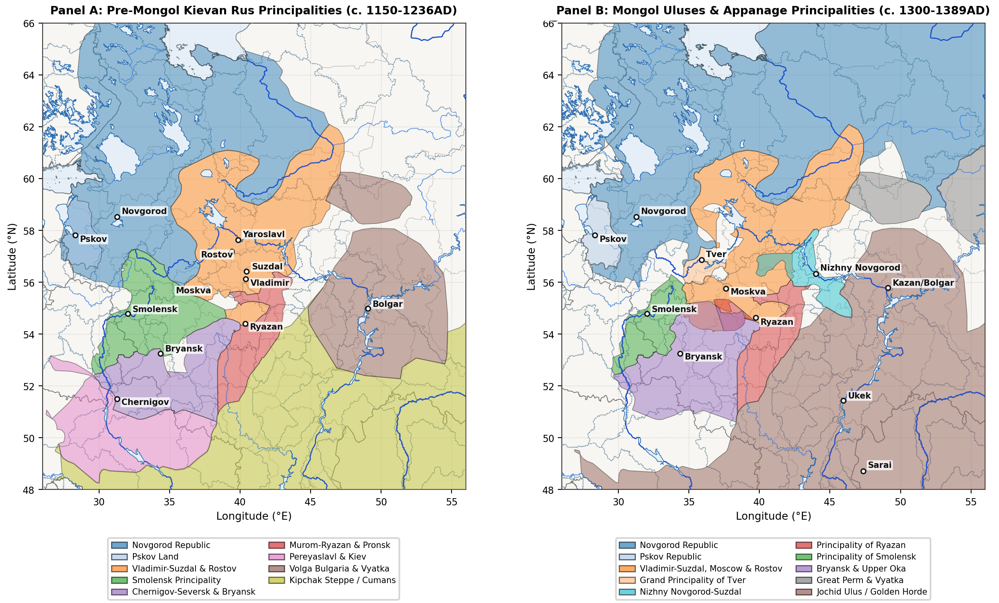
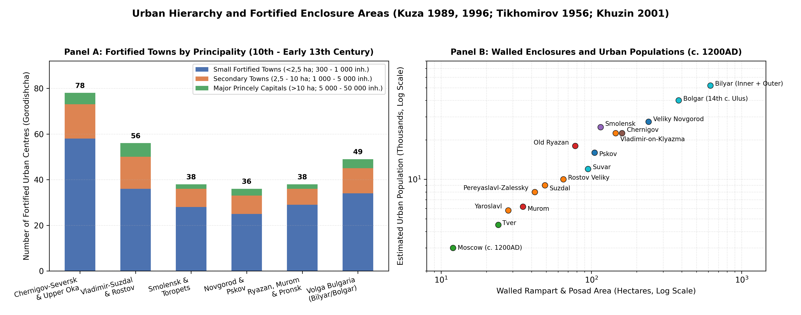
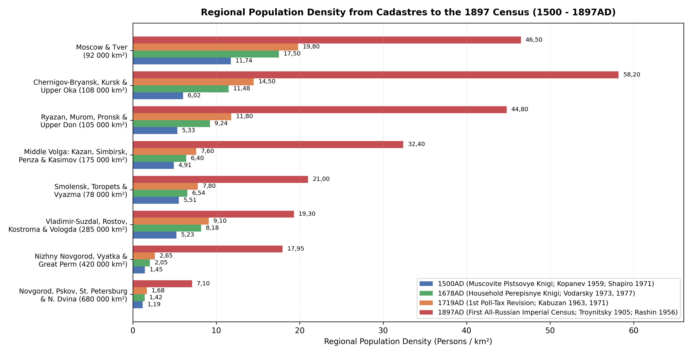
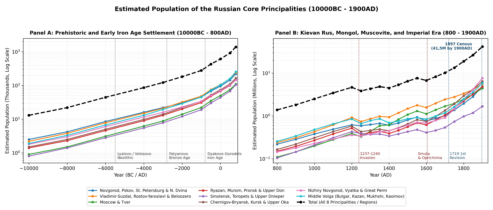

# Methodology

## Estimation Methods

Reconstructing the population history of the East European forest,
forest-steppe, and Middle Volga-Ural zones from 10000BC to 1900AD
requires combining archaeological settlement evidence for prehistoric
and medieval periods with fiscal and census records for the early modern
and imperial eras
[\[1\]](#ref-Vodarsky1973)[\[2\]](#ref-Kuza1989)[\[3\]](#ref-Avdeev2025).
Rather than relying on global macro-estimates or treating raw counts of
excavated sites and radiocarbon dates as direct measures of population
change, this study derives regional estimates from five primary classes
of historical and archaeological evidence.

For prehistoric and Early Iron Age settlements between 10000BC and
850AD, population densities across the Mesolithic, Neolithic, Bronze
Age, and Early Iron Age are estimated from excavated dwelling floors,
hearth counts, cemetery populations, and riverine settlement spacing.
These include Mesolithic peat-bog camps of the Butovo, Kunda, and
Veretye traditions
[\[4\]](#ref-Oshibkina2006)[\[5\]](#ref-Zhilin2019)[\[6\]](#ref-Zhilin2022),
multi-hearth timber longhouses (60 - 200 m², housing 15 - 40 occupants)
of the Middle Holocene Lyalovo and Volosovo cultures
[\[7\]](#ref-Kostyleva2014)[\[8\]](#ref-Kostyleva2022), Bronze Age
Fatyanovo, Abashevo, and Pozdnyakovo agro-pastoralist communities
[\[9\]](#ref-Nordqvist2020)[\[10\]](#ref-Saag2021)[\[11\]](#ref-Engovatova2021),
and Early Iron Age hillfort networks (*gorodishcha*, typically 0,15 -
0,50 ha spaced every 3 - 7 km along river bluffs, supporting 50 - 150
inhabitants per fortified site) of the Dyakovo, Gorodets, Dnieper-Dvina,
and Yukhnovo cultures
[\[12\]](#ref-Krenke2011)[\[13\]](#ref-Krenke2019)[\[14\]](#ref-Lopatina2023).

For the urban network of Kievan Rus and Volga Bulgaria between 850 and
1450AD, population estimates follow the fortified-area and homestead
(*usadba* / *dvor*) methods developed by M. N. Tikhomirov
[\[15\]](#ref-Tikhomirov1956), A. V. Kuza
[\[2\]](#ref-Kuza1989)[\[16\]](#ref-Kuza1996), V. P. Darkevich
[\[17\]](#ref-Darkevich1995), V. L. Yanin [\[18\]](#ref-Yanin1982), and
F. Sh. Khuzin [\[19\]](#ref-Khuzin2001). Across dendrochronologically
dated quarters in Veliky Novgorod (Nerevsky, Lyudin, and Slavensky
ends), Pskov, Staraya Russa, Smolensk, Old Ryazan, Vladimir, and Suzdal,
an urban *usadba* occupied 400 - 1 200 m² (averaging 600 - 800 m² inside
timber ramparts and 900 - 1 400 m² in outer *posad* suburbs), resulting
in 10 - 16 homesteads per net residential hectare. Applying a mean
household multiplier of 5,5 - 6,5 persons per homestead (or 8 - 10
persons on large boyar compounds with dependent artisans) yields a
density of 80 - 150 inhabitants per walled hectare
[\[2\]](#ref-Kuza1989)[\[17\]](#ref-Darkevich1995).

Rural population estimates between 900 and 1500AD are grounded in
total-coverage field walking and geophysical surveys of unfortified
villages (*selishcha*) in the Suzdal Opolye
[\[20\]](#ref-Modin2020)[\[21\]](#ref-Shpolyanskiy2021)[\[22\]](#ref-Lapshin2011),
the Lake Ilmen and Volkhov basin [\[23\]](#ref-Nosov1990), the
Moskva-Radonezh upland watersheds
[\[24\]](#ref-Chernov1991)[\[25\]](#ref-Boytsov2020), the Upper Don
valley [\[26\]](#ref-Vorotyntsev2016), and the Western Trans-Kama
(*Zakamye*) agricultural core of Volga Bulgaria
[\[27\]](#ref-Rudenko2012)[\[28\]](#ref-Rudenko2018). Whereas a typical
northern forest hamlet (*derevnya* of 1 - 3 homesteads) covered 0,3 -
1,2 ha (15 - 30 inhabitants), large Opolye and Bulgar chernozem villages
(*sela*) covered 5 - 19 ha and housed 100 - 350 inhabitants
[\[19\]](#ref-Khuzin2001)[\[21\]](#ref-Shpolyanskiy2021).

For the Mongol and early modern periods between 1257 and 1700AD,
estimates are cross-checked against the Empire-wide Mongol census
(*chislo*) conducted under Grand Qan Möngke and Berke in 1257 - 1259
[\[29\]](#ref-Allsen1987)[\[30\]](#ref-Vernadsky1953)[\[31\]](#ref-Gorsky2014),
the late fifteenth- and sixteenth-century Novgorodian and Muscovite
*pistsovye knigi* (land cadastres recording peasant *dvory* and *obzha*
/ *sokha* tax units)
[\[32\]](#ref-Shapiro1971)[\[33\]](#ref-Kopanev1959)[\[34\]](#ref-Mustafina2008),
and the 1646 and 1678 Empire-wide household census books (*perepisnye
knigi*) analysed by Ya. E. Vodarsky
[\[1\]](#ref-Vodarsky1973)[\[3\]](#ref-Avdeev2025)[\[35\]](#ref-Vodarsky1977).
From the reign of Peter I to the end of the nineteenth century (1719 -
1900AD), provincial population totals are anchored to the ten Imperial
Poll-Tax Revisions (*revizskie skazki*, 1719 - 1858) compiled by V. M.
Kabuzan
[\[36\]](#ref-Kabuzan1963)[\[37\]](#ref-Kabuzan1971)[\[38\]](#ref-Ulyanova2016)[\[39\]](#ref-Troitskaya2017),
nineteenth-century administrative statistics synthesised by A. G. Rashin
and B. N. Mironov
[\[40\]](#ref-Rashin1956)[\[41\]](#ref-Mironov2000)[\[42\]](#ref-Myakisheva2016)[\[43\]](#ref-Myakisheva2018),
and the First All-Russian Imperial Census of 28 January 1897 (*Pervaya
vseobshchaya perepis naseleniya Rossiyskoy Imperii*) edited by N. A.
Troynitsky [\[44\]](#ref-Troynitsky1905)[\[45\]](#ref-Akhtyamova2016),
carried forward to 1900AD.

## Regional Boundaries and Principality Catalogue

To maintain consistent geographic boundaries across the prehistoric,
Kievan Rus (882 - 1240AD), Mongol and Appanage (1240 - 1500AD),
Muscovite (1500 - 1700AD), and Imperial (1700 - 1900AD) periods, the
historical principalities are grouped into eight regional divisions
defined by river basins and historical provincial boundaries (Table and
Figure ). Because several large polities span multiple modern republics
or oblasts - notably the Golden Horde, the Novgorod Republic, and the
Chernigov-Seversk principalities - the estimates in this study cover the
territory of the Russian Core and the Middle Volga-Ural basin (~1 943
000 km²), excluding the Lower Volga steppe south of Ukek (51,5°N), the
Ukrainian Dnieper-Desna left bank south of the Seym-Bryansk watershed
(52,0°N), and Belarusian Polotsk-Turov-Vitebsk west of the Smolensk
Dnieper gate (31,0°E).

| Regional Division | Constituent Medieval Polities | Kievan Span | Mongol / Appanage | Corresponding Imperial Provinces & Area |
|:---|:---|:---|:---|:---|
| Novgorod, Pskov, St. Petersburg & N. Dvina | Novgorod Republic, Pskov Republic, Zavolochye | 882 - 1240AD | 1240 - 1478/1510AD | St. Petersburg, Novgorod, Pskov, Olonets, Arkhangelsk (680 000 km²) |
| Vladimir-Suzdal, Rostov-Yaroslavl & Beloozero | Vladimir-Suzdal, Rostov, Yaroslavl, Beloozero | 988 - 1238AD | 1238 - 1474AD | Vladimir, Yaroslavl, Kostroma, Vologda (285 000 km²) |
| Moscow & Tver | Grand Principalities of Moscow and Tver | 1147 - 1238AD | 1247 - 1485AD | Moscow, Tver (92 000 km²) |
| Ryazan, Murom, Pronsk & Upper Don | Murom-Ryazan, Pronsk, Yelets, Lipetsk | 1097 - 1237AD | 1237 - 1521AD | Ryazan, N. Tambov, N. Voronezh / Upper Don (105 000 km²) |
| Smolensk, Toropets & Upper Dnieper | Smolensk, Toropets, Vyazma, Dorogobuzh, Mstislavl | 1054 - 1239AD | 1239 - 1404/1514AD | Smolensk, E. Toropets / Bely (78 000 km²) |
| Chernigov-Bryansk, Kursk & Upper Oka | Chernigov-Kursk, Bryansk, Upper Oka Principalities | 1024 - 1239AD | 1239 - 1503AD | Kursk, Orel, Tula, Kaluga, Bryansk (108 000 km²) |
| Nizhny Novgorod, Vyatka & Great Perm | Nizhny Novgorod-Gorodets, Vyatka Land, Great Perm | 1152 - 1239AD | 1239 - 1489/1505AD | Nizhny Novgorod, Vyatka, Perm (420 000 km²) |
| Middle Volga (Bulgar, Kazan, Mukhshi, Kasimov) | Volga Bulgaria, Bulgar and Mukhshi Uluses, Kazan, Kasimov | 922 - 1236AD | 1236 - 1552AD | Kazan, Simbirsk, Penza, Kasimov/Temnikov (175 000 km²) |

Regional principality divisions, constituent medieval polities,
historical date spans, and corresponding imperial provinces of the
Russian Core.

# Prehistoric and Early Iron Age Settlement (10000BC - 850AD)

## Mesolithic and Pit-Comb Neolithic Foragers and Fishers

Human recolonisation of the East European forest zone began during the
Younger Dryas-Preboreal transition (10000 - 8000BC) as mobile reindeer-
and elk-hunting bands followed periglacial river valleys northward
[\[4\]](#ref-Oshibkina2006)[\[5\]](#ref-Zhilin2019). Across the
Volga-Oka interfluve and the Upper Dnieper-Desna basin, the Butovo and
Resseta tanged-point cultures (8000 - 5500BC) established seasonal base
camps on sandy lacustrine terraces and peat bogs such as Stanovoye 4,
Ivanovskoye 7, and Zamostje 2
[\[5\]](#ref-Zhilin2019)[\[6\]](#ref-Zhilin2022). In the north-western
lake basins (Lakes Ilmen, Lacha, Vozhe, Kubenskoye, and the Sukhona
basin), Kunda and Veretye forager-fishers occupied log-built shoreline
settlements such as Nizhneye Veretye I (6800 - 6000BC), where
waterlogged organic preservation reveals specialised bone harpoons, weir
traps, and birch-bark floats [\[4\]](#ref-Oshibkina2006). Because
Mesolithic subsistence depended on seasonal ungulate migrations and
lacustrine fish runs, regional population densities remained low
(0,006 - 0,025 persons/km²), with the entire Russian Core and Middle
Volga-Ural territory increasing from roughly 13,0k inhabitants in
10000BC to 44,5k by 6000BC [\[6\]](#ref-Zhilin2022).

During the Atlantic climatic optimum (5500 - 2800BC), the spread of
Upper Volga early ceramic traditions (5500 - 4200BC), the Lyalovo
pit-comb ware culture (4200 - 3000BC), and the Eneolithic Volosovo
culture (3200 - 2000BC) supported a much denser network of
semi-sedentary fishing and hunting villages along lake outlets across
the Volga-Oka, Klyazma, and Kama basins
[\[7\]](#ref-Kostyleva2014)[\[8\]](#ref-Kostyleva2022). At the Sakhtysh
I-VIII peat-bog complex near Ivanovo and multi-layer sites on lakes Nero
and Pleshcheyevo, Volosovo communities constructed rectangular
semi-subterranean timber longhouses measuring 60 - 200 m² with 3 - 6
axial hearths, each accommodating an extended household of 15 - 40
persons, alongside structured cemeteries exceeding 100 burials
[\[7\]](#ref-Kostyleva2014)[\[8\]](#ref-Kostyleva2022)[\[10\]](#ref-Saag2021).
Across all eight regional divisions, the total population rose from
86,0k in 4000BC to 122,0k by 3000BC.

## Bronze Age Agro-Pastoralists and Iron Age Hillfort Networks

Around 2800 - 2000BC, the arrival of Corded Ware groups of the
Fatyanovo-Balanovo culture introduced domesticated cattle, sheep, goats,
pigs, and wheeled vehicles into the Upper and Middle Volga forest zone
[\[9\]](#ref-Nordqvist2020)[\[10\]](#ref-Saag2021). Ancient DNA analyses
from Fatyanovo cemeteries in Yaroslavl, Ivanovo, Moscow, and Chuvashia
(including Volosovo-Danilovsky, featuring over 100 graves) confirm that
Fatyanovo pastoralists carried steppe-derived ancestry mixed with
Central European Early Farmers and coexisted for several centuries with
indigenous Volosovo hunter-fishers before genetic and cultural
integration [\[9\]](#ref-Nordqvist2020)[\[10\]](#ref-Saag2021).
Subsequent Middle and Late Bronze Age societies - the Abashevo (2200 -
1700BC), Seima-Turbino (2100 - 1800BC), Pozdnyakovo (1800 - 1200BC), and
Prikazan (1600 - 900BC) cultures - expanded copper-tin metallurgy along
the Oka, Klyazma, Kostroma, and Kama rivers, as documented at the
Starshe-Nikitinsky cemetery and the Govyadinovo settlement
[\[11\]](#ref-Engovatova2021)[\[46\]](#ref-Novikov2019). Total regional
population reached 182,0k in 2000BC and 278,0k by 1000BC.

The transition to the Early Iron Age (800BC - 500AD) brought local
bog-iron smelting, stockbreeding (dominated by horses, cattle, and
pigs), and forest swidden millet-barley cultivation
[\[12\]](#ref-Krenke2011)[\[13\]](#ref-Krenke2019)[\[14\]](#ref-Lopatina2023).
Across the Upper Volga, Moskva, and Oka basins, the Finno-Ugric Dyakovo
culture (700BC - 500AD) constructed hundreds of promontory hillforts
(*gorodishcha*) protected by concentric ditches and log palisades, while
the related Gorodets culture occupied the Middle Oka and Moksha-Sura
forest-steppe, the Dnieper-Dvina and Yukhnovo cultures occupied the
Smolensk and Bryansk-Desna basins, and the Ananyino (800 - 300BC),
Pyanobor (200BC - 300AD), and Glyadenovo cultures flourished along the
Kama and Vyatka valleys
[\[12\]](#ref-Krenke2011)[\[47\]](#ref-Belavin2023). N. A. Krenke’s
excavations at Dyakovo Gorodishche, Kuntsevo, and Borsheva in the Moskva
basin show that Iron Age hillforts averaged 0,15 - 0,50 ha of enclosed
habitation, spaced at 3 - 7 km intervals along main rivers and housing
50 - 150 inhabitants (8 - 20 timber dwellings), surrounded by small
satellite hamlets (*selishcha*)
[\[12\]](#ref-Krenke2011)[\[13\]](#ref-Krenke2019)[\[48\]](#ref-Sevostyanov2022).
By 1AD, the total population of the eight regions reached 610,0k,
expanding to 920,0k in 500AD and 1 390,0k by 800AD as Early Slavic
groups (Ilmen Slovenes, Krivichi, Vyatichi, and Severians) and Early
Bulgars entered the forest and forest-steppe zones
[\[49\]](#ref-Medovichev2014)[\[50\]](#ref-Mayorov2015).

# Kievan Rus Principalities (850 - 1240AD)

## Novgorod and Pskov

Between the ninth and eleventh centuries, the north-western lake basin
developed around the Baltic-Volga and “Varangians to the Greeks” river
trade corridors [\[23\]](#ref-Nosov1990)[\[49\]](#ref-Medovichev2014).
Early proto-urban trading and craft centres at Staraya Ladoga
(c. 753AD), Rurikovo Gorodishche at the source of the Volkhov (ninth to
tenth centuries, covering 4 - 7 ha), and the *sopki* high-mound cemetery
network around the Lake Ilmen Poozerye gave rise by the mid-tenth
century to the three initial urban nuclei (*kontsy*: Nerevsky,
Slavensky, and Lyudin) of Veliky Novgorod
[\[18\]](#ref-Yanin1982)[\[23\]](#ref-Nosov1990). By 1200AD, the outer
ramparts (*Okolny Gorod*) of Veliky Novgorod enclosed roughly 240 ha,
containing 4 000 - 5 000 fenced courtyard homesteads (*usadby* of 600 -
1 200 m² excavated at the Troitsky and Nerevsky trenches) and supporting
an urban population of 25,0k - 30,0k
[\[2\]](#ref-Kuza1989)[\[15\]](#ref-Tikhomirov1956)[\[18\]](#ref-Yanin1982).

In the western Lake Peipus-Velikaya basin, Pskov expanded from its 3,0
ha Krom promontory fortress (eighth to tenth centuries) across the
Dovmontov Gorod and Middle and Outer Town ramparts (~105 ha by the
fourteenth century) to 12,0k - 16,0k inhabitants, complemented by
Izborsk, Ostrov, Opochka, and Gdov
[\[51\]](#ref-Kolosova2007)[\[52\]](#ref-Postnikov2021). Other major
eleventh- and twelfth-century Novgorodian towns included Staraya Russa
(8,0k - 10,0k, a major salt-boiling centre south of Lake Ilmen), Torzhok
(5,0k - 7,0k on the Tvertsa portage), Ladoga (3,0k - 4,0k), Velikiye
Luki, and Koporye [\[2\]](#ref-Kuza1989). Across the agricultural core
of the Five Pyatinas (Vodskaya, Obonezhskaya, Bezhetskaya, Derevskaya,
and Shelonskaya) and the Northern Dvina *Zavolochye* fur-trapping
colonies, the total population of the Novgorod-Pskov region rose from
285,0k in 900AD to 380,0k in 1000AD and 620,0k on the eve of the Mongol
invasion (1200AD) [\[32\]](#ref-Shapiro1971).

## Vladimir-Suzdal, Rostov-Yaroslavl, and Beloozero

In North-Eastern Rus, Slavic agricultural colonisation by Krivichi and
Ilmen Slovene settlers merged with the indigenous Finno-Ugric Merya and
Ves populations between the tenth and twelfth centuries
[\[22\]](#ref-Lapshin2011)[\[53\]](#ref-Karpov2014)[\[54\]](#ref-Kuchkin1984).
The demographic heartland of the principality was the Suzdal Opolye (~4
500 km² of fertile, well-drained dark carbonate loess-like soils between
Suzdal, Vladimir, Yuriev-Polsky, and Pereyaslavl-Zalessky). Over twenty
years of systematic field surveys and geophysical magnetometry led by N.
A. Makarov, I. N. Modin, and S. V. Shpolyanskiy have documented nearly
400 medieval rural settlements (*selishcha*) in the Opolye alone
[\[20\]](#ref-Modin2020)[\[21\]](#ref-Shpolyanskiy2021). Roughly 25 -
30% of twelfth- and early thirteenth-century Opolye villages (such as
Shekshovo-2/9, Gnezdilovo, Kideksha, and Ves) were large multi-homestead
settlements covering 5 - 19 ha (100 - 350 inhabitants each), yielding
local rural densities of 18,0 - 28,0 persons/km² within the Opolye loess
islands [\[20\]](#ref-Modin2020)[\[21\]](#ref-Shpolyanskiy2021).

Under Princes Yuri Dolgoruky (1125 - 1157), Andrey Bogolyubsky (1157 -
1174), and Vsevolod the Big Nest (1176 - 1212), a dense urban hierarchy
took shape across the Klyazma-Upper Volga basin
[\[54\]](#ref-Kuchkin1984)[\[55\]](#ref-Zhilina2023). By 1200 - 1236AD,
the fortified capital of Vladimir-on-Klyazma enclosed 145 ha across its
Pecherny Gorod, Novy Gorod, and Vetchany Gorod ramparts, housing 20,0k -
25,0k inhabitants; Rostov Veliky (65 ha), Suzdal (49 ha), and
Pereyaslavl-Zalessky (42 ha) each supported 8,0k - 12,0k residents; and
Yaroslavl, Yuriev-Polsky, Kostroma, Galich-Mersky, Starodub-on-Klyazma,
Gorodets-Radilov (60 ha), Uglich, and Dmitrov housed 3,0k - 7,0k each
[\[2\]](#ref-Kuza1989)[\[16\]](#ref-Kuza1996)[\[56\]](#ref-Kuchkin1996).
Further north along Lake Beloye and the Sheksna River, the town of
Beloozero (Kema/Krokhino and the fourteenth-century Belozersk ramparts)
anchored a network of Finno-Slavic settlements documented by A. V.
Kudryashov [\[57\]](#ref-Kudryashov2012). In total, the Vladimir-Suzdal,
Rostov-Yaroslavl, and Beloozero region expanded from 310,0k in 900AD and
430,0k in 1000AD to 920,0k by 1200AD [\[56\]](#ref-Kuchkin1996).

## Smolensk, Chernigov-Bryansk, the Upper Oka, and Murom-Ryazan

Along the Upper Dnieper and Western Dvina portages, tenth-century
urbanism centred on the Gnezdovo archaeological complex (12 km west of
Smolensk), comprising two fortified settlements (17 - 20 ha of
habitation) and over 4 500 barrows (*kurgany*), with an estimated
population of 1,5k - 2,5k permanent Scandinavian, Slavic, and Baltic
residents [\[58\]](#ref-Eniosova2012)[\[59\]](#ref-Dobrova2017). In the
eleventh and twelfth centuries, princely administration shifted to
Smolensk, whose 115 ha fortified enclosure and dense *posad* artisan
quarters along the Dnieper supported 20,0k - 30,0k inhabitants on the
eve of the 1230 famine and pestilence chronicle entry, supplemented by
Toropets, Roslavl, Mstislavl, Dorogobuzh, Vyazma, and Yelnya
[\[2\]](#ref-Kuza1989)[\[15\]](#ref-Tikhomirov1956)[\[60\]](#ref-Alekseev1980).
Across its 56 tributary *pogosty* recorded in the 1136 Statutory Charter
of Prince Rostislav Mstislavich, the Smolensk principality grew from
210,0k in 1000AD to 430,0k in 1200AD [\[60\]](#ref-Alekseev1980).

South and east of Smolensk, the Russian sector of the Chernigov-Seversk
and Upper Oka lands encompassed the Vyatichi tribal territory along the
Upper Oka, Zhizdra, Upa, and Zusha rivers together with the
Desna-Bryansk and Posemye (Kursk-Rylsk) basins
[\[50\]](#ref-Mayorov2015)[\[61\]](#ref-Tsybakov2022). As shown in
Figure , A. V. Kuza’s survey of tenth- to thirteenth-century fortified
settlements (*gorodishcha*) demonstrates that the Chernigov-Seversk and
Upper Oka region possessed one of the densest networks of small
fortified administrative and refuge towns (\<2,5 ha) in Rus, including
Kozelsk, Karachev, Bryansk (*Debryansk*), Mtsensk, Novosil, Tarusa,
Vorotynsk, Odoev, Belyov, Mezetsk, Mosalsk, Serensk (famous for its
twelfth-century jewellery moulds), Dedoslavl, Spash-Gorodok, and Kursk
[\[2\]](#ref-Kuza1989)[\[16\]](#ref-Kuza1996)[\[61\]](#ref-Tsybakov2022).
Combined with the major urban centres of the Desna-Seym basin, the
Russian sector of the Chernigov-Bryansk and Upper Oka region rose from
310,0k in 1000AD to 580,0k in 1200AD.

In the Middle Oka and Upper Don forest-steppe, the Murom-Ryazan and
Pronsk principalities expanded rapidly during the twelfth century
[\[17\]](#ref-Darkevich1995). Excavations by V. P. Darkevich and G. V.
Borisevich at Old Ryazan (*Staraya Ryazan*, near Spassk-Ryazansky) show
that its Northern (8 ha), Southern (60 ha), and suburban *posad*
enclosures (~78 ha total) contained 1 500 - 2 500 timber homesteads and
master craft workshops, supporting 15,0k - 20,0k inhabitants before its
destruction by Batu Khan in December 1237
[\[2\]](#ref-Kuza1989)[\[17\]](#ref-Darkevich1995). Along with Murom (35
ha, 6,0k - 8,0k), Pronsk (4,0k - 6,0k), Pereyaslavl-Ryazansky, Kolomna,
Rostislavl, and Belgorod-Ryazansky, and over 250 twelfth- to
fourteenth-century rural *selishcha* surveyed along the Upper Don and
Nepryadva rivers [\[26\]](#ref-Vorotyntsev2016), the Ryazan, Murom, and
Upper Don region reached 520,0k inhabitants by 1200AD (Table ).

| Urban Centre | Region | Walled & Posad Area (ha) | Estimated Homesteads | Calibrated Population |
|:---|:---|:---|:---|:---|
| Bilyar (Volga Bulgaria) | Middle Volga | 620 (800 w/ suburbs) | 7 500 - 9 500 | 45,0k - 60,0k (c. 1200) |
| Bolgar (Golden Horde Ulus) | Middle Volga | 380 (14th c. rampart) | 5 500 - 7 000 | 35,0k - 45,0k (c. 1340) |
| Veliky Novgorod | Novgorod and Pskov | 240 (Okolny Gorod) | 4 200 - 5 000 | 25,0k - 30,0k (c. 1200) |
| Smolensk | Smolensk and Upper Dnieper | 115 (Detinets + Posad) | 3 500 - 4 500 | 22,0k - 28,0k (c. 1200) |
| Vladimir-on-Klyazma | Vladimir-Suzdal | 145 (3 rampart rings) | 3 200 - 4 000 | 20,0k - 25,0k (c. 1200) |
| Chernigov (Desna Core) | Chernigov-Bryansk | 160 (Detinets + Okolny) | 3 200 - 4 000 | 20,0k - 25,0k (c. 1200) |
| Old Ryazan (Staraya Ryazan) | Ryazan and Upper Don | 78 (North + South + Posad) | 2 200 - 3 000 | 15,0k - 20,0k (c. 1236) |
| Pskov | Novgorod and Pskov | 105 (Krom + Outer Wall) | 2 200 - 2 800 | 14,0k - 18,0k (c. 1350) |
| Suvar (Volga Bulgaria) | Middle Volga | 95 (Walled Shahristan) | 1 800 - 2 200 | 10,0k - 14,0k (c. 1200) |
| Rostov Veliky | Rostov-Yaroslavl | 65 (Rampart enclosure) | 1 500 - 1 900 | 9,0k - 12,0k (c. 1200) |
| Suzdal | Vladimir-Suzdal | 49 (Kremlin + Okolny) | 1 300 - 1 600 | 8,0k - 10,0k (c. 1200) |
| Pereyaslavl-Zalessky | Vladimir-Suzdal | 42 (1152 Earth Rampart) | 1 100 - 1 400 | 7,0k - 9,0k (c. 1200) |
| Staraya Russa | Novgorod and Pskov | 38 (Saline Posad) | 1 200 - 1 500 | 8,0k - 10,0k (c. 1200) |
| Murom | Ryazan and Murom | 35 (Kremlin + Posad) | 950 - 1 200 | 6,0k - 7,5k (c. 1200) |
| Yaroslavl | Rostov-Yaroslavl | 28 (13th c. Ramparts) | 850 - 1 100 | 5,0k - 7,0k (c. 1200) |
| Tver | Moscow and Tver | 24 (1200) / 85 (1400) | 750 / 2 200 | 4,5k (1200) / 14,0k (1400) |
| Moscow (1200 / 1450AD) | Moscow and Tver | 12 (1200) / 190 (1450) | 450 / 6 500 | 3,0k (1200) / 40,0k (1450) |

Fortified enclosure areas, estimated homestead counts, and calibrated
populations of principal medieval cities (1200 - 1450AD).

# Mongol Census, Appanages, and Volga Khanates (1240 - 1500AD)

## The 1237-1240 Invasion, the 1257-1259 Census, and Appanage Settlement

Batu Khan’s winter campaign of 1237 - 1238 against Ryazan, Kolomna,
Moscow, Vladimir, Suzdal, Rostov, Yaroslavl, Tver, Torzhok, and
Kozelsk - preceded by Subutai’s 1236 conquest of Volga Bulgaria and
followed by the 1239 campaigns against Murom, Gorodets, and Chernigov -
inflicted severe demographic losses on the fortified urban centres and
exposed forest-steppe valleys
[\[31\]](#ref-Gorsky2014)[\[62\]](#ref-Fennell1983)[\[63\]](#ref-Mayorov2021).
Out of 74 Russian towns known from twelfth- and early thirteenth-century
archaeological layers, 49 were burned during 1237 - 1240, and 14
(including Old Ryazan and Izheslavl) never recovered their prior urban
status [\[2\]](#ref-Kuza1989)[\[17\]](#ref-Darkevich1995). Between 1200
and 1250AD, total population across the eight regional divisions fell by
roughly 18%, from 4 670,0k to 3 850,0k, with the steepest declines
occurring in Ryazan (-28,8%), Chernigov-Upper Oka (-25,9%), Volga
Bulgaria (-22,4%), and Vladimir-Suzdal (-19,6%), whereas uninvaded
Novgorod and Pskov experienced only minor border losses (-4,8%)
[\[56\]](#ref-Kuchkin1996)[\[62\]](#ref-Fennell1983).

To organise systematic taxation (*vykhod* / *dan’*) and military
conscription across the Jochid Ulus, Grand Qan Möngke and Berke
dispatched imperial census officials (*chislenniki*) in 1257 - 1259 to
register households in Suzdalia, Ryazan, Murom, and (with Alexander
Nevsky’s military enforcement in 1259) Veliky Novgorod
[\[3\]](#ref-Avdeev2025)[\[29\]](#ref-Allsen1987)[\[31\]](#ref-Gorsky2014).
As analysed by G. Vernadsky [\[30\]](#ref-Vernadsky1953) and T. T.
Allsen [\[29\]](#ref-Allsen1987), the Mongol administrative system
grouped registered tax-paying peasant households into decimal units of
ten, hundred, thousand (*tysyacha*), and ten thousand (*tumen* /
*t’ma*). The 27 to 43 *t’my* cited in fourteenth-century princely
treaties and chronicle entries across North-Eastern Rus and Novgorod -
where a fiscal *t’ma* in wooded agricultural zones corresponded to 10
000 - 15 000 tax-paying households (60,0k - 90,0k inhabitants) rather
than a full steppe cavalry corps - align closely with an aggregate
post-invasion population of 3,85M in 1250AD, recovering to 4,33M in
1300AD and 4,84M on the eve of the Black Death (1350AD)
[\[29\]](#ref-Allsen1987)[\[30\]](#ref-Vernadsky1953)[\[54\]](#ref-Kuchkin1984).

Between the late thirteenth and fifteenth centuries, archaeological
surveys document a profound reorganisation of rural settlement across
the Moscow, Tver, and Vladimir-Suzdal principalities known in Russian
historiography as the “ascent to the hills” (*vzlet na kholmy*) or
internal watershed colonisation
[\[21\]](#ref-Shpolyanskiy2021)[\[24\]](#ref-Chernov1991)[\[25\]](#ref-Boytsov2020).
Rather than remaining concentrated along major river floodplains
vulnerable to Golden Horde punitive raids (*rati* such as Dyuden’s
campaign of 1293 or Tokhtamysh’s sack of 1382), peasant settlers cleared
upland morainic loams using iron-shod *sokha* ploughs and three-field
crop rotation (winter rye, spring oats, and fallow). S. Z. Chernov’s
total archaeological surveys of the Radonezh, Zvenigorod, Vorya, and
Pereyaslavl *volosti* demonstrate that between 1280 and 1450AD hundreds
of small 1 - 3 household clearing hamlets (*pochinki* and *derevni*,
0,2 - 0,8 ha) multiplied across interfluvial hills under the patronage
of the Grand Princes of Moscow and monastic estates such as the
Trinity-Sergius Lavra
[\[24\]](#ref-Chernov1991)[\[25\]](#ref-Boytsov2020). Simultaneously,
the Grand Principality of Tver (including Kashin, Mikulin, Zubtsov,
Kholm, and Staritsa) and the Principality of Nizhny Novgorod-Suzdal
(founded 1341 at the Volga-Oka confluence) emerged as major demographic
and commercial rivals to Moscow
[\[54\]](#ref-Kuchkin1984)[\[64\]](#ref-Bogdanov2025). Although the
second wave of the Black Death (1352 - 1353, which killed Grand Prince
Simeon the Proud and Metropolitan Theognostus, followed by recurrent
plague outbreaks in 1364 - 1366, 1389, and 1417 - 1427) temporarily
reduced total population from 4 840,0k in 1350AD to 4 490,0k in 1400AD,
rapid upland colonisation raised the Moscow-Tver region from 330,0k in
1250AD to 830,0k in 1450AD and 1 080,0k by 1500AD
[\[33\]](#ref-Kopanev1959)[\[65\]](#ref-Martin2007).

## Volga Bulgaria, the Golden Horde Uluses, and the Kazan, Kasimov, and Temnikov Polities

In the Middle Volga-Kama basin, pre-Mongol Volga Bulgaria (922 - 1236AD)
was one of the most urbanised states in Eastern Europe
[\[19\]](#ref-Khuzin2001)[\[27\]](#ref-Rudenko2012). F. Sh. Khuzin’s and
K. A. Rudenko’s syntheses of over 170 Bulgar fortified towns
(*gorodishcha*) and more than 700 unfortified villages (*selishcha*)
show that the twelfth-century capital of Bilyar (*Velikiy Gorod* in
Russian chronicles) encompassed 620 ha inside its triple earthen
ramparts (800 ha including outer suburbs), with brick-heated residences,
glass and metallurgical workshops, and a peak population of 45,0k -
60,0k [\[19\]](#ref-Khuzin2001)[\[27\]](#ref-Rudenko2012). Other major
Bulgar towns included Suvar (95 ha, 10,0k - 14,0k), Bolgar (25 - 30 ha
in the twelfth century), Oshel, Juketau (*Zhukotin*), Kashan, Muromsky
Gorodok (150 ha on the Samara Bend), and Kazan (founded c. 1005AD)
[\[19\]](#ref-Khuzin2001). Across the fertile chernozem plains of
Western Trans-Kama (*Zakamye*: the Cheremshan, Sheshma, Aktay, and Maly
Cheremshan valleys), pre-Mongol Volga Bulgaria supported 850,0k
inhabitants by 1200AD [\[27\]](#ref-Rudenko2012).

After the 1236 Mongol conquest destroyed Bilyar, Oshel, and Suvar, the
region was reorganised as the Bulgar Ulus and the southern Ulus of
Mukhshi (Narovchat) within the Golden Horde
[\[28\]](#ref-Rudenko2018)[\[66\]](#ref-Belorybkin2022)[\[67\]](#ref-Inaldiev2024).
Under Mengu-Timur and Uzbeg Khan (1313 - 1341), Bolgar expanded into a
380 ha walled metropolis (35,0k - 45,0k inhabitants) serving as the
northern summer residence and mint of the Jochid khans
[\[28\]](#ref-Rudenko2018), while in the Moksha-Sura forest-steppe
(modern Penza Oblast and Mordovia) the city of Mukhshi (Narovchat,
exceeding 150 ha, with brick mosques, mausoleums, baths, and a silver
mint established in 1313) anchored a dense network of Mordvin, Burtas,
and Tatar settlements
[\[66\]](#ref-Belorybkin2022)[\[67\]](#ref-Inaldiev2024). East of the
Kama in the Ik-Belaya interfluve, Tatar-Muslim agricultural and pastoral
communities also expanded during the thirteenth and fourteenth centuries
[\[68\]](#ref-Izmailov2024).

However, the Golden Horde’s “Great Troubles” (*Velikaya Zamknutnya*,
1359 - 1380), Bulat-Timur’s 1361 seizure of Bolgar, Muscovite river
raids (1376, 1399), Timur’s (Tamerlane’s) 1395 campaign, and nomadic
Nogai incursions triggered a decisive northward migration from the
exposed Southern Zakamye steppe borderland into the forested Predkamye
(north of the Kama: the Kazanka, Mesha, Ashit, Ilet, and Sviyaga basins)
[\[27\]](#ref-Rudenko2012)[\[34\]](#ref-Mustafina2008). This demographic
shift laid the foundation of the Khanate of Kazan (1438 - 1552AD),
administered through five territorial *darugas* (Alat, Arsk, Galich,
Zyuri, and Nogai) and populated by Kazan Tatars, Chuvash, Mari
(Cheremis), Udmurts (Votyaks), and Mordvins (860,0k across the Middle
Volga region in 1500AD)
[\[34\]](#ref-Mustafina2008)[\[69\]](#ref-Abdullin2013). On the
Oka-Moksha frontier between Ryazan and Kazan, the Kasimov Khanate
(founded c. 1452 at Gorodets-Meshchersky) and the Temnikov Principality
(ruled by Tatar princes of the Bekhanid line over Mordvin *belyaki*
tribute districts) formed a densely settled military buffer zone
documented in sixteenth- and seventeenth-century service registers
[\[70\]](#ref-Belyakov2013)[\[71\]](#ref-Belyakov2014). Meanwhile, along
the Vyatka and Upper Kama rivers, Russian colonists from Novgorod,
Ustyug, and Galich established the autonomous Vyatka Land (centred on
Khlynov, Kotelnich, and Orlov, together with the Arsk and Karino Tatar
princes settled along the Cheptsa River; annexed by Ivan III in 1489)
and the Principality of Great Perm (centred on Cherdyn, Pokcha, and
Iskor on the Kolva-Vishera-Kama confluence, arising from the medieval
Komi-Permyak Lomovatovo and Rodanovo cultures; subordinated in 1472 -
1505)
[\[47\]](#ref-Belavin2023)[\[72\]](#ref-Kryazhevskikh2011)[\[73\]](#ref-Egorov2014)[\[74\]](#ref-Krylasova2017)[\[75\]](#ref-Danich2025).

# Muscovite Cadastral Registers and the 1678 Household Census (1500 - 1700AD)

Following the unification of the northern principalities under Ivan III
(1462 - 1505) and Vasily III (1505 - 1533), the Muscovite state compiled
comprehensive land cadastres (*pistsovye knigi*) that provide
household-by-household inventories of towns and rural *pogosty*
[\[3\]](#ref-Avdeev2025)[\[32\]](#ref-Shapiro1971)[\[33\]](#ref-Kopanev1959).
In the Novgorod Five Pyatinas (1495 - 1505), A. L. Shapiro and A. I.
Kopanev’s analysis of surviving cadastral books documents approximately
65 000 - 70 000 peasant homesteads (*dvory*) assessed in *obzha*
plough-units (1 *obzha* = 1 man with 1 horse ploughing ~15 *desyatiny*
across three fields), corresponding to 500,0k - 550,0k inhabitants in
the Five Pyatinas proper and 810,0k across the entire
Novgorod-Pskov-Northern Dvina region in 1500AD, rising to 940,0k by
1550AD [\[32\]](#ref-Shapiro1971)[\[33\]](#ref-Kopanev1959). Across the
Zamoskovny Krai (Moscow, Tver, Vladimir, Suzdal, Pereyaslavl, Rostov,
Yaroslavl, Kostroma, and Beloozero), early sixteenth-century cadastres
indicate 2,57M inhabitants in 1500AD (1,49M in Vladimir-Suzdal and
Rostov-Yaroslavl, and 1,08M in Moscow-Tver), expanding to 3,09M by
mid-century (1550AD) as three-field arable farming reached its highest
pre-industrial extent in the non-chernozem forest zone
[\[1\]](#ref-Vodarsky1973)[\[33\]](#ref-Kopanev1959). In the newly
annexed Kazan *uezd*, the 1565 - 1568 *pistsovye knigi* of Nikita
Borisov and Dmitry Kikin register over 700 Russian, Tatar, and Chuvash
settlements across the Kazanka, Sviyaga, and Kama *darugas*
[\[34\]](#ref-Mustafina2008)[\[69\]](#ref-Abdullin2013).

During the late sixteenth and early seventeenth centuries, the northern
and western regions suffered two severe demographic crises: first, the
Livonian War (1558 - 1583), the Oprichnina (1565 - 1572, including Ivan
IV’s 1570 sack of Novgorod), and the 1569 - 1571 famine and plague,
which left 60 - 85% of registered *obzhi* in the Novgorod Pyatinas and
Moscow *uezd* recorded as abandoned waste (*pustoshi*) in the 1580s
cadastres [\[32\]](#ref-Shapiro1971)[\[76\]](#ref-Selin2020); and
second, the Time of Troubles (*Smuta*, 1598 - 1613), triggered by the
1601 - 1603 volcanic-winter famine and Polish-Lithuanian and Swedish
military intervention
[\[1\]](#ref-Vodarsky1973)[\[65\]](#ref-Martin2007). Across all eight
regional divisions, total population declined from 7 650,0k in 1550AD to
6 750,0k in 1600AD.

Recovery during the seventeenth century was accompanied by a decisive
geographical redistribution of population southward across the Belgorod
and Simbirsk Fortified Lines (*Zasechnaya cherta*, constructed 1635 -
1654), documented in the 1646 and 1678 Empire-wide household census
books (*perepisnye knigi*) analysed by Ya. E. Vodarsky
[\[1\]](#ref-Vodarsky1973)[\[3\]](#ref-Avdeev2025)[\[35\]](#ref-Vodarsky1977).
Because seventeenth-century peasant families frequently combined married
brothers or adult sons inside a single fenced courtyard to reduce
household (*dvor*) taxation, Vodarsky established that the average rural
household size in 1678 had risen to 6,5 - 8,5 persons (3,5 - 4,2 males
per *dvor*). As illustrated in Figure , between 1500 and 1678/1700AD
population in the old north-western forest core barely surpassed its
mid-sixteenth-century level (1 015,0k in 1700AD), whereas the
forest-steppe provinces along the Upper Oka, Kursk, Orel, and Tula
(doubling from 650,0k in 1500AD to 1 350,0k in 1700AD), the Ryazan and
Upper Don black-earth frontier (rising from 560,0k to 1 050,0k), the
Middle Volga (rising from 860,0k to 1 180,0k), and the Vyatka-Kama-Perm
lands (rising from 610,0k to 915,0k) expanded rapidly, bringing the
aggregate population of the eight regions to 10 190,0k (10,19M) by
1700AD [\[35\]](#ref-Vodarsky1977).

# Imperial Tax Revisions and the 1897 Census (1700 - 1900AD)

The transition from household taxation to the individual male soul tax
(*podushnaya podat’*) under Peter I (1718 - 1724) inaugurated a regular
series of ten Imperial Poll-Tax Revisions (*revizii* / *revizskie
skazki*) between 1719 and 1858, thoroughly compiled and cross-checked
with parish vital registers by V. M. Kabuzan
[\[36\]](#ref-Kabuzan1963)[\[37\]](#ref-Kabuzan1971)[\[38\]](#ref-Ulyanova2016)[\[39\]](#ref-Troitskaya2017),
followed by late nineteenth-century zemstvo statistics and the First
All-Russian Imperial Census of 28 January 1897
[\[40\]](#ref-Rashin1956)[\[41\]](#ref-Mironov2000)[\[44\]](#ref-Troynitsky1905).
Across the two centuries between 1700 and 1900AD, the total population
of the eight historical regions quadrupled from 10 190,0k (10,19M) to 41
500,0k (41,50M), driven by three major regional processes (Figure ).

In the north-western provinces, Peter I’s foundation of Saint Petersburg
in the Neva delta in 1703 (within the historical Ingrian and Vodskaya
Pyatina territory of Novgorod) created a rapidly growing imperial
capital and maritime port that reached ~95,0k inhabitants by 1750,
220,0k in 1800, 490,0k in 1850, and 1 264,9k in the 1897 Census (2
112,0k across Saint Petersburg Guberniya)
[\[40\]](#ref-Rashin1956)[\[44\]](#ref-Troynitsky1905). Combined with
Novgorod (1 367,0k in 1897), Pskov (1 122,3k), Olonets (364,2k), and the
Northern Dvina and Arkhangelsk districts, the north-western region rose
from 1 015,0k in 1700AD to 1 950,0k in 1800AD and 4 950,0k by 1900AD
[\[37\]](#ref-Kabuzan1971)[\[44\]](#ref-Troynitsky1905).

Throughout the eighteenth and first half of the nineteenth centuries
(First through Tenth Revisions, 1719 - 1858), the fertile Central Black
Earth (*Chernozem*) forest-steppe provinces south of the Oka River
experienced the highest rural natural increase and peasant settlement
densities in the Russian core
[\[37\]](#ref-Kabuzan1971)[\[42\]](#ref-Myakisheva2016)[\[43\]](#ref-Myakisheva2018).
Across Kursk Guberniya (2 371,1k in 1897), Orel Guberniya with Bryansk
and Karachev (2 033,8k), Tula Guberniya (1 419,5k), and Kaluga Guberniya
(1 132,8k), the regional population climbed from 1 350,0k in 1700AD to 2
950,0k in 1800AD and 6 450,0k in 1900AD (58,20 persons/km² in 1897)
[\[40\]](#ref-Rashin1956)[\[44\]](#ref-Troynitsky1905). Similarly, in
Ryazan Guberniya (1 802,2k in 1897) and the northern Upper Don *uezds*
of Tambov and Voronezh Guberniyas (Lipetsk, Yelets, Lebedyan, Dankov,
Usman, Shatsk, and Morshansk), population rose from 1 050,0k in 1700AD
to 2 250,0k in 1800AD and 4 850,0k by 1900AD
[\[43\]](#ref-Myakisheva2018)[\[44\]](#ref-Troynitsky1905).

In the old Zamoskovny core, thin podzolic soils encouraged seasonal
craft migration (*otkhodnichestvo*), proto-industrial linen and cotton
manufacturing (centred on Moscow, Ivanovo-Voznesensk, Shuya,
Orekhovo-Zuyevo, Yaroslavl, and Kostroma), and post-1861 railway
urbanisation [\[39\]](#ref-Troitskaya2017)[\[41\]](#ref-Mironov2000). By
the 1897 Census, Moscow Guberniya reached 2 430,6k (with Moscow city at
1 038,6k) and Tver Guberniya reached 1 769,1k, bringing the Moscow-Tver
division to 4 420,0k in 1900AD; simultaneously, the Vladimir-Suzdal and
Rostov-Yaroslavl division - spanning Vladimir (1 515,7k), Kostroma (1
387,0k), Vologda (1 341,8k), and Yaroslavl (1 071,4k) together with the
Belozersk and Cherepovets districts - reached 5 650,0k by 1900AD
[\[40\]](#ref-Rashin1956)[\[44\]](#ref-Troynitsky1905). Even faster
growth occurred across Nizhny Novgorod (1 524,9k), Vyatka (3 030,8k),
and Perm (2 994,3k), where state peasant land colonisation in Vyatka and
the eighteenth- and nineteenth-century expansion of Ural iron and copper
metallurgy multiplied the regional population more than eightfold from
915,0k in 1700AD to 2 420,0k in 1800AD and 7 650,0k in 1900AD
[\[37\]](#ref-Kabuzan1971)[\[44\]](#ref-Troynitsky1905). In the Middle
Volga (Kazan Guberniya at 2 170,7k in 1897, Simbirsk at 1 527,8k, Penza
at 1 470,5k, and the Kasimov, Elatma, and Temnikov *uezds* at ~680,0k),
multi-ethnic Russian, Tatar, Chuvash, Mordvin, and Mari agricultural
growth raised the population from 1 180,0k in 1700AD to 2 470,0k in
1800AD and 5 850,0k in 1900AD
[\[44\]](#ref-Troynitsky1905)[\[45\]](#ref-Akhtyamova2016).

# Appendix

## Population Estimates by Principality (10000BC - 1900AD)

Table presents the population estimates (in thousands k and millions M,
formatted with European decimal commas) across all eight regional
divisions from 10000BC to 1900AD.

| Year | Novg/SPb | Vlad-Suzd | Mosc-Tver | Ryaz-Don | Smol. | Oka-Kursk | N.Nov-Perm | Mid-Volga | Total |
|:---|:---|:---|:---|:---|:---|:---|:---|:---|:---|
| 10000BC | 2,5k | 2,2k | 0,9k | 1,4k | 0,8k | 1,5k | 1,8k | 1,9k | 13,0k |
| 8000BC | 4,2k | 3,8k | 1,5k | 2,3k | 1,4k | 2,5k | 3,0k | 3,3k | 22,0k |
| 6000BC | 8,5k | 7,8k | 3,1k | 4,6k | 2,8k | 5,0k | 6,0k | 6,7k | 44,5k |
| 4000BC | 16,0k | 15,0k | 6,2k | 9,0k | 5,5k | 9,8k | 11,5k | 13,0k | 86,0k |
| 3000BC | 22,0k | 21,0k | 8,8k | 13,0k | 7,8k | 14,0k | 16,0k | 19,4k | 122,0k |
| 2000BC | 30,0k | 32,0k | 14,0k | 20,0k | 12,0k | 22,0k | 23,0k | 29,0k | 182,0k |
| 1000BC | 45,0k | 48,0k | 22,0k | 31,0k | 19,0k | 34,0k | 34,0k | 45,0k | 278,0k |
| 500BC | 68,0k | 75,0k | 35,0k | 48,0k | 30,0k | 52,0k | 50,0k | 72,0k | 430,0k |
| 1AD | 95,0k | 105,0k | 50,0k | 68,0k | 44,0k | 74,0k | 70,0k | 104,0k | 610,0k |
| 500AD | 145,0k | 160,0k | 75,0k | 100,0k | 68,0k | 110,0k | 102,0k | 160,0k | 920,0k |
| 800AD | 220,0k | 240,0k | 110,0k | 150,0k | 105,0k | 165,0k | 145,0k | 255,0k | 1 390,0k |
| 900AD | 285,0k | 310,0k | 145,0k | 195,0k | 145,0k | 220,0k | 180,0k | 340,0k | 1 820,0k |
| 1000AD | 380,0k | 430,0k | 200,0k | 270,0k | 210,0k | 310,0k | 230,0k | 480,0k | 2 510,0k |
| 1100AD | 490,0k | 620,0k | 280,0k | 380,0k | 310,0k | 430,0k | 290,0k | 650,0k | 3 450,0k |
| 1200AD | 620,0k | 920,0k | 390,0k | 520,0k | 430,0k | 580,0k | 360,0k | 850,0k | 4 670,0k |
| 1250AD | 590,0k | 740,0k | 330,0k | 370,0k | 390,0k | 430,0k | 340,0k | 660,0k | 3 850,0k |
| 1300AD | 630,0k | 860,0k | 440,0k | 410,0k | 370,0k | 460,0k | 380,0k | 780,0k | 4 330,0k |
| 1350AD | 670,0k | 980,0k | 590,0k | 440,0k | 380,0k | 490,0k | 430,0k | 860,0k | 4 840,0k |
| 1400AD | 610,0k | 940,0k | 620,0k | 390,0k | 340,0k | 450,0k | 450,0k | 690,0k | 4 490,0k |
| 1450AD | 680,0k | 1 180,0k | 830,0k | 460,0k | 380,0k | 530,0k | 520,0k | 760,0k | 5 340,0k |
| 1500AD | 810,0k | 1 490,0k | 1 080,0k | 560,0k | 430,0k | 650,0k | 610,0k | 860,0k | 6 490,0k |
| 1550AD | 940,0k | 1 780,0k | 1 310,0k | 690,0k | 480,0k | 820,0k | 710,0k | 920,0k | 7 650,0k |
| 1600AD | 760,0k | 1 580,0k | 1 120,0k | 620,0k | 410,0k | 740,0k | 680,0k | 840,0k | 6 750,0k |
| 1650AD | 880,0k | 1 980,0k | 1 390,0k | 810,0k | 460,0k | 980,0k | 790,0k | 990,0k | 8 280,0k |
| 1700AD | 1 015,0k | 2 450,0k | 1 690,0k | 1 050,0k | 540,0k | 1 350,0k | 915,0k | 1 180,0k | 10 190,0k |
| 1750AD | 1 380,0k | 2 780,0k | 1 960,0k | 1 480,0k | 740,0k | 1 920,0k | 1 450,0k | 1 640,0k | 13 350,0k |
| 1800AD | 1 950,0k | 3 350,0k | 2 480,0k | 2 250,0k | 980,0k | 2 950,0k | 2 420,0k | 2 470,0k | 18 850,0k |
| 1850AD | 2 820,0k | 4 120,0k | 3 180,0k | 3 240,0k | 1 180,0k | 4 150,0k | 4 180,0k | 3 580,0k | 26 450,0k |
| 1900AD | 4 950,0k | 5 650,0k | 4 420,0k | 4 850,0k | 1 680,0k | 6 450,0k | 7 650,0k | 5 850,0k | 41 500,0k |

Regional population estimates across the eight historical divisions of
the Russian Core and Middle Volga-Ural basin from 10000BC to 1900AD.

## Appanage Population Estimates (1200 - 1450AD)

To map the eight regional divisions onto the individual fourteenth- and
fifteenth-century appanage principalities (*udelnye knyazhestva*) and
Golden Horde *uluses*, Table provides population and density estimates
at four medieval benchmarks (1200, 1300, 1380, and 1450AD).

| Appanage Principality or Ulus | 1200AD | 1300AD | 1380AD | 1450AD | Core Density (inh./km², 1380) |
|:---|:---|:---|:---|:---|:---|
| Novgorod Republic | 510,0k | 505,0k | 525,0k | 530,0k | 8,2 (Ilmen-Volkhov) |
| Pskov Republic | 110,0k | 125,0k | 140,0k | 150,0k | 6,4 (Velikaya basin) |
| Vladimir, Pereyaslavl, Yuriev & Starodub | 480,0k | 410,0k | 450,0k | 540,0k | 21,5 (Suzdal Opolye) |
| Rostov, Yaroslavl, Uglich, Mologa & Kostroma | 330,0k | 325,0k | 375,0k | 460,0k | 9,8 (Rostov-Nero) |
| Beloozero & Vologda-Sheksna Appanages | 110,0k | 125,0k | 145,0k | 180,0k | 2,4 (Sheksna-Beloye) |
| Grand Principality of Moscow, Mozhaysk, Vereya & Serpukhov | 210,0k | 240,0k | 360,0k | 545,0k | 14,2 (Moskva-Radonezh) |
| Grand Principality of Tver, Kashin, Mikulin & Rzhev | 180,0k | 200,0k | 245,0k | 285,0k | 11,0 (Upper Volga-Tvertsa) |
| Grand Principality of Ryazan, Pronsk & Yelets | 410,0k | 320,0k | 335,0k | 365,0k | 7,8 (Middle Oka-Pronya) |
| Principality of Murom & Meshchera | 110,0k | 90,0k | 90,0k | 95,0k | 4,5 (Lower Oka) |
| Principality of Smolensk, Vyazma & Toropets | 430,0k | 370,0k | 365,0k | 380,0k | 5,2 (Upper Dnieper) |
| Principality of Bryansk, Karachev & Kursk-Posemye | 340,0k | 250,0k | 255,0k | 280,0k | 5,8 (Desna-Sudost) |
| Upper Oka Appanages (Novosil, Odoev, Vorotynsk, Belyov, Tarusa, Mezetsk) | 240,0k | 210,0k | 225,0k | 250,0k | 7,5 (Upper Oka-Upa-Zusha) |
| Nizhny Novgorod-Suzdal & Gorodets Principality | 190,0k | 205,0k | 235,0k | 270,0k | 8,4 (Volga-Oka confluence) |
| Vyatka Land (Khlynov, Kotelnich, Orlov, Karino) | 95,0k | 100,0k | 120,0k | 155,0k | 2,8 (Middle Vyatka) |
| Great Perm Principality (Cherdyn, Pokcha, Upper Kama) | 75,0k | 75,0k | 85,0k | 95,0k | 1,1 (Upper Kama-Vishera) |
| Volga Bulgaria / Bulgar Ulus / Kazan Khanate | 680,0k | 560,0k | 570,0k | 580,0k | 14,5 (Bolgar-Kazan core) |
| Ulus of Mukhshi (Narovchat), Kasimov & Temnikov Principality | 170,0k | 220,0k | 220,0k | 180,0k | 6,2 (Moksha-Tsna-Oka) |

Population and core settlement density estimates for medieval Russian
appanage principalities and Golden Horde uluses (1200 - 1450AD).

## Regional Density Estimates

Table summarises the localised agro-ecological and urban settlement
zones across the Russian Core and Middle Volga-Ural region from 10000BC
to 1900AD, together with their calibrated population densities and
empirical sources.

| Ecological and Settlement Zone | Date Range | Density (inh./km²) | Area (km²) | Ecological Zone & Historical / Archaeological Basis |
|:---|:---|:---|:---|:---|
| Butovo and Veretye Mesolithic | 10000 - 5500BC | 0,012 | 180,0k | Lacha-Vozhe-Sukhona & Volga-Oka peat-bog lacustrine necks (Nizhneye Veretye I, Stanovoye 4; Oshibkina 2006; Zhilin 2019, 2022) |
| Lyalovo and Volosovo Neolithic | 5500 - 2500BC | 0,065 | 240,0k | Upper/Middle Volga, Oka, Klyazma & Kama multi-hearth longhouse villages (60-200 m², 15-40 persons/house; Sakhtysh I-VIII; Kostyleva et al. 2014, 2022) |
| Fatyanovo and Abashevo Bronze Age | 2800 - 1500BC | 0,180 | 310,0k | Upper Volga-Moskva-Oka-Sura-Sviyaga pastoralist clan territories (\>300 cemeteries led by Volosovo-Danilovsky; Nordqvist & Heyd 2020; Saag et al. 2021) |
| Dyakovo and Gorodets Iron Age | 800BC - 750AD | 0,550 | 420,0k | Moskva, Upper Volga, Oka, Desna & Kama bluff hillfort corridors (0,15-0,50 ha gorodishcha every 3-7 km, 50-150 persons/fort; Krenke 2011; Lopatina 2023) |
| Ilmen-Volkhov Poozerye Core | 800 - 1900AD | 14,000 | 6,5k | Lake Ilmen Poozerye, upper Volkhov (Rurikovo Gorodishche, Veliky Novgorod) & lower Shelona/Msta/Lovat pogost core (Nosov 1990; Shapiro et al. 1971) |
| Suzdal Opolye Loess Core | 1050 - 1900AD | 23,000 | 4,5k | Suzdal-Yuriev-Pereyaslavl-Vladimir dark-soil Opolye loess islands (~400 medieval selishcha, 25-30% covering 5-19 ha; Modin et al. 2020; Shpolyanskiy 2021) |
| Moscow-Tver Watershed Hills | 1280 - 1900AD | 18,500 | 18,0k | Moscow-Radonezh-Zvenigorod-Dmitrov-Tver morainic watershed hills (three-field hamlet colonisation & Zamoskovny cadastres; Chernov 1991; Boytsov et al. 2020) |
| Upper Don Forest-Steppe | 1150 - 1900AD | 44,800 | 105,0k | Ryazan, Pronsk & Upper Don forest-steppe (medieval selishcha followed by 1719-1897 Tambov/Voronezh/Ryazan agrarian boom; Vorotyntsev 2016; Myakisheva 2018) |
| Bilyar-Bolgar Cheremshan Core | 950 - 1400AD | 18,000 | 16,5k | Western Zakamye (Bilyar 800 ha, Bolgar 380 ha, Suvar 95 ha, Cheremshan-Aktay chernozem agricultural heartland; Khuzin 2001; Rudenko 2012, 2018) |
| Kazan Predkamye Core | 1380 - 1900AD | 32,400 | 175,0k | Middle Volga (Kazan, Simbirsk, Penza & Kasimov/Temnikov from 1565-1568 cadastres to 1897 Census; Mustafina 2008; Abdullin et al. 2013; Troynitsky 1905) |
| Central Black Earth Belt | 1719 - 1900AD | 58,200 | 108,0k | Kursk, Orel, Tula & Kaluga forest-steppe and chernozem guberniyas from the 1st-10th Revisions to the 1897 Census (Kabuzan 1971; Rashin 1956; Troynitsky 1905) |
| Moscow and St. Petersburg Industrial | 1861 - 1900AD | 68,500 | 65,0k | Moscow & Saint Petersburg metropolitan industrial districts in the 1897 First All-Russian Imperial Census (Troitskaya & Ulyanova 2017; Rashin 1956; Troynitsky 1905) |

Calibrated population densities and inhabited areas across ecological
and settlement zones of the Russian Core from 10000BC to 1900AD.

# Sources

1.
Vodarsky, Yaroslav Yevgenyevich.
*Naseleniye Rossii Za 400 Let (XVI - Nachalo XX Vv.) \[the Population of
Russia over 400 Years\]*. Prosveshcheniye, 1973,
<https://search.worldcat.org/search?q=Population+Russia+over+400+Years+Vodarsky+1973>.

2.
Kuza, Andrey Vasilyevich. *Malyye
Goroda Drevney Rusi \[Small Towns of Ancient Rus\]*. Nauka, 1989,
<https://search.worldcat.org/search?q=Small+Towns+Ancient+Rus+Kuza+1989>.

3.
Avdeev, Aleksandr Aleksandrovich,
and Irina Alekseyevna Troitskaya. “Dorevizskiy Uchet Naseleniya v Rossii
(XIII-XVII Veka): Istoriografiya, Diskussiya o Dostovernosti Informatsii
\[Pre-Revision Population Accounting in Russia (13th-17th Centuries)\].”
*Demograficheskoye Obozreniye / Demographic Review*, vol. 12, no. 1,
2025, pp. 4-33, <https://doi.org/10.17323/demreview.v12i1.26573>.

4.
Oshibkina, Svetlana Viktorovna.
*Mezolit Vostochnogo Prionezhya: Kultura Veretye \[the Mesolithic of the
Eastern Onega Region: The Veretye Culture\]*. Nauka, 2006,
<https://search.worldcat.org/search?q=Mesolithic+Eastern+Onega+Region+Veretye+Culture+Oshibkina+2006>.

5.
Zhilin, Mikhail Gennadievich.
“Podveski Iz Kosti v Mezolite Lesnoy Zony Vostochnoy Yevropy \[Bone
Pendants in the Mesolithic of the Forest Zone of Eastern Europe\].”
*Arkheologiya Yevraziyskikh Stepey*, no. 4, 2019, pp. 278-90,
<https://cyberleninka.ru/article/n/podveski-iz-kosti-v-mezolite-lesnoy-zony-vostochnoy-evropy>.

6.
Zhilin, Mikhail Gennadievich.
“Shirokiye Nozhi s Ornamentom i Izobrazheniyami v Mezolite Volgo-Okskogo
Mezhdurechya \[Wide Knives with Ornament and Images in the Mesolithic of
the Volga-Oka Interfluve\].” *Camera Praehistorica*, no. 1, 2022, pp.
44-61, <https://doi.org/10.31250/2658-3828-2022-1->.

7.
Kostyleva, Elena Leonidovna, et
al. “Importnyye Orudiya Russko-Karelskogo Tipa Iz Raskopok Sakhtyshskikh
Stoyanok: Stratigrafiya, Planigrafiya, Khronologiya \[Imported Tools of
the Russo-Karelian Type from the Sakhtysh Sites\].” *Vestnik Ivanovskogo
Gosudarstvennogo Universiteta. Seriya: Gumanitarnyye Nauki*, no. 4,
2014, pp. 34-41,
<https://cyberleninka.ru/article/n/importnye-orudiya-russko-karelskogo-tipa-iz-raskopok-sahtyshskih-stoyanok-stratigrafiya-planigrafiya-hronologiya>.

8.
Kostyleva, Elena Leonidovna, et
al. “Kostyanyye Figurki Ptits Volosovskoy Kultury: Kontekst
Mestonakhozhdeniya (Po Materialam Sakhtyshskikh Stoyanok v Verkhnem
Povolzhye) \[Bone Bird Figurines of the Volosovo Culture at Sakhtysh\].”
*Samarskiy Nauchnyy Vestnik*, vol. 11, no. 1, 2022, pp. 178-87,
<https://doi.org/10.55355/snv2022111205>.

9.
Nordqvist, Kerkko, and Volker
Heyd. “The Forgotten Child of the Wider Corded Ware Family: Russian
Fatyanovo Culture in Context.” *Praehistorische Zeitschrift*, vol. 95,
no. 1, 2020, pp. 65-95, <https://doi.org/10.1515/pz-2020-0002>.

10.
Saag, Lehti,
et al. “Genetic Ancestry Changes in Stone to Bronze Age
Transition in the East European Plain.” *Science Advances*, vol. 7, no.
4, 2021, p. eabd6535, <https://doi.org/10.1126/sciadv.abd6535>.

11.
Engovatova, Asya Viktorovna, et
al. “Novyye Dannyye Yestestvennonauchnykh Issledovaniy Materialov
Starshego Nikitinskogo Mogilnika i Yego Mesto v Khronologii
Srednevolzhskoy Abashevskoy Kultury.” *Samarskiy Nauchnyy Vestnik*, vol.
10, no. 3, 2021, pp. 148-52,
<https://doi.org/10.17816/snv2021103203>.

12.
Krenke, Nikolay Aleksandrovich.
*Dyakovo Gorodishche: Kultura Naseleniya Basseyna Moskvy-Reki v i Tys.
Do n.e. - i Tys. N.e. \[Dyakovo Hillfort: Culture of the Population of
the Moskva River Basin\]*. Nauka, 2011,
<https://search.worldcat.org/search?q=Dyakovo+Hillfort+Culture+Population+Moskva+River+Basin+Krenke+2011>.

13.
Krenke, Nikolay Aleksandrovich.
*Drevnosti Basseyna Moskvy-Reki Ot Neolita Do Srednevekovya
\[Antiquities of the Moskva River Basin from the Neolithic to the Middle
Ages\]*. Smolensk, 2019,
<https://search.worldcat.org/search?q=Antiquities+Moskva+River+Basin+Neolithic+Middle+Ages+Krenke+2019>.

14.
Lopatina, Olga Anatolevna.
“Gipoteza v. A. Gorodtsova Ob Odnokrylykh Strelakh Kashirskogo Tipa:
Novyy Vzglyad Na Problemu \[Single-Winged Kashira-Type Arrowheads of
Iron Age Dyakovo Hillforts\].” *Istoricheskiye Issledovaniya*, vol. 18,
2023, pp. 25-41,
<https://cyberleninka.ru/article/n/gipoteza-v-a-gorodtsova-ob-odnokrylyh-strelah-kashirskogo-tipa-novyy-vzglyad-na-problemu>.

15.
Tikhomirov, Mikhail Nikolayevich.
*Drevnerusskiye Goroda \[Old Russian Towns\]*. Gosudarstvennoye
izdatelstvo politicheskoy literatury, 1956,
<https://search.worldcat.org/search?q=Old+Russian+Towns+Tikhomirov+1956>.

16.
Kuza, Andrey Vasilyevich.
*Drevnerusskiye Gorodishcha x-XIII Vv.: Svod Arkheologicheskikh
Pamyatnikov \[Old Russian Fortified Settlements of the 10th-13th
Centuries\]*. Khristianskoye izdatelstvo, 1996,
<https://search.worldcat.org/search?q=Old+Russian+Fortified+Settlements+10th+13th+Centuries+Kuza+1996>.

17.
Darkevich, Vladislav Petrovich,
and G. V. Borisevich. *Drevnyaya Stolitsa Ryazanskoy Zemli: XI-XIII Vv.
\[The Ancient Capital of the Ryazan Land: 11th-13th Centuries\]*. Krug,
1995,
<https://search.worldcat.org/search?q=Ancient+Capital+Ryazan+Land+11th+13th+Centuries+Darkevich+1995>.

18.
Yanin, Valentin Lavrentyevich.
*Novgorodskaya Feodalnaya Votchina \[the Novgorodian Feudal Estate\]*.
Nauka, 1982,
<https://search.worldcat.org/search?q=Novgorodian+Feudal+Estate+Yanin+1982>.

19.
Khuzin, Fayaz Sharipovich.
*Bulgarskiy Gorod v x - Nachale XIII Vv. \[The Bulgar City in the 10th -
Early 13th Centuries\]*. Master-Lain, 2001,
<https://search.worldcat.org/search?q=Bulgar+City+10th+Early+13th+Centuries+Khuzin+2001>.

20.
Modin, I. N., et al.
“Geofizicheskiye Issledovaniya Ne Vyrazhennogo Na Poverkhnosti
Srednevekovogo Nekropolya Shekshovo-9 (Suzdalskoye Opolye).” *Vestnik
Moskovskogo Universiteta. Seriya 4. Geologiya*, no. 6, 2020, pp. 3-15,
<https://cyberleninka.ru/article/n/geofizicheskie-issledovaniya-ne-vyrazhennogo-na-poverhnosti-srednevekovogo-nekropolya-shekshovo-9-suzdalskoe-opolie>.

21.
Shpolyanskiy, Sergey
Vladimirovich. “Sela Suzdalskogo Opolya i Izmeneniya v Sisteme
Rasseleniya Vo Vtoroy Polovine XIV-XV Vv. \[Villages of the Suzdal
Opolye and Changes in the Settlement System in the Late 14th-15th
Centuries\].” *Povolzhskaya Arkheologiya*, vol. 36, no. 2, 2021, pp.
148-63, <https://doi.org/10.24852/pa2021.2.36.148.163>.

22.
Lapshin, Vladimir Anatolevich, and
Valeriy Nikolayevich Sedykh. “Osnovnyye Tendentsii v Arkheologicheskom
Izuchenii Severo-Vostochnoy Rusi Na Sovremennom Etape.” *Vestnik
Sankt-Peterburgskogo Universiteta. Istoriya*, no. 1, 2011, pp. 39-46,
<https://cyberleninka.ru/article/n/osnovnye-tendentsi-v-arheologicheskom-izuchenii-severo-vostochnoy-rusi-na-sovremennom-etape>.

23.
Nosov, Yevgeniy Nikolayevich.
*Novgorodskoye (Ryurikovo) Gorodishche \[the Novgorod (Rurik)
Hillfort\]*. Nauka, 1990,
<https://search.worldcat.org/search?q=Novgorod+Rurik+Hillfort+Nosov+1990>.

24.
Chernov, Sergey Zarembo.
“Arkheologicheskiye Dannyye o Vnutrenney Kolonizatsii Moskovskogo
Knyazhestva XIII-XV Vv. I Proiskhozhdeniye Volostnoy Obshchiny.”
*Sovetskaya Arkheologiya*, no. 4, 1991, pp. 112-33,
<https://cyberleninka.ru/article/n/arheologicheskiye-dannyye-o-vnutrenney-kolonizatsii-moskovskogo-knyazhestva-xiii-xv-vv-i-proishozhdeniye-volostnoy-obschiny>.

25.
Boytsov, Igor Aleksandrovich, et
al. “Arkheologicheskiye, Geologo-Geomorfologicheskiye i Arkhivnyye
Istochniki Virtualnoy Rekonstruktsii Istoricheskogo Landshafta
Vostochnoy Chasti Belogo Goroda Moskvy (XIV-XVI Vv.).” *Istoricheskaya
Informatika*, no. 4, 2020, pp. 93-149,
<https://doi.org/10.7256/2585-7797.2020.4.34625>.

26.
Vorotyntsev, Leonid
Vyacheslavovich. “Verkhniy Don Na Torgovykh Putyakh Zolotoy Ordy \[the
Upper Don on the Trade Routes of the Golden Horde\].” *Istoriya: Fakty i
Simvoly*, no. 3, 2016, pp. 51-58,
<https://cyberleninka.ru/article/n/verhniy-don-na-torgovyh-putyah-zolotoy-ordy>.

27.
Rudenko, Konstantin
Aleksandrovich. “Vozniknoveniye Gorodov v Volzhskoy Bulgarii i
Bulgarskom Uluse Zolotoy Ordy (Po Arkheologicheskim Dannym).”
*Povolzhskaya Arkheologiya*, no. 1, 2012, pp. 68-77,
<https://doi.org/10.24852/pa2012.1.1.68.77>.

28.
Rudenko, Konstantin
Aleksandrovich. “On the Relations of Volga Bulgaria and the Bulgar Ulus
of the Golden Horde with Iran in the 10th-14th Centuries.”
*Zolotoordynskoye Obozreniye / Golden Horde Review*, vol. 6, no. 3,
2018, pp. 472-88,
<https://doi.org/10.22378/2313-6197.2018-6-3.472-488>.

29.
Allsen, Thomas T. *Mongol
Imperialism: The Policies of the Grand Qan möngke in China, Russia, and
the Islamic Lands, 1251-1259*. University of California Press, 1987,
<https://search.worldcat.org/search?q=Mongol+Imperialism+Policies+Grand+Qan+ongke+China+Russia+Allsen+1987>.

30.
Vernadsky, George. *The Mongols
and Russia*. Yale University Press, 1953,
<https://search.worldcat.org/search?q=Mongols+Russia+Vernadsky+1953>.

31.
Gorsky, Anton Anatolevich.
“Utverzhdeniye Vlasti Mongolskoy Imperii Nad Rusyu: Regionalnyye
Osobennosti \[Consolidation of Mongol Power over Rus and the 1257-1259
Chislo\].” *Istoricheskiy Vestnik*, vol. 10, no. 157, 2014, pp. 58-79,
<https://cyberleninka.ru/article/n/utverzhdenie-vlasti-mongolskoy-imperii-nad-rusyu-regionalnye-osobennosti>.

32.
Shapiro, Aleksandr Lvovich, et al.
*Agrarnaya Istoriya Severo-Zapada Rossii: Vtoraya Polovina XV - Nachalo
XVI v. \[Agrarian History of North-Western Russia: Late 15th - Early
16th Century\]*. Nauka, 1971,
<https://search.worldcat.org/search?q=Agrarian+History+North+Western+Russia+Late+15th+Early+Shapiro+1971>.

33.
Kopanev, Aleksandr Ilyich.
“Naseleniye Russkogo Gosudarstva v XVI v. \[Population of the Russian
State in the 16th Century\].” *Istoricheskiye Zapiski*, vol. 64, 1959,
pp. 233-54,
<https://cyberleninka.ru/article/n/naseleniye-russkogo-gosudarstva-v-xvi-v>.

34.
Mustafina, Dina Abdulbarovna.
“Materialy Opisaniy 1685-1687 Gg. Kak Istochnik Po Istorii
Zemlevladeniya v Kazanskom Uezde.” *Uchenyye Zapiski Kazanskogo
Universiteta. Seriya Gumanitarnyye Nauki*, vol. 150, no. 1, 2008, pp.
89-96,
<https://cyberleninka.ru/article/n/materialy-opisaniy-1685-1687-gg-kak-istochnik-po-istorii-zemlevladeniya-v-kazanskom-uezde>.

35.
Vodarsky, Yaroslav Yevgenyevich.
*Naseleniye Rossii v Kontse XVII - Nachale XVIII Veka (Chislennost,
Soslovno-Klassovyy Sostav, Razmeshcheniye) \[the Population of Russia in
the Late 17th - Early 18th Century\]*. Nauka, 1977,
<https://doi.org/10.2307/1853555>.

36.
Kabuzan, Vladimir Maksimovich.
*Narodonaseleniye Rossii v XVIII - Pervoy Polovine XIX v. (Po Materialam
Reviziy) \[the Population of Russia in the 18th - First Half of the 19th
Century According to the Revisions\]*. Izdatelstvo Akademii nauk SSSR,
1963,
<https://search.worldcat.org/search?q=Population+Russia+18th+First+Half+19th+Century+according+Kabuzan+1963>.

37.
Kabuzan, Vladimir Maksimovich.
*Izmeneniya v Razmeshchenii Naseleniya Rossii v XVIII - Pervoy Polovine
XIX v. (Po Materialam Reviziy) \[Changes in the Distribution of the
Population of Russia in the 18th - First Half of the 19th Century\]*.
Nauka, 1971,
<https://search.worldcat.org/search?q=Changes+Distribution+Population+Russia+18th+First+Half+19th+Kabuzan+1971>.

38.
Ulyanova, Galina Nikolayevna, and
Irina Alekseyevna Troitskaya. “Revizskiye Skazki Kak Istochnik v
Istoriografii 1970-Kh - 2010-Kh Godov \[Poll-Tax Revision Lists as a
Source in the Historiography of the 1970s-2010s\].” *Vestnik PSTGU.
Seriya II: Istoriya*, vol. 71, no. 4, 2016, pp. 105-20,
<https://cyberleninka.ru/article/n/revizskie-skazki-kak-istochnik-v-istoriografii-1970-h-2010-h-godov>.

39.
Troitskaya, Irina Alekseyevna, and
Galina Nikolayevna Ulyanova. “Sotsialnaya i Territorialnaya Mobilnost
Moskovskikh Kuptsov Po Skazkam VIII (1833-1834) i x (1857-1858) Reviziy
\[Social and Territorial Mobility in Moscow According to the 8th and
10th Revisions\].” *Vestnik PSTGU. Seriya II: Istoriya*, vol. 78, 2017,
pp. 41-56,
<https://cyberleninka.ru/article/n/sotsialnaya-i-territorialnaya-mobilnost-moskovskih-kuptsov-po-skazkam-viii-1833-1834-i-x-1857-1858-reviziy>.

40.
Rashin, Adolf Grigoryevich.
*Naseleniye Rossii Za 100 Let (1811-1913 Gg.): Statisticheskiye Ocherki
\[the Population of Russia over 100 Years (1811-1913): Statistical
Essays\]*. Gosudarstvennoye statisticheskoye izdatelstvo, 1956,
<https://search.worldcat.org/search?q=Population+Russia+over+100+Years+1811+1913+Statistical+Rashin+1956>.

41.
Mironov, Boris Nikolayevich.
*Sotsialnaya Istoriya Rossii Perioda Imperii (XVIII - Nachalo XX v.):
Genezis Lichnosti, Demokraticheskoy Semyi, Grazhdanskogo Obshchestva i
Pravovogo Gosudarstva \[the Social History of Imperial Russia\]*. vol.
1, Dmitriy Bulanin, 2000,
<https://doi.org/10.4324/9780429499456>.

42.
Myakisheva, Yekaterina
Aleksandrovna. “Izmeneniya Chislennosti i Soslovnogo Sostava Naseleniya
Guberniy i Uezdov Yuga Tsentralnoy Rossii v 1810-1830-e Gg. \[Changes in
the Population Size and Estate Composition of the Guberniyas and Uezds
of Southern Central Russia in the 1810s-1830s\].” *Vestnik Tambovskogo
Universiteta. Seriya: Gumanitarnyye Nauki*, vol. 21, no. 10, 2016, pp.
92-99,
<https://doi.org/10.20310/1810-0201-2016-21-12(164)-107-114>.

43.
Myakisheva, Yekaterina
Aleksandrovna. “Osobennosti Sotsialno-Demograficheskikh Pokazateley i
Professionalnogo Sostava Tambovskoy, Voronezhskoy i Ryazanskoy Guberniy
v Seredine XIX Veka \[Socio-Demographic Indicators of Tambov, Voronezh
and Ryazan Guberniyas in the Mid-19th Century\].” *Vestnik Tambovskogo
Universiteta. Seriya: Gumanitarnyye Nauki*, vol. 23, no. 174, 2018, pp.
152-60,
<https://doi.org/10.20310/1810-0201-2018-23-1(171)-124-135>.

44.
Troynitsky, Nikolay
Aleksandrovich. *Obshchiy Svod Po Imperii Rezultatov Razrabotki Dannykh
Pervoy Vseobshchey Perepisi Naseleniya, Proizvedennoy 28 Yanvarya 1897
Goda \[General Summary Across the Empire of the Results of the First
General Census of Population of 28 January 1897\]*. vol. 1-2,
Tsentralnyy statisticheskiy komitet MVD, 1905,
<https://www.demoscope.ru/weekly/ssp/rus1897_01.php>.

45.
Akhtyamova, Alsu Vazikhovna.
“Sotsialnaya Struktura Tatar v Gorodakh Ufimskoy Gubernii (Po Materialam
Pervoy Vseobshchey Perepisi Naseleniya 1897 g.) \[Urban Social Structure
in the Volga-Ural Region According to the 1897 Census\].” *Iz Istorii i
Kultury Narodov Srednego Povolzhya*, no. 6, 2016, pp. 88-99,
<https://cyberleninka.ru/article/n/sotsialnaya-struktura-tatar-v-gorodah-ufimskoy-gubernii-po-materialam-pervoy-vseobschey-perepisi-naseleniya-1897-g>.

46.
Novikov, Aleksandr Viktorovich.
“Keramika Poseleniya Govyadinovo (Iz Issledovaniy v. I. Smirnova,
1925-1926, 1928 Gg.) \[Ceramics of the Govyadinovo Settlement in the
Kostroma Volga Region\].” *Arkheologiya Yevraziyskikh Stepey*, no. 4,
2019, pp. 291-316,
<https://cyberleninka.ru/article/n/keramika-poseleniya-govyadinovo-iz-issledovaniy-v-i-smirnova-1925-1926-1928-gg>.

47.
Belavin, Andrey Mikhaylovich.
“Arkheologicheskiye Issledovaniya IGI UrO RAN \[Archaeological
Researches of Cis-Ural and Great Perm Settlements\].” *Vestnik Permskogo
Federalnogo Issledovatelskogo Tsentra*, no. 2, 2023, pp. 6-19,
<https://doi.org/10.7242/2658-705X/2023.3.6>.

48.
Sevostyanov, Aleksey Sergeevich.
“Issledovaniye Arkheologicheskoy Keramiki Iz Selishcha Maksimkovo:
Problema Tipologizatsii i Identifikatsii Ornamentov.” *Kulturnoye
Naslediye Rossii*, no. 2, 2022, pp. 58-65,
<https://doi.org/10.34685/HI.2022.37.2.007>.

49.
Medovichev, A. E. “Rus v IX-x
Vekakh: Arkheologicheskaya Panorama \[Rus in the 9th-10th Centuries:
Archaeological Panorama\].” *Sotsialnyye i Gumanitarnyye Nauki. Seriya
5. Istoriya*, no. 1, 2014, pp. 137-50,
<https://cyberleninka.ru/article/n/2014-01-037-rus-v-ix-x-vekah-arheologicheskaya-panorama-gaydukov-p-g-gippius-a-a-grigoriev-a-v-i-dr-otv-red-makarov-n-a-ran-in-t-arheologii-m-vologda>.

50.
Mayorov, Anatoliy Aleksandrovich.
“Drevniye Vyatichi i Ikh Osoboye Mesto Sredi Vostochnoslavyanskikh
Plemen IX-XI Vv.” *Vestnik Kostromskogo Gosudarstvennogo Universiteta*,
no. 6, 2015, pp. 27-31,
<https://cyberleninka.ru/article/n/drevnie-vyatichi-i-ih-osoboe-mesto-sredi-vostochnoslavyanskih-plemen-ix-xi-vv>.

51.
Kolosova, Irina Olegovna.
“Monastyrskaya Tserkov Voskreseniya so Stadishcha v Batkove Ulitse Na
Zapskovye. Istoriko-Topograficheskiy Kontekst.” *Pskov.
Nauchno-Prakticheskiy, Istoriko-Krayevedcheskiy Zhurnal*, vol. 27, 2007,
pp. 45-52,
<https://cyberleninka.ru/article/n/monastyrskaya-tserkov-voskreseniya-so-stadischa-v-batkove-ulitse-na-zapskovie-istoriko-topograficheskiy-kontekst-arhitekturnogo>.

52.
Postnikov, A. B. “Posadskiye Lyudi
Pskova v Istoriografii \[the Posad Population of Pskov in Historiography
and Cadastral Sources\].” *Pskov. Nauchno-Prakticheskiy,
Istoriko-Krayevedcheskiy Zhurnal*, vol. 54, 2021, pp. 18-44,
<https://cyberleninka.ru/article/n/posadskie-lyudi-pskova-v-istoriografii>.

53.
Karpov, A. V. “Finno-Ugry i
Slavyane v Volgo-Klyazminskom Mezhdurechye: Epokha Khristianizatsii
\[Finno-Ugrians and Slavs in the Volga-Klyazma Interfluve\].” *Mir
Sovremennoy Nauki*, no. 6, 2014, pp. 16-37,
<https://cyberleninka.ru/article/n/finno-ugry-i-slavyane-v-volgo-klyazminskom-mezhdurechie-epoha-hristianizatsii>.

54.
Kuchkin, Vladimir Andreyevich.
*Formirovaniye Gosudarstvennoy Territorii Severo-Vostochnoy Rusi v x-XIV
Vv. \[Formation of the State Territory of North-Eastern Rus in the
10th-14th Centuries\]*. Nauka, 1984,
<https://search.worldcat.org/search?q=Formation+State+Territory+North+Eastern+Rus+10th+14th+Kuchkin+1984>.

55.
Zhilina, Natalya Viktorovna.
“Svyaz Khristianskikh Iskusstv Vo Vtoroy Polovine XI - Pervoy Polovine
XII v. V Vizantii i Na Rusi.” *Problemy Istorii, Filologii, Kultury*,
no. 4, 2023, pp. 178-202,
<https://doi.org/10.18503/1992-0431-2023-2-80-45>.

56.
Kuchkin, Vladimir Andreyevich.
“Naseleniye Rusi v Kanun Batyeva Nashestviya \[Population of Rus on the
Eve of Batu’s Invasion\].” *Obrazy Agrarnoy Rossii IX-XVIII Vv.*,
Indrik, 1996, pp. 15-46,
<https://scholar.google.com/scholar?q=Population+Rus+Eve+Batu+Invasion+Kuchkin+1996>.

57.
Kudryashov, Aleksandr
Valentinovich. “Issledovaniye Srednevekovykh Pogrebalnykh Pamyatnikov v
Basseyne r. Sheksny v Nachale XXI v.” *Vestnik Cherepovetskogo
Gosudarstvennogo Universiteta*, vol. 2, no. 3, 2012, pp. 36-40,
<https://cyberleninka.ru/article/n/issledovanie-srednevekovyh-pogrebalnyh-pamyatnikov-v-basseyne-r-sheksny-v-nachale-xxi-v>.

58.
Eniosova, Natalya Valerevna, et
al. “Gnyozdovo - Rannegorodskoy Tsentr Smolenskoy Zemli \[Gnezdovo - the
Early Urban Centre of the Smolensk Land\].” *Vestnik Moskovskogo
Universiteta. Seriya 8. Istoriya*, no. 5, 2012, pp. 99-106,
<https://cyberleninka.ru/article/n/gnyozdovo-rannegorodskoy-tsentr-smolenskoy-zemli>.

59.
Dobrova, Olga Pavlovna. “Busy Iz
Pogrebeniy Po Obryadu Ingumatsii Gnyozdovskogo Mogilnika \[Beads from
Inhumation Burials of the Gnezdovo Cemetery\].” *Povolzhskaya
Arkheologiya*, no. 3, 2017, pp. 184-96,
<https://doi.org/10.24852/pa2017.4.22.236.257>.

60.
Alekseev, Leonid Vasilyevich.
*Smolenskaya Zemlya v IX-XIII Vv.: Ocherki Istorii Smolenshchiny i
Vostochnoy Belorussii*. Nauka, 1980,
<https://search.worldcat.org/search?q=Smolenskaya+zemlya+IX+XIII+vv+Ocherki+istorii+Smolenshchiny+Alekseev+1980>.

61.
Tsybakov, D. L. “Problemy
Opredeleniya Vladeteley Territorii Verkhney Oki Na Rubezhe XI-XII
Stoletiy.” *Vestnik MGLU. Obshchestvennyye Nauki*, no. 2, 2022, pp.
112-18, <https://doi.org/10.52070/2500-347X_2022_4_849_110>.

62.
Fennell, John. *The Crisis of
Medieval Russia, 1200-1304*. Longman, 1983,
<https://doi.org/10.4324/9781315837192>.

63.
Mayorov, Aleksandr
Vyacheslavovich. “Zhenshchina, Diplomatiya i Voyna: Russkiye Knyazya v
Peregovorakh s Batu Nakanune Mongolskogo Nashestviya.” *Shagi / Steps*,
vol. 7, no. 3, 2021, pp. 124-99,
<https://cyberleninka.ru/article/n/zhenschina-diplomatiya-i-voyna-russkie-knyazya-v-peregovorah-s-batu-nakanune-mongolskogo-nashestviya>.

64.
Bogdanov, Vladimir Olegovich, and
Elena Viktorovna Lagutkina. “Sukhoputnyye Dorogi Uezda Rzhevy
Volodimerovoy v XV-XVII Vv. Po Pismennym i Kartograficheskim
Istochnikam.” *Istoriya: Fakty i Simvoly*, no. 1, 2025, pp. 35-48,
<https://doi.org/10.24888/2410-4205-2025-42-1-8-21>.

65.
Martin, Janet. *Medieval Russia,
980-1584*. Cambridge University Press, 2007,
<https://doi.org/10.1017/cbo9780511811074>.

66.
Belorybkin, Gennadiy Nikolayevich,
et al. “Osnovnyye Itogi Arkheologicheskogo Izucheniya Narovchatskogo
Gorodishcha (g. Mokhshi) i Yego Okrestnostey.” *Arkheologiya
Yevraziyskikh Stepey*, no. 6, 2022, pp. 85-96,
<https://doi.org/10.24852/2587-6112.2022.6.85.96>.

67.
Inaldiev, Evgeniy Mikhaylovich.
“Istoriya Izucheniya Pamyatnikov Arkheologii Zolotoordynskogo Perioda v
Penzenskoy Oblasti \[Ulus of Mukhshi\].” *Arkheologiya Yevraziyskikh
Stepey*, no. 2, 2024, pp. 142-57,
<https://doi.org/10.24852/2587-6112.2024.2.105.120>.

68.
Izmailov, Iskanderernerovich. “The
Formation of the Tatar-Muslim Community in the Ik-Belaya Interfluve in
the 13th-14th Centuries.” *Zolotoordynskoye Obozreniye / Golden Horde
Review*, vol. 12, no. 1, 2024, pp. 186-200,
<https://doi.org/10.22378/2313-6197.2024-12-1.186-200>.

69.
Abdullin, Khalim Minnullovich, et
al. “Formirovaniye Bazy Dannykh Istoricheskikh Istochnikov Vtoroy
Poloviny XVI - Pervoy Poloviny XIX Veka Dlya Geoinformatsionnoy Sistemy
Kazanskogo Kraya.” *Uchenyye Zapiski Kazanskogo Universiteta. Seriya
Gumanitarnyye Nauki*, vol. 155, no. 3, 2013, pp. 66-78,
<https://cyberleninka.ru/article/n/formirovanie-bazy-dannyh-istoricheskih-istochnikov-vtoroy-poloviny-xvi-pervoy-poloviny-xix-veka-dlya-geoinformatsionnoy-sistemy>.

70.
Belyakov, Andrey Vasilyevich.
“Nevidimki Russkoy Armii XVI Veka \[Service Tatars of Kasimov, Kadom and
Temnikov in the 16th-Century Russian Army\].” *Istoriya Voyennogo Dela:
Issledovaniya i Istochniki*, 2013, pp. 134-56,
<https://cyberleninka.ru/article/n/nevidimki-russkoy-armii-xvi-veka>.

71.
Belyakov, Andrey Vasilyevich, and
G. A. Engalycheva. “Temnikovskoye Knyazhestvo Po Istochnikam XVI-XVII
Vv. \[The Temnikov Principality and Mordvin Belyaki\].” *Srednevekovyye
Tyurko-Tatarskiye Gosudarstva*, vol. 6, 2014, pp. 63-71,
<https://cyberleninka.ru/article/n/temnikovskoe-knyazhestvo-po-istochnikam-xvi-xvii-vv>.

72.
Kryazhevskikh, Andrey Leonidovich.
“Istoriya Izucheniya Arkheologicheskikh Pamyatnikov v Cherte
Sovremennogo g. Kirova \[Archaeological Monuments Within Medieval
Khlynov\].” *Vestnik Vyatskogo Gosudarstvennogo Universiteta*, no. 1,
2011, pp. 24-33,
<https://cyberleninka.ru/article/n/istoriya-izucheniya-arheologicheskih-pamyatnikov-v-cherte-sovremennogo-g-kirova>.

73.
Egorov, Andrey Vladimirovich.
“Gipotezy o Vremeni Poyavleniya Karinskikh Tatar Na Territorii Vyatskogo
Kraya v Svete Arkheologicheskikh Istochnikov.” *Vestnik Vyatskogo
Gosudarstvennogo Universiteta*, no. 12, 2014, pp. 45-51,
<https://cyberleninka.ru/article/n/gipotezy-o-vremeni-poyavleniya-karinskih-tatar-na-territorii-vyatskogo-kraya-v-svete-arheologicheskih-istochnikov>.

74.
Krylasova, Natalya Borisovna.
“Trudy Po Arkheologii Rodanovskoy i Lomovatovskoy Kultur Permi Velikoy.”
*Trudy Kamskoy Arkheologo-Etnograficheskoy Ekspeditsii*, vol. 13, 2017,
pp. 12-31,
<https://cyberleninka.ru/article/n/spisok-trudov-n-b-krylasovoy>.

75.
Danich, A. V. “Pronizki Piter
(Stepanovo Plotbishche) Mogilnika Vtoroy Poloviny x-XI Vv.” *Trudy
Kamskoy Arkheologo-Etnograficheskoy Ekspeditsii*, 2025, pp. 1-17,
<https://doi.org/10.24412/2658-7637-2025-27-90-106>.

76.
Selin, Adrian Aleksandrovich.
“Izgnannyye Iz Livonii: Ob Ustroystve Pomeshchikov Starykh i Novykh
Nemetskikh Gorodov Posle Plyusskogo Peremiriya.” *Studia Slavica Et
Balcanica Petropolitana*, no. 1, 2020, pp. 121-32,
<https://doi.org/10.21638/spbu19.2020.202>.

