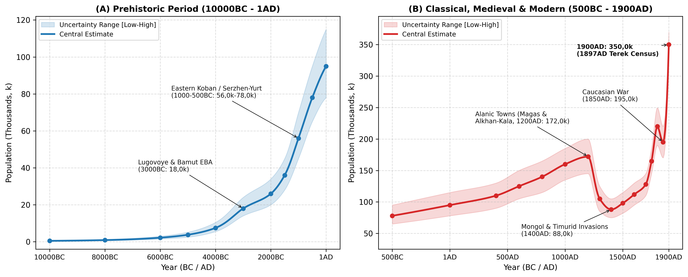
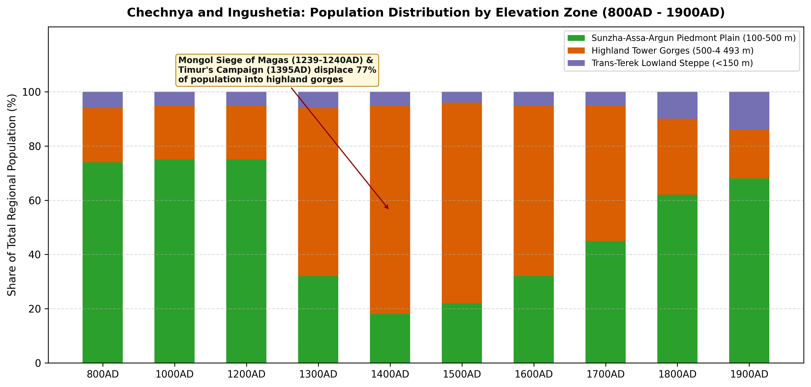
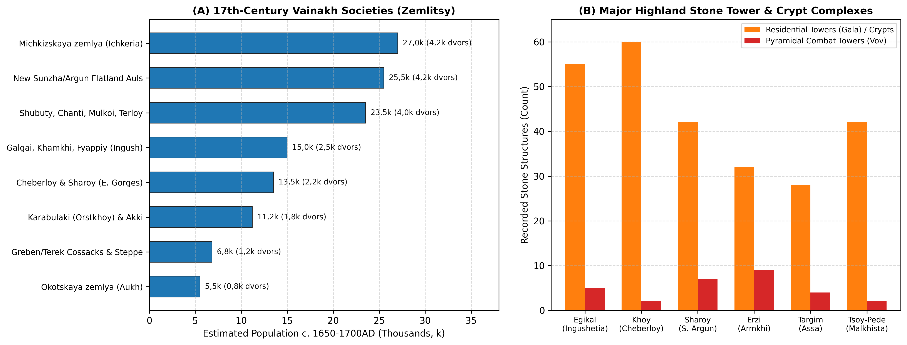

# Abstract

This paper reviews the archaeological, bioarchaeological, architectural, and archival literature to reconstruct the population and settlement history of Chechnya and Ingushetia (20,8k km² combined: 17,2k km² Chechen Republic and 3,6k km² Republic of Ingushetia) from 10000BC to 1900AD. Rather than extrapolating from raw site counts, our synthesis examines long-term settlement change across three main elevation zones: (1) Early Holocene canyon foragers and Early Bronze Age Kura-Araxes-Maykop contact settlements (Lugovoye/Muzhichi, Bamut, Serzhen-Yurt I), reaching ~18k by 3000BC [@munchaev1961lugovoye; @munchaev1975caucasus; @bagaev2008ancient]; (2) the Late Bronze and Early Iron Age Eastern Variant of the Koban Culture (1200-400BC, represented by Serzhen-Yurt, Zandak, and Nesterovskiy), when fortified hillforts and bronze metallurgy supported 56k (1000BC) to 78k (500BC) inhabitants [@kozenkova1977koban; @kozenkova1992serzhen; @kozenkova2013koban; @burkov2015]; (3) the Early and High Medieval Alanic urban period (400-1238AD), when fortified town (*gorodishche*) networks along the Sunzha, Assa, Argun, and Terek (Alkhan-Kala [60 ha], the Nazran-Ekazhevo/Magas cluster of >30 fortified settlements, and Germenchuk) raised regional population to 172k (145k-200k) around 1200AD, with 75% living on the fertile piedmont plains [@vinogradov1972central; @chakhkiev2006magas; @dolgieva2013ingushetia; @malashev2016alania; @mamaev2009]; and (4) the upland displacement (1238-1400AD) caused by the 1239-1240 Mongol siege of Magas and Timur's 1395 destruction of *Simsir*, which halved regional population to 88k (75k-105k) and concentrated 77% of survivors in the fortified stone tower and collective crypt villages of the Armkhi, Assa, and Argun gorges (Egikal, Erzi, Targim, Vovnushki, Tsoy-Pede, Khoy) [@markovin1965monuments; @shavkhelishvili1963history; @akhmadov2002chechnya; @frizen2020], before the 16th-18th-century Vainakh return to the Sunzha-Argun plains lifted population to 128k by 1700AD and 220k by 1800AD [@kusheva1963peoples; @volkova1973ethnonyms; @akhmadov2019chechnya; @kabuzan1996]. Following severe wartime mortality during the Caucasian War (1818-1859; 195k in 1850AD) and the 1865 *muhajir* deportation of ~22k Chechens and Orstkhoy (Karabulaks) to the Ottoman Empire, natural growth, Cossack settlement, the 1893 Grozny oil boom, and the 1897 First All-Russian Imperial Census document a rise to 350k (330k-370k) by 1900AD [@kabuzan1996; @ibragimova2006; @troynitskiy1905terek; @golovlev2017census].

# Background

 Occupying the north-central and northeastern slopes of the Greater Caucasus between the upper Terek-Assa watershed and the Andi ridge, the historical Vainakh territory (20,8k km²) is divided into three parallel east-west belts (Figure 1 and Table 1).

The first belt comprises the Sunzha-Assa-Argun piedmont plain and foothill valleys (Zone 1, 8,6k km², 100-500 m). Watered by the Sunzha (Сунжа) and its right-bank tributaries (Assa, Fortanga, Gehi, Martan, Argun, Dzhalka, Gums, Aksay), this fertile piedmont belt served as the main agricultural zone of the central-eastern Caucasus during the Early Bronze Age (Lugovoye, Serzhen-Yurt I), the Eastern Koban era (Serzhen-Yurt, Alkhaste, Bamut), the Alanic kingdom (Alkhan-Kala, Nazran-Ekazhevo/Magas), and the 16th-19th-century Vainakh resettlement of the plains (Chechen-Aul, Aldy, Shali, Germenchuk, Gekhi, Urus-Martan, Nazran, Grozny) [@munchaev1961lugovoye; @kozenkova1992serzhen; @chakhkiev2006magas; @akhmadov2002chechnya].
The second belt encompasses the highland limestone and slate tower gorges (Zone 2, 6,7k km², 500-4.493 m). Rising to Mount Tebulosmta (4.493 m) and Mount Shan (4.451 m), the deep canyons of the Armkhi (Dzheirakh), upper Assa (Targim basin), Fortanga (Orstkhoy/Akki), upper Argun (Malkhista, Maysta, Terloy, Chanti, Shubuty, Mulkoi), Sharo-Argun (Sharoy, Cheberloy), and wooded Ichkeria (Nokhch-Mokhk) formed natural mountain refuges [@markovin1965monuments; @chakhkiev2007weapons; @nalgiev2026]. Following the 13th-14th-century Mongol and Timurid campaigns across the Sunzha plain, these gorges saw extensive construction of mortar-bound residential stone towers (*gala*), pyramidal combat towers (*vov*), and above-ground collective vaulted crypts (*maigash* / *kash*) [@markovin1965monuments; @dolgieva2013ingushetia; @karieva2024].

The third belt consists of the Trans-Terek lowland steppe (Zone 3, 5,5k km², -10 to 150 m). North of the Terek river (Naurskaya, Shelkovskaya, Kargalinskaya steppes), mobile pastoralists (Scythians, Sarmatians, Savirs/Khazars, Kipchaks, Golden Horde Tatars, and Nogais) alternated with fortified river settlements along the Terek bluff and, from the 16th to 19th centuries, the Greben and Terek Cossack *stanitsas* [@vinogradov1972central; @kusheva1963peoples; @kabuzan1996].

# Methodology

## Regional Subdivisions

To track population movements between the fertile Sunzha-Assa-Argun piedmont and the mountain tower gorges, we divide Chechnya and Ingushetia (20,8k km²) into three elevation zones (Table 1).

Table: Elevation zones, river basins, and principal archaeological and historical complexes of Chechnya and Ingushetia.

|Sub-Regional Zone                         |Elevation      |Area (km2) |River Basins                                                              |Key Archaeological and Historical Centres                                         |
|:-----------------------------------------|:--------------|:----------|:-------------------------------------------------------------------------|:---------------------------------------------------------------------------------|
|Sunzha-Assa-Argun Piedmont Plain          |100 to 500 m   |8,6k       |Sunzha, lower Assa, Fortanga, Martan, lower Argun, Aksay and Terek valley |Lugovoye, Serzhen-Yurt, Alkhan-Kala, Magas (Nazran-Ekazhevo), Shali, Grozny       |
|Highland Tower Gorges and Wooded Ichkeria |500 to 4.493 m |6,7k       |Dzheirakh (Armkhi), Targim (upper Assa), Argun, Sharo-Argun and Hulhulau  |Egikal, Erzi, Targim, Vovnushki, Tsoy-Pede, Khoy, Nikaroy, Sharoy, Vedeno         |
|Trans-Terek Lowland Steppe                |-10 to 150 m   |5,5k       |Left-bank Terek valley and Shelkovskaya-Naurskaya semi-arid steppe        |Trans-Terek kurgans, Golden Horde river crossings, Greben/Terek Cossack stanitsas |
|Total Chechnya and Ingushetia             |-10 to 4.493 m |20,8k      |Terek-Sunzha-Argun drainage basin                                         |Major prehistoric, Alanic, and Vainakh tower complexes                            |

## Estimation Methods

Regional population estimates P(t) are derived from five independent archaeological and documentary methods.

For the Eastern Koban hillfort and cemetery period (1200-400BC), excavations by V. I. Kozenkova at Serzhen-Yurt I-II (~8-10 ha craft settlement with cobbled streets, >60 timber-and-wattle dwellings, and bronze-foundry workshops) and its adjacent cemetery (>120 excavated flat graves) alongside Zandak, Bamut, Nesterovskiy, and Lugovoye establish a density of 40-65 persons/ha for Eastern Koban hillforts (400-650 residents per major settlement) [@kozenkova1977koban; @kozenkova1992serzhen; @kozenkova2013koban; @burkov2015].
For the Early and High Medieval Alanic fortification network (400-1238AD) mapped by V. B. Vinogradov, Kh. M. Mamaev, D. Yu. Chakhkiev, and V. Yu. Malashev [@burkov2007; @mamaev2009], population is estimated from intramural citadel area (80-120 persons/ha) plus open agricultural *posad* settlements (25-40 persons/ha) across the Alkhan-Kala urban centre (60 ha fortified core + >150 ha suburbs; 8k-15k inhabitants) and the Nazran-Ekazhevo/Ali-Yurt (Magas) settlement cluster (>30 fortified towns spanning ~100 km²; 15k-25k inhabitants) [@chakhkiev2006magas; @dolgieva2013ingushetia; @malashev2016alania; @mamaev2022early].
For the late medieval highland refuge period (1300-1700AD) in Zone 2, over 300 fortified stone tower villages (*aul-kreposti*) containing >2.000 residential towers (*gala*, 2-3 storeys, one nuclear or stem family of 5,5-6,5 persons per tower) and >250 pyramidal combat towers (*vov*, 4-6 storeys, 22-31 m high) are cross-checked against skeletal MNI counts inside multi-tiered collective stone crypts (Tsoy-Pede [42 crypts], Egikal, Erzi, Khoy, Vaserkel, where each lineage crypt accumulated 60-150 burials across 6-8 generations) [@markovin1965monuments; @chakhkiev2007weapons; @dolgieva2013ingushetia; @frizen2020; @nalgiev2026].
For the early modern period (1550-1800AD), Russian *Posolskiye* and fortress registers compiled by E. N. Kusheva [@kusheva1963peoples], N. G. Volkova [@volkova1973ethnonyms; @volkova1974ethnic], and Ya. Z. and Sh. B. Akhmadov [@akhmadov2004; @akhmadov2016; @tovsultanov2017] record village counts (*kabaki* / *auly*), household totals (*dvory*), and military levies across *Okotskaya zemlya* (Aukh), *Michkizskaya zemlya* (Ichkeria), *Shubutskaya zemlya* (Shatoy/Argun), *Kalkanskaya* / *Erokanskaya zemlya* (Ingush gorges), and the resettled Sunzha-Argun plains [@akhmadov2002chechnya; @akhmadov2019chechnya; @akhmadov2020taip].
Finally, late 19th-century estimates (1860-1900AD) are anchored to A. P. Berger's (1859) village enumerations [@berger1859chechnya], the 1867-1890 statistical tables of Terek Oblast analysed by Z. Kh. Ibragimova [@ibragimova2006] and V. M. Kabuzan [@kabuzan1996], the 1886 family lists (*posemeynye spiski*), and Volume 68 (*Terskaya Oblast'*) of the 1897 First All-Russian Imperial Census across Grozny, Vedeno, Nazran/Sunzha, and left-bank Terek Cossack districts [@troynitskiy1905terek; @golovlev2017census].

# Results

plot of chunk fig-chech-pop

## Mesolithic to Early and Middle Bronze Ages: Kezenoy-Am, Lugovoye, and Bamut (10000 - 1200BC)

During the Early Holocene (10000-5000BC), Mesolithic and Neolithic hunter-gatherers occupied high-mountain lake basins (Kezenoy-Am, 1.870 m) and limestone cave overhangs in the Argun, Sharoy, and Assa gorges, increasing gradually from 0,5k (10000BC) to 3,8k (5000BC) [@munchaev1975caucasus; @bagaev2008ancient]. During the 4th and 3rd millennia BC (Eneolithic and Early Bronze Age, 4000-2000BC), the Sunzha-Assa-Argun piedmont became an active contact zone where the Northeastern Caucasian Kura-Araxes culture met the Maykop-Novosvobodnaya kurgan tradition [@munchaev1961lugovoye; @munchaev1975caucasus].

At Lugovoye (Muzhichi, Assa Valley) and Serzhen-Yurt I, excavations by R. M. Munchaev (1952-1957) in the Assa gorge of Ingushetia (157 excavated burials) and the lower layer of Serzhen-Yurt I (Shali district, Chechnya) revealed wattle-and-daub houses with sunken circular hearths, horn-lugged Kura-Araxes burnished pottery, stone shaft-hole axes, and arsenical bronze daggers and spiral temple rings [@munchaev1961lugovoye; @munchaev1975caucasus].
In the Bamut kurgan field (Бамутские курганы) on the Fortanga-Assa piedmont exit, Munchaev excavated over 50 Early and Middle Bronze Age kurgans combining Maykop-Novosvobodnaya metalwork with Kura-Araxes domestic pottery [@munchaev1975caucasus]. By 3000BC, piedmont farming villages and transhumant herders numbered 18k (14k-24k), rising during the Middle Bronze Age North Caucasian (Ginchi and Pre-Koban) cultures (Galaity, Achkhoy-Martan, Harachoy) to 26k (2000BC) and 36k (1500BC) [@bagaev2008ancient].

## Late Bronze and Early Iron Ages: The Eastern Koban Hillforts (1200 - 400BC)

Between the 12th and 5th centuries BC, Chechnya and Ingushetia formed the core territory of the Eastern Variant of the Koban Culture (Восточный вариант кобанской культуры), studied in detail by V. I. Kozenkova and M. Kh. Bagaev [@kozenkova1977koban; @kozenkova1992serzhen; @kozenkova2013koban; @bagaev2008ancient; @burkov2015; @spasskaya2024].

Situated on two naturally defended river terraces above the Bass river (Shali district), the Serzhen-Yurt I-II settlement functioned from the 11th to the 6th century BC as a large craft and farming centre (~8-10 ha). Excavations uncovered cobble-paved main streets (4 m wide), rows of timber-framed clay dwellings (20-45 m²), bronze-smelting furnaces with clay tuyères and stone casting moulds for Koban shaft-hole axes, zoomorphic terracotta figurines, and grain storage pits [@kozenkova1992serzhen; @kozenkova2001; @kozenkova2013koban].
Over 80 Eastern Koban settlements and cemeteries line the Sunzha-Assa-Argun foothills and mountain gorges, including the Zandak stone-cist cemetery in Nozhay-Yurt containing >60 graves, as well as Nesterovskiy, Alkhaste, Lugovoye, and Sharoy yielding bimetallic iron-and-bronze daggers and early Scythian *akinakes* weapons from the 7th-5th centuries BC [@kozenkova1977koban; @bagaev2008ancient]. Supported by mixed millet-barley cultivation and mountain sheep-cattle husbandry (with 5,9% terraced land in mountainous Ingushetia [@shaev2024terraces]), total regional population rose from 56k (45k-70k) in 1000BC to 78k (65k-95k) in 500BC.

## Sarmatian and Alanic Towns: *Magas* and *Alkhan-Kala* (400BC - 1238AD)

During the Sarmatian period (300BC - 300AD, 95k at 1AD) and the Early Alanic period (400-800AD, 110k in 400AD to 140k in 800AD), a dense network of earthen-rampart and moated fortified towns (*gorodishcha*) developed along the Sunzha, Assa, Argun, and Terek rivers [@vinogradov1970; @vinogradov1972central; @malashev2016; @malashev2016alania; @mamaev2009; @burkov2007].

Protected by triple concentric horseshoe ramparts and deep moats backing onto a steep Sunzha river cliff 18 km west of Grozny, Alkhan-Kala (Алхан-Калинское городище) enclosed a 60-hectare urban core surrounded by >150 ha of craft suburbs and a large catacomb cemetery (>2.500 kurgan and flat catacombs spanning the 2nd to 12th centuries AD) [@vinogradov1970; @vinogradov1972central; @malashev2016; @mamaev2009]. Serving as the main administrative and trading centre of the central Sunzha basin, Alkhan-Kala housed 8k-15k inhabitants prior to its destruction in 1238-1240.

In the upper Sunzha-Assa-Kambileyevka interfluve of lowland Ingushetia, surveys by D. Yu. Chakhkiev, N. D. Kodzoev, and U. B. Gadiev documented the Nazran-Ekazhevo-Yandare (Magas / Магас) cluster of over 30 fortified *gorodishcha* and >60 satellite villages spaced 0,5-2 km apart within a ~100 km² core (Hatrig-Yurt, Ekazhevo I-IV, Nazran, Ali-Yurt, Surkhakhi, Yandare, Gazi-Yurt) [@chakhkiev2003; @chakhkiev2006magas; @kodzoev2002; @gadiev2015; @dolgieva2013ingushetia]. Identified by regional archaeologists with the Alanic capital Magas (*Ma'as*, described by al-Mas'udi in 943AD and besieged by the Mongol princes Möngke, Güyük, Kadan, and Büri from winter 1239 to early 1240 according to Juwayni and Rashid al-Din), this urban cluster housed 15k-25k inhabitants [@chakhkiev2006magas; @dolgieva2013ingushetia].

Further east along the Sunzha and Argun, fortified towns at Germenchuk, Shali, Aldy, and Goryacheistochnenskoye (15-45 ha each) controlled the Argun-Sunzha confluence and Terek crossings [@mamaev1979; @mamaev2009]. At its pre-Mongol high point around 1200AD, Chechnya and Ingushetia supported 172k (145k-200k) inhabitants (8,27 persons/km²), with 75% (129k) living on the Sunzha-Assa-Argun piedmont plain (Zone 1).

plot of chunk fig-chech-shift

## Mongol and Timurid Invasions and the Highland Stone Tower Villages (1238 - 1500AD)

Between 1238 and 1395AD, the lowland settlement network of Chechnya and Ingushetia was destroyed by two waves of invasion (Figure 2B and Figure 3).

Following the storming and levelling of Magas (1239-1240), Alkhan-Kala, and Dedyakov (1277-1278 joint Mongol-Rus' siege recorded in the Russian chronicles), the fertile Sunzha and Terek plains were turned into winter pastures (*kochev'ya*) of the Golden Horde khans (Batu, Berke, Uzbek), where Ibn Battuta visited Uzbek Khan's camp at *Bish-Dag* in 1334 [@dolgieva2013ingushetia; @akhmadov2002chechnya]. Total regional population fell by nearly 40% to 105k (85k-125k) by 1300AD.

After defeating Tokhtamysh on the Terek river in April 1395, Timur invaded the Vainakh principality of Simsir (Симсир) (ruled by Gayur Khan across Ichkeria and the Sunzha-Argun foothills) and marched into the highland gorges (*Aukhar*, *Buri-Burd*, *Kuli*, *Taus*). As recorded by Sharaf al-Din Yazdi and Nizam al-Din Shami, Timur's troops demolished stone fortresses, burned terraced fields, and killed defenders across the mountains [@shavkhelishvili1963history; @akhmadov2002chechnya]. By 1400AD, regional population dropped to a late-medieval low of 88k (75k-105k), and its geographical distribution shifted sharply upward: 77% (67,8k) of all inhabitants were now concentrated in the mountain gorges of Zone 2, while the Sunzha plain (Zone 1) held only 18% (15,8k).

Refugee movement into the limestone canyons of the Armkhi (Dzheirakh), upper Assa (Targim basin), Fortanga, and upper Argun (Malkhista, Maysta, Terloy, Chanti, Cheberloy) spurred the construction of Vainakh stone tower complexes across the 14th to 17th centuries, documented by V. I. Markovin and D. Yu. Chakhkiev (Figure 4B) [@markovin1965monuments; @chakhkiev2007weapons; @dolgieva2013ingushetia; @nalgiev2026].

In the Ingush gorges of the Targim basin and Armkhi valley (Egikal, Erzi, Targim, Khamkhi, Vovnushki, Puy), Egikal (Эгикал) alone contained over 50 mortar-bound residential stone towers (*gala*), 5 intact pyramidal combat towers (*vov*, up to 27 m high with machicolations and slate-slab roofs), 6 subterranean and 106 above-ground collective stone crypts (*kash*), and 3 sanctuary shrines (Tkhaba-Yerdy, Albi-Yerdy) [@markovin1965monuments; @dolgieva2013ingushetia; @karieva2024].
At the confluence of the Chanty-Argun and Meshi-Khi rivers in Malkhista, the Chechen cemetery of Tsoy-Pede (Цой-Педе) preserved 42 gabled stone collective crypts guarded by two defensive barrier walls and combat towers (>3.000 cumulative burials across the 14th-17th centuries) [@markovin1965monuments; @frizen2020]. In Cheberloy (Kezenoy-Am basin), the cliff settlement of Khoy (Хой) and the 7-tower complex of Sharoy (Шарой) anchored dense terraced mountain communities alongside Nikaroy, Vaserkel, and Pakoch [@chakhkiev2007weapons; @ilyasov2004].

## Return to the Plains: Sixteenth and Seventeenth-Century Vainakh Societies (1500 - 1700AD)

Following the breakup of the Golden Horde and the founding of the Russian fortress of Terki (Терский город, 1567/1588) on the lower Terek, land scarcity on the mountain terraces of Zone 2 prompted a gradual Vainakh return to the forested foothills (*Chernye gory*) and the Sunzha-Argun-Aksay plains (1550-1700AD) [@kusheva1963peoples; @volkova1973ethnonyms; @akhmadov2019chechnya; @akhmadov2020taip; @albogachiev2025].

Drawing on Russian *Posolskiy Prikaz* ambassadorial journals (Semen Zvenigorodskiy 1589, Fedor Takmakov 1604, Khodotetskiy 1638, Terki Voivode Books 1614-1690) analysed by E. N. Kusheva [@kusheva1963peoples], N. G. Volkova [@volkova1973ethnonyms; @volkova1974ethnic], and Ya. Z. Akhmadov [@akhmadov2002chechnya; @akhmadov2019chechnya; @akhmadov2020taip; @tovsultanov2017], total population across Chechnya and Ingushetia grew from 98k (1500AD) to 112k (1600AD) and 128k (110k-145k) by 1700AD (Figure 4A and Table 2).

In the eastern foothills, Okotskaya Zemlya (Окоцкая земля / Aukh) along the Aksay, Yamansu, and Aktash rivers (Staryy Okokh, Shovkhal-Berd) was ruled by the mirzas Shikh-Murza (killed 1596) and Batay-Murza, who fielded 500-1.000 horsemen and footmen in Russian service (~850 households; 5,5k inhabitants, plus the *Okotskaya Sloboda* at Terki) [@kusheva1963peoples; @akhmadov2019chechnya; @albogachiev2025]. Michkizskaya Zemlya (Мичкизская земля / Wooded Ichkeria - Nokhch-Mokhk) comprised 36 large villages along the Michik, Gums, Hulhulau, and Aksay rivers (Benoy, Tsontaroy, Gordali, Alleroy, Zandak, Vedeno), where *Posolskiy Prikaz* reports (1619-1647) credit the *Michkizy* with 3.000-5.000 fighting men (3,8k-4,6k households; 24k-30k inhabitants) [@kusheva1963peoples; @akhmadov2019chechnya].

In the upper and middle Argun societies (Shubuty/Shatoy, Chanti, Mulkoi, Terloy, Malkhista, Maysta, Peshkhoy) controlling the gorge route to Tusheti and Khevsureti, population reached 3,6k-4,4k households (21k-26k inhabitants) [@akhmadov2019chechnya; @akhmadov2020taip; @akhmadov2004], while Cheberloy and Sharoy (Sharo-Argun and Kezenoy-Am) supported 2k-2,5k households (12k-15k inhabitants) [@akhmadov2019chechnya].

To the west, the Ingush mountain societies (Kalkanskaya/Galgai, Erokanskaya/Dzheirakh, Khamkhi, Fyappiy/Metskhal) and early plains settlements in the Angusht/Tarskaya valley numbered 2,2k-2,8k households (13k-17k inhabitants) [@dolgieva2013ingushetia; @volkova1974ethnic], while the Karabulaki (Orstkhoy on the Fortanga-Assa) and Akki (Akkintsy/Galashki) numbered 1,6k-2,1k households (9,5k-13k inhabitants) [@volkova1974ethnic; @akhmadov2019chechnya; @albogachiev2025]. Simultaneously, new flatland Chechen *auls* on the Sunzha and lower Argun (Chechen-Aul, Staraya Sunzha, Shali, Germenchuk, Aldy, Gekhi, Atterki) expanded rapidly during the second half of the 17th century (3,8k-4,6k households; 22k-29k inhabitants), lifting the lowland piedmont share (Zone 1) back to 45% by 1700AD [@akhmadov2002chechnya; @akhmadov2020taip].

plot of chunk fig-chech-typology

Table: Population and household estimates for Chechnya and Ingushetia c. 1650-1700AD across Vainakh territorial societies (zemlitsy) and Terek borderlands.

|Territorial Society (Zemlitsa) / Sub-Region                                          |Elevation Zone                        |Households (Dvors) |Militia (Fighting Men) |Estimated Population |
|:------------------------------------------------------------------------------------|:-------------------------------------|:------------------|:----------------------|:--------------------|
|Michkizskaya zemlya (Ichkeria / Nokhch-Mokhk: 36 villages)                           |Zone 2 / Zone 1 margin                |3,8k - 4,6k        |3,5k - 5k              |24k - 30k            |
|New Sunzha and Lower Argun Flatland Auls (Chechen-Aul, Shali, Germenchuk, Aldy)      |Zone 1 (Sunzha-Argun Plain)           |3,8k - 4,6k        |3,5k - 4,8k            |22k - 29k            |
|Upper and Middle Argun Societies (Shubuty/Shatoy, Chanti, Mulkoi, Terloy, Malkhista) |Zone 2 (Argun Gorges)                 |3,6k - 4,4k        |3,2k - 4,2k            |21k - 26k            |
|Ingush Societies (Galgai/Kalkany, Khamkhi, Fyappiy, Dzheirakh and Tarskaya Valley)   |Zone 2 and Zone 1 (Assa-Armkhi-Terek) |2,2k - 2,8k        |2k - 2,8k              |13k - 17k            |
|Cheberloy and Sharoy (Sharo-Argun and Kezenoy-Am Basin)                              |Zone 2 (Eastern Gorges)               |2k - 2,5k          |1,8k - 2,5k            |12k - 15k            |
|Karabulaki (Orstkhoy on Fortanga-Assa) and Highland Akki (Lam-Akki)                  |Zone 2 / Zone 1 (Fortanga-Assa)       |1,6k - 2,1k        |1,5k - 2k              |9,5k - 13k           |
|Greben and Terek Cossack Gorodki + Trans-Terek Nogai Winter Camps                    |Zone 3 (Terek Bluff and Steppe)       |1k - 1,4k          |1k - 1,5k              |5,5k - 8k            |
|Okotskaya zemlya (Aukh Foothills: Aktash, Yamansu, Yaryksu)                          |Zone 1 (Eastern Foothills)            |0,75k - 0,95k      |0,6k - 1k              |4,5k - 6,5k          |
|Total Chechnya and Ingushetia (20,8k km2)                                            |All 3 Elevation Zones                 |18,75k - 23,35k    |17,1k - 23,8k          |128k (110k - 145k)   |

## The Eighteenth and Nineteenth Centuries (1700 - 1900AD)

The 18th and 19th centuries brought the completion of Vainakh lowland settlement across the Sunzha-Grozny plains, the construction of the Russian Terek-Sunzha fortified line, severe population losses during the Caucasian War (1818-1859), and rapid post-1865 demographic recovery [@akhmadov2002history19c; @kabuzan1996; @ibragimova2006; @dolgieva2013ingushetia].

Throughout the 18th century, Chechen and Ingush settlers founded large agricultural villages (1k-3,5k inhabitants each) across Greater and Lesser Chechnya (*Bol'shaya i Malaya Chechnya*: Shali, Germenchuk, Urus-Martan, Goyty, Gekhi, Achkhoy, Gudermes, Avtury, Mayrtup) and the Nazran-Kambileyevka plain (Angusht, Sholkhi, Nazran, where Ingush elders took a formal oath of allegiance to Russia in 1770 and 1810) [@akhmadov2002history19c; @akhmadov2016; @dolgieva2013ingushetia; @zhurtova2014]. Simultaneously, the Russian Empire established the Terek-Mozdok Cordon Line along the left bank of the Terek (Kizlyar 1735, Mozdok 1763, Vladikavkaz 1784), resettling Greben, Terek-Semeynye, and Volga Cossacks across the Naurskaya and Shelkovskaya steppes (Zone 3) [@kabuzan1996]. Combined Vainakh and Cossack population rose from 128k in 1700AD to 165k (145k-185k) in 1750AD and 220k (190k-250k) in 1800AD, with 62% (136,5k) residing on the Sunzha-Argun piedmont plains [@kabuzan1996; @akhmadov2002history19c].

General A. P. Yermolov's construction of the Sunzha Fortified Line - anchored by the fortress of Groznaya (founded 1818) - and the forced eviction of Chechen villages between the Terek and Sunzha rivers sparked the 1818-1859 war, during which Chechnya formed the principal agricultural and military base of Imam Shamil's Caucasian Imamate (capital at Dargo 1840-1845 and Vedeno 1845-1859) [@kabuzan1996; @ibragimova2006]. Repeated military campaigns, forest-clearing (*proseki*), winter blockades of lowland pastures, and the replacement of Orstkhoy (Karabulak) and western Chechen foothill villages with the Sunzha Cossack Line (*stanitsas* of Слепцовская / Sleptsovskaya, Troitskaya, Karabulakskaya, Assinskaya, Samashkinskaya, Mikhailovskaya in 1845-1860) caused severe demographic losses: Russian military-statistical estimates summarised by A. P. Berger (1859) [@berger1859chechnya], V. M. Kabuzan (1996) [@kabuzan1996], and Z. Kh. Ibragimova (2006) [@ibragimova2006] indicate that ethnic Chechen numbers dropped from ~250k-300k in the 1830s to ~130k-150k by 1859-1860 (yielding a regional midpoint of 195k [170k-220k] across Chechnya-Ingushetia including Cossack settlements in 1850AD). In the summer of 1865, imperial authorities organised the *muhajir* emigration of ~22k-23k Chechens and nearly the entire Orstkhoy (Karabulak) population (~5k families) into the Ottoman Empire [@ibragimova2006; @kabuzan1996; @dolgieva2013ingushetia].

Between 1866 and 1900, peaceful agrarian recovery on the Sunzha-Argun maize-and-wheat plains, the 1886 family lists (*posemeynye spiski*) (which recorded ~195k ethnic Chechens and ~38k Ingush), and the discovery of the Grozny oilfield (1893) combined with the Vladikavkaz Railway to produce rapid population growth [@ibragimova2006; @kabuzan1996]. In the First General Census of the Russian Empire (28 January 1897) for Terek Oblast (Vol. 68) [@troynitskiy1905terek; @golovlev2017census], the total number of native Vainakh speakers in Terek Oblast reached 273.962 (226.496 Chechens and 47.466 Ingush). Within the administrative districts corresponding to modern Chechnya and Ingushetia - specifically the Grozny Okrug (226.035 total inhabitants, including Grozny city with 15.564 residents), the Sunzha (Nazran) Otdel (~47,4k Ingush plus ~36k Sunzha Cossacks), the Chechen sector of the Khasavyurt Okrug (~18,1k Aukh Chechens), and the left-bank Kizlyar/Mozdok Terek Cossack *stanitsas* (Naurskaya, Shelkovskaya, Chervlennaya, Kalinovskaya; ~40k inhabitants) - total population reached 350k (330k-370k, or 16,83 persons/km²) by 1900AD, with 68% (238k) concentrated on the Sunzha-Assa-Argun plains and Grozny urban district (Zone 1), 18% (63k) in the mountain gorges (Zone 2), and 14% (49k) across the Trans-Terek Cossack steppe (Zone 3) [@troynitskiy1905terek; @ibragimova2006; @kabuzan1996].

# Limitations

Two primary methodological constraints affect historical population estimates for Chechnya and Ingushetia. First, because highland lineage crypts (*kash* / *maigash*) at Tsoy-Pede, Egikal, and Erzi remained in continuous use from the 14th to the 18th century (until Islamisation replaced crypt burial with subterranean *keschnash* cemeteries), skeletal MNI totals must be divided by 6-8 generations (180-240 years) to estimate the living population of any single century [@markovin1965monuments; @dolgieva2013ingushetia; @frizen2020]. Second, during the Caucasian War and the subsequent reorganisation of Terek Oblast (merging and splitting the Grozny, Vedeno, Ichkeria, Argun, and Sunzha/Nazran districts between 1860 and 1905), military estimates of unpacified highland communities carried wider margins of error (~15-20%) prior to the 1886 family lists and the 1897 census [@ibragimova2006; @kabuzan1996].

# Conclusion

The population history of Chechnya and Ingushetia (10000BC - 1900AD) reflects a recurring shift between the fertile Sunzha-Argun piedmont plains and the defensive stone gorges of the Greater Caucasus. After reaching two major early lowland peaks during the Eastern Koban hillfort era (56k-78k in 1000-500BC) and the Alanic urban period around Magas and Alkhan-Kala (172k in 1200AD), the region experienced a marked shift into the mountain gorges following the Mongol and Timurid invasions (77% highland concentration in 1400AD at 88k). Subsequent Vainakh resettlement of the plains lifted population to 128k by 1700AD and 220k by 1800AD, and despite the heavy toll of the Caucasian War and the 1865 *muhajir* deportations (195k in 1850AD), demographic recovery and the Grozny industrial expansion carried the regional population to 350k (16,83 persons/km²) by 1900AD.

# Appendix

## Population Estimates

Table: Estimated population of Chechnya and Ingushetia across its three elevation zones (10000BC - 1900AD; total area 20,8k km2).

|Benchmark |Zone 1: Piedmont Plain (8,6k km2) |Zone 2: Highland Gorges (6,7k km2) |Zone 3: Trans-Terek Steppe (5,5k km2) |Total Midpoint |Uncertainty Range [Low - High] |Density (p/km2) |
|:---------|:---------------------------------|:----------------------------------|:-------------------------------------|:--------------|:------------------------------|:---------------|
|10000BC   |0,2k                              |0,25k                              |0,05k                                 |0,5k           |0,3k - 0,8k                    |0,02            |
|8000BC    |0,4k                              |0,4k                               |0,1k                                  |0,9k           |0,6k - 1,3k                    |0,04            |
|6000BC    |1k                                |1k                                 |0,2k                                  |2,2k           |1,5k - 3k                      |0,11            |
|5000BC    |1,8k                              |1,6k                               |0,4k                                  |3,8k           |2,5k - 5,2k                    |0,18            |
|4000BC    |4k                                |2,8k                               |0,7k                                  |7,5k           |5,5k - 10,5k                   |0,36            |
|3000BC    |10,8k                             |5,4k                               |1,8k                                  |18k            |14k - 24k                      |0,87            |
|2000BC    |15,5k                             |8k                                 |2,5k                                  |26k            |20k - 34k                      |1,25            |
|1500BC    |21,5k                             |11,5k                              |3k                                    |36k            |28k - 45k                      |1,73            |
|1000BC    |34k                               |17,5k                              |4,5k                                  |56k            |45k - 70k                      |2,69            |
|500BC     |48k                               |23k                                |7k                                    |78k            |65k - 95k                      |3,75            |
|1AD       |62k                               |24k                                |9k                                    |95k            |78k - 115k                     |4,57            |
|400AD     |77k                               |24k                                |9k                                    |110k           |90k - 130k                     |5,29            |
|600AD     |90k                               |26k                                |9k                                    |125k           |105k - 150k                    |6,01            |
|800AD     |103,5k                            |28k                                |8,5k                                  |140k           |115k - 165k                    |6,73            |
|1000AD    |120k                              |32k                                |8k                                    |160k           |135k - 185k                    |7,69            |
|1200AD    |129k                              |34,4k                              |8,6k                                  |172k           |145k - 200k                    |8,27            |
|1300AD    |33,6k                             |65,1k                              |6,3k                                  |105k           |85k - 125k                     |5,05            |
|1400AD    |15,8k                             |67,8k                              |4,4k                                  |88k            |75k - 105k                     |4,23            |
|1500AD    |21,6k                             |72,5k                              |3,9k                                  |98k            |82k - 115k                     |4,71            |
|1600AD    |35,8k                             |70,6k                              |5,6k                                  |112k           |95k - 130k                     |5,38            |
|1700AD    |57,6k                             |64k                                |6,4k                                  |128k           |110k - 145k                    |6,15            |
|1750AD    |92k                               |61k                                |12k                                   |165k           |145k - 185k                    |7,93            |
|1800AD    |136,5k                            |61,5k                              |22k                                   |220k           |190k - 250k                    |10,58           |
|1850AD    |105k                              |62k                                |28k                                   |195k           |170k - 220k                    |9,38            |
|1900AD    |238k                              |63k                                |49k                                   |350k           |330k - 370k                    |16,83           |

# Sources

::: {#refs}
:::

