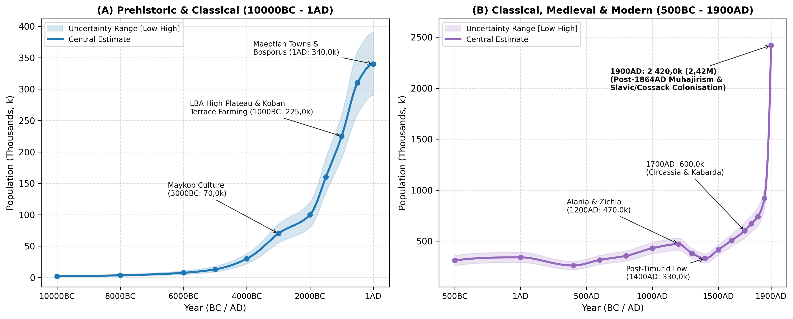
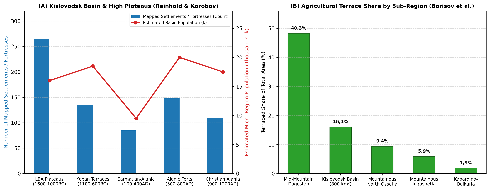
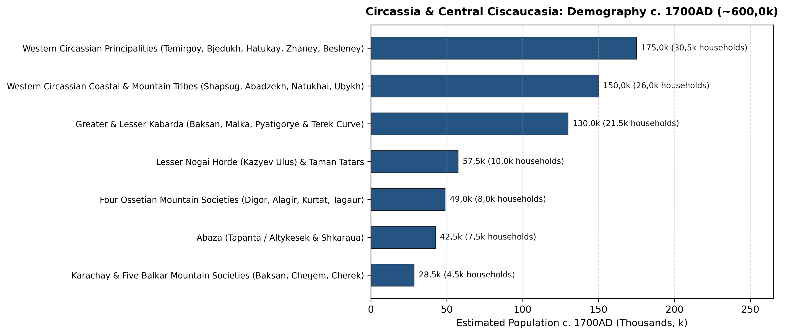

# Abstract

This paper reviews the archaeological, geoarchaeological,
bioarchaeological, classical-epigraphic, and archival literature to
reconstruct the population and settlement history of Historical
Circassia and Central Ciscaucasia (122,9k km² across Krasnodar Krai,
Adygea, Karachay-Cherkessia, Kabardino-Balkaria, North Ossetia-Alania,
and the Pyatigorye / Kislovodsk basin of southern Stavropol Krai) from
10000BC to 1900AD. Avoiding raw site-count extrapolations, our synthesis
traces long-term demographic change across six major historical periods:
(1) Terminal Pleistocene and Early Holocene rock-shelter foragers at
Satanay (Gubs Gorge) and Sosruko (Baksan Gorge) (2,0k in 10000BC -\>
13,0k in 5000BC)
[\[1\]](#ref-formozov1965stone)[\[2\]](#ref-leonova2013gubs)[\[3\]](#ref-golovanova2020sosruko);
(2) Eneolithic fortified stone villages (Meshoko, Yasenova Polyana,
Svobodnoe) and the Early and Middle Bronze Age Maykop-Novosvobodnaya,
Western Caucasian Dolmen (\>2 300-3 000 megaliths), and North Caucasian
cultures (70,0k in 3000BC -\> 100,0k in 2000BC)
[\[4\]](#ref-korenevskiy2004ancient)[\[5\]](#ref-korenevskiy2008a)[\[6\]](#ref-trifonov2001dolmens)[\[7\]](#ref-markovin1978dolmens);
(3) the Late Bronze Age high-mountain plateau settlement (\>260
symmetrical stone villages at 1 400-2 400 m around Mount Elbrus) and the
Western and Central Koban agricultural terrace expansion (160,0k in
1500BC -\> 225,0k in 1000BC)
[\[8\]](#ref-reinhold2017lba)[\[9\]](#ref-korobov2017system)[\[10\]](#ref-kozenkova1989western);
(4) the Classical Asiatic Bosporus cities (Phanagoria, Gorgippia,
Hermonassa, Semibratneye) and the \>200 Maeotian fortified towns
(*gorodishcha*) of the Kuban plain (310,0k in 500BC -\> 340,0k at 1AD)
[\[11\]](#ref-marchenko1996maeotians)[\[12\]](#ref-kuznetsov2017phanagoria)[\[13\]](#ref-alekseeva1997anapa);
(5) the Early and High Medieval Western Alanic (Nizhniy Arkhyz, Khumara,
Kislovodsk Basin \[\>140 forts\], Verkhniy and Nizhniy Dzhulat) and
Zichian-Kasogian peak (470,0k around 1200AD)
[\[9\]](#ref-korobov2017system)[\[14\]](#ref-kuznetsov1993arkhyz)[\[15\]](#ref-bidzhiev1983khumara)[\[16\]](#ref-afanasyev2014alans),
followed by the 1238-1395 Mongol and Timurid invasions (330,0k in
1400AD) and the early modern growth of Western Circassia, Greater and
Lesser Kabarda, Abaza, Karachay-Balkaria, Ossetia, and the Lesser Nogai
Horde to 600,0k (530,0k-680,0k) by 1700AD
[\[17\]](#ref-gardanov1967social)[\[18\]](#ref-khotko2008circassians)[\[19\]](#ref-khotko2015zichia)[\[20\]](#ref-trepalov2016nogai);
and (6) the 18th-19th-century demographic transformation, in which the
Caucasian War (1817-1864) and the 1860-1864 *muhajir* expulsion of
400,0k-500,0k+ Western Circassians (Shapsugs, Natukhais, Abadzekhs,
Ubykhs) and Abaza to the Ottoman Empire were followed by large-scale
Kuban Cossack and Slavic peasant settlement across Kuban Oblast, Black
Sea Governorate, and Western Terek Oblast, lifting total regional
population to 2 420,0k (2,42M; range 2,30M-2,55M) by 1900AD
[\[21\]](#ref-kabuzan1996)[\[22\]](#ref-kumykov1994)[\[23\]](#ref-berger1860expulsion)[\[24\]](#ref-troynitskiy1905kuban)[\[25\]](#ref-bgeu2007demography).

# Background

Stretching 650 km from the Taman Peninsula and the Kerch Strait
(Cimmerian Bosporus) across the chernozem plains of the Kuban
(*Prikuban’ye*) and the Sub-Elbrus volcanic plateaus to the Darial Gorge
on the upper Terek, Northwestern and Central Ciscaucasia (122,9k km²)
comprises five connected sub-regions (Figure 1 and Table 1).

The first sub-region encompasses the Taman Peninsula, the Black Sea
littoral (*Zichia* from Anapa to Sochi), the Azov reed-flats, and the
lower and middle Kuban chernozem plains (Krasnodar Krai, 75,5k km²).
This corridor hosted the richest Early Bronze Age royal kurgans (Maykop,
Staromyshastovskaya), \>200 Classical Maeotian fortified towns
(Elizavetinskoye, Starokorsunskoye, Semibratneye), the Greek polis
cities of Phanagoria (65 ha) and Gorgippia (40 ha), 39 Genoese-Zichian
trading ports (Matrega, Copa, Mapa, Maurocastro), the early modern
Western Circassian tribes and principalities (Zhaney, Temirgoy, Bjedukh,
Hatukay, Shapsug, Natukhai, Abadzekh, Ubykh), and, after 1792-1864, the
administrative heartland of Kuban Oblast (Yekaterinodar) and Black Sea
Governorate (Novorossiysk)
[\[11\]](#ref-marchenko1996maeotians)[\[12\]](#ref-kuznetsov2017phanagoria)[\[17\]](#ref-gardanov1967social)[\[19\]](#ref-khotko2015zichia)[\[24\]](#ref-troynitskiy1905kuban).

In the Trans-Kuban foothills and dolmen belt (Republic of Adygea, 7,8k
km²), drained by the Belaya, Laba, Fars, and Pshish rivers, Adygea
contains the stratified Eneolithic stone fortresses (Meshoko, Yasenova
Polyana), the eponymous Oshad kurgan of Maykop, the Klady
(Novosvobodnaya) megalithic tombs, dense clusters of Bronze Age slab and
trough dolmens (Kizinka, Deguako, Bogatyrskaya Polyana), the Maeotian
sanctuary kurgans of Ulyap, and the core territory of the Temirgoy
(*Kemirgoy*) and Hatukay principalities (modern Maykop Otdel)
[\[1\]](#ref-formozov1965stone)[\[4\]](#ref-korenevskiy2004ancient)[\[6\]](#ref-trifonov2001dolmens).

Across the upper Kuban, Zelenchuk, and Teberda gorges
(Karachay-Cherkessia, 14,3k km²), controlling the Klukhor and Marukh
passes into Abkhazia, this sub-region hosted the 8th-10th century
fortress of Khumara (Хумаринское городище, 25 ha), the 10th-12th century
metropolitan see of Alania at Nizhniy Arkhyz (Нижне-Архызское городище,
65 ha with three standing Byzantine stone churches), and the early
modern territories of the Besleney Circassians, Abaza (Tapanta /
Altykesek and Shkaraua), and Karachay (Карачай) in the Batalpashinsk
Otdel
[\[14\]](#ref-kuznetsov1993arkhyz)[\[15\]](#ref-bidzhiev1983khumara)[\[26\]](#ref-volkova1974ethnic)[\[27\]](#ref-titorenko2017).

In the Kislovodsk basin (*Pyatigorye*) and Sub-Elbrus high plateaus
(Kabardino-Balkaria \[12,5k km²\] + Pyatigorye / KMV \[4,8k km²\] =
17,3k km²), between the Baksan-Malka-Cherek gorges and the
Podkumok-Eshkakon limestone basin around Kislovodsk (800 km²),
systematic surveys by Sabine Reinhold and D. S. Korobov (2004-2020)
documented over 260 Late Bronze Age stone plateau settlements (1 400-2
400 m, e.g., Kabardinka 2), 16,1% terraced agricultural land coverage
(Koban and Alanic periods), and over 140 Early Medieval Alanic
promontory fortresses (5th-8th centuries AD)
[\[8\]](#ref-reinhold2017lba)[\[9\]](#ref-korobov2017system)[\[28\]](#ref-shaev2024terraces),
succeeded by the Golden Horde city of Nizhniy Dzhulat (Нижний Джулат),
the princely federation of Greater and Lesser Kabarda alongside the Five
Balkar Mountain Societies, and the 19th-century Nalchik Okrug and
Pyatigorsk/Kislovodsk spa towns
[\[17\]](#ref-gardanov1967social)[\[29\]](#ref-kusheva1963peoples)[\[30\]](#ref-azikova2021).

Finally, the upper Terek and Darial corridor (North Ossetia-Alania, 8,0k
km²) is anchored by the eponymous Koban (Кобан) cemetery in the Gizeldon
gorge, the Alanic-Golden Horde city of Verkhniy Dzhulat (Верхний Джулат
/ Tatartup / Dedyakov) at the Elkhotovo Gates, the Zmeyskaya catacomb
necropolis, the four post-Timurid Ossetian mountain societies (Digor,
Alagir, Kurtat, Tagaur), and the Russian fortress and administrative
capital of Vladikavkaz (founded 1784)
[\[31\]](#ref-kuznetsov1984alania)[\[32\]](#ref-bliev2000ossetia).

# Methodology

## Regional Subdivisions

| Sub-Regional Unit | Elevation | Area (km2) | River Basins | Key Archaeological and Historical Centres |
|:---|:---|:---|:---|:---|
| Krasnodar Krai (Taman, Black Sea Coast and Kuban Plain) | 0 to 3 256 m | 75,5k | Lower/Middle Kuban, Taman delta, Eya-Chelbas Azov steppe and Pontic rivers | Phanagoria, Gorgippia, Semibratneye, Elizavetinskoye, Yekaterinodar, Novorossiysk |
| Republic of Adygea (Belaya-Laba Foothills and Dolmen Belt) | 50 to 3 238 m | 7,8k | Belaya, Laba, Fars, Kurdzhips and Gubs river valleys | Meshoko, Maykop (Oshad), Klady (Novosvobodnaya), Satanay, Kizinka, Ulyap |
| Karachay-Cherkessia (Upper Kuban, Zelenchuk and Teberda) | 400 to 5 642 m | 14,3k | Upper Kuban, Bolshoy and Malyy Zelenchuk, Urup and Teberda | Nizhniy Arkhyz (65 ha), Khumara Fortress (25 ha), Batalpashinsk |
| Kabardino-Balkaria and Pyatigorye / Kislovodsk Basin | 150 to 5 642 m | 17,3k | Podkumok-Kuma (Kislovodsk), Malka, Baksan, Chegem and Cherek | Sosruko, Kabardinka 2, Kislovodsk forts (\>140), Nizhniy Dzhulat, Nalchik, Pyatigorsk |
| North Ossetia-Alania (Upper Terek, Ardon and Darial Gorge) | 130 to 5 033 m | 8,0k | Upper Terek, Urukh, Ardon, Fiagdon, Gizeldon and Kambileyevka | Koban, Zmeyskaya, Verkhniy Dzhulat (Tatartup), Dargavs, Vladikavkaz |
| Total Circassia and Central Ciscaucasia | 0 to 5 642 m | 122,9k | Azov-Black Sea (Kuban) and Caspian (Kuma-Terek) drainage basins | Over 5 000 mapped prehistoric, classical, and medieval monuments |

Sub-regional units, river basins, and major archaeological and
historical sites of Circassia and Central Ciscaucasia.

## Estimation Methods

To estimate regional population across 122,9k km² from 10000BC to
1900AD, we combine five quantitative methods.

For the Late Bronze Age high-plateau stone settlements and Koban
terraces (1600-500BC), we use Sabine Reinhold’s inventory of \>260 Late
Bronze Age stone plateau villages (1 400-2 400 m; 10-36 double-row stone
courtyard houses per village; 80-200 inhabitants per site)
[\[8\]](#ref-reinhold2017lba)[\[33\]](#ref-korobov2012) and D. S.
Korobov and A. V. Borisov’s land-use study of the Kislovodsk basin (800
km², 16,1% terraced surface area capable of supporting 15,0k-25,0k
inhabitants in that single basin alone)
[\[9\]](#ref-korobov2017system)[\[28\]](#ref-shaev2024terraces)[\[34\]](#ref-borisov2013)[\[35\]](#ref-korobov2023).

For the Asiatic Bosporus polis cities and Maeotian fortified towns
(*gorodishcha*) (500BC-300AD), we combine urban walled area (Phanagoria
\[65 ha\], Gorgippia \[40 ha\], Hermonassa \[25 ha\], Semibratneye /
Labrys \[14 ha\], Patraeus, Kepoi at 100-130 persons/ha)
[\[12\]](#ref-kuznetsov2017phanagoria)[\[13\]](#ref-alekseeva1997anapa)[\[36\]](#ref-voroshilov2023phanagoria)
with I. I. Marchenko’s and N. V. Anfimov’s survey of over 200 fortified
Maeotian *gorodishcha* and open *selishcha* lining the Kuban terrace
bluffs (2-15 ha each, plus the 200-ha Elizavetinskoye delta trading
town)
[\[11\]](#ref-marchenko1996maeotians)[\[37\]](#ref-anfimov1958)[\[38\]](#ref-limberis2019)[\[39\]](#ref-limberis2020).

For the Alanic period (400-1238AD), we apply Korobov’s (2017) catchment
model of \>140 Early Medieval Alanic stone fortresses and \>700 sites in
the Kislovodsk basin (1,5-2,5 km spacing between forts; 12,0k-22,0k
basin inhabitants)
[\[9\]](#ref-korobov2017system)[\[16\]](#ref-afanasyev2014alans)[\[40\]](#ref-belinskiy2018)
alongside the Christian Alanic capital at Nizhniy Arkhyz (65 ha,
6,0k-10,0k inhabitants)
[\[14\]](#ref-kuznetsov1993arkhyz)[\[41\]](#ref-dzidzoev2017), Khumara
(25 ha) [\[15\]](#ref-bidzhiev1983khumara), Nizhniy Dzhulat, and
Verkhniy Dzhulat (Tatartup) [\[31\]](#ref-kuznetsov1984alania).

For the early modern period (1500-1800AD), we cross-check Giorgio
Interiano (1502), Giovanni da Lucca (1625), Evliya Çelebi (1666-1667),
Xavier Glavani (1724), Johann Anton Güldenstädt (1770-1773), and P. S.
Pallas (1793) alongside Russian *Posolskiy Prikaz* registers (1552-1700)
analysed by V. K. Gardanov [\[17\]](#ref-gardanov1967social), E. N.
Kusheva [\[29\]](#ref-kusheva1963peoples), S. Kh. Khotko
[\[18\]](#ref-khotko2008circassians)[\[19\]](#ref-khotko2015zichia)[\[30\]](#ref-azikova2021)[\[42\]](#ref-khotko2016princedoms)[\[43\]](#ref-fomenko2019),
and V. V. Trepalov [\[20\]](#ref-trepalov2016nogai).

Finally, 19th-century estimates (1800-1900AD) combine General A. P.
Berger’s (1860-1882) and T. Kh. Kumykov’s (1994) archival records of the
1858-1865 Circassian and Abaza *muhajir* deportations
[\[22\]](#ref-kumykov1994)[\[23\]](#ref-berger1860expulsion), V. M.
Kabuzan’s (1996) ethnostatistical reconstructions of Ciscaucasia
(1795-1897) [\[21\]](#ref-kabuzan1996), and the 1897 First All-Russian
Imperial Census volumes for Kuban Oblast (Vol. 65: 1 918 881
inhabitants), Black Sea Governorate (Vol. 70: 57 478 inhabitants), and
the western *okrugs* of Terek Oblast (Vol. 68: Nalchik, Vladikavkaz,
Pyatigorsk, and Mozdok)
[\[24\]](#ref-troynitskiy1905kuban)[\[25\]](#ref-bgeu2007demography)[\[44\]](#ref-golovlev2017census).

# Historical Overview

## Mesolithic, Neolithic, and Eneolithic Villages: Satanay, Sosruko, and Meshoko (10000 - 3700BC)

During the Terminal Pleistocene and Early Holocene (10000-5000BC),
hunter-gatherer bands occupied karst rock-shelters across both the
northwestern foothills (Satanay / Gubskiy Naves No. 7, Chygai, Dvoinaya,
and Kasozhskaya caves in the Gubs gorge of Adygea/Krasnodar) and the
central volcanic canyons (Sosruko and Badynoko rock-shelters in the
Baksan gorge of Kabardino-Balkaria)
[\[1\]](#ref-formozov1965stone)[\[2\]](#ref-leonova2013gubs)[\[3\]](#ref-golovanova2020sosruko)[\[45\]](#ref-golovanova2014).
Stratified hearths at Sosruko (Layers 7-4) and Satanay preserve
geometric obsidian and flint microliths, bone harpoons, edible land
snails (*Helix*), and bones of Caucasian tur, wild boar, and red deer,
supporting a gradual regional rise from 2,0k (10000BC) to 7,5k (6000BC)
and 13,0k (5000BC).

In the mid-5th millennium BC (Eneolithic, 4500-3700BC), settled farmers
established the Meshoko-Svobodnoe (Darkveti-Meshoko) culture in the
Belaya and Kuban foothills
[\[1\]](#ref-formozov1965stone)[\[4\]](#ref-korenevskiy2004ancient)[\[5\]](#ref-korenevskiy2008a).

Excavated by A. A. Formozov and A. D. Rezepkin among the fortified
promontory villages (Meshoko, Yasenova Polyana, Skala, Myskhako) and
steppe settlements (Svobodnoe), Meshoko (Мешоко) occupied a cliff-lined
limestone plateau in Adygea protected by a 150-metre-long, 4-metre-thick
dry-stone defensive wall, while Svobodnoe on the Kuban plain was
enclosed by a circular ditch-and-palisade system (~2,5 ha, 25-40
rectangular wattle-and-daub houses)
[\[1\]](#ref-formozov1965stone)[\[4\]](#ref-korenevskiy2004ancient)[\[5\]](#ref-korenevskiy2008a).
Subsisting on domesticated cattle, pigs (up to 30-40% at Meshoko), and
emmer and barley cultivation, and participating in long-distance copper
and obsidian exchange (as seen in the Nalchik Eneolithic cemetery of 121
ochre-stained burials in Kabardino-Balkaria), total regional population
reached 30,0k (22,0k-38,0k) by 4000BC.

## Early and Middle Bronze Ages: The Maykop Culture and Western Caucasian Dolmens (3700 - 1600BC)

Between 3700 and 2900BC, Northwestern and Central Ciscaucasia formed the
core of the Maykop-Novosvobodnaya culture (Майкопско-новосвободненская
общность), documented in the monographs and radiocarbon chronologies of
S. N. Korenevskiy, R. M. Munchaev, and V. A. Trifonov
[\[4\]](#ref-korenevskiy2004ancient)[\[46\]](#ref-korenevskiy2008b)[\[47\]](#ref-korenevskiy2017origin)[\[48\]](#ref-korenevskiy2016dolmens)[\[49\]](#ref-munchaev1975caucasus).

Excavations of open river-terrace Maykop settlements along the Kuban and
Terek (Galyugay I-III, Sereginskoye, Chekon, Bolshoy Tegink, with
Galyugay I spanning 6-8 ha of large circular sunken-floor
wattle-and-daub dwellings of 50-80 m²) demonstrate that the great royal
kurgans - such as the 11-metre-high Maykop (Oshad) kurgan (1897),
Kishpek, Marinskaya, and the Klady (Novosvobodnaya) megalithic
two-chamber stone tombs - were supported by a wide network of wheel-made
pottery-producing farming villages
[\[4\]](#ref-korenevskiy2004ancient)[\[46\]](#ref-korenevskiy2008b)[\[47\]](#ref-korenevskiy2017origin).
Palaeogenetic (aDNA) and craniological studies confirm strong continuity
among Caucasian Hunter-Gatherer (CHG) and Anatolian-Iranian Neolithic
farming populations alongside steppe exchange
[\[50\]](#ref-kazarnitsky2024ba)[\[51\]](#ref-berezina2023trepanation).
By 3000BC, regional population reached 70,0k (55,0k-85,0k).

During the subsequent Western Caucasian Dolmen culture (Дольменная
культура Западного Кавказа, 2900-1400BC) across the wooded mountain
valleys from the Taman-Anapa coast (Pshekh, Pshada, Dzhubga) to the
Belaya and Laba headwaters (Kizinka, Deguako, Bogatyrskaya Polyana), V.
I. Markovin and V. A. Trifonov catalogued between 2 300 and 3 000
megalithic stone dolmens (slab, composite, trough-shaped, and monolithic
tombs weighing 15-50 tonnes; clustered in cemeteries of up to 564
dolmens at Kizinka and \>300 at Bogatyrskaya Polyana)
[\[6\]](#ref-trifonov2001dolmens)[\[7\]](#ref-markovin1978dolmens)[\[52\]](#ref-trifonov2014)[\[53\]](#ref-bondarev2020)[\[54\]](#ref-kudin2021).
Excavations at the fortified settlement of Deguako-Dakhovskoye and
collective chamber burials (15-70 individuals per dolmen) attest to
settled mountain-forest communities, which - together with the North
Caucasian (*Severokavkazskaya*) and Piedmont Catacomb cultures of
Central Ciscaucasia - supported 100,0k (80,0k-120,0k) inhabitants by
2000BC.

## Late Bronze and Early Iron Ages: High-Plateau Stone Villages and Koban Terraces (1600 - 400BC)

During the mid-2nd millennium BC (1600-1000BC), Russian-German surveys
led by Sabine Reinhold, D. S. Korobov, and A. B. Belinskiy (2004-2017)
identified a major Late Bronze Age high-mountain plateau settlement
phase (1 400-2 400 m elevation) stretching 140 km across the sub-alpine
limestone plateaus north of Mount Elbrus (Kislovodsk / Pyatigorye,
Karachay-Cherkessia, and Kabardino-Balkaria)
[\[8\]](#ref-reinhold2017lba)[\[9\]](#ref-korobov2017system)[\[55\]](#ref-reinhold2007).

Using aerial photography, geomagnetic survey, and excavations at
Kabardinka 2, Pravoberezhnaya Berezovaya, and Tambukan, Reinhold et
al. (2017) mapped over 260 permanent stone-built villages laid out in
symmetrical linear or oval plans around central livestock enclosures
(10-36 double-row stone houses per village; 80-200 inhabitants per
settlement; 20,0k-35,0k high-plateau inhabitants during 1500-1100BC)
(Figure 3A) [\[8\]](#ref-reinhold2017lba)[\[56\]](#ref-peters2014).

Following climate cooling around 1000-900BC, communities of the Western
and Central Koban culture (1100-400BC) moved 400-600 m down into the
mid-mountain valleys (800-1 300 m), establishing classic Koban Culture
(Кобанская культура) settlements and cemeteries (Koban, Tli, Verkhnyaya
Rutkha, Kumbulta in Ossetia; Bylym, Zayukovo in Kabardino-Balkaria; the
Kislovodsk basin; Tereze and Kyzyl-Kala in Karachay-Cherkessia; and
Proto-Maeotian sites on the Kuban plain)
[\[9\]](#ref-korobov2017system)[\[10\]](#ref-kozenkova1989western). In
the 800 km² Kislovodsk basin alone, \>130 Koban settlements built
agricultural lynchet terraces across 16,1% of the landscape (Figure 3B)
[\[9\]](#ref-korobov2017system)[\[28\]](#ref-shaev2024terraces)[\[34\]](#ref-borisov2013),
raising total regional population from 160,0k (1500BC) to 225,0k
(190,0k-260,0k) by 1000BC.

## Classical Antiquity: The Asiatic Bosporus and Maeotian Fortified Towns (500BC - 350AD)

Between the 6th century BC and the 3rd century AD, Northwestern
Ciscaucasia supported a dense population through the commercial ties
between the Greek cities of the Asiatic Bosporus (Азиатский Боспор) and
the settled farming Maeotian (Меоты) tribes of the Kuban basin
[\[11\]](#ref-marchenko1996maeotians)[\[12\]](#ref-kuznetsov2017phanagoria)[\[13\]](#ref-alekseeva1997anapa)[\[36\]](#ref-voroshilov2023phanagoria)[\[38\]](#ref-limberis2019)[\[39\]](#ref-limberis2020)[\[57\]](#ref-strokov2022bosporus).

In the polis cities and rural territory (*chora*) of the Asiatic
Bosporus on the Taman Peninsula and at Anapa, Phanagoria (Фанагория),
founded by Teian colonists c. 543BC, became the eastern capital of the
Bosporan Kingdom (65 ha walled upper and lower city plus \>22 ha
submerged in Taman Bay and \>600 kurgans; 10,0k-15,0k urban residents)
[\[12\]](#ref-kuznetsov2017phanagoria)[\[36\]](#ref-voroshilov2023phanagoria).
Gorgippia (Горгиппия / Anapa, 40 ha; 6,0k-9,0k residents), Hermonassa
(Taman, 25 ha), Kepoi, Patraeus, and the Sindian capital Labrys
(Semibratneye gorodishche, 14 ha) were surrounded by \>250 rural
farmsteads (*chora*) exporting grain and salted fish to Athens and
Pontus (55,0k-75,0k total inhabitants in the Asiatic Bosporus)
[\[13\]](#ref-alekseeva1997anapa)[\[57\]](#ref-strokov2022bosporus).

Along the high right-bank terrace of the Kuban from Ust-Labinsk to
Krasnodar and across the Laba-Belaya and Ponura-Kirpili rivers, N. V.
Anfimov and I. I. Marchenko mapped over 200 fortified Maeotian
*gorodishcha* (Elizavetinskoye \[200 ha outer enclosure / 12 ha inner
citadel\], Starokorsunskoye No. 2, Pashkovskoye, Voronezhskoye,
Ust-Labinskoye), each surrounded by 3-8 open agricultural villages
(*selishcha*) and flat cemeteries containing 500-3 000+ graves
[\[11\]](#ref-marchenko1996maeotians)[\[37\]](#ref-anfimov1958)[\[38\]](#ref-limberis2019)[\[58\]](#ref-anfimov1987).
Strabo (*Geography* 11,5.8) recorded that the neighbouring Siraces
(Сираки) and Aorsi (Аорсы) of the Kuban-Kuma steppes could field 20 000
and 200 000 horsemen respectively. Combined with the Sarmatian-Koban
population of Central Ciscaucasia, total regional population reached
310,0k (500BC) and 340,0k (290,0k-390,0k) at 1AD, before declining to
260,0k in 400AD during the Gothic and Hunnic wars (c. 370-375AD).

## Early and High Middle Ages: Western Alania, *Zichia*, and the Mongol and Timurid Invasions (400 - 1450AD)

Between the 5th and early 13th centuries AD, population grew across both
the Christian Kingdom of Alania (Алания) in Central Ciscaucasia and the
coastal and foothill confederation of Zichia / Kasogia (Зихия / Касогия)
in the northwest. As mapped by D. S. Korobov (2012, 2017, 2023) and G.
E. Afanasyev, over 140 single-layer stone promontory castles (Rim-Gora,
Klin-Yar, Khasaut) and \>700 total sites occupied the 800 km² Kislovodsk
basin during the 5th-8th centuries AD (15,0k-22,0k inhabitants in that
single basin)
[\[9\]](#ref-korobov2017system)[\[16\]](#ref-afanasyev2014alans)[\[33\]](#ref-korobov2012)[\[35\]](#ref-korobov2023)[\[40\]](#ref-belinskiy2018).

During the 9th-13th centuries AD, Christian Alanic metropolitan cities
anchored the upper Kuban and Terek valleys. Extending 3,5 km along the
Bolshoy Zelenchuk valley (1 150 m) behind three stone defensive walls
(65 ha intramural area), Nizhniy Arkhyz (Нижне-Архызское городище)
served as the seat of the Byzantine Metropolitan of Alania (established
914-916AD under Patriarch Nicholas Mystikos). Excavations by V. A.
Kuznetsov documented three standing cross-domed stone cathedrals (North,
Middle, and South Zelenchuk churches), 11 smaller chapels, paved stone
streets, residential quarters, and \>1 000 stone-cist and catacomb
burials, supporting 6,0k-10,0k urban inhabitants
[\[14\]](#ref-kuznetsov1993arkhyz)[\[27\]](#ref-titorenko2017)[\[31\]](#ref-kuznetsov1984alania)[\[41\]](#ref-dzidzoev2017).
Nearby Khumara (Хумаринское городище, upper Kuban, 25 ha) was protected
by a 5-7 m thick ashlar stone wall with 19 towers and Turkic runic
inscriptions (3,0k-5,0k inhabitants) [\[15\]](#ref-bidzhiev1983khumara),
while Illichevskoye (Ильичевское городище, Otradnaya district, 45 ha
with 6 stone churches), Nizhniy Dzhulat (Mayskiy, Kabardino-Balkaria),
and Verkhniy Dzhulat (Tatartup / Dedyakov, North Ossetia, \>35 ha with
Christian churches, two Golden Horde minarets, and a brick mosque)
controlled the main piedmont corridors
[\[31\]](#ref-kuznetsov1984alania)[\[32\]](#ref-bliev2000ossetia)[\[59\]](#ref-kuznetsov1992).

In Krasnodar and Adygea (Zichia, Kasogia, and Taman),
cremation-and-inhumation kurgan fields (Borisovskiy, Dyurso,
Moldavanovskiy, Kazazovo with \>800 burials) and the Taman port of
Tmutarakan (Matrega) supported a dense Zichian-Kasogian farming
population (195,0k in Krasnodar + 28,0k in Adygea by 1200AD), lifting
total regional population to 470,0k (410,0k-530,0k) around 1200AD
[\[19\]](#ref-khotko2015zichia)[\[60\]](#ref-dmitriev1982)[\[61\]](#ref-pyankov2001).

While Batu and Möngke devastated central Alania in 1238-1240 (and
Mengu-Timur stormed Dedyakov / Verkhniy Dzhulat in 1278), an active
urban network persisted under Golden Horde rule at Verkhniy Dzhulat,
Nizhniy Dzhulat, and Madzhar (380,0k in 1300AD) until Timur’s 1395
campaign burned the Circassian Kuban forests, stormed the Elbrus gorges
(*Buriberd*, *Kula*, *Taus*), and destroyed both Dzhulats
[\[31\]](#ref-kuznetsov1984alania)[\[42\]](#ref-khotko2016princedoms)[\[43\]](#ref-fomenko2019)[\[62\]](#ref-fomenko2018).
Regional population fell to 330,0k (285,0k-375,0k) in 1400AD, while
survival of Alanic communities in the Digor, Alagir, Kurtat, Tagaur, and
Balkar-Karachay gorges was accompanied by the 15th-century eastward
expansion of the Kabardian Circassians across Pyatigorye, Baksan, and
the Terek bend
[\[17\]](#ref-gardanov1967social)[\[42\]](#ref-khotko2016princedoms)[\[63\]](#ref-khotko2017).

## Early Modern Circassia, Kabarda, Abaza, Karachay-Balkaria, Ossetia, and the Lesser Nogais (1500 - 1700AD)

Between 1450 and 1700AD, the recovery of Black Sea, Crimean, Ottoman,
and Russian Terki-Astrakhan trade routes carried total regional
population from 415,0k (1500AD) to 505,0k (1600AD) and 600,0k
(530,0k-680,0k) by 1700AD (Figure 4 and Table 2).

Drawing on the Italian, Ottoman, French, and Russian accounts analysed
by V. K. Gardanov [\[17\]](#ref-gardanov1967social), E. N. Kusheva
[\[29\]](#ref-kusheva1963peoples), N. G. Volkova
[\[26\]](#ref-volkova1974ethnic), S. Kh. Khotko
[\[18\]](#ref-khotko2008circassians)[\[19\]](#ref-khotko2015zichia)[\[64\]](#ref-khotko2001)[\[65\]](#ref-khotko2015natukhai)[\[66\]](#ref-achmiz2023),
and V. V. Trepalov [\[20\]](#ref-trepalov2016nogai), six principal
regional groups can be reconstructed. In Western Circassia (Западная
Черкесия - Krasnodar Krai and Adygea, 300,0k-350,0k), Giorgio Interiano
(1502) noted that the Circassians could muster \>20 000 noble heavy
cavalry (*uzden* and *pshi*) plus peasant infantry; in 1666-1667, the
Ottoman traveller Evliya Çelebi (*Seyahatnâme*, Vol. VII) travelled
across the Circassian lands from Taman and Anapa through Shegak, Zhaney,
Hatukay, Temirgoy (*Kemirgoy* / Bolotoko), Bjedukh, Abadzekh, and
Kabarda, recording 3 000 to 10 000 armed warriors per principality (~70
000-85 000 total fighting men across all Circassian tribes)
[\[17\]](#ref-gardanov1967social)[\[18\]](#ref-khotko2008circassians).
In 1724, the French consul in Crimea Xavier Glavani (*Description de la
Circassie*) compiled a district-by-district household (*maison*) count
across 14 Western and Central Circassian provinces (Temirgoy: \>5 000
households in 40 large villages; Besleney: 1 500 households; Bjedukh,
Hatukay, Zhaney, Shapsug, Natukhai, Abadzekh), confirming 52,0k-62,0k
Western Circassian households (300,0k-350,0k inhabitants)
[\[17\]](#ref-gardanov1967social)[\[18\]](#ref-khotko2008circassians)[\[65\]](#ref-khotko2015natukhai).

In Greater and Lesser Kabarda (Большая и Малая Кабарда, 115,0k-145,0k),
following the 1557 diplomatic alliance with Ivan IV (Temryuk Idarovich),
Russian *Posolskiy Prikaz* embassies (1589-1700) documented the four
princely houses of Greater Kabarda (Kaytukino, Atazhukino / Hatokshoko,
Misostovo, Bekmurzino along the Malka, Baksan, Cherek, and Pyatigorye)
and Lesser Kabarda (Talostanovo and Dzholyakhstanovo / Mudarovo along
the Terek bend), capable of fielding 10 000-15 000 noble cavalry and 20
000 infantry (19,0k-24,0k households across \>150 princely and *uzden*
*kabaki*; 115,0k-145,0k inhabitants)
[\[17\]](#ref-gardanov1967social)[\[29\]](#ref-kusheva1963peoples)[\[30\]](#ref-azikova2021)[\[67\]](#ref-kazharov1994).
The Lesser Nogai Horde (Малая Ногайская Орда / Kazyev Ulus), founded by
Ghazi Mirza in the 1550s across the Kuban-Azov steppes (*Prikuban’ye*)
and Pyatigorye, together with Ottoman garrisons at Azov, Temryuk, Taman,
and Anapa, comprised 9,0k-11,0k *kibitkas*/households and 50,0k-65,0k
inhabitants [\[20\]](#ref-trepalov2016nogai).

In the mountain gorges, the Abaza (Абазины - Tapanta / Altykesek and
Shkaraua) inhabited the upper Kuban, Zelenchuk, Urup, and Laba valleys
(Bibard, Loov, Dudaruq, Klych, Kech, Tram *kabaki*; 6,5k-8,5k
households; 38,0k-47,0k inhabitants)
[\[26\]](#ref-volkova1974ethnic)[\[29\]](#ref-kusheva1963peoples). The
four Ossetian mountain societies (Tagaur, Kurtat, Alagir, Digor)
occupied the fortified stone tower villages (Dargavs, Tsmiti, Nuzal,
Zadalesk) of North Ossetia (7,0k-9,0k households; 44,0k-54,0k
inhabitants)
[\[26\]](#ref-volkova1974ethnic)[\[32\]](#ref-bliev2000ossetia), while
Karachay and the five Balkar mountain societies (Baksan / Urusbiev,
Chegem, Khulam, Bezengi, Balkar / Malkar) comprised 4,0k-5,2k mountain
stone homesteads (25,0k-32,0k inhabitants) around Mount Elbrus
[\[26\]](#ref-volkova1974ethnic)[\[29\]](#ref-kusheva1963peoples).

| Sub-Ethnic Group / Principality Union | Primary Sub-Region | Households (Dvors/Kibitkas) | Militia (Cavalry and Foot) | Estimated Population |
|:---|:---|:---|:---|:---|
| Western Circassian Principalities (Temirgoy, Bjedukh, Hatukay, Zhaney, Besleney, Mamkhegh) | Krasnodar, Adygea and W. Karachay-Cherkessia | 28,0k - 33,0k | 25,0k - 32,0k | 160,0k - 190,0k |
| Western Circassian Coastal and Mountain Tribes (Shapsug, Abadzekh, Natukhai, Ubykh) | Black Sea Littoral (Anapa-Sochi) and Western Slopes | 24,0k - 28,0k | 22,0k - 28,0k | 135,0k - 165,0k |
| Greater and Lesser Kabarda (Atazhukino, Kaytukino, Misostovo, Bekmurzino, Talostanovo, Dzholyakhstanovo) | Kabardino-Balkaria, Pyatigorye and Terek Curve | 19,0k - 24,0k | 20,0k - 28,0k | 115,0k - 145,0k |
| Lesser Nogai Horde (Kazyev Ulus) and Ottoman Taman-Temryuk-Anapa Ports | Azov-Kuban Steppe (Krasnodar) and Taman | 9,0k - 11,0k | 10,0k - 14,0k | 50,0k - 65,0k |
| Four Ossetian Mountain Societies (Digor, Alagir, Kurtat, Tagaur) | North Ossetia-Alania (Upper Terek and Ardon) | 7,0k - 9,0k | 7,0k - 9,5k | 44,0k - 54,0k |
| Abaza (Tapanta / Altykesek Six-Clan Federation and Shkaraua Mountain Clans) | Karachay-Cherkessia and E. Adygea Gorges | 6,5k - 8,5k | 6,0k - 8,0k | 38,0k - 47,0k |
| Karachay (Upper Kuban) and Five Balkar Societies (Baksan, Chegem, Khulam, Bezengi, Malkar) | High-Mountain Karachay-Cherkessia and Kabardino-Balkaria | 4,0k - 5,2k | 4,0k - 5,5k | 25,0k - 32,0k |
| Adopted Regional Benchmark (Circassia and Central Ciscaucasia, 122,9k km2) | All 5 Sub-Regions (122,9k km2) | 97,5k - 118,7k | 94,0k - 125,0k | 600,0k (530,0k - 680,0k) |

Population and household estimates for Circassia and Central Ciscaucasia
c. 1700AD across principalities, tribal unions, and mountain societies.

## The Eighteenth and Nineteenth Centuries (1700 - 1900AD)

Between 1700 and 1900AD, Northwestern and Central Ciscaucasia underwent
the most dramatic demographic and ethnic transformation in its history
[\[21\]](#ref-kabuzan1996)[\[22\]](#ref-kumykov1994)[\[23\]](#ref-berger1860expulsion)[\[25\]](#ref-bgeu2007demography)[\[26\]](#ref-volkova1974ethnic).

During the first three quarters of the 18th century, indigenous
Circassian, Kabardian, Abaza, Karachay-Balkar, and Ossetian populations
expanded steadily from 600,0k in 1700AD to 670,0k (590,0k-750,0k) in
1750AD [\[17\]](#ref-gardanov1967social)[\[21\]](#ref-kabuzan1996).
Following the Russo-Turkish War of 1768-1774 (Treaty of Küçük Kaynarca)
and the annexation of the Crimean Khanate (1783), the Russian Empire
constructed the Azov-Mozdok Fortified Line (1777-1780, including
Stavropol, Georgievsk, Konstantinogorsk/Pyatigorsk, and Vladikavkaz in
1784), crushed the Kuban Nogai Horde under Suvorov in 1783, and in
1792-1793 resettled ~25,0k former Zaporozhian Cossacks (Black Sea
Cossack Host / *Chernomorskoye kazach’ye voysko*) onto the right-bank
Kuban plain between the Taman Peninsula and Ust-Labinsk (founding
Yekaterinodar \[Krasnodar\] in 1793), followed by the Old Line Cossack
regiments along the middle and upper Kuban (1794-1804)
[\[21\]](#ref-kabuzan1996)[\[25\]](#ref-bgeu2007demography). Total
population across the five sub-regions reached 740,0k (650,0k-830,0k) in
1800AD.

During the early 19th century, Greater and Lesser Kabarda suffered a
severe demographic collapse caused by the 1804-1812 plague epidemics,
Russian military campaigns (1804, 1810, 1822, when General Yermolov
founded Nalchik), and the migration of *“fugitive Kabardians”* (*beglyye
kabardintsy*) across the Kuban to join the Western Adyghe: Kabardian
population fell from \>150,0k-200,0k in the 1780s to ~35,0k-40,0k in the
1830s
[\[21\]](#ref-kabuzan1996)[\[26\]](#ref-volkova1974ethnic)[\[67\]](#ref-kazharov1994).
In Western Circassia, the construction of the Black Sea Coastline Forts
(1837-1839), the Laba and Belaya fortified lines (with the founding of
Maykop in 1857), and the final Russian offensive of 1859-1864 (ending at
Kbaada / Krasnaya Polyana on 21 May 1864) culminated in the mass
expulsion (*muhajirism*) of the Western Circassian and Abaza populations
to the Ottoman Empire
[\[22\]](#ref-kumykov1994)[\[23\]](#ref-berger1860expulsion)[\[66\]](#ref-achmiz2023).
Official Russian embarkation logs compiled by A. P. Berger (1882)
recorded 493 194 mountaineers deported through Black Sea ports (Anapa,
Novorossiysk, Tuapse, Sochi, Adler) between 1858 and 1865 - including
virtually the entire Ubykh, Natukhai, and coastal Shapsug populations,
the majority of the Abadzekh, Temirgoy, Bjedukh, Hatukay, Besleney, and
Shkaraua/Tapanta Abaza, and Kuban Nogais - while T. Kh. Kumykov (1994)
and S. Kh. Khotko estimate total Circassian and Abaza demographic loss
and emigration in 1858-1865 at 450,0k-600,0k+
[\[22\]](#ref-kumykov1994)[\[23\]](#ref-berger1860expulsion)[\[66\]](#ref-achmiz2023).
Only ~50,0k-65,0k Western Circassians (settled in lowland villages of
the Ekaterinodar and Maykop *otdels*) and ~9,0k-12,0k Abaza remained on
the northwestern slopes by 1865
[\[21\]](#ref-kabuzan1996)[\[26\]](#ref-volkova1974ethnic). Because
Slavic and Cossack military colonisation of the right-bank Kuban plain
and Pyatigorye was already well underway by mid-century, total
population across the five sub-regions stood at 920,0k (820,0k-1 020,0k)
in 1850AD [\[21\]](#ref-kabuzan1996)[\[25\]](#ref-bgeu2007demography).

Following the 1860 formation of Kuban Oblast (uniting the Black Sea and
Caucasus Line Cossack hosts into the Kuban Cossack Host), the 1861
Emancipation of the Serfs, the 1862 law on the settlement of the Western
Caucasus foothills, and the construction of the Rostov-Vladikavkaz
Railway (1875) and Tikhoretsk-Novorossiysk line (1888), over one million
Russian and Ukrainian peasants (*inogorodniye*) and Cossacks poured into
the fertile Kuban plains and foothill valleys
[\[21\]](#ref-kabuzan1996)[\[25\]](#ref-bgeu2007demography). In the
First General Census of the Russian Empire (28 January 1897)
[\[24\]](#ref-troynitskiy1905kuban)[\[44\]](#ref-golovlev2017census),
Kuban Oblast (94,3k km², encompassing modern Krasnodar Krai, Adygea, and
Karachay-Cherkessia / Batalpashinsk Otdel) recorded 1 918 881
inhabitants (908,8k Ukrainians/Little Russians \[47,4%\], 816,7k Great
Russians \[42,6%\], 38,5k Western Circassians & Adyghe, 26,9k Karachays,
20,1k Germans, 14,3k Greeks, 13,9k Armenians, and 12,4k Abaza and
Nogais), with Yekaterinodar (Krasnodar) reaching 65 606 residents,
Maykop 34 327, and Yeysk 35 414
[\[24\]](#ref-troynitskiy1905kuban)[\[25\]](#ref-bgeu2007demography).
Black Sea Governorate (*Chernomorskaya guberniya*, from
Anapa/Novorossiysk to Sochi) recorded 57 478 inhabitants, including 16
897 in the port of Novorossiysk [\[24\]](#ref-troynitskiy1905kuban).

In Central Ciscaucasia (western Terek Oblast), the Nalchik Okrug
(Kabarda and Balkaria) recorded 102 908 inhabitants (84,1k Kabardians
and 23,2k Balkars/Mountain Tatars across the oblast), the Pyatigorsk
(KMV) Otdel recorded ~125,0k inhabitants (centred on Pyatigorsk \[18
440\] and Kislovodsk), and North Ossetia (the Vladikavkaz Okrug plus
Ossetian villages of the Mozdok/Sunzha border) recorded ~215,0k
inhabitants (including 43 740 in Vladikavkaz city and 96,6k ethnic
Ossetians in Terek Oblast)
[\[21\]](#ref-kabuzan1996)[\[24\]](#ref-troynitskiy1905kuban)[\[44\]](#ref-golovlev2017census).
Summing all five sub-regions within their modern boundaries yields a
total 1900AD population of 2 420,0k (2,42M; range 2,30M - 2,55M, or
19,69 persons/km²): 1 650,0k in Krasnodar Krai, 215,0k in Adygea (Maykop
lowland & foothill sector), 165,0k in Karachay-Cherkessia (Batalpashinsk
sector), 235,0k in Kabardino-Balkaria & Pyatigorye/KMV, and 155,0k in
North Ossetia-Alania (excluding the Ingush Nazran sector counted in the
Chechnya-Ingushetia review)
[\[21\]](#ref-kabuzan1996)[\[24\]](#ref-troynitskiy1905kuban).

# Limitations

Three main methodological constraints affect population estimates for
Circassia and Central Ciscaucasia. First, unlike the permanent stone
*auls* of the mountain gorges, the Azov-Kuban and Kuma steppes hosted
mobile pastoral groups (Scythians, Siraces, Kipchaks, Lesser Nogais)
whose winter camps (*kochev’ya*) along the Kuban and Kuma shifted
seasonally across the Don-Manych watershed
[\[11\]](#ref-marchenko1996maeotians)[\[20\]](#ref-trepalov2016nogai).
Second, because relative Black Sea and Azov sea levels rose by ~3,5-4,0
m since the 1st millennium BC (Phanagorian Transgression), roughly
one-third of ancient Phanagoria, Patraeus, and Korokondame now lies
beneath Taman Bay, requiring bathymetric area adjustments when
estimating Classical Bosporan urban populations
[\[12\]](#ref-kuznetsov2017phanagoria)[\[57\]](#ref-strokov2022bosporus).
Third, while Russian port commissions registered 493,2k *muhajirs*
embarking at designated Black Sea ports
[\[23\]](#ref-berger1860expulsion), unrecorded departures on Ottoman
feluccas along the Abkhaz-Ubykh-Shapsug coast and typhus mortality in
coastal camps mean that pre-1860 Western Circassian population totals
carry an uncertainty range of ~15%
[\[22\]](#ref-kumykov1994)[\[66\]](#ref-achmiz2023).

# Conclusion

Spanning 122,9k km² from the Kerch Strait to the Darial Gorge,
Historical Circassia and Central Ciscaucasia supported the largest
population in the North Caucasus throughout the last twelve millennia
(2,0k in 10000BC -\> 70,0k under the Maykop Culture in 3000BC -\> 225,0k
during the Late Bronze and Koban plateau and terrace expansion in 1000BC
-\> 340,0k in the Classical Bosporan-Maeotian era at 1AD -\> 470,0k at
the Alanic-Zichian medieval peak in 1200AD -\> 600,0k by 1700AD -\>
740,0k by 1800AD). In the 19th century, the expulsion of the majority of
the indigenous Western Circassian and Abaza population in 1860-1864 and
the subsequent influx of over 1,7 million Kuban Cossacks and Slavic
agrarian settlers transformed the demographic profile of the region,
raising its population to 2 420,0k (2,42M) by 1900AD. Combining all
three North Caucasian review regions (Dagestan: 690,0k,
Chechnya-Ingushetia: 350,0k, and Circassia and Central Ciscaucasia: 2
420,0k) yields a total North Caucasus population of 1 188,0k (1,19M) at
1700AD and 3 460,0k (3,46M) at 1900AD across 194,0k km².

# Appendix

## Population Estimates

| Benchmark | Krasnodar (75,5k km2) | Adygea (7,8k km2) | Karachay-Cherkessia (14,3k km2) | Kabardino-Balkaria and KMV (17,3k km2) | North Ossetia (8,0k km2) | Total Midpoint | Uncertainty Range \[Low - High\] | Density (p/km2) |
|:---|:---|:---|:---|:---|:---|:---|:---|:---|
| 10000BC | 0,90k | 0,30k | 0,25k | 0,35k | 0,20k | 2,0k | 1,2k - 3,0k | 0,02 |
| 8000BC | 1,60k | 0,50k | 0,45k | 0,60k | 0,35k | 3,5k | 2,2k - 5,0k | 0,03 |
| 6000BC | 3,50k | 1,10k | 0,95k | 1,25k | 0,70k | 7,5k | 5,0k - 10,5k | 0,06 |
| 5000BC | 6,0k | 2,0k | 1,6k | 2,2k | 1,2k | 13,0k | 9,0k - 18,0k | 0,11 |
| 4000BC | 14,0k | 4,8k | 3,5k | 5,0k | 2,7k | 30,0k | 22,0k - 38,0k | 0,24 |
| 3000BC | 34,0k | 11,0k | 8,0k | 11,5k | 5,5k | 70,0k | 55,0k - 85,0k | 0,57 |
| 2000BC | 46,0k | 15,0k | 12,0k | 18,0k | 9,0k | 100,0k | 80,0k - 120,0k | 0,81 |
| 1500BC | 64,0k | 19,0k | 24,0k | 35,0k | 18,0k | 160,0k | 135,0k - 190,0k | 1,30 |
| 1000BC | 92,0k | 24,0k | 32,0k | 48,0k | 29,0k | 225,0k | 190,0k - 260,0k | 1,83 |
| 500BC | 155,0k | 32,0k | 35,0k | 55,0k | 33,0k | 310,0k | 260,0k - 360,0k | 2,52 |
| 1AD | 175,0k | 35,0k | 38,0k | 58,0k | 34,0k | 340,0k | 290,0k - 390,0k | 2,77 |
| 400AD | 110,0k | 22,0k | 38,0k | 56,0k | 34,0k | 260,0k | 220,0k - 300,0k | 2,12 |
| 600AD | 130,0k | 24,0k | 48,0k | 72,0k | 41,0k | 315,0k | 270,0k - 360,0k | 2,56 |
| 800AD | 148,0k | 26,0k | 55,0k | 80,0k | 46,0k | 355,0k | 305,0k - 405,0k | 2,89 |
| 1000AD | 178,0k | 27,0k | 68,0k | 98,0k | 59,0k | 430,0k | 375,0k - 485,0k | 3,50 |
| 1200AD | 195,0k | 28,0k | 72,0k | 108,0k | 67,0k | 470,0k | 410,0k - 530,0k | 3,82 |
| 1300AD | 165,0k | 25,0k | 56,0k | 82,0k | 52,0k | 380,0k | 330,0k - 430,0k | 3,09 |
| 1400AD | 150,0k | 24,0k | 46,0k | 66,0k | 44,0k | 330,0k | 285,0k - 375,0k | 2,69 |
| 1500AD | 190,0k | 32,0k | 54,0k | 92,0k | 47,0k | 415,0k | 365,0k - 465,0k | 3,38 |
| 1600AD | 232,0k | 40,0k | 63,0k | 122,0k | 48,0k | 505,0k | 445,0k - 565,0k | 4,11 |
| 1700AD | 275,0k | 48,0k | 72,0k | 156,0k | 49,0k | 600,0k | 530,0k - 680,0k | 4,88 |
| 1750AD | 310,0k | 54,0k | 78,0k | 172,0k | 56,0k | 670,0k | 590,0k - 750,0k | 5,45 |
| 1800AD | 365,0k | 62,0k | 85,0k | 160,0k | 68,0k | 740,0k | 650,0k - 830,0k | 6,02 |
| 1850AD | 520,0k | 75,0k | 95,0k | 140,0k | 90,0k | 920,0k | 820,0k - 1 020,0k | 7,49 |
| 1900AD | 1 650,0k | 215,0k | 165,0k | 235,0k | 155,0k | 2 420,0k | 2 300,0k - 2 550,0k | 19,69 |

Estimated population of Circassia and Central Ciscaucasia across its
five sub-regional units (10000BC - 1900AD; total area 122,9k km2).

# Sources

1.
Formozov, A. A. *Kamennyy Vek i
Eneolit Prikuban’ya \[the Stone Age and Eneolithic of the Kuban
Region\]*. Nauka, 1965,
<https://search.worldcat.org/search?q=Stone+Age+Eneolithic+Kuban+Region+Formozov+1965>.

2.
Leonova, E. V. “Chronology and
Periodization of the Late Upper Paleolithic and Mesolithic of the
Northwestern Caucasus.” *Quaternary International*, vol. 587, 2021, pp.
112-26,
<https://scholar.google.com/scholar?q=Chronology+Periodization+Late+Upper+Paleolithic+Mesolithic+Northwestern+Caucasus+Leonova+2021>.

3.
Golovanova, L. V., et al.
“Epipaleolit i Mezolit Tsentral’nogo Kavkaza: Novyye Dannyye Po Groty
Sosruko (Priehl’brus’ye).” *Rossiyskaya Arkheologiya*, no. 2, 2020, pp.
7-23,
<https://cyberleninka.ru/article/n/epipaleolit-i-mezolit-tsentralnogo-kavkaza-novyye-dannyye-po-groty-sosruko-priehlbrusye>.

4.
Korenevskiy, S. N. *Drevneyshiye
Zemledel’tsy i Skotovody Predkavkaz’ya: Maykopsko-Novosvobodnenskaya
Obshchnost’*. Nauka, 1995,
<https://search.worldcat.org/search?q=Drevneyshiye+zemledel+tsy+skotovody+Predkavkaz+ya+Maykopsko+novosvobodnenskaya+Korenevskiy+1995>.

5.
Korenevskiy, S. N. “Poseleniye
Eneoliticheskoy Epokhi Predkavkaz’ya, Yasenova Polyana i Kul’tura
Nakol’chatoy Zhemchuzhnoy Keramiki Predkavkaz’ya \[the Eneolithic
Settlement of Yasenova Polyana\].” *Problemy Istorii, Filologii,
Kul’tury*, no. 21, 2008, pp. 3-39,
<https://cyberleninka.ru/article/n/poseleniye-eneoliticheskoy-epohi-predkavkazya-yasenova-polyana-i-kultura-nakolchatoy-zhemchuzhnoy-keramiki-predkavkazya>.

6.
Trifonov, V. A. “Sumarnyye Otsenki
Trudozatrat i Demograficheskogo Potentsiala Stroiteley Dol’menov
Zapadnogo Kavkaza.” *Arkheologicheskiye Vesti*, vol. 8, 2001, pp. 87-98,
<https://cyberleninka.ru/article/n/sumarnyye-otsenki-trudozatrat-i-demograficheskogo-potentsiala-stroiteley-dolmenov-zapadnogo-kavkaza>.

7.
Markovin, V. I. *Dol’meny
Zapadnogo Kavkaza \[Dolmens of the Western Caucasus\]*. Nauka, 1978,
<https://search.worldcat.org/search?q=Dolmens+Western+Caucasus+Markovin+1978>.

8.
Reinhold, S., et al.
*Landschaftsarchäologie Im Nordkaukasus: Studien Zu Einer Neu Entdeckten
Bronzezeitlichen Kulturlandschaft Im Hochgebirge Des Nordkaukasus*.
Habelt-Verlag, 2017,
<https://search.worldcat.org/search?q=Landschaftsarch+aologie+im+Nordkaukasus+Studien+zu+einer+neu+Reinhold+2017>.

9.
Korobov, D. S. *Sistema
Rasseleniya Alan Tsentral’nogo Predkavkaz’ya v i Tys. N.e.
(Landshaftnaya Arkheologiya Kislovodskoy Kotloviny)*. Nestor-Istoriya,
2017,
<https://search.worldcat.org/search?q=Sistema+rasseleniya+alan+Tsentral+nogo+Predkavkaz+ya+tys+Korobov+2017>.

10.
Kozenkova, V. I. *Kobanskaya
Kul’tura. Zapadnyy Variant \[the Koban Culture: Western Variant\]*.
Nauka, 1989,
<https://search.worldcat.org/search?q=Koban+Culture+Western+Variant+Kozenkova+1989>.

11.
Marchenko, I. I. *Siraki Kubani
(Po Materialam Kurgannykh Pogrebeniy Nizhney Kubani) \[the Siraces of
the Kuban\]*. Kubanskiy Gosudarstvennyy Universitet, 1996,
<https://search.worldcat.org/search?q=Siraces+Kuban+Marchenko+1996>.

12.
Kuznetsov, V. D., and V. P.
Tolstikov. *Fanagoriya: Rezul’taty Arkheologicheskikh Issledovaniy
\[Phanagoria: Results of Archaeological Investigations\]*. Institut
Arkheologii RAN, 2017,
<https://search.worldcat.org/search?q=Phanagoria+Results+Archaeological+Investigations+Kuznetsov+2017>.

13.
Alekseeva, E. M. *Antichnyy Gorod
Gorgippiya \[the Ancient City of Gorgippia\]*. Editorial URSS, 1997,
<https://search.worldcat.org/search?q=Ancient+City+Gorgippia+Alekseeva+1997>.

14.
Kuznetsov, V. A. *Nizhniy Arkhyz v
x-XII Vekakh: K Istorii Srednevekovykh Gorodov Severnogo Kavkaza*.
Kavkazskaya Biblioteka, 1993,
<https://search.worldcat.org/search?q=Nizhniy+Arkhyz+XII+vekakh+istorii+srednevekovykh+gorodov+Severnogo+Kuznetsov+1993>.

15.
Bidzhiev, Kh. Kh. *Khumarinskoye
Gorodishche \[the Khumara Fortified Settlement\]*. Stavropol’skoye
Knizhnoye Izdatel’stvo, 1983,
<https://search.worldcat.org/search?q=Khumara+Fortified+Settlement+Bidzhiev+1983>.

16.
Afanasyev, G. E., et al.
*Drevnosti Kislovodskoy Kotloviny \[Antiquities of the Kislovodsk
Basin\]*. Nauchnyy Mir, 2004,
<https://search.worldcat.org/search?q=Antiquities+Kislovodsk+Basin+Afanasyev+2004>.

17.
Gardanov, V. K. *Obshchestvennyy
Stroy Adygskikh Narodov (XVIII - Pervaya Polovina XIX v.) \[the Social
Order of the Adyghe Peoples\]*. Nauka, 1967,
<https://search.worldcat.org/search?q=Social+Order+Adyghe+Peoples+Gardanov+1967>.

18.
Khotko, S. Kh. *Tsivilizatsiya
Kabardy \[the Civilisation of Kabarda\]*. Izdatel’stvo SPbGU, 2008,
<https://search.worldcat.org/search?q=Civilisation+Kabarda+Khotko+2008>.

19.
Khotko, S. Kh. *Otkrytiye
Cherkesii: Kartograficheskiye Istochniki XIV-XIX Vv.* Poligraf-Yug,
2015,
<https://search.worldcat.org/search?q=Otkrytiye+Cherkesii+Kartograficheskiye+istochniki+XIV+XIX+vv+Khotko+2015>.

20.
Trepalov, V. V. *Istoriya
Nogayskoy Ordy \[History of the Nogai Horde\]*. Kazanskaya
Nedvizhimost’, 2016,
<https://archive.org/details/istoriya-nogayskoy-ordy>.

21.
Kabuzan, V. M. *Naseleniye
Severnogo Kavkaza v XIX-XX Vekakh: Etnostatisticheskoye Issledovaniye
\[the Population of the North Caucasus in the 19th-20th Centuries: An
Ethnostatistical Study\]*. Russko-Baltiyskiy Informatsionnyy Tsentr
BLITs, 1996,
<https://search.worldcat.org/search?q=Population+North+Caucasus+19th+20th+Centuries+Ethnostatistical+Study+Kabuzan+1996>.

22.
Kumykov, T. Kh. *Vyseleniye Adygov
v Turtsiyu - Posledstviye Kavkazskoy Voyny \[the Expulsion of the Adyghe
to Turkey - Consequence of the Caucasian War\]*. El’brus, 1994,
<https://search.worldcat.org/search?q=Expulsion+Adyghe+Turkey+Consequence+Caucasian+War+Kumykov+1994>.

23.
Berger, A. P. “Vyseleniye Gortsev
s Kavkaza \[the Expulsion of the Mountaineers from the Caucasus\].”
*Russkaya Starina*, vol. 33, 1882, pp. 1-32, 337-63,
<https://cyberleninka.ru/article/n/vyseleniye-gortsev-s-kavkaza>.

24.
Troynitskiy, N. A. *Pervaya
Vseobshchaya Perepis’ Naseleniya Rossiyskoy Imperii, 1897 g. Tom LXV:
Kubanskaya Oblast’; Tom LXX: Chernomorskaya Guberniya \[First General
Census of the Russian Empire, 1897. Vol. 65: Kuban Oblast; Vol. 70:
Black Sea Governorate\]*. Tsentral’nyy Statisticheskiy Komitet MVD,
1905, <https://www.demoscope.ru/weekly/ssp/rus1897_01.php>.

25.
Rakacheva, Ya. V., and V. N.
Rakachev. *Narodonaseleniye Kubani v XX Veke: Istoriko-Demograficheskoye
Issledovaniye (Tom 1: Konets XVIII - Nachalo XX v.) \[Population of the
Kuban: Historical-Demographic Study, Late 18th - Early 20th Century\]*.
KubGU, 2005,
<https://search.worldcat.org/search?q=Population+Kuban+Historical+Demographic+Study+Late+18th+Early+Rakacheva+2005>.

26.
Volkova, N. G. *Etnicheskiy Sostav
Naseleniya Severnogo Kavkaza v XVIII - Nachale XX Veka*. Nauka, 1974,
<https://search.worldcat.org/search?q=Etnicheskiy+sostav+naseleniya+Severnogo+Kavkaza+XVIII+nachale+XX+Volkova+1974>.

27.
Titorenko, M. F. “Iz Istorii
Pravoslavnykh Khramov Verkhnego Prikuban’ya \[Some Glimpses on Orthodox
Monuments of the Upper Kuban Region\].” *Istoricheskaya i
Sotsial’no-Obrazovatel’naya Mysl’*, vol. 9, no. 3/1, 2017, pp. 79-84,
<https://doi.org/10.17748/2075-9908-2017-9-3/1-79-84>.

28.
Shaev, I. A., et al.
“Zemledel’cheskiye Terrasy v Srednegornoy Zone Bol’shogo Kavkaza.”
*Regional’nyye Geosistemy*, vol. 48, no. 4, 2024, pp. 503-14,
<https://doi.org/10.52575/2712-7443-2024-48-4-503-514>.

29.
Kusheva, E. N. *Narody Severnogo
Kavkaza i Ikh Svyazi s Rossiyey (Vtoraya Polovina XVI - 30-e Gody XVII
v.)*. Izdatel’stvo AN SSSR, 1963,
<https://search.worldcat.org/search?q=Narody+Severnogo+Kavkaza+ikh+svyazi+Rossiyey+vtoraya+polovina+Kusheva+1963>.

30.
Azikova, Yu. M. “Kinship and
Territorial Ties Within the Power System of the Traditional Kabardian
Society.” *Social Evolution & History*, vol. 20, no. 1, 2021, pp.
114-45, <https://doi.org/10.30884/seh/2021.01.05>.

31.
Kuznetsov, V. A. *Ocherki Istorii
Alan \[Essays on the History of the Alans\]*. Ir, 1984,
<https://search.worldcat.org/search?q=Essays+History+Alans+Kuznetsov+1984>.

32.
Bliev, M. M., and R. S. Bzarov.
*Istoriya Osetii s Drevneyshikh Vremen Do Kontsa XIX v. \[History of
Ossetia from Ancient Times to the Late 19th Century\]*. Ir, 2000,
<https://search.worldcat.org/search?q=History+Ossetia+Ancient+Times+Late+19th+Century+Bliev+2000>.

33.
Korobov, D. S. “Early Medieval
Settlement in Southern Russia: Changing Directions.” *Medieval
Archaeology*, vol. 56, no. 1, 2012, pp. 34-59,
<https://doi.org/10.1179/0076609712Z.0000000002>.

34.
Borisov, A. V., et al. *Drevneye i
Srednevekovoye Zemledeliye v Kislovodskoy Kotlovine: Itogi
Pochvenno-Arkheologicheskikh Issledovaniy \[Ancient and Medieval
Agriculture in the Kislovodsk Basin\]*. Taus, 2013,
<https://search.worldcat.org/search?q=Ancient+Medieval+Agriculture+Kislovodsk+Basin+Borisov+2013>.

35.
Korobov, D. S. “Severokavkazskiye
Alany - 1000 Let Na Puti k Gosudarstvennosti Cherez Prizmu
Poselencheskoy Arkheologii \[North Caucasian Alans - 1000 Years on the
Road to Statehood\].” *Izvestiya SOIGSI*, vol. 48, no. 87, 2023, pp.
15-32, <https://doi.org/10.46698/VNC.2023.87.48.014>.

36.
Voroshilov, A. N., and O. M.
Voroshilova. “Nekropol’ Fanagorii: Topografiya i Demograficheskiye
Aspekty Issledovaniya \[the Necropolis of Phanagoria\].” *Kratkiye
Soobshcheniya Instituta Arkheologii (KSIA)*, vol. 270, 2023, pp. 145-60,
<https://doi.org/10.55086/sp226119135>.

37.
Anfimov, N. V. *Iz Proshlogo
Kubani \[from the Past of the Kuban\]*. Krasnodarskoye Knizhnoye
Izdatel’stvo, 1958,
<https://search.worldcat.org/search?q=Past+Kuban+Anfimov+1958>.

38.
Limberis, N. Yu., and I. I.
Marchenko. “Pogrebeniya s Rodosskimi Amforami Iz Meotskikh Mogil’nikov
Krasnodarskoy Gruppy \[Burials with Rhodian Amphorae from Maeotian
Cemeteries of the Krasnodar Group\].” *Antichnyy Mir i Arkheologiya*,
vol. 19, 2019, pp. 265-88,
<https://doi.org/10.18500/0320-961x-2019-19-318-341>.

39.
Limberis, N. Yu., and I. I.
Marchenko. “Khronologiya Mechey s Serpovidnym Navershiyem Iz Meotskikh
Mogil’nikov \[Chronology of Swords with a Crescent-Shaped Top from
Maeotian Burial Grounds\].” *Vestnik VolgGU. Seriya 4*, vol. 25, no. 4,
2020, pp. 136-50, <https://doi.org/10.15688/jvolsu4.2020.4.9>.

40.
Belinskiy, A. B., and H. Härke.
*Ritual, Society and Population at Klin-Yar (North Caucasus):
Excavations 1994-1996 in the Iron Age and Early Medieval Cemetery*.
Habelt-Verlag, 2018,
<https://search.worldcat.org/search?q=Ritual+Society+Population+Klin+Yar+North+Caucasus+Excavations+Belinskiy+2018>.

41.
Dzidzoev, V. D., et al. “Vesomyy
Vklad v Otechestvennuyu i Mirovuyu Nauku (k 90-Letiyu Doktora
Istoricheskikh Nauk, Professora v. A. Kuznetsova).” *Izvestiya Vuzov.
Severo-Kavkazskiy Region. Obshchestvennyye Nauki*, no. 3, 2017, pp.
100-02, <https://doi.org/10.23683/0321-3056-2017-3-100-102>.

42.
Khotko, S. Kh. “Cherkesskiye
Knyazhestva v XIV-XV Vekakh: Problemy Formirovaniya i Sotsial’noy
Organizatsii.” *Istoricheskiy Vestnik*, vol. 16, 2016, pp. 112-43,
<https://cyberleninka.ru/article/n/cherkesskiye-knyazhestva-v-xiv-xv-vekah-problemy-formirovaniya-i-sotsialnoy-organizatsii>.

43.
Fomenko, V. A. “Feodal’naya Elita
Adygov XIV-XV Vv. Po Arkheologicheskim Dannym \[the Feudal Elite of the
Adyghe in the 14th-15th Centuries\].” *Obshchestvo: Filosofiya,
Istoriya, Kul’tura*, no. 4, 2019, pp. 31-35,
<https://doi.org/10.24158/fik.2019.4.5>.

44.
Golovlev, A. A. “Materialy Pervoy
Vseobshchey Perepisi Naseleniya Rossiyskoy Imperii 1897 g. Kak Istochnik
Po Istoricheskoy Geografii Severnogo Kavkaza \[Materials of the First
General Census of the Russian Empire of 1897 as a Source on the
Historical Geography of the North Caucasus\].” *Samarskaya Luka:
Problemy Regional’noy i Global’noy Ekologii*, vol. 26, no. 2, 2017, pp.
178-94,
<https://cyberleninka.ru/article/n/materialy-pervoy-vseobschey-perepisi-naseleniya-rossiyskoy-imperii-1897-g-kak-istochnik-po-istoricheskoy-geografii-i-etnogeografii>.

45.
Golovanova, L. V., et al. “The
Epipalaeolithic of the Caucasus After the Last Glacial Maximum.”
*Quaternary International*, vol. 337, 2014, pp. 189-224,
<https://doi.org/10.1016/j.quaint.2012.12.034>.

46.
Korenevskiy, S. N., and A. D.
Rezepkin. “Radiokarbonnaya Khronologiya Pamyatnikov Kruga Maykopskogo
Kurgana i Novosvobodnenskikh Grobnits \[Radiocarbon Chronology of the
Maykop Kurgan and Novosvobodnaya Tombs\].” *Problemy Istorii, Filologii,
Kul’tury*, no. 22, 2008, pp. 109-27,
<https://cyberleninka.ru/article/n/radiokarbonnaya-hronologiya-pamyatnikov-kruga-maykopskogo-kurgana-i-novosvobodnenskih-grobnits>.

47.
Korenevskiy, S. N. “Poseleniye
Eneoliticheskoy Epokhi Predkavkaz’ya, Yasenova Polyana i Kul’tura
Nakol’chatoy Zhemchuzhnoy Keramiki.” *Problemy Istorii, Filologii,
Kul’tury*, no. 21, 2008, pp. 3-39,
<https://cyberleninka.ru/article/n/poseleniye-eneoliticheskoy-epohi-predkavkazya-yasenova-polyana-i-kultura-nakolchatoy-zhemchuzhnoy-keramiki>.

48.
Korenevskiy, S. N., and A. D.
Rezepkin. “Radiokarbonnaya Khronologiya Pamyatnikov Kruga Maykopskogo
Kurgana i Novosvobodnenskikh Grobnits.” *Problemy Istorii, Filologii,
Kul’tury*, no. 22, 2008, pp. 109-27,
<https://cyberleninka.ru/article/n/radiokarbonnaya-hronologiya-pamyatnikov-kruga-maykopskogo-kurgana-i-novosvobodnenskih-grobnits>.

49.
Munchaev, R. M. *Kavkaz Na Zare
Bronzovogo Veka: Neolit, Eneolit, Rannyaya Bronza*. Nauka, 1975,
<https://search.worldcat.org/search?q=Kavkaz+zare+bronzovogo+veka+Neolit+eneolit+rannyaya+bronza+Munchaev+1975>.

50.
Kazarnitskiy, A. A., et al.
“Cranial Variation and Genetic Continuity in Bronze Age Populations of
Ciscaucasia.” *Archaeology, Ethnology and Anthropology of Eurasia*, vol.
52, no. 1, 2024, pp. 128-38,
<https://doi.org/10.17746/1563-0110.2024.52.1.143-152>.

51.
Berezina, N. Ya., et al.
“Bioarchaeological and Paleopathological Study of Bronze Age Populations
of the North Caucasus.” *International Journal of Osteoarchaeology*,
vol. 33, 2023, pp. 85-98,
<https://scholar.google.com/scholar?q=Bioarchaeological+Paleopathological+Study+Bronze+Age+Populations+North+Caucasus+Berezina+2023>.

52.
Trifonov, V. A., et al.
“Radiocarbon Chronology of the Megalithic Dolmens at the Zhane River,
Western Caucasus.” *Radiocarbon*, vol. 56, no. 2, 2014, pp. 521-32,
<https://doi.org/10.2458/56.17452>.

53.
Bondarev, N. I., and T. A.
Bondareva. “Naznacheniye Dol’menov Zapadnogo Kavkaza \[Intention of the
Western Caucasus Dolmens\].” *Via in Tempore. Istoriya. Politologiya*,
vol. 47, no. 1, 2020, pp. 107-12,
<https://doi.org/10.18413/2687-0967-2020-47-1-107-112>.

54.
Kudin, M. I. “Astronomicheskoye i
Kalendarnoye Znacheniye Petroglifov Dol’mena Dudugush-1 \[Astronomical
and Calendar Meaning of the Petroglyphs of the Dolmen Dudugush-1\].”
*Archaeoastronomy and Ancient Technologies*, vol. 9, no. 1, 2021, pp.
1-39,
<https://cyberleninka.ru/article/n/astronomicheskoye-i-kalendarnoye-znacheniye-petroglifov-dolmena-dudugush-1>.

55.
Reinhold, S., and D. S. Korobov.
“The Kislovodsk Basin in the North Caucasian Foothills - Archaeology and
GIS Studies in a Mountain Cultural Landscape.” *Preistoria Alpina*, vol.
42, 2007, pp. 183-207,
<https://scholar.google.com/scholar?q=Kislovodsk+Basin+North+Caucasian+Foothills+Archaeology+GIS+Studies+Reinhold+2007>.

56.
Peters, S., et al. “Microbial
Characteristics of Soils Depending on the Human Impact on Archaeological
Sites in the Northern Caucasus.” *Quaternary International*, vol. 324,
2014, pp. 162-71, <https://doi.org/10.1016/j.quaint.2013.11.020>.

57.
Garbuzov, G. P., et al. “Sel’skaya
Territoriya Aziatskogo Bospora v Antichnuyu Epokhu: Osvoyeniye i
Demografiya \[Rural Territory of the Asiatic Bosporus\].” *Drevnosti
Bospora*, vol. 27, 2022, pp. 78-104,
<https://cyberleninka.ru/article/n/selskaya-territoriya-aziatskogo-bospora-v-antichnuyu-epohu-osvoyeniye-i-demografiya>.

58.
Anfimov, N. V. *Drevneye Zoloto
Kubani \[Ancient Gold of the Kuban\]*. Knizhnoye Izdatel’stvo, 1987,
<https://search.worldcat.org/search?q=Ancient+Gold+Kuban+Anfimov+1987>.

59.
Kuznetsov, V. A. *Ocherki Istorii
Alan \[Essays on the History of the Alans, 2nd Ed.\]*. Ir, 1992,
<https://search.worldcat.org/search?q=Essays+History+Alans+2nd+ed+Kuznetsov+1992>.

60.
Dmitriev, A. V.
“Rannesrednevekovyye Fibuly Iz Mogil’nika Na r. Dyurso \[Early Medieval
Fibulae from the Cemetery on the Dyurso River\].” *Drevnosti Epokhi
Velikogo Pereseleniya Narodov v-VIII Vekov*, Nauka, 1982, pp. 69-107,
<https://scholar.google.com/scholar?q=Early+Medieval+Fibulae+Cemetery+Dyurso+River+Dmitriev+1982>.

61.
Pyankov, A. V. “Kasogi / Kasakhi /
Kashaki Pis’mennykh Istochnikov i Arkheologicheskiye Realii
Severo-Zapadnogo Kavkaza.” *Severnyy Kavkaz: Istoriko-Arkheologicheskiye
Ocherki i Zametki*, Institut Arkheologii RAN, 2001, pp. 135-47,
<https://scholar.google.com/scholar?q=Kasogi+Kasakhi+Kashaki+pis+mennykh+istochnikov+arkheologicheskiye+realii+Pyankov+2001>.

62.
Fomenko, V. A. “O Roli
Belorechenskoy Arkheologicheskoy Kul’tury v Etnogeneze Naseleniya
Tsentral’nogo Kavkaza \[on the Role of the Belorechensk Archaeological
Culture\].” *Obshchestvo: Filosofiya, Istoriya, Kul’tura*, no. 3, 2018,
pp. 42-46, <https://doi.org/10.24158/fik.2018.3.8>.

63.
Khotko, S. Kh. “Belorechenskiye
Kurgany i Knyazhestvo Kremukh: Demografiya i Sotsial’naya Struktura
\[the Belorechensk Kurgans and the Principality of Kremukh\].” *Vestnik
Maykopskogo Gosudarstvennogo Tekhnologicheskogo Universiteta*, no. 2,
2017, pp. 15-26,
<https://cyberleninka.ru/article/n/belorechenskiye-kurgany-i-knyazhestvo-kremuh-demografiya-i-sotsialnaya-struktura>.

64.
Khotko, S. Kh. *Istoriya Cherkesii
v Sredniye Veka i Novoye Vremya \[History of Circassia in the Middle
Ages and Modern Period\]*. Izdatel’stvo SPbGU, 2001,
<https://search.worldcat.org/search?q=History+Circassia+Middle+Ages+Modern+Period+Khotko+2001>.

65.
Khotko, S. Kh. “Zhaneyevtsy i
Natukhaytsy: Istoricheskaya Geografiya i Demografiya Zapadnoy
Cherkesii.” *Vestnik Adygeyskogo Gosudarstvennogo Universiteta*, no. 3,
2015, pp. 45-56,
<https://cyberleninka.ru/article/n/zhaneyevtsy-i-natuhaytsy-istoricheskaya-geografiya-i-demografiya-zapadnoy-cherkesii>.

66.
Achmiz, K. G. “Nekotoryye
Aktual’nyye Problemy Istorii Adygov (Cherkesov) \[Some Topical Problems
of the History of the Adyghe (Circassians)\].” *Vestnik Adygeyskogo
Gosudarstvennogo Universiteta. Seriya 1*, no. 4, 2023, pp. 25-34,
<https://cyberleninka.ru/article/n/nekotoryye-aktualnyye-problemy-istorii-adygov-cherkesov>.

67.
Kazharov, V. Kh. *Traditsionnyye
Obshchestvennyye Instituty Kabardintsev i Ikh Krizis v Kontse XVIII -
Pervoy Polovine XIX Veka \[Traditional Social Institutions of the
Kabardians\]*. El’-Fa, 1994,
<https://search.worldcat.org/search?q=Traditional+Social+Institutions+Kabardians+Kazharov+1994>.

