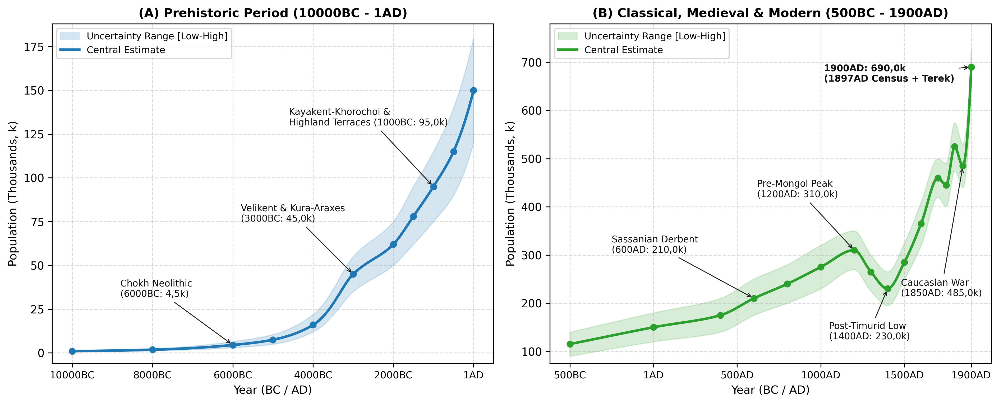
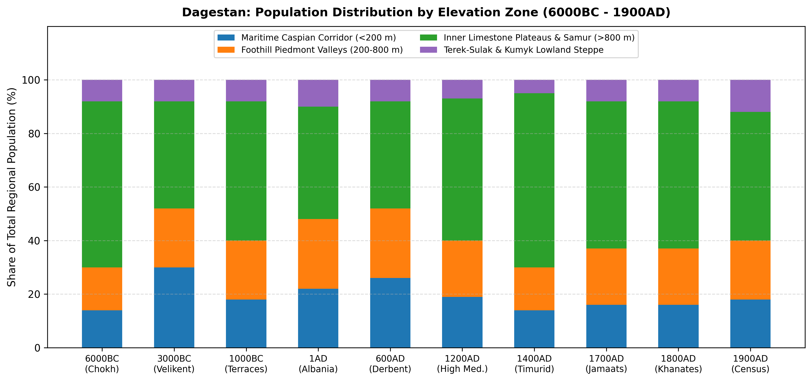
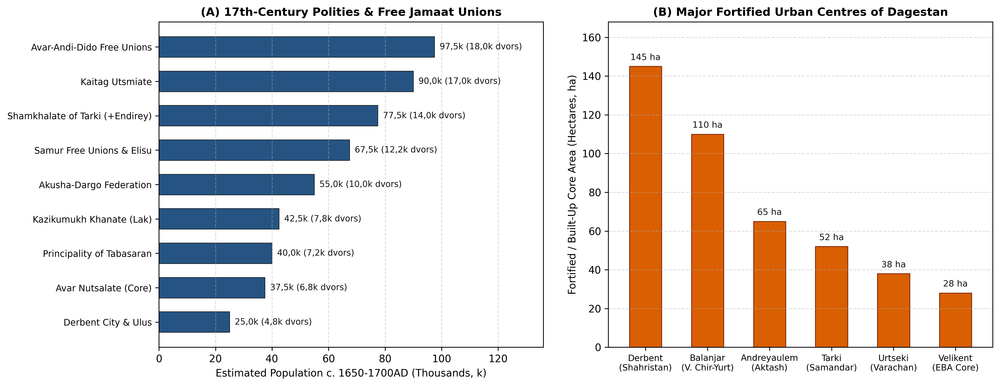

# Abstract

This paper reviews the archaeological, bioarchaeological, agricultural,
epigraphic, and archival literature to reconstruct the population and
settlement history of Dagestan (50,3k km²) from 10000BC to 1900AD.
Rather than relying on raw site counts that reflect uneven excavation
coverage, our synthesis traces long-term demographic change across four
distinct ecological and agricultural eras: (1) the early Holocene
domestication of free-threshing wheat, hulled barley, and sheep and
goats on the Inner Limestone Plateaus at Chokh by 6000BC (~4,5k
inhabitants)
[\[1\]](#ref-amirkhanov1987chokh)[\[2\]](#ref-amirkhanov2022chokh)[\[3\]](#ref-davudov2009);
(2) the Eneolithic and Early Bronze Age expansion of the Northeastern
Caucasian variant of the Kura-Araxes culture across highland
stone-walled villages (Ginchi, Chinna) and coastal tell settlements at
Velikent (~45,0k by 3000BC)
[\[4\]](#ref-gadzhiev1991early)[\[5\]](#ref-gadzhiev1997velikent)[\[6\]](#ref-magomedov2000kura)[\[7\]](#ref-magomedov2005);
(3) the Middle-to-Late Bronze and Early Iron Age construction of
mountain agricultural terraces covering 48,3% of Mid-Mountain Dagestan
(~100k-150k ha of cultivated slope steps), supporting ~95,0k inhabitants
by 1000BC
[\[8\]](#ref-borisov2013terraces)[\[9\]](#ref-korobov2020terraces)[\[10\]](#ref-shaev2024terraces)[\[11\]](#ref-aglarov1986terraces);
and (4) the Classical, Sassanian, Khazar, and Islamic urban
fortification of the Caspian coastal corridor (Derbent, Urtseki, Tarki,
Balanjar, Andreyaulem) alongside dense highland clan (*tukhum*) and
rural community (*jamaat*) federations
[\[12\]](#ref-abakarov1993atlas)[\[13\]](#ref-kudryavtsev1982derbent)[\[14\]](#ref-gadjiev2017derbent)[\[15\]](#ref-gmyrya1995huns).
Following a pre-Mongol high point of 310,0k (270,0k-350,0k) around
1200AD and a ~26% contraction during the 1220-1240 Mongol and 1395-1396
Timurid invasions (230,0k in 1400AD)
[\[16\]](#ref-ikhilov1960narody)[\[17\]](#ref-aliev2017tabasaran)[\[18\]](#ref-gasanov2024),
population recovered across lowland principalities and highland *jamaat*
unions to 460,0k (420,0k-500,0k) by 1700AD
[\[19\]](#ref-aliev1975feudal)[\[20\]](#ref-umakhanov1973mutual)[\[21\]](#ref-aglarov1988jamaat).
Despite severe wartime losses during Nadir Shah’s 1741-1743 campaigns
(445,0k in 1750AD) and the Caucasian War of 1829-1859 (485,0k in
1850AD), administrative integration into Dagestan Oblast (1860), the
1886 family lists (*posemeynye spiski*), and the 1897 First All-Russian
Imperial Census document a rise to 690,0k (650,0k-730,0k) within the
boundaries of modern Dagestan by 1900AD
[\[22\]](#ref-kabuzan1996)[\[23\]](#ref-kozubsky1901)[\[24\]](#ref-troynitskiy1905dagestan)[\[25\]](#ref-nagieva2005).

# Background

Situated along the northeastern flank of the Greater Caucasus between
the Caspian Sea (-28 m) and Mount Bazardüzü (4 466 m), the Republic of
Dagestan (50,3k km²) comprises two contrasting geographical
environments.

The first is the Maritime Caspian Corridor (the “Derbent Gate”), a
narrow coastal plain (3-35 km wide) between the eastern spurs of the
Greater Caucasus and the Caspian shoreline (Zone 1, 6,8k km²), together
with the semi-arid Terek-Sulak and Kumyk lowland steppes (Zone 4, 13,5k
km²). Serving as the principal land route linking the Eurasian steppe
with Transcaucasia and the Iranian plateau, this corridor hosted Early
Bronze Age tell settlements (Velikent, Kabaz-Kutan), Sassanian imperial
fortifications and garrisons (Derbent / *Bab al-Abwab*, Palasa-Syrt),
early Khazar urban centres (Balanjar / Verkhniy Chir-Yurt, Samandar /
Tarki, Varachan / Urtseki, Andreyaulem), and early modern Kumyk and
Kaitag principalities
[\[5\]](#ref-gadzhiev1997velikent)[\[13\]](#ref-kudryavtsev1982derbent)[\[26\]](#ref-gadjiev2008palasa)[\[27\]](#ref-magomedov1983khazar)[\[28\]](#ref-fedchenko2023).

The second environment comprises the foothill piedmont, Inner Limestone
Plateaus, and alpine Samur gorges (Zones 2-3, 30,0k km²). Dissected by
the four branches of the Koysu (Andi, Avar, Kara, Kazikumukh -
converging into the Sulak) and the Samur river basin, Inner and
High-Mountain Dagestan formed one of Eurasia’s earliest centres of
mountain cereal domestication (Chokh, 6000BC) and slope terracing
(2000-1000BC)
[\[1\]](#ref-amirkhanov1987chokh)[\[8\]](#ref-borisov2013terraces)[\[29\]](#ref-idrisov2018).
Sheltered behind natural limestone defiles (Gunib, Khunzakh, Kumukh,
Akusha, Kubachi), highland communities maintained demographic continuity
during the Mongol and Timurid invasions that repeatedly depopulated the
Caspian lowlands
[\[12\]](#ref-abakarov1993atlas)[\[21\]](#ref-aglarov1988jamaat).

# Methodology

## Regional Subdivisions

Following the archaeological survey of Abakarov and Davudov (2 128
mapped sites across 38 administrative districts)
[\[12\]](#ref-abakarov1993atlas)[\[30\]](#ref-budaychiev2014) and the
geographical classification of Gadzhiev [\[4\]](#ref-gadzhiev1991early),
we divide Dagestan (50,3k km²) into four elevation and drainage zones
(Table 1).

| Sub-Regional Zone | Elevation | Area (km2) | River Basins | Key Archaeological and Historical Centres |
|:---|:---|:---|:---|:---|
| Maritime Caspian Corridor | -28 to 200 m | 6,8k | Coastal streams (Ulluchay, Rubas, Darvagchay) and lower Samur delta | Velikent, Derbent, Palasa-Syrt, Urtseki, Tarki, Petrovsk |
| Foothill Piedmont (Predgorye) | 200 to 800 m | 8,5k | Buynaksk, Kaitag, Tabasaran, Sergokala and lower Sulak foothills | Balanjar (V. Chir-Yurt), Andreyaulem, Kala-Koreysh, Khuchni, Temir-Khan-Shura |
| Inner Limestone Plateaus and Alpine Samur | 800 to 4 466 m | 21,5k | Four Koysu basins (Andi, Avar, Kara, Kazikumukh), Gunib-Chokh, Akusha and upper Samur | Chokh, Ginchi, Khunzakh, Kumukh, Akusha, Kubachi, Akhty |
| Terek-Sulak and Kumyk Lowland Steppe | -28 to 100 m | 13,5k | Lower Terek-Sulak delta, Agrakhan peninsula and Nogai-Kumyk plain | Terek-Sulak kurgans, Terki (Terskiy Gorod), Kizlyar, Khasavyurt |
| Total Dagestan | -28 to 4 466 m | 50,3k | All Caspian-draining watersheds of eastern North Caucasus | 2 128 catalogued prehistoric and medieval monuments |

Elevation zones, river basins, and representative archaeological and
historical centres of Dagestan.

## Estimation Methods

To avoid distortion from uneven archaeological survey coverage, regional
population totals $`P(t)`$ are derived from five empirical estimation
methods across successive historical periods.

For stone-walled Neolithic and Eneolithic settlements (Chokh, Ginchi,
Chinna, Mekegi) and Early Bronze Age tell clusters (Velikent) between
6000 and 1000BC, household counts are estimated from excavated circular
and rectangular stone dwellings (12-38 m² floor area; one nuclear family
of 4,5-5,5 persons per hearth) and cross-checked against the minimum
number of individuals (MNI) and life-table mortality in collective
catacomb tombs (100-350+ burials per vault over 150-250 years)
[\[5\]](#ref-gadzhiev1997velikent)[\[31\]](#ref-mednikova2020velikent)[\[32\]](#ref-kohl2007making)[\[33\]](#ref-davudov2014).

For agricultural terrace land-use capacity (1500BC-1200AD), using
remote-sensing and soil-chronological surveys of Mid-Mountain Dagestan
(48,3% of land surface terraced; ~100k-150k ha of slope terraces)
[\[8\]](#ref-borisov2013terraces)[\[9\]](#ref-korobov2020terraces)[\[10\]](#ref-shaev2024terraces)[\[29\]](#ref-idrisov2018),
sustainable highland population capacity $`K_{\text{terrace}}`$ is
bounded by:
``` math
K_{\text{terrace}}(t) = \frac{A_{\text{terrace}}(t) \cdot \theta_{\text{active}}(t) \cdot Y_{\text{grain}}}{C_{\text{cap}}}
```
where $`A_{\text{terrace}}(t)`$ is cumulative terraced area,
$`\theta_{\text{active}}(t) \in [0{,}45,\,0{,}65]`$ is the non-fallow
cultivated fraction,
$`Y_{\text{grain}} \approx 850\text{-}1\,100\text{ kg/ha}`$ is manured
mountain barley and wheat yield [\[11\]](#ref-aglarov1986terraces), and
$`C_{\text{cap}} \approx 250\text{ kg/person/yr}`$ is annual cereal
consumption supplemented by transhumant sheep husbandry (65-75% of
faunal assemblages).

For Sassanian, Khazar, and early Islamic walled cities (Derbent,
Urtseki, Tarki, Balanjar, Andreyaulem) between 400BC and 1220AD, urban
population is calculated by dividing enclosed intramural area into
residential quarters (100-140 persons/ha in the 30-35 ha *shahristan* of
Derbent), craft suburbs (40-60 persons/ha), and garrison enclosures
(10-20 persons/ha)
[\[13\]](#ref-kudryavtsev1982derbent)[\[14\]](#ref-gadjiev2017derbent)[\[34\]](#ref-gadjiev2013).
Border settlements on the Rubas river are cross-checked against the ~1
500-2 000+ catacomb kurgans of the Palasa-Syrt necropolis (4th-5th
centuries AD)
[\[26\]](#ref-gadjiev2008palasa)[\[35\]](#ref-gmyrya2012)[\[36\]](#ref-saipudi2020palasa).

For the 16th to 18th centuries (1500-1800AD), Russian *Posolskiy Prikaz*
diplomatic dispatches, Terki and Kizlyar fortress registers, and local
Arabic *tarikh* and *adat* codices (*Tarikh Dagestan*, *Darband-nama*,
*Codex of Rustam Khan*, 1635 decrees of Maisum Ali-Bek) record household
(*dvor* / *dym*) and armed militia (*konnyye i peshiye lyudi*) totals
across Dagestani principalities and free *jamaats*
[\[17\]](#ref-aliev2017tabasaran)[\[19\]](#ref-aliev1975feudal)[\[20\]](#ref-umakhanov1973mutual)[\[37\]](#ref-dadaev2014).
Applying a multiplier of 5,0-5,5 persons per nuclear highland *dvor* and
a 1 : 4,5 ratio of mobilisable militia to total population yields a
1700AD benchmark of 460,0k (420,0k-500,0k) and an 1800AD benchmark of
525,0k (475,0k-575,0k) [\[22\]](#ref-kabuzan1996).

Finally, for the late 19th century (1860-1900AD), population totals are
anchored directly to the 1866-1867 military-statistical surveys of
Dagestan Oblast, the 1886 family lists (*posemeynye spiski*), and the
First General Census of the Russian Empire (28 January 1897), combining
the nine districts (*okrugs*) of Dagestan Oblast with the Khasavyurt and
Kizlyar lowland districts of Terek Oblast that lie within modern
Dagestan
[\[22\]](#ref-kabuzan1996)[\[23\]](#ref-kozubsky1901)[\[24\]](#ref-troynitskiy1905dagestan)[\[25\]](#ref-nagieva2005)[\[38\]](#ref-kozubsky1895).

# Historical Overview



## Mesolithic and Neolithic Foundations: Chokh and the Inner Plateaus (10000 - 5000BC)

During the Terminal Pleistocene and Early Holocene (10000-6000BC), human
settlement in Dagestan was concentrated in two complementary
environments: the karst rock-shelters of the Inner Limestone Plateaus (1
100-1 800 m) and the marine terraces of the Caspian coast (Tarki, Manas,
Ulluchay). Excavations directed by V. G. Kotovich (1955-1957) and Hizri
Amirkhanov (1980-1985, resumed 2020-2022) at the Chokh settlement
(Чохское поселение) in the Gunib district (1 675 m elevation) revealed a
six-layer stratigraphic sequence (Layers F-A) spanning the
Mesolithic-to-Neolithic transition in the northeastern Caucasus
[\[1\]](#ref-amirkhanov1987chokh)[\[2\]](#ref-amirkhanov2022chokh)[\[3\]](#ref-davudov2009)[\[39\]](#ref-kotovich1964stone).

The Mesolithic horizon (Layers E-C, c. 9000-6500BC) is characterised by
geometric microliths (asymmetric triangles, trapezes, backed bladelets)
and hunting of East Caucasian tur (*Capra cylindricornis*), bezoar goat
(*Capra aegagrus*), mouflon (*Ovis orientalis*), and red deer. Seasonal
base camps in the Chokh and Rugudja canyons (Rugudja, Kozma-Noho,
Mekegi) supported bands of 25-50 individuals (~1,0k-1,8k across Dagestan
between 10000 and 8000BC).

In the Neolithic domestication horizon (Layers B-A, c. 6000-5000BC),
around 6000BC, Chokh preserves the earliest palaeobotanical and
archaeozoological evidence for an indigenous transition to agriculture
and stockbreeding in the North Caucasus
[\[1\]](#ref-amirkhanov1987chokh)[\[33\]](#ref-davudov2014).
Palaeobotanical impressions identified by N. R. Yanushevich and G. N.
Lisitsyna demonstrate the cultivation of six-row naked and hulled barley
(*Hordeum vulgare* var. *coeleste* and *pallidum*) alongside
free-threshing hexaploid wheat (*Triticum aestivum*, *T. compactum*) and
emmer (*T. dicoccum*). At the same time, domesticated sheep (*Ovis
aries*) and goats (*Capra hircus*) rose to over 60% of the ungulate bone
assemblage, accompanied by permanent dry-stone dwellings with
clay-plastered floors and stone-lined hearths
[\[1\]](#ref-amirkhanov1987chokh)[\[2\]](#ref-amirkhanov2022chokh). This
early farming economy raised regional population from 4,5k (3,0k-6,5k)
in 6000BC to 7,5k (5,0k-10,5k) by 5000BC, with over 60% residing on the
Inner Limestone Plateaus (Zone 3).

## Eneolithic and Early Bronze Age: Ginchi, Velikent, and the Kura-Araxes Culture (5000 - 2000BC)

During the 5th millennium BC (Eneolithic, 5000-3600BC), permanent
stone-walled farming villages spread across the intermontane basins of
Inner Dagestan. Excavations by M. G. Gadzhiev at Ginchi (Гинчи) (Gidatl
valley, Shamilsky district, ~1 650 m) and Chinna (Чинна) uncovered
closely spaced circular stone dwellings (4,0-5,5 m diameter), defensive
perimeter walls, obsidian blades imported from Transcaucasia, and early
arsenical copper awls
[\[4\]](#ref-gadzhiev1991early)[\[40\]](#ref-gadzhiev1995metallurgy).
Each fortified village housed 15-30 families (75-150 inhabitants),
bringing regional population to 16,0k (12,0k-22,0k) by 4000BC.

Between 3600 and 2000BC, settlement expanded substantially under the
Northeastern Caucasian Variant of the Kura-Araxes Culture
[\[4\]](#ref-gadzhiev1991early)[\[6\]](#ref-magomedov2000kura)[\[7\]](#ref-magomedov2005).

Along the coastal plain tell cluster (Velikent, Kabaz-Kutan,
Torpakh-Kala, Dzhemikentskiy), joint Daghestan-American excavations
(1994-1998) directed by M. G. Gadzhiev, Philip L. Kohl, and Rabadan G.
Magomedov at Velikent (Великент) (25 km northwest of Derbent on the
ancient Ulluchay river fan) established that five natural clay-terrace
mounds (Mounds I-V) spanning a 280-hectare archaeological complex were
occupied continuously from c. 3600 to 1900BC
[\[5\]](#ref-gadzhiev1997velikent)[\[32\]](#ref-kohl2007making)[\[41\]](#ref-gadzhiev2000).
Multi-room mudbrick and pisé buildings, wheel-thrown storage vessels
(Mound II), and over 1 500 bronze weapons, ornaments, and casting moulds
point to a coastal craft and farming centre of 1,2k-2,5k inhabitants
[\[5\]](#ref-gadzhiev1997velikent)[\[40\]](#ref-gadzhiev1995metallurgy).

Excavations of 13 subterranean collective catacomb tombs on Mounds III-V
at Velikent yielded 100 to over 350 skeletons per tomb (Tomb 1 on Mound
III alone contained ~300 individuals alongside \>1 500 bronze and
carnelian-agate grave goods) [\[5\]](#ref-gadzhiev1997velikent).
Craniological, dental, and palaeopathological studies by M. B. Mednikova
and V. Y. Bakholdina confirm a southern Caucasoid farming population
practising surgical cranial trepanation with high post-operative
survival, moderate dental caries from cereal gruels, and lineage-based
collective burial over 150-250 years
[\[31\]](#ref-mednikova2020velikent)[\[42\]](#ref-bakholdina2008velikent)[\[43\]](#ref-davudov2006).
Across all four elevation zones, Kura-Araxes settlement expansion raised
Dagestan’s population to 45,0k (35,0k-55,0k) by 3000BC and 62,0k
(50,0k-75,0k) by 2000BC.

## Middle and Late Bronze and Early Iron Ages: Kayakent-Khorochoi and Highland Terracing (2000 - 400BC)

During the Middle Bronze Age (Gemetyube I-II, Velikent MBA, Irganay) and
the Late Bronze and Early Iron Age Kayakent-Khorochoi Culture
(Каякентско-хорочоевская культура, 1300-600BC), settlement density
increased across both the foothill valleys (Kayakent, Tarki,
Karabudakhkent, Zandak-Dagestan) and the Inner Limestone Plateaus
(Khorochoi, Gagatli, Kuli, Chirkei)
[\[12\]](#ref-abakarov1993atlas)[\[44\]](#ref-kruglov1958ne)[\[45\]](#ref-kotovich1982problems).
Stone-cist cemeteries (каменные ящики) containing 50 to 400+ graves
accompany fortified ridge villages (2-8 ha) built in tiered stone
masonry.

Interdisciplinary geoarchaeological, radiocarbon, and
soil-micromorphological studies led by A. V. Borisov, D. S. Korobov, and
I. A. Idrisov (2012-2024) resolved the chronological debate initiated by
M. A. Aglarov [\[11\]](#ref-aglarov1986terraces) concerning the age of
Dagestan’s mountain agricultural terraces
[\[8\]](#ref-borisov2013terraces)[\[9\]](#ref-korobov2020terraces)[\[10\]](#ref-shaev2024terraces)[\[29\]](#ref-idrisov2018)[\[46\]](#ref-peters2014).
Radiocarbon dating of buried humic soils beneath lynchet and
stone-retaining terrace walls in the Gunib, Lak, and Akusha basins
demonstrates that systematic slope terracing began during the transition
from the Middle to Late Bronze Age (c. 1700-1300BC) and reached full
valley coverage during the Early Iron Age and Classical Albanian periods
[\[8\]](#ref-borisov2013terraces)[\[9\]](#ref-korobov2020terraces).
Satellite mapping by Shaev, Borisov, Idrisov, and Korobov (2024) shows
that man-made terraces cover 48,3% of the total land area of
Mid-Mountain Dagestan (ranging from 29,4% to 64,8% across individual
basins) - far exceeding any other part of the Greater Caucasus (16,1% in
the Kislovodsk basin, 9,4% in North Ossetia, 5,9% in Ingushetia; see
Figure 2) [\[10\]](#ref-shaev2024terraces). This ~100k-150k ha network
of terraced fields raised regional population to 78,0k (62,0k-95,0k) by
1500BC and 95,0k (75,0k-115,0k) by 1000BC.



## Caucasian Albania, Sassanian *Bab al-Abwab*, and the Palasa-Syrt Necropolis (400BC - 650AD)

Between the 4th century BC and the 4th century AD (Albanian-Sarmatian
Period), the Caspian coastal corridor and foothill valleys formed the
northern marches of Caucasian Albania and the Sarmatian-Maskut
confederations
[\[26\]](#ref-gadjiev2008palasa)[\[45\]](#ref-kotovich1982problems)[\[47\]](#ref-gadjiev2002).
Dozens of mudbrick and cobble-walled fortified towns (*gorodishcha*,
5-25 ha) arose along the coastal plain (Tarki, Urtseki, Karabudakhkent,
Torpakh-Kala, Derbent hill), lifting regional population from 115,0k
(90,0k-140,0k) in 500BC to 150,0k (120,0k-180,0k) at 1AD and 175,0k
(140,0k-210,0k) in 400AD.

During the 5th and 6th centuries AD, the Sassanian shahs Yazdegerd II
(438-457), Peroz (459-484), and Khosrow I Anushirvan (531-579)
transformed the Derbent defile into the monumental stone fortification
system of Derbent (Дербент / *Bab al-Abwab*)
[\[13\]](#ref-kudryavtsev1982derbent)[\[14\]](#ref-gadjiev2017derbent)[\[34\]](#ref-gadjiev2013)[\[48\]](#ref-gadjiev2008)[\[49\]](#ref-gadjiev2016dagbary).
Replacing Yazdegerd II’s 440s AD mudbrick wall (*Gil-Bary*), Khosrow I
constructed (c. 567-569AD, documented in 29 Middle Persian building
inscriptions studied by M. S. Gadjiev) the twin parallel stone walls
(3,6 km long, 350-450 m apart, enclosing ~145 ha between the 15-ha
*Naryn-Kala* citadel and the Caspian sea moles) together with the 42-km
*Dag-Bary* mountain wall (31 stone forts and towers ascending into
Tabasaran)
[\[13\]](#ref-kudryavtsev1982derbent)[\[14\]](#ref-gadjiev2017derbent)[\[49\]](#ref-gadjiev2016dagbary).
Based on Kudryavtsev’s study of the 30-35 ha residential *shahristan*
and garrison quarters, Sassanian and early Islamic Derbent housed
15,0k-25,0k inhabitants (20,0k midpoint in 600AD, rising to 35,0k-50,0k
during its 10th-century height under the Hashimid emirs when al-Istakhri
described it as larger than Ardabil)
[\[13\]](#ref-kudryavtsev1982derbent)[\[50\]](#ref-kudryavtsev1993).

Located 25 km south of Derbent on the Rubas river ridge, the Palasa-Syrt
catacomb necropolis (Паласа-Сырт, 4,5 km long; excavated by V. G.
Kotovich, L. B. Gmyrya, and M. S. Gadjiev) comprises 1 500 to 2 000+
earthen kurgans covering T-shaped and longitudinal catacomb graves dated
to the late 4th-5th centuries AD
[\[15\]](#ref-gmyrya1995huns)[\[26\]](#ref-gadjiev2008palasa)[\[35\]](#ref-gmyrya2012)[\[36\]](#ref-saipudi2020palasa).
Craniological and funerary evidence (artificial cranial deformation,
polychrome fibulae, Sassanian seals, and weapons) identifies a
multi-ethnic Alanic-Maskut-Hunnic border garrison guarding the Derbent
pass of 3,5k-5,0k living inhabitants over 4-5 generations
[\[15\]](#ref-gmyrya1995huns)[\[26\]](#ref-gadjiev2008palasa).

## Early and High Middle Ages: Khazar Cities, *Sarir*, Islamisation, and the Mongol and Timurid Invasions (650 - 1500AD)

Between 650 and 965AD, northern and coastal Dagestan served as the early
urban core of the Khazar Khaganate and the Kingdom of the Huns
(*Savirs*), while the Inner Limestone Plateaus were consolidated under
the Christian and syncretic Avar kingdom of Sarir (Сарир, capital at
Khunzakh) and the early principalities of Lakz (South Dagestan),
Tabasaran, Zirikhgeran (Kubachi), Kaitag, and Gumik (Kumukh)
[\[27\]](#ref-magomedov1983khazar)[\[28\]](#ref-fedchenko2023)[\[51\]](#ref-gadzhiev1971varachan)[\[52\]](#ref-minorsky1958bab).
Archaeological excavations across the northern foothills and coastal
corridor document four major fortified towns (Figure 3B). Balanjar
(Verkhniy Chir-Yurt on the Sulak exit) enclosed ~110 ha behind stone and
mudbrick ramparts (2,5 km wall perimeter), accompanied by three large
catacomb and kurgan cemeteries (\>2 000 burials) and two early Christian
churches, supporting an estimated population of 12,0k-18,0k prior to its
capture by the Arab general al-Jarrah ibn Abdallah in 722/723AD
[\[27\]](#ref-magomedov1983khazar)[\[28\]](#ref-fedchenko2023). Samandar
(Tarki / Makhachkala-Karaman plain) enclosed \>50 ha of stone terraces
and vineyard gardens (40 000 vineyards reported by al-Mas’udi and Ibn
Hawqal prior to Svyatoslav’s 965-969 campaign) with an estimated
population of 10,0k-15,0k
[\[12\]](#ref-abakarov1993atlas)[\[27\]](#ref-magomedov1983khazar).
Varachan (Urtseki fortified city), capital of the Caspian Huns
(*Savirs*), comprised a 38-40 ha three-tiered stone citadel and
agricultural suburb (6,0k-10,0k inhabitants)
[\[15\]](#ref-gmyrya1995huns)[\[51\]](#ref-gadzhiev1971varachan), while
Andreyaulem (Endirey on the Aktash river) formed a 65-ha fortified town
controlling the Terek-Sulak piedmont crossroads (8,0k-12,0k inhabitants)
[\[12\]](#ref-abakarov1993atlas)[\[27\]](#ref-magomedov1983khazar)[\[53\]](#ref-khapizov2019).

During the High Middle Ages (1000-1220AD), the spread of Sunni (Shafi’i)
Islam (Kala-Koreysh, Kumukh, Richa, Tsakhur, where a madrasa was founded
in 1075AD) and the growth of highland craft specialisation (Kubachi
armourers, Sulevkent potters, Khunzakh and Kumukh market towns) raised
Dagestan’s total population to 310,0k (270,0k-350,0k) around 1200AD
[\[12\]](#ref-abakarov1993atlas)[\[17\]](#ref-aliev2017tabasaran)[\[52\]](#ref-minorsky1958bab).

This medieval high point was interrupted by two destructive foreign
invasions [\[18\]](#ref-gasanov2024)[\[37\]](#ref-dadaev2014). During
the Mongol campaigns of 1220-1222 and 1239-1240, Subutai and Jebe
bypassed Derbent in 1221, and Bukdai sacked Derbent, Richa (where a 1239
Arabic inscription records the slaughter), Kumukh (1240), and the
coastal plain
[\[17\]](#ref-aliev2017tabasaran)[\[52\]](#ref-minorsky1958bab). Lowland
cities shrank considerably (Guillaume de Rubruck noted Derbent’s reduced
perimeter in 1254), pulling total regional population down to 265,0k
(225,0k-300,0k) by 1300AD. Following his victory over Tokhtamysh on the
Terek in April 1395, Timur ravaged the Kumyk plain, Kaitag,
Akusha/Ushkudzha, Nerges, and the foothill fortresses during his
1395-1396 campaigns (the *Zafar-nama* of Nizam al-Din Shami and Sharaf
al-Din Yazdi records the killing of Kaitag and Kumyk defenders and the
destruction of piedmont strongholds)
[\[17\]](#ref-aliev2017tabasaran)[\[18\]](#ref-gasanov2024)[\[19\]](#ref-aliev1975feudal).
Regional population fell to a late-medieval low of 230,0k
(195,0k-265,0k) in 1400AD, with 65% of the surviving population
concentrated on the fortified Inner Plateaus and Samur gorges (Zone 3).

## Early Modern Principalities and Free *Jamaat* Unions (1500 - 1700AD)

Between 1450 and 1700AD, Dagestan experienced steady demographic and
political recovery (285,0k in 1500AD -\> 365,0k in 1600AD -\> 460,0k
\[420,0k-500,0k\] in 1700AD). Drawing on the archival studies of B. G.
Aliev and M.-S. K. Umakhanov alongside M. A. Aglarov’s ethnographic work
on the mountain *jamaat*
[\[19\]](#ref-aliev1975feudal)[\[20\]](#ref-umakhanov1973mutual)[\[21\]](#ref-aglarov1988jamaat)[\[54\]](#ref-aliev2019unions)[\[55\]](#ref-aliev2019jamaat)[\[56\]](#ref-guseynova2008)[\[57\]](#ref-isaev2011),
17th-century Dagestan was divided between major feudal principalities
(~45% of regional population) and autonomous rural unions (~55% of
regional population) (Figure 3A and Table 2).

Among the feudal principalities, the Shamkhalate of Tarki (Тарковское
шамхальство) and the Endirey / Zasulak Kumyk domains were centred at
Tarki (~1,5k-2,0k households; 8,0k-10,0k inhabitants visited by Adam
Olearius in 1638, Evliya Çelebi in 1666, and Jan Struys in 1670),
Kafir-Kumukh, Buynak, and the autonomous Sultanate of Endirey
(Andreyaulem, ~1,5k households). Russian *Posolskiy Prikaz* records
(1614-1650) credit the Shamkhal and the Endirey rulers (Sultan-Mahmud)
with 12 000-15 000 mounted and foot militia, corresponding to
12,0k-16,0k households (65,0k-85,0k inhabitants)
[\[19\]](#ref-aliev1975feudal)[\[20\]](#ref-umakhanov1973mutual). The
Kaitag Utsmiate (Кайтагское уцмийство), spanning Lower Kaitag
(Madzhalis, Bashly with ~1,5k households) and Upper Kaitag/Dargwa
(Urkarakh, Kubachi) under the early-17th-century *Codex of Rustam Khan*,
fielded 15 000-20 000 warriors (15,0k-19,0k households; 80,0k-100,0k
inhabitants)
[\[19\]](#ref-aliev1975feudal)[\[20\]](#ref-umakhanov1973mutual). The
Kazikumukh Khanate (Казикумухское ханство), centred at Kumukh
(~1,2k-1,5k stone multi-storey houses) across the Lak basin, numbered
7,0k-8,5k households (38,0k-46,0k inhabitants)
[\[20\]](#ref-umakhanov1973mutual), while the Avar Nutsalate (Аварское
нуцальство) on the Khunzakh plateau (~700-1 000 households in Khunzakh
and Tobot villages) numbered 6,0k-7,5k core households (32,0k-42,0k
inhabitants)
[\[19\]](#ref-aliev1975feudal)[\[21\]](#ref-aglarov1988jamaat)[\[58\]](#ref-saidov1980).
In southern Dagestan, the Principality of Tabasaran (Maisumate and
Qadiate of North Tabasaran), documented in the 1635 decrees of Maisum
Ali-Bek [\[37\]](#ref-dadaev2014), numbered 6,5k-8,0k households
(35,0k-45,0k inhabitants) [\[17\]](#ref-aliev2017tabasaran), and the
Safavid Governorate of Derbent (following Shah Abbas I’s 1606 reconquest
and resettlement of Bayat and Qurchi garrisons) comprised Derbent city
(~2,0k-2,5k houses; 10,0k-14,0k urban residents) and its coastal *ulus*
villages (4,0k-5,5k households; 20,0k-30,0k inhabitants)
[\[13\]](#ref-kudryavtsev1982derbent)[\[16\]](#ref-ikhilov1960narody).

Across the self-governing free *jamaat* unions (вольные общества), over
60 autonomous federations (*soyuzy sel’skikh obshchin*) governed by
elected elders (*chankas*, *qadis*, *kartas*) and customary *adat* law
occupied the Dargwa plateaus and the Avar-Andi-Dido and Samur alpine
gorges
[\[21\]](#ref-aglarov1988jamaat)[\[54\]](#ref-aliev2019unions)[\[55\]](#ref-aliev2019jamaat)[\[56\]](#ref-guseynova2008)[\[57\]](#ref-isaev2011).
The Akusha-Dargo Upper Dargwa Confederation (Akusha, Tsudakhar, Usisha,
Mugi, Mekegi) comprised 9,0k-11,0k households (48,0k-60,0k inhabitants);
the Avar, Andi, and Tsez/Dido free unions (Gidatl, Andalal around
Chokh-Sogratl, Karata, Bagulal, Chamalyal, Tindi, Dido, Antsukh,
Dzhurmut, Koysubulu, Antl-Ratl) totalled 16,0k-20,0k households
(85,0k-110,0k inhabitants)
[\[21\]](#ref-aglarov1988jamaat)[\[54\]](#ref-aliev2019unions)[\[56\]](#ref-guseynova2008);
and the Samur Valley free unions and Elisu Sultanate (Akhty-para,
Dokuz-para, Altı-para, Rutul Magal, Tsakhur / Elisu) numbered
11,0k-13,5k households (60,0k-75,0k inhabitants)
[\[16\]](#ref-ikhilov1960narody)[\[54\]](#ref-aliev2019unions).



| Polity / Free Jamaat Union | Primary Centres | Households (Dvors) | Militia (Sabres) | Estimated Population |
|:---|:---|:---|:---|:---|
| Avar, Andi and Dido Free Unions (Andalal, Gidatl, Antsukh, Dido, Andi) | Chokh, Sogratl, Khidi, Andi, Botlikh, Bezhta | 16,0k - 20,0k | 18,0k - 22,0k | 85,0k - 110,0k |
| Kaitag Utsmiate (Lower Kaitag and Upper Kaitag/Dargwa) | Madzhalis, Bashly, Urkarakh, Kubachi | 15,0k - 19,0k | 15,0k - 20,0k | 80,0k - 100,0k |
| Shamkhalate of Tarki and Endirey / Zasulak Kumyk Domains | Tarki, Endirey, Kafir-Kumukh, Buynak | 12,0k - 16,0k | 12,0k - 15,0k | 65,0k - 85,0k |
| Samur Free Unions (Akhty-para, Dokuz-para, Rutul) and Tsakhur/Elisu | Akhty, Mikrakh, Rutul, Tsakhur | 11,0k - 13,5k | 10,0k - 13,0k | 60,0k - 75,0k |
| Akusha-Dargo Upper Dargwa Federation (Akusha, Tsudakhar, Usisha, Mekegi) | Akusha, Tsudakhar, Usisha, Mugi | 9,0k - 11,0k | 10,0k - 12,0k | 48,0k - 60,0k |
| Kazikumukh Khanate (Kumukh and Lak Basin) | Kumukh, Tovuz, Khosrekh | 7,0k - 8,5k | 7,0k - 9,0k | 38,0k - 46,0k |
| Principality of Tabasaran (Maisumate and Qadiate of Tabasaran) | Khuchni, Dzhalgan, Rukel | 6,5k - 8,0k | 6,0k - 8,0k | 35,0k - 45,0k |
| Avar Nutsalate (Khunzakh Plateau Core) | Khunzakh, Arani, Untsukul | 6,0k - 7,5k | 6,0k - 8,0k | 32,0k - 42,0k |
| Safavid Governorate of Derbent (Derbent City and Coastal Ulus) | Derbent (Naryn-Kala and Shahristan) | 4,0k - 5,5k | 3,5k - 5,0k | 20,0k - 30,0k |
| Unadjusted Sum of Sub-Regional Polities | All 9 polity/confederation groupings | 86,5k - 109,0k | 87,5k - 112,0k | 463,0k - 593,0k |
| Adopted Regional Benchmark (Adjusted for Shared Tributary Margins) | Republic of Dagestan (50,3k km2) | 82,0k - 95,0k | 80,0k - 95,0k | 460,0k (420,0k - 500,0k) |

Population and household estimates for Dagestani principalities and free
jamaat unions around 1650-1700AD from Russian and local sources.

## The Eighteenth and Nineteenth Centuries (1700 - 1900AD)

During the 18th and 19th centuries, Dagestan’s population experienced
two sharp wartime contractions followed by sustained post-1860
demographic growth under Russian imperial administration
[\[22\]](#ref-kabuzan1996)[\[25\]](#ref-nagieva2005)[\[59\]](#ref-aliev1999)[\[60\]](#ref-aliev2001).

During the 1720s, anti-Safavid uprisings in Southern Dagestan and Peter
I’s Persian Campaign (1722-1723, which established the fortress of
Svyatoy Krest on the Sulak and Russian garrisons at Derbent and Tarki
before Kizlyar was founded on the Terek in 1735) disrupted coastal
agriculture. Even greater devastation accompanied the three Dagestani
campaigns of the Iranian ruler Nadir Shah Afshar in 1734, 1735, and
especially 1741-1743 [\[59\]](#ref-aliev1999)[\[60\]](#ref-aliev2001).
Before his defeat by the combined Avar, Lak, and Dargwa militia at
Andalal (Sogratl-Chokh) and Aymaki in September 1741, Nadir Shah burned
dozens of villages across Kaitag, Tabasaran, Mehtuli, and Kazikumukh,
reducing Dagestan’s population slightly from 460,0k (1700AD) to 445,0k
(400,0k-490,0k) in 1750AD. A half-century of relative internal recovery
and expanding trade through Kizlyar, Derbent, and Tarki subsequently
lifted regional population to 525,0k (475,0k-575,0k) by 1800AD
[\[22\]](#ref-kabuzan1996)[\[59\]](#ref-aliev1999).

Russian annexation of the Derbent, Baku, and Quba khanates (confirmed by
the 1813 Treaty of Gulistan) and General A. P. Yermolov’s punitive
expeditions (1818-1826, establishing the fortresses of Vnezapnaya at
Endirey in 1819 and Burnaya above Tarki in 1821) provoked the rise of
the Caucasian Imamate under the three Imams Ghazi Muhammad (1829-1832),
Hamzat Bek (1832-1834), and Shamil (1834-1859)
[\[22\]](#ref-kabuzan1996)[\[61\]](#ref-magomeddadaev2006). Three
decades of siege warfare (Gimry 1832, Akhulgo 1839, Dargo 1845, Gergebil
and Salta 1847, Chokh 1849, and Gunib 1859), cholera outbreaks, crop
destruction, and post-1859 *muhajir* emigration of ~15,0k-20,0k
Dagestani mountaineers to the Ottoman Empire reduced total population to
485,0k (440,0k-530,0k) around 1850AD
[\[22\]](#ref-kabuzan1996)[\[25\]](#ref-nagieva2005)[\[61\]](#ref-magomeddadaev2006).

Following Shamil’s capture at Gunib (25 August 1859), imperial
authorities organised Dagestan Oblast (1860, administrative capital at
Temir-Khan-Shura \[modern Buynaksk\], divided into nine *okrugs*: Avar,
Andi, Gunib, Dargwa, Kazikumukh, Kaitag-Tabasaran, Kyurin, Samur, and
Temir-Khan-Shura) while the northern Kumyk and Nogai plains north of the
Sulak (the Khasavyurt and Kizlyar *okrugs*) were placed under Terek
Oblast
[\[38\]](#ref-kozubsky1895)[\[62\]](#ref-adzhiev2018kumyks)[\[63\]](#ref-khapizov2015andotsez).
Early military-statistical enumerations in the 1860s recorded
~450,0k-480,0k inhabitants in Dagestan Oblast proper, rising in the 1886
family lists (*posemeynye spiski*) to 592,8k in Dagestan Oblast
[\[22\]](#ref-kabuzan1996)[\[25\]](#ref-nagieva2005)[\[38\]](#ref-kozubsky1895).
In the First General Census of the Russian Empire (28 January 1897)
edited by N. A. Troynitskiy and E. I. Kozubskiy
[\[23\]](#ref-kozubsky1901)[\[24\]](#ref-troynitskiy1905dagestan),
Dagestan Oblast recorded 571 154 *de facto* present inhabitants
(slightly below the *de jure* permanent population because ~50,0k-80,0k
highland male seasonal labourers \[*otkhodniki*\] were working in winter
in Baku oilfields, Tiflis, and Terek towns), broken down by linguistic
group as 158,6k Avars-Ando-Tsez (27,8%), 121,4k Dargwas and Kubachis
(21,3%), 94,6k Kyurins/Lezgins (16,6%), 76,4k Kazi-Kumukhs/Laks (13,4%),
32,6k Kumyks in Temir-Khan-Shura and Kaitag (5,7%), 32,1k
Tatars/Azerbaijanis and Tats around Derbent (5,6%), and 22,0k
Tabasarans, Aguls, Rutuls, and Tsakhurs
[\[23\]](#ref-kozubsky1901)[\[24\]](#ref-troynitskiy1905dagestan)[\[63\]](#ref-khapizov2015andotsez).
Adding the Khasavyurt Okrug (70 800 inhabitants in 1897, including 26,6k
Kumyks, 18,1k Chechens/Aukh, and Russian/Jewish settlers) and the
Dagestani sector of the Kizlyar Okrug (Kizlyar town, Terek Cossack
*stanitsas*, and Karanogai steppe camps, ~45,0k-50,0k) yields a
well-documented total population within the modern borders of the
Republic of Dagestan of 690,0k (650,0k-730,0k, or 13,72 persons/km²) by
1900AD
[\[22\]](#ref-kabuzan1996)[\[25\]](#ref-nagieva2005)[\[62\]](#ref-adzhiev2018kumyks).
The completion of the Vladikavkaz Railway through Petrovsk-Port
(Makhachkala, 9 753 inhabitants in 1897) to Derbent (14 649 inhabitants)
and Baku in 1893-1900 initiated rapid urban growth along the Caspian
littoral (Zone 1: 124,0k; Zone 4: 83,0k in 1900AD)
[\[25\]](#ref-nagieva2005).

# Limitations

Three main constraints affect historical population estimates for
Dagestan. First, fluctuations of the Caspian Sea between -34 m (Derbent
Regression, 6th-10th centuries AD) and -22 m (Late Medieval
Transgression, 14th-17th centuries AD) submerged the seaward moles of
Derbent and several coastal Bronze Age sites while shifting the lower
Terek-Sulak delta channels
[\[5\]](#ref-gadzhiev1997velikent)[\[13\]](#ref-kudryavtsev1982derbent).
Second, although 48,3% of Mid-Mountain Dagestan preserves man-made
agricultural terraces [\[10\]](#ref-shaev2024terraces), fallow rotation
and post-Timurid village consolidation mean that only 45-65% of total
terraced land was cultivated at any single benchmark date
[\[8\]](#ref-borisov2013terraces)[\[9\]](#ref-korobov2020terraces).
Third, in the 17th century, the Shamkhal of Tarki, the Utsmi of Kaitag,
and the Khan of Kazikumukh frequently claimed authority over the same
border *jamaats* when negotiating with Russian envoys, requiring a
~10-15% deduction from raw militia sums
[\[19\]](#ref-aliev1975feudal)[\[20\]](#ref-umakhanov1973mutual).
Conversely, in the January 1897 census, winter seasonal migration
(*otkhodnichestvo*) of 50,0k-80,0k highland men to Baku and Terek Oblast
depressed the *de facto* count of mountain *okrugs* relative to the 1886
*de jure* family lists
[\[23\]](#ref-kozubsky1901)[\[25\]](#ref-nagieva2005).

# Conclusion

From 10000BC to 1900AD, Dagestan developed from an early mountain centre
of wheat, barley, and sheep-goat domestication at Chokh (4,5k in 6000BC)
into the most densely terraced and urbanised region of the Eastern
Caucasus (690,0k or 13,72 persons/km² by 1900AD). The combination of the
irrigated urban corridor along the Caspian coast (Velikent, Derbent,
Urtseki, Tarki, Balanjar, Petrovsk-Port) and the terraced stone villages
of the Inner Limestone Plateaus (Chokh, Khunzakh, Kumukh, Akusha,
Kubachi) enabled Dagestan to withstand the 13th-century Mongol and 1395
Timurid invasions, Nadir Shah’s 1741-1743 campaigns, and the Caucasian
War (1829-1859) with much smaller long-term population losses than the
open steppes and piedmont plains of Central and Northwestern
Ciscaucasia.

# Appendix

## Population Estimates

| Benchmark | Zone 1: Littoral (6,8k km2) | Zone 2: Piedmont (8,5k km2) | Zone 3: Highlands (21,5k km2) | Zone 4: Steppe (13,5k km2) | Total Midpoint | Uncertainty Range \[Low - High\] | Density (p/km2) |
|:---|:---|:---|:---|:---|:---|:---|:---|
| 10000BC | 0,15k | 0,20k | 0,55k | 0,10k | 1,0k | 0,6k - 1,5k | 0,02 |
| 8000BC | 0,25k | 0,35k | 1,05k | 0,15k | 1,8k | 1,2k - 2,5k | 0,04 |
| 6000BC | 0,65k | 0,70k | 2,80k | 0,35k | 4,5k | 3,0k - 6,5k | 0,09 |
| 5000BC | 1,1k | 1,2k | 4,6k | 0,6k | 7,5k | 5,0k - 10,5k | 0,15 |
| 4000BC | 3,2k | 3,2k | 8,3k | 1,3k | 16,0k | 12,0k - 22,0k | 0,32 |
| 3000BC | 13,5k | 9,9k | 18,0k | 3,6k | 45,0k | 35,0k - 55,0k | 0,89 |
| 2000BC | 14,5k | 13,5k | 29,0k | 5,0k | 62,0k | 50,0k - 75,0k | 1,23 |
| 1500BC | 15,5k | 17,0k | 39,5k | 6,0k | 78,0k | 62,0k - 95,0k | 1,55 |
| 1000BC | 17,0k | 21,0k | 49,5k | 7,5k | 95,0k | 75,0k - 115,0k | 1,89 |
| 500BC | 23,0k | 27,5k | 53,5k | 11,0k | 115,0k | 90,0k - 140,0k | 2,29 |
| 1AD | 33,0k | 39,0k | 63,0k | 15,0k | 150,0k | 120,0k - 180,0k | 2,98 |
| 400AD | 42,0k | 45,5k | 73,5k | 14,0k | 175,0k | 140,0k - 210,0k | 3,48 |
| 600AD | 54,5k | 54,5k | 84,0k | 17,0k | 210,0k | 175,0k - 250,0k | 4,17 |
| 800AD | 57,5k | 62,5k | 101,0k | 19,0k | 240,0k | 200,0k - 280,0k | 4,77 |
| 1000AD | 55,0k | 60,5k | 140,0k | 19,5k | 275,0k | 230,0k - 320,0k | 5,47 |
| 1200AD | 59,0k | 65,0k | 164,0k | 22,0k | 310,0k | 270,0k - 350,0k | 6,16 |
| 1300AD | 42,0k | 48,0k | 159,0k | 16,0k | 265,0k | 225,0k - 300,0k | 5,27 |
| 1400AD | 32,0k | 37,0k | 149,5k | 11,5k | 230,0k | 195,0k - 265,0k | 4,57 |
| 1500AD | 43,0k | 51,0k | 174,0k | 17,0k | 285,0k | 250,0k - 325,0k | 5,67 |
| 1600AD | 58,0k | 73,0k | 208,0k | 26,0k | 365,0k | 320,0k - 410,0k | 7,26 |
| 1700AD | 73,5k | 96,5k | 253,0k | 37,0k | 460,0k | 420,0k - 500,0k | 9,15 |
| 1750AD | 68,0k | 92,0k | 250,0k | 35,0k | 445,0k | 400,0k - 490,0k | 8,85 |
| 1800AD | 84,0k | 110,0k | 289,0k | 42,0k | 525,0k | 475,0k - 575,0k | 10,44 |
| 1850AD | 78,0k | 102,0k | 262,0k | 43,0k | 485,0k | 440,0k - 530,0k | 9,64 |
| 1900AD | 124,0k | 152,0k | 331,0k | 83,0k | 690,0k | 650,0k - 730,0k | 13,72 |

Estimated population of Dagestan across its four elevation zones
(10000BC - 1900AD; total area 50,3k km2).

# Sources

<div id="refs" class="references csl-bib-body" data-entry-spacing="0">

<div id="ref-amirkhanov1987chokh" class="csl-entry">

<span class="csl-left-margin">1.
</span><span class="csl-right-inline">Amirkhanov, H. A. *Chokhskoye
Poseleniye: Chelovek i Yego Kul’tura v Mezolite i Neolite Gornogo
Dagestana \[the Chokh Settlement: Man and His Culture in the Mesolithic
and Neolithic of Mountainous Dagestan\]*. Nauka, 1987,
<https://search.worldcat.org/search?q=Chokh+Settlement+Man+His+Culture+Mesolithic+Neolithic+Mountainous+Amirkhanov+1987>.</span>

</div>

<div id="ref-amirkhanov2022chokh" class="csl-entry">

<span class="csl-left-margin">2.
</span><span class="csl-right-inline">Amirkhanov, H. A. “Chokhskaya
Neoliticheskaya Kul’tura: Opredeleniye i Khronologiya \[the Chokh
Neolithic Culture: Definition and Chronology\].” *Istoriya, Arkheologiya
i Etnografiya Kavkaza*, vol. 18, no. 4, 2022, pp. 1030-47,
<https://doi.org/10.32653/CH1841030-1047>.</span>

</div>

<div id="ref-davudov2009" class="csl-entry">

<span class="csl-left-margin">3.
</span><span class="csl-right-inline">Davudov, O. M. “Hizri
Amirkhanovich Amirkhanov (k 60-Letiyu so Dnya Rozhdeniya) \[Hizri
Amirkhanovich Amirkhanov: On His 60th Birthday and Investigations of
Chokh\].” *Istoriya, Arkheologiya i Etnografiya Kavkaza*, no. 4, 2009,
pp. 176-92,
<https://cyberleninka.ru/article/n/hizri-amirhanovich-amirhanov-k-60-letiyu-so-dnya-rozhdeniya>.</span>

</div>

<div id="ref-gadzhiev1991early" class="csl-entry">

<span class="csl-left-margin">4.
</span><span class="csl-right-inline">Gadzhiev, M. G.
*Rannezemledel’cheskaya Kul’tura Severo-Vostochnogo Kavkaza: Epokha
Eneolita i Ranney Bronzy*. Nauka, 1991,
<https://search.worldcat.org/search?q=Rannezemledel+cheskaya+kul+tura+Severo+Vostochnogo+Kavkaza+Epokha+Gadzhiev+1991>.</span>

</div>

<div id="ref-gadzhiev1997velikent" class="csl-entry">

<span class="csl-left-margin">5.
</span><span class="csl-right-inline">Gadzhiev, M. G., et al. “The 1995
Daghestan-American Velikent Expedition: Excavations in Daghestan,
Russia.” *Eurasia Antiqua*, vol. 3, 1997, pp. 181-222,
<https://scholar.google.com/scholar?q=1995+Daghestan+American+Velikent+Expedition+Excavations+Daghestan+Russia+Gadzhiev+1997>.</span>

</div>

<div id="ref-magomedov2000kura" class="csl-entry">

<span class="csl-left-margin">6.
</span><span class="csl-right-inline">Magomedov, R. G. *Materialy k
Izucheniyu Kul’tur Epokhi Bronzy v Primorskom Dagestane*. IIAE DNTs RAN,
2000,
<https://search.worldcat.org/search?q=Materialy+izucheniyu+kul+tur+epokhi+bronzy+Primorskom+Dagestane+Magomedov+2000>.</span>

</div>

<div id="ref-magomedov2005" class="csl-entry">

<span class="csl-left-margin">7.
</span><span class="csl-right-inline">Magomedov, R. G.
“Severo-Vostochnyy Kavkaz i Kuro-Arakskaya Kul’turno-Istoricheskaya
Obshchnost’: Novyye Perspektivy Staroy Problemy \[the Northeastern
Caucasus and the Kura-Araxes Community\].” *Vestnik Instituta Istorii,
Arkheologii i Etnografii*, no. 4, 2005, pp. 60-65,
<https://cyberleninka.ru/article/n/severo-vostochnyy-kavkaz-i-kuro-arakskaya-kulturno-istoricheskaya-obschnost-novyye-perspektivy-staroy-problemy>.</span>

</div>

<div id="ref-borisov2013terraces" class="csl-entry">

<span class="csl-left-margin">8.
</span><span class="csl-right-inline">Borisov, A. V., et al. “Opyt
Kompleksnogo Izucheniya Drevnego Zemledeliya v Gornom Dagestane (Na
Primere Gunibskogo Plato).” *Rossiyskaya Arkheologiya*, no. 4, 2012, pp.
24-36,
<https://cyberleninka.ru/article/n/opyt-kompleksnogo-izucheniya-drevnego-zemledeliya-v-gornom-dagestane>.</span>

</div>

<div id="ref-korobov2020terraces" class="csl-entry">

<span class="csl-left-margin">9.
</span><span class="csl-right-inline">Korobov, D. S., and A. V. Borisov.
“Zemledel’cheskiye Terrasy Vo Vnutrennem Dagestane: Proiskhozhdeniye i
Khronologiya \[Agricultural Terraces in Inner Dagestan: Origin and
Chronology\].” *Rossiyskaya Arkheologiya*, no. 3, 2020, pp. 68-83,
<https://cyberleninka.ru/article/n/zemledelcheskiye-terrasy-vo-vnutrennem-dagestane-proishozhdeniye-i-hronologiya>.</span>

</div>

<div id="ref-shaev2024terraces" class="csl-entry">

<span class="csl-left-margin">10.
</span><span class="csl-right-inline">Shaev, I. A., et al.
“Zemledel’cheskiye Terrasy v Srednegornoy Zone Bol’shogo Kavkaza
\[Agricultural Terraces in the Mid-Mountain Zone of the Greater
Caucasus\].” *Regional’nyye Geosistemy*, vol. 48, no. 4, 2024, pp.
503-14, <https://doi.org/10.52575/2712-7443-2024-48-4-503-514>.</span>

</div>

<div id="ref-aglarov1986terraces" class="csl-entry">

<span class="csl-left-margin">11.
</span><span class="csl-right-inline">Aglarov, M. A. “Tekhnika
Sooruzheniya Terrasnykh Poley i Voprosy Evolyutsii Form Sobstvennosti v
Dagestane (Do XX v.).” *Studia Pontocaucasica*, vol. 1, 1986, pp. 74-92,
<https://www.saunje.ge/index.php?id=1495>.</span>

</div>

<div id="ref-abakarov1993atlas" class="csl-entry">

<span class="csl-left-margin">12.
</span><span class="csl-right-inline">Abakarov, A. I., and O. M.
Davudov. *Arkheologicheskaya Karta Dagestana \[Archaeological Map of
Dagestan\]*. Nauka, 1993,
<https://search.worldcat.org/search?q=Archaeological+Map+Dagestan+Abakarov+1993>.</span>

</div>

<div id="ref-kudryavtsev1982derbent" class="csl-entry">

<span class="csl-left-margin">13.
</span><span class="csl-right-inline">Kudryavtsev, A. A. *Drevniy
Derbent \[Ancient Derbent\]*. Nauka, 1982,
<https://search.worldcat.org/search?q=Ancient+Derbent+Kudryavtsev+1982>.</span>

</div>

<div id="ref-gadjiev2017derbent" class="csl-entry">

<span class="csl-left-margin">14.
</span><span class="csl-right-inline">Gadjiev, M. S. “Construction
Activities of Kavadh i and Khusraw i Anushirvan in the Caucasus and the
Fortifications of Derbent.” *Iran and the Caucasus*, vol. 21, no. 2,
2017, pp. 121-47,
<https://scholar.google.com/scholar?q=Construction+Activities+Kavadh+Khusraw+Anushirvan+Caucasus+Fortifications+Derbent+Gadjiev+2017>.</span>

</div>

<div id="ref-gmyrya1995huns" class="csl-entry">

<span class="csl-left-margin">15.
</span><span class="csl-right-inline">Gmyrya, L. B. *Strana Gunnov u
Kaspiyskikh Vorot: Prikaspiyskiy Dagestan v Epokhu Velikogo Pereseleniya
Narodov*. Dagestanskoye Knizhnoye Izdatel’stvo, 1995,
<https://search.worldcat.org/search?q=Strana+gunnov+Kaspiyskikh+vorot+Prikaspiyskiy+Dagestan+epokhu+Velikogo+Gmyrya+1995>.</span>

</div>

<div id="ref-ikhilov1960narody" class="csl-entry">

<span class="csl-left-margin">16.
</span><span class="csl-right-inline">Ikhilov, M. M. *Narody Lezginskoy
Gruppy: Etnograficheskoye Issledovaniye Proshlogo i Nastoyashchego
Lezgin, Tabasarantsev, Rutul’tsev, Tsakhurov, Agulov*. Dagestanskiy
Filial AN SSSR, 1967,
<https://search.worldcat.org/search?q=Narody+lezginskoy+gruppy+etnograficheskoye+issledovaniye+proshlogo+nastoyashchego+lezgin+Ikhilov+1967>.</span>

</div>

<div id="ref-aliev2017tabasaran" class="csl-entry">

<span class="csl-left-margin">17.
</span><span class="csl-right-inline">Aliev, B. G., and M.-S. K.
Umakhanov. *Istoricheskaya Geografiya Dagestana XVII - Nach. XIX v.
(Yuzhnyy Dagestan i Tabasaran)*. IIAE DNTs RAN, 2001,
<https://search.worldcat.org/search?q=Istoricheskaya+geografiya+Dagestana+XVII+nach+XIX+Yuzhnyy+Dagestan+Aliev+2001>.</span>

</div>

<div id="ref-gasanov2024" class="csl-entry">

<span class="csl-left-margin">18.
</span><span class="csl-right-inline">Gasanov, M. R., and E. M.
Magomedova. “Iz Istorii Srednevekovogo Dagestana: Tabasaran v XIV-XV Vv.
\[From the History of Medieval Dagestan: Tabasaran in the 14th-15th
Centuries\].” *Izvestiya DGPU. Obshchestvennyye i Gumanitarnyye Nauki*,
vol. 18, no. 4, 2024, pp. 12-17,
<https://doi.org/10.31161/1995-0667-2024-18-4-12-17>.</span>

</div>

<div id="ref-aliev1975feudal" class="csl-entry">

<span class="csl-left-margin">19.
</span><span class="csl-right-inline">Aliev, B. G., et al. *Iz Istorii
Srednevekovogo Dagestana \[from the History of Medieval Dagestan\]*.
IIAE DNTs AN SSSR, 1975,
<https://search.worldcat.org/search?q=History+Medieval+Dagestan+Aliev+1975>.</span>

</div>

<div id="ref-umakhanov1973mutual" class="csl-entry">

<span class="csl-left-margin">20.
</span><span class="csl-right-inline">Umakhanov, M.-S. K.
*Vzaimootnosheniya Feodal’nykh Vladeniy i Osvoboditel’naya Bor’ba
Narodov Dagestana v XVII Veke \[Mutual Relations of Feudal
Principalities and the Peoples of Dagestan in the 17th Century\]*.
Dagestanskiy Filial AN SSSR, 1973,
<https://search.worldcat.org/search?q=Mutual+Relations+Feudal+Principalities+Peoples+Dagestan+17th+Century+Umakhanov+1973>.</span>

</div>

<div id="ref-aglarov1988jamaat" class="csl-entry">

<span class="csl-left-margin">21.
</span><span class="csl-right-inline">Aglarov, M. A. *Sel’skaya
Obshchina v Nagornom Dagestane v XVII - Nachale XIX v. \[The Rural
Community in Mountainous Dagestan in the 17th - Early 19th Century\]*.
Nauka, 1988,
<https://instituteofhistory.ru/media/library/publication/files/Aglarov_1988.pdf>.</span>

</div>

<div id="ref-kabuzan1996" class="csl-entry">

<span class="csl-left-margin">22.
</span><span class="csl-right-inline">Kabuzan, V. M. *Naseleniye
Severnogo Kavkaza v XIX-XX Vekakh: Etnostatisticheskoye Issledovaniye
\[the Population of the North Caucasus in the 19th-20th Centuries: An
Ethnostatistical Study\]*. Russko-Baltiyskiy Informatsionnyy Tsentr
BLITs, 1996,
<https://search.worldcat.org/search?q=Population+North+Caucasus+19th+20th+Centuries+Ethnostatistical+Study+Kabuzan+1996>.</span>

</div>

<div id="ref-kozubsky1901" class="csl-entry">

<span class="csl-left-margin">23.
</span><span class="csl-right-inline">Kozubskiy, E. I. *Dagestanskiy
Sbornik. Vypusk i \[Dagestan Collection, Issue i: Statistical Summary
and the 1897 Census\]*. Russkaya Tipografiya V. M. Sorokina, 1902,
<https://search.worldcat.org/search?q=Dagestan+Collection+Issue+Statistical+Summary+1897+Census+Kozubskiy+1902>.</span>

</div>

<div id="ref-troynitskiy1905dagestan" class="csl-entry">

<span class="csl-left-margin">24.
</span><span class="csl-right-inline">Troynitskiy, N. A. *Pervaya
Vseobshchaya Perepis’ Naseleniya Rossiyskoy Imperii, 1897 g. Tom LXII:
Dagestanskaya Oblast’ \[First General Census of the Population of the
Russian Empire, 1897. Vol. 62: Dagestan Oblast\]*. Tsentral’nyy
Statisticheskiy Komitet MVD, 1905,
<https://www.demoscope.ru/weekly/ssp/rus1897_01.php>.</span>

</div>

<div id="ref-nagieva2005" class="csl-entry">

<span class="csl-left-margin">25.
</span><span class="csl-right-inline">Nagieva, M. K. “Rasseleniye
Naseleniya i Migratsionnyye Protsessy v Dagestane Vo Vtoroy Polovine
XIX - Nachale XX Vv. \[Settlement of Population and Migration Processes
in Dagestan in the Second Half of the 19th - Early 20th Century\].”
*Istoriya, Arkheologiya i Etnografiya Kavkaza*, vol. 1, no. 4, 2005, pp.
54-63,
<https://cyberleninka.ru/article/n/rasselenie-naseleniya-i-migratsionnye-protsessy-v-dagestane-vo-vtoroy-polovine-xix-nachale-xx-vv>.</span>

</div>

<div id="ref-gadjiev2008palasa" class="csl-entry">

<span class="csl-left-margin">26.
</span><span class="csl-right-inline">Gadjiev, M. S. “On the
Construction Date of the Derbent Fortification Complex.” *Iran and the
Caucasus*, vol. 12, no. 1, 2008, pp. 1-15,
<https://doi.org/10.1163/157338408X326163>.</span>

</div>

<div id="ref-magomedov1983khazar" class="csl-entry">

<span class="csl-left-margin">27.
</span><span class="csl-right-inline">Magomedov, M. G. *Obrazovaniye
Khazarskogo Kaganata: Po Materialam Arkheologicheskikh Issledovaniy i
Pis’mennym Dannym*. Nauka, 1983,
<https://search.worldcat.org/search?q=Obrazovaniye+Khazarskogo+kaganata+materialam+arkheologicheskikh+issledovaniy+pis+mennym+Magomedov+1983>.</span>

</div>

<div id="ref-fedchenko2023" class="csl-entry">

<span class="csl-left-margin">28.
</span><span class="csl-right-inline">Fedchenko, O. D. “Lokalizatsiya
Khazarskikh Gorodov: Ot Sarkela Do Samandara \[Localisation of Khazar
Cities: From Sarkel to Samandar and Balanjar\].” *Kochevaya
Tsivilizatsiya: Istoricheskiye Issledovaniya*, vol. 3, no. 2, 2023, pp.
47-62, <https://doi.org/10.53315/2782-3377-2023-3-2-47-62>.</span>

</div>

<div id="ref-idrisov2018" class="csl-entry">

<span class="csl-left-margin">29.
</span><span class="csl-right-inline">Idrisov, I. A., et al. “Pochvy
Zemledel’cheskikh Terras Gunibskogo Plato \[Soils of the Agricultural
Terraces of the Gunib Plateau\].” *Izvestiya DGPU. Yestestvennyye i
Tochnyye Nauki*, vol. 12, no. 2, 2018, pp. 41-50,
<https://doi.org/10.31161/1995-0675-2018-12-2-41-50>.</span>

</div>

<div id="ref-budaychiev2014" class="csl-entry">

<span class="csl-left-margin">30.
</span><span class="csl-right-inline">Budaychiev, A. L.
“Arkheologicheskiye Razvedki Na Territorii Suleyman-Stal’skogo Rayona v
2013 Godu \[Archaeological Surveys in Suleyman-Stalskiy District in
2013\].” *Vestnik Instituta Istorii, Arkheologii i Etnografii*, no. 1,
2014, pp. 150-54,
<https://cyberleninka.ru/article/n/arheologicheskie-razvedki-na-territorii-suleyman-stalskogo-rayona-v-2013-godu>.</span>

</div>

<div id="ref-mednikova2020velikent" class="csl-entry">

<span class="csl-left-margin">31.
</span><span class="csl-right-inline">Mednikova, M. B., et al.
“Bioarchaeology of the Collective Catacomb Burials of Velikent (Early
and Middle Bronze Age, Dagestan).” *Kratkiye Soobshcheniya Instituta
Arkheologii (KSIA)*, vol. 259, 2020, pp. 210-26,
<https://doi.org/10.25681/IARAS.0130-2620.259.210-226>.</span>

</div>

<div id="ref-kohl2007making" class="csl-entry">

<span class="csl-left-margin">32.
</span><span class="csl-right-inline">Kohl, Philip L. *The Making of
Bronze Age Eurasia*. Cambridge University Press, 2007,
<https://doi.org/10.1017/cbo9780511618468>.</span>

</div>

<div id="ref-davudov2014" class="csl-entry">

<span class="csl-left-margin">33.
</span><span class="csl-right-inline">Davudov, O. M. “Vydayushchiysya
Uchenyy, Talantlivyy Organizator (k 65-Letiyu Akademika h. A.
Amirkhanova) \[on the 65th Birthday of Academician h. A. Amirkhanov\].”
*Vestnik Instituta Istorii, Arkheologii i Etnografii*, no. 4, 2014, pp.
182-96,
<https://cyberleninka.ru/article/n/vydayuschiysya-uchenyy-talantlivyy-organizator-k-65-letiyu-akademika-h-a-amirhanova>.</span>

</div>

<div id="ref-gadjiev2013" class="csl-entry">

<span class="csl-left-margin">34.
</span><span class="csl-right-inline">Gadjiev, M. S., et al. “Raskopki v
Tsitadeli Derbenta v 2011 g. \[Excavations in the Citadel of Derbent in
2011\].” *Vestnik Instituta Istorii, Arkheologii i Etnografii*, no. 1,
2013, pp. 56-81,
<https://cyberleninka.ru/article/n/raskopki-v-tsitadeli-derbenta-v-2011-g>.</span>

</div>

<div id="ref-gmyrya2012" class="csl-entry">

<span class="csl-left-margin">35.
</span><span class="csl-right-inline">Gmyrya, L. B., and A. K. Abiev.
“Arkheologicheskiye Raskopki Na Palasa-Syrtskom Kurgannom Mogil’nike
IV-v Vv. V 2009-2011 Gg. \[Archaeological Excavations at the 4th-5th
Century Palasa-Syrt Kurgan Cemetery\].” *Izvestiya DGPU.
Obshchestvennyye i Gumanitarnyye Nauki*, no. 3, 2012, pp. 16-20,
<https://cyberleninka.ru/article/n/arheologicheskiye-raskopki-na-palasa-syrtskom-kurgannom-mogilnike-iv-v-vv-v-2009-2011-gg>.</span>

</div>

<div id="ref-saipudi2020palasa" class="csl-entry">

<span class="csl-left-margin">36.
</span><span class="csl-right-inline">Gmyrya, L. B., and M. Saipudi.
“Katakombnyye Pogrebeniya Palasa-Syrtskogo Kurgannogo Mogil’nika IV-v
Vv. \[Catacomb Burials of the 4th-5th Century Palasa-Syrt Kurgan
Cemetery\].” *Istoriya, Arkheologiya i Etnografiya Kavkaza*, vol. 16,
no. 1, 2020, pp. 115-36,
<https://cyberleninka.ru/article/n/katakombnyye-pogrebeniya-palasa-syrtskogo-kurgannogo-mogilnika-iv-v-vv>.</span>

</div>

<div id="ref-dadaev2014" class="csl-entry">

<span class="csl-left-margin">37.
</span><span class="csl-right-inline">Dadaev, Yu. U. “Sistema Organov
Vlasti i Upravleniya Feodal’nykh Vladeniy Dagestana \[the System of
Government and Administration of the Feudal Principalities of
Dagestan\].” *Vestnik Instituta Istorii, Arkheologii i Etnografii*, no.
1, 2014, pp. 25-39,
<https://cyberleninka.ru/article/n/sistema-organov-vlasti-i-upravleniya-feodalnyh-vladeniy-dagestana>.</span>

</div>

<div id="ref-kozubsky1895" class="csl-entry">

<span class="csl-left-margin">38.
</span><span class="csl-right-inline">Kozubskiy, E. I. *Pamyatnaya
Knizhka Dagestanskoy Oblasti \[Memorial Book of Dagestan Oblast\]*.
Russkaya Tipografiya V. M. Sorokina, 1895,
<https://www.prlib.ru/collections>.</span>

</div>

<div id="ref-kotovich1964stone" class="csl-entry">

<span class="csl-left-margin">39.
</span><span class="csl-right-inline">Kotovich, V. G. *Kamennyy Vek
Dagestana \[the Stone Age of Dagestan\]*. Dagestanskiy Filial AN SSSR,
1964,
<https://search.worldcat.org/search?q=Stone+Age+Dagestan+Kotovich+1964>.</span>

</div>

<div id="ref-gadzhiev1995metallurgy" class="csl-entry">

<span class="csl-left-margin">40.
</span><span class="csl-right-inline">Gadzhiev, M. G., and S. N.
Korenevskiy. “Metall Velikentskoy Katakomby \[Metalwork of the Velikent
Catacomb\].” *Drevniye Remesla, Torgovlya i Khozyaystvo Dagestana*,
1984, pp. 7-27,
<https://cyberleninka.ru/article/n/metall-velikentskoy-katakomby>.</span>

</div>

<div id="ref-gadzhiev2000" class="csl-entry">

<span class="csl-left-margin">41.
</span><span class="csl-right-inline">Gadzhiev, M. G., et al.
“Daghestan-American Archaeological Investigations in Daghestan, Russia
1997-99.” *Eurasia Antiqua*, vol. 6, 2000, pp. 47-123,
<https://scholar.google.com/scholar?q=Daghestan+American+Archaeological+Investigations+Daghestan+Russia+1997+99+Gadzhiev+2000>.</span>

</div>

<div id="ref-bakholdina2008velikent" class="csl-entry">

<span class="csl-left-margin">42.
</span><span class="csl-right-inline">Bakholdina, V. Yu., and M. B.
Mednikova. “Kraniologiya Naseleniya Epokhi Ranney Bronzy Primorskogo
Dagestana (Po Materialam Mogil’nika Velikent).” *Rossiyskaya
Arkheologiya*, no. 1, 2008, pp. 105-14,
<https://cyberleninka.ru/article/n/kraniologiya-naseleniya-epohi-ranney-bronzy-primorskogo-dagestana-po-materialam-mogilnika-velikent>.</span>

</div>

<div id="ref-davudov2006" class="csl-entry">

<span class="csl-left-margin">43.
</span><span class="csl-right-inline">Davudov, O. M. “Gadzhiev Murtuzali
Serazhutdinovich (k 50-Letiyu so Dnya Rozhdeniya) \[Murtuzali
Serazhutdinovich Gadjiev: On His 50th Birthday\].” *Vestnik Instituta
Istorii, Arkheologii i Etnografii*, no. 1, 2006, pp. 168-79,
<https://cyberleninka.ru/article/n/gadzhiev-murtuzali-serazhutdinovich-k-50-letiyu-so-dnya-rozhdeniya>.</span>

</div>

<div id="ref-kruglov1958ne" class="csl-entry">

<span class="csl-left-margin">44.
</span><span class="csl-right-inline">Kruglov, A. P. *Severo-Vostochnyy
Kavkaz Vo II-i Tysyacheletiyakh Do n.e. \[The Northeastern Caucasus in
the 2nd-1st Millennia BC\]*. Izdatel’stvo AN SSSR, 1958,
<https://search.worldcat.org/search?q=Northeastern+Caucasus+2nd+1st+Millennia+BC+Kruglov+1958>.</span>

</div>

<div id="ref-kotovich1982problems" class="csl-entry">

<span class="csl-left-margin">45.
</span><span class="csl-right-inline">Kotovich, V. G. *Problemy
Kul’turno-Istoricheskogo i Khozyaystvennogo Razvitiya Naseleniya
Drevnego Dagestana*. Nauka, 1982,
<https://search.worldcat.org/search?q=Problemy+kul+turno+istoricheskogo+khozyaystvennogo+razvitiya+naseleniya+drevnego+Kotovich+1982>.</span>

</div>

<div id="ref-peters2014" class="csl-entry">

<span class="csl-left-margin">46.
</span><span class="csl-right-inline">Peters, S., et al. “Microbial
Characteristics of Soils Depending on the Human Impact on Archaeological
Sites in the Northern Caucasus.” *Quaternary International*, vol. 324,
2014, pp. 162-71, <https://doi.org/10.1016/j.quaint.2013.11.020>.</span>

</div>

<div id="ref-gadjiev2002" class="csl-entry">

<span class="csl-left-margin">47.
</span><span class="csl-right-inline">Gadjiev, M. S. *Drevniy Gorod
Dagestana: Opyt Istoriko-Topograficheskogo i Sotsial’no-Ekonomicheskogo
Analiza \[the Ancient City of Dagestan\]*. Vostochnaya Literatura, 2002,
<https://search.worldcat.org/search?q=Ancient+City+Dagestan+Gadjiev+2002>.</span>

</div>

<div id="ref-gadjiev2008" class="csl-entry">

<span class="csl-left-margin">48.
</span><span class="csl-right-inline">Gadjiev, M. S. “On the
Construction Date of the Derbent Fortification Complex.” *Iran and the
Caucasus*, vol. 12, no. 1, 2008, pp. 1-15,
<https://doi.org/10.1163/157338408X326163>.</span>

</div>

<div id="ref-gadjiev2016dagbary" class="csl-entry">

<span class="csl-left-margin">49.
</span><span class="csl-right-inline">Gadjiev, M. S. “Gornaya Stena
Dag-Bary: Arkhitektura i Khronologiya \[the Dag-Bary Mountain Wall:
Architecture and Chronology\].” *Rossiyskaya Arkheologiya*, no. 2, 2016,
pp. 82-96,
<https://cyberleninka.ru/article/n/gornaya-stena-dag-bary-arhitektura-i-hronologiya>.</span>

</div>

<div id="ref-kudryavtsev1993" class="csl-entry">

<span class="csl-left-margin">50.
</span><span class="csl-right-inline">Kudryavtsev, A. A. *Feodal’nyy
Derbent: Puti i Zakonomernosti Razvitiya Goroda v VI - Seredine XIII v.
\[Feudal Derbent: Urban Development from the 6th to Mid-13th Century\]*.
Nauka, 1993,
<https://search.worldcat.org/search?q=Feudal+Derbent+Urban+Development+6th+Mid+13th+Century+Kudryavtsev+1993>.</span>

</div>

<div id="ref-gadzhiev1971varachan" class="csl-entry">

<span class="csl-left-margin">51.
</span><span class="csl-right-inline">Kotovich, V. G. “O Mestopolozhenii
Rannesrednevekovykh Gorodov Varachana, Belendzhera i Targu \[on the
Location of the Early Medieval Cities of Varachan, Balanjar, and
Tarki\].” *Drevnosti Dagestana*, 1974, pp. 180-218,
<https://cyberleninka.ru/article/n/o-mestopolozhenii-rannesrednevekovyh-gorodov-varachana-belendzhera-i-targu>.</span>

</div>

<div id="ref-minorsky1958bab" class="csl-entry">

<span class="csl-left-margin">52.
</span><span class="csl-right-inline">Minorsky, Vladimir. *A History of
Sharvan and Darband in the 10th-11th Centuries*. W. Heffer & Sons, 1958,
<https://search.worldcat.org/search?q=History+Sharvan+Darband+10th+11th+Centuries+Minorsky+1958>.</span>

</div>

<div id="ref-khapizov2019" class="csl-entry">

<span class="csl-left-margin">53.
</span><span class="csl-right-inline">Khapizov, Sh. M. “K Izucheniyu
Etnokul’turnoy Situatsii v Severnom Dagestane v i-II Tys. N.e. (Na
Primere Mezhdurech’ya Aksaya i Aktasha) \[Ethnocultural Situation in
Northern Dagestan in the 1st-2nd Millennia AD\].” *Istoriya,
Arkheologiya i Etnografiya Kavkaza*, vol. 15, no. 3, 2019, pp. 390-411,
<https://doi.org/10.32653/CH153390-411>.</span>

</div>

<div id="ref-aliev2019unions" class="csl-entry">

<span class="csl-left-margin">54.
</span><span class="csl-right-inline">Aliev, B. G. “Svobodno-Soslovnyye
Obshchestva (Vol’nyye Obshchestva) Dagestana v XVII-XVIII Vv.” *Vestnik
Instituta Istorii, Arkheologii i Etnografii*, vol. 15, no. 1, 2019, pp.
28-44,
<https://cyberleninka.ru/article/n/svobodno-soslovnyye-obschestva-volnyye-obschestva-dagestana-v-xvii-xviii-vv>.</span>

</div>

<div id="ref-aliev2019jamaat" class="csl-entry">

<span class="csl-left-margin">55.
</span><span class="csl-right-inline">Aliev, B. G. “Sel’skaya Obshchina
(Dzhamaat) i Soyuzy Sel’skikh Obshchin Dagestana v XVII-XVIII Vv.”
*Istoriya, Arkheologiya i Etnografiya Kavkaza*, vol. 15, no. 2, 2019,
pp. 165-82,
<https://cyberleninka.ru/article/n/selskaya-obschina-dzhamaat-i-soyuzy-selskih-obschin-dagestana-v-xvii-xviii-vv>.</span>

</div>

<div id="ref-guseynova2008" class="csl-entry">

<span class="csl-left-margin">56.
</span><span class="csl-right-inline">Guseynova, B. M. “Soyuz Sel’skikh
Obshchestv Antl’-Ratl’ \[the Antl-Ratl Union of Rural Communities\].”
*Izvestiya RGPU Im. A. I. Gertsena*, no. 67, 2008, pp. 74-76,
<https://cyberleninka.ru/article/n/soyuz-selskih-obschestv-antl-ratl>.</span>

</div>

<div id="ref-isaev2011" class="csl-entry">

<span class="csl-left-margin">57.
</span><span class="csl-right-inline">Isaev, Sh. M. “Obshcheye Ponyatiye
i Vidy Istochnikov Obychnogo Prava Yuzhno-Avarskogo Regiona XV-XVIII Vv.
\[Sources of Customary Law of the South-Avar Region in the 15th-18th
Centuries\].” *Severo-Kavkazskiy Yuridicheskiy Vestnik*, no. 3, 2011,
pp. 25-29,
<https://cyberleninka.ru/article/n/obscheye-ponyatiye-i-vidy-istochnikov-obychnogo-prava-yuzhno-avarskogo-regiona-xv-xviii-vv>.</span>

</div>

<div id="ref-saidov1980" class="csl-entry">

<span class="csl-left-margin">58.
</span><span class="csl-right-inline">Saidov, M.-S., and A. R.
Shikhsaidov. “Zaveshchaniye Andunika (k Voprosu Ob Izuchenii Pamyatnikov
Delovoy Pis’mennosti Dagestana XV v.) \[the Testament of Andunik\].”
*Dagestanskiy Filial AN SSSR*, 1980, pp. 100-40,
<https://cyberleninka.ru/article/n/zaveschaniye-andunika-k-voprosu-ob-izuchenii-pamyatnikov-delovoy-pismennosti-dagestana-xv-v>.</span>

</div>

<div id="ref-aliev1999" class="csl-entry">

<span class="csl-left-margin">59.
</span><span class="csl-right-inline">Aliev, B. G., and M.-S. K.
Umakhanov. *Istoricheskaya Geografiya Dagestana XVII - Nach. XIX v.
(Kniga i) \[Historical Geography of Dagestan, 17th - Early 19th Century,
Book i\]*. IIAE DNTs RAN, 1999,
<https://search.worldcat.org/search?q=Historical+Geography+Dagestan+17th+Early+19th+Century+Book+Aliev+1999>.</span>

</div>

<div id="ref-aliev2001" class="csl-entry">

<span class="csl-left-margin">60.
</span><span class="csl-right-inline">Aliev, B. G., and M.-S. K.
Umakhanov. *Istoricheskaya Geografiya Dagestana XVII - Nach. XIX v.
(Kniga II: Istoricheskaya Geografiya Yuzhnogo Dagestana) \[Historical
Geography of Dagestan, Book II: Southern Dagestan\]*. IIAE DNTs RAN,
2001,
<https://cheloveknauka.com/istoricheskaya-geografiya-yuzhnogo-dagestana-xvii-nach-xix-v>.</span>

</div>

<div id="ref-magomeddadaev2006" class="csl-entry">

<span class="csl-left-margin">61.
</span><span class="csl-right-inline">Magomeddadaev, A. M., and Z. M.
Alieva. “Nekotoryye Aspekty Soslovno-Etnicheskoy Struktury Naseleniya
Dagestana v 60-70 Gg. XIX v. \[Some Aspects of the Estate and Ethnic
Structure of the Population of Dagestan in the 1860s-1870s\].”
*Istoriya, Arkheologiya i Etnografiya Kavkaza*, vol. 2, no. 2, 2006, pp.
48-57,
<https://cyberleninka.ru/article/n/nekotorye-aspekty-soslovno-etnicheskoy-struktury-naseleniya-dagestana-v-60-70-gg-xix-v>.</span>

</div>

<div id="ref-adzhiev2018kumyks" class="csl-entry">

<span class="csl-left-margin">62.
</span><span class="csl-right-inline">Adzhiev, A. M., and D. Sh.
Ramazanova. “Etnicheskaya Demografiya Dagestana: Kumyki Vo Vtoroy
Polovine XIX - Nachale XX v. \[Ethnic Demography of Dagestan: The Kumyks
in the Second Half of the 19th - Early 20th Century\].” *Istoriya,
Arkheologiya i Etnografiya Kavkaza*, vol. 14, no. 2, 2018, pp. 102-14,
<https://doi.org/10.32653/CH142102-114>.</span>

</div>

<div id="ref-khapizov2015andotsez" class="csl-entry">

<span class="csl-left-margin">63.
</span><span class="csl-right-inline">Khapizov, Sh. M. “Dinamika
Etnicheskogo Statusa Ando-Tsezov i Archintsev (Vtoraya Polovina XIX - XX
v.) \[Dynamics of the Ethnic Status and Census Enumeration of the
Ando-Tsez and Archi Peoples, Second Half of the 19th-20th Century\].”
*Vestnik Instituta Istorii, Arkheologii i Etnografii*, no. 1, 2015, pp.
112-28,
<https://cyberleninka.ru/article/n/dinamika-etnicheskogo-statusa-ando-tsezov-i-archintsev-vtoraya-polovina-xix-xx-v>.</span>

</div>

</div>
