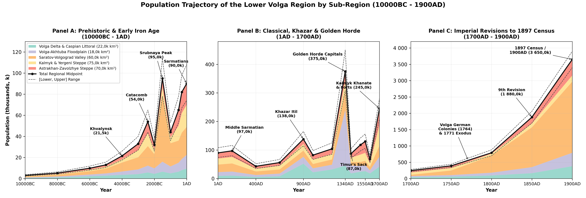
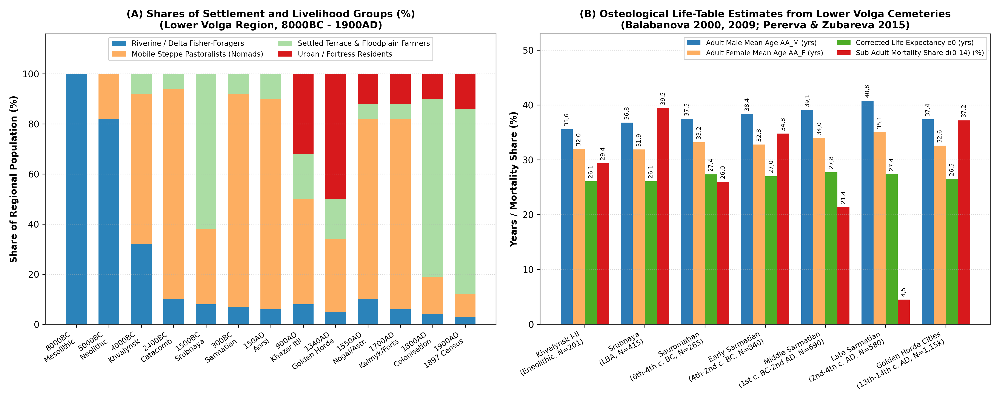
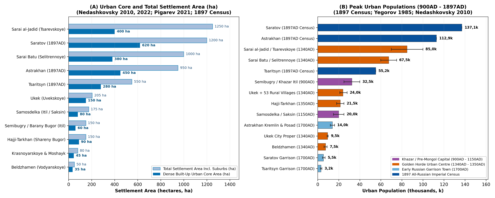

# Abstract

This paper reviews the archaeological, bioarchaeological and archival
literature on the demographic and settlement history of the Lower Volga
region (~ 245,0k km², encompassing the Volga Delta, the Volga-Akhtuba
Floodplain, the Saratov-Volgograd river corridor, the Kalmyk-Yergeni
steppes and the Astrakhan-Volgograd Trans-Volga semi-deserts) from the
Early Mesolithic (10000BC) to the First All-Russian Imperial Census
(1897 / 1900AD). Estimates are derived from regional field studies and
archival records: radiocarbon chronologies and excavated pit-house
floors at Varfolomeyevka, Kairshak, Tenteksor and Dzhangar
[\[1\]](#ref-yudin2004varfolomeyevka)[\[2\]](#ref-baratskov2015itogi)[\[3\]](#ref-smagin2018mikrolitov)[\[4\]](#ref-vybornov2022khronologiya),
Copper Age cemeteries at Khvalynsk I-II and Maksimovka I
[\[5\]](#ref-agapov1990khvalynskiy)[\[6\]](#ref-tsibin2019maksimovka),
Bronze Age buried-soil and pastoral mobility studies
[\[7\]](#ref-shishlina2008reconstruction)[\[8\]](#ref-borisov2019palaeosols),
Late Bronze Age Srubnaya village inventories in the Saratov-Volgograd
valleys (\>850 villages)
[\[9\]](#ref-malov2008nizhneye)[\[10\]](#ref-lopatin2014nachalo),
Sauromatian-Sarmatian skeletal life tables (N \> 2,3k skeletons) and
Kalmyk pasture comparisons
[\[11\]](#ref-balabanova2009khronologicheskiye)[\[12\]](#ref-skripkin2012chislennosti)[\[13\]](#ref-pererva2015istorii)[\[14\]](#ref-krivosheev2021chelovek),
excavations at Khazar Itil (Semibugry / Barany Bugor) and Pre-Mongol
Saksin (Samosdelka)
[\[15\]](#ref-vasilyev2015saksin)[\[16\]](#ref-vasilyev2020samosdelka)[\[17\]](#ref-solovyev2022semibugry),
Golden Horde urban and rural surveys (Ukek, Bagaevskoye, Beldzhamen,
Sarai al-Jadid / Tsarevskoye, Sarai Batu / Selitrennoye and
Hajji-Tarkhan)
[\[18\]](#ref-yegorov1985geografiya)[\[19\]](#ref-nedashkovsky2010goroda)[\[20\]](#ref-zeleneev2018selitrennom)[\[21\]](#ref-pigarev2021topografii)[\[22\]](#ref-nedashkovsky2022predmety)[\[23\]](#ref-shigapov2022selishch),
15th-17th century Astrakhan, Nogai and Kalmyk registers
[\[24\]](#ref-moiseev2015stepnyye)[\[25\]](#ref-trepavlov2016nogayskoy)[\[26\]](#ref-tepkeev2025dzhungarskiye)[\[27\]](#ref-muzraev2025uchastiye)
and 18th-19th century Imperial *revizii*, Volga German colony records,
Kalmyk and Inner Bukey Kazakh Horde returns and the 1897 Imperial Census
[\[28\]](#ref-kabuzan1963narodonaseleniye)[\[29\]](#ref-pleve1998nemetskiye)[\[30\]](#ref-doenninghaus2011nemetskikh)[\[31\]](#ref-solovyov2013saratovskoy)[\[32\]](#ref-brylyov2018volgogradskoy)[\[33\]](#ref-ochirov2008tyurkoyazychnyye)[\[34\]](#ref-okonova2012migratsii)[\[35\]](#ref-kyshpanakov2026kalmyki)[\[36\]](#ref-belousov2019bukeyevskoy)[\[37\]](#ref-pirova2020tatarakh)[\[38\]](#ref-troynitsky1904saratov)[\[39\]](#ref-troynitsky1904astrakhan).
Regional population grew from 3,0k (10000BC) to 95,0k during the Late
Bronze Age Srubnaya expansion (1500BC), 97,0k in the Middle Sarmatian
(Aorsi) period (150AD), 138,0k under the Khazar Khaganate (900AD) and
375,0k (308,0k–450,0k) in the Golden Horde heartland (1340AD). After
Timur’s 1395-1396 devastation of the floodplain cities (87,0k in 1400AD)
and the 1557-1558 Nogai famine and plague (68,0k in 1600AD),
Oirat-Kalmyk migration and Russian garrison founding lifted the
population to 245,0k by 1700AD, before 18th- and 19th-century
agricultural colonisation, Volga German settlement and railway
industrialisation raised the total to 3 650,0k (3,65M) by 1900AD.

# Background

The Lower Volga region (~ 245,0k km²) is defined by the sharp ecological
contrast between Europe’s largest alluvial oasis - the 400 km-long
Volga-Akhtuba Floodplain and fan-shaped Volga Delta - and the
surrounding dry steppes and semi-deserts of the Caspian Depression
(Figure ). For regional demographic analysis, the territory is divided
into five ecological sub-regions.

The first sub-region comprises the Volga Delta and north-western Caspian
littoral (22,0k km²), encompassing the branching channels of the Volga
Delta (Bolda, Buzan, Bakhtemir), Baer knolls (*Berovskiye bugry*), and
coastal lagoons (Seroglazovka, Kairshak, Tenteksor, Khazar Itil at
Semibugry / Barany Bugor, Samosdelka \[Saksin / Summerkent\], Golden
Horde Hajji-Tarkhan \[Shareny Bugor\], Krasnoyarskoye, and Russian
Astrakhan and Krasny Yar)
[\[16\]](#ref-vasilyev2020samosdelka)[\[17\]](#ref-solovyev2022semibugry).
The second sub-region is the Volga-Akhtuba Floodplain (18,0k km²), a
15-45 km-wide alluvial gallery-forest and meadow corridor between the
Volgograd (Tsaritsyn) bend and the upper delta apex, which hosted the
imperial capitals of the Golden Horde (Sarai al-Jadid / Sarai Berke at
Tsarevskoye Gorodishche, Sarai Batu / Sarai al-Mahrusa at Selitrennoye
Gorodishche, the Ak-Sarai royal mausoleums at Lapas, and Russian
Tsaritsyn, Chyorny Yar, Yenotayevsk, and Tsarev)
[\[18\]](#ref-yegorov1985geografiya)[\[19\]](#ref-nedashkovsky2010goroda)[\[21\]](#ref-pigarev2021topografii).

The third sub-region covers the Saratov-Volgograd right bank and
northern Trans-Volga (Zavolzhye) valley corridor (60,0k km²), marking
the forest-steppe to dry-steppe transition along the main Volga channel,
Medveditsa, Ilovlya, Bolshoy Irgiz, and Yeruslan rivers (Varfolomeyevka,
Khvalynsk I-II, Khlopkov Bugor, Pokrovsk, Golden Horde Ukek \[Uvekskoye
Gorodishche\] with its 53-site agricultural district including
Bagaevskoye Selishche, Beldzhamen \[Vodyanskoye Gorodishche\], Russian
Saratov, Kamyshin, Volsk, and Khvalynsk, and the 18th-19th century Volga
German *Bergseite* and *Wiesenseite* colonies)
[\[1\]](#ref-yudin2004varfolomeyevka)[\[22\]](#ref-nedashkovsky2022predmety)[\[23\]](#ref-shigapov2022selishch)[\[29\]](#ref-pleve1998nemetskiye).
The fourth sub-region encompasses the Kalmyk Steppe, Yergeni Hills, and
Sarpa Lakes (75,0k km²), the right-bank arid steppes stretching south of
the Volga-Don portage along the Yergeni ridge, Sarpa lacustrine chain,
and Black Lands (*Chyornye Zemli*, including Neolithic Dzhangar, Bronze
Age Manych Catacomb and Lola kurgan fields, 17th-19th century Kalmyk
*uluses*, the Herrnhuter colony of Sarepta, and Elista)
[\[7\]](#ref-shishlina2008reconstruction)[\[34\]](#ref-okonova2012migratsii)[\[40\]](#ref-koltsov2005mezolit)[\[41\]](#ref-tepkeev2012kalmyki).
Finally, the fifth sub-region consists of the Astrakhan-Volgograd
Trans-Volga (Zavolzhye) and Ryn-Caspian Steppe (70,0k km²), the
left-bank semi-desert steppes between the Akhtuba valley and the
Volga-Ural (Yaik) watershed (Elton, Baskunchak, Bolshoy and Maly Uzen
rivers, 16th-century Nogai and 17th-18th century Torghut-Kalmyk winter
pastures, and the 19th-century Inner / Bukey Kazakh Horde and Novouzensk
steppes)
[\[25\]](#ref-trepavlov2016nogayskoy)[\[36\]](#ref-belousov2019bukeyevskoy).

# Methodology

Population estimates across the Lower Volga combine five lines of
historical and archaeological evidence. For the Mesolithic, Neolithic,
and Eneolithic (10000-3500BC), A. V. Baratskov
[\[2\]](#ref-baratskov2015itogi), V. A. Smagin
[\[3\]](#ref-smagin2018mikrolitov), A. A. Vybornov et al.
[\[4\]](#ref-vybornov2022khronologiya), P. M. Koltsov
[\[40\]](#ref-koltsov2005mezolit), and A. I. Yudin
[\[1\]](#ref-yudin2004varfolomeyevka) provide excavated pit-house floor
areas (30-60 m² at Varfolomeyevka) and AMS radiocarbon series (89
$`{}^{14}\text{C}`$ dates by 2015, \>200 by 2022), while S. A. Agapov et
al. [\[5\]](#ref-agapov1990khvalynskiy) and V. A. Tsibin and A. A.
Shalapinin [\[6\]](#ref-tsibin2019maksimovka) establish Copper Age
cemetery populations (201 skeletons at Khvalynsk I-II). For the Yamnaya,
Poltavka, Catacomb, Pokrovsk, Srubnaya, Sauromatian, and Sarmatian
periods (3500BC–400AD), northern valley settlement inventories (\>850
Srubnaya villages)
[\[9\]](#ref-malov2008nizhneye)[\[10\]](#ref-lopatin2014nachalo) and
buried-soil studies
[\[8\]](#ref-borisov2019palaeosols)[\[14\]](#ref-krivosheev2021chelovek)
are combined with M. A. Balabanova’s
[\[11\]](#ref-balabanova2009khronologicheskiye)[\[42\]](#ref-balabanova2000antropologiya)[\[43\]](#ref-balabanova2013detskaya)[\[44\]](#ref-balabanova2015skripkin)
and E. V. Pererva and E. G. Zubareva’s [\[13\]](#ref-pererva2015istorii)
skeletal life tables ($`e_0`$, $`AA_{\text{M}}`$, $`AA_{\text{F}}`$,
$`d_{0\text{-}14}`$, sex ratios) and A. S. Skripkin’s
[\[12\]](#ref-skripkin2012chislennosti) comparison of Sarmatian pastures
with historical Kalmyk herd capacities.

For the medieval delta and floodplain cities (740-1460AD), D. V.
Vasilyev
[\[15\]](#ref-vasilyev2015saksin)[\[16\]](#ref-vasilyev2020samosdelka),
E. D. Zilivinskaya [\[45\]](#ref-zilivinskaya2014ocherki), and D. S.
Solovyev et al. [\[17\]](#ref-solovyev2022semibugry) estimate Khazar
(Itil at Semibugry / Barany Bugor and Samosdelka) and Pre-Mongol
(Saksin) urban populations. For the Golden Horde heartland, V. L.
Yegorov [\[18\]](#ref-yegorov1985geografiya), G. A. Fyodorov-Davydov
[\[46\]](#ref-fyodorovdavydov1994goroda), Yu. A. Zeleneev and E. M.
Pigarev
[\[20\]](#ref-zeleneev2018selitrennom)[\[21\]](#ref-pigarev2021topografii),
L. F. Nedashkovsky
[\[19\]](#ref-nedashkovsky2010goroda)[\[22\]](#ref-nedashkovsky2022predmety)[\[47\]](#ref-nedashkovsky2000ukek)[\[48\]](#ref-nedashkovsky2022izdeliya),
and M. B. Shigapov [\[23\]](#ref-shigapov2022selishch) document built-up
urban areas (Ukek \>205 ha, Beldzhamen 50 ha, Tsarevskoye \>400 ha core
/ \>1,0k ha with suburbs, Selitrennoye ~ 380 ha core / ~ 1,0k ha with
suburbs) and surrounding agricultural villages (53 *selishcha* around
Ukek, 17 around Tsarevskoye).

For the post-Jochid and early modern era (1460-1700AD), archival studies
by M. V. Moiseev [\[24\]](#ref-moiseev2015stepnyye), I. V. Zaitsev
[\[49\]](#ref-zaitsev2006astrakhanskoye), A. V. Syzranov
[\[50\]](#ref-syzranov2014astrakhani), V. V. Trepavlov
[\[25\]](#ref-trepavlov2016nogayskoy), V. T. Tepkeev
[\[26\]](#ref-tepkeev2025dzhungarskiye)[\[41\]](#ref-tepkeev2012kalmyki),
and N. L. Muzraev [\[27\]](#ref-muzraev2025uchastiye) establish Great
Horde, Astrakhan Tatar, Nogai *san*, and Kalmyk *kibitka* (35,0k–45,0k
tents = 160,0k–210,0k people) numbers alongside Russian *Razryadny
Prikaz* fortress censuses. For the 18th and 19th centuries
(1700-1900AD), V. M. Kabuzan [\[28\]](#ref-kabuzan1963narodonaseleniye),
I. R. Pleve [\[29\]](#ref-pleve1998nemetskiye), V. Dönninghaus
[\[30\]](#ref-doenninghaus2011nemetskikh), V. Yu. Solovyov
[\[31\]](#ref-solovyov2013saratovskoy), V. A. Brylyov
[\[32\]](#ref-brylyov2018volgogradskoy), U. B. Ochirov
[\[33\]](#ref-ochirov2008tyurkoyazychnyye), L. V. Okonova
[\[34\]](#ref-okonova2012migratsii), V. A. Kyshpanakov
[\[35\]](#ref-kyshpanakov2026kalmyki), S. S. Belousov
[\[36\]](#ref-belousov2019bukeyevskoy), R. N. Pirova
[\[37\]](#ref-pirova2020tatarakh), and N. A. Troynitsky
[\[38\]](#ref-troynitsky1904saratov)[\[39\]](#ref-troynitsky1904astrakhan)
provide exact counts from the 1st–10th *revizii* (1719-1858), the
1764-1767 Volga German colony registers, the 1771 Kalmyk exodus records,
the Inner (Bukey) Kazakh Horde censuses, and the 1897 Imperial Census
across Saratov and Astrakhan Governorates.[^1]

# Prehistoric Foragers to Sarmatian Nomads (10000BC - 400AD)

## Mesolithic, Neolithic and Eneolithic (10000-3500BC)

Investigated by P. M. Koltsov [\[40\]](#ref-koltsov2005mezolit) and V.
A. Smagin [\[3\]](#ref-smagin2018mikrolitov), the Mesolithic of the
Northern Caspian lowlands and Volga-Ural sands (10000-6800 cal BC) is
represented by the Seroglazovka and Istay cultures (Seroglazovka,
Zhe-Kalgan, Kairshak V), characterised by geometric flint microliths
(segments, trapezes and parallelograms traced across the Lower Volga by
Smagin [\[3\]](#ref-smagin2018mikrolitov)). Small mobile bands (15-35
persons per camp) hunted saiga, kulan and onager and fished along delta
channels, with regional population growing gradually from 3,0k (10000BC,
density 0,012 persons/km²) to 5,2k (8000BC).

As documented by A. V. Baratskov [\[2\]](#ref-baratskov2015itogi) and A.
A. Vybornov et al. [\[4\]](#ref-vybornov2022khronologiya), the
radiocarbon dataset for the Steppe Volga Neolithic expanded from 12
dates prior to 2007 to 89 dates by 2015 and more than 200 AMS dates by
2022, establishing the Northern Caspian and Lower Volga as one of the
earliest pottery-making regions in Western Eurasia. At the Kairshak
sites (6800-5800 cal BC, including Kairshak I-III, Baibek, and Kugat
IV), flat-bottomed incised pottery and geometric microliths yielded AMS
dates of 7950-7930 BP (6800-6500 cal BC) alongside light surface
dwellings (15-28 m²) [\[2\]](#ref-baratskov2015itogi). At Varfolomeyevka
(Orlovka Culture, 6000-5000 cal BC), excavated by A. I. Yudin
[\[1\]](#ref-yudin2004varfolomeyevka) in the Saratov Trans-Volga, a 3,5
m cultural deposit across Layer 3 (6200-5800 cal BC), Layer 2B
(5600-5300 cal BC), and Layer 2A (5200-4900 cal BC)
[\[2\]](#ref-baratskov2015itogi) preserved permanent multi-room
semi-subterranean pit-houses (*poluzemlyanki* of 30-60 m²) that housed
60-100 residents per phase. At Tenteksor I and Dzhangar (5600-4800 cal
BC in Kalmykia, upper layer dated to 6564 +/- 44 BP / c. 5500 cal BC
[\[2\]](#ref-baratskov2015itogi)[\[40\]](#ref-koltsov2005mezolit)),
communities settled around freshwater limans in sub-rectangular
pit-dwellings (35-50 m²), raising regional population to 9,8k (6000BC)
and 13,0k (5000BC).

During the Eneolithic (4800-3500 cal BC), the cemeteries of Khvalynsk I
(158 skeletons) and Khvalynsk II (43 skeletons)
[\[5\]](#ref-agapov1990khvalynskiy), Khlopkov Bugor and collective
flat-grave burials such as Maksimovka I on the Samara-Volga steppe
margin [\[6\]](#ref-tsibin2019maksimovka) document early Copper Age
herding (cattle, sheep, goats and horses) and Balkan-Carpathian copper
exchange. Terrestrial-herbivore AMS dates place Khvalynsk I-II between
4508-4340 cal BC and 4346-4171 cal BC ($`2\sigma`$)
[\[4\]](#ref-vybornov2022khronologiya), with regional population
reaching 21,5k by 4000BC.

## Bronze Age and Sauromatian-Sarmatian Nomadic Confederacies (3500BC - 400AD)

During the Yamnaya (3300-2600 cal BC) and Middle Bronze Age Poltavka
(2700-2100 cal BC) and Catacomb periods, mobile pastoralists using
wheeled wagons expanded across the Saratov-Volgograd valleys, Yergeni
Hills and Sarpa lakes
[\[7\]](#ref-shishlina2008reconstruction)[\[8\]](#ref-borisov2019palaeosols),
lifting regional population from 33,0k (3000BC) to 54,0k around 2400BC
before the 2200-2000 cal BC dry phase (when settlement contracted during
the Lola period to 32,0k at 2000BC).

The transition from the Potapovka / Pokrovsk (1900-1700 cal BC)
chariot-warrior burials to the Srubnaya (Timber-Grave) Culture
(1700-1100 cal BC)
[\[9\]](#ref-malov2008nizhneye)[\[10\]](#ref-lopatin2014nachalo)
produced a clear north-south contrast: the northern Saratov-Volgograd
river valleys (60,0k km²) supported more than 850 permanent Srubnaya
villages (*poseleniya*) with large timber-framed semi-subterranean
houses (80-180 m², housing 62,0k mixed farmers and herders), whereas the
southern Kalmyk and Astrakhan semi-deserts (185,0k km²) were used for
seasonal dune camps (*stoyanki*, 33,0k mobile herders), giving a Late
Bronze Age regional peak of 95,0k (78,0k–114,0k) at 1500BC (0,388
persons/km²).

In the Early Iron Age (600BC–400AD), studied by A. S. Skripkin
[\[12\]](#ref-skripkin2012chislennosti)[\[44\]](#ref-balabanova2015skripkin),
V. M. Klepikov [\[51\]](#ref-klepikov2002sarmaty) and M. V. Krivosheev,
E. V. Pererva and M. V. Eltsov [\[14\]](#ref-krivosheev2021chelovek),
the Lower Volga passed from the Sauromatian (6th–4th c. BC, 65,0k) and
Early Sarmatian (Prokhorovka, 4th–2nd c. BC, 82,0k at 300BC, followed by
a mid-3rd-century BC dry-steppe pullback to 66,0k
[\[51\]](#ref-klepikov2002sarmaty)) periods to the Middle Sarmatian
(Susly / Aorsi Confederacy, 1st c. BC–mid-2nd c. AD) expansion (Kosika,
Verkhnoye Pogromnoye). In a dedicated demographic study, A. S. Skripkin
[\[12\]](#ref-skripkin2012chislennosti) compared Lower Volga Sarmatian
burial densities against 18th- and 19th-century Kalmyk nomadic censuses
(30,0k–45,0k *kibitkas*), showing that the Lower Volga pastures
supported 65,0k–110,0k Sarmatian nomads (90,0k–97,0k midpoint in
1-150AD). Across more than 2,3k Lower Volga skeletons, M. A. Balabanova
[\[11\]](#ref-balabanova2009khronologicheskiye)[\[42\]](#ref-balabanova2000antropologiya)[\[43\]](#ref-balabanova2013detskaya)
and E. V. Pererva and E. G. Zubareva [\[13\]](#ref-pererva2015istorii)
recorded high child mortality in Srubnaya (39,5%) and Early Sarmatian
(34,8%) cemeteries, contrasted with the customary exclusion of infants
($`d_{0\text{-}14} = 4{,}5\%`$) and a strong excess of adult males
($`M/F = 2{,}15`$) in Late Sarmatian kurgans (Figure B; Table ).

# Khazar Heartland (Itil), Pre-Mongol Saksin, Golden Horde Imperial Capitals and the Kalmyk Khanate (400 - 1700AD)

## Khazar Imperial Capital Itil (Semibugry and Samosdelka) and Pre-Mongol Saksin (740-1236AD)

Following the post-Hunnic population low (43,0k at 400AD) and the
Arab-Khazar war of 737AD, the Khazar Khagan transferred his court
permanently to the Lower Volga Delta (Itil / Atil). At Semibugry and
Barany Bugor (Семибугоринский археологический комплекс), excavated since
2020 by D. S. Solovyev, D. V. Vasilyev, and E. E. Kravchenko
[\[17\]](#ref-solovyev2022semibugry) along the Bolda delta channel in
Kamyzyaksky District, Astrakhan Oblast, a large 8th–10th century Khazar
urban and suburban complex covers ~ 150 ha, yielding Saltovo-Mayaki
amphorae, Khazar royal *tamga* bricks, an 8th-century Abbasid silver
dirham, and monumental brick foundations (estimated urban population
25,0k-40,0k).

Summarising 20 years of excavations (2000-2020) at Samosdelka
(Самосдельское городище), D. V. Vasilyev
[\[15\]](#ref-vasilyev2015saksin)[\[16\]](#ref-vasilyev2020samosdelka)
showed that the site (~ 150-200 ha across three delta islands) preserves
a lower Khazar layer (9th–10th c. AD) with a triangular burnt-brick
fortress and *yurt*-shaped dwellings (10,0k–18,0k inhabitants), sealed
by a fire-and-flood layer from Sviatoslav’s 965/969AD campaign. Together
with Kalmyk-steppe outposts (Bashanta I-II
[\[52\]](#ref-ochirgoryaeva2020bashanta)) and floodplain herders, the
Khazar Lower Volga reached 138,0k (115,0k–165,0k) at 900AD. In the
11th–early 13th centuries, the middle layer of Samosdelka flourished as
the trading port of Saksin, where Abu Hamid al-Gharnati (1131-1153AD)
described Oghuz, Bolgar, Suvar, and Khazar quarters (matched directly to
Samosdelka’s four pottery traditions by Vasilyev
[\[15\]](#ref-vasilyev2015saksin)), supporting 15,0k–25,0k urban
residents within a regional population of 104,0k at 1200AD.

## Golden Horde Imperial Core on the Lower Volga (1240-1502AD)

During the 1250s–1360s AD, the Lower Volga and Volga-Akhtuba Floodplain
served as the personal domain of the Jochid Khans and the most heavily
urbanised river corridor in Eastern Europe
[\[18\]](#ref-yegorov1985geografiya)[\[19\]](#ref-nedashkovsky2010goroda)[\[46\]](#ref-fyodorovdavydov1994goroda)[\[53\]](#ref-sitdikov2022volgoural)
(Figure ). In the northern Saratov right-bank sector, Ukek (Uvekskoye
Gorodishche, modern Saratov) stretched more than 3,5 km along the Volga
across \>205 ha with brick palaces, mosques, bathhouses (*hammams*), and
Christian and Muslim quarters, housing 9,0k–10,0k urban residents
[\[19\]](#ref-nedashkovsky2010goroda)[\[47\]](#ref-nedashkovsky2000ukek).
Across its 420 km² rural district (*okruga*), L. F. Nedashkovsky and M.
B. Shigapov
[\[19\]](#ref-nedashkovsky2010goroda)[\[22\]](#ref-nedashkovsky2022predmety)[\[23\]](#ref-shigapov2022selishch)[\[48\]](#ref-nedashkovsky2022izdeliya)
mapped 53 rural settlements (3 satellite towns and 50 farming villages),
exemplified by Bagaevskoye Selishche (5,1 ha, \>90 cm cultural layer,
excavated 2002-2021, yielding iron sickles, scythes, saws, and
fishhooks), which supported 12,0k–18,0k rural inhabitants. Further south
at Dubovka, Beldzhamen / Bezdezh (Vodyanskoye Gorodishche) covered 50 ha
(6,0k–9,0k inhabitants), with distinct Russian Christian, Volga Bolgar
(stone mosque and baths), and Kipchak-Mongol quarters
[\[18\]](#ref-yegorov1985geografiya)[\[19\]](#ref-nedashkovsky2010goroda).

In the Volga-Akhtuba Floodplain, the 14th-century imperial capital of
Sarai al-Jadid / Sarai Berke (Tsarevskoye Gorodishche, Leninsk)
encompassed a compact urban core of \>400 ha (~1,55k aristocratic house
mounds) and a suburban estate belt of \>1,0k–1,5k ha, surrounded by 17
satellite villages [\[19\]](#ref-nedashkovsky2010goroda), supporting a
1340s population of 70,0k–100,0k inhabitants
[\[18\]](#ref-yegorov1985geografiya)[\[46\]](#ref-fyodorovdavydov1994goroda)[\[53\]](#ref-sitdikov2022volgoural).
Downstream at Kharabali, Sarai Batu / Sarai al-Mahrusa (Selitrennoye
Gorodishche) and the royal necropolis of Ak-Sarai (Lapas) stretched 7-12
km along the Akhtuba across ~ 380-400 ha of dense urban quarters and ~
1,0k ha of suburban estates and workshops (mapped in 2000-2020 by Yu. A.
Zeleneev and E. M. Pigarev
[\[20\]](#ref-zeleneev2018selitrennom)[\[21\]](#ref-pigarev2021topografii)),
housing 60,0k–75,0k inhabitants. In the Volga Delta, the Golden Horde
port cities included Hajji-Tarkhan (Shareny Bugor, 150 ha, 18,0k–25,0k),
Summerkent (Samosdelka upper layer, 80-100 ha, 6,0k–10,0k
[\[16\]](#ref-vasilyev2020samosdelka)), and Krasnoyarskoye / Moshayk
(5,0k–10,0k).

At the height of the Golden Horde in 1340AD, Lower Volga towns housed
170,0k–230,0k inhabitants, supported by 50,0k–70,0k settled floodplain
farmers and fishermen and 100,0k–140,0k steppe pastoralists - giving a
regional total of 375,0k (308,0k–450,0k, 1,531 persons/km²). Between the
Black Death (1346), the civil wars of the *Velikaya Zamyatnya*
(1359-1380) and Timur’s winter campaign of 1395-1396AD, the floodplain
cities lost roughly four-fifths of their inhabitants, reducing the
regional population to 87,0k in 1400AD.

## Astrakhan Khanate, Nogai Horde, Kalmyk Khanate and Russian Fortress Network (1460-1700AD)

As shown by M. V. Moiseev [\[24\]](#ref-moiseev2015stepnyye), I. V.
Zaitsev [\[49\]](#ref-zaitsev2006astrakhanskoye) and A. V. Syzranov
[\[50\]](#ref-syzranov2014astrakhani), the post-Jochid Astrakhan Khanate
(1459-1556AD) centred at Hajji-Tarkhan supported an urban and
semi-settled *Yurt* Tatar population of 15,0k–25,0k (fielding 3,0k
cavalrymen), while V. V. Trepavlov [\[25\]](#ref-trepavlov2016nogayskoy)
established from Manghit *san* lists that the Western *uluses* of the
Nogai Horde wintering along the Lower Volga numbered 80,0k–120,0k nomads
in 1500-1550AD (regional total 130,0k at 1550AD). Immediately after Ivan
IV’s annexation of Astrakhan (1554-1556), civil war and the severe
winter freeze (*dzhut*), famine and plague of 1557-1558 (witnessed at
Astrakhan by Anthony Jenkinson in 1558) devastated the Nogai *uluses*,
reducing the regional population to 68,0k by 1600AD
[\[25\]](#ref-trepavlov2016nogayskoy).

Between 1558 and 1700AD, two demographic movements reshaped the Lower
Volga. First, the Russian garrison and *posad* network expanded along
the river: Astrakhan (moved to Hare Island in 1558, stone Kremlin built
1582-1589) grew to 12,0k–16,0k permanent residents by 1700AD (including
*streltsy*, Russian townspeople, Bukharan, Persian, Armenian, and Indian
merchant *dvory*, and *Yurt* Tatar Muslim suburbs
[\[50\]](#ref-syzranov2014astrakhani)), alongside Saratov (1590,
4,5k–7,0k urban plus 6,0k rural settlers), Tsaritsyn (1589, 2,5k–4,0k),
Chyorny Yar (1627), Krasny Yar (1667), and Dmitriyevsk (Kamyshin, 1668)
(~34,0k total Russian and settled inhabitants). Second, beginning in
1628-1632, Western Mongol (Oirat - Torghut, Derbet, and Khoshut) tribes
under Tayishi Kho Orluk migrated into the Lower Volga steppes
[\[41\]](#ref-tepkeev2012kalmyki). Under Ayuka Khan (r. 1669-1724,
granted the title of Khan in 1690), reinforced by new Derbet and Dzungar
arrivals studied by V. T. Tepkeev
[\[26\]](#ref-tepkeev2025dzhungarskiye) and N. L. Muzraev
[\[27\]](#ref-muzraev2025uchastiye), the Kalmyk Khanate numbered
35,0k–45,0k *kibitkas* (160,0k–210,0k Kalmyks, fielding 20,0k–40,0k
horsemen) plus 20,0k subordinate Nogai and *Yurt* Tatars, lifting the
Lower Volga region to 245,0k (210,0k–280,0k, 1,000 persons/km²) in
1700AD.

# Imperial Russian Colonisation, the Volga Germans, the 1771 Kalmyk Exodus and the 1897 Census (1700 - 1900AD)

Between 1700 and 1900AD, the Lower Volga was transformed from a pastoral
frontier into one of Imperial Russia’s major grain-exporting, fishing,
and river-shipping regions, expanding more than fourteen-fold from
245,0k (1700AD) to 3 650,0k (3,65M) by 1900AD (Figure B). Following the
completion of the 60 km Tsaritsyn Defensive Line (*Tsaritsynskaya
storozhevaya liniya*, 1718-1720) between the Volga and the Don and the
establishment of the Dubovka Cossack Host (1734), Russian and Ukrainian
state and landlord peasants settled the right-bank river valleys of
Saratov and Kamyshin
[\[28\]](#ref-kabuzan1963narodonaseleniye)[\[31\]](#ref-solovyov2013saratovskoy)[\[32\]](#ref-brylyov2018volgogradskoy),
lifting regional population to 390,0k by 1750AD. Under Catherine II’s
Manifestos of 1762 and 1763, analysed by I. R. Pleve
[\[29\]](#ref-pleve1998nemetskiye) and V. Dönninghaus
[\[30\]](#ref-doenninghaus2011nemetskikh), 25,6k–27,0k German colonists
settled 104 mother colonies between 1764 and 1767 along the
Saratov-Kamyshin right bank (*Bergseite*) and northern Trans-Volga left
bank (*Wiesenseite*), while Moravian Brethren (Herrnhuter) founded
Sarepta near Tsaritsyn in 1765.

In January 1771, Ubashi Khan led roughly 30,0k–33,0k left-bank Torghut
and Khoshut *kibitkas* (~150,0k–170,0k people) eastwards out of the
Lower Volga back towards Dzungaria, leaving only ~11,0k–13,0k right-bank
Derbet and Torghut tents (~50,0k–60,0k Kalmyks) trapped west of the
un-iced Volga
[\[33\]](#ref-ochirov2008tyurkoyazychnyye)[\[34\]](#ref-okonova2012migratsii)[\[35\]](#ref-kyshpanakov2026kalmyki).
This sudden depopulation of the Astrakhan Trans-Volga (Zavolzhye fell
from 67,0k in 1750 to 28,0k in 1800AD, even as Saratov agricultural
growth lifted the overall Lower Volga to 790,0k in 1800AD) prompted Paul
I’s decree of 11 March 1801 permitting Sultan Bukei Nuraliev to lead
Junior Zhuz Kazakhs across the Ural into the Ryn Sands
[\[36\]](#ref-belousov2019bukeyevskoy). By 1850AD, the Inner (Bukey)
Kazakh Horde (~100,0k–120,0k Kazakhs centred at Khanskaya Stavka),
state-peasant salt-carters (*chumaki*) at Lakes Elton and Baskunchak,
and rapid natural increase among the Volga Germans (reaching 165,0k by
1850) and Saratov peasantry raised the regional total to 1 880,0k (7,673
persons/km²)
[\[28\]](#ref-kabuzan1963narodonaseleniye)[\[30\]](#ref-doenninghaus2011nemetskikh)[\[36\]](#ref-belousov2019bukeyevskoy).

After the Emancipation of 1861, the opening of the Gryazi-Tsaritsyn
(1871), Ryazan-Ural (1871-1894, linking Saratov and Pokrovskaya
Sloboda), and Baskunchak (1882) railways, and the rise of Nobel
Brothers’ oil-tanker fleets at Astrakhan and Tsaritsyn, the First
All-Russian Census of 28 January 1897
[\[38\]](#ref-troynitsky1904saratov)[\[39\]](#ref-troynitsky1904astrakhan)
provides an exact baseline across the five Lower Volga sub-regions. In
the Saratov-Volgograd Valley Corridor (60,0k km²), Saratov Governorate
recorded 2 405,8k inhabitants in 1897
[\[31\]](#ref-solovyov2013saratovskoy)[\[38\]](#ref-troynitsky1904saratov);
within the Lower Volga river and northern Trans-Volga districts
(Saratov, Kamyshin, Tsaritsyn uplands, Volsk, Khvalynsk, Atkarsk, and
the Volga German canton of Novouzensk and Nikolayevsk uyezds
[\[30\]](#ref-doenninghaus2011nemetskikh)[\[32\]](#ref-brylyov2018volgogradskoy)),
population reached 2 180,0k by 1900AD, including ~390,0k–405,0k Volga
Germans across mother and daughter colonies and the cities of Saratov
(137,1k in 1897), Kamyshin (16,3k), Volsk (27,1k), Khvalynsk (15,1k),
and Dubovka (16,3k). In the Volga-Akhtuba Floodplain (18,0k km²),
anchored by the booming railway-and-timber hub of Tsaritsyn (55,2k in
1897, up from 6,7k in 1861 [\[32\]](#ref-brylyov2018volgogradskoy)),
Tsarev (6,9k), Chyorny Yar (4,2k), Yenotayevsk (2,8k), Vladimirovka, and
dense Russian, Ukrainian, and Mordvinian orchard-and-fishery villages
along the Akhtuba, population reached 410,0k in 1900AD.

In the Volga Delta and north-western Caspian littoral (22,0k km²),
Astrakhan Governorate recorded 1 003,5k inhabitants in 1897
[\[39\]](#ref-troynitsky1904astrakhan), and the delta proper (Astrakhan
uyezd 219,8k and Krasny Yar uyezd 66,0k, plus seasonal fishery workers
and delta Tatar villages [\[37\]](#ref-pirova2020tatarakh)) reached
380,0k by 1900AD, led by Astrakhan city (112,9k permanent residents in
1897, swelling by \>100,0k seasonal fishermen and dockers each spring).
In the Kalmyk Steppe and Yergeni Hills (75,0k km²), analysed in detail
by L. V. Okonova [\[34\]](#ref-okonova2012migratsii), U. B. Ochirov
[\[33\]](#ref-ochirov2008tyurkoyazychnyye), and V. A. Kyshpanakov
[\[35\]](#ref-kyshpanakov2026kalmyki), the Kalmyk Steppe (*Kalmytskaya
step*) of Astrakhan Governorate counted 128,6k nomadic Kalmyks plus
~10,0k Russian and Ukrainian settlers (total 138,6k in the steppe
proper), alongside peasant road-villages (*traktovye syola*) along the
Yergeni ridge (Elista, Remontnoye, Kresty) and Sarepta, giving 190,0k
across the 75,0k km² sub-region in 1900AD. Finally, in the
Astrakhan-Volgograd Trans-Volga and Ryn Steppe (70,0k km²), the Inner
(Bukey) Kazakh Horde counted 214,8k inhabitants in 1897 (96,5% Kazakhs,
plus sedentary trading settlements at Khanskaya Stavka, Talovka, and
Novaia Kazanka studied by S. S. Belousov
[\[36\]](#ref-belousov2019bukeyevskoy)), which together with the
Baskunchak and Elton salt-mining towns and the southern Trans-Volga
*volosts* of Tsarev and Novouzensk uyezds totalled 490,0k in 1900AD
(regional aggregate 3 650,0k, density 14,898 persons/km²).

| Settlement / Site | Sub-Region | Chronology | Core / Total Area (ha) | Estimated Population | Primary Literature |
|:---|:---|:---|:---|:---|:---|
| Varfolomeyevka (Neolithic) | Saratov Trans-Volga | 6000-5000 cal BC | 0,8 / 1,5 | 60-100 | Yudin 2004; Baratskov 2015 |
| Semibugry / Barany Bugor (Itil) | Volga Delta (Bolda arm) | 750-969AD | 60,0 / ~150,0 | 25,0k-40,0k (900AD) | Solovyev, Vasilyev et al. 2022 |
| Samosdelka (Itil / Saksin) | Volga Delta (Kamyzyak) | 9th-14th c. AD | 80,0 / 150,0-200,0 | 15,0k-25,0k (Saksin, 12th c.) | Vasilyev 2015, 2020; Zilivinskaya 2014 |
| Ukek (Uvekskoye) & 53 Selishcha | Saratov Right Bank | 1250s-1395AD | 150,0 / \>205,0 (+53 sites) | 9,0k-10,0k (city) / 24,0k (dist.) | Nedashkovsky 2010, 2022; Shigapov 2022 |
| Beldzhamen (Vodyanskoye) | Volgograd Right Bank (Dubovka) | 1260s-1370s AD | 35,0 / 50,0 | 6,0k-9,0k (1340AD) | Yegorov 1985; Nedashkovsky 2010 |
| Sarai al-Jadid (Tsarevskoye) | Volga-Akhtuba (Leninsk) | 1320s-1395AD | 400,0 / 1,0k-1,5k (+17 sites) | 70,0k-100,0k (1340s AD) | Yegorov 1985; Nedashkovsky 2010 |
| Sarai Batu (Selitrennoye) | Volga-Akhtuba (Kharabali) | 1254-1480/1502AD | 380,0 / ~1,0k (7-12 km strip) | 60,0k-75,0k (1330s-1350s AD) | Zeleneev & Pigarev 2018; Pigarev 2021 |
| Hajji-Tarkhan (Shareny Bugor) | Volga Delta Apex | 1280s-1556AD | 90,0 / 150,0 | 18,0k-25,0k (1350) / 10,0k (1500) | Nedashkovsky 2010; Zaitsev 2006 |
| Krasnoyarskoye & Moshayk | Volga Delta | 1260s-1395AD | 45,0 / 80,0 | 5,0k-10,0k (14th c. AD) | Zilivinskaya 2014; Pigarev 2021 |
| Astrakhan (Kremlin, Posad & Port) | Volga Delta (Hare Isl.) | 1558-1900AD | 450,0 / 950,0 | 14,0k (1700) / 112,9k (1897) | Syzranov 2014; Troynitsky 1904 |
| Saratov | Saratov Right Bank | 1590-1900AD | 620,0 / 1,2k | 5,5k (1700) / 137,1k (1897) | Solovyov 2013; Troynitsky 1904 |
| Tsaritsyn (Volgograd) | Volga-Don Bend | 1589-1900AD | 280,0 / 550,0 | 3,2k (1700) / 55,2k (1897) | Brylyov 2018; Troynitsky 1904 |
| Kamyshin, Volsk & Dubovka | Saratov-Volgograd Volga | 1668-1900AD | 210,0 / 420,0 | 2,5k (1700) / 59,7k (1897) | Brylyov 2018; Troynitsky 1904 |

Core and total settlement areas and population estimates for major urban
centres of the Lower Volga (6000BC - 1900AD).

# Limitations

Three practical constraints affect Lower Volga demographic estimates.
First, multi-metre Holocene rises and falls of the Caspian Sea (the
Mangyshlak lowstand around 8000BC, the Novocaspian highstands, and the
10th- and 14th-century transgressions) submerged or eroded delta sites
(such as the Samosdelka fire-and-flood layer
[\[16\]](#ref-vasilyev2020samosdelka)), while lateral shifting of the
Volga and Akhtuba channels has destroyed parts of Ukek, Beldzhamen, and
Selitrennoye
[\[19\]](#ref-nedashkovsky2010goroda)[\[21\]](#ref-pigarev2021topografii).
Second, scholars continue to debate how much the twin Golden Horde
capitals of Sarai Batu (Selitrennoye) and Sarai al-Jadid (Tsarevskoye)
overlapped in population during the 1330s–1360s AD
[\[18\]](#ref-yegorov1985geografiya)[\[20\]](#ref-zeleneev2018selitrennom)[\[53\]](#ref-sitdikov2022volgoural);
our 1340AD floodplain estimate (195,0k) accounts for partial transfer of
residents between the two capitals rather than adding both at their
maximum sizes. Third, both the Nogai Horde (15th–16th c.), the Kalmyk
Khanate (17th–18th c.), and the Inner Bukey Kazakh Horde (19th c.)
shifted camps seasonally across the Ural, Lower Volga, and Kuma-Manych
steppes
[\[25\]](#ref-trepavlov2016nogayskoy)[\[26\]](#ref-tepkeev2025dzhungarskiye)[\[36\]](#ref-belousov2019bukeyevskoy),
while late 19th-century Astrakhan and Tsaritsyn attracted more than
150,0k seasonal spring and summer fishery and dock labourers outside the
January 1897 census date [\[39\]](#ref-troynitsky1904astrakhan).
Sub-regional figures reflect resident populations within the 245,0k km²
Lower Volga polygon.

# Conclusion

The Lower Volga region experienced repeated shifts between pastoral
nomadism and dense riverine urbanisation across the Holocene. After
early farming and nomadic growth during the Late Bronze Age Srubnaya
village expansion (95,0k at 1500BC) and the Middle Sarmatian Aorsi
confederacy (97,0k at 150AD), the Volga Delta and Volga-Akhtuba
Floodplain twice served as the metropolitan heartland of Western
Eurasian steppe empires: first under the Khazar Khaganate (Itil at
Semibugry and Samosdelka, 138,0k in 900AD, followed by Pre-Mongol Saksin
at 104,0k in 1200AD) and second under the Golden Horde (375,0k in 1340AD
across Sarai al-Jadid, Sarai Batu, Ukek, Beldzhamen and Hajji-Tarkhan).
Following Timur’s 1395AD destruction of the floodplain cities and the
1557-1558 Nogai famine and plague (68,0k in 1600AD), 17th-century
Oirat-Kalmyk migration (35,0k–45,0k *kibitkas* under Ayuka Khan) and
Russian fortress founding (Astrakhan, Saratov, Tsaritsyn) restored
regional population to 245,0k by 1700AD. Despite the 1771 departure of
~150,0k–170,0k left-bank Kalmyks, peasant and Volga German colonisation
of the Saratov-Kamyshin valleys, the creation of the Inner (Bukey)
Kazakh Horde (1801) and late 19th-century railway and shipping growth
expanded the Lower Volga population to 3 650,0k (14,898 persons/km²) by
1900AD.

# Appendix

## Osteological Life-Table Estimates

| Archaeological Period | Sample (N) | Sub-Adult d(0-14) | Male AA (yrs) | Female AA (yrs) | Adult Sex Ratio (M/F) | Corrected e0 (yrs) | Sources |
|:---|:---|:---|:---|:---|:---|:---|:---|
| Khvalynsk I-II (Eneolithic) | 201 | 29,4% | 35,6 | 32,0 | 1,35 | 25,0-27,2 | Agapov et al. 1990 |
| Srubnaya (LBA, Lower Volga) | 415 | 39,5% | 36,8 | 31,9 | 1,08 | 24,8-27,4 | Balabanova 2000, 2009 |
| Sauromatian (6th-4th c. BC) | 265 | 26,0% | 37,5 | 33,2 | 1,32 | 26,2-28,5 | Balabanova 2009; Pererva 2015 |
| Early Sarmatian (Prokhorovka, 4th-2nd c. BC) | 840 | 34,8% | 38,4 | 32,8 | 1,18 | 25,8-28,2 | Balabanova 2009, 2013; Krivosheev 2021 |
| Middle Sarmatian (1st c. BC-mid-2nd c. AD) | 690 | 21,4% (kurgan bias) | 39,1 | 34,0 | 1,12 | 26,5-29,0 | Balabanova 2009; Krivosheev 2021 |
| Late Sarmatian (mid-2nd-4th c. AD) | 580 | 4,5% (ritual filter) | 40,8 | 35,1 | 2,15 (male skew) | 26,0-28,8 | Balabanova 2009; Pererva 2015 |
| Golden Horde (Ukek, Tsarevskoye, Selitrennoye) | 1,15k | 37,2% | 37,4 | 32,6 | 1,15 | 25,2-27,8 | Pererva 2015 |

Osteological life-table estimates across seven skeletal series from the
Lower Volga region.

## Population Estimates

| Year | Volga Delta (22,0k km²) | Volga-Akhtuba (18,0k km²) | Saratov-Volgograd (60,0k km²) | Kalmyk Steppe (75,0k km²) | Zavolzhye (70,0k km²) | Total Population \[Range\] | Density (p/km²) |
|:---|:---|:---|:---|:---|:---|:---|:---|
| 10000BC | 0,6k | 0,5k | 0,9k | 0,5k | 0,5k | 3,0k \[2,4k-3,7k\] | 0,012 |
| 8000BC | 1,1k | 0,9k | 1,6k | 0,8k | 0,8k | 5,2k \[4,2k-6,3k\] | 0,021 |
| 6000BC | 2,2k | 1,6k | 3,2k | 1,4k | 1,4k | 9,8k \[8,0k-11,8k\] | 0,040 |
| 5000BC | 2,8k | 2,1k | 4,5k | 1,8k | 1,8k | 13,0k \[10,5k-15,6k\] | 0,053 |
| 4000BC | 3,5k | 3,2k | 8,5k | 3,0k | 3,3k | 21,5k \[17,5k-26,0k\] | 0,088 |
| 3000BC | 4,2k | 4,5k | 11,5k | 6,8k | 6,0k | 33,0k \[27,0k-40,0k\] | 0,135 |
| 2400BC | 5,8k | 6,5k | 18,5k | 12,2k | 11,0k | 54,0k \[44,0k-65,0k\] | 0,220 |
| 2000BC | 4,5k | 5,2k | 13,5k | 4,5k | 4,3k | 32,0k \[26,0k-38,5k\] | 0,131 |
| 1500BC | 6,5k | 9,5k | 62,0k | 8,5k | 8,5k | 95,0k \[78,0k-114,0k\] | 0,388 |
| 1000BC | 5,0k | 6,5k | 22,0k | 5,5k | 5,0k | 44,0k \[36,0k-53,0k\] | 0,180 |
| 500BC | 6,5k | 8,5k | 21,0k | 14,0k | 15,0k | 65,0k \[53,0k-78,0k\] | 0,265 |
| 300BC | 8,0k | 10,5k | 25,0k | 18,5k | 20,0k | 82,0k \[67,0k-98,0k\] | 0,335 |
| 1AD | 9,5k | 13,0k | 26,5k | 21,0k | 20,0k | 90,0k \[74,0k-108,0k\] | 0,367 |
| 150AD | 10,5k | 14,0k | 28,5k | 22,5k | 21,5k | 97,0k \[80,0k-116,0k\] | 0,396 |
| 400AD | 5,5k | 7,0k | 12,5k | 9,5k | 8,5k | 43,0k \[35,0k-52,0k\] | 0,176 |
| 650AD | 8,0k | 9,5k | 14,5k | 13,0k | 11,0k | 56,0k \[46,0k-67,0k\] | 0,229 |
| 900AD | 52,0k | 24,0k | 22,0k | 23,0k | 17,0k | 138,0k \[115,0k-165,0k\] | 0,563 |
| 1000AD | 22,0k | 14,0k | 15,0k | 16,0k | 15,0k | 82,0k \[67,0k-98,0k\] | 0,335 |
| 1200AD | 32,0k | 16,5k | 18,5k | 19,0k | 18,0k | 104,0k \[85,0k-125,0k\] | 0,424 |
| 1340AD | 45,0k | 195,0k | 65,0k | 38,0k | 32,0k | 375,0k \[308,0k-450,0k\] | 1,531 |
| 1400AD | 18,0k | 28,0k | 12,0k | 15,0k | 14,0k | 87,0k \[71,0k-104,0k\] | 0,355 |
| 1500AD | 24,0k | 20,0k | 14,0k | 26,0k | 34,0k | 118,0k \[97,0k-142,0k\] | 0,482 |
| 1550AD | 26,0k | 21,0k | 15,0k | 28,0k | 40,0k | 130,0k \[106,0k-156,0k\] | 0,531 |
| 1600AD | 18,0k | 11,0k | 12,0k | 12,0k | 15,0k | 68,0k \[56,0k-82,0k\] | 0,278 |
| 1700AD | 42,0k | 35,0k | 38,0k | 72,0k | 58,0k | 245,0k \[210,0k-280,0k\] | 1,000 |
| 1750AD | 58,0k | 48,0k | 142,0k | 75,0k | 67,0k | 390,0k \[340,0k-440,0k\] | 1,592 |
| 1800AD | 95,0k | 85,0k | 520,0k | 62,0k | 28,0k | 790,0k \[700,0k-880,0k\] | 3,224 |
| 1850AD | 165,0k | 185,0k | 1 220,0k | 115,0k | 195,0k | 1 880,0k \[1 700,0k-2 060,0k\] | 7,673 |
| 1900AD | 380,0k | 410,0k | 2 180,0k | 190,0k | 490,0k | 3 650,0k \[3 400,0k-3 900,0k\] | 14,898 |

Estimated population of the Lower Volga across its five ecological
sub-regions (10000BC - 1900AD; total area 245,0k km²).

# Sources

1.
Yudin, Aleksandr Ivanovich.
*Varfolomeyevskaya Stoyanka i Neolit Stepnogo Povolzh’ya \[the
Varfolomeyevka Site and the Neolithic of the Steppe Volga Region\]*.
Saratov State University Press, 2004, pp. 1-200,
<https://search.worldcat.org/search?q=Varfolomeyevka+Site+Neolithic+Steppe+Volga+Region+Yudin+2004>.

2.
Baratskov, Aleksey Valeryevich.
“Itogi Radiouglerodnogo Datirovaniya Materialov Neolita Stepnogo
Povolzh’ya \[Results of Radiocarbon Dating of Neolithic Materials of the
Steppe Volga Region\].” *Izvestiya Samarskogo Nauchnogo Tsentra
Rossiyskoy Akademii Nauk*, vol. 17, no. 3, 2015, pp. 228-34,
<https://cyberleninka.ru/article/n/itogi-radiouglerodnogo-datirovaniya-materialov-neolita-stepnogo-povolzhya>.

3.
Smagin, Valeriy Andreyevich.
“Istoriya Izucheniya Pamyatnikov s Nalichiyem v Inventare
Geometricheskikh Mikrolitov s Territorii Nizhnego Povolzh’ya \[History
of the Study of Sites Containing Geometric Microliths from the Territory
of the Lower Volga Region\].” *Izvestiya Samarskogo Nauchnogo Tsentra
Rossiyskoy Akademii Nauk*, vol. 20, no. 3, 2018, pp. 467-73,
<https://cyberleninka.ru/article/n/istoriya-izucheniya-pamyatnikov-s-nalichiem-v-inventare-geometricheskih-mikrolitov-s-territorii-nizhnego-povolzhya>.

4.
Vybornov, Aleksandr Alekseyevich,
et al. “Khronologiya Neolita - Eneolita Stepnogo Povolzh’ya \[Chronology
of the Neolithic - Eneolithic of the Steppe Volga Region\].” *Vestnik
Volgogradskogo Gosudarstvennogo Universiteta. Seriya 4, Istoriya*, vol.
27, no. 3, 2022, pp. 6-15,
<https://doi.org/10.15688/jvolsu4.2022.3.1>.

5.
Agapov, Sergey Aleksandrovich, et
al. *Khvalynskiy Eneoliticheskiy Mogil’nik \[the Khvalynsk Eneolithic
Cemetery\]*. Saratov University Press (Kuibyshev Branch), 1990, pp.
1-160,
<https://search.worldcat.org/search?q=Khvalynsk+Eneolithic+Cemetery+Agapov+1990>.

6.
Tsibin, Viktor Aleksandrovich, and
Anton Aleksandrovich Shalapinin. “Pogrebeniye Epokhi Eneolita Gruntovogo
Mogil’nika Maksimovka i Iz Samarskogo Zavolzh’ya \[the Eneolithic Burial
of Maksimovka i Soil Burial Ground from the Samara Trans-Volga
Region\].” *Vestnik Volgogradskogo Gosudarstvennogo Universiteta. Seriya
4, Istoriya*, vol. 24, no. 3, 2019, pp. 6-16,
<https://doi.org/10.15688/jvolsu4.2019.3.1>.

7.
Shishlina, Natalya Ivanovna.
*Reconstruction of the Bronze Age of the Caspian Steppes: Life Styles
and Life Ways of Pastoral Nomads*. Archaeopress, 2008, pp. 1-399,
<https://doi.org/10.30861/9781407303567>.

8.
Borisov, Aleksandr Vladimirovich,
and Roman Alekseyevich Mimokhod. “Palaeosols and Natural Conditions of
the South Russian Steppes in the Bronze Age.” *Arid Ecosystems*, vol. 9,
no. 1, 2019, pp. 12-21,
<https://doi.org/10.1134/S2079096119010037>.

9.
Malov, Nikolay Mikhaylovich.
*Nizhneye Povolzh’ye v Epokhu Kamnya, Medi i Bronzy \[the Lower Volga in
the Stone, Copper and Bronze Ages\]*. Saratov State University Press,
2008, pp. 1-210,
<https://search.worldcat.org/search?q=Lower+Volga+Stone+Copper+Bronze+Ages+Malov+2008>.

10.
Lopatin, Vladimir Alekseyevich.
*Nachalo Epokhi Pozdney Bronzy Na Severe Nizhnego Povolzh’ya \[the
Beginning of the Late Bronze Age in the North of the Lower Volga
Region\]*. Saratov State University Press, 2014, pp. 1-228,
<https://search.worldcat.org/search?q=Beginning+Late+Bronze+Age+North+Lower+Volga+Region+Lopatin+2014>.

11.
Balabanova, Mariya Afanasyevna.
“Khronologicheskiye Osobennosti Polovozrastnoy Struktury
Savromato-Sarmatskogo Naseleniya Nizhnego Povolzh’ya i Yuzhnogo
Priural’ya \[Chronological Features of the Age-Sex Structure of the
Sauromatian-Sarmatian Population of the Lower Volga and Southern
Urals\].” *Vestnik Volgogradskogo Gosudarstvennogo Universiteta. Seriya
4, Istoriya*, no. 1 (15), 2009, pp. 5-12,
<https://cyberleninka.ru/article/n/hronologicheskie-osobennosti-polovozrastnoy-struktury-savromato-sarmatskogo-naseleniya-nizhnego-povolzhya-i-yuzhnogo-priuralya>.

12.
Skripkin, Anatoliy Stepanovich. “K
Probleme Opredeleniya Chislennosti Sarmatskogo Naseleniya v Nizhnem
Povolzh’ye \[on the Problem of Determining the Size of the Sarmatian
Population in the Lower Volga Region\].” *Vestnik Volgogradskogo
Gosudarstvennogo Universiteta. Seriya 4, Istoriya*, no. 1 (21), 2012,
pp. 20-23,
<https://cyberleninka.ru/article/n/k-probleme-opredeleniya-chislennosti-sarmatskogo-naseleniya-v-nizhnem-povolzhie>.

13.
Pererva, Yevgeniy Vladimirovich,
and Yelena Gennadyevna Zubareva. “K Istorii Paleoantropologicheskogo
Izucheniya Sarmatskikh Plemen Nizhnego Povolzh’ya (Osteologiya,
Paleodemografiya i Paleopatologiya) \[on the History of
Palaeoanthropological Study of the Sarmatian Tribes of the Lower
Volga\].” *Izvestiya Volgogradskogo Gosudarstvennogo Pedagogicheskogo
Universiteta*, 2015, pp. 173-84,
<https://cyberleninka.ru/article/n/k-istorii-paleoantropologicheskogo-izucheniya-sarmatskih-plemen-nizhnego-povolzhya-osteologiya-paleodemografiya-i-paleopatologiya>.

14.
Krivosheev, Mikhail Vasilyevich,
et al. “Chelovek i Step’ v Rannem Zheleznom Veke (Po Materialam Nizhnego
Povolzh’ya) \[Man and the Steppe in the Early Iron Age (Based on
Materials of the Lower Volga Region)\].” *Vestnik Volgogradskogo
Gosudarstvennogo Universiteta. Seriya 4, Istoriya*, vol. 26, no. 2,
2021, pp. 6-30, <https://doi.org/10.15688/jvolsu4.2021.2.1>.

15.
Vasilyev, Dmitriy Viktorovich.
“Gorod Saksin: Mestopolozheniye i Naseleniye (Po Pis’mennym Istochnikam
i Materialam Samosdel’skogo Gorodishcha) \[the City of Saksin: Location
and Population\].” *Uchenyye Zapiski Kazanskogo Universiteta. Seriya
Gumanitarnyye Nauki*, vol. 157, no. 3, 2015, pp. 12-24,
<https://cyberleninka.ru/article/n/gorod-saksin-mestopolozhenie-i-naselenie-po-pismennym-istochnikam-i-materialam-samosdelskogo-gorodischa>.

16.
Vasilyev, Dmitriy Viktorovich.
“Dvadtsat’ Let Issledovaniy Samosdel’skogo Gorodishcha: Rezul’taty i
Perspektivy \[Twenty Years of Investigations at the Samosdelka
Settlement: Results and Prospects\].” *Trudy Kamskoy
Arkheologo-Etnograficheskoy Ekspeditsii (KAEE PGGPU)*, no. 16, 2020, pp.
64-75, <https://doi.org/10.24411/2658-7637-2020-11609>.

17.
Solovyev, Damir Sergeyevich, et
al. “Issledovaniya Semibugorinskogo Arkheologicheskogo Kompleksa v
Del’te Volgi \[Investigations of the Semibugry Archaeological Complex in
the Volga Delta\].” *Astrakhanskiy Krayevedcheskiy Vestnik*, 2022,
<https://casp-geo.ru/v-astrahanskoj-oblasti-prodolzhayutsya-poiski-stolitsy-hazarskogo-kaganata>.

18.
Yegorov, Vadim Leonidovich.
*Istoricheskaya Geografiya Zolotoy Ordy v XIII-XIV Vv. \[Historical
Geography of the Golden Horde in the 13th-14th Centuries\]*. Nauka,
1985, pp. 1-246,
<https://search.worldcat.org/search?q=Historical+Geography+Golden+Horde+13th+14th+Centuries+Yegorov+1985>.

19.
Nedashkovsky, Leonard Fyodorovich.
*Zolotoordynskiye Goroda Nizhnego Povolzh’ya i Ikh Okruga \[the Golden
Horde Cities of the Lower Volga and Their Periphery\]*. Vostochnaya
Literatura RAN, 2010, pp. 1-351,
<https://search.worldcat.org/search?q=Golden+Horde+Cities+Lower+Volga+Their+Periphery+Nedashkovsky+2010>.

20.
Zeleneev, Yuriy Anatolyevich, and
Yevgeniy Mikhaylovich Pigarev. “Raboty Arkheologicheskoy Ekspeditsii Na
Selitrennom Gorodishche v XXI v. \[Works of the Archaeological
Expedition at the Selitrennoye Settlement in the 21st Century\].”
*Povolzhskaya Arkheologiya*, no. 4 (26), 2018, pp. 235-47,
<https://doi.org/10.24852/2018.4.26.235.247>.

21.
Pigarev, Yevgeniy Mikhaylovich.
“Novyye Dannyye k Topografii Selitrennogo Gorodishcha \[New Data on the
Topography of the Selitrennoye Settlement\].” *Arkheologiya
Yevraziyskikh Stepey*, no. 3, 2021, pp. 269-72,
<https://doi.org/10.24852/2587-6112.2021.3.269.272>.

22.
Nedashkovsky, Leonard Fyodorovich,
and Marat Bayazitovich Shigapov. “Zheleznyye Predmety s Bagayevskogo
Selishcha \[Iron Objects from the Bagaevskoye Settlement\].”
*Arkheologiya Yevraziyskikh Stepey*, no. 1, 2022, pp. 202-12,
<https://doi.org/10.24852/2587-6112.2022.1.202.212>.

23.
Shigapov, Marat Bayazitovich.
“Istoriya Izucheniya Zolotoordynskikh Selishch Tsentral’noy Chasti
Saratovskogo Povolzh’ya \[History of the Study of Golden Horde Rural
Settlements in the Central Part of the Saratov Volga Region\].”
*Problemy Istorii, Filologii, Kul’tury*, no. 2 (76), 2022, pp. 227-43,
<https://doi.org/10.18503/1992-0431-2022-2-76-227-243>.

24.
Moiseev, Maksim Vladimirovich.
“Stepnyye Voyny Ot Ugry Do Nogayskogo Pogroma Kryma (1480-1522 Gg.)
\[Steppe Wars from the Ugra to the Nogai Pogrom of Crimea
(1480-1522)\].” *Istoriya Voyennogo Dela: Issledovaniya i Istochniki*,
vol. Special Issue V, Part I, 2015, pp. 1-44,
<https://cyberleninka.ru/article/n/stepnye-voyny-ot-ugry-do-nogayskogo-pogroma-kryma-1480-1522-gg>.

25.
Trepavlov, Vadim Vintserovich.
*Istoriya Nogayskoy Ordy \[History of the Nogai Horde\]*. Kazanskaya
Nedvizhimost’, 2016, pp. 1-764,
<https://archive.org/details/istoriya-nogayskoy-ordy>.

26.
Tepkeev, Vladimir Toltayevich.
“Kalmytsko-Dzhungarskiye Otnosheniya v Kontse XVII - Nachale XVIII Veka
\[Kalmyk-Dzungar Relations at the End of the 17th - Beginning of the
18th Century\].” *Novyy Istoricheskiy Vestnik*, no. 2 (84), 2025, pp.
257-71, <https://doi.org/10.54770/20729286-2025-2-257>.

27.
Muzraev, Nikolay Lidzhiyevich.
“Uchastiye Kalmykov v Russko-Turetskoy Voyne 1735-1739 Gg.:
Istoriograficheskiy Aspekt \[Participation of the Kalmyks in the
Russo-Turkish War of 1735-1739: A Historiographical Aspect\].”
*Byulleten’ Kalmytskogo Nauchnogo Tsentra RAN*, 2025, pp. 94-105,
<https://cyberleninka.ru/article/n/uchastie-kalmykov-v-russko-turetskoy-voyne-1735-1739-gg-istoriograficheskiy-aspekt1>.

28.
Kabuzan, Vladimir Maksimovich.
*Narodonaseleniye Rossii v XVIII - Pervoy Polovine XIX v. (Po Materialam
Reviziy) \[Population of Russia in the 18th - First Half of the 19th
Century (Based on Revision Materials)\]*. Izdatel’stvo Akademii nauk
SSSR, 1963, pp. 1-230,
<https://search.worldcat.org/search?q=Population+Russia+18th+First+Half+19th+Century+Based+Kabuzan+1963>.

29.
Pleve, Igor Rudolfovich.
*Nemetskiye Kolonii Na Volge Vo Vtoroy Polovine XVIII Veka \[German
Colonies on the Volga in the Second Half of the 18th Century\]*. Gotika,
1998, pp. 1-448,
<https://search.worldcat.org/search?q=German+Colonies+Volga+Second+Half+18th+Century+Pleve+1998>.

30.
Doenninghaus, Viktor. “Chto
Russkomu Khorosho, to Nemtsu - Smert’?: Zemel’nyye Otnosheniya i
Agrarnaya Reforma v Nemetskikh Koloniyakh Povolzh’ya (1900-1914) \[Land
Relations and Agrarian Reform in the German Colonies of the Volga Region
(1900-1914)\].” *Trudy Po Rossiyevedeniyu*, no. 3, 2011, pp. 231-52,
<https://cyberleninka.ru/article/n/chto-russkomu-horosho-to-nemtsu-smert-zemelnye-otnosheniya-i-agrarnaya-reforma-v-nemetskih-koloniyah-povolzhya-1900-1914>.

31.
Solovyov, V. Yu., et al.
“Osobennosti Dorevolyutsionnogo Issledovaniya Etnokonfessional’noy
Tematiki (Na Primere Saratovskoy Gubernii) \[Features of
Pre-Revolutionary Study of Ethno-Confessional Themes (on the Example of
Saratov Governorate)\].” *Ekonomika i Sotsium*, no. 4 (9), 2013, pp.
1-8,
<https://cyberleninka.ru/article/n/osobennosti-dorevolyutsionnogo-issledovaniya-etnokonfessionalnoy-tematiki-na-primere-saratovskoy-gubernii>.

32.
Brylyov, Viktor Andreyevich.
“Formirovaniye Territorii Volgogradskoy Oblasti i Aglomeratsii v XX
Stoletii: Granitsy, Administrativnoye Ustroystvo \[Formation of the
Territory of Volgograd Oblast and Agglomeration: Borders and
Administrative Structure\].” *Izvestiya Volgogradskogo Gosudarstvennogo
Pedagogicheskogo Universiteta*, no. 3 (126), 2018, pp. 195-204,
<https://cyberleninka.ru/article/n/formirovanie-territorii-volgogradskoy-oblasti-i-aglomeratsii-v-xx-stoletii-granitsy-administrativnoe-ustroystvo>.

33.
Ochirov, Utash Borisovich.
“Tyurkoyazychnyye Etnicheskiye Gruppy v Sostave Kalmytskogo Khanstva
(XVII - XVIII Vv.) \[Turkic-Speaking Ethnic Groups Within the Kalmyk
Khanate (17th - 18th Centuries)\].” *Vestnik Instituta Kompleksnykh
Issledovaniy Aridnykh Territoriy*, no. 2 (17), 2008, pp. 78-84,
<https://cyberleninka.ru/article/n/tyurkoyazychnye-etnicheskie-gruppy-v-sostave-kalmytskogo-hanstva-xvii-xviii-vv>.

34.
Okonova, Lyudmila Vyacheslavovna.
“Voprosy Migratsii v Kalmytskoy Stepi Astrakhanskoy Gubernii: Opyt
Istochnikovedcheskogo Analiza (Po Materialam Perepisi 1897 g.) \[Issues
of Migration in the Kalmyk Steppe of Astrakhan Governorate: Source
Analysis Based on the 1897 Census\].” *Oriental Studies*, no. 2, 2012,
pp. 43-48,
<https://cyberleninka.ru/article/n/voprosy-migratsii-v-kalmytskoy-stepi-astrahanskoy-gubernii-opyt-istochnikovedcheskogo-analiza-po-materialam-perepisi-1897-g>.

35.
Kyshpanakov, Vladimir
Alekseyevich. “Kalmyki Astrakhanskoy Gubernii v Zerkale Perepisi 1897 g.
Chast’ III \[the Kalmyks of Astrakhan Governorate in the Mirror of the
1897 Census. Part III\].” *Vestnik Kalmytskogo Universiteta*, no. 1
(69), 2026, pp. 22-31,
<https://doi.org/10.53315/1995-0713-2026-71-3-44-56>.

36.
Belousov, Sergey Stepanovich.
“Rol’ Torgovo-Remeslennogo Naseleniya v Sozdanii Statsionarnykh
Poseleniy Na Zemlyakh Kazakhov Vnutrenney Kirgizskoy Ordy Astrakhanskoy
Gubernii. XIX v. \[The Role of the Trade and Craft Population in
Creating Permanent Settlements in the Lands of the Inner Kirghiz Horde
of Astrakhan Governorate in the 19th Century\].” *Oriental Studies*, no.
4, 2019, pp. 616-26,
<https://doi.org/10.22162/2619-0990-2019-44-4-616-626>.

37.
Pirova, Rena Nizamiyevna.
“Perepiska o Tatarakh 1823 Goda - Delo Iz Fondov Gosudarstvennogo
Arkhiva Astrakhanskoy Oblasti \[Correspondence on the Tatars of 1823
from the State Archive of Astrakhan Oblast\].” *Gasyrlar Avazy - Ekho
Vekov*, no. 3, 2020, pp. 134-42,
<https://cyberleninka.ru/article/n/perepiska-o-tatarah-1823-goda-delo-iz-fondov-gosudarstvennogo-arhiva-astrahanskoy-oblasti>.

38.
Troynitsky, Nikolay
Aleksandrovich. *Pervaya Vseobshchaya Perepis’ Naseleniya Rossiyskoy
Imperii, 1897 g. Tom XXXVIII: Saratovskaya Guberniya \[First General
Census of the Population of the Russian Empire, 1897. Vol. XXXVIII:
Saratov Governorate\]*. Tsentral’nyy statisticheskiy komitet MVD, 1904,
pp. 1-215, <https://www.demoscope.ru/weekly/ssp/rus1897_01.php>.

39.
Troynitsky, Nikolay
Aleksandrovich. *Pervaya Vseobshchaya Perepis’ Naseleniya Rossiyskoy
Imperii, 1897 g. Tom II: Astrakhanskaya Guberniya \[First General Census
of the Population of the Russian Empire, 1897. Vol. II: Astrakhan
Governorate\]*. Tsentral’nyy statisticheskiy komitet MVD, 1904, pp.
1-184, <https://www.demoscope.ru/weekly/ssp/rus1897_01.php>.

40.
Koltsov, Pyotr Mikhaylovich.
*Mezolit i Neolit Severo-Zapadnogo Prikaspiya \[Mesolithic and Neolithic
of the North-Western Caspian Region\]*. Voskresen’ye, 2005, pp. 1-352,
<https://search.worldcat.org/search?q=Mesolithic+Neolithic+North+Western+Caspian+Region+Koltsov+2005>.

41.
Tepkeev, Vladimir Toltayevich.
*Kalmyki v Severnom Prikaspii Vo Vtoroy Treti XVII Veka \[the Kalmyks in
the Northern Caspian Region in the Second Third of the 17th Century\]*.
KIGI RAN, 2012, pp. 1-376,
<https://search.worldcat.org/search?q=Kalmyks+Northern+Caspian+Region+Second+Third+17th+Century+Tepkeev+2012>.

42.
Balabanova, Mariya Afanasyevna.
*Antropologiya Drevnego Naseleniya Yuzhnogo Priural’ya i Nizhnego
Povolzh’ya. Ranniy Zheleznyy Vek \[Anthropology of the Ancient
Population of the Southern Urals and Lower Volga: Early Iron Age\]*.
Nauka, 2000, pp. 1-133,
<https://search.worldcat.org/search?q=Anthropology+Ancient+Population+Southern+Urals+Lower+Volga+Early+Balabanova+2000>.

43.
Balabanova, Mariya Afanasyevna.
“Detskaya Smertnost’ u Kochevnikov Rannesarmatskogo Vremeni Nizhnego
Povolzh’ya \[Child Mortality Among Early Sarmatian Nomads of the Lower
Volga\].” *Vestnik Volgogradskogo Gosudarstvennogo Universiteta. Seriya
4, Istoriya*, no. 2 (24), 2013, pp. 6-14,
<https://jvolsu.com/index.php/ru/archive-ru/230-vestnik-volgu-seriya-4-2013-2-24>.

44.
Balabanova, Mariya Afanasyevna,
and Aleksandr Nikolayevich Dyachenko. “Spisok Opublikovannykh Rabot
Professora a. S. Skripkina \[List of Published Works of Professor a. S.
Skripkin\].” *Vestnik Volgogradskogo Gosudarstvennogo Universiteta.
Seriya 4, Istoriya*, no. 5 (35), 2015, pp. 154-70,
<https://cyberleninka.ru/article/n/spisok-opublikovannyh-rabot-professora-a-s-skripkina>.

45.
Zilivinskaya, Emma Davidovna.
*Ocherki Kul’tovogo i Grazhdanskogo Zodchestva Zolotoy Ordy \[Essays on
the Religious and Civil Architecture of the Golden Horde\]*. Institute
of Ethnology; Anthropology RAS, 2014, pp. 1-268,
<https://search.worldcat.org/search?q=Essays+Religious+Civil+Architecture+Golden+Horde+Zilivinskaya+2014>.

46.
Fyodorov-Davydov, German
Alekseyevich. *Zolotoordynskiye Goroda Povolzh’ya \[the Golden Horde
Cities of the Volga Region\]*. Moscow State University Press, 1994, pp.
1-228,
<https://search.worldcat.org/search?q=Golden+Horde+Cities+Volga+Region+Fyodorov+1994>.

47.
Nedashkovsky, Leonard Fyodorovich.
*Zolotoordynskiy Gorod Ukek i Yego Okruga \[the Golden Horde City of
Ukek and Its Periphery\]*. Vostochnaya Literatura, 2000, pp. 1-224,
<https://doi.org/10.30861/9781841715872>.

48.
Nedashkovsky, Leonard Fyodorovich,
and Marat Bayazitovich Shigapov. “Zheleznyye Izdeliya s Bagayevskogo
Selishcha (Chast’ 2) \[Iron Artefacts from the Bagaevskoye Settlement
(Part 2)\].” *Arkheologiya Yevraziyskikh Stepey*, no. 3, 2022, pp.
288-94, <https://doi.org/10.24852/2587-6112.2022.3.288.294>.

49.
Zaitsev, Ilya Vladimirovich.
*Astrakhanskoye Khanstvo \[the Astrakhan Khanate\]*. Vostochnaya
Literatura RAN, 2006, pp. 1-303,
<https://search.worldcat.org/search?q=Astrakhan+Khanate+Zaitsev+2006>.

50.
Syzranov, Andrey Vyacheslavovich.
“Musul’manskaya Knizhnaya Kul’tura Astrakhani \[Muslim Book Culture of
Astrakhan\].” *Islamovedeniye*, no. 2, 2014, pp. 62-67,
<https://cyberleninka.ru/article/n/musulmanskaya-knizhnaya-kultura-astrahani>.

51.
Klepikov, Valeriy Mikhaylovich.
*Sarmaty Nizhnego Povolzh’ya v IV-III Vv. Do n.e. \[The Sarmatians of
the Lower Volga in the 4th-3rd Centuries BC\]*. Volgograd State
University Press, 2002, pp. 1-216,
<https://cyberleninka.ru/article/n/2004-02-030-klepikov-v-m-sarmaty-nizhnego-povolzhya-v-iv-iii-vv-do-n-e-volgograd-izd-vo-volgogr-un-ta-2002-216-s>.

52.
Ochir-Goryaeva, Mariya
Aleksandrovna. “Gorodishcha Bashanta-i i Bashanta-II Epokhi Khazarskogo
Kaganata \[Fortified Settlements of Bashanta-i and Bashanta-II of the
Khazar Khaganate Epoch\].” *Oriental Studies*, vol. 13, no. 4, 2020, pp.
830-42, <https://doi.org/10.22162/2619-0990-2020-50-4-830-842>.

53.
Sitdikov, Ayrat Gabitovich, and
Vyacheslav Sergeyevich Baranov, eds. *Arkheologiya Volgo-Ural’ya. V 7 t.
Tom 6. Sredniye Veka (Vtoraya Tret’ XIII - Pervaya Polovina XV Vv.).
Epokha Zolotoy Ordy (Ulusa Dzhuchi) \[Archaeology of the Volga-Ural
Region. Vol. 6: The Golden Horde\]*. Institute of Archaeology named
after A. Kh. Khalikov, Tatarstan Academy of Sciences, 2022, pp. 1-936,
<https://doi.org/10.24852/978-5-9690-0951-6.2022.6>.

[^1]: All archived full-text academic PDFs cited in this review are
    stored locally in
    histmap/1.data_raw/population_regional/POLARIS/pontic_steppe_and_lower_volga/papers/.
