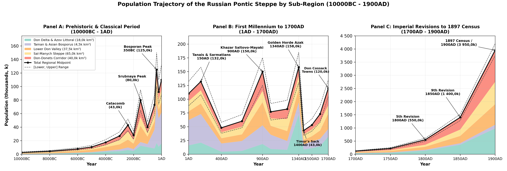
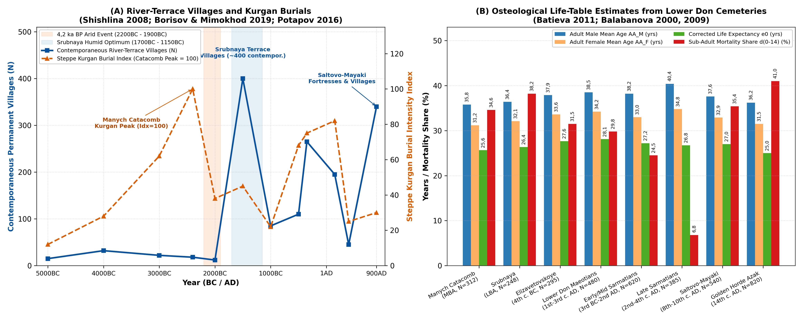
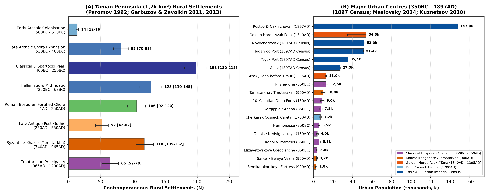

# Abstract

This paper reviews the archaeological, osteological, historical and
census literature for the Russian Pontic Steppe (~ 165,0k km², covering
the Lower Don Delta, the Taganrog Gulf, the Taman Peninsula, the Lower
Don and Seversky Donets valleys and the Sal-Manych steppe) from the
Mesolithic period (10000BC) to the First All-Russian Imperial Census
(1897 / 1900AD). Population estimates are derived from excavated house
floors and shell middens at Rakushechny Yar
[\[1\]](#ref-tsybrij2018rakushechnyy)[\[2\]](#ref-skorobogatov2025keramicheskiy),
Bronze Age burial mounds and ancient soil studies
[\[3\]](#ref-shishlina2008reconstruction)[\[4\]](#ref-borisov2019palaeosols),
Late Bronze Age Srubnaya and Kobyakovo village inventories
[\[5\]](#ref-potapov2013krest)[\[6\]](#ref-potapov2016uklady), complete
rural settlement surveys on the Taman Peninsula
[\[7\]](#ref-paromov1992karta)[\[8\]](#ref-garbuzov2011osvoyeniye)[\[9\]](#ref-garbuzov2013selskaya),
skeletal life tables (N \> 3,6k individuals)
[\[10\]](#ref-balabanova2009khronologicheskiye)[\[11\]](#ref-batieva2011naseleniye),
Khazar fortress and village surveys
[\[12\]](#ref-afanasyev1993donskiye)[\[13\]](#ref-ochirgoryaeva2020bashanta),
urban excavations at Golden Horde Azak
[\[14\]](#ref-maslovsky2022tokhtamysh)[\[15\]](#ref-maslovsky2024chislennosti),
17th-century Russian *Prikaz* registers for the 125 Don Cossack towns
[\[16\]](#ref-mininkov1998donskoye)[\[17\]](#ref-sushchiy2019institut)[\[18\]](#ref-prudnikov2024gorodok),
18th- and 19th-century imperial tax revisions (*revizskie skazki*)
[\[19\]](#ref-pronshtein1961zemlya)[\[20\]](#ref-kabuzan1976zaseleniye)[\[21\]](#ref-agafonov2017zemli)[\[22\]](#ref-kolomeytseva2018krestyanstva)
and the 1897 Imperial Census
[\[23\]](#ref-troynitsky1905don)[\[24\]](#ref-troynitsky1905kuban)[\[25\]](#ref-volvenko2023priazovya).
Regional population grew from 2,6k-10,7k among early riverine fishing
communities to 80,0k during the Late Bronze Age Srubnaya farming
expansion (1500BC), 125,0k-132,0k during the Classical Bosporan and
Sarmatian period (350BC - 150AD), 150,0k under the Khazar Khaganate
(900AD) and 158,0k at the height of Golden Horde Azak (1340AD).
Following Timur’s sack of Azak in 1395AD and the growth of the Don
Cossack Host (120,0k in 1700AD), peasant and Cossack colonisation of the
black-earth steppes, port trade at Rostov-on-Don and Taganrog and
eastern Donbas coal mining raised the regional population to 550,0k in
1800AD, 1 400,0k in 1850AD and 3 950,0k (3,95M) by 1900AD.

# Geographical Setting

The Russian Pontic Steppe forms the land and river corridor between the
North-Western Caucasus, the Sea of Azov (*Maeotis*), the Lower Don
basin, and the Caspian-Manych depression (Figure ). Because rainfall and
surface water vary sharply from the coast and floodplains to the dry
eastern watersheds, settlement history across this 165,0k km² region is
divided into four sub-regions. The first sub-region comprises the Lower
Don Delta, floodplain, and Azov littoral (18,0k km²), encompassing
Pochatkovsky (Porechny) Island (Rakushechny Yar), the Dead Donets
(Mertvy Donets), and the main Don delta branches (Elizavetovskoye,
Tanais, the ten Maeotian-Tanaitic delta forts including Kobyakovo,
Nizhne-Gnilovskoye, and Podazovskoye, Golden Horde Azak/Tana, Cossack
Cherkassk and Novocherkassk, and the modern port cities of
Rostov-on-Don, Nakhichevan-on-Don, Taganrog, Azov, and Yeysk)
[\[15\]](#ref-maslovsky2024chislennosti)[\[25\]](#ref-volvenko2023priazovya)[\[26\]](#ref-marchenko2000elizavetovskoye).
The second sub-region covers the Taman Peninsula / Asian Bosporus (4,5k
km², including the 1,2k km² ancient Taman archipelago and
Anapa/Gorgippia coast); surveyed by Ya. M. Paromov
[\[7\]](#ref-paromov1992karta), V. D. Kuznetsov
[\[27\]](#ref-kuznetsov2010phanagoria), U. Schlotzhauer and D. V.
Zhuravlev [\[28\]](#ref-schlotzhauer2014colonization), G. P. Garbuzov
and A. A. Zavoikin
[\[8\]](#ref-garbuzov2011osvoyeniye)[\[9\]](#ref-garbuzov2013selskaya),
and A. V. Batasova [\[29\]](#ref-batasova2015osvoyeniye), this deltaic
peninsula hosted the Greek cities of Phanagoria, Hermonassa (later
Tamatarkha/Tmutarakan), Kepoi, Patraeus, and Gorgippia (Anapa), and from
1792 the Black Sea (Kuban) Cossack settlements
[\[30\]](#ref-burykina2008osvoyeniye).

The third sub-region encompasses the Lower Don River Valley and Southern
Don-Donets Corridor (77,5k km²), comprising the main Lower Don valley
and Tsimlyansk bend ($`37{,}5\text{k km}^2`$: Razdorskaya,
Konstantinovsk, Semikarakorskoye, Sarkel / Belaya Vezha, Pravoberezhnoye
Tsimlyanskoye, and Cossack Razdory) and the northern tributary valleys
of the Seversky Donets, Chir, Kalitva, lower Khopyor, and lower
Medveditsa ($`40{,}0\text{k km}^2`$), which supported dense Late Bronze
Age Srubnaya villages, Early Medieval Saltovo-Mayaki settlements, Don
Cossack *stanitsy*, and 19th-century coal-mining towns
[\[6\]](#ref-potapov2016uklady)[\[12\]](#ref-afanasyev1993donskiye)[\[22\]](#ref-kolomeytseva2018krestyanstva)[\[31\]](#ref-artamonov1958sarkel).
Finally, the fourth sub-region consists of the Sal-Manych Watershed
Steppe and Yergeni Slope (65,0k km²), the dry inland steppes and
seasonal grazing corridors linking the Lower Don to the Caspian
Depression along the Western and Eastern Manych, Sal, Yegorlyk, and
Kalaus rivers (Manych Catacomb burial grounds, Khazar-period Bashanta
I-II, Don Kalmyk pastures, and 19th-century Salsk and northern Stavropol
peasant districts)
[\[3\]](#ref-shishlina2008reconstruction)[\[4\]](#ref-borisov2019palaeosols)[\[13\]](#ref-ochirgoryaeva2020bashanta).

# Sources and Methods

Regional population estimates are compiled from five groups of
archaeological and documentary evidence. For the Mesolithic and
Neolithic periods (Rakushechny Yar, Razdorskaya 2, Kremennaya),
excavated house floors (12-35 m² wattle-and-daub and *Viviparus*
snail-shell platforms) and radiocarbon dates
[\[1\]](#ref-tsybrij2018rakushechnyy)[\[2\]](#ref-skorobogatov2025keramicheskiy)[\[32\]](#ref-dolbunova2021rakovinnyye)[\[33\]](#ref-dolbunova2022novyye)
indicate riverine densities of 0,016-0,065 persons/km². For the
Eneolithic, Early Bronze Age (Yamnaya), and Middle Bronze Age
(Catacomb), N. I. Shishlina’s [\[3\]](#ref-shishlina2008reconstruction)
strontium, carbon, and nitrogen isotope studies
($`{}^{87}\text{Sr}/{}^{86}\text{Sr}`$, $`\delta^{13}\text{C}`$,
$`\delta^{15}\text{N}`$) of seasonal grazing routes are combined with A.
V. Borisov and R. A. Mimokhod’s [\[4\]](#ref-borisov2019palaeosols)
buried-soil analyses across the Sal-Manych and Yergeni steppes.

For the Late Bronze Age Srubnaya (Timber-Grave) and Kobyakovo cultures
(2000-900BC), counts of permanent river-terrace villages (*poseleniya*),
excavated semi-subterranean timber-and-stone houses (5-20 dwellings of
80-250 m² per village), and household size estimates (8-12 persons per
house)
[\[5\]](#ref-potapov2013krest)[\[6\]](#ref-potapov2016uklady)[\[34\]](#ref-sharafutdinova1980kobyakovo)
are checked against skeletal mortality tables. For the Classical,
Hellenistic, and Roman/Sarmatian periods (600BC - 370AD), Ya. M.
Paromov’s [\[7\]](#ref-paromov1992karta) survey of \>230 rural
settlements on the Taman Peninsula (1,2k km²), G. P. Garbuzov and A. A.
Zavoikin’s
[\[8\]](#ref-garbuzov2011osvoyeniye)[\[9\]](#ref-garbuzov2013selskaya)
agricultural land-use calculations, K. K. Marchenko, V. G. Zhitnikov,
and V. P. Kopylov’s
[\[26\]](#ref-marchenko2000elizavetovskoye)[\[35\]](#ref-kopylov2016vremeni)
estimates for Elizavetovskoye Gorodishche (44-55 ha, 3,0k-4,5k
inhabitants), and M. A. Balabanova’s
[\[10\]](#ref-balabanova2009khronologicheskiye) and E. F. Batieva’s
[\[11\]](#ref-batieva2011naseleniye) skeletal mortality tables provide
direct benchmarks.

For the medieval and modern periods (740-1900AD), G. E. Afanasyev’s
[\[12\]](#ref-afanasyev1993donskiye) Saltovo-Mayaki settlement study and
A. N. Maslovsky and I. B. Papka’s
[\[14\]](#ref-maslovsky2022tokhtamysh)[\[15\]](#ref-maslovsky2024chislennosti)
\>250-trench urban density study of Golden Horde Azak (54,0k inhabitants
in 1340AD) are combined with 17th-century Russian *Posolsky* and
*Razryadny Prikaz* rolls
[\[16\]](#ref-mininkov1998donskoye)[\[17\]](#ref-sushchiy2019institut),
18th- and 19th-century imperial tax revisions (1st-10th *revizii*,
1719-1858)
[\[19\]](#ref-pronshtein1961zemlya)[\[20\]](#ref-kabuzan1976zaseleniye)[\[21\]](#ref-agafonov2017zemli)[\[22\]](#ref-kolomeytseva2018krestyanstva),
and the First All-Russian Imperial Census of 1897
[\[23\]](#ref-troynitsky1905don)[\[24\]](#ref-troynitsky1905kuban)[\[25\]](#ref-volvenko2023priazovya).[^1]

# Prehistoric Fishing Communities and Bronze Age Herders (10000 - 900BC)

## Final Palaeolithic, Mesolithic and Early Neolithic (10000 - 5000BC)

Studied by V. V. Tsybrij and A. V. Tsybrij
[\[1\]](#ref-tsybrij2018rakushechnyy), the Mesolithic sites of the Lower
Don and Azov coast (Kremennaya II-III, Razdorskaya 2, Yuzhny Bugor,
10000-6200 cal BC) were flint-working camps and seasonal fishing
stations on low floodplain terraces where inhabitants caught sturgeon
(*Acipenseridae*), carp (*Cyprinidae*) and catfish (*Silurus glanis*)
and hunted red deer and wild boar. Total population across the 165,0k
km² region rose gradually from 2,6k in 10000BC (0,016 persons/km²) to
4,4k in 8000BC.

On Pochatkovsky (Porechny) Island near Stanitsa Razdorskaya in the Lower
Don floodplain, the multi-layered settlement of Rakushechny Yar
(excavated by T. D. Belanovskaya
[\[36\]](#ref-belanovskaya1995rakushechnyy) and re-examined in 2008-2025
by E. V. Dolbunova, A. N. Mazurkevich, A. V. Tsybrij and V. V. Tsybrij
[\[1\]](#ref-tsybrij2018rakushechnyy)[\[32\]](#ref-dolbunova2021rakovinnyye)[\[33\]](#ref-dolbunova2022novyye))
contains 23 cultural layers reaching 5-6 m in depth. Radiocarbon and OSL
dates place the earliest Neolithic shell-tempered pottery layers (Layers
23-15) between 6200/6000 and 5600 cal BC, making Rakushechny Yar one of
the oldest pottery-producing villages in Europe
[\[33\]](#ref-dolbunova2022novyye). Excavations uncovered artificial
floors built from freshwater *Viviparus* snail shells (*rakovinnye
platformy*), post-hole rows and clay-plastered wattle-and-daub
(*turluk*) surfaces belonging to permanent riverine houses
[\[32\]](#ref-dolbunova2021rakovinnyye). Individual floodplain villages
housed 50-120 people (8-18 structures), raising Lower Don valley
densities to 0,15-0,25 persons/km² and the regional population to 7,8k
by 6000BC and 10,7k by 5000BC (Figure A).

## Eneolithic and Early/Middle Bronze Age (5000 - 2000BC)

During the Eneolithic (5000-3300 cal BC), the Lower Don
(Nizhnedonskaya), Sredny Stog / Novodanilovka and Konstantinovka
traditions established river-terrace farming, herding and fishing
villages (1,0-2,5 ha settlements with 60-150 residents each at
Razdorskoye I and Samsonovskoye) alongside flat and low-mound cemeteries
(Karatayevo, Mukhin). In an analysis of Layer 5 at Rakushechny Yar (a 55
cm-thick *Viviparus* shell midden dated to 4600-4300 cal BC), A. M.
Skorobogatov, E. V. Dolbunova and A. N. Mazurkevich
[\[2\]](#ref-skorobogatov2025keramicheskiy) showed that collared and
comb-impressed Nizhnedonskaya pots make up 6,6% of the ceramic
assemblage alongside local Late Neolithic vessels, consistent with a
regional population of 17,5k by 4000BC.

In her study *Reconstruction of the Bronze Age of the Caspian Steppes*
[\[3\]](#ref-shishlina2008reconstruction), N. I. Shishlina showed that
the transition to the Yamnaya (Pit-Grave, 3300-2600 cal BC) and
Katakombnaya (Catacomb, 2600-2000 cal BC) periods introduced four-season
mobile herding with heavy four-wheeled ox-wagons. Whereas Yamnaya
herders moved along short river-valley loops (10-25 km), population
growth during the Manych Catacomb phase (2500-2100 cal BC) led to longer
north-south seasonal migrations (150-300 km routes linking the Lower Don
and Manych lakes to the Stavropol Uplands and Yergeni Hills). Field
surveys and buried-soil studies by A. V. Borisov and R. A. Mimokhod
[\[4\]](#ref-borisov2019palaeosols) record burial mound densities of
0,4-1,2 kurgans/km² along river terraces and 0,1-0,3 kurgans/km² on open
watersheds, with 60-75% of all Bronze Age burials belonging to the
Catacomb period. Heavy grazing contributed to alkaline soil (*solonetz*)
formation before the 4,2 ka BP (2200-2000 cal BC) dry phase, which
emptied the open Sal-Manych watersheds during the post-Catacomb Lola
period [\[4\]](#ref-borisov2019palaeosols). Regional population rose
from 27,0k in 3000BC to 43,0k during the Catacomb period (2400BC),
before falling to 28,0k around 2000BC (Figure A).

## Late Bronze Age Farming and Herding Villages (2000 - 900BC)

With wetter conditions returning after 1850/1750 cal BC, the Srubnaya
(Timber-Grave) Culture (Berezhnovka-Mayovka group) produced a dense
network of permanent farming and herding villages across the Lower Don,
Seversky Donets, Chir, Khopyor and Azov coastal valleys. As summarised
by E. S. Sharafutdinova [\[34\]](#ref-sharafutdinova1980kobyakovo) and
V. V. Potapov
[\[5\]](#ref-potapov2013krest)[\[6\]](#ref-potapov2016uklady), field
surveys in Rostov Oblast and the southern Don basin have recorded more
than 1,2k permanent Srubnaya settlements (*poseleniya*) along first and
second river terraces and ravine springs, spaced 1,5-3,5 km apart.

Unlike temporary Yamnaya or Catacomb camps (*stoyanki*), Srubnaya
villages (0,8-4,0 ha) consisted of 5 to 20 large semi-subterranean
timber-framed and limestone-lined houses (*poluzemlyanki*), each
measuring 80 to 250 m². Animal bone assemblages studied by V. V. Potapov
[\[6\]](#ref-potapov2016uklady) and V. R. Erlikh et al.
[\[37\]](#ref-erlikh2019sostav) show settled herds dominated by cattle
(50-65% cattle, alongside horses, sheep, goats and pigs). At 10-14
people per extended household, an average Srubnaya village of 8-12
occupied houses held 80-150 residents. Assuming that roughly 30% of the
\>1,2k recorded terrace settlements were occupied at the same time
within any 100-year phase (350-450 contemporaneous villages), the
Srubnaya population of the Russian Pontic Steppe reached 80,0k
(65,0k-95,0k) around 1500BC (0,485 persons/km² overall; 1,5-2,8
persons/km² in the river valleys). During the Final Bronze Age (1200-900
cal BC), drier conditions reduced open-steppe village numbers and house
sizes [\[5\]](#ref-potapov2013krest), while the stone-built Kobyakovo
Culture [\[34\]](#ref-sharafutdinova1980kobyakovo) concentrated 15-25
fishing and bronze-working villages in the Don Delta (Kobyakovo,
Safyanovo, Nizhne-Gnilovskoye), sustaining a regional population of
40,0k around 1000BC.

# Greek Colonies, Tanais and Steppe Nomads (900BC - 370AD)

## Cities and Rural Settlements of the Taman Peninsula and Gorgippia

On the Taman Peninsula (*Asian Bosporus*, an ancient archipelago of
three main islands covering ~ 1,2k km²), Ya. M. Paromov
[\[7\]](#ref-paromov1992karta) carried out a complete field and aerial
survey that mapped \>230 Greek and Sindian-Maeotian rural settlements
(*chora*), fortified villages (such as Golubitskaya 2 at 7,2 ha,
excavated by U. Schlotzhauer and D. V. Zhuravlev
[\[28\]](#ref-schlotzhauer2014colonization)), rectangular field systems
and farmsteads (Figure A).

As reconstructed by G. P. Garbuzov, A. A. Zavoikin, A. A. Maslennikov,
and S. L. Smekalov
[\[8\]](#ref-garbuzov2011osvoyeniye)[\[9\]](#ref-garbuzov2013selskaya)
and A. V. Batasova [\[29\]](#ref-batasova2015osvoyeniye), Greek
settlement on Taman developed in two main stages. During the Late
Archaic settlement phase (580-480BC), following the foundation of
Hermonassa, Kepoi, Patraeus, Phanagoria (c. 542BC, founded by Teos), and
inland settlements at Beregovoy 4, Golubitskaya 2, and Akhtanizovskaya
4, rural farmsteads spread across the peninsula, growing from 12-15
early sites to 70-93 contemporaneous rural settlements by 500-480BC
[\[8\]](#ref-garbuzov2011osvoyeniye)[\[29\]](#ref-batasova2015osvoyeniye).
During the Classical and Early Hellenistic Spartocid period (400-250BC),
after Sindika was incorporated into the Bosporan Kingdom, 180-215 rural
villages and estates were occupied at the same time on the Taman
archipelago
[\[7\]](#ref-paromov1992karta)[\[9\]](#ref-garbuzov2013selskaya).
Phanagoria covered 65 ha (~ 43 ha on land plus 22 ha now submerged in
Taman Bay), housing 10,0k-15,0k urban residents
[\[27\]](#ref-kuznetsov2010phanagoria). Together with Hermonassa (25-30
ha, 4,5k-6,5k), Kepoi (20-25 ha, 3,0k-4,5k), Patraeus (12-15 ha,
1,5k-2,5k), Gorgippia (modern Anapa, 40 ha, 6,0k-9,0k), and 20,0k-28,0k
rural *chora* inhabitants, the Asian Bosporus supported 45,0k-65,0k
people (58,0k midpoint in 350BC), corresponding to 37,5-54,2 persons/km²
on Taman.

## Lower Don Delta Trading Towns and Scythian-Sarmatian Nomads

In the Lower Don Delta, Elizavetovskoye Gorodishche (5th - early 3rd
c. BC), excavated by K. K. Marchenko, V. G. Zhitnikov and V. P. Kopylov
[\[26\]](#ref-marchenko2000elizavetovskoye)[\[35\]](#ref-kopylov2016vremeni),
covered 44-55 ha with a 12 ha inner citadel enclosed by two 4th-century
BC ditch-and-rampart lines that housed a Bosporan Greek merchant quarter
and later colony, supporting 3,0k-4,5k permanent inhabitants. Terracotta
and pottery studies by N. I. Suvorova
[\[38\]](#ref-suvorova2025preemstvennosti) show direct population
continuity between the abandonment of Elizavetovskoye (c. 275-270BC) and
the founding of Tanais (Nedvigovskoye Gorodishche) on the right bank of
the Dead Donets (16-20 ha, 3,0k-5,0k residents). Between the 1st c. BC
and 3rd c. AD, Bosporan rulers settled Kuban Maeotian farming and
military communities in a ring of ten fortified delta towns
(*gorodishcha*: Kobyakovo, Nizhne-Gnilovskoye, Podazovskoye, Krepkoye,
Sukho-Chaltyrskoye, Temernitskoye, Khopry, Safyanovo, Lebyazhye and
Rogozy), which held another 7,0k-11,0k settled inhabitants
[\[39\]](#ref-vdovchenkov2019meotov) until the Gothic-Borani raids of
244-254AD.

Across the surrounding Don-Manych-Azov steppes, E. F. Batieva
[\[11\]](#ref-batieva2011naseleniye) and M. A. Balabanova
[\[10\]](#ref-balabanova2009khronologicheskiye) examined \>1,5k
Scythian, Maeotian and Sarmatian skeletons, finding adult male mean ages
at death ($`AA_{\text{M}}`$) of 37,9-40,4 years, adult female ages at
death ($`AA_{\text{F}}`$) of 33,0-34,8 years and corrected life
expectancy at birth ($`e_0`$) of 25,5-29,2 years (Table ). Using A. S.
Skripkin’s [\[40\]](#ref-skripkin2012chislennosti) Kalmyk steppe pasture
comparison (0,35-0,65 persons/km²), the nomadic Sarmatian tribes
(Siraces, Aorsi and Alans) numbered 40,0k-65,0k in the 1st-2nd c. AD,
giving a combined regional population of 132,0k (108,0k-158,0k) in
150AD.

# Khazar Fortresses, Golden Horde Azak and the Early Don Cossacks (370 - 1700AD)

## The Khazar Khaganate and the Saltovo-Mayaki Culture (740 - 965AD)

After population declined during the Hunnic and post-Hunnic centuries
(48,0k in 400AD; 60,0k under Kubrat’s Old Great Bulgaria in 650AD), the
Khazar peace fostered widespread village and town settlement (the
Saltovo-Mayaki Culture) along the Lower Don, the Tsimlyansk bend, the
Manych valley, and the Don-Donets borderlands
[\[12\]](#ref-afanasyev1993donskiye)[\[31\]](#ref-artamonov1958sarkel)[\[41\]](#ref-flyorov2011goroda).
Along the Lower Don, the network was anchored by the brick fortress of
Sarkel (Levoberezhnoye Tsimlyanskoye, built c. 834-837AD; 3,7 ha citadel
plus \>15 ha outer town, 2,5k-4,0k inhabitants)
[\[31\]](#ref-artamonov1958sarkel), the white-stone fortress of
Pravoberezhnoye Tsimlyanskoye (1,5k-2,5k), and the mudbrick fortress of
Semikarakorskoye (3,8 ha citadel plus \>30 ha settlement, 2,0k-3,5k)
[\[41\]](#ref-flyorov2011goroda), surrounded by \>120 open farming and
wine-growing villages (*selishcha*). In the southern Sal-Manych /
Western Kalmyk valley, M. A. Ochir-Goryaeva
[\[13\]](#ref-ochirgoryaeva2020bashanta) excavated the twin
Khazar-period fortified settlements of Bashanta I and Bashanta II,
confirming permanent farming and herding villages along the
Yergeni-Manych streams.

On the Taman Peninsula, Ya. M. Paromov [\[7\]](#ref-paromov1992karta)
mapped \>110 Khazar-period (8th-10th c. AD) rural villages (with
semi-dugouts and stone-foundation houses similar to Artezian
[\[42\]](#ref-vinokurov2016artezian)) around the port city of Tamatarkha
(Hermonassa, ~ 35 ha, 8,0k-12,0k residents), supporting 34,0k
inhabitants on the Asian Bosporus. Combined with G. E. Afanasyev’s
[\[12\]](#ref-afanasyev1993donskiye) Don-Donets Saltovo-Mayaki valley
settlements (5,0-8,5 persons/km²), total regional population reached
150,0k (125,0k-175,0k) in 900AD, before Sviatoslav’s 965AD campaign and
Pecheneg-Cuman nomadism reduced the regional total to 77,0k-82,0k in
1000-1200AD.

## Golden Horde Azak (Tana) and the Rise of the Don Cossack Host (1240 - 1700AD)

Founded around 1269-1270AD under Khan Mengu-Timur at the mouth of the
Don (modern Azov), Azak (together with the Venetian and Genoese merchant
quarters of Tana) served as the main western port of the Golden Horde.
Drawing on rescue excavations across \>250 trenches in modern Azov, A.
N. Maslovsky
[\[14\]](#ref-maslovsky2022tokhtamysh)[\[43\]](#ref-maslovsky2017azak)
and A. N. Maslovsky and I. B. Papka
[\[15\]](#ref-maslovsky2024chislennosti) reconstructed the growth and
contraction of the city (Figure B). During the early settlement phase
around 1290AD, the urban population numbered 3,0k-3,5k inhabitants. At
the height of urban expansion under Uzbek and Janibek in 1340AD, Azak
covered \>400 ha with paved streets (3-8 m wide) and closely packed
wattle-and-daub and mudbrick courtyard houses heated by underfloor *kan*
flues and *tandyr* ovens, reaching an estimated 54,0k urban residents
(35,0k-54,0k range) [\[15\]](#ref-maslovsky2024chislennosti). During the
civil wars of the *Velikaya Zamyatnya* (1359-1380AD) and the reign of
Tokhtamysh (1381-1395AD), political conflict and recurring plague
epidemics reduced the inhabited area to a quarter of its former size and
eliminated the outer artisan dugouts (*zemlyanki*)
[\[14\]](#ref-maslovsky2022tokhtamysh), leaving 12,5k-13,5k inhabitants
on the eve of Timur’s sack in September 1395AD
[\[15\]](#ref-maslovsky2024chislennosti).

Together with 18,0k rural delta farmers and 86,0k Kipchak-Tatar nomads
in the Don-Manych-Azov steppes (part of a wider Azov-Kuban nomadic
population estimated at up to 250,0k by Maslovsky and Papka
[\[15\]](#ref-maslovsky2024chislennosti)), the Russian Pontic Steppe
reached 158,0k in 1340AD before dropping to 43,0k in 1400AD.

After the Ottoman conquest of Azak in 1475AD (leaving an Ottoman
fortress town of 3,5k-6,0k residents) and the formation of the Lesser
Nogai Horde (*Kazyev Ulus*, 25,0k-40,0k nomads), free Don Cossack
communities (*Voysko Donskoye*) expanded from 4-6 early river-island
strongholds (Razdory, Donskoy/Donetsky
[\[18\]](#ref-prudnikov2024gorodok), and Cherkassk, founded in 1570) to
30-40 fortified towns (*gorodki*) by 1637 (22,0k-28,0k people) and 125
*gorodki* along the Don (56), Seversky Donets (11), Khopyor (23),
Medveditsa (19) and Buzuluk (16) by 1695-1700AD
[\[16\]](#ref-mininkov1998donskoye). As shown by S. Ya. Sushchiy
[\[17\]](#ref-sushchiy2019institut), early family formation on the Lower
Don (initially involving captive Turkish and Tatar women) was reinforced
after 1650 by a steady influx of married Russian peasant families into
the Upper Don towns. By 1700AD, following Peter I’s 1696 capture and
garrisoning of Azov and Taganrog, the Don Cossack Host numbered
65,0k-80,0k people, bringing the regional population to 120,0k
(105,0k-135,0k).

# Imperial Russian Colonisation, Industrialisation and the 1897 Census (1700 - 1900AD)

## The Don Land in the 18th Century, Taganrog, Rostov and the Black Sea Cossacks (1700 - 1800AD)

During the early 18th century, the suppression of the Bulavin Rebellion
(1707-1708) and the Temporary Transfer of Azov back to Ottoman rule
(1711-1739) slowed growth along the lower river, but Russian and
Ukrainian peasant migration onto the estates of Don Cossack elders
(*starshina*) soon accelerated
[\[19\]](#ref-pronshtein1961zemlya)[\[21\]](#ref-agafonov2017zemli). By
1750AD, follow-up military rolls and the Second Imperial Revision
recorded ~220,0k inhabitants across the study region, including 55,0k in
the Don Delta and Taganrog littoral (following the establishment of the
Temernitskaya custom house in 1749), 122,0k across the Lower Don and
Don-Donets *stanitsy* and peasant *slobody*, 27,0k Don Kalmyk and Nogai
herders in the Sal-Manych steppe and 16,0k residents on the Taman
Peninsula
[\[19\]](#ref-pronshtein1961zemlya)[\[20\]](#ref-kabuzan1976zaseleniye).

Following the Russo-Turkish War of 1768-1774 (Treaty of Küçük Kaynarca)
and the annexation of the Azov-Kuban littoral (1783), imperial
settlement transformed the coastal and southern steppes. Taganrog was
rebuilt as a naval and commercial port in 1769, the Fortress of
St. Dimitry of Rostov (1761) grew into Rostov-on-Don, and in 1779
Catherine II resettled \>12,0k Crimean Armenians on the adjacent right
bank at Nakhichevan-on-Don and five surrounding villages (Chaltyr, Krym,
Sultan-Saly, Nesvetay, and Bolshiye Saly)
[\[20\]](#ref-kabuzan1976zaseleniye)[\[25\]](#ref-volvenko2023priazovya).
Between 1777 and 1783, the construction of the Azov-Mozdok fortified
line encouraged state peasant settlement along the Yegorlyk and Manych
valleys, and in 1792-1793 the Black Sea Cossack Host (*Chernomorskoye
kazachye voysko*, ~25,0k former Zaporozhian Cossacks) landed on Taman
and settled 40 *kureni* across the Taman Peninsula and right-bank Kuban
steppes
[\[30\]](#ref-burykina2008osvoyeniye)[\[44\]](#ref-parshina2023kubanskogo).
As documented by A. P. Pronshtein [\[19\]](#ref-pronshtein1961zemlya)
and V. M. Kabuzan [\[20\]](#ref-kabuzan1976zaseleniye) in the Fifth
Imperial Revision (1795 / 1800AD), the registering of Ukrainian and
Russian peasants attached to Don officer estates alongside the Cossack
*stanitsy* raised the population of the Russian Pontic Steppe to 550,0k
(490,0k-610,0k) by 1800AD (Figure B).

## Peasant Colonisation, Railway Industrialisation and the 1897 Imperial Census (1800 - 1900AD)

In the first half of the 19th century, the transfer of the Don Host
capital from flood-prone Starocherkassk to Novocherkassk (founded by
Ataman M. I. Platov in 1805), the opening of the port of Yeysk on the
Azov coast (1848) and the expansion of wheat exports through Taganrog
and Rostov-on-Don drove rapid demographic growth. By the Ninth Revision
of 1850, the study region contained 1 400,0k (1,40M) inhabitants,
including 360,0k in the Don Delta and Azov port districts, 737,0k along
the Lower Don and Don-Donets valleys, 245,0k in the Sal-Manych and
northern Stavropol steppes and 58,0k on the Taman Peninsula
[\[20\]](#ref-kabuzan1976zaseleniye)[\[21\]](#ref-agafonov2017zemli).

After the Emancipation Reform of 1861, the end of the Caucasian War
(1864) and the 1868 law permitting non-Cossack citizens (*inogorodniye*)
to buy and lease property across the Don and Kuban territories, hundreds
of thousands of land-short peasants from the Ukrainian and Central
Russian Black-Earth governorates migrated into the region
[\[22\]](#ref-kolomeytseva2018krestyanstva)[\[30\]](#ref-burykina2008osvoyeniye)[\[45\]](#ref-shadrina2020edinovercheskoye).
As M. A. Kolomeytseva [\[22\]](#ref-kolomeytseva2018krestyanstva)
demonstrated, high rural birth rates (48-55 per 1 000) and peasant
immigration coincided with the opening of the Grushevsky
(Aleksandrovsk-Grushevsky / Shakhty) and Sulin anthracite coalfields,
metallurgical plants at Taganrog and Sulin and the Voronezh-Rostov and
Vladikavkaz railways.

The First All-Russian Imperial Census of 28 January 1897
[\[23\]](#ref-troynitsky1905don)[\[24\]](#ref-troynitsky1905kuban)
provides an exact baseline for the end of the 19th century. The Province
of the Don Cossack Host (*Oblast Voyska Donskogo*) recorded 2 564,2k
inhabitants across 164,5k km² (12,4% urban), of whom ~2 150,0k lived
within the Lower Don, Don Delta/Taganrog, Donetsk, Sal-Manych, and
southern Ust-Medveditsa/Khopyor districts inside the study boundary
(Rostov-on-Don 119,5k plus Nakhichevan-on-Don 28,4k = 147,9k combined
agglomeration; Novocherkassk 52,0k; Taganrog 51,4k; Azov 27,5k;
Aleksandrovsk-Grushevsky 16,5k)
[\[23\]](#ref-troynitsky1905don)[\[25\]](#ref-volvenko2023priazovya).
Within the southern portion of the 165,0k km² study polygon, the
Temryuksky (Taman), Yeysky (Yeysk city 35,4k), and northern Kavkazsky
departments of Kuban Oblast
[\[24\]](#ref-troynitsky1905kuban)[\[30\]](#ref-burykina2008osvoyeniye)
together with the Manych/Medvezhensky steppe districts of northern
Stavropol Governorate accounted for a further 1 550,0k-1 650,0k
residents in 1897. Projecting forward at the observed 1,8% annual growth
rate over the three years from January 1897 to 1900AD gives a regional
population of 3 950,0k (3,95M; range 3 750,0k-4 200,0k, density 23,939
persons/km²) by 1900AD (Table ).

| Settlement / Site | Sub-Region | Chronology | Core / Total Area (ha) | Population Estimate | Primary Literature |
|:---|:---|:---|:---|:---|:---|
| Rakushechny Yar | Lower Don (Pochatkovsky Isl.) | 6200-4300 cal BC | 1,2 (core) / 2,5 | 80-150 | Tsybrij et al. 2018; Skorobogatov 2025 |
| Kobyakovo (Final Bronze) | Lower Don Delta | 1200-900 cal BC | 3,5 (core) / 8,0 | 300-500 | Sharafutdinova 1980; Potapov 2013 |
| Phanagoria | Taman Peninsula | 542BC-10th c. AD | 43,0 (land) / 65,0 | 10,0k-15,0k (350BC) | Kuznetsov 2010; Garbuzov 2013 |
| Gorgippia (Anapa) | Asian Bosporus Coast | 5th c. BC-240AD | 35,0 / 40,0 | 6,0k-9,0k (350BC) | Paromov 1992; Garbuzov 2013 |
| Hermonassa / Tamatarkha | Taman Peninsula | 6th c. BC-14th c. AD | 25,0 / 35,0 | 4,5k-6,5k / 8,0k-12,0k | Garbuzov 2011; Batasova 2015 |
| Kepoi & Golubitskaya 2 | Taman Peninsula | 6th c. BC-4th c. AD | 20,0-25,0 / 7,2-9,0 | 3,0k-4,5k / 0,6k-1,0k | Schlotzhauer & Zhuravlev 2014 |
| Elizavetovskoye Gorodishche | Lower Don Delta | 500-270BC | 12,0 (cit.) / 44,0-55,0 | 3,0k-4,5k (4th c. BC) | Marchenko et al. 2000; Kopylov 2016 |
| Tanais (Nedvigovskoye) | Dead Donets (Don Delta) | 275BC-450AD | 14,0 / 20,0 | 3,0k-5,0k (150AD) | Suvorova 2025; Vdovchenkov 2019 |
| 10 Maeotian Delta Forts | Lower Don Delta | 1st c. BC-250AD | 0,5-4,0 / 10,0-35,0 ea. | 7,0k-11,0k (combined) | Vdovchenkov 2019 |
| Sarkel (Belaya Vezha) | Lower Don (Tsimlyansk) | 834-1117AD | 3,7 (fort) / 18,0 | 2,5k-4,0k (900AD) | Artamonov 1958; Afanasyev 1993 |
| Semikarakorskoye & Bashanta | Lower Don & Manych | 8th-10th c. AD | 3,8 (fort) / 32,0 | 2,0k-3,5k (900AD) | Flyorov 2011; Ochir-Goryaeva 2020 |
| Azak / Tana (Azov) | Lower Don Delta | 1270-1395AD | 120,0 / \>400,0 | 54,0k (1340) / 13,0k (1395) | Maslovsky 2022; Maslovsky & Papka 2024 |
| Cherkassk (Starocherkassk) | Lower Don | 1570-1805AD | 35,0 / 60,0 | 6,0k-8,5k (1700) / 15,0k (1800) | Mininkov 1998; Pronshtein 1961 |
| Rostov & Nakhichevan-on-Don | Lower Don Delta | 1749/1779-1900AD | 680,0 / 1 250,0 | 147,9k (1897 Census) | Troynitsky 1905; Volvenko 2023 |
| Novocherkassk (Host Capital) | Lower Don Basin | 1805-1900AD | 320,0 / 550,0 | 52,0k (1897 Census) | Troynitsky 1905; Agafonov 2017 |
| Taganrog & Yeysk (Azov Ports) | Taganrog Gulf / Azov Coast | 1698/1848-1900AD | 410,0 / 720,0 | 51,4k & 35,4k (1897 Census) | Troynitsky 1905; Volvenko 2023 |

Core and total settlement areas and population estimates for major urban
centres of the Russian Pontic Steppe (6200BC - 1900AD).

# Limitations

Three practical constraints affect population estimates in the Russian
Pontic Steppe. First, both the Taman Bay (where rising sea levels after
the Classical period submerged ~ 22 ha of Phanagoria and coastal parts
of Kepoi and Patraeus)
[\[8\]](#ref-garbuzov2011osvoyeniye)[\[27\]](#ref-kuznetsov2010phanagoria)
and the advancing Don Delta (where 5-7 m of river silt cover the
prehistoric floodplain) conceal low-lying Mesolithic, Neolithic, and
Archaic shoreline camps. Second, as shown by M. A. Balabanova
[\[10\]](#ref-balabanova2009khronologicheskiye) and E. F. Batieva
[\[11\]](#ref-batieva2011naseleniye), Late Sarmatian (2nd-4th c. AD)
burial mounds rarely include infants and young children
($`d_{0\text{-}14} = 6{,}8\%`$) and contain more adult men than women
(M/F \> 2,0); standard life-table corrections
($`e_0 = 25{,}5\text{-}28{,}0\text{ years}`$) are therefore required
instead of unadjusted skeletal averages. Third, nomadic groups (Manych
Catacomb herders, Scythians, Sarmatians, Cumans, Golden Horde *uluses*,
Lesser Nogais, and Don Kalmyks) moved seasonally across the Sal-Manych,
Kuban, and Stavropol steppes
[\[3\]](#ref-shishlina2008reconstruction)[\[15\]](#ref-maslovsky2024chislennosti),
while early 18th-century Cossack and runaway peasant settlements
frequently evaded imperial tax enumerators prior to the Fifth Revision
of 1795
[\[19\]](#ref-pronshtein1961zemlya)[\[21\]](#ref-agafonov2017zemli).

# Conclusion

Archaeological, skeletal and archival records show that the Russian
Pontic Steppe experienced four pre-modern phases of dense settlement
before 1700AD: the Late Bronze Age Srubnaya river-terrace farming
expansion (80,0k around 1500BC), the Classical and Roman Bosporan and
Sarmatian period (125,0k-132,0k in 350BC - 150AD), the Khazar
Saltovo-Mayaki fortress and village network (150,0k around 900AD) and
the Golden Horde urban expansion centred on Azak/Tana (158,0k in
1340AD). Following Timur’s destruction of Azak in 1395AD (43,0k in
1400AD) and the growth of the 125 Don Cossack towns to 120,0k by 1700AD,
18th- and 19th-century Russian, Ukrainian, Armenian and German
colonisation of the black-earth steppes, Azov port trade and eastern
Donbas coal mining raised the regional population more than thirtyfold
to 550,0k in 1800AD, 1 400,0k in 1850AD and 3 950,0k (23,939
persons/km²) by 1900AD.

# Appendix

## Osteological Life-Table Estimates

| Archaeological Period | Sample (N) | Sub-Adult d(0-14) | Male AA (yrs) | Female AA (yrs) | Corrected e0 (yrs) | Sources |
|:---|:---|:---|:---|:---|:---|:---|
| Manych Catacomb (MBA) | 312 | 34,6% | 35,8 | 31,2 | 24,5-26,8 | Batieva 2011 |
| Srubnaya (LBA, Lower Don) | 248 | 38,2% | 36,4 | 32,1 | 25,2-27,5 | Balabanova 2009; Batieva 2011 |
| Elizavetovskoye (4th c. BC) | 295 | 31,5% | 37,9 | 33,6 | 26,8-28,5 | Batieva 2011; Marchenko et al. 2000 |
| Lower Don Maeotians (1st-3rd c. AD) | 480 | 29,8% | 38,5 | 34,2 | 27,0-29,2 | Batieva 2011 |
| Early/Middle Sarmatians (3rd c. BC-2nd c. AD) | 620 | 24,5% (kurgan bias) | 38,2 | 33,0 | 26,0-28,4 | Balabanova 2009; Batieva 2011 |
| Late Sarmatians (mid-2nd-4th c. AD) | 385 | 6,8% (burial filter) | 40,4 | 34,8 | 25,5-28,0 | Balabanova 2009; Batieva 2011 |
| Saltovo-Mayaki (Sarkel & Lower Don) | 540 | 35,4% | 37,6 | 32,9 | 25,8-28,2 | Afanasyev 1993; Batieva 2011 |
| Golden Horde Azak (14th c. AD) | 820 | 41,0% (plague/sack) | 36,2 | 31,5 | 23,5-26,5 | Batieva 2011; Maslovsky 2024 |

Osteological life-table estimates across eight skeletal series from the
Lower Don and Azov steppes.

## Population Estimates

| Year | Don Delta (18,0k km²) | Taman (4,5k km²) | Lower Don (37,5k km²) | Sal-Manych (65,0k km²) | Don-Donets (40,0k km²) | Total Population \[Range\] | Density (p/km²) |
|:---|:---|:---|:---|:---|:---|:---|:---|
| 10000BC | 0,5k | 0,2k | 0,8k | 0,5k | 0,6k | 2,6k \[2,0k-3,3k\] | 0,016 |
| 8000BC | 0,9k | 0,3k | 1,4k | 0,8k | 1,0k | 4,4k \[3,5k-5,5k\] | 0,027 |
| 6000BC | 1,8k | 0,5k | 2,6k | 1,2k | 1,7k | 7,8k \[6,2k-9,6k\] | 0,047 |
| 5000BC | 2,5k | 0,7k | 3,5k | 1,6k | 2,4k | 10,7k \[8,5k-13,2k\] | 0,065 |
| 4000BC | 3,8k | 1,2k | 5,5k | 2,8k | 4,2k | 17,5k \[14,0k-21,5k\] | 0,106 |
| 3000BC | 4,5k | 2,5k | 7,5k | 6,5k | 6,0k | 27,0k \[21,5k-33,0k\] | 0,164 |
| 2400BC | 6,2k | 3,8k | 11,5k | 12,0k | 9,5k | 43,0k \[35,0k-52,0k\] | 0,261 |
| 2000BC | 4,8k | 2,8k | 8,0k | 5,4k | 7,0k | 28,0k \[22,5k-34,0k\] | 0,170 |
| 1500BC | 12,5k | 5,5k | 24,0k | 13,0k | 25,0k | 80,0k \[65,0k-95,0k\] | 0,485 |
| 1000BC | 10,5k | 4,5k | 11,0k | 5,5k | 8,5k | 40,0k \[32,0k-48,0k\] | 0,242 |
| 500BC | 8,5k | 28,0k | 12,0k | 14,0k | 10,5k | 73,0k \[58,0k-88,0k\] | 0,442 |
| 350BC | 16,5k | 58,0k | 16,0k | 20,0k | 14,5k | 125,0k \[100,0k-150,0k\] | 0,758 |
| 200BC | 11,0k | 42,0k | 12,5k | 15,0k | 11,5k | 92,0k \[74,0k-110,0k\] | 0,558 |
| 1AD | 16,0k | 46,0k | 15,5k | 19,0k | 13,5k | 110,0k \[88,0k-132,0k\] | 0,667 |
| 150AD | 21,0k | 52,0k | 19,0k | 24,0k | 16,0k | 132,0k \[108,0k-158,0k\] | 0,800 |
| 400AD | 4,5k | 15,0k | 9,5k | 11,0k | 8,0k | 48,0k \[38,0k-58,0k\] | 0,291 |
| 650AD | 6,0k | 18,0k | 12,0k | 14,0k | 10,0k | 60,0k \[48,0k-72,0k\] | 0,364 |
| 900AD | 18,5k | 34,0k | 42,0k | 20,5k | 35,0k | 150,0k \[125,0k-175,0k\] | 0,909 |
| 1000AD | 9,5k | 26,0k | 16,0k | 13,5k | 12,0k | 77,0k \[62,0k-92,0k\] | 0,467 |
| 1200AD | 8,0k | 16,0k | 18,0k | 22,0k | 18,0k | 82,0k \[66,0k-98,0k\] | 0,497 |
| 1340AD | 72,0k | 22,0k | 24,0k | 24,0k | 16,0k | 158,0k \[130,0k-185,0k\] | 0,958 |
| 1400AD | 8,5k | 9,5k | 8,0k | 10,0k | 7,0k | 43,0k \[34,0k-52,0k\] | 0,261 |
| 1500AD | 11,0k | 12,0k | 9,5k | 12,5k | 8,0k | 53,0k \[42,0k-64,0k\] | 0,321 |
| 1600AD | 14,5k | 13,5k | 15,0k | 16,0k | 14,0k | 73,0k \[58,0k-88,0k\] | 0,442 |
| 1700AD | 32,0k | 14,0k | 28,0k | 15,0k | 31,0k | 120,0k \[105,0k-135,0k\] | 0,727 |
| 1750AD | 55,0k | 16,0k | 52,0k | 27,0k | 70,0k | 220,0k \[190,0k-250,0k\] | 1,333 |
| 1800AD | 135,0k | 32,0k | 115,0k | 78,0k | 190,0k | 550,0k \[490,0k-610,0k\] | 3,333 |
| 1850AD | 360,0k | 58,0k | 275,0k | 245,0k | 462,0k | 1 400,0k \[1 280,0k-1 520,0k\] | 8,485 |
| 1900AD | 980,0k | 140,0k | 780,0k | 850,0k | 1 200,0k | 3 950,0k \[3 750,0k-4 200,0k\] | 23,939 |

Population estimates, uncertainty ranges, and densities across the four
sub-regions of the Russian Pontic Steppe (10000BC - 1900AD).

# Sources

1.
Tsybrij, Andrey Vitalyevich, et
al. “Novyye Issledovaniya Ranneneoliticheskikh Sloyev Poseleniya
Rakushechnyy Yar \[New Investigations of the Early Neolithic Layers of
the Rakushechny Yar Settlement\].” *Samarskiy Nauchnyy Vestnik*, vol. 7,
no. 3 (24), 2018, pp. 215-24,
<https://cyberleninka.ru/article/n/novye-issledovaniya-ranneneoliticheskih-sloev-poseleniya-rakushechnyy-yar>.

2.
Skorobogatov, Andrey Mikhaylovich,
et al. “Keramicheskiy Kompleks Nizhnedonskoy Kul’tury Pamyatnika
Rakushechnyy Yar (Sloy 5) \[Ceramic Complex of the Lower Don Culture of
the Rakushechny Yar Site (Layer 5)\].” *Camera Praehistorica*, no. 1
(14), 2025, pp. 26-39,
<https://doi.org/10.31250/2658-3828-2025-1-26-39>.

3.
Shishlina, Natalya Ivanovna.
*Reconstruction of the Bronze Age of the Caspian Steppes: Life Styles
and Life Ways of Pastoral Nomads*. Archaeopress, 2008, pp. 1-399,
<https://doi.org/10.30861/9781407303567>.

4.
Borisov, Aleksandr Vladimirovich,
and Roman Alekseyevich Mimokhod. “Palaeosols and Natural Conditions of
the South Russian Steppes in the Bronze Age.” *Arid Ecosystems*, vol. 9,
no. 1, 2019, pp. 12-21,
<https://doi.org/10.1134/S2079096119010037>.

5.
Potapov, Vadim Valeryevich.
“Pogrebeniye Epokhi Final’noy Bronzy Iz Mogil’nika ‘Krest’ v Del’te Dona
\[Final Bronze Age Burial from the ‘Krest’ Cemetery in the Don Delta\].”
*Arkheologicheskiye Zapiski*, vol. 8, 2013, pp. 213-29,
<https://cyberleninka.ru/article/n/pogrebenie-epohi-finalnoy-bronzy-iz-mogilnika-krest-v-delte-dona>.

6.
Potapov, Vadim Valeryevich.
“Khozyaystvennyye Uklady Naseleniya Dono-Donetskogo Regiona i
Vostochnogo Priazov’ya Perioda Pozdney i Final’noy Bronzy: Dinamika Ikh
Razvitiya \[Economic Structures of the Population of the Don-Donets
Region and Eastern Azov Region in the Late and Final Bronze Age\].”
*Sciences of Europe*, no. 7 (7), 2016, pp. 58-67,
<https://cyberleninka.ru/article/n/hozyaystvennye-uklady-naseleniya-donodonetskogo-regiona-i-vostochnogo-priazovya-perioda-pozdney-i-finalnoy-bronzy-dinamika-ih-razvitiya>.

7.
Paromov, Yakov Maksimovich.
*Arkheologicheskaya Karta Tamanskogo Poluostrova \[Archaeological Map of
the Taman Peninsula\]*. INION RAN, 1992, pp. 1-469,
<https://cyberleninka.ru/article/n/glavnye-dorogi-tamanskogo-poluostrova-v-antichnoe-vremya>.

8.
Garbuzov, Gennadiy Pavlovich, and
Aleksey Andreyevich Zavoikin. “Osvoyeniye Grekami Zemel’ Tamanskogo
Poluostrova v Posledney Chetverti VI - Pervoy Polovine v v. Do n.e.
\[Greek Colonisation of the Lands of the Taman Peninsula in the Last
Quarter of the 6th - First Half of the 5th Century BC\].” *Antichnyy Mir
i Arkheologiya*, vol. 15, 2011, pp. 194-223,
<https://cyberleninka.ru/article/n/osvoenie-grekami-zemel-tamanskogo-poluostrova-v-posledney-chetverti-vi-pervoy-polovine-v-v-do-n-e>.

9.
Garbuzov, Gennadiy Pavlovich, et
al. “Sel’skaya Territoriya Yevropeyskogo i Aziatskogo Bospora v Epokhu
Spartokidov (Opyt Sravnitel’nogo Analiza) \[the Rural Territory of the
European and Asian Bosporus in the Spartocid Epoch (a Comparative
Analysis)\].” *Problemy Istorii, Filologii, Kul’tury*, no. 4 (42), 2013,
pp. 49-66,
<https://cyberleninka.ru/article/n/selskaya-territoriya-evropeyskogo-i-aziatskogo-bospora-v-epohu-spartokidov-opyt-sravnitelnogo-analiza>.

10.
Balabanova, Mariya Afanasyevna.
“Khronologicheskiye Osobennosti Polovozrastnoy Struktury
Savromato-Sarmatskogo Naseleniya Nizhnego Povolzh’ya i Yuzhnogo
Priural’ya \[Chronological Features of the Age-Sex Structure of the
Sauromatian-Sarmatian Population of the Lower Volga and Southern
Urals\].” *Vestnik Volgogradskogo Gosudarstvennogo Universiteta. Seriya
4, Istoriya*, no. 1 (15), 2009, pp. 5-12,
<https://cyberleninka.ru/article/n/hronologicheskie-osobennosti-polovozrastnoy-struktury-savromato-sarmatskogo-naseleniya-nizhnego-povolzhya-i-yuzhnogo-priuralya>.

11.
Batieva, Yelena Fedorovna.
*Naseleniye Nizhnego Dona v IX v. Do n.e. - IV v. N.e.
(Paleoantropologicheskoye Issledovaniye) \[the Population of the Lower
Don in the 9th Century BC - 4th Century AD (a Palaeoanthropological
Study)\]*. Southern Scientific Centre of the Russian Academy of Sciences
(SSC RAS), 2011, pp. 1-160,
<https://www.ssc-ras.ru/files/files/Batieva_2011.pdf>.

12.
Afanasyev, Gennadiy Yevgenyevich.
*Donskiye Alany: Sotsial’nyye Struktury Alano-Asso-Burtasskogo
Naseleniya Basseyna Srednego Dona \[the Don Alans: Social Structures of
the Alan-as-Burtas Population of the Middle Don Basin\]*. Nauka, 1993,
pp. 1-184,
<https://cyberleninka.ru/article/n/sistema-rasseleniya-lesostepnogo-varianta-saltovo-mayatskoy-kultury>.

13.
Ochir-Goryaeva, Mariya
Aleksandrovna. “Gorodishcha Bashanta-i i Bashanta-II Epokhi Khazarskogo
Kaganata \[Fortified Settlements of Bashanta-i and Bashanta-II of the
Khazar Khaganate Epoch\].” *Oriental Studies*, vol. 13, no. 4, 2020, pp.
830-42, <https://doi.org/10.22162/2619-0990-2020-50-4-830-842>.

14.
Maslovsky, Andrey Nikolayevich.
“Zolotoordynskiy Azak Vo Vremya Pravleniya Khana Tokhtamysha (1381-1395
Gg.) \[Golden Horde Azak During the Reign of Khan Tokhtamysh
(1381-1395)\].” *Arkheologiya Yevraziyskikh Stepey*, no. 4, 2022, pp.
185-97, <https://doi.org/10.24852/2587-6112.2022.4.185.197>.

15.
Maslovsky, Andrey Nikolayevich,
and Irina Borisovna Papka. “O Chislennosti Naseleniya Zolotoordynskogo
Azaka i Yego Okrugi \[on the Population Size of Golden Horde Azak and
Its Periphery\].” *Arkheologiya Yevraziyskikh Stepey*, no. 2, 2024, pp.
241-52, <https://doi.org/10.24852/2587-6112.2024.2.241.252>.

16.
Mininkov, Nikolay Aleksandrovich.
*Donskoye Kazachestvo v Epokhu Pozdnego Srednevekov’ya (Do 1671 g.)
\[the Don Cossacks in the Late Middle Ages (up to 1671)\]*. Rostov State
University Press, 1998, pp. 1-512,
<https://search.worldcat.org/search?q=Don+Cossacks+Late+Middle+Ages+up+1671+Mininkov+1998>.

17.
Sushchiy, Sergey Yakovlevich.
“Institut Sem’i u Donskikh Kazakov i Sposob Demograficheskogo
Vosproizvodstva Kazach’yego Sotsiuma (Konets XVI - Nachalo XVIII v.)
\[the Institution of the Family Among the Don Cossacks and the Mode of
Demographic Reproduction of Cossack Society\].” *Novoye Proshloye / The
New Past*, no. 4, 2019, pp. 112-31,
<https://doi.org/10.23683/2500-3224-2019-4-112-131>.

18.
Prudnikov, Yaroslav Vladimirovich.
“Donskoy / Donetskiy Kazachiy Gorodok: Odno Ili Dva Poseleniya?
\[Donskoy / Donetsk Cossack Town: One or Two Settlements?\].” *Vestnik
Volgogradskogo Gosudarstvennogo Universiteta. Seriya 4, Istoriya*, vol.
29, no. 2, 2024, pp. 46-54,
<https://doi.org/10.15688/jvolsu4.2024.2.4>.

19.
Pronshtein, Aleksandr Pavlovich.
*Zemlya Donskaya v XVIII Veke \[the Don Land in the 18th Century\]*.
Rostov University Press, 1961, pp. 1-376,
<https://search.worldcat.org/search?q=Don+Land+18th+Century+Pronshtein+1961>.

20.
Kabuzan, Vladimir Maksimovich.
*Zaseleniye Novorossii (Yekaterinoslavskoy i Khersonskoy Guberniy) v
XVIII - Pervoy Polovine XIX Veka (1719-1858 Gg.) \[Settlement of New
Russia in the 18th - First Half of the 19th Century (1719-1858)\]*.
Nauka, 1976, pp. 1-306,
<https://search.worldcat.org/search?q=Settlement+New+Russia+18th+First+Half+19th+Century+Kabuzan+1976>.

21.
Agafonov, Anatoliy Ivanovich. “Ot
Zemli Donskogo Voyska k Oblasti Voyska Donskogo (Seredina XIX - Nachalo
XX Veka) \[from the Land of the Don Host to the Province of the Don
Cossack Host (Mid-19th - Early 20th Century)\].” *Izvestiya Vysshikh
Uchebnykh Zavedeniy. Severo-Kavkazskiy Region. Obshchestvennyye Nauki*,
no. 3 (195), 2017, pp. 38-45,
<https://doi.org/10.23683/0321-3056-2017-3-28-37>.

22.
Kolomeytseva, Mariya Andreyevna.
“Demograficheskiye Protsessy v Srede Krest’yanstva Dona v Kontse XIX v.
\[Demographic Processes Among the Peasantry of the Don at the End of the
19th Century\].” *Oriental Studies*, no. 4 (38), 2018, pp. 53-62,
<https://doi.org/10.22162/2619-0990-2018-38-4-53-62>.

23.
Troynitsky, Nikolay
Aleksandrovich. *Pervaya Vseobshchaya Perepis’ Naseleniya Rossiyskoy
Imperii, 1897 g. Tom XII: Oblast’ Voyska Donskogo \[First General Census
of the Population of the Russian Empire, 1897. Vol. XII: Province of the
Don Cossack Host\]*. Tsentral’nyy statisticheskiy komitet MVD, 1905, pp.
1-255, <https://www.demoscope.ru/weekly/ssp/rus1897_01.php>.

24.
Troynitsky, Nikolay
Aleksandrovich. *Pervaya Vseobshchaya Perepis’ Naseleniya Rossiyskoy
Imperii, 1897 g. Tom LXV: Kubanskaya Oblast’ \[First General Census of
the Population of the Russian Empire, 1897. Vol. LXV: Kuban Province\]*.
Tsentral’nyy statisticheskiy komitet MVD, 1905, pp. 1-263,
<https://www.demoscope.ru/weekly/ssp/rus1897_01.php>.

25.
Volvenko, Aleksey Aleksandrovich,
and K. S. Panin. “Ob Etnolingvisticheskom Sostave Naseleniya Severnogo
Priazov’ya Po Perepisi 1897 Goda i Materialam Etnograficheskoy
Kartografii XIX Stoletiya \[on the Ethnolinguistic Composition of the
Population of the Northern Azov Region According to the 1897 Census\].”
*Vestnik Taganrogskogo Instituta Imeni A. P. Chekhova*, no. 1, 2023, pp.
132-41,
<https://cyberleninka.ru/article/n/ob-etnolingvisticheskom-sostave-naseleniya-severnogo-priazovya-po-perepisi-1897-goda-i-materialam-etnograficheskoy-kartografii-xix>.

26.
Marchenko, Konstantin
Konstantinovich, et al. *Yelizavetovskoye Gorodishche Na Donu \[the
Elizavetovskoye Fortified Settlement on the Don\]*. Paleograf / DAI
Eurasia Department, 2000, pp. 1-282,
<https://search.worldcat.org/search?q=Elizavetovskoye+Fortified+Settlement+Don+Marchenko+2000>.

27.
Kuznetsov, Vladimir Dmitriyevich.
“Phanagoria and Its Metropolis.” *Antiquities of Bosporus*, vol. 15,
2010, pp. 208-28,
<https://www.researchgate.net/publication/318456923>.

28.
Schlotzhauer, Udo, and Denis
Valeryevich Zhuravlev. “Greek Colonization in the Cimmerian Bosporus:
New Results of the Russian-German Archaeological Project on the Taman
Peninsula.” *Eurasia Antiqua*, vol. 20, 2014, pp. 185-224,
<https://www.researchgate.net/publication/282154980>.

29.
Batasova, Anzhela Vladimirovna.
“Osvoyeniye Tamanskogo Poluostrova v VI - Nachale v v. Do n.e.
\[Colonisation of the Taman Peninsula in the 6th - Early 5th Century
BC\].” *Problemy Istorii, Filologii, Kul’tury*, no. 1 (47), 2015, pp.
140-52,
<https://cyberleninka.ru/article/n/osvoenie-tamanskogo-poluostrova-v-vi-nachale-v-v-do-n-e>.

30.
Burykina, Lyudmila Vasilyevna.
“Osvoyeniye Russkimi i Ukrainskimi Poselentsami Severo-Zapadnogo Kavkaza
(Konets XIX - Nachalo XX Vv.) \[Settlement of the North-Western Caucasus
by Russian and Ukrainian Colonists (Late 19th - Early 20th
Centuries)\].” *Vestnik Adygeyskogo Gosudarstvennogo Universiteta.
Seriya 1: Regionovedeniye*, no. 8, 2008, pp. 45-52,
<https://cyberleninka.ru/article/n/osvoenie-russkimi-i-ukrainskimi-poselentsami-severo-zapadnogo-kavkaza-konets-hih-nachalo-hh-vv>.

31.
Artamonov, Mikhail Illarionovich.
“Sarkel - Belaya Vezha.” *Materialy i Issledovaniya Po Arkheologii SSSR
(MIA)*, vol. 62, 1958, pp. 7-84,
<https://kronk.spb.ru/library/artamonov-mi-1958.htm>.

32.
Dolbunova, Yekaterina
Vladimirovna, et al. “Rakovinnyye Platformy i Zhilyye Konstruktsii:
Planigrafiya Kul’turnogo Sloya Rannego Neolita p. Rakushechnyy Yar
\[Shell Platforms and Dwelling Structures: Planigraphy of the Early
Neolithic Cultural Layer of the Rakushechny Yar Settlement\].”
*Universum Humanitarium*, no. 2, 2021, pp. 58-84,
<https://doi.org/10.25205/2499-9997-2021-2-58-84>.

33.
Dolbunova, Yekaterina
Vladimirovna, et al. “Novyye Dannyye Po Khronologii i Stratigrafii
Pamyatnika Rakushechnyy Yar \[New Data on the Chronology and
Stratigraphy of the Rakushechny Yar Site\].” *Izvestiya Irkutskogo
Gosudarstvennogo Universiteta. Seriya Geoarkheologiya. Etnologiya.
Antropologiya*, vol. 42, 2022, pp. 106-21,
<https://doi.org/10.26516/2227-2380.2022.42.106>.

34.
Sharafutdinova, Эlza Safronovna.
*Pamyatniki Predskifskogo Vremeni Na Nizhnem Donu (Kobyakovskaya
Kul’tura) \[Monuments of the Pre-Scythian Period on the Lower Don (the
Kobyakovo Culture)\]*. Nauka, 1980, pp. 1-128,
<https://search.worldcat.org/search?q=Monuments+Pre+Scythian+Period+Lower+Don+Kobyakovo+Culture+Sharafutdinova+1980>.

35.
Kopylov, Viktor Pavlovich. “O
Vremeni Sooruzheniya Oboronitel’nykh Rubezhey Na Yelizavetovskom
Gorodishche \[on the Time of Construction of Defensive Lines at the
Elizavetovskoye Fortified Settlement\].” *Bosporskiye Issledovaniya*,
vol. 33, 2016, pp. 116-24,
<https://cyberleninka.ru/article/n/o-vremeni-sooruzheniya-oboronitelnyh-rubezhey-na-elizavetovskom-gorodische>.

36.
Belanovskaya, Tatyana Dmitriyevna.
*Iz Drevneyshego Proshlogo Nizhnego Podon’ya: Poseleniye Vremeni Neolita
i Eneolita Rakushechnyy Yar \[from the Most Ancient Past of the Lower
Don: The Neolithic and Eneolithic Settlement of Rakushechny Yar\]*.
Saint Petersburg State University Press, 1995, pp. 1-199,
<https://search.worldcat.org/search?q=Most+Ancient+Past+Lower+Don+Neolithic+Eneolithic+Settlement+Belanovskaya+1995>.

37.
Erlikh, Vladimir Roaldovich, et
al. “Sostav Stada i Myasnaya Diyeta Postdol’mennogo Gorizonta Poseleniya
Kontsa Epokhi Bronzy - Nachala Rannego Zheleznogo Veka \[Herd
Composition and Meat Diet of the Final Bronze - Early Iron Age
Settlement Horizon\].” *Istoriya, Arkheologiya i Etnografiya Kavkaza*,
vol. 15, no. 1, 2019, pp. 47-56,
<https://doi.org/10.32653/CH15147-56>.

38.
Suvorova, Nadezhda Igorevna. “K
Voprosu o Preyemstvennosti Kul’tur Yelizavetovskogo i Nedvigovskogo
Gorodishch (Na Primere Analiza Predmetov Koroplastiki) \[on the Question
of Cultural Continuity Between the Elizavetovskoye and Nedvigovskoye
Settlements\].” *Bosporskiye Issledovaniya*, vol. 50, 2025, pp. 93-106,
<https://cyberleninka.ru/article/n/k-voprosu-o-preemstvennosti-kultur-elizavetovskogo-i-nedvigovskogo-gorodisch-na-primere-analiza-predmetov-koroplastiki>.

39.
Vdovchenkov, Yevgeniy Viktorovich.
“Sotsial’no-Politicheskaya Organizatsiya Donskikh Meotov v Sarmatskuyu
Epokhu \[Socio-Political Organisation of the Don Maeotians in the
Sarmatian Epoch\].” *Nizhnevolzhskiy Arkheologicheskiy Vestnik*, vol.
18, no. 2, 2019, pp. 55-71,
<https://doi.org/10.15688/nav.jvolsu.2019.2.4>.

40.
Skripkin, Anatoliy Stepanovich. “K
Probleme Opredeleniya Chislennosti Sarmatskogo Naseleniya v Nizhnem
Povolzh’ye \[on the Problem of Determining the Size of the Sarmatian
Population in the Lower Volga Region\].” *Vestnik Volgogradskogo
Gosudarstvennogo Universiteta. Seriya 4, Istoriya*, no. 1 (21), 2012,
pp. 20-23,
<https://cyberleninka.ru/article/n/k-probleme-opredeleniya-chislennosti-sarmatskogo-naseleniya-v-nizhnem-povolzhie>.

41.
Flyorov, Valeriy Sergeyevich.
*“Goroda” i “Zamki” Khazarskogo Kaganata. Arkheologicheskaya Real’nost’
\[“Cities” and “Castles” of the Khazar Khaganate: Archaeological
Reality\]*. Mosty kul’tury / Gesharim, 2011, pp. 1-264,
<https://cyberleninka.ru/article/n/kreposti-hazarskogo-kaganata-na-nizhnem-donu>.

42.
Vinokurov, Nikolay Igorevich, and
Leonid Yuryevich Ponomarev. “Tsentral’nyy Uchastok Saltovo-Mayatskogo
Poseleniya Na Gorodishche Artezian (Po Itogam Issledovaniy Na Raskope i
v 1989-2001 Gg.) \[the Central Sector of the Saltovo-Mayaki Settlement
at the Artezian Fortified Site\].” *Problemy Istorii, Filologii,
Kul’tury*, no. 1 (51), 2016, pp. 186-232,
<https://cyberleninka.ru/article/n/tsentralnyy-uchastok-saltovo-mayatskogo-poseleniya-na-gorodische-artezian-po-itogam-issledovaniy-na-raskope-i-v-1989-2001-gg>.

43.
Maslovsky, Andrey Nikolayevich.
“Zolotoordynskiy Azak Vo Vtoroy Polovine XIV v.: Krusheniye i
Vozrozhdeniye \[Golden Horde Azak in the Second Half of the 14th
Century: Collapse and Revival\].” *Stratum Plus*, no. 6, 2017, pp.
215-34,
<https://cyberleninka.ru/article/n/zolotoordynskiy-azak-vo-vtoroy-polovine-xiv-v-krushenie-i-vozrozhdenie>.

44.
Parshina, Natalya Viktorovna. “K
Voprosu o Provedenii Sudebnoy Reformy Na Territorii Kubanskogo
Kazach’yego Voyska Vo Vtoroy Polovine XIX Veka \[on the Implementation
of Judicial Reform in the Territory of the Kuban Cossack Host in the
Second Half of the 19th Century\].” *Istoriko-Pravovyye Problemy: Novyy
Rakurs*, no. 1, 2023, pp. 92-101,
<https://doi.org/10.24412/2309-152-2023-1-27-35>.

45.
Shadrina, Alla Valeryevna.
“Edinovercheskoye Naseleniye Oblasti Voyska Donskogo v Nachale XX Veka:
Chislennost’ i Lokalizatsiya \[the Edinoverie Population of the Province
of the Don Cossack Host in the Early 20th Century: Size and
Localisation\].” *Izvestiya Vysshikh Uchebnykh Zavedeniy.
Severo-Kavkazskiy Region. Obshchestvennyye Nauki*, no. 2 (206), 2020,
pp. 85-92, <https://doi.org/10.18522/2687-0770-2020-2-80-86>.

[^1]: All archived full-text academic PDFs cited in this review are
    stored locally in
    histmap/1.data_raw/population_regional/POLARIS/pontic_steppe_and_lower_volga/papers/.
