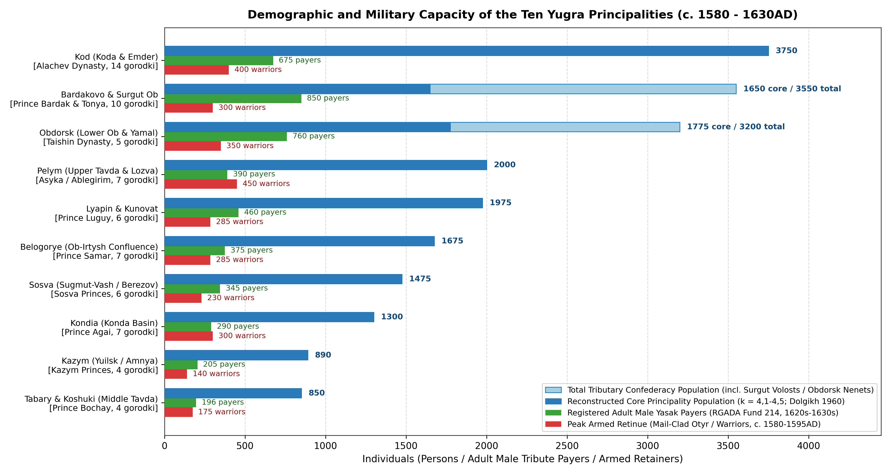
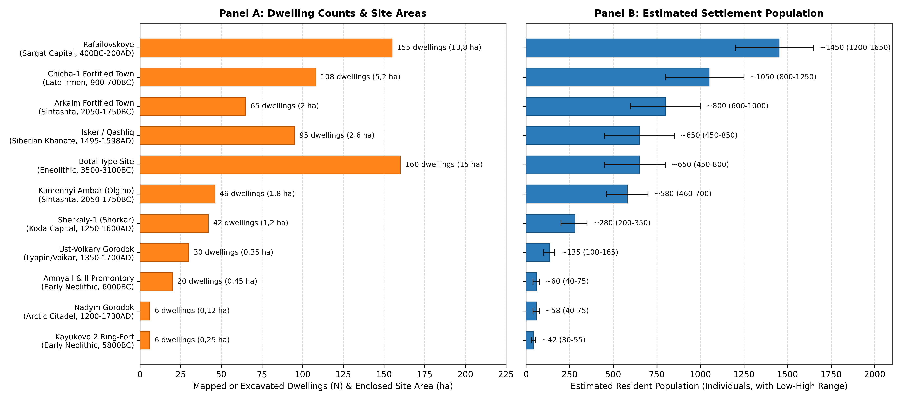
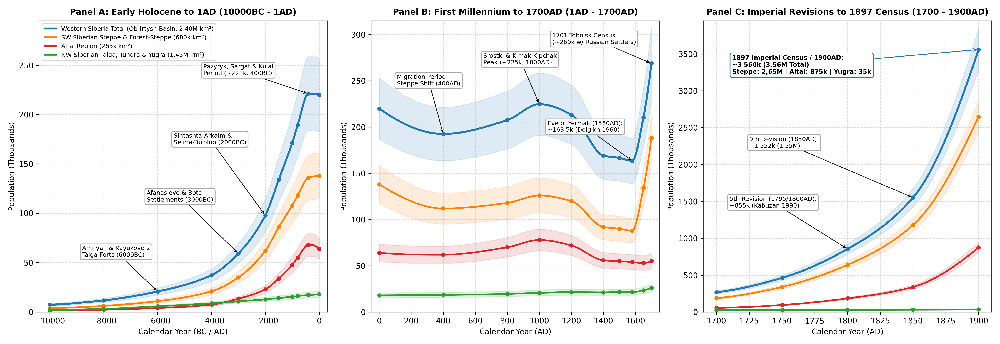

# Abstract

This review synthesises archaeological, palaeoecological,
bioarchaeological, and historical census literature to reconstruct the
population and settlement history of Western Siberia (the Ob-Irtysh
river basin, ~2,40M km²) from 10000BC to 1900AD. Following the regional
framework established for Northern Eurasia [\[1\]](#ref-Chernykh2022),
the basin is examined across three geographical provinces: the Altai
region (265k km²), the South-West Siberian Steppe and Forest-Steppe
(680k km²), and the North-West Siberian Taiga, Tundra, and Yugra (1,45M
km²). Rather than relying on global historical interpolation schemes or
raw radiocarbon date counts, population estimates are derived from
excavated house counts and floor areas (Amnya I, Kayukovo 2, Botai,
Arkaim, Kamennyi Ambar, Chicha-1, Rafailovskoye, Sherkaly-1, and Nadym
Gorodok), cemetery mortality profiles (Sopka-2, Tartas-1, Choburak-I,
and 43 Sargat burial grounds), 17th-century Russian fur-tribute
(*yasak*) registers
[\[2\]](#ref-Dolgikh1960)[\[3\]](#ref-Bakhrushin1935), the ten Imperial
Poll-Tax Revisions (*revizii*, 1719-1858)
[\[4\]](#ref-Kabuzan1990)[\[5\]](#ref-Kolesnikov1973), and the First
All-Russian Imperial Census of 1897
[\[6\]](#ref-Patkanov1911)[\[7\]](#ref-Tychinskikh2019). Total
population across the Ob-Irtysh basin grew from ~7,3k hunter-fishers at
10000BC to ~20,8k in the Early Neolithic (6000BC), ~97,8k in the Middle
Bronze Age (2000BC), ~221,2k during the Scythian and Sargat Iron Age
(400BC), and ~224,8k in the High Middle Ages (1000AD). Following late
medieval political reorganisation (~163,5k on the eve of Yermak’s 1582
campaign, including ~21,5k inhabitants across the ten Ob-Ugrian Yugra
principalities and ~39,3k in the core of the Siberian Khanate), Russian
agricultural settlement lifted the basin’s population to ~269,0k by
1700AD, ~855,0k by 1800AD, and ~3,56M by 1900AD.

# Background

Stretching from the Ural watershed (58°E-60°E) to the Yenisei-Chulym
divide (86°E-90°E) and from the intermontane valleys of the Russian
Altai (49°N) to the Kara Sea coast (73°N), the Ob-Irtysh drainage basin
forms the westernmost third of Siberia [\[1\]](#ref-Chernykh2022). As
shown in Figure , latitudinal climate belts and elevation gradients
divide Western Siberia into three distinct environmental zones. The
first zone is the Altai region (~265k km²; 49,0°N-54,0°N,
80,0°E-90,0°E), covering the high intermontane valleys of the Mountain
Altai (*Gorny Altai* - the Katun, Biya, Chuya, Argut, Ursul, Chulyshman,
Bukhtarma, Ukok, and Anui/Denisova valleys) and the northern
forest-steppe foothills (*Altaiskoye Priobye* - the Charysh, Alei, Inya,
and Chumysh valleys). Rich in sheltered winter pastures and polymetallic
copper-tin ores, the Altai supported early pastoralist settlement during
the Eneolithic (Afanasievo culture), horse-riding polities during the
Scythian (Pazyryk), Hunno-Sarmatian (Bulan-Koba), and Turkic (Srostki)
periods, and rapid mining and agricultural expansion under the
Kolyvano-Voskresensk (Altai) Mining District in the 18th and 19th
centuries
[\[8\]](#ref-Poliakov2019)[\[9\]](#ref-Bourgeois2007)[\[10\]](#ref-Seregin2024)[\[11\]](#ref-Ekeev2020).

The second zone is the South-West Siberian Steppe and Forest-Steppe
(~680k km²; 52,0°N-57,5°N, 61,0°E-86,0°E), spanning the Southern
Trans-Urals and Tobol-Ishim interfluve (the Tura, Pyshma, Iset, Miass,
Tobol, Ubagan, and Ishim rivers), the Middle Irtysh (Tara, Om, and Osha
rivers), the Baraba forest-steppe (Tartas and Kargat rivers, Lakes Chany
and Sartlan), and the Kulunda steppe
[\[12\]](#ref-Ryabogina2010)[\[13\]](#ref-Zakh2011)[\[14\]](#ref-Molodin2019).
This chernozem and meadow-steppe belt supported Eneolithic horse-hunters
(Botai-Tersek), Middle Bronze Age fortified settlements
(Sintashta-Petrovka), Late Bronze Age fortified towns (Chicha-1), Early
Iron Age chiefdoms (Sargat culture), the Late Medieval Tyumen and
Siberian Khanates, and the primary corridor of Russian peasant
colonisation along the Siberian Tract and Trans-Siberian Railway
[\[5\]](#ref-Kolesnikov1973)[\[15\]](#ref-Outram2009)[\[16\]](#ref-Krause2019)[\[17\]](#ref-Matveeva2000)[\[18\]](#ref-Tataurov2016)[\[19\]](#ref-Belyanin2010).

The third zone encompasses the North-West Siberian Taiga, Tundra, and
Yugra (~1,45M km²; 57,5°N-73,0°N, 58,0°E-86,0°E), covering the boreal
forest, wetlands, and Arctic tundra of the Lower and Middle Ob (Surgut,
Berezov, and Obdorsk reaches), the Lower Irtysh (Demyanka and Konda
basins), the eastern Ural tributaries (Tavda, Pelym, Lozva, Northern
Sosva, Lyapin, and Voikar), and the right-bank Arctic rivers (Vakh,
Trom-Yugan, Pim, Kazym, Polui, Nadym, Pur, Taz, and Yamal)
[\[20\]](#ref-Borzunov2012)[\[21\]](#ref-Lobanova2016). Abundant
seasonal runs of whitefish and sturgeon alongside migrating elk and
reindeer herds sustained early fortified fishing settlements in the
Neolithic (Amnya I and Kayukovo 2, c. 6000 cal BC), Iron Age
metalworking centres (Barsova Gora, Ust-Polui, and the Kulai culture),
and ten hereditary Ob-Ugrian (Khanty and Mansi) principalities
(*knyazhestva*) documented in 16th- and 17th-century Russian records
[\[2\]](#ref-Dolgikh1960)[\[3\]](#ref-Bakhrushin1935)[\[22\]](#ref-Piezonka2023)[\[23\]](#ref-Kardash2020).

# Methodology

Regional population estimates in this paper are built from three primary
lines of evidence: excavated dwelling floor areas, skeletal mortality
profiles from cemeteries, and historical tax and census records[^1].

## House Counts and Settlement Area

In the boreal taiga and tundra, excavations of Early Neolithic (Amnya I,
Kayukovo 2), Bronze Age (Barsova Gora), and Iron Age (Beloyarskaya,
Kulai, Karym) settlements by V. A. Borzunov
[\[20\]](#ref-Borzunov2012)[\[24\]](#ref-Borzunov2013)[\[25\]](#ref-Borzunov2020),
E. N. Dubovtseva
[\[26\]](#ref-Dubovtseva2020)[\[27\]](#ref-Dubovtseva2022), O. V.
Kardash [\[23\]](#ref-Kardash2020), and H. Piezonka
[\[22\]](#ref-Piezonka2023)[\[28\]](#ref-Piezonka2020) identify
single-chamber pit-houses (*poluzemlyanki* of 15-45 m², occupied by
nuclear or small extended families of 5-8 individuals at ~4,5-5,5 m² of
heated winter floor space per person) and multi-hearth communal
pit-houses (60-160 m², such as at Kayukovo 2 and Barsov Gorodok,
occupied by kin groups of 12-25 individuals across 2-4 hearth families).
In the medieval Ob-Ugrian fortified towns (*gorodishcha* and *gorodki*,
12th-17th c. AD), excavations in permafrost at Nadym Gorodok
[\[29\]](#ref-Kardash2009), Ust-Voikary [\[30\]](#ref-Vizgalov2008),
Berezov / Sugmut-Vash [\[31\]](#ref-Vizgalov2011), and Emder
[\[32\]](#ref-Zykov2001) reveal dense rows of surface log cabins (16-36
m², housing 5-7 persons each) inside timber ramparts (700-3 500 m²),
surrounded by outer seasonal quarters (*posad*). Assuming an occupancy
rate $`c_{\text{occ}} = 0{,}70`$ across multi-phase house depressions
and a mean household size $`H_{\text{size}} = 6{,}5\text{ persons}`$,
settlement population is calculated as:

``` math
P_{\text{site}} = N_{\text{dwellings}} \times c_{\text{occ}} \times H_{\text{size}}
```
In the steppe and forest-steppe zone, magnetometry surveys and
excavations at the Middle Bronze Age Sintashta-Petrovka fortified
settlements (2100-1750 cal BC) of Arkaim (60-67 houses), Kamennyi Ambar
(46 houses), and Sintashta (35-42 houses) document radial or linear
blocks of timber-and-turf row-houses measuring 110-220 m² each
[\[16\]](#ref-Krause2019)[\[33\]](#ref-Koryakova2007). While early
studies suggested 25-30 occupants per house, demographic and cemetery
analyses by A. V. Epimakhov
[\[34\]](#ref-Epimakhov2009)[\[35\]](#ref-Epimakhov2011) and B. Hanks
[\[36\]](#ref-Hanks2018) show that roughly one-third of indoor floor
area was used for winter stalling of young livestock, wells, and
copper-smelting furnaces, indicating 10-15 persons per house and 450-950
permanent residents per fortified settlement. For the Early Iron Age
Sargat settlements (500BC - 400AD), N. P. Matveeva’s
[\[17\]](#ref-Matveeva2000)[\[37\]](#ref-Matveeva1999) study of Middle
Tobol and Iset settlements (Rafailovskoye, Pavlinovo, Bayevo) combines
multi-room house floor areas (70-180 m²) with contemporary burial
grounds (705 individuals across 43 cemeteries) to estimate an average
household of 10,0-11,0 persons, with ordinary villages (*selishcha*)
housing 250-360 residents and major fortified centres such as
Rafailovskoye supporting 1 200-1 650 inhabitants.

## Cemetery Mortality Estimates

In the mountain valleys of the Altai and the open steppes of South-West
Siberia, mobile pastoralist winter camps leave thin cultural layers,
whereas burial mounds (*kurgans*) and flat cemeteries are well
preserved. Following the standard Acsádi-Nemeskéri life-table formula as
applied to Siberian skeletal series by N. P. Matveeva
[\[37\]](#ref-Matveeva1999), A. V. Epimakhov
[\[34\]](#ref-Epimakhov2009), and N. N. Seregin
[\[10\]](#ref-Seregin2024):
``` math
P_{\text{living}} = \frac{N_{\text{burials}} \times e_0}{T_{\text{duration}} \times f_{\text{preserved}}}
```
where life expectancy at birth
$`e_0 \approx 24{,}5\text{-}27{,}5\text{ years}`$ (derived from
osteological series at Sopka-2, Tartas-1, and 43 Sargat cemeteries where
adult life expectancy at age 20 is $`e_{20} = 16{,}5\text{ years}`$ and
sub-adult mortality $`d_{0-14}`$ is 38-45%), $`T_{\text{duration}}`$ is
the radiocarbon phase duration in years, and $`f_{\text{preserved}}`$ is
the estimated burial recovery fraction (0,60-0,80 in large communal flat
cemeteries such as Tartas-1, compared with 0,08-0,15 for monumental
stone kurgans of the Pazyryk and Sargat elites).

## Tax Registers and Census Records

Early Russian fiscal registers (*yasachnye knigi*) preserved in the
Russian State Archive of Ancient Acts (RGADA, Fund 214, *Sibirsky
Prikaz*) record headcounts of adult able-bodied indigenous male tribute
payers (*yasachnye lyudi*, aged 18-50). Following B. O. Dolgikh
[\[2\]](#ref-Dolgikh1960), S. V. Bakhrushin
[\[3\]](#ref-Bakhrushin1935), E. V. Perevalova
[\[38\]](#ref-Perevalova2004), and Ya. G. Solodkin
[\[39\]](#ref-Solodkin2015), total indigenous population is estimated
using a multiplier of $`k = 4{,}1\text{-}4{,}5`$ per registered *yasak*
payer for the Ob-Ugrian (Khanty and Mansi) principalities (combining
Dolgikh’s base ratio of 4,0 with a 5-12% allowance for unregistered
dependents and remote forest or tundra camps), a multiplier of
$`k = 4{,}0\text{-}4{,}3`$ applied to registered tribute-paying
(*yasachnye*), military-service (*sluzhilye*), and Bukharan merchant
(*bukhartsy*) men for the Siberian Tatars across Tobolsk, Tyumen,
Turinsk, Tara, and Baraba *volosts*
[\[2\]](#ref-Dolgikh1960)[\[18\]](#ref-Tataurov2016), and a multiplier
of $`k = 4{,}0`$ per tribute payer or armed horseman listed in Russian
diplomatic reports (*stateynye spiski*) for the Altai Teleuts,
Telengits, and Northern Altaian tributaries
[\[2\]](#ref-Dolgikh1960)[\[40\]](#ref-Mitko2009).

Between 1719 and 1858, the Russian state conducted ten Poll-Tax
Revisions (*revizskie skazki*) enumerating taxable male “souls”
(*revizskie dushi*) among Russian state peasants (*gosudarstvennye
krestyane*), Cabinet mining peasants (*pripisnye krestyane*),
townspeople, and Siberian *yasak* payers (re-registered under Major Ya.
Shcherbachev’s 1763 *yasak* commission)
[\[4\]](#ref-Kabuzan1990)[\[5\]](#ref-Kolesnikov1973)[\[11\]](#ref-Ekeev2020).
Total population from revision male counts is obtained by doubling male
soul totals (incorporating female family members recorded from the 3rd
Revision of 1762-1764 onwards) and adding non-taxable categories
(Cossacks of the Siberian Host, regular troops, clergy, and exiled
settlers) [\[4\]](#ref-Kabuzan1990). Finally, the First All-Russian
Imperial Census of 28 January 1897 (*Pervaya vseobshchaya perepis’
naseleniya Rossiyskoy Imperii 1897 g.*), analysed at the *uezd* and
*volost* level by S. K. Patkanov [\[6\]](#ref-Patkanov1911), Z. A.
Tychinskikh [\[7\]](#ref-Tychinskikh2019), E. A. Bryukhanova
[\[41\]](#ref-Bryukhanova2021), and Yu. V. Semenov
[\[42\]](#ref-Semenov2024), provides direct household-level enumerations
across Tobolsk Governorate, Tomsk Governorate (including the Altai
Mining District), and Akmolinsk Oblast.

# Altai Region

## Final Palaeolithic, Mesolithic, and Afanasievo Settlement (10000 - 2500BC)

During the Younger Dryas and Early Holocene warming (10000-6000BC), the
sheltered lower valleys of the Anui, Katun, Biya, and Charysh rivers
served as refugia for hunting and fishing groups. Stratified cave and
open-air sites at Denisova Cave (Holocene layers 0-8), Kaminnaya Cave,
Ust-Karakol-1, Kara-Bom, and Tytkesken-2 (along the Middle Katun, where
nine cultural layers span the Mesolithic to the Eneolithic) document a
gradual shift from Final Palaeolithic blade hunters to semi-sedentary
Mesolithic and Kuznetsk-Altai Neolithic riverine fisher-hunters living
in pit-houses (16-28 m²) and using collective cemeteries (Ust-Isha,
Solontsy-5, Itkul). Across the Altai region, population grew gradually
from ~1,5k (1,2k-1,9k; 0,006 persons/km²) at 10000BC to ~4,0k at 6000BC
and ~7,5k by 4000BC.

Around 3100-3050 cal BC, the Mountain Altai experienced a major economic
and demographic shift with the arrival of the Afanasievo culture
(*Afanasievskaya kultura*), established by Western Steppe
(Yamnaya-related) pastoralists who introduced domesticated cattle,
sheep, goats, and horses
[\[8\]](#ref-Poliakov2019)[\[43\]](#ref-Stepanova2023). A series of more
than 150 AMS radiocarbon dates compiled by A. V. Poliakov, S. V.
Svyatko, and N. F. Stepanova [\[8\]](#ref-Poliakov2019) shows that
Mountain Altai Afanasievo sites cluster between 3100 and 2800 cal BC,
slightly earlier than the Minusinsk Basin sites (2900-2500 cal BC). Over
60 kurgan cemeteries (Elo-1/2, Balyktyul, Kurta-2, Nizhnyaya Sooru,
Bike-1/3, Kuyum, Aragol, Karasu) containing more than 450 stone-ringed
enclosures and 15+ seasonal settlements (Elo-Bashichi, Kara-Tenesh,
Malyi Dugan; [\[43\]](#ref-Stepanova2023)) indicate ~6,0k-8,0k
pastoralists in the mountain valleys alongside ~6,5k-8,8k Eneolithic
Bolshoy Mys inhabitants in the northern foothills, bringing the total
Altai population to ~13,5k (10,8k-16,8k; 0,051 persons/km²) at 3000BC.

## Bronze Age Metallurgy and Farming Villages (2500 - 800BC)

During the Early and Middle Bronze Age (2200-1700 cal BC), settlement
patterns differed between the high mountain valleys and the northern
forest-steppe plains [\[44\]](#ref-Dashkovskiy2024). The Karakol culture
(2200-1700 cal BC), concentrated in the Ursul and Middle Katun valleys
(Karakol, Besh-Ozek, Ozernoye) and known for stone-cist graves decorated
with polychrome mineral paintings, supported ~5,0k-7,5k mountain
inhabitants. Simultaneously, the Elunino culture (2200-1700 cal BC)
occupied the Upper Ob forest-steppe and the copper-tin mining foothills
of the Rudny Altai
[\[44\]](#ref-Dashkovskiy2024)[\[45\]](#ref-Grushin2011). At the
settlement of Berezovaya Luka on the Alei River (excavated over \>2 200
m²), S. P. Grushin documented permanent timber-frame dwellings (17-20
m²), bronze-casting workshops, and large herds of horses (36%), sheep
and goats (37%), and cattle (27%). More than 80 Elunino settlements and
cemeteries (Elunino-1, Teleutsky Vzvoz-1, Starodubtsevo) supported
~15,0k-21,0k agro-pastoralists, raising total Altai population to ~23,0k
(18,5k-28,5k) by 2000BC.

Between 1800 and 800 cal BC, Andronovo (Fedorovo) communities
(Firsovo-XIV, Kytmanovo, Rubtsovsk) and Late Bronze Age Irmen
(*Irmenskaya kultura*) villages (Blizhniye Elbany, Krasnaya Gorka,
Kalistratiha, Plotinnaya) established dense chains of river-terrace
settlements containing 8-15 large multi-hearth pit-houses (80-150 m²
each, housing 100-200 residents per village). Regional population
increased from ~34,0k at 1500BC to ~48,0k at 1000BC and ~55,0k
(45,0k-66,0k; 0,208 persons/km²) by 800BC.

## Scythian, Hunno-Sarmatian, and Medieval Periods (800BC - 1700AD)

Following the early Scythian Arzhan-Maiemir phase (850-550BC), nomadic
pastoralism expanded across all elevation zones of the Altai during the
Scythian-Saka period (550-200BC). Between 1995 and 2014, joint surveys
by Ghent University and Gorno-Altaisk State University led by J.
Bourgeois and W. Gheyle [\[9\]](#ref-Bourgeois2007) mapped ~1 250 km² of
high mountain valleys (Chuya, Kuray, Yustyd, Sebÿstei, Kalanegir,
Dzhazator) using satellite imagery and GPS ground checks, recording more
than 4 800 surface monuments (3,8-6,5 monuments/km² in Yustyd and
Sebÿstei), of which 45-55% (\>2 200 kurgans) date to the Pazyryk and
Kara-Koba phases. Across all habitable valleys of the Russian Altai (an
estimated 18 000-25 000 Scythian kurgans built over 350 years, with
$`e_0 = 26\text{ years}`$ and elite kurgan representation
$`f_{\text{preserved}} \approx 0{,}08\text{-}0{,}12`$), the Mountain
Altai Pazyryk population numbered ~22,0k-30,0k pastoralists, while the
northern foothill Bystryanka, Kamen, and Staroaleika farming and herding
groups supported ~42,0k-52,0k inhabitants, giving a combined Altai
population of ~68,0k (56,0k-82,0k; 0,257 persons/km²) at 400BC.

During the Hunno-Sarmatian and Migration Period (200BC - 500AD),
synthesised by N. N. Seregin and S. S. Matrenin
[\[10\]](#ref-Seregin2024) from more than 750 excavated graves across
45+ cemeteries (Bulan-Koba IV, Yaloman II, Ust-Edigan, Belyi Bom II,
Choburak-I, Dyalyan, Stepushka), the Bulan-Koba culture (200BC - 450AD)
and northern foothill Maima communities maintained a regional population
of ~64,0k at 1AD and ~62,0k at 400AD, marked by frequent weapon burials
(~75% of adult males buried with composite bows, iron armour plates, and
horses).

As the core metalworking region of the First and Second Turkic
Khaganates (Kudyrge, Katanda, and Kuray phases; ~70,0k by 800AD), the
Altai reached its highest pre-modern population during the Srostki
culture (*Srostkinskaya kultura*, 850-1050AD), linked to the eastern
wing of the Kimak-Kipchak confederation [\[46\]](#ref-Gorbunov2018).
Across more than 160 kurgan cemeteries (Srostki-1, Biyke, Filimonovo,
Kamen-2, Shadrino) and 40+ foothill settlements combining horse herding
with millet and barley cultivation, the regional population reached
~78,0k (64,0k-93,0k; 0,294 persons/km²) at 1000AD. After 13th- and
14th-century Mongol-era warfare and pasture shifts reduced regional
numbers to ~56,0k by 1400AD, 17th-century Russian tribute records from
Kuznetsk (founded 1618) and Tomsk (founded 1604) analysed by B. O.
Dolgikh [\[2\]](#ref-Dolgikh1960) and O. A. Mitko
[\[40\]](#ref-Mitko2009) document ~14,0k-18,0k Teleuts (“White Kalmyks”
of Prince Abak) and Northern Altaian/Shor tributaries (Kumandins,
Tubalars, Chelkans, Abintsy) in the Upper Ob and Biya basins alongside
~28,0k-36,0k Southern Altai Telengits and Uriankhai (*dvoedantsy* paying
dual tribute across 24 Dzungar *zaisanstvos*), giving ~54,0k
(45,0k-64,0k) in 1580AD and ~55,0k (including early Russian settlers
around Kuznetsk) by 1700AD.

## Imperial Mining District and Peasant Colonisation (1700 - 1900AD)

The demographic profile of the Altai changed dramatically after the
founding of Biysk Fortress (1709), the construction of Akinfiy Demidov’s
Kolyvan (1727) and Barnaul (1739-1744) copper and silver smelters, and
Empress Elizaveta Petrovna’s 1747 decree transferring the
Kolyvano-Voskresensk Mining District (*Kolyvano-Voskresenskiy gorniy
okrug*) to the Imperial Cabinet
[\[4\]](#ref-Kabuzan1990)[\[5\]](#ref-Kolesnikov1973)[\[11\]](#ref-Ekeev2020).
Protected by the Kolyvano-Kuznetsk Fortified Line along the Biya, Katun,
and Charysh foothills, the Imperial Cabinet assigned tens of thousands
of state peasants as ascribed mining peasants (*pripisnye krestyane*)
who supplied charcoal, timber, and grain to the Barnaul, Pavlovsk, and
Zmeinogorsk silver works, supplemented by exiled Old Believers
(“*Polyaki*”) settled in the Uba and Bukhtarma valleys
[\[5\]](#ref-Kolesnikov1973). Following the Qing destruction of the
Dzungar Khanate in 1755-1756, twelve Southern Altai *zaisans* petitioned
for Russian protection under Empress Elizabeth’s decree of 2 May 1756
[\[11\]](#ref-Ekeev2020). Regulated by Major Ya. Shcherbachev’s 1763
*yasak* commission and later codified into seven Altaian *dyuchinas* and
twenty-four Kalmyk and Teleut *volosts* under M. M. Speransky’s 1822
Statute on Indigenous Administration (*Ustav ob upravlenii inorodtsev*),
the indigenous Altaian, Teleut, and Kumandin population stabilised at
~42,0k-48,0k [\[6\]](#ref-Patkanov1911)[\[11\]](#ref-Ekeev2020).
Combined with rapidly growing Russian villages, total Altai population
rose from ~95,0k (82,0k-108,0k) in 1750AD (2nd Revision) to ~185,0k
(165,0k-205,0k; ~140k Russians and ~45k indigenous Altaians) by 1800AD
(5th Revision, 1795) and ~340,0k (310,0k-370,0k) by 1850AD (9th
Revision) [\[4\]](#ref-Kabuzan1990).

Following the emancipation of Cabinet mining peasants in 1861 and the
Imperial decree of 30 July 1865 opening the Altai Cabinet lands to
peasant migration from European Russia [\[19\]](#ref-Belyanin2010), the
fertile black-earth piedmont of the Upper Ob became the primary
agricultural destination in Siberia. In the First All-Russian Imperial
Census of 1897
[\[6\]](#ref-Patkanov1911)[\[41\]](#ref-Bryukhanova2021)[\[42\]](#ref-Semenov2024),
Biysk *uezd* recorded 337 007 inhabitants, Zmeinogorsk *uezd* 242 718,
and the Upper Ob and foothill *volosts* of Barnaul *uezd* (584 100
across the entire *uezd*, with Barnaul city at 21 073 and Biysk city at
17 213) contributed ~240,0k-260,0k within the Altai boundary, including
49 528 indigenous Turkic inhabitants enumerated by S. K. Patkanov (42
223 Altaians, Telengits, Kumandins, Tubalars, and Chelkans, plus 7 305
Teleuts) [\[6\]](#ref-Patkanov1911). Including peasant arrivals between
1897 and 1900, the population of the Altai region reached ~875,0k
(820,0k-930,0k; 3,302 persons/km²) in 1900AD.

# South-West Siberian Steppe and Forest-Steppe

## Mesolithic, Neolithic, and Botai Horse-Hunters (10000 - 2500BC)

Pollen cores and radiocarbon series from the Tobol-Ishim interfluve
(Oshukovskoye peatland, Lake Kyrtyma, Lake Mergen) studied by N. E.
Ryabogina and V. A. Zakh
[\[12\]](#ref-Ryabogina2010)[\[13\]](#ref-Zakh2011) and from the Baraba
forest-steppe studied by V. I. Molodin
[\[14\]](#ref-Molodin2019)[\[47\]](#ref-Molodin2024) show that Boreal
and Atlantic warming (8500-5000BC) established birch-pine parklands and
shallow fish-rich lakes across the 680k km² of the South-West Siberian
steppe and forest-steppe. From sparse Mesolithic hunting and fishing
camps (Chernoozerye VIa, Kamyshnoye-1, Vengerovo-5, Tartas-3; ~3,8k at
10000BC), population grew during the Early and Late Neolithic (Koshkino,
Boborykino, Koksharovsko-Yuryinskaya, and Ust-Tartas cultures; Mergen 6
with 20+ pit-houses of 20-50 m² and Vengerovo-2A) from ~11,0k
(8,8k-13,8k) at 6000BC to ~21,0k (16,8k-26,0k) at 4000BC.

Between 3700 and 3100 cal BC, the southern Ishim-Tobol forest-steppe
margin witnessed the growth of the Botai-Tersek culture, whose economy
relied heavily (90-99% of animal bones) on horse hunting, taming, and
mare’s milk (*koumiss*) processing
[\[15\]](#ref-Outram2009)[\[48\]](#ref-Outram2021). Fluxgate
magnetometry surveys led by A. K. Outram and V. F. Zaibert
[\[48\]](#ref-Outram2021) mapped 158-250+ polygonal pit-houses (20-70
m²) across 15 ha at the Botai type-site (~160 contemporaneous dwellings
housing ~450-800 residents), 54 houses at Krasnyi Yar, and 44 houses at
Vasilkovka IV, raising total steppe and forest-steppe population to
~35,0k (28,0k-43,5k; 0,051 persons/km²) by 3000BC.

## Bronze Age Fortified Towns and Forest-Steppe Villages (2500 - 800BC)

During the Early and Middle Bronze Age (2300-1750 cal BC), circular
Tashkovo-2 villages in the Lower Tobol and Tura basin (11-13 timber
houses of 35-48 m² arranged around a central open space, housing 70-100
residents) developed alongside the Odinovo and Krotovo cultures of the
Middle Irtysh and Baraba (Sopka-2, Tartas-1 with \>800 excavated graves,
Vengerovo-2 with 60-110 m² houses containing indoor tin-bronze furnaces,
and the Rostovka and Chernoozerye Seima-Turbino cemeteries;
[\[14\]](#ref-Molodin2019)[\[47\]](#ref-Molodin2024)). In the Southern
Trans-Urals and Upper Tobol-Ui-Miass watershed, Sintashta-Petrovka
(2100-1750 cal BC) pastoralists and copper smelters built more than 24
fortified circular and rectangular towns, including Arkaim (2,0 ha,
60-67 longhouses housing 600-1 000 residents), Kamennyi Ambar (1,8 ha,
46 longhouses of 150-220 m² housing 460-700 residents), Sintashta,
Ustye, Stepnoye, Kuysak, Alabuga, and Petrovka-2
[\[16\]](#ref-Krause2019)[\[33\]](#ref-Koryakova2007)[\[34\]](#ref-Epimakhov2009)[\[35\]](#ref-Epimakhov2011)[\[36\]](#ref-Hanks2018).
Combining the 24 fortified towns and surrounding hamlets (~15,0k-24,0k
inhabitants) with Tashkovo and Odinovo-Krotovo communities across the
Irtysh and Baraba plains gives a total steppe and forest-steppe
population of ~62,0k (50,0k-76,0k; 0,091 persons/km²) at 2000BC.

During the Andronovo (Alakul and Fedorovo) period (1750-1400BC) and the
subsequent Cherkaskul, Pakhomovo, Suzgun, Barkhatovo, and Irmen cultures
(1400-900BC), hundreds of unfortified river-terrace villages (5-20 large
timber houses of 100-250 m² per village) spread across the Tobol, Ishim,
Irtysh, and Baraba valleys, lifting the steppe and forest-steppe
population to ~86,0k at 1500BC and ~108,0k at 1000BC. Around 900-700 cal
BC (Late Irmen transition), cooler, wetter conditions and contact with
northern forest groups (Atlym and Suzgun) led to the construction of
large fortified settlements in Baraba [\[49\]](#ref-Molodin2009). At
Chicha-1 on Lake Malaya Chicha, Russian-German magnetometry and
excavations directed by V. I. Molodin, H. Parzinger, and J. Schneeweiss
[\[49\]](#ref-Molodin2009) uncovered a 5,2 ha fortified town divided by
concentric ditches and ramparts into an inner citadel (Zone I) and three
outer residential quarters (Zones II-IV) containing 100-110+
contemporaneous pit and timber-frame houses (40-120 m² each), supporting
~800-1 250 inhabitants (mean ~1 050). Regional population in the steppe
and forest-steppe zone reached ~118,0k (96,0k-142,0k) at 800BC.

## Early Iron Age Sargat Confederacy and Siberian Khanate (800BC - 1700AD)

Covering more than 400k km² across the Tobol, Iset, Pyshma, Ishim,
Middle Irtysh, and Baraba forest-steppe, the Sargat culture
(*Sargatskaya kultura*, 500BC - 400AD) formed the largest pre-modern
population in Western Siberia, widely associated with Ugrian and Iranian
mounted pastoralists and forest-steppe farmers
[\[17\]](#ref-Matveeva2000)[\[37\]](#ref-Matveeva1999)[\[50\]](#ref-Chikunova2005).
More than 500 known Sargat sites (~80 fortified *gorodishcha*, ~300
unfortified villages, and ~150 kurgan cemeteries) form a three-level
settlement hierarchy reconstructed by N. P. Matveeva
[\[17\]](#ref-Matveeva2000)[\[37\]](#ref-Matveeva1999). Major fortified
centres included Rafailovskoye on the Iset (a 1,8 ha multi-rampart
citadel plus a 12,0 ha outer settlement containing ~155 contemporaneous
multi-room houses and supporting 1 200-1 650 residents;
[\[50\]](#ref-Chikunova2005)), Pavlinovo, Aktau, Inbereny-IV,
Sargatskoye, Bayevo, and Abramovo-4; ordinary fortified refuges and
villages held 25-35 active households of 10,0-11,0 persons each (250-360
residents per settlement cluster); and seasonal herding camps contained
5-10 households (50-100 persons). Combining mortality data from 43
Sargat cemeteries (705 individuals; adult life expectancy
$`e_{20} = 16{,}5\text{ years}`$, mean adult age at death 36,5 years;
[\[37\]](#ref-Matveeva1999)) with settlement counts across the
Tobol-Irtysh river valleys yields an estimated steppe and forest-steppe
population of ~136,0k (112,0k-162,0k; 0,200 persons/km²) at 400BC and
~138,0k (114,0k-165,0k) at 1AD, declining to ~112,0k by 400AD during the
Migration Period.

Between 600 and 1240AD, Bakalskaya (Tobol-Iset), Yudino (Tura-Tavda),
and Ust-Ishim (Middle Irtysh) communities interacted with the
Kimak-Kipchak Khaganate (whose main seat on the Middle Irtysh is
mentioned by medieval Islamic geographers) and Cuman-Kipchak tribes,
sustaining ~118,0k inhabitants at 800AD, ~126,0k at 1000AD, and ~120,0k
at 1200AD. Under the Ulus of Jochi (the Shibanid appanage and the local
Taibugid rulers), 14th-century political fragmentation and plague
reduced the steppe and forest-steppe population to ~92,0k by 1400AD. In
the 15th and 16th centuries, the region reorganised under the Tyumen
Khanate (centred at Chimgi-Tura, modern Tyumen) and the Siberian Khanate
(c. 1495-1598AD) ruled by the Taibugids and the Shibanid Khan Kuchum (r.
1563-1598)
[\[18\]](#ref-Tataurov2016)[\[51\]](#ref-Matveev2011)[\[52\]](#ref-Maslyuzhenko2018).

Excavations of the Khanate’s 65+ fortified settlements (*gorodishcha*)
synthesised by A. P. Zykov, S. F. Tataurov, and D. N. Maslyuzhenko
[\[18\]](#ref-Tataurov2016)[\[52\]](#ref-Maslyuzhenko2018) show that the
capital Isker (Qashliq / Gorod Sibir) occupied a 2,0-2,6 ha
triple-rampart promontory citadel with an outer settlement (~95
structures) housing 450-850 permanent residents (rising to 2 000-3 500
during military musters), flanked by regional administrative forts at
Chimgi-Tura (500-1 000 residents), Suzgun, Chuvashsky Mys, Karachin
Gorodok, Kullara, Kyzyl-Tura, and Ton-Tura (Voznesenskoye on the Om
River in Baraba, 300-600 residents). Based on the earliest Russian
*yasak* and service-Tatar registers (1590s-1630s) compiled by B. O.
Dolgikh [\[2\]](#ref-Dolgikh1960), the indigenous population of the
Siberian Khanate’s core territory in c. 1580AD numbered ~34,3k-44,3k
(mean ~39,3k: ~9,5k-11,0k Tobolsk and Vagay Tatars, ~5,8k-6,8k Tyumen
and Tura Tatars and Southern Mansi, ~3,2k-4,0k Tara and Middle Irtysh
Tatars, ~3,8k-4,5k Baraba Tatars, and ~12,0k-18,0k Ishim-Kulunda nomadic
subjects), within a total steppe and forest-steppe population of ~88,0k
(72,0k-105,0k) including southern Kazakh and Kalmyk steppe camps.
Following the founding of Tyumen (1586), Tobolsk (1587), Tara (1594),
Turinsk (1600), Yalutorovsk (1659), and Shadrinsk (1662), Russian
peasant (*pashennye krestyane*) and Cossack settlement across the Tura,
Pyshma, Iset, and Tobol valleys added ~145,0k Russian inhabitants by the
1701 Tobolsk census alongside ~43,0k Siberian Tatars, Bukharans, and
southern pastoralists, bringing the steppe and forest-steppe population
to ~134,0k in 1650AD and ~188,0k (172,0k-204,0k; 0,276 persons/km²) by
1700AD.

## Fortified Lines, Poll-Tax Revisions, and the Trans-Siberian Railway (1700 - 1900AD)

Throughout the 18th and 19th centuries, the South-West Siberian
forest-steppe served as the main gateway for Russian agricultural
settlement in Asia
[\[4\]](#ref-Kabuzan1990)[\[5\]](#ref-Kolesnikov1973)[\[19\]](#ref-Belyanin2010).
Following I. D. Bukhgolts’s founding of Omsk Fortress (1716) and the
construction of the Irtysh and Novo-Ishimskaya fortification lines
(Presnogorkovskaya - Petropavlovskaya - Omskaya, 1730s-1752), Russian
military and peasant settlement pushed southward from the Tobol-Tura
river valleys onto the open chernozem plains of Kurgan, Ishim, Omsk, and
the Baraba Siberian Tract (*Sibirskiy trakt*)
[\[5\]](#ref-Kolesnikov1973). According to V. M. Kabuzan’s
[\[4\]](#ref-Kabuzan1990) and A. D. Kolesnikov’s
[\[5\]](#ref-Kolesnikov1973) analyses of the 1st through 10th Poll-Tax
Revisions, the population of the steppe and forest-steppe zone nearly
doubled every half-century: rising from ~188,0k in 1700AD to ~340,0k
(305,0k-375,0k) in 1750AD (2nd Revision, 1744-1747), ~640,0k
(585,0k-695,0k) in 1800AD (5th Revision, 1795), and ~1 180,0k
(1,09M-1,27M; 1,735 persons/km²) in 1850AD (9th Revision). Alongside
Russian state peasants and Cossacks of the Siberian Line Host, the
indigenous and resettled Turkic population (Tobolsk, Tyumen, Tara, and
Baraba Tatars, Central Asian *Bukhartsy*, and Volga-Ural Tatar settlers)
expanded from ~43,0k in 1700AD to ~52,0k in 1795 and ~64,0k by the 10th
Revision of 1858
[\[7\]](#ref-Tychinskikh2019)[\[53\]](#ref-Korusenko2011).

After the 1861 peasant emancipation, the 1889 Resettlement Law, and the
construction of the West Siberian section of the Trans-Siberian Railway
(Chelyabinsk - Kurgan - Petropavlovsk - Omsk - Kainsk - Ob, 1892-1896),
state-assisted peasant migration into the Tobol, Ishim, and Baraba
steppes accelerated sharply
[\[19\]](#ref-Belyanin2010)[\[54\]](#ref-Liskevich2012). In the 1897
Imperial Census
[\[6\]](#ref-Patkanov1911)[\[7\]](#ref-Tychinskikh2019)[\[41\]](#ref-Bryukhanova2021)[\[42\]](#ref-Semenov2024),
the eight southern forest-steppe *uezds* of Tobolsk Governorate recorded
1 403 837 inhabitants (Ishim *uezd* 269 031, Kurgan 260 095, Tyukalinsk
208 718, Yalutorovsk 188 550, Tara 159 655, Tobolsk 127 860, Tyumen 121
357, and Turinsk 68 571, including 56 957 Tatars and Bukharans in
Tobolsk Governorate
[\[7\]](#ref-Tychinskikh2019)[\[53\]](#ref-Korusenko2011)), while Kainsk
*uezd* (187 147) and the northern Baraba-Kulunda *volosts* of Tomsk
Governorate added ~512,0k, and the northern forest-steppe districts of
Akmolinsk Oblast (Petropavlovsk *uezd* 227 539, Omsk *uezd* 100 539 with
Omsk city at 37 376, and adjoining Ishim-Irtysh *volosts*) accounted for
~580,0k-620,0k residents. Including railway-corridor arrivals between
1897 and 1900, the total population of the South-West Siberian Steppe
and Forest-Steppe reached ~2 650,0k (2,50M-2,80M; 3,897 persons/km²) in
1900AD.

# North-West Siberian Taiga, Tundra, and Yugra

## Early Neolithic Fortified Settlements: Amnya I and Kayukovo 2 (10000 - 4000BC)

As post-glacial forests established across the Lower Ob and Konda-Sosva
basins, Mesolithic hunter-fishers occupied elevated pine-covered river
terraces (Lugovskoye, Sumpanya-IV/VI, Korstovo, Komudvany; ~2,0k across
1,45M km² at 10000BC, rising to ~3,2k at 8000BC). Around 6100-5500 cal
BC, Early Neolithic communities in the West Siberian taiga began
building fortified promontory settlements (260-1 900 m²) enclosed by
timber palisades, earthen banks, and ditches, as documented by V. A.
Borzunov [\[20\]](#ref-Borzunov2012)[\[25\]](#ref-Borzunov2020), E. N.
Dubovtseva [\[26\]](#ref-Dubovtseva2020)[\[27\]](#ref-Dubovtseva2022),
O. V. Kardash [\[23\]](#ref-Kardash2020), and H. Piezonka
[\[22\]](#ref-Piezonka2023)[\[28\]](#ref-Piezonka2020). At Amnya I and
Amnya II in the Kazym River basin (63,5°N), AMS radiocarbon dating
published by H. Piezonka, N. M. Chairkina, E. N. Dubovtseva, and L. L.
Kosinskaya [\[22\]](#ref-Piezonka2023)[\[26\]](#ref-Dubovtseva2020)
dates the inner defensive ditch, rampart, palisade, and House 1 to
6100-5900 cal BC, making Amnya I the oldest dated fortified settlement
in northern Eurasia; the site consists of 10 semi-subterranean
pit-houses (15-40 m², 0,6-1,8 m deep) behind three defensive
ditch-and-bank lines (Amnya I), together with 10 unfortified outer
pit-houses (Amnya II) 50 m to the east, housing ~40-75 residents (mean
~60) who controlled seasonal fish-weir (*zapor*) and elk-crossing sites.

At Kayukovo 2 on the Bolshoy Salym - Bolshoy Yugan watershed, excavated
by O. V. Kardash, N. M. Chairkina, E. N. Dubovtseva, and H. Piezonka
[\[23\]](#ref-Kardash2020) and AMS-dated to 6000-5500 cal BC, a circular
fortified settlement (35 x 35 m, ~1 150 m² inner enclosure within a 0,25
ha site) was surrounded by a timber wall and ring ditch and contained 5
outer pit-houses (16-32 m²) linked by sunken passages to a central
communal building (House 6), housing ~30-55 residents (mean ~42).
Together with Imnegan, Sumpanya IV/VI, and Et-to I/II (on the Nadym-Pur
watershed at 63,2°N), more than 300 Neolithic pit-house sites across the
northern taiga and tundra supported ~5,8k (4,6k-7,2k) inhabitants at
6000BC and ~8,8k (7,0k-11,0k) by 4000BC.

## Eneolithic, Bronze Age, and Iron Age Centres (4000BC - 600AD)

During the Eneolithic and Bronze Age (4000-800BC), comb-pit pottery
groups (Sartyn’ya, Shapkul, Chuovsky) living in multi-hearth winter
pit-houses (40-90 m²) supported ~10,8k inhabitants at 3000BC. During the
Seima-Turbino period (2150-1900 cal BC; Satyga XVI sanctuary) and the
Late Bronze Age Atlym culture (1200-800BC), large semi-subterranean
houses (50-120 m²) spread north to the Arctic Circle, raising the
northern taiga and tundra population from ~12,8k at 2000BC to ~15,5k at
1000BC. Along an 8 km bluff on the right bank of the Middle Ob near
Surgut, the Barsova Gora complex studied by Yu. P. Chemyakin and A. P.
Zykov [\[55\]](#ref-Zykov2012)[\[56\]](#ref-Selin2021) preserves 66
fortified settlements (*gorodishcha*), ~300 unfortified villages
(*selishcha*), 8 ritual sites, and ~3 000 house depressions spanning 7
000 years from the Neolithic to the 17th century AD.

Between 500BC and 450AD, the Kulai culture (*Kulaiskaya kultura*) spread
across the Middle and Lower Ob (Sarovskoye, Barsov Gorodok I/32;
[\[56\]](#ref-Selin2021)). At Ust-Polui (260BC - 140AD, on the Polui
River cape in modern Salekhard at 66,5°N), excavations by N. V.
Fedorova, A. V. Gusev, R. J. Losey, and E. V. Vodyasov
[\[57\]](#ref-Vodyasov2016)[\[58\]](#ref-Vodyasov2017)[\[59\]](#ref-Losey2018)[\[60\]](#ref-Losey2020)
uncovered a ditch-and-palisade sanctuary and metalworking site (~4 200
m²) containing the earliest evidence of iron smelting and forging in the
Arctic [\[57\]](#ref-Vodyasov2016)[\[58\]](#ref-Vodyasov2017), carved
bone harness toggles for reindeer sleds [\[60\]](#ref-Losey2020), and
the remains of more than 115 domesticated sledging and sacrificial dogs
[\[59\]](#ref-Losey2018). During the subsequent Karym phase (350-550AD)
studied by V. A. Borzunov and Yu. P. Chemyakin
[\[24\]](#ref-Borzunov2013), fortified taiga settlements multiplied
along the Surgut and Lower Ob rivers, with regional population growing
from ~17,2k at 400BC to ~18,0k at 1AD and ~18,6k at 400AD.

## Medieval Yugra and the Ten Ob-Ugrian Principalities (600 - 1700AD)

Between the 8th and 16th centuries AD (Lower Ob culture: Kintusovskiy,
Oronturskiy, Emder, and Saygatinskiy stages;
[\[32\]](#ref-Zykov2001)[\[55\]](#ref-Zykov2012)), trade in northern
furs with Volga Bulgaria, Great Novgorod (recorded in Gyuryata
Rogovich’s 1096AD account and the Novgorodian expeditions of 1187 and
1193), and the Golden Horde supported the rise of ten hereditary
Ob-Ugrian (Mansi/*Vogul* and Khanty/*Ostyak*) principalities
(*knyazhestva*)
[\[2\]](#ref-Dolgikh1960)[\[3\]](#ref-Bakhrushin1935)[\[38\]](#ref-Perevalova2004)[\[39\]](#ref-Solodkin2015)[\[61\]](#ref-Mitrofanov2018).
Analysis of 25 871 fish bones from 17 Late Holocene sites (Nadym
Gorodok, Ust-Voikary, Sherkaly-1, Bukhta Nakhodka, Berezov) by T. V.
Lobanova and D. O. Gimranov [\[21\]](#ref-Lobanova2016) confirms that
large-scale seasonal catching and drying (*yukola*) of pike, ide,
sturgeon, nelma, and muksun supplied the food stores needed for
permanent fortified timber towns (*gorodki*). Among the best-excavated
princely centres, Sherkaly-1 (*Shorkarskiy Gorodok* in the Koda
Principality) comprised three fortified hill enclosures (~1,2 ha) with
40+ surface log cabins fitted with stone ovens (*pechi-kamenki*) and
smithies (~200-350 residents; [\[55\]](#ref-Zykov2012)); Emder
(Endyrskoye-1) preserved nine successive building layers (11th-16th
c. AD, ~2 400 m² citadel and outer settlement, ~120-220 residents;
[\[32\]](#ref-Zykov2001)); Ust-Voikary (*Voikarsky Gorodok*) and Berezov
(*Sugmut-Vash*) contained permafrost-preserved log towns with ~30
residential and storage buildings (~100-165 residents;
[\[30\]](#ref-Vizgalov2008)[\[31\]](#ref-Vizgalov2011)); and in the far
north, Nadym Gorodok (1200-1730AD, a 700 m² timber fort of the *Bolshaya
Karacheya* clan with 6 log apartment blocks) housed 40-75 winter
residents [\[29\]](#ref-Kardash2009), alongside Bukhta Nakhodka (a
1213-1332AD tree-ring dated Arctic *Sikhirtya* coastal fort on the Yamal
Peninsula with 25-45 residents).

| No. | Principality | Ethnic Group | Ruling Dynasty | Main Fortified Towns (N) | Adult Male Yasak Payers | Armed Warriors | Estimated Pop. (k = 4,1-4,5) |
|:---|:---|:---|:---|:---|:---|:---|:---|
| 1 | Pelym (Pelymskoe) | Western Mansi (Voguls) | Asyka, Yumshan, Ablegirim | Pelym, Ust-Lozva, Vagil (7) | 365-410 | 400-500 | 1 800-2 200 |
| 2 | Tabary & Koshuki | Southern Plough Mansi | Prince Bochay (Tabary) | Tabary, Koshuki, Chubarov (4) | 177-215 | 150-200 | 750-950 |
| 3 | Kondia (Kondinskoe) | Konda Mansi & Khanty | Prince Agai / Kondinsky | Kartauzh, Levushi, Satyga (7) | 235-340 | 250-350 | 1 100-1 500 |
| 4 | Kod (Koda & Emder) | Middle-Lower Ob Khanty | House of Alachev (Moldan, Igichey) | Koda, Shorkar, Vezhakar, Emder (14) | 620-730 | 350-450 | 3 000-4 500 |
| 5 | Belogorye (Ob-Irtysh) | Confluence Khanty | Prince Samar (d. 1582) | Samarovo, Belogorye, Tsingaly (7) | 340-410 | 250-320 | 1 500-1 850 |
| 6 | Kazym (Kazymskoe) | Northern Khanty & Nenets | Kazym / Moldanov Princes | Yuilsk, Polnovat, Amnya (4) | 185-220 | 120-160 | 800-980 |
| 7 | Sosva (Sugmut-Vash) | Northern Mansi & Khanty | Sosva Princes (Berezov) | Sugmut-Vash, Iskar, Sartyn’ya (6) | 320-370 | 200-260 | 1 350-1 600 |
| 8 | Lyapin & Kunovat | Sygva Mansi & Khanty | Luguyev Dynasty (Luguy, Shatrov) | Lombovozh, Lopmus, Ust-Voikary (6) | 430-490 | 250-320 | 1 800-2 150 |
| 9 | Obdorsk (Pulnovat-Vash) | Arctic Khanty & Nenets | House of Taishin (Vasily, Mamruk) | Pulnovat-Vash, Sobsky, Muzhi (5) | 380-450 (760 w/ Nenets) | 300-400 | 1 775 (3 200 w/ Nenets) |
| 10 | Bardakovo & Surgut Ob | Eastern (Surgut) Khanty | Prince Bardak & Prince Tonya | Bardakov, Monkys-Uriy, Pim (10) | 390 Core (850 All Surgut) | 250-350 | 1 650 (3 550 All Surgut) |
| \- | Unattached Tura/Nadym/Taz | Tura Mansi & Taz Nenets | Bolshaya Karacheya & Tura Murzy | Nadym Gorodok, Tura Yurts (5) | 550-680 | 200-300 | 2 300-2 900 |
| Total | All Yugra & NW Taiga | Khanty, Mansi & Nenets | 10 Hereditary Princely Houses | ~65-75 Active Fortified Gorodki | 4 680-5 410 | 2 720-3 610 | 19 350-23 880 (Mean 21,5k) |

Political, military, and demographic overview of the ten Yugra
principalities reconstructed from 17th-century yasak registers (1580 -
1630AD).

As shown in Table and Figure , summing across all ten principalities and
neighbouring Tura Mansi and Nadym/Taz Nenets districts gives 16 050-19
800 Ob-Ugrians (~9,8k Khanty and ~6,4k Mansi) plus ~2 800-3 800
North-West Siberian Tundra and Forest Nenets (*Samoyeds*) in
1580-1625AD, matching B. O. Dolgikh’s [\[2\]](#ref-Dolgikh1960) estimate
of ~21,5k (19,35k-23,88k) indigenous inhabitants across Yugra and the
north-western taiga (rising to ~26,0k by 1700AD when ~4,5k Russian
Cossacks and townsmen in Berezov, Surgut, Pelym, Obdorsk, and Mangazeya
are included).



## Berezov and Surgut Districts in the 18th and 19th Centuries (1700 - 1900AD)

During the 18th and 19th centuries, the northern forest and tundra
basins of the Lower and Middle Ob were administered primarily through
Berezov and Surgut *okrugs* (*uezds*) of Tobolsk Governorate, alongside
the northern *volosts* of Turinsk (Pelym) and Verkhoturye
[\[4\]](#ref-Kabuzan1990)[\[6\]](#ref-Patkanov1911)[\[62\]](#ref-Bespokoinyy2013).
Following Peter I’s decrees of 1706-1714 and the missionary expeditions
of Metropolitan Filofey (Leshchinsky) between 1712 and 1727
[\[62\]](#ref-Bespokoinyy2013), most Khanty and Mansi river communities
were formally baptised, and the old fortified princely *gorodki* (such
as Nadym Gorodok, abandoned c. 1730; [\[29\]](#ref-Kardash2009)) gave
way to open winter log-cabin villages (*zimovya*) and seasonal
birch-bark fishing camps (*yurts*). In Obdorsk, however, the hereditary
Taishin princes retained formal administrative authority over Lower Ob
Khanty and Yamal Nenets *yasak* collection until 1886
[\[38\]](#ref-Perevalova2004)[\[61\]](#ref-Mitrofanov2018). Across the
2nd (1744-1747), 5th (1795), and 9th (1850) Revisions
[\[4\]](#ref-Kabuzan1990)[\[62\]](#ref-Bespokoinyy2013), slow growth
among northern Khanty and Tundra Nenets reindeer herders offset gradual
linguistic assimilation of southern Mansi and Konda villages into
surrounding Russian peasant parishes, lifting total northern taiga and
tundra population from ~26,0k in 1700AD to ~28,0k in 1750AD, ~30,0k in
1800AD, and ~32,0k in 1850AD.

In the First All-Russian Imperial Census of 1897, analysed in detail at
the *volost* and clan level by S. K. Patkanov
[\[6\]](#ref-Patkanov1911), the complete *okrug* tally for Berezov
*Okrug* (including nomadic Yamal and Kazym tundra *volosts* beyond the
11 406 stationary residents) recorded 21 411 inhabitants (72,9%
indigenous Khanty, Mansi, and Nenets, alongside Russian townsmen in
Berezov \[1 070\] and Obdorsk and migrant Izhma Komi-Zyrian reindeer
herders), while Surgut *Okrug* recorded 7 747 inhabitants (72,1%
indigenous Khanty and Forest Nenets, with 1 120 residents in Surgut
town). Including the Ob-Ugrian and Selkup *volosts* of northern Tobolsk
(Samarovo), Turinsk (Pelym and Konda), and the Upper Taz
[\[6\]](#ref-Patkanov1911)[\[63\]](#ref-Tuchkova2020), the 1897 Census
enumerated 19 663 Khanty (*Ostyaks*), 7 651 Mansi (*Voguls*), and ~4 450
West Siberian Tundra and Forest Nenets (*Samoyeds*) (~31 764 indigenous
inhabitants across the northern taiga and tundra), together with ~3 200
Russians and Komi-Zyrians, giving a total population of ~35,0k
(32,0k-38,0k; 0,024 persons/km²) in 1900AD.

# Population Estimates

Combining the excavated settlement data (Figure and Table ), cemetery
mortality profiles, 17th-century *yasak* registers, 18th- and
19th-century Poll-Tax Revisions, and the 1897 Imperial Census across the
three environmental zones of Western Siberia produces the regional
population and density estimates from 10000BC to 1900AD shown in Figure
and Table .





| Date | Altai Pop. (265k km²) | Altai Dens. | Steppe Pop. (680k km²) | Steppe Dens. | Taiga/Yugra Pop. (1,45M km²) | Taiga Dens. | Western Siberia Total (2,40M km²) | Main Cultural or Historical Period |
|:---|:---|:---|:---|:---|:---|:---|:---|:---|
| 10000BC | 1 500 (1,2k-1,9k) | 0,006 | 3 800 (3,0k-4,8k) | 0,006 | 2 000 (1,5k-2,6k) | 0,001 | 7 300 (5,7k-9,3k) | Final Palaeolithic / Early Mesolithic (Denisova, Chernoozerye) |
| 8000BC | 2 400 (1,9k-3,0k) | 0,009 | 6 200 (4,9k-7,8k) | 0,009 | 3 200 (2,5k-4,1k) | 0,002 | 11 800 (9,3k-14,9k) | Boreal Mesolithic Hunter-Fishers (Kaminnaya, Sumpanya, Vengerovo-5) |
| 6000BC | 4 000 (3,2k-5,0k) | 0,015 | 11 000 (8,8k-13,8k) | 0,016 | 5 800 (4,6k-7,2k) | 0,004 | 20 800 (16,6k-26,0k) | Early Neolithic Fortified Sites (Amnya I, Kayukovo 2, Koshkino) |
| 4000BC | 7 500 (6,0k-9,4k) | 0,028 | 21 000 (16,8k-26,0k) | 0,031 | 8 800 (7,0k-11,0k) | 0,006 | 37 300 (29,8k-46,4k) | Late Neolithic / Early Eneolithic (Boborykino, Ust-Tartas) |
| 3000BC | 13 500 (10,8k-16,8k) | 0,051 | 35 000 (28,0k-43,5k) | 0,051 | 10 800 (8,6k-13,5k) | 0,007 | 59 300 (47,4k-73,8k) | Afanasievo Pastoralists (Altai) & Botai Horse Villages (Steppe) |
| 2000BC | 23 000 (18,5k-28,5k) | 0,087 | 62 000 (50,0k-76,0k) | 0,091 | 12 800 (10,2k-15,8k) | 0,009 | 97 800 (78,7k-120,3k) | Sintashta-Arkaim Forts, Elunino, Krotovo & Seima-Turbino |
| 1500BC | 34 000 (27,5k-41,5k) | 0,128 | 86 000 (70,0k-105,0k) | 0,126 | 14 200 (11,5k-17,5k) | 0,010 | 134 200 (109,0k-164,0k) | Andronovo (Alakul & Fedorovo) Farming & Herding Expansion |
| 1000BC | 48 000 (39,0k-58,0k) | 0,181 | 108 000 (88,0k-130,0k) | 0,159 | 15 500 (12,6k-19,0k) | 0,011 | 171 500 (139,6k-207,0k) | Late Bronze Irmen, Suzgun, Barkhatovo, Atlym & Barsova Gora |
| 800BC | 55 000 (45,0k-66,0k) | 0,208 | 118 000 (96,0k-142,0k) | 0,174 | 16 200 (13,2k-19,8k) | 0,011 | 189 200 (154,2k-227,8k) | Chicha-1 Fortified Town (108 Houses) & Early Scythian Period |
| 400BC | 68 000 (56,0k-82,0k) | 0,257 | 136 000 (112,0k-162,0k) | 0,200 | 17 200 (14,0k-21,0k) | 0,012 | 221 200 (182,0k-265,0k) | Pazyryk Culture (Altai), Sargat Confederacy (Steppe), Kulai (Taiga) |
| 1AD | 64 000 (52,0k-77,0k) | 0,242 | 138 000 (114,0k-165,0k) | 0,203 | 18 000 (14,8k-21,8k) | 0,012 | 220 000 (180,8k-263,8k) | Bulan-Koba (Altai), Late Sargat (Rafailovskoye), Ust-Polui (Arctic) |
| 400AD | 62 000 (50,0k-75,0k) | 0,234 | 112 000 (92,0k-134,0k) | 0,165 | 18 600 (15,2k-22,5k) | 0,013 | 192 600 (157,2k-231,5k) | Migration Period (Choburak-I / Dyalyan, Potchevash, Karym) |
| 800AD | 70 000 (58,0k-84,0k) | 0,264 | 118 000 (96,0k-142,0k) | 0,174 | 19 600 (16,0k-23,5k) | 0,014 | 207 600 (170,0k-249,5k) | First & Second Turkic Khaganates, Early Kimak & Kintusovskiy |
| 1000AD | 78 000 (64,0k-93,0k) | 0,294 | 126 000 (104,0k-150,0k) | 0,185 | 20 800 (17,0k-25,0k) | 0,014 | 224 800 (185,0k-268,0k) | Srostki Culture & Kimak-Kipchak Peak; Early Yugra Gorodki |
| 1200AD | 72 000 (59,0k-86,0k) | 0,272 | 120 000 (98,0k-144,0k) | 0,176 | 21 500 (17,8k-25,6k) | 0,015 | 213 500 (174,8k-255,6k) | Cuman-Kipchak, Bakalskaya, Ust-Ishim, Sherkaly-1 & Emder |
| 1400AD | 56 000 (46,0k-67,0k) | 0,211 | 92 000 (75,0k-110,0k) | 0,135 | 21 200 (17,5k-25,2k) | 0,015 | 169 200 (138,5k-202,2k) | Ulus of Jochi/Shiban Steppe Contraction; Bukhta Nakhodka |
| 1500AD | 55 000 (45,0k-66,0k) | 0,208 | 90 000 (74,0k-108,0k) | 0,132 | 21 600 (18,0k-25,5k) | 0,015 | 166 600 (137,0k-199,5k) | Tyumen & Siberian Khanates; Four Oirats; 10 Yugra Polities |
| 1580AD | 54 000 (45,0k-64,0k) | 0,204 | 88 000 (72,0k-105,0k) | 0,129 | 21 500 (19,3k-23,9k) | 0,015 | 163 500 (136,3k-192,9k) | Eve of Yermak (Isker, 10 Yugra Principalities, Teleut Uluses) |
| 1650AD | 53 000 (44,0k-62,0k) | 0,200 | 134 000 (115,0k-154,0k) | 0,197 | 23 500 (20,5k-26,8k) | 0,016 | 210 500 (179,5k-242,8k) | Russian Agricultural Settlement (Tobolsk, Tyumen, Tara, Surgut) |
| 1700AD | 55 000 (48,0k-62,0k) | 0,208 | 188 000 (172,0k-204,0k) | 0,276 | 26 000 (22,5k-29,5k) | 0,018 | 269 000 (242,5k-295,5k) | 1701 Tobolsk Census (~151k Russians + ~118k Indigenous) |
| 1750AD | 95 000 (82,0k-108,0k) | 0,358 | 340 000 (305,0k-375,0k) | 0,500 | 28 000 (24,5k-31,5k) | 0,019 | 463 000 (411,5k-514,5k) | 2nd Revision (1744-1747); Irtysh/Ishim Lines & Demidov Works |
| 1800AD | 185 000 (165,0k-205,0k) | 0,698 | 640 000 (585,0k-695,0k) | 0,941 | 30 000 (26,5k-33,5k) | 0,021 | 855 000 (776,5k-933,5k) | 5th Revision (1795); Kolyvano-Voskresensk District & Siberian Tract |
| 1850AD | 340 000 (310,0k-370,0k) | 1,283 | 1 180 000 (1,09M-1,27M) | 1,735 | 32 000 (28,5k-35,5k) | 0,022 | 1 552 000 (1,43M-1,68M) | 9th Revision (1850); State Peasant Resettlement into Tobolsk/Tomsk |
| 1900AD | 875 000 (820,0k-930,0k) | 3,302 | 2 650 000 (2,50M-2,80M) | 3,897 | 35 000 (32,0k-38,0k) | 0,024 | 3 560 000 (3,35M-3,77M) | 1897 First All-Russian Census & Trans-Siberian Railway Boom |

Estimated population, uncertainty ranges, and densities across the three
sub-regions of Western Siberia (10000BC - 1900AD).

# Limitations

Three main sources of uncertainty affect the population ranges reported
in Table . First, because boreal hunter-fisher groups in the northern
taiga periodically moved their winter pit-house villages
(*poluzemlyanki*) and summer birch-bark fishing camps (*yurts*) along
shifting river channels, surface counts of house depressions (~3 000 at
Barsova Gora) accumulate over several centuries
[\[20\]](#ref-Borzunov2012)[\[28\]](#ref-Piezonka2020); applying a 70%
occupancy factor ($`c_{\text{occ}} = 0{,}70`$) within single-phase
fortified enclosures avoids overstating winter settlement populations.
Second, skeletal studies of 43 Sargat burial grounds (705 individuals;
[\[37\]](#ref-Matveeva1999)) and Mountain Altai Pazyryk and Bulan-Koba
cemeteries [\[9\]](#ref-Bourgeois2007)[\[10\]](#ref-Seregin2024) show
that infant and child burials ($`d_{0-14}`$) are under-represented in
monumental burial mounds compared with flat communal cemeteries
(Sopka-2, Tartas-1; [\[47\]](#ref-Molodin2024)), requiring life-table
adjustments ($`e_0 \approx 25\text{-}27\text{ years}`$ and
$`f_{\text{preserved}} \approx 0{,}08\text{-}0{,}15`$ for elite kurgan
fields). Third, fish-rich diets across the Tobol-Ishim lakes, Baraba,
and the Lower Ob can make radiocarbon dates on human bone collagen and
pottery food crusts appear 200-500 years too old
[\[8\]](#ref-Poliakov2019)[\[13\]](#ref-Zakh2011)[\[22\]](#ref-Piezonka2023),
so all chronological benchmarks in this review rely on terrestrial wood,
charcoal, or ungulate bone dates; in the early Imperial period, the 1st
and 2nd Poll-Tax Revisions (1719-1747) also under-counted fugitive
peasants, Old Believers in the Altai foothills, and remote tundra camps
by an estimated 8-15% prior to the more complete 5th Revision (1795) and
1897 Imperial Census
[\[4\]](#ref-Kabuzan1990)[\[6\]](#ref-Patkanov1911).

# Conclusion

The archaeological, bioarchaeological, and historical evidence from the
2,40M km² Ob-Irtysh basin demonstrates five major phases of demographic
development in Western Siberia: (1) an Early Neolithic expansion of
fishing and hunting communities in the boreal forest and forest-steppe
(c. 6000 cal BC at Amnya I and Kayukovo 2, supporting ~20,8k inhabitants
across Western Siberia); (2) an Eneolithic and Bronze Age pastoral and
metallurgical expansion (Afanasievo, Botai, Sintashta-Arkaim, Andronovo,
Irmen, and Chicha-1, raising total population from ~59,3k at 3000BC to
~189,2k at 800BC); (3) an Early Iron Age and High Medieval period of
mounted pastoralism and fortified forest-steppe chiefdoms (Pazyryk,
Sargat, Kulai, Bulan-Koba, and Srostki / Kimak-Kipchak cultures,
sustaining ~220,0k-224,8k inhabitants between 400BC and 1000AD); (4) a
Late Medieval division between the Siberian Khanate (~39,3k core
subjects in 1580AD) and the ten fortified Ob-Ugrian Yugra principalities
(~21,5k inhabitants); and (5) Russian agricultural and industrial
colonisation from the 17th to the 19th centuries, which expanded the
basin’s population from ~269,0k at the 1701 Tobolsk census to ~855,0k in
1800AD and ~3,56M by the time of the 1897 First All-Russian Imperial
Census and 1900AD.

# Appendix

## Settlement Estimates

| Settlement | Region | Calibrated Date | Area | Excavated / Mapped Dwellings | Estimated Pop. (Range) | Primary Reference |
|:---|:---|:---|:---|:---|:---|:---|
| Amnya I & II (Kazym Basin) | Taiga / Yugra | 6100-5900 cal BC | 0,45 ha | 20 pit-houses (15-40 m²) | 40-75 (Mean 60) | Piezonka et al. 2023; Dubovtseva 2020 |
| Kayukovo 2 (Salym-Yugan) | Taiga / Yugra | 6000-5500 cal BC | 0,25 ha | 6 ring-houses (16-32 m²) | 30-55 (Mean 42) | Kardash et al. 2020; Borzunov 2012 |
| Botai Type-Site (Ishim Steppe) | Steppe | 3700-3100 cal BC | 15,0 ha | 158-250+ pits (~160 active) | 450-800 (Mean 650) | Outram et al. 2009, 2021 |
| Arkaim (Trans-Ural Steppe) | Steppe | 2050-1750 cal BC | 2,0 ha | 60-67 radial longhouses | 600-1 000 (Mean 800) | Koryakova & Epimakhov 2007 |
| Kamennyi Ambar (Olgino) | Steppe | 2050-1750 cal BC | 1,8 ha | 46 row longhouses (150-220 m²) | 460-700 (Mean 580) | Krause et al. 2019; Epimakhov 2009 |
| Berezovaya Luka (Alei / Ob) | Altai | 2100-1800 cal BC | 2,2 ha | 18-25 frame-post houses | 120-180 (Mean 150) | Grushin 2011; Dashkovskiy et al. 2024 |
| Chicha-1 Fortified Town (Baraba) | Steppe | 900-700 cal BC | 5,2 ha | 100-110+ houses (Zones I-IV) | 800-1 250 (Mean 1 050) | Molodin, Parzinger & Schneeweiss 2009 |
| Rafailovskoye (Iset Valley) | Steppe | 400BC - 200AD | 13,8 ha | ~155 multi-room houses | 1 200-1 650 (Mean 1 450) | Matveeva 1999, 2000; Chikunova 2005 |
| Ust-Polui (Salekhard, Arctic) | Taiga / Yugra | 260BC - 140AD | 0,42 ha | Sanctuary + smithy enclosure | Regional catchment 1,5k-2,5k | Losey et al. 2018, 2020; Vodyasov 2017 |
| Sherkaly-1 / Shorkar (Koda) | Taiga / Yugra | 1250-1600AD | 1,2 ha | ~42 log cabins w/ stone ovens | 200-350 (Mean 280) | Zykov 2012; Solodkin 2015 |
| Emder (Endyrskoye-1) | Taiga / Yugra | 1100-1600AD | 0,35 ha | 25-35 citadel + posad cabins | 120-220 (Mean 170) | Zykov & Koksharov 2001 |
| Ust-Voikary (Voikar Gorodok) | Taiga / Yugra | 1350-1720AD | 0,35 ha | ~30 permafrost log cabins | 100-165 (Mean 135) | Vizgalov & Parkhimovich 2008 |
| Nadym Gorodok (Lower Nadym) | Taiga / Yugra | 1200-1730AD | 0,12 ha | 6 apartment log-blocks | 40-75 (Mean 58) | Kardash 2009; Lobanova 2016 |
| Isker / Qashliq (Gorod Sibir) | Steppe | 1495-1598AD | 2,6 ha | Citadel + posad (~95 structs) | 450-850 (2k-3,5k assembly) | Tataurov & Maslyuzhenko 2016, 2018 |

Dwelling counts, enclosed areas, and population estimates for key
settlements of Western Siberia (6100BC - 1598AD).

# Sources

<div id="refs" class="references csl-bib-body" data-entry-spacing="0">

<div id="ref-Chernykh2022" class="csl-entry">

<span class="csl-left-margin">1.
</span><span class="csl-right-inline">Chernykh, Evgenii N., et al.
“Spatial and Chronological Architecture of Holocene Archaeological
Cultures of Northern Eurasia and Siberia.” *Archaeology, Ethnology and
Anthropology of Eurasia*, vol. 50, no. 1, 2022, pp. 3-18,
<https://doi.org/10.17746/1563-0110.2022.50.1.003-018>.</span>

</div>

<div id="ref-Dolgikh1960" class="csl-entry">

<span class="csl-left-margin">2.
</span><span class="csl-right-inline">Dolgikh, Boris Osipovich. *Rodovoy
i Plemennoy Sostav Narodov Sibiri v XVII v. \[Clan and Tribal
Composition of the Peoples of Siberia in the 17th Century\]*. USSR
Academy of Sciences Press, 1960, pp. 1-622,
<https://search.worldcat.org/search?q=Clan+Tribal+Composition+Peoples+Siberia+17th+Century+Dolgikh+1960>.</span>

</div>

<div id="ref-Bakhrushin1935" class="csl-entry">

<span class="csl-left-margin">3.
</span><span class="csl-right-inline">Bakhrushin, Sergey Vladimirovich.
“Ostyatskie i Vogul’skie Knyazhestva v XVI-XVII Vekakh \[the Ostyak and
Vogul Principalities in the 16th-17th Centuries\].” *Nauchnye Trudy s.
V. Bakhrushina, Vol. III, Part 2*, USSR Academy of Sciences Press, 1955,
pp. 86-152,
<https://www.vostlit.info/Texts/Dokumenty/Russ/XVI/1580-1600/Bachrusin_Ostyaki_Voguly/text1.htm>.</span>

</div>

<div id="ref-Kabuzan1990" class="csl-entry">

<span class="csl-left-margin">4.
</span><span class="csl-right-inline">Kabuzan, Vladimir Maksimovich.
*Narody Rossii v XVIII Veke: Chislennost’ i Etnicheskiy Sostav \[Peoples
of Russia in the 18th Century: Population Size and Ethnic
Composition\]*. Nauka, 1990, pp. 1-256,
<https://search.worldcat.org/search?q=Peoples+Russia+18th+Century+Population+Size+Ethnic+Composition+Kabuzan+1990>.</span>

</div>

<div id="ref-Kolesnikov1973" class="csl-entry">

<span class="csl-left-margin">5.
</span><span class="csl-right-inline">Kolesnikov, Aleksandr Dmitrievich.
*Russkoe Naselenie Zapadnoy Sibiri v XVIII - Nachale XIX Vv. \[The
Russian Population of Western Siberia in the 18th - Early 19th
Centuries\]*. West Siberian Book Publishing House, 1973, pp. 1-440,
<https://search.worldcat.org/search?q=Russian+Population+Western+Siberia+18th+Early+19th+Centuries+Kolesnikov+1973>.</span>

</div>

<div id="ref-Patkanov1911" class="csl-entry">

<span class="csl-left-margin">6.
</span><span class="csl-right-inline">Patkanov, Serafim Keropovich.
*Statisticheskie Dannye, Pokazyvayushchie Plemennoy Sostav Naseleniya
Sibiri, Yazyk i Rody Inorodtsev (Na Osnovanii Dannykh Spetsial’noy
Razrabotki Materiala Perepisi 1897 g.) \[Statistical Data Showing the
Tribal Composition of the Population of Siberia, Language and Clans of
Indigenous Peoples Based on the 1897 Census\], Vol. II: Tobol’skaya,
Tomskaya i Yeniseyskaya Gubernii*. Imperial Russian Geographical
Society, 1911, pp. 1-432,
<https://www.demoscope.ru/weekly/ssp/rus1897_01.php>.</span>

</div>

<div id="ref-Tychinskikh2019" class="csl-entry">

<span class="csl-left-margin">7.
</span><span class="csl-right-inline">Tychinskikh, Zaytuna
Aptrashitovna. “Istoriko-Demograficheskaya Kharakteristika Tatarskogo
Naseleniya Tobol’skoy Gubernii v Poreformennyy Period (Po Materialam
Pervoy Vseobshchey Perepisi 1897 g.) \[Historical and Demographic
Characteristics of the Tatar Population of Tobolsk Governorate in the
Post-Reform Period Based on the 1897 Census\].” *Vestnik Tomskogo
Gosudarstvennogo Universiteta*, no. 447, 2019, pp. 188-93,
<https://doi.org/10.17223/15617793/447/22>.</span>

</div>

<div id="ref-Poliakov2019" class="csl-entry">

<span class="csl-left-margin">8.
</span><span class="csl-right-inline">Poliakov, Andrey V., et al. “A
Review of the Radiocarbon Chronology of the Afanasievo Culture in the
Altai and Minusinsk Basin.” *Radiocarbon*, vol. 61, no. 1, 2019, pp.
243-63, <https://doi.org/10.1017/RDC.2018.143>.</span>

</div>

<div id="ref-Bourgeois2007" class="csl-entry">

<span class="csl-left-margin">9.
</span><span class="csl-right-inline">Bourgeois, Jean, et al. “Saving
the Frozen Scythian Tombs of the Altai Mountains (Central Asia).” *World
Archaeology*, vol. 39, no. 3, 2007, pp. 458-74,
<https://doi.org/10.1080/00438240701504585>.</span>

</div>

<div id="ref-Seregin2024" class="csl-entry">

<span class="csl-left-margin">10.
</span><span class="csl-right-inline">Seregin, Nikolay Nikolaevich, and
Sergeynikolaevich Matrenin. “Opyt Sotsial’noy Interpretatsii Materialov
Nekropolya Predtyurkskogo Vremeni Choburak-i (Severnyy Altay) \[Social
Interpretation of Materials from the Pre-Turkic Necropolis of
Choburak-i, Northern Altai\].” *Vestnik Arkheologii, Antropologii i
Etnografii*, vol. 66, no. 3, 2024, pp. 31-41,
<https://doi.org/10.20874/2071-0437-2024-66-3-3>.</span>

</div>

<div id="ref-Ekeev2020" class="csl-entry">

<span class="csl-left-margin">11.
</span><span class="csl-right-inline">Ekeev, Nikolay Vasilyevich.
“Nachalo Adaptatsii Altayskikh Kochevnikov k Regional’noy
Sotsial’no-Politicheskoy Sisteme Rossiyskogo Gosudarstva (1763-1822 Gg.)
\[Initial Adaptation of Altai Nomads to the Regional Socio-Political
System of the Russian State, 1763-1822\].” *Vestnik Kalmytskogo
Universiteta*, vol. 45, no. 1, 2020, pp. 12-20,
<https://cyberleninka.ru/article/n/nachalo-adaptatsii-altayskih-kochevnikov-k-regionalnoy-sotsialno-politicheskoy-sisteme-rossiyskogo-gosudarstva-1763-1822-gg>.</span>

</div>

<div id="ref-Ryabogina2010" class="csl-entry">

<span class="csl-left-margin">12.
</span><span class="csl-right-inline">Ryabogina, Natalya E., and Viktor
A. Zakh. “Climate and Environmental Dynamics of the Mid- to Late
Holocene Settlement in the Tobol-Ishim Forest-Steppe Region, West
Siberia.” *Quaternary International*, vol. 220, no. 1-2, 2010, pp.
102-12, <https://doi.org/10.1016/j.quaint.2010.07.019>.</span>

</div>

<div id="ref-Zakh2011" class="csl-entry">

<span class="csl-left-margin">13.
</span><span class="csl-right-inline">Zakh, Viktor Alekseevich, et al.
“Radiouglerodnye Daty Arkheologicheskikh i Prirodnykh Kompleksov
Tobolo-Ishim’ya \[Radiocarbon Dates of Archaeological and Natural
Complexes of the Tobol-Ishim Region\].” *Vestnik Arkheologii,
Antropologii i Etnografii*, vol. 14, no. 1, 2011, pp. 219-33,
<https://cyberleninka.ru/article/n/radiouglerodnye-daty-arheologicheskih-i-prirodnyh-kompleksov-tobolo-ishimya>.</span>

</div>

<div id="ref-Molodin2019" class="csl-entry">

<span class="csl-left-margin">14.
</span><span class="csl-right-inline">Molodin, Vyacheslav Ivanovich.
“Sovremennoe Sostoyanie Problemy Otnositel’noy i Absolyutnoy Khronologii
Ob’-Irtyshskoy Lesostepi v Epokhu Neolita i Bronzy \[Current State of
Relative and Absolute Chronology of the Ob-Irtysh Forest-Steppe in the
Neolithic and Bronze Age\].” *Finno-Ugorskiy Mir*, vol. 11, no. 3, 2019,
pp. 268-77,
<https://cyberleninka.ru/article/n/sovremennoe-sostoyanie-problemy-otnositelnoy-i-absolyutnoy-hronologii-ob-irtyshskoy-lesostepi-v-epohu-neolita-i-bronzy>.</span>

</div>

<div id="ref-Outram2009" class="csl-entry">

<span class="csl-left-margin">15.
</span><span class="csl-right-inline">Outram, Alan K., et al. “The
Earliest Horse Harnessing and Milking.” *Science*, vol. 323, no. 5919,
2009, pp. 1332-35, <https://doi.org/10.1126/science.1168594>.</span>

</div>

<div id="ref-Krause2019" class="csl-entry">

<span class="csl-left-margin">16.
</span><span class="csl-right-inline">Krause, Rüdiger, et al. “The
Bronze Age Settlement of Kamennyi Ambar (South Urals): Household
Archaeology, Fortification and Demographic Carrying Capacity.”
*Frontiers in Ecology and Evolution*, vol. 7, 2019, p. 84,
<https://doi.org/10.3389/fevo.2019.00084>.</span>

</div>

<div id="ref-Matveeva2000" class="csl-entry">

<span class="csl-left-margin">17.
</span><span class="csl-right-inline">Matveeva, Natalya Petrovna.
*Sotsial’no-Ekonomicheskie Struktury Naseleniya Zapadnoy Sibiri v Rannem
Zheleznom Veke (Lesostepnaya i Podtaezhnaya Zony) \[Socio-Economic
Structures of the Population of Western Siberia in the Early Iron
Age\]*. Nauka, 2000,
<https://cyberleninka.ru/article/n/sotsialno-ekonomicheskie-struktury-naseleniya-zapadnoy-sibiri-v-rannem-zheleznom-veke>.</span>

</div>

<div id="ref-Tataurov2016" class="csl-entry">

<span class="csl-left-margin">18.
</span><span class="csl-right-inline">Tataurov, Sergey Filippovich, and
Denis Nikolaevich Maslyuzhenko. “Ocherki Istorii i Arkheologii Gorodov
Tyumenskogo i Sibirskogo Khanstv (Chimgi-Tura, Isker, Ton-Tura) \[Essays
on the History and Archaeology of Towns of the Tyumen and Siberian
Khanates\].” *Zolotoordynskoe Obozrenie / Golden Horde Review*, vol. 4,
no. 4, 2016, pp. 796-809,
<https://doi.org/10.22378/2313-6197.2016-4-4.796-809>.</span>

</div>

<div id="ref-Belyanin2010" class="csl-entry">

<span class="csl-left-margin">19.
</span><span class="csl-right-inline">Belyanin, Dmitriy Nikolaevich.
“Organizatsiya Krest’yanskikh Pereseleniy Na Kazennye Zemli Sibiri v
XIX - Nachale XX Vv. \[Organisation of Peasant Resettlement to State
Lands in Siberia in the 19th - Early 20th Centuries\].” *Vestnik
Kemerovskogo Gosudarstvennogo Universiteta*, vol. 44, no. 4, 2010, pp.
16-22,
<https://cyberleninka.ru/article/n/organizatsiya-krestyanskih-pereseleniy-na-kazennye-zemli-sibiri-v-xix-nachale-xx-vv>.</span>

</div>

<div id="ref-Borzunov2012" class="csl-entry">

<span class="csl-left-margin">20.
</span><span class="csl-right-inline">Borzunov, Viktor Aleksandrovich.
“Neoliticheskie Ukrepleniya i Ikh Prototipy Taezhnogo Priob’ya i
Zaural’ya \[Neolithic Fortifications and Their Prototypes in the Taiga
Ob Region and Trans-Urals\].” *Vestnik Arkheologii, Antropologii i
Etnografii*, vol. 19, no. 4, 2012, pp. 4-16,
<https://cyberleninka.ru/article/n/neoliticheskie-ukrepleniya-i-ih-prototipy-taezhnogo-priobya-i-zauralya>.</span>

</div>

<div id="ref-Lobanova2016" class="csl-entry">

<span class="csl-left-margin">21.
</span><span class="csl-right-inline">Lobanova, Tatyana Vladimirovna,
and Dmitriy Olegovich Gimranov. “Obzor Nakhodok Kostey Ryb Iz
Golotsenovykh Mestonakhozhdeniy Severa Zapadnoy Sibiri \[Review of Fish
Bone Finds from Holocene Sites in Northern Western Siberia\].” *Fauna
Urala i Sibiri*, no. 2, 2016, pp. 7-20,
<https://cyberleninka.ru/article/n/obzor-nahodok-kostey-ryb-iz-golotsenovyh-mestonahozhdeniy-severa-zapadnoy-sibiri>.</span>

</div>

<div id="ref-Piezonka2023" class="csl-entry">

<span class="csl-left-margin">22.
</span><span class="csl-right-inline">Piezonka, Henny, et al. “The
World’s Oldest-Known Promontory Fort: Amnya and the Acceleration of
Hunter-Gatherer Diversity in Siberia 8000 Years Ago.” *Antiquity*, vol.
97, no. 396, 2023, pp. 1386-406,
<https://doi.org/10.15184/aqy.2023.164>.</span>

</div>

<div id="ref-Kardash2020" class="csl-entry">

<span class="csl-left-margin">23.
</span><span class="csl-right-inline">Kardash, Oleg Viktorovich, et al.
“Novye Issledovaniya Gorodishcha Rannego Neolita Kayukovo-2 Na Severe
Zapadnoy Sibiri \[New Investigations of the Early Neolithic Fortified
Settlement of Kayukovo-2 in Northern Western Siberia\].” *Vestnik NSU.
Series: History and Philology*, vol. 19, no. 7, 2020, pp. 109-24,
<https://doi.org/10.25205/1818-7919-2020-19-7-109-124>.</span>

</div>

<div id="ref-Borzunov2013" class="csl-entry">

<span class="csl-left-margin">24.
</span><span class="csl-right-inline">Borzunov, Viktor Aleksandrovich,
and Yuriy Petrovich Chemyakin. “Karymskie Pamyatniki Taezhnogo Priob’ya:
Istoriya Izucheniya, Khronologiya i Territoriya Rasprostraneniya \[Karym
Monuments of the Taiga Ob Region: History of Study, Chronology and
Distribution\].” *Vestnik Arkheologii, Antropologii i Etnografii*, vol.
20, no. 1, 2013, pp. 34-46,
<https://cyberleninka.ru/article/n/karymskie-pamyatniki-taezhnogo-priobya-istoriya-izucheniya-hronologiya-i-territoriya-rasprostraneniya>.</span>

</div>

<div id="ref-Borzunov2020" class="csl-entry">

<span class="csl-left-margin">25.
</span><span class="csl-right-inline">Borzunov, Viktor Aleksandrovich.
*Drevnie Ukrepleniya Lesnoy Polosy Urala i Zapadnoy Sibiri: Neolit i
Eneolit \[Ancient Fortifications of the Forest Belt of the Urals and
Western Siberia: Neolithic and Eneolithic\]*. Ural Federal University
Press, 2020, <https://elar.urfu.ru/handle/10995/94612>.</span>

</div>

<div id="ref-Dubovtseva2020" class="csl-entry">

<span class="csl-left-margin">26.
</span><span class="csl-right-inline">Dubovtseva, Ekaterina Nikolaevna,
et al. “Poseleniya Amninskogo Kul’turnogo Tipa v Kontekste Rannego
Neolita Severa Zapadnoy Sibiri \[Settlements of the Amnya Cultural Type
in the Context of the Early Neolithic of Northern Western Siberia\].”
*Vestnik NSU. Series: History and Philology*, vol. 19, no. 7, 2020, pp.
94-108, <https://doi.org/10.25205/1818-7919-2020-19-7-94-108>.</span>

</div>

<div id="ref-Dubovtseva2022" class="csl-entry">

<span class="csl-left-margin">27.
</span><span class="csl-right-inline">Dubovtseva, Ekaterina Nikolaevna.
“Migratsii i Keramicheskie Traditsii Na Severe Zapadnoy Sibiri v Neolite
\[Migrations and Ceramic Traditions in Northern Western Siberia During
the Neolithic\].” *Trudy KAEE PGGPU*, vol. 20, 2022, pp. 66-78,
<https://doi.org/10.24412/2658-7637-2022-20-66-78>.</span>

</div>

<div id="ref-Piezonka2020" class="csl-entry">

<span class="csl-left-margin">28.
</span><span class="csl-right-inline">Piezonka, Henny, et al. “Migration
and Its Effects on Life Ways and Subsistence Strategies of Boreal
Hunter-Fishers: Ethnoarchaeological Research Among the Selkup, Siberia.”
*Quaternary International*, vol. 541, 2020, pp. 141-55,
<https://doi.org/10.1016/j.quaint.2019.07.005>.</span>

</div>

<div id="ref-Kardash2009" class="csl-entry">

<span class="csl-left-margin">29.
</span><span class="csl-right-inline">Kardash, Oleg Viktorovich.
*Nadymskiy Gorodok v Kontse XVI - Pervoy Treti XVIII Vv.: Istoriya i
Material’naya Kul’tura \[Nadym Gorodok in the Late 16th - First Third of
the 18th Centuries: History and Material Culture\]*. Magellan, 2009,
<https://www.researchgate.net/publication/340000001>.</span>

</div>

<div id="ref-Vizgalov2008" class="csl-entry">

<span class="csl-left-margin">30.
</span><span class="csl-right-inline">Vizgalov, Georgiy Petrovich, and
Sergey Grigoryevich Parkhimovich. “Ust’-Voykarskoe Gorodishche
(Gorodok) - Pamyatnik Istorii i Arkheologii Severo-Zapadnoy Sibiri
\[Ust-Voikary Fortified Settlement - a Monument of History and
Archaeology of Northwestern Siberia\].” *Arkheologiya, Etnografiya i
Antropologiya Evrazii*, vol. 33, no. 1, 2008, pp. 104-15,
<https://cyberleninka.ru/article/n/ust-voykarskoe-gorodische>.</span>

</div>

<div id="ref-Vizgalov2011" class="csl-entry">

<span class="csl-left-margin">31.
</span><span class="csl-right-inline">Vizgalov, Georgiy Petrovich, and
Oleg Viktorovich Kardash. “‘Ostyatskaya Usad’ba’ v Posade Goroda
Berezova XVIII v. \[An Ostyak Homestead in the Posad of Berezov /
Sugmut-Vash\].” *Vestnik Arkheologii, Antropologii i Etnografii*, vol.
14, no. 1, 2011, pp. 87-97,
<https://cyberleninka.ru/article/n/ostyatskaya-usadba-v-posade-goroda-berezova-xviii-v>.</span>

</div>

<div id="ref-Zykov2001" class="csl-entry">

<span class="csl-left-margin">32.
</span><span class="csl-right-inline">Zykov, Aleksey Pavlovich, and
Sergey Fedorovich Koksharov. *Drevniy Emder \[Ancient Emder\]*. NPMP
“Volot,” 2001,
<https://www.researchgate.net/publication/318542109>.</span>

</div>

<div id="ref-Koryakova2007" class="csl-entry">

<span class="csl-left-margin">33.
</span><span class="csl-right-inline">Koryakova, Ludmila N., and Andrey
V. Epimakhov. *The Urals and Western Siberia in the Bronze and Iron
Ages*. Cambridge University Press, 2007,
<https://doi.org/10.1017/CBO9780511618451>.</span>

</div>

<div id="ref-Epimakhov2009" class="csl-entry">

<span class="csl-left-margin">34.
</span><span class="csl-right-inline">Epimakhov, Andrey Vladimirovich.
“Ot Arkheologii Pamyatnika k Arkheologii Sotsiuma: Epokha Bronzy
Yuzhnogo Zaural’ya \[from Monument Archaeology to Social Archaeology:
The Bronze Age of the Southern Trans-Urals\].” *Problemy Istorii,
Filologii, Kul’tury*, vol. 25, no. 3, 2009, pp. 92-104,
<https://cyberleninka.ru/article/n/ot-arheologii-pamyatnika-k-arheologii-sotsiuma-epoha-bronzy-yuzhnogo-zauralya>.</span>

</div>

<div id="ref-Epimakhov2011" class="csl-entry">

<span class="csl-left-margin">35.
</span><span class="csl-right-inline">Epimakhov, Andrey Vladimirovich.
“Nekotorye Voprosy Rekonstruktsii Parametrov Paleodemografii Bronzovogo
Veka Zaural’ya \[Some Issues in Reconstructing Paleodemographic
Parameters of the Trans-Ural Bronze Age\].” *Vestnik Arkheologii,
Antropologii i Etnografii*, vol. 15, no. 2, 2011, pp. 42-51,
<https://cyberleninka.ru/article/n/nekotorye-voprosy-rekonstruktsii-parametrov-paleodemografii-bronzovogo-veka-zauralya>.</span>

</div>

<div id="ref-Hanks2018" class="csl-entry">

<span class="csl-left-margin">36.
</span><span class="csl-right-inline">Hanks, Bryan, et al. “Bronze Age
Diet and Economy: New Stable Isotope Data from the Central Eurasian
Steppes (2100-1700 BC).” *Journal of Archaeological Science*, vol. 97,
2018, pp. 14-25, <https://doi.org/10.1016/j.jas.2018.06.006>.</span>

</div>

<div id="ref-Matveeva1999" class="csl-entry">

<span class="csl-left-margin">37.
</span><span class="csl-right-inline">Matveeva, Natalya Petrovna.
“Materialy k Paleodemograficheskoy Kharakteristike Sargatskoy
Obshchnosti \[Materials on the Paleodemographic Characterisation of the
Sargat Community\].” *Vestnik Arkheologii, Antropologii i Etnografii*,
vol. 2, 1999, pp. 87-97,
<https://cyberleninka.ru/article/n/materialy-k-paleodemograficheskoy-harakteristike-sargatskoy-obschnosti>.</span>

</div>

<div id="ref-Perevalova2004" class="csl-entry">

<span class="csl-left-margin">38.
</span><span class="csl-right-inline">Perevalova, Elena Valeryevna.
*Severnye Khanty: Etnicheskaya Istoriya \[the Northern Khanty: Ethnic
History\]*. UrO RAN, 2004,
<https://search.worldcat.org/search?q=Northern+Khanty+Ethnic+History+Perevalova+2004>.</span>

</div>

<div id="ref-Solodkin2015" class="csl-entry">

<span class="csl-left-margin">39.
</span><span class="csl-right-inline">Solodkin, Yakov Grigoryevich.
“Kodskoe Knyazhestvo i Russkie Vlasti Sibiri v Kontse XVI - Nachale XVII
Vv. \[The Principality of Koda and the Russian Authorities in Siberia at
the Turn of the 16th-17th Centuries\].” *Severnyy Region: Nauka,
Obrazovanie, Kul’tura*, no. 2, 2015, pp. 12-15,
<https://cyberleninka.ru/article/n/kodskoe-knyazhestvo-i-russkie-vlasti-sibiri-v-kontse-xvi-nachale-xvii-vv>.</span>

</div>

<div id="ref-Mitko2009" class="csl-entry">

<span class="csl-left-margin">40.
</span><span class="csl-right-inline">Mitko, Oleg Andreevich.
“Krematsiya v Pogrebal’noy Obryadnosti Telengitov Altaya (Konets XVI -
Nachalo XVII Veka) \[Cremation in the Mortuary Ritual of the Altai
Telengits in the Late 16th - Early 17th Centuries\].” *Vestnik NSU.
Series: History and Philology*, vol. 8, no. 3, 2009, pp. 205-12,
<https://cyberleninka.ru/article/n/krematsiya-v-pogrebalnoy-obryadnosti-telengitov-altaya-konets-xvi-nachalo-xvii-veka>.</span>

</div>

<div id="ref-Bryukhanova2021" class="csl-entry">

<span class="csl-left-margin">41.
</span><span class="csl-right-inline">Bryukhanova, Elena Aleksandrovna,
et al. “Musul’manskoe Naselenie v Gorodakh Sibiri: Po Materialam
Perepisi 1897 Goda \[Muslim Population in Siberian Cities According to
the Census of 1897\].” *Journal of Frontier Studies*, vol. 6, no. 4,
2021, pp. 132-56, <https://doi.org/10.46539/jfs.v6i4.338>.</span>

</div>

<div id="ref-Semenov2024" class="csl-entry">

<span class="csl-left-margin">42.
</span><span class="csl-right-inline">Semenov, Yuriy Vladimirovich.
“Etnicheskiy Sostav i Osobennosti Dislokatsii Voinskikh Formirovaniy v
Zapadnoy Sibiri Po Itogam Pervoy Vseobshchey Perepisi Naseleniya
Rossiyskoy Imperii 1897 Goda \[Ethnic Composition and Deployment of
Military Units in Western Siberia Based on the 1897 Imperial Census\].”
*Vestnik Tomskogo Gosudarstvennogo Universiteta. Istoriya*, no. 90,
2024, pp. 50-58, <https://doi.org/10.17223/19988613/90/5>.</span>

</div>

<div id="ref-Stepanova2023" class="csl-entry">

<span class="csl-left-margin">43.
</span><span class="csl-right-inline">Stepanova, Nadezhda Fedorovna.
“Kuril’nitsy s Afanas’evskikh Poseleniy Iz Gornogo Altaya \[Censers from
Afanasievo Settlements in the Mountain Altai\].” *Vestnik Tomskogo
Gosudarstvennogo Universiteta. Istoriya*, vol. 83, 2023, pp. 153-64,
<https://doi.org/10.17223/19988613/83/18>.</span>

</div>

<div id="ref-Dashkovskiy2024" class="csl-entry">

<span class="csl-left-margin">44.
</span><span class="csl-right-inline">Dashkovskiy, Petr Konstantinovich,
et al. “Novye Dannye Radiouglerodnogo Datirovaniya Pamyatnikov Epokhi
Bronzy i Rannego Zheleznogo Veka Altaya \[New Radiocarbon Dating Data
for Bronze and Early Iron Age Sites of the Altai\].” *Izvestiya
Altayskogo Gosudarstvennogo Universiteta*, vol. 136, no. 2, 2024, pp.
160-65, <https://doi.org/10.14258/2411-1503.2024.25>.</span>

</div>

<div id="ref-Grushin2011" class="csl-entry">

<span class="csl-left-margin">45.
</span><span class="csl-right-inline">Grushin, Sergey Petrovich.
“Goncharnoe Proizvodstvo Naseleniya Eluninskoy Kul’tury Epokhi Ranney
Bronzy Verkhnego Priob’ya \[Pottery Industry of the Elunino Culture
Population in the Early Bronze Age of the Upper Ob Region\].” *Izvestiya
Altayskogo Gosudarstvennogo Universiteta*, vol. 4, no. 2, 2011, pp.
60-67,
<https://cyberleninka.ru/article/n/goncharnoe-proizvodstvo-naseleniya-eluninskoy-kultury-epohi-ranney-bronzy-verhnego-priobya>.</span>

</div>

<div id="ref-Gorbunov2018" class="csl-entry">

<span class="csl-left-margin">46.
</span><span class="csl-right-inline">Gorbunov, Vadim Vladimirovich, and
Aleksey Alekseevich Tishkin. “‘Elitnye’ Kurgany Srostkinskoy Kul’tury
Rubezha i/II Tys. N. E. Na Priobskom Plato \[Elite Kurgans of the
Srostki Culture at the Turn of the 1st/2nd Millennia AD on the Ob
Plateau\].” *Povolzhskaya Arkheologiya*, vol. 24, no. 2, 2018, pp.
81-88,
<https://cyberleninka.ru/article/n/elitnye-kurgany-srostkinskoy-kultury-rubezha-i-ii-tys-n-e-na-priobskom-plato>.</span>

</div>

<div id="ref-Molodin2024" class="csl-entry">

<span class="csl-left-margin">47.
</span><span class="csl-right-inline">Molodin, Vyacheslav Ivanovich.
“Mul’tidistsiplinarnye Issledovaniya Dukhovnoy Kul’tury Na Bazovykh
Arkheologicheskikh Pamyatnikakh Barabinskoy Lesostepi
\[Multidisciplinary Studies of Spiritual Culture at Benchmark
Archaeological Sites of the Baraba Forest-Steppe\].” *Vestnik Tomskogo
Gosudarstvennogo Universiteta*, vol. 507, 2024, pp. 125-32,
<https://doi.org/10.17223/15617793/507/14>.</span>

</div>

<div id="ref-Outram2021" class="csl-entry">

<span class="csl-left-margin">48.
</span><span class="csl-right-inline"><span class="nocase">Outram, Alan
K., et al.</span> “High-Resolution Magnetometry Survey and Pit-House
Architecture at the Eneolithic Settlements of Botai, Krasnyi Yar and
Vasilkovka.” *American Antiquity*, vol. 86, no. 1, 2021, pp. 112-30,
<https://doi.org/10.1017/aaq.2020.106>.</span>

</div>

<div id="ref-Molodin2009" class="csl-entry">

<span class="csl-left-margin">49.
</span><span class="csl-right-inline">Molodin, Vyacheslav Ivanovich, et
al. *Chicha - Gorodishche Perekhodnogo Ot Bronzy k Zhelezu Vremeni v
Barabinskoy Lesostepi \[Chicha - a Fortified Settlement of the
Bronze-to-Iron Age Transition in the Baraba Forest-Steppe\], Vols. 1-3*.
IAET SB RAS / DAI, 2009,
<https://www.researchgate.net/publication/283717830>.</span>

</div>

<div id="ref-Chikunova2005" class="csl-entry">

<span class="csl-left-margin">50.
</span><span class="csl-right-inline">Chikunova, Irina Yuryevna. “K
Voprosu o Ratsione Pitaniya Sargatskogo Naseleniya (Po Materialam
Rafaylovskogo Arkheologicheskogo Kompleksa) \[on the Diet of the Sargat
Population Based on the Rafailovo Archaeological Complex\].” *Vestnik
Arkheologii, Antropologii i Etnografii*, vol. 6, 2005, pp. 124-27,
<https://cyberleninka.ru/article/n/k-voprosu-o-ratsione-pitaniya-sargatskogo-naseleniya>.</span>

</div>

<div id="ref-Matveev2011" class="csl-entry">

<span class="csl-left-margin">51.
</span><span class="csl-right-inline">Matveev, Aleksandr Vasilyevich,
and Sergey Filippovich Tataurov. “Puti Soobshcheniya Sibirskikh Khanstv
\[Communication Routes of the Siberian Khanates in the 14th-16th
Centuries\].” *Vestnik Omskogo Universiteta*, no. 3, 2011, pp. 95-101,
<https://cyberleninka.ru/article/n/puti-soobscheniya-sibirskih-hanstv>.</span>

</div>

<div id="ref-Maslyuzhenko2018" class="csl-entry">

<span class="csl-left-margin">52.
</span><span class="csl-right-inline">Maslyuzhenko, Denis Nikolaevich,
and Sergey Filippovich Tataurov. “Retsenziya Na Monografiyu: Zykov a.
P., Kosintsev p. A., Trepavlov v. V. Gorod Sibir - Gorodishche Isker
(Istoriko-Arkheologicheskoe Issledovanie) \[Review of the Monograph: The
City of Sibir - Isker Gorodishche\].” *Zolotoordynskoe Obozrenie /
Golden Horde Review*, vol. 6, no. 3, 2018, pp. 644-55,
<https://doi.org/10.22378/2313-6197.2018-6-3.644-655>.</span>

</div>

<div id="ref-Korusenko2011" class="csl-entry">

<span class="csl-left-margin">53.
</span><span class="csl-right-inline">Korusenko, Svetlana Nikolaevna,
and Nikolay Arkadyevich Tomilov. “Tatary Sibiri v XVIII - Nachale XX v.:
Rasselenie, Chislennost’ i Sotsial’naya Struktura \[Tatars of Siberia in
the 18th - Early 20th Centuries: Settlement, Population Size and Social
Structure\].” *Vestnik Arkheologii, Antropologii i Etnografii*, vol. 15,
no. 2, 2011, pp. 177-85,
<https://cyberleninka.ru/article/n/tatary-sibiri-v-xviii-nachale-xx-v-rasselenie-chislennost-i-sotsialnaya-struktura>.</span>

</div>

<div id="ref-Liskevich2012" class="csl-entry">

<span class="csl-left-margin">54.
</span><span class="csl-right-inline">Liskevich, Nina Aleksandrovna, and
Аnna Khadzhimuratovna Masharipova. “Formirovanie i Rasselenie Grupp Komi
Na Territorii Yalutorovskogo Uezda Tobol’skoy Gubernii v XIX - Nachale
XX v. \[Formation and Settlement of Komi Groups in Yalutorovsk Uezd of
Tobolsk Governorate in the 19th - Early 20th Centuries\].” *Vestnik
Arkheologii, Antropologii i Etnografii*, vol. 17, no. 2, 2012, pp.
113-22,
<https://cyberleninka.ru/article/n/formirovanie-i-rasselenie-grupp-komi-na-territorii-yalutorovskogo-uezda-tobolskoy-gubernii-v-xix-nachale-xx-v>.</span>

</div>

<div id="ref-Zykov2012" class="csl-entry">

<span class="csl-left-margin">55.
</span><span class="csl-right-inline">Zykov, Aleksey Pavlovich. *Barsova
Gora: Ocherki Arkheologii Surgutskogo Priob’ya. Srednevekov’e i Novoe
Vremya \[Barsova Gora: Essays on the Archaeology of the Surgut Ob.
Middle Ages and Modern Period\]*. Basko, 2012,
<https://elar.urfu.ru/handle/10995/29010>.</span>

</div>

<div id="ref-Selin2021" class="csl-entry">

<span class="csl-left-margin">56.
</span><span class="csl-right-inline">Selin, Dmitriy Vadimovich, and
Yuriy Petrovich Chemyakin. “Osobennosti Keramiki Kulayskoy Kul’tury
(Surgutskiy Variant) Gorodishcha Barsov Gorodok i/32 (Surgutskoe
Priob’e) \[Characteristics of Kulai Culture Pottery at the Barsov
Gorodok i/32 Fortified Settlement, Surgut Ob\].” *Vestnik NSU. Series:
History and Philology*, vol. 20, no. 5, 2021, pp. 116-28,
<https://doi.org/10.25205/1818-7919-2021-20-5-116-128>.</span>

</div>

<div id="ref-Vodyasov2016" class="csl-entry">

<span class="csl-left-margin">57.
</span><span class="csl-right-inline">Vodyasov, Evgeniy Vyacheslavovich,
and Andrey Vasilyevich Gusev. “Drevneyshie Svidetel’stva Osvoeniya
Chelovekom Zheleza v Nizhnem Priob’e (Po Materialam Raskopok Ust’-Poluya
v 2010-2012 Gg.) \[Earliest Evidence of Iron Working in the Lower Ob
Region Based on 2010-2012 Excavations at Ust-Polui\].” *Vestnik
Arkheologii, Antropologii i Etnografii*, vol. 35, no. 4, 2016, pp.
58-68, <https://doi.org/10.20874/2071-0437-2016-35-4-058-068>.</span>

</div>

<div id="ref-Vodyasov2017" class="csl-entry">

<span class="csl-left-margin">58.
</span><span class="csl-right-inline">Vodyasov, Evgeniy Vyacheslavovich,
et al. “Ust’-Poluy: Drevneyshie Svidetel’stva Chernoy Metallurgii v
Arktike \[Ust-Polui: Earliest Evidence of Ferrous Metallurgy in the
Arctic\].” *Sibirskie Istoricheskie Issledovaniya*, no. 3, 2017, pp.
113-32, <https://doi.org/10.17223/2312461X/17/7>.</span>

</div>

<div id="ref-Losey2018" class="csl-entry">

<span class="csl-left-margin">59.
</span><span class="csl-right-inline">Losey, Robert J., et al. “Dogs
Were Domesticated in the Arctic: Culling Practices and Dog Sledding at
Ust’-Polui.” *Journal of Anthropological Archaeology*, vol. 51, 2018,
pp. 113-26, <https://doi.org/10.1016/j.jaa.2018.06.004>.</span>

</div>

<div id="ref-Losey2020" class="csl-entry">

<span class="csl-left-margin">60.
</span><span class="csl-right-inline">Losey, Robert J., et al. “The
Harnessing of Reindeer at Ust’-Polui (Russian Arctic, 260 BCE-140 CE).”
*American Antiquity*, vol. 85, no. 3, 2020, pp. 457-77,
<https://doi.org/10.1017/aaq.2020.45>.</span>

</div>

<div id="ref-Mitrofanov2018" class="csl-entry">

<span class="csl-left-margin">61.
</span><span class="csl-right-inline">Mitrofanov, Viktor Vladimirovich.
“Pravovye Osnovaniya Dlya Razresheniya Zhaloby Obdorskogo Knyazya
Tayshina \[Legal Grounds for Resolving the Petition of the Obdorsk
Prince Taishin: 17th-Century Charters\].” *Vestnik Ugrovedeniya*, vol.
8, no. 1, 2018, pp. 146-54,
<https://doi.org/10.30624/2220-4156-2018-8-1-146-154>.</span>

</div>

<div id="ref-Bespokoinyy2013" class="csl-entry">

<span class="csl-left-margin">62.
</span><span class="csl-right-inline">Bespokoinyy, Andrey Vladimirovich.
“Khristianizatsiya Etnograficheskikh Grupp Mansi i Pravoslavnoe
Missionerstvo (Konets XIX - Nachalo XX v.) \[Christianisation of
Ethnographic Groups of the Mansi and Orthodox Missionary Work in the
Late 19th - Early 20th Centuries\].” *Vestnik Ugrovedeniya*, vol. 12,
no. 2, 2013, pp. 94-107,
<https://cyberleninka.ru/article/n/hristianizatsiya-etnograficheskih-grupp-mansi-i-pravoslavnoe-missionerstvo-konets-xix-nachalo-hh-v>.</span>

</div>

<div id="ref-Tuchkova2020" class="csl-entry">

<span class="csl-left-margin">63.
</span><span class="csl-right-inline">Tuchkova, Natalya Anatolyevna.
*Etnicheskaya Istoriya i Fol’klor Sel’kupov: Problema Korrelyatsii
Dannykh \[Ethnic History and Folklore of the Selkups: The Problem of
Data Correlation\]*. Tomsk State Pedagogical University Press, 2020,
<https://cyberleninka.ru/article/n/etnicheskaya-istoriya-i-folklor-selkupov-problema-korrelyatsii-dannyh>.</span>

</div>

</div>

[^1]: Between benchmark dates, regional population series are
    interpolated smoothly while keeping long-run annual growth rates
    within historically plausible bounds
    ($`r \in [-0{,}0015, +0{,}0030]\text{ yr}^{-1}`$ for pre-modern
    societies, rising during 18th- and 19th-century peasant
    immigration), avoiding artificial swings caused by uneven
    radiocarbon sampling.
