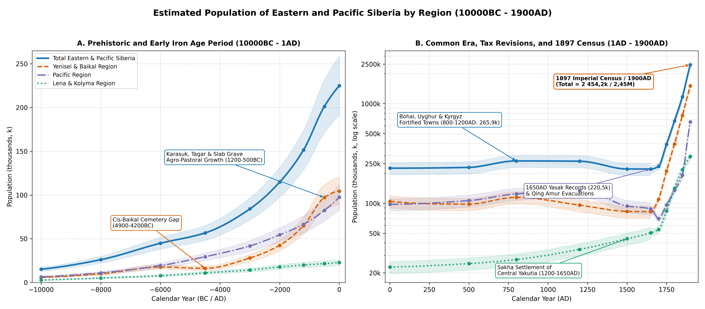
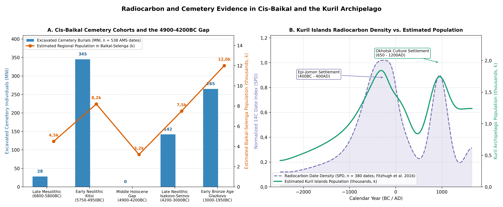
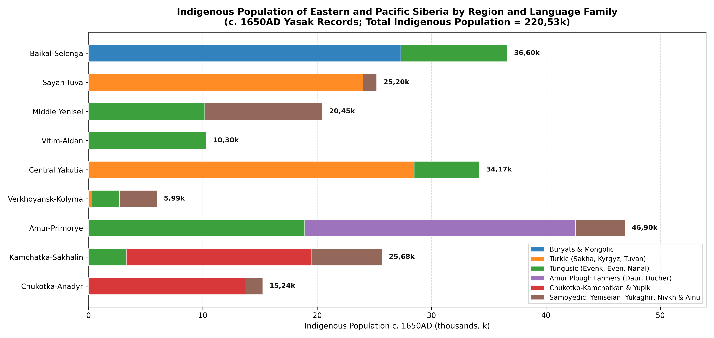

# Abstract

This paper reviews the archaeological, radiocarbon, stable-isotope, and
historical demographic literature to estimate the population of Eastern
and Pacific Siberia (~ 10,11M km²) from 10000BC to 1900AD. Following the
regional drainage divisions established by Chernykh et al.
[\[1\]](#ref-Chernykh2022), the study covers three major drainage
systems and nine constituent regions (Figure ): the Yenisei and Baikal
Region (Baikal-Selenga, Sayan-Tuva, and Middle and Lower Yenisei), the
Lena and Kolyma Region (Vitim-Aldan, Central Yakutia and Middle Lena,
and Yana-Indigirka-Kolyma), and the Pacific Region (Amur-Primorye,
Kamchatka-Sakhalin-Kurils, and Chukotka-Anadyr). Rather than relying on
global historical databases or treating raw radiocarbon date counts as
direct measures of short-term population change, the estimates are
derived from excavated house counts, cemetery burial cohorts, fortified
settlement areas (*gorodishcha*), 17th-century Russian fur-tribute
(*yasak*) registers [\[2\]](#ref-Dolgikh1960), 18th- and 19th-century
imperial poll-tax revisions (*revizskie skazki*), and the First
All-Russian Imperial Census of 1897
[\[3\]](#ref-Troinitskiy1905)[\[4\]](#ref-Patkanov1912)[\[5\]](#ref-Kabuzan1985).
Across all nine regions, the combined population grew from ~ 15,20k
during the Younger Dryas (10000BC) to ~ 56,70k in the Middle Holocene
(4500BC), ~ 201,30k during the Early Iron Age Tagar and Slab Grave
period (500BC), and ~ 265,90k during the medieval Bohai, Uyghur, and
Yenisei Kyrgyz period (800AD). In the mid-17th century (1650AD), Russian
*yasak* records document 220,53k indigenous inhabitants (234,80k total
population by 1700AD). Over the 18th and 19th centuries, natural growth
among the Buryat and Sakha pastoralists and large-scale Russian peasant,
Cossack, and mining settlement raised the total population to 390,80k in
1750AD, 669,00k in 1800AD, 1,17M in 1850AD, and 2,45M by 1900AD.

# Background

Eastern and Pacific Siberia span a wide range of environments, from the
sheltered steppes of the Minusinsk Hollow, Tuva, and the Selenga basin
and the temperate monsoon forests of the Amur, Ussuri, and Primorye
plains to the thermokarst meadow-steppe depressions (*alaas*) of Central
Yakutia, the continental permafrost larch taiga of the Tunguska, Vitim,
Aldan, and Kolyma basins, and the salmon rivers and sea-mammal coasts of
Kamchatka, Sakhalin, the Kurils, and the Bering Strait
[\[1\]](#ref-Chernykh2022). Prior to the 17th century, crop cultivation
was confined to the southern steppe valleys and the Middle Amur, Ussuri,
and Primorye lowlands. Across the remaining 8,5M km² of boreal forest
and Arctic tundra, population density depended on freshwater and
anadromous fish runs, coastal sea-mammal hunting, wild ungulate hunting,
and - from the medieval period onward - horse, cattle, and reindeer
herding.

Four bodies of historical and archaeological research provide the
empirical basis for the estimates presented here. In the Lake Baikal
basin, the Baikal Hunter-Gatherer Project (BHGP) obtained over 538
accelerator mass spectrometry (AMS) radiocarbon dates paired with
$`\delta^{13}\text{C}`$ and $`\delta^{15}\text{N}`$ stable-isotope
measurements from individual burials at Shamanka II, Lokomotiv, Ust’-Ida
I, Kurma XI, and Khuzhir-Nuge XIV. Correcting for old carbon offsets of
300-700 $`^{14}\text{C}`$ years in fish and seal consumers confirmed a
700-year gap in formal cemetery burials (4900-4200 cal BC) between the
Early Neolithic Kitoi culture and the Late Neolithic Isakovo-Serovo
culture
[\[6\]](#ref-Schulting2014)[\[7\]](#ref-Weber2016a)[\[8\]](#ref-Weber2016b)[\[9\]](#ref-Weber2021).
In the Minusinsk Hollow and Tuva, AMS dating and stable-isotope analyses
of 354 individuals show that broomcorn millet (*Panicum miliaceum*)
became a staple crop during the Karasuk (~ 1400-900 cal BC) and Tagar (~
800-100 cal BC) periods, supporting a three- to fourfold increase in
population reflected in tens of thousands of stone-walled burial mounds
(*kurgans*) and permanent winter villages
[\[10\]](#ref-Legrand2006)[\[11\]](#ref-Bokovenko2006)[\[12\]](#ref-Svyatko2009)[\[13\]](#ref-Svyatko2013)[\[14\]](#ref-Caspari2018)[\[15\]](#ref-Caspari2019).

In the Amur-Primorye basin and the Northwest Pacific islands and coasts,
excavations of Terminal Pleistocene pottery sites (Osipovka,
Gromatukha), large Neolithic pit-house villages (Suchu Island with 142
house depressions; Boisman-2 shell midden), Bohai and Jurchen walled
towns (Krasnoyarovskoye covering 180 ha; Shayginskoye with over 310
excavated heated dwellings), Kuril Island radiocarbon series
($`n = 380`$ dates), and Bering Strait whalebone villages (Ekven and
Uelen with over 530 graves) provide direct house and burial counts
[\[16\]](#ref-Kuzmin1998)[\[17\]](#ref-Kuzmin2006)[\[18\]](#ref-Popov2010)[\[19\]](#ref-Filatova2018)[\[20\]](#ref-Gelman2018)[\[21\]](#ref-Artemyeva2013)[\[22\]](#ref-Artemyeva2025)[\[23\]](#ref-Fitzhugh2016)[\[24\]](#ref-Mason1998)[\[25\]](#ref-Dneprovskiy2017).
B. O. Dolgikh’s clan-by-clan archival study of 17th-century *yasak* tax
books [\[2\]](#ref-Dolgikh1960), supplemented by regional archival
studies of Khongorai, Yakutsk *uyezd*, Priamurye, and Kamchatka-Chukotka
[\[26\]](#ref-Chertykov2009)[\[27\]](#ref-Ushnitskiy2017a)[\[28\]](#ref-Ushnitskiy2017b)[\[29\]](#ref-Turaev2013)[\[30\]](#ref-Turaev2020)[\[31\]](#ref-Tolkacheva2015),
establishes the mid-17th-century indigenous population. For the 18th and
19th centuries, the ten imperial poll-tax revisions (*revizii* of
1719-1858), the records of the 1763 *Yasak* Commission and post-1822
Steppe Dumas, guberniya statistical reviews, and the First All-Russian
Imperial Census of 28 January 1897 document both indigenous demographic
trends and the Russian agricultural and urban settlement of Eastern
Siberia and the Far East
[\[3\]](#ref-Troinitskiy1905)[\[4\]](#ref-Patkanov1912)[\[5\]](#ref-Kabuzan1985)[\[32\]](#ref-Mansheev2010)[\[33\]](#ref-Kurchatova2015)[\[34\]](#ref-Kyshpanakov2022a)[\[35\]](#ref-Kolomiets2022).

# Methodology

## Regional Subdivisions

All population estimates are organised according to the nine drainage
regions defined by Chernykh et al. [\[1\]](#ref-Chernykh2022) and mapped
in Figure . The Yenisei and Baikal Region (~ 3,28M km²) comprises the
Baikal and Selenga Basin (~ 650k km²: Lake Baikal, Upper Angara,
Barguzin, Selenga, Uda, Khilok, Chikoy, and Onon-Ingoda headwaters), the
Sayan, Minusinsk, and Tuva Basin (~ 380k km²: Minusinsk Hollow, Abakan,
Chulym, Kan, and Upper Yenisei / Ulug-Khem / Khemchik basins in Tuva),
and the Middle and Lower Yenisei (~ 2,25M km²: Middle and Lower Yenisei,
Lower Angara, Stony and Lower Tunguska, Pyasina, Khatanga, and Taimyr
Peninsula).

The Lena and Kolyma Region (~ 4,05M km²) encompasses the Vitim and Aldan
Basins (~ 1,12M km²: Vitim, Olekma, Aldan, Amga, Uchur, and Maya
basins), Central Yakutia and the Middle Lena (~ 1,38M km²: Middle and
Lower Lena, Central Yakutian *alaas* lowland, and Vilyuy basin), and the
Yana, Indigirka, and Kolyma Basins (~ 1,55M km²: Yana, Indigirka,
Alazeya, Kolyma, and Omolon basins, plus the New Siberian Islands). The
Pacific Region (~ 2,78M km²) comprises the Amur, Ussuri, and Primorye
Basin (~ 980k km²: Shilka-Argun, Upper/Middle/Lower Amur, Zeya, Bureya,
Ussuri, Lake Khanka, and Primorye coast), Kamchatka, Sakhalin, and the
Kuril Islands (~ 650k km²: Okhotsk coast, Kamchatka Peninsula, Sakhalin
Island, and Kuril Archipelago), and Chukotka, Anadyr, and the Bering
Strait (~ 1,15M km²: Anadyr basin, Chukotka Peninsula, Bering Strait
coast, and Koryak Highlands / Penzhina-Gizhiga bays).

## Estimation Methods

Four standard archaeological and historical conversion methods are used
to translate field and archival records into regional population totals
across nineteen benchmark dates from 10000BC to 1900AD. Using standard
floor-area ratios (~ 6-10 m² per person) and North Asian ethnographic
observations [\[25\]](#ref-Dneprovskiy2017)[\[36\]](#ref-Kiryanov2019),
single-hearth pit-houses of 20-45 m² (Boisman, Yankovsky, and Shayga
*kan*-heated houses) are estimated at 5-7 occupants; medium multi-hearth
houses of 60-120 m² (Suchu Island, Okhotsk Culture, and Ekven whalebone
*nynglu*) at 12-20 occupants; and large communal winter houses (Karasuk
timber houses at Torgazhak of 100-200 m²; Itelmen winter *zimniki* of
150-300 m²) at 25-80 occupants. For walled towns (*gorodishcha*) of the
Xiongnu (Ivolga, Bayangol), Uyghur Khaganate (Por-Bajin, Shagonar),
Bohai Kingdom (Kraskinskoye, Koksharovka-1), and Jurchen Jin / Eastern
Xia (Krasnoyarovskoye, Shayginskoye), excavated dwelling counts (54
houses in 25% of the 7,2 ha interior at Ivolga; over 310 houses across
47,6 ha at Shayginskoye) indicate 30-55 dwellings/ha in residential
wards, corresponding to 150-300 persons/ha in densely built towns and
40-80 persons/ha in large mountain refuge enclosures
[\[21\]](#ref-Artemyeva2013)[\[22\]](#ref-Artemyeva2025)[\[37\]](#ref-Vasyutin2022).

Living community size $`P`$ is estimated from the minimum number of
individuals ($`M_{\text{MNI}}`$) buried over a calibrated cemetery
duration $`T`$ (in years) at an annual crude mortality rate
$`m \approx 0{,}030\text{-}0{,}035\text{ yr}^{-1}`$ via
$`P = (M_{\text{MNI}} \cdot c_{\text{exc}}) / (m \cdot T)`$, where
$`c_{\text{exc}}`$ accounts for unexcavated cemetery area and subadult
burial under-representation [\[8\]](#ref-Weber2016b). In the historical
period, adult male tribute-payers (*yasachnye lyudi*, aged 18-50) in
17th-century Russian *yasak* registers are converted to total population
using B. O. Dolgikh’s household multipliers [\[2\]](#ref-Dolgikh1960): x
3,5-4,0 for taiga and tundra hunter-herders (Evenks, Evens, Yukaghirs,
Kets, Samoyeds), x 4,0-4,5 for pastoralists (Sakha, Buryats, Yenisei
Kyrgyz, Tuvans), and x 4,5-5,0 for sedentary plough farmers and
multi-family river fishers (Daurs, Duchers, Itelmens). For 1750, 1800,
1850, and 1900AD, district (*uyezd* / *okrug*) returns from the 2nd
(1744), 5th (1795), and 9th-10th (1850-1858) revisions, Steppe Duma
registers, and the 1897 Imperial Census (adjusted to 1900AD via
guberniya statistical yearbooks) are allocated to the nine drainage
regions
[\[3\]](#ref-Troinitskiy1905)[\[4\]](#ref-Patkanov1912)[\[5\]](#ref-Kabuzan1985)[\[38\]](#ref-Rygalova2024).

# Yenisei and Baikal Region

## Baikal and Selenga Basin

### Mesolithic, Early Neolithic Kitoi, and the Middle Holocene Gap (8000-1800 cal BC)

Following Terminal Pleistocene and Mesolithic hunting and fishing along
the Angara rapids and Selenga river terraces (Ust’-Belaya, Studenoe-1/2,
~ 8000-5800 cal BC; regional population rising from ~ 2,2k at 10000BC to
~ 3,8k at 8000BC), the Early Neolithic Kitoi culture (*Kitoyskaya
kultura*, reservoir-corrected to ~ 5750-4950 cal BC) established large
formal cemeteries at productive fishing and sealing locations
[\[6\]](#ref-Schulting2014)[\[7\]](#ref-Weber2016a)[\[8\]](#ref-Weber2016b).
At Shamanka II on the Kultuk peninsula at the southwestern tip of Lake
Baikal, excavations uncovered 112 graves containing 155 individuals (116
AMS dates), with over 85% of burials belonging to the Kitoi phase (~
5650-4950 cal BC) and a smaller Early Bronze Age Glazkovo component (13
individuals, ~ 2600-1950 cal BC) [\[8\]](#ref-Weber2016b). At Lokomotiv
at the Irkut-Angara confluence in Irkutsk, excavations of 91 graves
yielded an MNI of 149 individuals (~ 5750-5000 cal BC), whose elevated
$`\delta^{15}\text{N}`$ values (+13,5‰ to +16,8‰) reflect heavy reliance
on Angara grayling, sturgeon, and Baikal seal (*Pusa sibirica*)
[\[6\]](#ref-Schulting2014)[\[7\]](#ref-Weber2016a).

Across all 538 reservoir-corrected AMS dates from Cis-Baikal cemeteries
(Figure , Panel A), no formal cemetery burials date between 4900 and
4200 cal BC [\[7\]](#ref-Weber2016a)[\[9\]](#ref-Weber2021). Large Kitoi
fishing communities dispersed into smaller mobile hunting bands
(regional population falling from ~ 8,2k at 6000BC to ~ 3,2k at 4500BC),
before genetically distinct Late Neolithic Isakovo-Serovo (~ 4200-3000
cal BC; Ust’-Ida I with MNI = 67) and Early Bronze Age Glazkovo (~
3000-1950 cal BC; Khuzhir-Nuge XIV with 79 graves and MNI = 89, Kurma
XI, and Sagan-Zaba II sealing camps) communities raised the regional
population to ~ 7,5k at 3000BC and ~ 12,0k at 2000BC
[\[7\]](#ref-Weber2016a)[\[39\]](#ref-Losey2008).

### Slab Grave, Khirigsuur, and the Xiongnu Northern Frontier (1300BC-100AD)

The spread of horse, sheep, goat, and cattle pastoralism during the Late
Bronze and Early Iron Ages reshaped settlement across the Selenga, Uda,
Khilok, Dzhida, and Onon-Ingoda steppes. More than 3,000 stone-slab
burial enclosures of the Slab Grave culture (*Kultura plitochnykh
mogil*, ~ 1300-300BC) and monumental *khirigsuur* stone mounds are
recorded across Buryatia and western Transbaikalia, supporting an
estimated regional population of ~ 18,5k by 1200BC and ~ 27,0k by 500BC.

From the late 2nd century BC to the 1st century AD, the Xiongnu Empire
(*Khunnu*) incorporated the Selenga-Dzhida basin as a northern
agricultural, ironworking, and garrison frontier
[\[37\]](#ref-Vasyutin2022)[\[40\]](#ref-Miyagashev2020). At Ivolga
Fortress (*Ivolginskoye gorodishche*, 14 km southwest of Ulan-Ude),
enclosed by four concentric ramparts and ditches (348 x 216 m, ~ 7,2 ha
preserved), A. V. Davydova’s excavations of roughly a quarter of the
interior exposed 54 semi-subterranean dwellings heated by L-shaped stone
and clay flues (*kan*), iron-smelting furnaces, grain storage pits
containing millet, barley, and wheat, and the adjacent 216-grave Ivolga
cemetery; scaling across the unexcavated quarters indicates ~ 300-380
contemporary houses, or a garrison and craft town of ~ 2,5k-3,0k
residents [\[37\]](#ref-Vasyutin2022). Beyond Bayangol (~ 10,0 ha),
Dyrestui, and Ilmovaya Pad (over 320 Xiongnu graves including
aristocratic terraced tombs), open agricultural and craft villages such
as Nizhnemangirtuyskoe (1,8 ha) and Dureny I-II (extending along 12 km²
of the Chikoy valley) supplied grain and iron tools to nomadic camps,
supporting a regional population of ~ 36,0k around 1AD
[\[40\]](#ref-Miyagashev2020).

### Medieval Kurykans, Buryat Steppe Dumas, and Russian Settlement (500-1900AD)

Between the 6th and 11th centuries AD, the Kurykan (*Kurumchinskaya*)
confederation (the *Gulifan* of Tang Chinese chronicles, recorded as
fielding up to 5,000 horsemen) built more than 40 stone-walled hillforts
(*shibe* on Olkhon Island and in the Barguzin, Kuda, and Angara
valleys), bloomery iron furnaces, and hay-meadow irrigation ditches,
sustaining ~ 34,0k-35,5k people across the Baikal and Selenga basin
between 800 and 1200AD. In the mid-17th century, B. O. Dolgikh
[\[2\]](#ref-Dolgikh1960) and V. N. Davydov et al.
[\[41\]](#ref-Davydov2016) reconstructed 27,3k Buryats (~ 13,5k western
Bulagat, Ekhirit, and Khongodor Buryats along the Angara, Oka, and
Olkhon, and ~ 13,8k eastern Khori, Selenga, and Tabunut Buryats)
together with 9,3k Baikal and Daurian Evenks, giving an indigenous
population of 36,60k in 1650AD (0,0563 persons/km²), rising to 49,0k by
1700AD after the founding of Irkutsk (1661), Selenginsk (1665), and
Verkhneudinsk (1666).

During the 18th and 19th centuries, the Baikal-Selenga basin became the
demographic core of Eastern Siberia
[\[32\]](#ref-Mansheev2010)[\[42\]](#ref-Khankharaev2010). Following the
1727 Treaty of Kyakhta (which fixed the Russo-Qing border and organised
six Buryat border-guard regiments) and M. M. Speransky’s 1822 *Statute
on Indigenous Administration* (*Ustav ob upravlenii inorodtsev*, which
created the Kudinskaya, Balaganskaya, Idinskaya, Verkholenskaya,
Olkhonskaya, Tunkinskaya, and Alarskaya Steppe Dumas in Irkutsk
Guberniya and the Khorinskaya, Selenginskaya, Barguzinskaya, and
Aginskaya Steppe Dumas in Transbaikalia), Buryat households increasingly
combined semi-sedentary livestock raising with haymaking and rye/wheat
cultivation [\[32\]](#ref-Mansheev2010). Archival returns compiled by P.
I. Keppen, Yu. A. Gagemeister, and S. K. Patkanov show the Buryat
population growing from ~ 27,3k in 1650 to ~ 73k at the 3rd Revision
(1763), ~ 115k in 1800, ~ 195k at the 9th Revision (1850), and 288,6k in
the 1897 Imperial Census (108,9k in Irkutsk Guberniya and 179,7k in
Transbaikal Oblast)
[\[4\]](#ref-Patkanov1912)[\[42\]](#ref-Khankharaev2010).

From the 1760s, tens of thousands of exiled Old Believer peasants
(*Semeiskie*) settled in the fertile Chikoy, Khilok, and Uda valleys of
western Transbaikalia, while Russian peasant villages multiplied along
the Moscow Highway (*Moskovskiy trakt*) toward Irkutsk (which grew to
51,5k inhabitants in 1897), Verkhneudinsk, Chita, and the tea-trade
entrepôt of Kyakhta-Troitskosavsk
[\[3\]](#ref-Troinitskiy1905)[\[38\]](#ref-Rygalova2024). Combined total
population in the Baikal and Selenga basin rose from 105,0k in 1750AD to
210,0k in 1800AD, 415,0k in 1850AD, and 850,0k by 1900AD (~ 430k in the
Upper Angara, Irkutsk, Balagansk, and Verkholensk districts of
Cis-Baikal and ~ 420k in the Selenga, Barguzin, Verkhneudinsk,
Troitskosavsk, Chita, and Aksha districts of western Transbaikalia).

## Sayan, Minusinsk, and Tuva

### Eneolithic to Late Bronze Age (Afanasievo, Okunev, Andronovo, Karasuk; 3100-800 cal BC)

After Upper Palaeolithic and Neolithic foraging along the Yenisei
terraces (Afontova Gora, Kokorevo, Toora-Dash; regional population
growing from ~ 2,5k at 10000BC to ~ 8,2k at 4500BC), the sheltered
steppes of the Minusinsk Hollow and Tuva (~ 380k km²) supported dense
Bronze Age pastoral and farming populations
[\[12\]](#ref-Svyatko2009)[\[13\]](#ref-Svyatko2013). Across the
Afanasievo (~ 3100-2500 cal BC), Okunev (~ 2500-1800 cal BC), and
Andronovo/Fedorovo (~ 1800-1400 cal BC) periods, radiocarbon modelling
of 88 new and over 300 previously published human-bone $`^{14}\text{C}`$
dates [\[12\]](#ref-Svyatko2009) tracks the shift from early
$`\text{C}_3`$-diet herders
($`\delta^{13}\text{C} = -18{,}9 \pm 0{,}6\text{‰}`$) to bronze-working
pastoral communities (~ 14,0k at 3000BC and ~ 22,0k at 2000BC). During
the Karasuk culture (*Karasukskaya kultura*, ~ 1400-900 cal BC), human
bone carbon isotope values shift sharply to
$`\delta^{13}\text{C} = -14{,}8 \pm 2{,}1\text{‰}`$, demonstrating
widespread cultivation of $`\text{C}_4`$ broomcorn millet alongside
sheep and cattle transhumance [\[13\]](#ref-Svyatko2013). More than
10,000 stone-slab burial enclosures (over 2,500 excavated across more
than 100 cemeteries; Sukhaya Erba alone contains over 600 enclosures)
and permanent winter villages such as Torgazhak on the Askiz River (6
excavated timber-and-sod pit-houses of 100-200 m² each, housing ~
120-180 villagers) indicate a Late Bronze Age population of ~ 36,0k
around 1200BC [\[10\]](#ref-Legrand2006).

### Early Iron Age Kurgans (Tagar, Aldy-Bel, Uyuk-Sagly) and Tashtyk Crypts (800BC-500AD)

During the Tagar culture (*Tagarskaya kultura*, ~ 800-100 cal BC), the
Minusinsk basin contained the largest concentration of Early Iron Age
burial mounds in Siberia, with 25,000-30,000 recorded kurgans across the
Podgornovo, Saragash, and Tes stages, including the royal mound of
Salbyk (70 x 70 m megalithic stone enclosure with slabs weighing 30-50
tonnes) and clan-marked enclosures below Mount Tepsei
[\[11\]](#ref-Bokovenko2006)[\[43\]](#ref-Sovetova2015); collective
timber burial vaults of the Saragash and Tes phases hold 30-150+
individuals per kurgan. In Tuva during the Aldy-Bel and Uyuk-Sagly
cultures, satellite and geomagnetic surveys in the Uyuk River valley
(“Siberian Valley of the Kings”) have mapped thousands of stone and
timber kurgans [\[14\]](#ref-Caspari2018)[\[15\]](#ref-Caspari2019). At
Tunnug-1 (Arzhan-0, 9th century BC) and Arzhan-1 (~ 800 cal BC, 120 m
diameter, 70 radial larch chambers containing over 160 sacrificed riding
horses) [\[44\]](#ref-Khorvat2020), construction required an estimated
1,0k-1,5k workers, and combined Minusinsk (~ 36k) and Tuva (~ 22k)
populations reached ~ 58,0k around 500BC. In the subsequent Tashtyk
(*Tashtykskaya kultura*, 1st-7th centuries AD) and Kokel periods, known
for the permafrost burials at Oglakhty (painted plaster funerary masks
and leather effigies) and collective burial crypts (*sklepy*) containing
20-120+ individuals [\[45\]](#ref-Gromov2021), the region sustained ~
55,0k at 1AD and ~ 52,0k at 500AD.

### Yenisei Kyrgyz, Uyghur Fortresses, Khongorai, and Imperial Settlement (600-1900AD)

Along the Khemchik and Ulug-Khem valleys of Tuva between 745 and 840AD,
the Uyghur Khaganate built 17 rectangular stamped-clay (*pakhs*)
fortresses connected by earthen ramparts (*Dlinnaya Stena*), including
Shagonar I-V (Shagonar III covers 22 ha), Bazhyn-Alaak (18 ha), and the
island complex of Por-Bajin (215 x 162 m, 3,5 ha in Lake Tere-Khol)
[\[46\]](#ref-Tulush2011)[\[47\]](#ref-Tulush2016). Using the 774-775AD
radiocarbon spike, Kuitems et al. [\[48\]](#ref-Kuitems2020) dated the
felling of Por-Bajin’s foundation larch timbers to the summer of 777AD
under Tengri Bögü Khagan. North of the Sayan Range from the 6th to 13th
centuries AD, the Yenisei Kyrgyz state — supported by plough
agriculture, irrigation canals (*aryks*) along the Abakan, Uybat, and
Erba rivers, and elite *chaatas* cemeteries (Uybatsky, Kopensky) —
overthrew the Uyghur Khaganate in 840AD [\[49\]](#ref-Mitko2009). Around
800-900AD, the Sayan-Tuva region supported ~ 64,0k inhabitants (~ 40k in
Minusinsk and ~ 24k in Tuva), before 13th-century Mongol campaigns
(1207-1293AD) and deportations reduced the population to ~ 42,0k in
1200AD and ~ 28,0k in 1500AD.

In 1650AD, the four Yenisei Kyrgyz princely *uluses* (Altysar, Altyr,
Isar, Tubin) of Khongorai and their tributary *kyshtym* clans (Kachin,
Sagai, Beltir, Kyzyl, Shor, Kamasin) numbered ~ 12,8k, while Tuvans and
Todzhins numbered ~ 11,2k and Sayan Samoyeds (Mator, Karagas, Koibal) ~
1,2k, giving an indigenous population of 25,20k (0,0663 persons/km²)
[\[2\]](#ref-Dolgikh1960)[\[26\]](#ref-Chertykov2009). After the Qing
Empire relocated a large part of the Yenisei Kyrgyz elite to the Ili
valley in 1703 and Russia erected the Abakan (1707) and Sayansk (1718)
forts, the Minusinsk, Achinsk, and Kansk forest-steppes became the
premier grain-growing belt of Yeniseysk Guberniya (founded 1822)
[\[34\]](#ref-Kyshpanakov2022a)[\[50\]](#ref-Kyshpanakov2022b). Under
the Kachinskaya, Sagayskaya, and Kyzylskaya Steppe Dumas, the indigenous
Khakas (“Yenisei Turks”) grew from ~ 14k in the mid-18th century to
37,7k in the 1897 Census, while Russian peasant immigration pushed the
total population of Minusinsk Okrug alone to 182,7k (with another 111,5k
in Achinsk Okrug and 96,2k in Kansk Okrug)
[\[3\]](#ref-Troinitskiy1905)[\[34\]](#ref-Kyshpanakov2022a). South of
the Sayan Range in Qing-ruled Uriankhai (Tuva, *Tangnu-Uryankhai*),
banners (*khoshuns*) of Tuvan pastoralists numbered ~ 50,0k-55,0k by the
late 19th century, joined from the 1860s onward by Russian Old Believer
farmers, gold miners, and merchants (~ 2,5k Russians by 1900AD)
[\[51\]](#ref-Tokareva2018)[\[52\]](#ref-Natsak2024). Across the entire
Sayan, Minusinsk, and Tuva region, total population increased from 31,5k
in 1700AD to 58,0k in 1750AD, 105,0k in 1800AD, 215,0k in 1850AD, and
440,0k in 1900AD.

## Middle and Lower Yenisei

Covering ~ 2,25M km² of boreal taiga and Arctic tundra across the Middle
and Lower Yenisei, Lower Angara, Stony and Lower Tunguska, and Taimyr
Peninsula, the Middle Siberian basin was inhabited from the Early
Holocene (Ust-Kova on the Lower Angara; Tagenar VI on the Taimyr
Peninsula, ~ 6000 cal BC) by riverine fishers and wild reindeer hunters
(rising from ~ 1,2k at 10000BC to ~ 4,8k at 4500BC and ~ 8,5k at
2000BC). During the 2nd millennium BC, Ymyyakhtakh and Pyasina groups
operated the world’s northernmost bronze foundries at Abylaakh-1 on the
Kheta River ($`71^\circ\text{N}`$, ~ 1200 cal BC), casting socketed
celts from local Norilsk-Talnakh native copper. Iron Age Tsepan and
Ust-Chernaya bloomery iron-smelters along the Angara and Stony Tunguska
preceded the 17th-century indigenous groups reconstructed by B. O.
Dolgikh [\[2\]](#ref-Dolgikh1960) and N. A. Tuchkova
[\[53\]](#ref-Tuchkova2020): 10,16k Western Evenks across the Tunguska
basins, 5,54k Yeniseian peoples (Inbatsk and Sym Kets, Kott, Arin,
Assan, Pumpokol, Yugh), and 4,75k Yenisei-Taimyr Samoyeds (Enets,
Nganasan/Tavgi, and Yenisei Nenets), totalling 20,45k indigenous
inhabitants in 1650AD (0,0091 persons/km²), or 29,5k in 1700AD including
Russian settlers around Yeniseysk (1619), Krasnoyarsk (1628), and
Turukhansk.

In the 18th and 19th centuries, agricultural villages expanded along the
Yeniseysk-Krasnoyarsk-Nizhneudinsk-Bratsk river and post-road corridors,
while the discovery of rich alluvial gold in the North and South Yenisei
taiga (the Yeniseysk gold rush of the 1830s-1850s) attracted tens of
thousands of seasonal miners
[\[3\]](#ref-Troinitskiy1905)[\[50\]](#ref-Kyshpanakov2022b). In the
northern Turukhansk Krai (10,9k inhabitants in the 1897 Census),
indigenous Evenk, Ket, Selkup, Enets, Nganasan, and Dolgan populations
remained stable at ~ 10k-12k, while southern Kott, Arin, and Assan
groups were linguistically assimilated into Russian and Khakas
communities [\[4\]](#ref-Patkanov1912). Overall population in the Middle
and Lower Yenisei basin rose from 48,0k in 1750AD to 78,0k in 1800AD,
132,0k in 1850AD, and 215,0k in 1900AD.

# Lena and Kolyma Region

## Vitim and Aldan Basins

Multi-layered river terrace sites along the Aldan, Olekma, and Vitim
rivers (Belkachi I with 23 cultural horizons, Ust-Timpton with 26
horizons, Sumnagin I with 38 horizons, and Ust-Mil II) provide the
primary radiocarbon sequence for interior Northeast Asia
[\[54\]](#ref-AlekseyevDyakonov2009). During the Terminal Pleistocene
Dyuktai (~ 14000-8500 cal BC) and Early Holocene Sumnagin Mesolithic
(*Sumnaginskaya kultura*, ~ 8500-5000 cal BC, 46 $`^{14}\text{C}`$
dates), non-ceramic microblade hunters occupying light surface *chum*
tents (3-4 m stone-ring hearths) hunted elk (*Alces alces*) and wild
reindeer along the Aldan and Vitim valleys, with regional population
growing from ~ 1,0k at 10000BC to ~ 1,8k at 8000BC and ~ 2,8k at 6000BC.
During the subsequent Syalakh (~ 5000-3800 cal BC, 34 dates), Belkachi
(~ 3800-2200 cal BC, 42 dates), and Ymyyakhtakh (~ 2200-1000 cal BC, 90
dates) cultures, net-impressed, cord-marked, and waffle-stamped pottery
accompanied semi-subterranean winter houses and composite bone/antler
bows (Belkachi I, Tuoi-Khaya), raising the regional population from ~
4,0k at 4500BC to ~ 6,5k at 2000BC
[\[54\]](#ref-AlekseyevDyakonov2009)[\[55\]](#ref-SikoraPitulko2019).

During the Bronze Age Ust-Mil culture (~ 1300-400 cal BC, 48 dates) and
the Early Iron Age, local bronze casting (Ust-Mil II) and ironworking
supported ~ 7,4k people at 1200BC and ~ 9,6k at 1200AD. In 1650AD
[\[2\]](#ref-Dolgikh1960), the Vitim and Aldan basins held ~ 8,8k Evenks
and ~ 1,5k southern Evens (10,30k total; 0,0092 persons/km²). In the
18th and early 19th centuries, Sakha cattle-and-horse pastoralists
settled along the Amga and lower Aldan valleys, raising the regional
population to 13,5k in 1750AD and 18,0k in 1800AD. From the 1840s to
1890s, the opening of the Olekma and Vitim (Bodaibo) placer goldfields
drew thousands of Russian, Sakha, and Buryat mineworkers and carters,
lifting the regional total from 26,0k in 1850AD to 48,0k in 1900AD
[\[3\]](#ref-Troinitskiy1905)[\[33\]](#ref-Kurchatova2015).

## Central Yakutia and Middle Lena

Throughout the Neolithic, Bronze Age, and Early Iron Age (Syalakh,
Belkachi, Ymyyakhtakh, Ust-Mil, Kullaty, Pokrovsk), the Middle Lena,
Lower Lena (Siktyakh, Zhigansk), and Vilyuy river basins were occupied
by taiga hunting and fishing bands whose population grew gradually from
~ 1,1k at 10000BC to ~ 4,6k at 4500BC, ~ 7,5k at 2000BC, and ~ 9,6k at
1AD [\[54\]](#ref-AlekseyevDyakonov2009).

Between the 11th and 14th centuries AD, Turkic-speaking Sakha (*Yakuty*)
ancestors migrating from the Baikal-Angara region introduced hardy
northern horse and cattle breeding into the Central Yakutian Lowland
(the Tuymaada, Erkeeni, and Ensieli valleys along the Middle Lena and
the Lena-Amga interfluve between $`61^\circ\text{N}`$ and
$`63{,}5^\circ\text{N}`$), making intensive use of the thermokarst
lake-meadow depressions (*alaas*) scattered through the permafrost taiga
[\[36\]](#ref-Kiryanov2019)[\[56\]](#ref-Ushnitskiy2009)[\[57\]](#ref-Crubezy2024).
During the Kulun-Atakh culture (*Kulun-Atakhskaya kultura*, 14th-16th
centuries AD), excavations at Kulun-Atakh, Ugar, Sayylyk, and the
15th-century site of Ayyy-Taybyt in Yakutsk uncovered timber winter
houses (*balagan*) with clay-plastered hearths (*komulok*), birch-bark
summer tents (*urasa*), bloomery iron furnaces, and hay-storage corrals
[\[36\]](#ref-Kiryanov2019); contemporaneous “Small Houses” (*Kultura
malykh domov*) sites around the edges of the *alaas* lowland represent
neighbouring Evenk hunter-fishers adopting Sakha material culture and
language [\[36\]](#ref-Kiryanov2019).

When Russian Cossacks founded Yakutsk Ostrog in 1632, over 80% of the
Sakha lived within a 25,000 km² *alaas* core between the Middle Lena,
lower Aldan, and lower Amga (local density \> 1,1 persons/km²). From the
*yasak* books of 1634-1690, B. O. Dolgikh [\[2\]](#ref-Dolgikh1960) and
V. V. Ushnitskiy
[\[27\]](#ref-Ushnitskiy2017a)[\[28\]](#ref-Ushnitskiy2017b)
reconstructed 28,47k Sakha across 35 *volosts* (Kangalasskaya ~ 4,8k,
Meginskaya ~ 3,6k, Borogonskaya ~ 3,3k, Baturusskaya ~ 3,1k, Namskaya ~
2,5k, Betunskaya ~ 1,6k, and Bayagantayskaya, plus Vilyuy and Olekma
settlements established from the 1630s onward) alongside ~ 5,7k Vilyuy
and Lower Lena Evenks, yielding an indigenous population of 34,17k in
1650AD (37,5k in 1700AD including Russian servicemen and Lena peasant
farmers). Despite periodic smallpox outbreaks in the 18th century, the
Sakha expanded steadily across the entire Vilyuy basin (Suntar, Nyurba,
Verkhnevilyuysk) and the Olekma valley, draining thermokarst lakes
(*khoruu*) to create new hay meadows and adopting barley and rye farming
from Russian peasants settled along the Lena post stations
[\[27\]](#ref-Ushnitskiy2017a)[\[33\]](#ref-Kurchatova2015). Poll-tax
revisions and Yakut Steppe Duma records show the Sakha growing from ~
28,5k in 1650 to ~ 80k at the 3rd Revision (1763), ~ 125k at the 7th
Revision (1816), ~ 185k at the 10th Revision (1858), and 225,8k across
Yakutsk Oblast in the 1897 Imperial Census (83,7% of the oblast’s 269,9k
residents, with Russians accounting for ~ 30k and Evenks/Evens/Yukaghirs
~ 14k)
[\[4\]](#ref-Patkanov1912)[\[33\]](#ref-Kurchatova2015)[\[58\]](#ref-Kurchatova2017).
Within the bounds of Central Yakutia and the Middle Lena (Yakutsk,
Vilyuysk, and Olekminsk *okrugs*), total population increased from 62,0k
in 1750AD to 112,0k in 1800AD, 175,0k in 1850AD, and 225,0k in 1900AD.

## Yana, Indigirka, and Kolyma Basins

At the High Arctic Zhokhov site ($`76^\circ\text{06}'\text{N}`$, De Long
Archipelago, ~ 7000-5800 cal BC), excavations by V. V. Pitulko (over 540
m² of permafrost trench and more than 70 $`^{14}\text{C}`$ dates)
uncovered 13 semi-subterranean driftwood and whalebone dwellings at
$`76^\circ\text{N}`$, intensive polar bear (*Ursus maritimus*, MNI \>
150) and reindeer (MNI \> 200) hunting, engineered wooden dog sleds, and
obsidian blades transported over 1,500 km from Lake Krasnoye on the
lower Anadyr, representing a resident hunting band of ~ 25-50 people
[\[55\]](#ref-SikoraPitulko2019). Along the Upper and Lower Kolyma and
Indigirka, S. B. Slobodin
[\[59\]](#ref-Slobodin2023a)[\[60\]](#ref-Slobodin2023b) documented
Mesolithic and Neolithic campsites at Burkhala, Rodinka, and Labuya
(Burkhala yielded over 6,000 stone artefacts around stone-lined hearths;
the Rodinka II burial contained 36 bone/antler arrowheads and 130 adzes
and knives), consistent with a gradual rise in population from ~ 0,7k at
10000BC to ~ 3,8k at 2000BC and ~ 4,9k at 1AD.

For 1650AD, B. O. Dolgikh [\[2\]](#ref-Dolgikh1960) reconstructed 3,29k
Yukaghirs within the Yana, Indigirka, and Kolyma basins (~ 775 Yana
Yukaghirs, ~ 1,20k Indigirka and Alazeya Yukaghirs, and ~ 1,32k Kolyma
and Omolon Yukaghirs, out of 4,78k total Yukaghirs including 1,49k
Anadyr Chuvans, Khodyntsy, and Anauls), ~ 2,40k Verkhoyansk-Kolyma Evens
(*Lamuty*), and ~ 0,30k northern Sakha, giving 5,99k indigenous
inhabitants (0,0039 persons/km²). Over the 18th and 19th centuries,
smallpox epidemics and linguistic assimilation reduced the registered
Yukaghirs to fewer than 1,0k by 1897, while northern Sakha
cattle-and-horse herders and Even reindeer herders expanded across the
Yana, Indigirka, and Kolyma valleys
[\[4\]](#ref-Patkanov1912)[\[33\]](#ref-Kurchatova2015). In the 1897
Imperial Census, Verkhoyansk Okrug recorded 14,3k inhabitants and
Kolymsk Okrug 7,9k inhabitants, bringing the regional population from
6,3k in 1700AD to 8,0k in 1750AD, 11,5k in 1800AD, 16,5k in 1850AD, and
22,2k in 1900AD
[\[3\]](#ref-Troinitskiy1905)[\[58\]](#ref-Kurchatova2017).

# Pacific Region

## Amur, Ussuri, and Primorye

### Early Pottery, Pit-House Villages, and Millet Farming (10000-1000 cal BC)

The Lower and Middle Amur preserve some of the oldest pottery vessels in
the world within the Osipovka (Gasya, Khummi, Goncharka-1) and
Gromatukha cultures (13,300-12,300 uncal BP / ~ 14200-12200 cal BC),
used by riverine fishers harvesting seasonal runs of chum and pink
salmon
[\[16\]](#ref-Kuzmin1998)[\[17\]](#ref-Kuzmin2006)[\[61\]](#ref-Klyuev2026).
During the Mariinskoe, Malyshevo, Kondon, and Voznesenovka phases (~
6000-1500 cal BC), large permanent fishing villages lined the Lower Amur
[\[19\]](#ref-Filatova2018); on Suchu Island (3,7 ha), more than 142
circular and oval semi-subterranean house depressions (over 25
excavated, 35-150 m² floor area) housed ~ 120-250 residents at a time.
Along Peter the Great Gulf in southern Primorye, the Boisman culture
(Boisman-1 and 2, ~ 4800-3000 cal BC) left oyster shell middens with
ring cemeteries (over 40 skeletons at Boisman-2,
$`\delta^{15}\text{N} = +16{,}3\text{‰}`$)
[\[18\]](#ref-Popov2010)[\[62\]](#ref-Kuzmin2002). During the Zaisanovka
phase (~ 3000-1300 cal BC), direct AMS dates on charred foxtail and
broomcorn millet (*Setaria italica*, *Panicum miliaceum*) at
Krounovka-1, Novoselishche-4, and Bogolyubovka-1 (over 25 excavated
pit-houses) date the introduction of dryland farming in Primorye to ~
2900-2500 cal BC, supporting a rise in regional population from ~ 17,5k
at 4500BC to ~ 25,5k at 3000BC and ~ 34,0k at 2000BC
[\[16\]](#ref-Kuzmin1998)[\[63\]](#ref-IvlievKlyuev2006).

### Iron Age Villages, the Bohai Kingdom (698-926AD), and Jurchen Fortresses (1115-1234AD)

During the Early Iron Age (~ 1000BC-400AD) and Mohe period (4th-10th
centuries AD), coastal Yankovsky shell-midden farming villages
(Peschany-1 with over 30 houses), inland Krounovka settlements with
heated *kan* flues, and Middle Amur Urily and Poltse villages (Poltse I
contained 10 large burned houses, each holding 50-100 ceramic storage
jars) raised the population of the Amur-Primorye basin to ~ 55,0k at
500BC, ~ 66,0k at 1AD, and ~ 72,0k at 500AD (the Troitskoye Mohe
cemetery on the Middle Amur yielded over 218 graves). Under the Bohai
Kingdom (*Gosudarstvo Bokhay*, 698-926AD), more than 20 walled Bohai
towns and over 200 rural villages were built in Primorye
[\[20\]](#ref-Gelman2018)[\[64\]](#ref-Ivliev2021), including the
stone-walled port city of Kraskinskoye (~ 13,0 ha, 1,380 m perimeter
wall, Buddhist temple, roof-tile kilns, and residential wards housing ~
1,5k-3,0k inhabitants), Koksharovka-1 (16 ha), and Maryanovka (15 ha),
supporting ~ 86,0k people across the region around 800AD.

Under the Jurchen Jin Empire (1115-1234AD) and the Eastern Xia State
(1215-1233AD), over 30 Jurchen mountain fortresses (*gorodishcha*) and
valley towns were constructed across Primorye
[\[21\]](#ref-Artemyeva2013)[\[22\]](#ref-Artemyeva2025). At
Krasnoyarovskoye Gorodishche near Ussuriysk (~ 180 ha enclosed by an 8
km stone-and-earth rampart), Puxian Wannu’s northern capital of Kaiyuan
contained a walled inner palace compound and terraced residential
quarters with a wartime urban population of ~ 10,0k-20,0k
[\[22\]](#ref-Artemyeva2025). At Shayginskoye Gorodishche (47,6 ha),
excavations uncovered more than 310 dwellings heated by *kan* flues, 14
ironworking and bronze workshops, and an inner citadel, supporting ~
3,0k-4,5k permanent inhabitants (~ 550 total houses)
[\[21\]](#ref-Artemyeva2013). Ananyevskoye (31 ha), Nikolaevskoye (27
ha), Yekaterinovskoye (27 ha), Skalistoye (22 ha), and Lazovskoye (19
ha) each held 1,5k-3,5k residents, bringing the Amur-Primorye basin to a
medieval peak of ~ 95,0k around 1200AD, before the Mongol conquest of
1233AD and subsequent Ming and early Qing resettlements reduced the
population to ~ 54,0k by 1500AD.

### 17th-Century Qing Deportations, Nerchinsk Mining, and Post-1858 Far Eastern Settlement (1640-1900AD)

When Vasily Poyarkov (1643-1646) and Yerofey Khabarov (1649-1653)
descended the Amur, they encountered fortified timber towns (Albazin,
Guigudar with ~ 1,000 residents, Tolga, Atchansky) inhabited by
plough-farming Daurs (~ 9,7k along the Upper/Middle Amur and Zeya) and
Duchers (~ 14,0k along the Middle Amur), alongside ~ 9,0k Amur Evenks
and Negidals, ~ 7,5k Nanai (5,2k) and Ulchi (2,3k), ~ 4,3k mainland
Nivkhs, and ~ 2,4k Udege and Orochi, giving an indigenous total of
46,90k in 1650AD (0,0479 persons/km²)
[\[2\]](#ref-Dolgikh1960)[\[29\]](#ref-Turaev2013)[\[30\]](#ref-Turaev2020).
Between 1654 and 1658, the Qing government forcibly evacuated ~ 20k-24k
Daurs and Duchers southward to the Nonni and Sungari valleys in
Manchuria to deprive Russian Cossacks of local grain supplies, reducing
the population of the Amur-Primorye region to 28,5k by 1700AD
[\[5\]](#ref-Kabuzan1985)[\[30\]](#ref-Turaev2020).

Between 1689 (Treaty of Nerchinsk) and 1858, Russian territory within
the Amur drainage was limited to the upper Shilka and Argun valleys of
eastern Transbaikalia (the Nerchinsk Mining District, founded 1704),
where silver-lead mines, metallurgical works, and peasant villages grew
the regional population of the Amur basin to 62,0k in 1750AD, 102,0k in
1800AD, and 155,0k in 1850AD (while the Middle/Lower Amur and Ussuri
basins held only ~ 17,7k indigenous Nanai, Ulchi, Nivkh, Evenk, Udege,
and Manchu-Chinese residents in 1858) [\[5\]](#ref-Kabuzan1985).
Following the 1858 Treaty of Aigun and 1860 Treaty of Beijing,
large-scale settlement transformed Priamurye and Primorye
[\[5\]](#ref-Kabuzan1985)[\[65\]](#ref-Poznyak2007)[\[66\]](#ref-Avdeev2011).
The Russian government established the Amur and Ussuri Cossack Hosts
along the border rivers and, after launching regular steamship voyages
of the Volunteer Fleet (*Dobroflot*) from Odessa to Vladivostok in 1883
and beginning construction of the Ussuri and Trans-Siberian Railways in
1891, settled over 150,000 Ukrainian and Russian peasants in the
Zeya-Bureya plain and Khanka-Ussuri lowland
[\[5\]](#ref-Kabuzan1985)[\[66\]](#ref-Avdeev2011). Rapidly growing
cities included Vladivostok (28,9k in 1897), Blagoveshchensk (32,8k),
Khabarovsk (15,0k), and Nikolsk-Ussuriysky (10,9k), alongside Korean
farming villages (~ 26k Koreans in 1897) and Chinese merchants and gold
miners (~ 57k Chinese in 1897)
[\[3\]](#ref-Troinitskiy1905)[\[65\]](#ref-Poznyak2007). By 1897-1900AD,
Amur Oblast counted 120,3k inhabitants in 1897 (130,4k in 1900), the
southern districts of Primorskaya Oblast (South Ussuri, Khabarovsk, and
Udsk/Nikolaevsk *okrugs*) counted ~ 207k in 1897 (~ 245k in 1900), and
the Nerchinsk and Shilka-Argun *okrugs* of eastern Transbaikalia counted
~ 215k, giving the Amur, Ussuri, and Primorye region a total population
of 590,0k in 1900AD
[\[3\]](#ref-Troinitskiy1905)[\[5\]](#ref-Kabuzan1985).

## Kamchatka, Sakhalin, and the Kuril Islands

At Ushki I and V in the central Kamchatka River valley, Goebel, Waters,
and Dikova [\[67\]](#ref-Goebel2003) dated Layer VII (over 10
double-chambered surface dwellings, stemmed points, and a dog burial) to
~ 11000-10700 cal BC and Layer VI (over 40 semi-subterranean pit-houses
with stone-lined entrance tunnels and microblades) to ~ 10300-9800 cal
BC. During the Late Holocene (Tarya and Old Itelmen phases), more than
120 fortified riverine settlements (*ostrozhki*) lined the Kamchatka,
Bolshaya, Avacha, and Tigil rivers, each housing 50-100+ people in
communal winter *zimniki* and raised summer *balagans*. For 1650AD,
Dolgikh [\[2\]](#ref-Dolgikh1960), Zuev [\[68\]](#ref-Zuev2003), and
Tolkacheva [\[31\]](#ref-Tolkacheva2015) reconstructed 12,68k Itelmens
(*Kamchadaly*), ~ 3,50k northern Kamchatka and Karaga Koryaks, and ~
2,90k Okhotsk-coast Evens.

On Sakhalin Island (160 $`^{14}\text{C}`$ dates from 74 sites), Kuzmin,
Vasilevski et al. [\[69\]](#ref-KuzminVasilevski2004) documented
continuous occupation from Early Neolithic blade sites (~ 7000 cal BC)
and Middle/Late Neolithic Imchin pit-house villages to the Susuya (~
500BC-400AD) and Okhotsk (~ 400-1200AD) maritime sea-mammal hunting
cultures (~ 2,0k Sakhalin Nivkhs, ~ 2,8k Sakhalin Ainu, and ~ 0,4k
Uilta/Evenks in 1650AD). Across the Kuril Islands
($`n = 380\text{ }^{14}\text{C}`$ dates), Fitzhugh et al.
[\[23\]](#ref-Fitzhugh2016) identified two major maritime settlement
episodes (Epi-Jomon at ~ 400BC-400AD and Okhotsk Culture at ~
650-1200AD, followed by Kuril Ainu communities of ~ 1,4k residents;
Figure , Panel B). Across Kamchatka, Sakhalin, and the Kuril Islands,
population rose from ~ 1,8k at 10000BC to ~ 13,5k at 2000BC, ~ 20,0k at
1AD, ~ 24,0k at 800AD, and 25,68k in 1650AD (0,0395 persons/km²).

Following Russian conquest in 1697-1706, heavy transport requisitions,
armed uprisings (1706, 1731, 1746), and the devastating smallpox
epidemic of 1768-1769 (which killed roughly two-thirds of the Itelmens)
reduced the regional population from 26,2k in 1700AD to 18,5k in 1750AD
and 16,0k in 1800AD
[\[31\]](#ref-Tolkacheva2015)[\[68\]](#ref-Zuev2003). In the second half
of the 19th century, after the 1875 Treaty of Saint Petersburg
recognised Russian sovereignty over all of Sakhalin in exchange for
ceding the Kuril Islands to Japan, the imperial government expanded the
Sakhalin penal colony (*katorga*). In the 1897 Census, Sakhalin Island
recorded 28,1k inhabitants (20,4k males and 7,7k females, including ~
4,3k indigenous Nivkhs, Ainu, and Uilta alongside Russian convicts,
exiles, and guards), while Petropavlovsk (Kamchatka) Okrug counted 8,4k,
Okhotsk Okrug 4,7k, the Commander Islands 0,65k, and the Kuril Islands ~
4,1k, bringing the region to 46,0k in 1900AD
[\[3\]](#ref-Troinitskiy1905)[\[5\]](#ref-Kabuzan1985).

## Chukotka, Anadyr, and the Bering Strait

While interior Chukotka and the Anadyr basin were occupied by
wild-reindeer hunters at river crossings (Ust-Belaya, Chirovoe, ~
3000-500 cal BC), the Bering Strait headlands (Uelen, Ekven, Sireniki,
Chini, Enmynytnyn) supported dense maritime sea-mammal and bowhead
whaling communities of the Old Bering Sea (~ 200BC-800AD), Birnirk (~
500-1000AD), Punuk (~ 700-1400AD), and Thule (~ 1000-1700AD) cultures
[\[24\]](#ref-Mason1998)[\[25\]](#ref-Dneprovskiy2017)[\[70\]](#ref-Aleksashenko2020).
Excavations at Ekven (over 330 graves, MNI \> 350) and Uelen (over 200
graves) and reconstructions of semi-subterranean bowhead-whalebone and
driftwood winter dwellings (*nynglu*, housing 15-30 occupants each)
indicate coastal villages of 150-400 residents
[\[24\]](#ref-Mason1998)[\[25\]](#ref-Dneprovskiy2017). Between ~ 1300
and 1650AD, interior Chukchi (*Chauchu*) and Chavchuven Koryaks
developed large-herd tundra reindeer pastoralism. In 1650AD
[\[2\]](#ref-Dolgikh1960)[\[29\]](#ref-Turaev2013), the Chukotka,
Anadyr, and Bering Strait region held 7,25k mainland Koryaks (settled
coastal *Nymylan* and nomadic *Chavchuven*), 4,00k Siberian Yupik, 2,50k
Chukchi, and 1,49k Anadyr Yukaghirs (Chuvans, Khodyntsy, Anauls),
totalling 15,24k indigenous inhabitants (0,0133 persons/km²).

During the 18th and 19th centuries, following the withdrawal of the
Anadyr garrison in 1764 and the opening of peaceful trade at the Anyuy
Fair (1788), tundra reindeer-herding Chukchi expanded their pastures
westward toward the Kolyma and southward into Koryak lands, growing from
~ 2,5k in the mid-17th century to ~ 11,8k by 1897
[\[35\]](#ref-Kolomiets2022). In the 1897 Imperial Census (conducted in
Anadyr and Chukotka with the participation of exiled ethnographer V. G.
Bogoraz), Anadyr Okrug (12,1k) and the northern mainland portion of
Gizhiga Okrug (7,5k total) recorded ~ 18,0k inhabitants across the
Chukotka-Anadyr region (~ 11,8k Chukchi, ~ 3,8k mainland Koryaks, ~ 1,3k
Siberian Yupik, ~ 0,6k Chuvans and Yukaghirs, and ~ 0,5k Russians),
reflecting gradual growth from 15,5k in 1700AD to 15,8k in 1750AD, 16,5k
in 1800AD, 17,2k in 1850AD, and 18,0k in 1900AD
[\[4\]](#ref-Patkanov1912)[\[35\]](#ref-Kolomiets2022).

# Population Estimates

Figures , , and and Tables , , , and summarise the archaeological,
*yasak*, tax-revision, and 1897 Census population estimates across all
nine regions from 10000BC to 1900AD.

| Site / Complex | Reg. | Culture & Calibrated Date | Area & Excavated Features | Site Population |
|:---|:---|:---|:---|:---|
| Shamanka II (SW Baikal) | Baikal | Early Neolithic Kitoi (5650-4950BC) | 112 graves, MNI = 155 (116 AMS dates) | 35-60 band |
| Lokomotiv (Angara) | Baikal | Early Neolithic Kitoi (5750-5000BC) | 91 graves, MNI = 149 (FRE-corrected) | 50-80 band |
| Khuzhir-Nuge XIV (Baikal) | Baikal | Early Bronze Glazkovo (2750-1950BC) | 79 slab graves, MNI = 89 (82 AMS dates) | 30-50 band |
| Ivolga Gorodishche | Baikal | Xiongnu Frontier (150BC-50AD) | 7,2 ha (4 ramparts); 54 kan houses, 216 graves | 2,5k-3,0k town |
| Torgazhak (Minusinsk) | Sayan-Tuva | Late Bronze Karasuk (1100-900BC) | 1,5 ha village; 6 timber houses (100-200 m2) | 120-180 village |
| Arzhan-1 & Tunnug-1 | Sayan-Tuva | Early Scythian Aldy-Bel (9th-8th c. BC) | 110-120 m royal kurgans; 70 chambers, 160+ horses | 1,0k-1,5k builders |
| Oglakhty Cemetery | Sayan-Tuva | Tashtyk Culture (1st-7th c. AD) | Permafrost graves + collective crypts (20-100+ MNI) | 150-300 clan |
| Por-Bajin & 17 Forts | Sayan-Tuva | Uyghur Khaganate (Summer 777AD) | 3,5 ha palace (Por-Bajin); 22 ha (Shagonar III) | 8,0k-15,0k line |
| Ayyy-Taybyt & Sayylyk | Mid. Lena | Sakha Kulun-Atakh (14th-16th c. AD) | Alaas timber balagan dwellings & cattle corrals | 15-40 homestead |
| Zhokhov Site (76 N) | Arctic | Arctic Mesolithic (7000-5800BC) | 13 driftwood/whalebone houses (\>540 m2 trench) | 25-50 band |
| Suchu Island (Amur) | Amur | Neolithic Villages (6000-1500BC) | 3,7 ha island; 142 pit-houses (25+ excavated) | 120-250 village |
| Boisman-2 (Primorye) | Amur | Middle Neolithic (4400-3300BC) | Shell midden; 5 houses + 28 graves (MNI \> 40) | 35-60 band |
| Kraskinskoye (Posyet) | Amur | Bohai Port City (8th-10th c. AD) | 13,0 ha walled city (1 380 m perimeter), temple | 1,5k-3,0k city |
| Krasnoyarovskoye | Amur | Jurchen Capital Kaiyuan (1215-1233AD) | 180,0 ha mountain capital (8 km wall), Forbidden City | 10,0k-20,0k city |
| Shayginskoye | Amur | Jurchen Fortress Town (1215-1233AD) | 47,6 ha fortress; \>310 kan houses, 14 workshops | 3,0k-4,5k town |
| Ushki Lake I & V | Kamchatka | Terminal Pleistocene (11000-9800BC) | Layers VII-VI: \>50 surface & pit dwellings | 30-60 band |
| Ekven & Uelen | Bering | Old Bering Sea / Punuk (200BC-1400AD) | \>530 graves (Ekven \>330, Uelen \>200) + nynglu houses | 150-400 village |

Excavated dwellings, burial cohorts, and population estimates for key
archaeological sites of Eastern and Pacific Siberia (11000BC - 1600AD).

| Region | Area (km2) | 1650 Indig. | 1900 Total | Ethno-Demographic Composition (1650AD vs. 1897/1900AD) |
|:---|:---|:---|:---|:---|
| Baikal-Selenginsky | 650 000 | 36,60k | 850,0k | 1650: Buryats 27,3k, Evenks 9,3k. 1897/1900: Buryats 288,6k, Russians & Semeiskie ~548k, Evenks ~13k |
| Sayan-Tuvinsky | 380 000 | 25,20k | 440,0k | 1650: Kyrgyz/Khakas 12,8k, Tuvans 11,2k. 1897/1900: Minusinsk-Achinsk-Kansk Russians ~345k, Khakas 37,7k, Tuva ~55k |
| Middle Siberian | 2 250 000 | 20,45k | 215,0k | 1650: Evenks 10,16k, Kets/Yeniseians 5,54k, Samoyeds 4,75k. 1897/1900: Yeniseysk/Angara Russians ~192k, Indig. ~23k |
| Subtotal Yenisei & Baikal | 3 280 000 | 82,25k | 1 505,0k | Yenisei & Baikal Region (82,25k indigenous in 1650AD; 1 505,0k total by 1900AD) |
| Vitimsko-Aldansky | 1 120 000 | 10,30k | 48,0k | 1650: Evenks 8,8k, Evens 1,5k. 1897/1900: Vitim-Olekma goldfields ~22k, Amga-Aldan Sakha ~14k, Evenks/Evens ~12k |
| Prilensky | 1 380 000 | 34,17k | 225,0k | 1650: Sakha 28,47k (35 volosts), Evenks 5,7k. 1897/1900: Sakha ~198k in Middle Lena (225,8k in oblast), Russians ~20k |
| Verkhoyansk-Kolymsky | 1 550 000 | 5,99k | 22,2k | 1650: Yukaghirs 3,29k, Evens 2,4k, Sakha 0,3k. 1897/1900: Verkhoyansk & Kolymsk okrugs (Sakha, Evens, Yukaghirs, Russians) |
| Subtotal Lena & Kolyma | 4 050 000 | 50,46k | 295,2k | Lena & Kolyma Region (50,46k indigenous in 1650AD; 295,2k total by 1900AD) |
| Amursky | 980 000 | 46,90k | 590,0k | 1650: Duchers 14,0k, Daurs 9,7k, Evenks/Nanai/Nivkh 23,2k. 1900: Amur (130k), S. Primorye (245k), Nerchinsk (215k) |
| Kamchatka-Sakhalinsky | 650 000 | 25,68k | 46,0k | 1650: Itelmens 12,68k, Koryaks 3,5k, Ainu 4,2k, Evens/Nivkh 5,3k. 1897/1900: Sakhalin (28,1k), Kamchatka-Okhotsk-Kurils (17,9k) |
| North Pacific | 1 150 000 | 15,24k | 18,0k | 1650: Koryaks 7,25k, Yupik 4,0k, Chukchi 2,5k, Chuvans 1,49k. 1897/1900: Chukchi 11,8k, Koryaks 3,8k, Yupik 1,3k |
| Subtotal Pacific Region | 2 780 000 | 87,82k | 654,0k | Pacific Region (87,82k indigenous in 1650AD; 654,0k total by 1900AD) |
| TOTAL | 10 110 000 | 220,53k | 2 454,2k | Complete Eastern & Pacific Siberia (220,53k indigenous in 1650AD; 2 454,20k / 2,45M total in 1900AD) |

Comparison of 1650AD indigenous yasak populations and 1897/1900AD census
totals across Eastern and Pacific Siberia.

| Benchmark | Baikal | Sayan | Yenisei | Vitim | Lena | Kolyma | Amur | Kamch. | Chukot. | Total |
|:---|:---|:---|:---|:---|:---|:---|:---|:---|:---|:---|
| 10000BC | 2,2k | 2,5k | 1,2k | 1,0k | 1,1k | 0,7k | 3,5k | 1,8k | 1,2k | 15,20k |
| 8000BC | 3,8k | 4,0k | 2,2k | 1,8k | 2,0k | 1,3k | 6,0k | 3,0k | 2,0k | 26,10k |
| 6000BC | 8,2k | 6,0k | 3,5k | 2,8k | 3,2k | 1,8k | 11,0k | 5,2k | 3,2k | 44,90k |
| 4500BC | 3,2k | 8,2k | 4,8k | 4,0k | 4,6k | 2,4k | 17,5k | 7,5k | 4,5k | 56,70k |
| 3000BC | 7,5k | 14,0k | 6,5k | 5,2k | 6,0k | 3,1k | 25,5k | 10,5k | 5,8k | 84,10k |
| 2000BC | 12,0k | 22,0k | 8,5k | 6,5k | 7,5k | 3,8k | 34,0k | 13,5k | 7,0k | 114,80k |
| 1200BC | 18,5k | 36,0k | 10,5k | 7,4k | 8,4k | 4,2k | 43,0k | 15,5k | 8,0k | 151,50k |
| 500BC | 27,0k | 58,0k | 12,2k | 8,0k | 9,0k | 4,6k | 55,0k | 18,0k | 9,5k | 201,30k |
| 1AD | 36,0k | 55,0k | 13,5k | 8,4k | 9,6k | 4,9k | 66,0k | 20,0k | 11,5k | 224,90k |
| 500AD | 31,0k | 52,0k | 15,0k | 8,8k | 10,8k | 5,2k | 72,0k | 21,5k | 12,8k | 229,10k |
| 800AD | 34,0k | 64,0k | 16,5k | 9,2k | 12,5k | 5,5k | 86,0k | 24,0k | 14,2k | 265,90k |
| 1200AD | 35,5k | 42,0k | 18,2k | 9,6k | 19,0k | 5,8k | 95,0k | 24,5k | 14,5k | 264,10k |
| 1500AD | 35,0k | 28,0k | 19,8k | 10,0k | 28,0k | 6,0k | 54,0k | 25,0k | 14,9k | 220,70k |
| 1650AD (Indig.) | 36,6k | 25,2k | 20,5k | 10,3k | 34,2k | 6,0k | 46,9k | 25,7k | 15,2k | 220,53k |
| 1700AD | 49,0k | 31,5k | 29,5k | 10,8k | 37,5k | 6,3k | 28,5k | 26,2k | 15,5k | 234,80k |
| 1750AD | 105,0k | 58,0k | 48,0k | 13,5k | 62,0k | 8,0k | 62,0k | 18,5k | 15,8k | 390,80k |
| 1800AD | 210,0k | 105,0k | 78,0k | 18,0k | 112,0k | 11,5k | 102,0k | 16,0k | 16,5k | 669,00k |
| 1850AD | 415,0k | 215,0k | 132,0k | 26,0k | 175,0k | 16,5k | 155,0k | 19,0k | 17,2k | 1 170,70k |
| 1900AD | 850,0k | 440,0k | 215,0k | 48,0k | 225,0k | 22,2k | 590,0k | 46,0k | 18,0k | 2 454,20k |

Estimated regional population across the nine drainage basins of Eastern
and Pacific Siberia (10000BC - 1900AD, in thousands).

| Benchmark | Baikal | Sayan  | Yenisei | Vitim  | Lena   | Kolyma | Amur   | Kamch. | Chukot. | Overall |
|:----------|:-------|:-------|:--------|:-------|:-------|:-------|:-------|:-------|:--------|:--------|
| 10000BC   | 0,0034 | 0,0066 | 0,0005  | 0,0009 | 0,0008 | 0,0005 | 0,0036 | 0,0028 | 0,0010  | 0,0015  |
| 6000BC    | 0,0126 | 0,0158 | 0,0016  | 0,0025 | 0,0023 | 0,0012 | 0,0112 | 0,0080 | 0,0028  | 0,0044  |
| 4500BC    | 0,0049 | 0,0216 | 0,0021  | 0,0036 | 0,0033 | 0,0015 | 0,0179 | 0,0115 | 0,0039  | 0,0056  |
| 2000BC    | 0,0185 | 0,0579 | 0,0038  | 0,0058 | 0,0054 | 0,0025 | 0,0347 | 0,0208 | 0,0061  | 0,0114  |
| 500BC     | 0,0415 | 0,1526 | 0,0054  | 0,0071 | 0,0065 | 0,0030 | 0,0561 | 0,0277 | 0,0083  | 0,0199  |
| 1AD       | 0,0554 | 0,1447 | 0,0060  | 0,0075 | 0,0070 | 0,0032 | 0,0673 | 0,0308 | 0,0100  | 0,0222  |
| 800AD     | 0,0523 | 0,1684 | 0,0073  | 0,0082 | 0,0091 | 0,0035 | 0,0878 | 0,0369 | 0,0123  | 0,0263  |
| 1200AD    | 0,0546 | 0,1105 | 0,0081  | 0,0086 | 0,0138 | 0,0037 | 0,0969 | 0,0377 | 0,0126  | 0,0261  |
| 1650AD    | 0,0563 | 0,0663 | 0,0091  | 0,0092 | 0,0248 | 0,0039 | 0,0479 | 0,0395 | 0,0133  | 0,0218  |
| 1750AD    | 0,1615 | 0,1526 | 0,0213  | 0,0121 | 0,0449 | 0,0052 | 0,0633 | 0,0285 | 0,0137  | 0,0387  |
| 1800AD    | 0,3231 | 0,2763 | 0,0347  | 0,0161 | 0,0812 | 0,0074 | 0,1041 | 0,0246 | 0,0143  | 0,0662  |
| 1850AD    | 0,6385 | 0,5658 | 0,0587  | 0,0232 | 0,1268 | 0,0106 | 0,1582 | 0,0292 | 0,0150  | 0,1158  |
| 1900AD    | 1,3077 | 1,1579 | 0,0956  | 0,0429 | 0,1630 | 0,0143 | 0,6020 | 0,0708 | 0,0157  | 0,2428  |

Estimated population density across the nine drainage basins of Eastern
and Pacific Siberia (10000BC - 1900AD, persons/km²).

# Limitations

Four empirical constraints affect the uncertainty margins (+/- 15%-25%
prior to 1650AD; +/- 5%-10% between 1700 and 1900AD) around the regional
estimates. First, whereas stone-slab kurgans in Minusinsk and Tuva,
shell middens in Primorye (Boisman), and permafrost whalebone villages
along the Bering Strait (Ekven, Uelen) preserve durable dwellings and
hundreds of burials, acidic podzolic soils in the boreal larch taiga
dissolve unburned bone within a few centuries. Taiga estimates prior to
the 17th century therefore depend on stratified hearth counts (Aldan and
Kolyma river terrace sequences) and comparison with 17th-century *yasak*
densities
[\[54\]](#ref-AlekseyevDyakonov2009)[\[59\]](#ref-Slobodin2023a).
Second, in both Lake Baikal (offsets of 300-700 $`^{14}\text{C}`$ yr)
and the Northwest Pacific and Bering Strait (marine reservoir offsets
$`\Delta R \approx 250\text{-}500\text{ }^{14}\text{C}`$ yr), human-bone
dates from aquatic consumers appear several centuries too old unless
paired with terrestrial herbivore bone or corrected using stable carbon
and nitrogen isotopes
[\[6\]](#ref-Schulting2014)[\[7\]](#ref-Weber2016a).

Third, in Uyghur Tuva (17 fortresses dated 750-840AD) and Jurchen
Eastern Xia Primorye (Krasnoyarovskoye at 180 ha and Shayginskoye at
47,6 ha during 1215-1233AD), large walled enclosures sheltered military
garrisons and refugees displaced from Manchuria and Mongolia; regional
estimates therefore reflect sustainable valley farming and herding
populations rather than extrapolating peak wartime fortress densities
across the entire countryside
[\[22\]](#ref-Artemyeva2025)[\[47\]](#ref-Tulush2016). Fourth, prior to
M. M. Speransky’s 1822 administrative reform and the establishment of
indigenous Steppe Dumas, early imperial poll-tax revisions (1719-1816)
frequently carried forward outdated *yasak* assessments for remote
tundra and taiga clans and omitted unpacified Chukchi and
Qing-administered Uriankhai Tuvans
[\[5\]](#ref-Kabuzan1985)[\[35\]](#ref-Kolomiets2022)[\[52\]](#ref-Natsak2024).
Our 1750 and 1800AD estimates correct for these omissions by combining
revision returns with 1763 *Yasak* Commission schedules and
retrospective comparison with the 1897 Imperial Census
[\[4\]](#ref-Patkanov1912)[\[33\]](#ref-Kurchatova2015).

# Conclusion

Across the 11,900-year span from the Younger Dryas (10000BC) to the turn
of the 20th century (1900AD), the demographic history of Eastern and
Pacific Siberia unfolded across five major phases: (1) an
Early-to-Middle Holocene expansion of fishing and marine-hunting
communities along the Baikal-Angara rapids (Kitoi), the Lower Amur
(Osipovka to Suchu Island), and the Pacific coast (Boisman, Ushki),
interrupted in Cis-Baikal by the 4900-4200 cal BC cemetery gap; (2) a
Bronze and Early Iron Age agro-pastoral and metallurgical expansion in
the southern steppes (Karasuk, Tagar, Aldy-Bel, Slab Grave, Xiongnu) and
Primorye (Zaisanovka to Yankovsky and Krounovka) that raised the
combined population past 200k by 500BC; (3) an Early and High Medieval
urban and state-building peak (~ 265,9k at 800AD and ~ 264,1k at 1200AD)
centred on the Yenisei Kyrgyz and Uyghur fortresses in the Sayan-Tuva
basins and the Bohai and Jurchen walled cities in Primorye; (4) a Late
Medieval pastoral expansion — led by Sakha horse-and-cattle herders in
the Central Yakutian *alaas* lowland (reaching 34,17k by 1650AD) and
Chukchi and Koryak tundra reindeer herders — documented in the
mid-17th-century *yasak* baseline of 220,53k indigenous inhabitants; and
(5) an 18th- and 19th-century demographic transformation driven by
sustained Buryat (288,6k in 1897) and Sakha (225,8k in 1897) population
growth alongside Russian peasant, Cossack, and mining settlement across
the Minusinsk, Irkutsk, Transbaikal, Lena-Vitim, and post-1858
Amur-Ussuri basins, bringing the total population of Eastern and Pacific
Siberia to 2,45M by 1900AD.

# Appendix

## Subregional Estimates

To support finer spatial allocation within the nine drainage regions of
Chernykh et al. [\[1\]](#ref-Chernykh2022), Table lists 18 constituent
geographic subzones and their estimated populations in 1650AD and
1900AD.

| Subregion Name | 1650AD Pop. | 1900AD Pop. | Archaeological Cultures, 17th-c. Groups & 1897/1900AD Districts |
|:---|:---|:---|:---|
| Cis-Baikal & Upper Angara | 17,6k | 430,0k | Kitoi, Glazkovo, Kurykans; Irkutsk/Balagansk/Verkholensk Russians & Western Buryats |
| Transbaikal Steppe (Selenga-Onon) | 19,0k | 420,0k | Slab Grave, Xiongnu (Ivolga); Verkhneudinsk/Chita Russians, Semeiskie & Khori/Selenga Buryats |
| Minusinsk, Achinsk & Kansk Steppe | 14,0k | 385,0k | Afanasievo, Karasuk, Tagar, Tashtyk, Kyrgyz; Minusinsk-Achinsk-Kansk peasants & 37,7k Khakas |
| Tuva Basin (Ulug-Khem & Khemchik) | 11,2k | 55,0k | Aldy-Bel (Arzhan-1, Tunnug-1), Kokel, 17 Uyghur forts (Por-Bajin); Tuvan khoshuns & Russian settlers |
| Middle Yenisei, Angara & Tunguska | 15,5k | 203,0k | Ust-Kova, Tsepan; Yeniseysk/Angara peasants, goldfields, Tunguska Evenks & Kets |
| Lower Yenisei & Taimyr Tundra | 4,95k | 12,0k | Pyasina/Abylaakh bronze foundries; Turukhansk Krai Nganasans, Enets, Nenets & Dolgans |
| Aldan-Amga-Maya River Terraces | 6,7k | 22,0k | Sumnagin, Syalakh, Belkachi, Ymyyakhtakh, Ust-Mil; Amga-Aldan Sakha & Evenks |
| Vitim-Olekma Mountain Taiga | 3,6k | 26,0k | Vitim-Olekma Neolithic; Bodaibo/Olekma gold-mining settlements & Vitim Evenks |
| Central Yakutian Alaas Lowland | 28,0k | 148,0k | Kulun-Atakh (Sayylyk, Ayyy-Taybyt); Yakutsk Okrug Sakha (alaas core) & Lena Russian peasants |
| Vilyuy & Lower Lena Basin | 6,17k | 77,0k | Ymyyakhtakh/Ust-Mil fishers; Vilyuysk & Olekminsk Okrug Sakha pastoralists & Evenks |
| Yana-Indigirka-Kolyma Valleys | 5,89k | 22,1k | Burkhala, Rodinka; Verkhoyansk & Kolymsk Okrug Sakha, Evens, Yukaghirs & Russians |
| New Siberian High Arctic Islands | 0,10k | 0,10k | Early Holocene Zhokhov polar-bear hunters (76 N); seasonal mammoth-ivory & hunting camps |
| Upper/Middle/Lower Amur & Zeya | 36,6k | 345,0k | Osipovka, Gromatukha, Suchu, Poltse; Nerchinsk district (215k) & Amur Oblast (130k) |
| Primorye, Ussuri & Khanka Plain | 10,3k | 245,0k | Boisman, Zaisanovka, Bohai, Jurchen (Krasnoyarovskoye, Shayga); Vladivostok & Ussuri settlers |
| Kamchatka Peninsula & Okhotsk Coast | 19,0k | 13,8k | Ushki I-V, Old Itelmen (\>120 ostrozhki); Petropavlovsk & Okhotsk okrugs (Russians, Kamchadals, Koryaks) |
| Sakhalin Island & Kuril Chain | 6,68k | 32,2k | Imchin, Susuya, Okhotsk Culture; Sakhalin penal colony (28,1k in 1897), Nivkhs, Ainu & Kurils |
| Interior Chukotka, Anadyr & Koryak | 8,38k | 12,5k | Ust-Belaya; Reindeer Chukchi (Chauchu), Chavchuven Koryaks & Anadyr Chuvans |
| Bering Strait & Coastal Headlands | 6,86k | 5,5k | Old Bering Sea, Birnirk, Punuk, Thule (Ekven, Uelen); Maritime Chukchi, Yupik & Nymylan Koryaks |

Subregional population estimates and ethnographic composition across
Eastern and Pacific Siberia in 1650AD and 1900AD.

# Sources

1.
Chernykh, D. V., et al. “Landscape
and Hydrological Zoning of Siberia for Environmental and
Historical-Geographical Studies.” *Land*, vol. 11, no. 12, 2022, p.
2274, <https://doi.org/10.3390/land11122274>.

2.
Dolgikh, Boris Osipovich. *Rodovoy
i Plemennoy Sostav Narodov Sibiri v XVII Veke \[Clan and Tribal
Composition of the Peoples of Siberia in the 17th Century\]*. vol. 55,
Izdatelstvo Akademii Nauk SSSR, 1960, p. 622,
<https://search.worldcat.org/search?q=Clan+Tribal+Composition+Peoples+Siberia+17th+Century+Dolgikh+1960>.

3.
Troinitskiy, Nikolay
Aleksandrovich, ed. *Obshchiy Svod Po Imperii Rezultatov Razrabotki
Dannykh Pervoy Vseobshchey Perepisi Naseleniya, Proizvedennoy 28
Yanvarya 1897 Goda \[General Summary for the Empire of the Results of
the First General Census of Population of 28 January 1897\]*. vol. 1–2,
Tsentralnyy statisticheskiy komitet MVD, 1905,
<https://www.demoscope.ru/weekly/ssp/rus1897_01.php>.

4.
Patkanov, Serafim Keropovich.
*Statisticheskie Dannye, Pokazyvayushchie Plemennoy Sostav Naseleniya
Sibiri, Yazyk i Rody Inorodtsev (Na Osnovanii Dannykh Spetsialnoy
Razrabotki Materiala Perepisi 1897 g.) \[Statistical Data Showing the
Tribal Composition of the Population of Siberia, Language and Clans of
Indigenous Peoples Based on the 1897 Census\]*. vol. 1–3, Tsentralnyy
statisticheskiy komitet MVD, 1912,
<https://www.demoscope.ru/weekly/ssp/rus1897_01.php>.

5.
Kabuzan, Vladimir Maksimovich.
*Dalnevostochnyy Kray v XVII - Nachale XX Vv. (1640-1917 Gg.):
Istoriko-Demograficheskiy Ocherk \[the Far Eastern Territory in the
17th - Early 20th Centuries (1640-1917): A Historical-Demographic
Essay\]*. Nauka, 1985, pp. 1-260,
<https://search.worldcat.org/search?q=Far+Eastern+Territory+17th+Early+20th+Centuries+1640+Kabuzan+1985>.

6.
Schulting, Rick J., et al.
“Freshwater Reservoir Offsets Investigated Through Paired Human-Faunal
14C Dating and Stable Carbon and Nitrogen Isotope Analysis at Lake
Baikal, Siberia.” *Radiocarbon*, vol. 56, no. 3, 2014, pp. 991-1008,
<https://doi.org/10.2458/56.17963>.

7.
Weber, Andrzej W., et al.
“Chronology of Middle Holocene Hunter-Gatherers in the Cis-Baikal Region
of Siberia: Corrections Based on Examination of the Freshwater Reservoir
Effect.” *Quaternary International*, vol. 419, 2016, pp. 74-98,
<https://doi.org/10.1016/j.quaint.2015.12.003>.

8.
Weber, Andrzej W., et al.
“Biogeochemical Data from the Shamanka II Early Neolithic Cemetery on
Southwest Baikal: Chronological and Dietary Patterns.” *Quaternary
International*, vol. 405, 2016, pp. 233-54,
<https://doi.org/10.1016/j.quaint.2016.01.031>.

9.
Weber, Andrzej W., et al. “Middle
Holocene Hunter-Gatherers of Cis-Baikal, Eastern Siberia: Chronology and
Dietary Trends from Bayesian Modeling of FRE-Corrected Radiocarbon
Dates.” *Archaeological Research in Asia*, vol. 25, 2021, p. 100234,
<https://doi.org/10.1016/j.ara.2020.100234>.

10.
Legrand, Sophie. “The Emergence of
the Karasuk Culture.” *Antiquity*, vol. 80, no. 310, 2006, pp. 843-59,
<https://doi.org/10.1017/S0003598X00094461>.

11.
Bokovenko, Nikolai. “The Emergence
of the Tagar Culture.” *Antiquity*, vol. 80, no. 310, 2006, pp. 860-79,
<https://doi.org/10.1017/S0003598X00094473>.

12.
Svyatko, Svetlana V., et al. “New
Radiocarbon Dates and a Review of the Chronology of Prehistoric
Populations from the Minusinsk Basin, Southern Siberia, Russia.”
*Radiocarbon*, vol. 51, no. 1, 2009, pp. 243-73,
<https://doi.org/10.1017/S0033822200033798>.

13.
Svyatko, Svetlana V., et al.
“Stable Isotope Dietary Analysis of Prehistoric Populations from the
Minusinsk Basin, Southern Siberia, Russia: A New Chronological Framework
for the Introduction of Millet to the Eastern Eurasian Steppe.” *Journal
of Archaeological Science*, vol. 40, no. 11, 2013, pp. 3936-45,
<https://doi.org/10.1016/j.jas.2013.05.005>.

14.
Caspari, Gino, et al. “Tunnug 1
(Arzhan 0) - an Early Scythian Kurgan in Tuva Republic, Russia.”
*Archaeological Research in Asia*, vol. 15, 2018, pp. 82-87,
<https://doi.org/10.1016/j.ara.2017.11.001>.

15.
Caspari, Gino, et al. “Integrating
Remote Sensing and Geophysics for Exploring Early Nomadic Funerary
Architecture in the ‘Siberian Valley of the Kings’.” *Sensors*, vol. 19,
no. 14, 2019, p. 3074, <https://doi.org/10.3390/s19143074>.

16.
Kuzmin, Yaroslav V., et al. “14C
Chronology of Stone Age Cultures in the Russian Far East.”
*Radiocarbon*, vol. 40, no. 2, 1998, pp. 675-86,
<https://doi.org/10.1017/S0033822200018610>.

17.
Kuzmin, Yaroslav V. “Chronology of
the Earliest Pottery in East Asia: Progress and Pitfalls.” *Antiquity*,
vol. 80, no. 308, 2006, pp. 362-71,
<https://doi.org/10.1017/S0003598X00093686>.

18.
Popov, Aleksandr Nikolaevich.
“Pogrebalnye Kompleksy v Rakovinnykh Kuchakh Yuga Primorya \[Burial
Complexes in Shell Middens of Southern Primorye\].” *Izvestiya
Laboratorii Drevnikh Tekhnologiy*, vol. 8, 2010, pp. 112-23,
<https://cyberleninka.ru/article/n/pogrebalnye-kompleksy-v-rakovinnyh-kuchah-yuga-primorya>.

19.
Filatova, I. V. “K Voprosu o
Keramike Boysmanskoy Kultury v Kollektsiyakh a. P. Okladnikova - n. N.
Zabelinoy 1935 i 1959 Godov s Ostrova Suchu (Nizhniy Amur) \[on the
Pottery of the Boisman Culture in the Collections of a. P. Okladnikov
and n. N. Zabelina of 1935 and 1959 from Suchu Island (Lower Amur)\].”
*Samarskiy Nauchnyy Vestnik*, vol. 7, no. 4, 2018, pp. 229-35,
<https://cyberleninka.ru/article/n/k-voprosu-o-keramike-boysmanskoy-kultury-v-kollektsiyah-a-p-okladnikova-n-n-zabelinoy-1935-i-1959-godov-s-ostrova-suchu-nizhniy-amur>.

20.
Gelman, Evgeniya Ivanovna, and
Elena Valentinovna Astashenkova. “Gorodskaya Kultura v Gosudarstve
Bokhay \[Urban Culture in the Bohai State\].” *Sibirskie Istoricheskie
Issledovaniya*, no. 2, 2018, pp. 24-46,
<https://doi.org/10.17223/2312461X/20/2>.

21.
Artemyeva, Nadezhda Grigorevna.
“Istoriya Otkrytiya i Izucheniya Shayginskogo Gorodishcha \[History of
the Discovery and Study of the Shayginskoye Gorodishche\].” *Rossiya i
ATR \[Russia and the Pacific\]*, no. 3, 2013, pp. 91-103,
<https://cyberleninka.ru/article/n/istoriya-otkrytiya-i-izucheniya-shayginskogo-gorodischa>.

22.
Artemyeva, Nadezhda Grigorevna.
“Vklad Chzhurchzheney Perioda Gosudarstva Vostochnoe Sya (1215-1234) v
Razvitie Gradostroitelnoy Kultury Dalnego Vostoka \[Contribution of the
Jurchens of the Eastern Xia State Period (1215-1234) to the Development
of Urban Planning Culture in the Far East\].” *Trudy Instituta Istorii,
Arkheologii i Etnografii DVO RAN*, vol. 47, 2025, pp. 45-63,
<https://cyberleninka.ru/article/n/vklad-chzhurchzheney-perioda-gosudarstva-vostochnoe-sya-1215-1234-v-razvitie-gradostroitelnoy-kultury-dalnego-vostoka>.

23.
Fitzhugh, Ben, et al. “Resilience
and the Population History of the Kuril Islands, Northwest Pacific: A
Study in Complex Human Ecodynamics.” *Quaternary International*, vol.
419, 2016, pp. 165-93,
<https://doi.org/10.1016/j.quaint.2016.02.003>.

24.
Mason, Owen K. “The Contest
Between the Ipiutak, Old Bering Sea, and Birnirk Polities and the Origin
of Whaling During the First Millennium a.d. Along Bering Strait.”
*Journal of Anthropological Archaeology*, vol. 17, no. 3, 1998, pp.
240-325, <https://doi.org/10.1006/jaar.1998.0324>.

25.
Dneprovskiy, Kirill
Aleksandrovich, and Ekaterina Georgievna Devlet. “K Voprosu o
Konstruktivnykh Osobennostyakh Zhilishch Drevnikh Eskimosov Po
Materialam Arkheologii, Etnografii i Izobrazitelnym Istochnikam \[on the
Structural Features of Ancient Eskimo Dwellings Based on Archaeological,
Ethnographic and Pictorial Sources\].” *Problemy Istorii, Filologii,
Kultury*, no. 3, 2017, pp. 210-51,
<https://cyberleninka.ru/article/n/k-voprosu-o-konstruktivnyh-osobennostyah-zhilisch-drevnih-eskimosov-po-materialam-arheologii-etnografii-i-izobrazitelnym-istochnikam>.

26.
Chertykov, Mikhail Anatolevich.
“Etnopoliticheskaya Situatsiya Na Territorii Khongoraya v XVII - Nachale
XVIII v. \[Ethno-Political Situation in the Territory of Khongorai in
the 17th - Early 18th Centuries\].” *Vestnik Tomskogo Gosudarstvennogo
Universiteta*, vol. 323, 2009, pp. 123-26,
<https://cyberleninka.ru/article/n/etnopoliticheskaya-situatsiya-na-territorii-hongoraya-xvii-nachale-xviii-v>.

27.
Ushnitskiy, Vasiliy Vasilevich. “O
Vremeni Zaseleniya Vilyuya Yakutami \[on the Timing of the Settlement of
the Vilyuy Basin by the Yakuts\].” *Problemy Vostokovedeniya*, no. 3,
2017, pp. 48-51,
<https://cyberleninka.ru/article/n/o-vremeni-zaseleniya-vilyuya-yakutami>.

28.
Ushnitskiy, Vasiliy Vasilevich.
“Yakutskie Volosti v 30-40-Kh Godakh XVII Veka \[Yakut Volosts in the
1630s-1640s\].” *Vestnik NGU. Seriya: Istoriya, Filologiya*, vol. 16,
no. 5, 2017, pp. 82-89,
<https://cyberleninka.ru/article/n/yakutskie-volosti-v-30-40-h-godah-xvii-veka>.

29.
Turaev, Vadim Anatolevich.
“Khozhdenie ‘Vstrech Solntsu’ v Kontekste Problem Prisoedineniya Dalnego
Vostoka k Rossiyskomu Gosudarstvu (XVII-XVIII Vv.) \[Walking ‘Towards
the Sun’ in the Context of the Problems of Joining the Far East to the
Russian State\].” *Vestnik DVO RAN*, no. 1, 2013, pp. 37-47,
<https://cyberleninka.ru/article/n/hozhdenie-vstrech-solntsu-v-kontekste-problem-prisoedineniya-dalnego-vostoka-k-rossiyskomu-gosudarstvu-hvii-hviii-vv>.

30.
Turaev, Vadim Anatolevich.
“Rossiysko-Kitayskoe Pogranichye v XVII Veke \[the Russian-Chinese
Borderland in the 17th Century\].” *Trudy IIAE DVO RAN*, vol. 27, no. 2,
2020, pp. 102-16,
<https://doi.org/10.24411/2658-5960-2020-10022>.

31.
Tolkacheva, N. V. “Russkie Lyudi i
Korennye Narody Kamchatki: Pervye Kontakty. Nachalo Inkorporatsii v
Sostav Gosudarstva \[Russian People and Indigenous Peoples of Kamchatka:
First Contacts\].” *Vestnik KamchatGTU*, vol. 32, 2015, pp. 100-09,
<https://doi.org/10.17217/2079-0333-2015-32-100-109>.

32.
Mansheev, Dorzha Mikhaylovich.
“Buryaty v XIX v.: Demograficheskie Protsessy \[Buryats in the 19th
Century: Demographic Processes\].” *Izvestiya Altayskogo
Gosudarstvennogo Universiteta*, no. 4-1 (68), 2010, pp. 148-53,
<https://cyberleninka.ru/article/n/buryaty-v-xix-v-demograficheskie-protsessy>.

33.
Kurchatova, Tamara Timofeevna.
“Materialy Perepisey Naseleniya v Yakutskoy Oblasti (Konets XIX -
Nachalo XX Vv.) Kak Istoricheskiy Istochnik \[Materials of Population
Censuses in Yakutsk Oblast (Late 19th - Early 20th Centuries) as a
Historical Source\].” *Teoriya i Praktika Obshchestvennogo Razvitiya*,
no. 3, 2015, pp. 116-19,
<https://cyberleninka.ru/article/n/materialy-perepisey-naseleniya-v-yakutskoy-oblasti-konets-xix-nachalo-hh-vv-kak-istoricheskiy-istochnik>.

34.
Kyshpanakov, Vladimir Alekseevich.
“Rozhdaemost v Minusinskom Okruge v Kontse XIX - Nachale XX Vv.
\[Fertility in Minusinsk Okrug in the Late 19th - Early 20th
Centuries\].” *Vestnik Khakasskogo Gosudarstvennogo Universiteta Im. N.
F. Katanova*, no. 1 (39), 2022, pp. 44-52,
<https://cyberleninka.ru/article/n/rozhdaemost-v-minusinskom-okruge-v-kontse-xix-nachale-xx-vv>.

35.
Kolomiets, Oksana Petrovna.
“Etnodemograficheskaya Kharakteristika Naseleniya Chukotki
\[Ethnodemographic Characteristics of the Population of Chukotka\].”
*Vestnik Omskogo Universiteta. Seriya Istoricheskie Nauki*, vol. 9, no.
4 (36), 2022, pp. 127-42,
<https://doi.org/10.24147/2312-1300.2022.9(4).127-142>.

36.
Kiryanov, Nikolay Sergeevich. “K
Voprosu o Meste Kultury ‘Malykh Domov’ v Periodizatsii Srednikh Vekov
Yakutii (Po Materialam Poseleniya Ayyy-Taybyt v g. Yakutske) \[on the
Place of the ‘Small Houses’ Culture in the Medieval Periodisation of
Yakutia\].” *Izvestiya IGU. Seriya: Geoarkheologiya. Etnologiya.
Antropologiya*, vol. 27, 2019, pp. 56-72,
<https://doi.org/10.26516/2227-2380.2019.27.56>.

37.
Vasyutin, Sergey Aleksandrovich.
“Faktory Gradostroitelstva v Stepyakh Vnutrenney Azii i Urbanizatsiya
Po-Khunnski \[Factors of Urban Planning in the Steppes of Inner Asia and
Xiongnu-Style Urbanisation\].” *Multidistsiplinarnye Issledovaniya v
Arkheologii*, no. 1, 2022, pp. 34-50,
<https://cyberleninka.ru/article/n/faktory-gradostroitelstva-v-stepyah-vnutrenney-azii-i-urbanizatsiya-po-hunnski>.

38.
Rygalova, Mariya Vladimirovna, et
al. “Informatsionnyy Potentsial i Reprezentativnost Obzorov Guberniy i
Oblastey Dlya Izucheniya Dinamiki Razvitiya Gorodov Sibiri Na Rubezhe
XIX-XX Vv. \[Information Potential and Representativeness of Guberniya
and Oblast Reviews for Studying the Dynamics of Siberian Urban
Development at the Turn of the 19th-20th Centuries\].” *Vestnik Tomskogo
Gosudarstvennogo Universiteta. Istoriya*, no. 89, 2024, pp. 85-95,
<https://cyberleninka.ru/article/n/informatsionnyy-potentsial-i-reprezentativnost-obzorov-guberniy-i-oblastey-dlya-izucheniya-dinamiki-razvitiya-gorodov-sibiri-na>.

39.
Losey, Robert J., et al. “Fishing
Gear from the Early Holocene Through the Early Iron Age at Sagan-Zaba
II, Lake Baikal, Siberia.” *Journal of Archaeological Science*, vol. 35,
no. 3, 2008, pp. 577-90,
<https://doi.org/10.1016/j.jas.2007.05.008>.

40.
Miyagashev, D. A., and B. A.
Bazarov. “Nizhnemangirtuyskoe Poselenie i Voprosy Poyavleniya Osedlykh
Kompleksov Khunnu v Zabaykalye \[Nizhnemangirtuyskoe Settlement and
Questions of the Emergence of Sedentary Xiongnu Complexes in
Transbaikalia\].” *Multidistsiplinarnye Issledovaniya v Arkheologii*,
no. 2, 2020, pp. 84-101,
<https://cyberleninka.ru/article/n/nizhnemangirtuyskoe-poselenie-i-voprosy-poyavleniya-osedlyh-kompleksov-hunnu-v-zabaykalie>.

41.
Davydov, V. N., et al. *Ogon,
Voda, Veter i Kamen v Evenkiyskikh Landshaftakh: Otnosheniya Cheloveka i
Prirody v Baykalskoy Sibiri \[Fire, Water, Wind and Stone in Evenki
Landscapes: Human-Nature Relations in Baikal Siberia\]*. MAE RAN
(Kunstkamera), 2016,
<https://lib.kunstkamera.ru/files/lib/978-5-88431-306-4/978-5-88431-306-4.pdf>.

42.
Khankharaev, Viktor Safronovich.
“Demograficheskie Protsessy u Buryat v Trudakh p. I. Keppena, Yu. A.
Gagemeystera i s. K. Patkanova \[Demographic Processes Among the Buryats
in the Works of p. I. Keppen, Yu. A. Gagemeister, and s. K. Patkanov\].”
*Vestnik Buryatskogo Gosudarstvennogo Universiteta*, no. 7, 2010, pp.
80-85,
<https://cyberleninka.ru/article/n/demograficheskie-protsessy-u-buryat-v-trudah-p-i-keppena-yu-a-gagemeystera-i-s-k-patkanova>.

43.
Sovetova, Olga Sergeevna, and Olga
Olegovna Shishkina. “Tamgi Na Plitakh Ograd Tagarskikh Kurganov Pod
Goroy Tepsey \[Tamgas on the Fence Slabs of Tagar Kurgans Under Mount
Tepsei\].” *Vestnik KemGU*, no. 1-3, 2015, pp. 88-92,
<https://cyberleninka.ru/article/n/tamgi-na-plitah-ograd-tagarskih-kurganov-pod-goroy-tepsey>.

44.
Khorvat, V. “Zakhoroneniya Koney v
Kamere 31 Kurgana Arzhan-1: Novye Dannye Radiouglerodnogo Datirovaniya i
Analiza Stabilnykh Izotopov \[Horse Burials in Chamber 31 of the
Arzhan-1 Kurgan: New Radiocarbon Dating and Stable Isotope Data\].”
*Zapiski IIMK RAN*, vol. 23, 2020, pp. 112-25,
<https://cyberleninka.ru/article/n/zahoroneniya-koney-v-kamere-31-kurgana-arzhan-1-novye-dannye-radiouglerodnogo-datirovaniya-i-analiza-stabilnyh-izotopov>.

45.
Gromov, Andrey Viktorovich, and
Tatyana Mikhaylovna Savenkova. “Kraniologicheskie Materialy Iz Mogilnika
Oglakhty \[Craniological Materials from the Oglakhty Cemetery\].”
*Camera Praehistorica*, no. 1, 2021, pp. 122-35,
<https://cyberleninka.ru/article/n/kraniologicheskie-materialy-iz-mogilnika-oglahty>.

46.
Tulush, Demir Konstantinovich.
“Srednevekovye Gorodishcha-Kreposti Tuvy \[Medieval Fortress Settlements
of Tuva\].” *Vestnik KemGU*, no. 2, 2011, pp. 39-44,
<https://cyberleninka.ru/article/n/srednevekovye-gorodischa-kreposti-tuvy>.

47.
Tulush, Demir Konstantinovich.
“Fortifikatsionnye Sooruzheniya Tuvy v Kontekste Istorii
Tsentralnoaziatskogo Regiona \[Fortifications of Tuva in the Context of
the History of the Central Asian Region\].” *Oykumena. Regionovedcheskie
Issledovaniya*, no. 2, 2016, pp. 152-58,
<https://cyberleninka.ru/article/n/fortifikatsionnye-sooruzheniya-tuvy-v-kontekste-istorii-tsentralnoaziatskogo-regiona>.

48.
Kuitems, Margot, et al.
“Radiocarbon-Based Approach Capable of Subannual Precision Resolves the
Origins of the Site of Por-Bajin.” *Proceedings of the National Academy
of Sciences (PNAS)*, vol. 117, no. 25, 2020, pp. 14038-41,
<https://doi.org/10.1073/pnas.1921301117>.

49.
Mitko, Oleg Andreevich.
“Krematsiya v Pogrebalnoy Obryadnosti Telengitov i Narodov Yuzhnoy
Sibiri \[Cremation in the Funerary Rites of the Telengits and Southern
Siberian Peoples\].” *Vestnik NGU. Seriya: Istoriya, Filologiya*, vol.
8, no. 3, 2009, pp. 252-59,
<https://cyberleninka.ru/article/n/krematsiya-v-pogrebalnoy-obryadnosti-telengitov-po-materialam-etnograficheskih-nablyudeniy>.

50.
Kyshpanakov, Vladimir Alekseevich.
“Gorodskoe Naselenie Eniseyskoy Gubernii Po Perepisi 1897 Goda \[Urban
Population of Yeniseysk Guberniya According to the 1897 Census\].”
*Vestnik Khakasskogo Gosudarstvennogo Universiteta Im. N. F. Katanova*,
no. 3 (41), 2022, pp. 38-46,
<https://cyberleninka.ru/article/n/gorodskoe-naselenie-eniseyskoy-gubernii-po-perepisi-1897-goda>.

51.
Tokareva, Galina Sergeevna.
“Istoricheskie Osobennosti Migratsionno-Pravovoy Politiki v Tuve v
Nachale XX v. \[Historical Features of Migration and Legal Policy in
Tuva in the Early 20th Century\].” *Obshchestvo: Filosofiya, Istoriya,
Kultura*, no. 8, 2018, pp. 67-71,
<https://cyberleninka.ru/article/n/istoricheskie-osobennosti-migratsionno-pravovoy-politiki-v-tuve-v-nachale-xx-v>.

52.
Natsak, Organa Dorzhuevna.
“Migratsionnye Protsessy i Etnicheskaya Struktura Naseleniya Tuvy v
XIX - Pervoy Polovine XX Vv. \[Migration Processes and Ethnic Structure
of the Population of Tuva in the 19th - First Half of the 20th
Centuries\].” *Aziatskie Issledovaniya: Istoriya i Sovremennost*, no. 4
(12), 2024, pp. 46-71,
<https://doi.org/10.63124/2782-6139-2024-4-12-46-71>.

53.
Tuchkova, Natalya Anatolevna.
“Etnicheskaya Istoriya i Folklor Selkupov: Problema Korrelyatsii Dannykh
\[Ethnic History and Folklore of the Selkups and Yenisei Neighbours\].”
*Izvestiya Obshchestva Arkheologii, Istorii i Etnografii Pri Kazanskom
Universitete*, vol. 40, no. 1-2, 2020, pp. 1-410,
<https://cyberleninka.ru/article/n/etnicheskaya-istoriya-i-folklor-selkupov-problema-korrelyatsii-dannyh>.

54.
Alekseyev, A. N., and V. M.
Dyakonov. “Radiocarbon Chronology of Neolithic and Bronze Age Cultures
in Yakutia.” *Archaeology, Ethnology and Anthropology of Eurasia*, vol.
37, no. 3, 2009, pp. 26-40,
<https://doi.org/10.1016/j.aeae.2009.11.003>.

55.
Sikora,
Martin, et al. “The Population History of Northeastern Siberia
Since the Pleistocene.” *Nature*, vol. 570, 2019, pp. 182-88,
<https://doi.org/10.1038/s41586-019-1279-z>.

56.
Ushnitskiy, Vasiliy Vasilevich.
“Interpretatsiya Arkheologicheskikh Materialov Po Etnogenezu Sakha
\[Interpretation of Archaeological Materials on the Ethnogenesis of the
Sakha\].” *Izvestiya Laboratorii Drevnikh Tekhnologiy*, vol. 7, 2009,
pp. 192-99,
<https://cyberleninka.ru/article/n/interpretatsiya-arheologicheskih-materialov-po-etnogenezu-saha>.

57.
Crubezy,
Eric, et al. “The Origins of the Yakut (Sakha) People: Genomic
and Archaeological Evidence from 14th-19th Century Burials.” *Nature*,
vol. 633, 2024, pp. 412-20,
<https://doi.org/10.1038/s41586-024-07982-6>.

58.
Kurchatova, Tamara Timofeevna.
“Sootnoshenie Muzhchin i Zhenshchin v Kontse XIX - Nachale XX v. V
Yakutii (Po Materialam Perepisey Naseleniya) \[Male-to-Female Ratio in
the Late 19th - Early 20th Century in Yakutia Based on Population Census
Materials\].” *Obshchestvo: Filosofiya, Istoriya, Kultura*, no. 2, 2017,
pp. 76-79,
<https://cyberleninka.ru/article/n/sootnoshenie-muzhchin-i-zhenschin-v-kontse-xix-nachale-xx-v-v-yakutii-po-materialam-perepisey-naseleniya>.

59.
Slobodin, Sergey Borisovich.
“Epokha Mezolita v Basseyne Reki Kolymy \[the Mesolithic Epoch in the
Kolyma River Basin\].” *Pervobytnaya Arkheologiya. Zhurnal
Mezhdistsiplinarnykh Issledovaniy*, no. 1, 2023, pp. 48-66,
<https://cyberleninka.ru/article/n/epoha-mezolita-v-basseyne-reki-kolymy>.

60.
Slobodin, Sergey Borisovich.
“Issledovaniya Stoyanki Burkhala Na Verkhney Kolyme \[Investigations of
the Burkhala Site on the Upper Kolyma\].” *Izvestiya Laboratorii
Drevnikh Tekhnologiy*, vol. 19, no. 2, 2023, pp. 20-36,
<https://cyberleninka.ru/article/n/issledovaniya-stoyanki-burhala-na-verhney-kolyme>.

61.
Klyuev, Nikolay Aleksandrovich.
“Arkheologi Instituta i Ikh Otkrytiya \[Archaeologists of the Institute
and Their Discoveries in the Russian Far East\].” *Trudy IIAE DVO RAN*,
vol. 55, 2026, pp. 74-101,
<https://doi.org/10.24412/2658-5960-2026-55-74-101>.

62.
Kuzmin, Yaroslav Vsevolodovich.
“Geoarkheologiya Primorya v 1990-Kh Godakh: Osnovnye Rezultaty
\[Geoarchaeology of Primorye in the 1990s: Main Results\].” *Vestnik DVO
RAN*, no. 3, 2002, pp. 67-76,
<https://cyberleninka.ru/article/n/geoarheologiya-primorya-v-1990-h-godah-osnovnye-rezultaty>.

63.
Ivliev, Aleksandr Lvovich, and
Nikolay Aleksandrovich Klyuev. “Vglyadyvayas v Proshloe: Itogi i
Perspektivy Arkheologicheskikh Izyskaniy \[Looking into the Past:
Results and Prospects of Archaeological Research in the Russian Far
East\].” *Rossiya i ATR*, no. 2, 2006, pp. 41-72,
<https://cyberleninka.ru/article/n/vglyadyvayas-v-proshloe-itogi-i-perspektivy-arheologicheskih-izyskaniy>.

64.
Ivliev, Aleksandr Lvovich.
“Otechestvennoe Bokhaevedenie Na Sovremennom Etape \[Russian Bohai
Studies at the Present Stage\].” *Arkheologiya Evraziyskikh Stepey*, no.
4, 2021, pp. 6-16,
<https://doi.org/10.24852/2587-6112.2021.4.6.16>.

65.
Poznyak, Tatyana Zinovievna.
“Goroda Dalnevostochnoy Okrainy: Usloviya i Faktory Rosta (Vtoraya
Polovina XIX - Nachalo XX v.) \[Cities of the Far Eastern Periphery:
Conditions and Factors of Growth in the Second Half of the 19th - Early
20th Century\].” *Oykumena. Regionovedcheskie Issledovaniya*, no. 3,
2007, pp. 44-54,
<https://cyberleninka.ru/article/n/goroda-dalnevostochnoy-okrainy-usloviya-i-faktory-rosta-vtoraya-polovina-xix-nachalo-xx-v>.

66.
Avdeev, Yuriy Alekseevich, and
Valentina Leonidovna Ushakova. “Motivatsiya Migrantov i Zakonodatelnoe
Regulirovanie Migratsionnykh Potokov Na Dalnem Vostoke Rossii \[Migrant
Motivation and Legislative Regulation of Migration Flows in the Russian
Far East\].” *Sotsiologiya Vlasti*, no. 2, 2011, pp. 105-14,
<https://cyberleninka.ru/article/n/motivatsiya-migrantov-i-zakonodatelnoe-regulirovanie-migratsionnyh-potokov-na-dalnem-vostoke-rossii>.

67.
Goebel, Ted, et al. “The
Archaeology of Ushki Lake, Kamchatka, and the Pleistocene Peopling of
the Americas.” *Science*, vol. 301, no. 5632, 2003, pp. 501-05,
<https://doi.org/10.1126/science.1086555>.

68.
Zuev, Andrey Sergeevich.
“Vosstanie Koryakov-Karagintsev v 1746 g. I Bratya Lazukovy \[the Revolt
of the Karaga Koryaks in 1746 and the Lazukov Brothers\].” *Vestnik
KRAUNTs. Gumanitarnye Nauki*, no. 2, 2003, pp. 41-52,
<https://cyberleninka.ru/article/n/vosstanie-koryakov-karagintsev-v-1746-g-i-bratya-lazukovy>.

69.
Kuzmin, Yaroslav V., et al.
“Chronology of Prehistoric Cultural Complexes of Sakhalin Island
(Russian Far East).” *Radiocarbon*, vol. 46, no. 1, 2004, pp. 353-62,
<https://doi.org/10.1017/S0033822200039655>.

70.
Aleksashenko, Natalya Anatolevna.
“Vystavka ‘Mify i Veshchi: Iskusstvo Drevnikh Eskimosov Ekvena’: Zamysel
i Rezultat \[the Exhibition ‘Myths and Things: Art of the Ancient
Eskimos of Ekven’: Concept and Result\].” *Kunstkamera*, vol. 8, no. 2,
2020, pp. 186-95,
<https://cyberleninka.ru/article/n/vystavka-mify-i-veschi-iskusstvo-drevnih-eskimosov-ekvena-zamysel-i-rezultat>.

