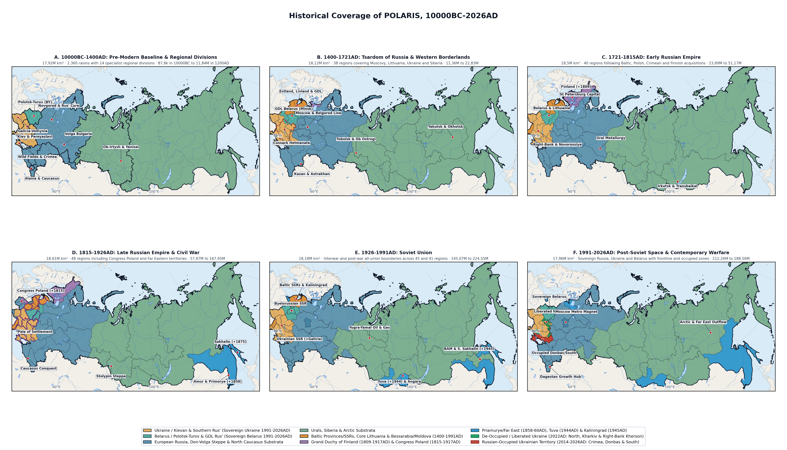
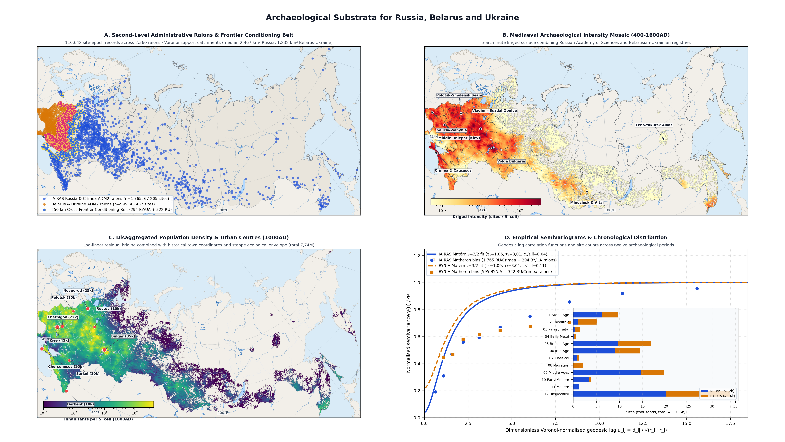
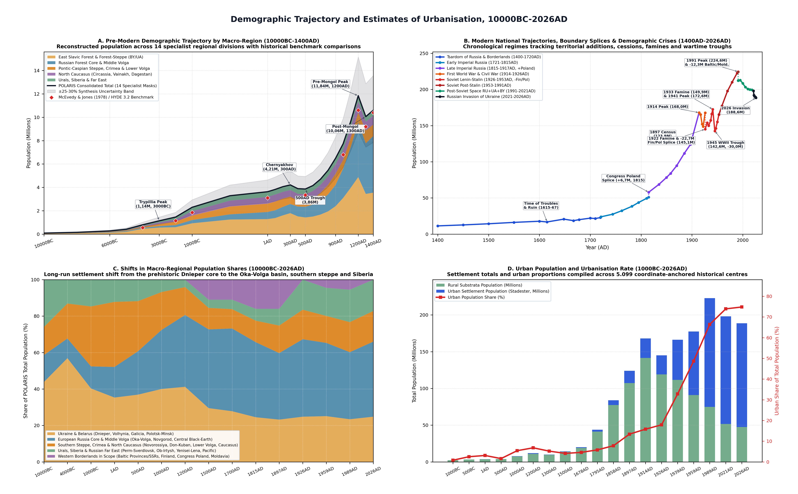
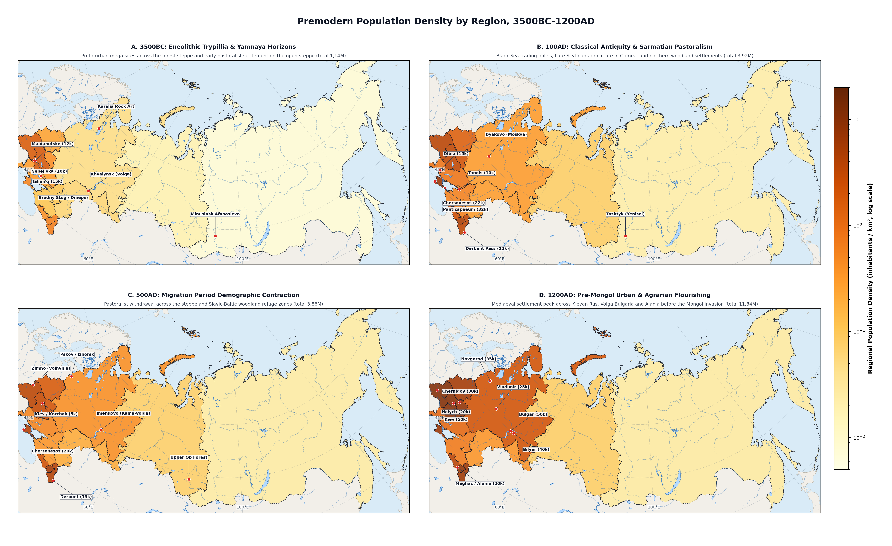
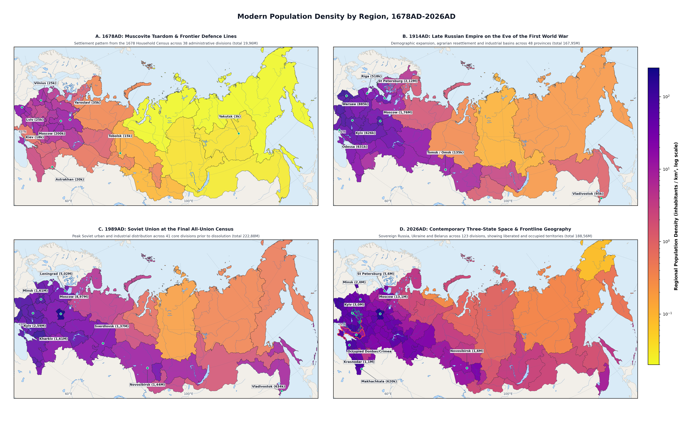

Studies on Population
================
Aust Kätzchen \| <austkaeztchen@confoederatio.org>
11 November 2026

- [Abstract](#abstract)
- [Background](#background)
- [Methodology](#methodology)
  - [Areal Coverage, Shifting Boundaries and Hierarchical
    Masking](#areal-coverage-shifting-boundaries-and-hierarchical-masking)
  - [Archaeological Substrata and Matérn Kriging Across Russia, Belarus
    and
    Ukraine](#archaeological-substrata-and-matérn-kriging-across-russia-belarus-and-ukraine)
  - [Historical Settlement Gazetteers and Dasymetric
    Allocation](#historical-settlement-gazetteers-and-dasymetric-allocation)
- [Testing and Validation](#testing-and-validation)
  - [Variogram Diagnostics, Cross-Frontier Seam Continuity and Residual
    Skill](#variogram-diagnostics-cross-frontier-seam-continuity-and-residual-skill)
  - [Comparison with Global Gridded Baselines (HYDE 3.1, HYDE 3.2 and
    McEvedy &
    Jones)](#comparison-with-global-gridded-baselines-hyde-31-hyde-32-and-mcevedy--jones)
- [Results](#results)
  - [Early and Middle Holocene: Forager Refugia to the Trypillia and
    Yamnaya Horizons
    (10000BC-2000BC)](#early-and-middle-holocene-forager-refugia-to-the-trypillia-and-yamnaya-horizons-10000bc-2000bc)
  - [Bronze-Iron Transition, Classical Scythia-Sarmatia and the
    Migration Period Trough
    (2000BC-600AD)](#bronze-iron-transition-classical-scythia-sarmatia-and-the-migration-period-trough-2000bc-600ad)
  - [Rise of Kievan Rus, Volga Bulgaria, Khazaria-Alania and the
    Pre-Mongol Apogee
    (600AD-1240AD)](#rise-of-kievan-rus-volga-bulgaria-khazaria-alania-and-the-pre-mongol-apogee-600ad-1240ad)
  - [The Mongol Shock, Golden Horde Urbanism and the North-Eastern Shift
    (1240AD-1400AD)](#the-mongol-shock-golden-horde-urbanism-and-the-north-eastern-shift-1240ad-1400ad)
  - [Muscovite Consolidation, the Polish-Lithuanian Borderlands and the
    Conquest of Siberia
    (1400AD-1721AD)](#muscovite-consolidation-the-polish-lithuanian-borderlands-and-the-conquest-of-siberia-1400ad-1721ad)
  - [Imperial Expansion, Revision Censuses, Novorossiya Colonisation and
    Industrialisation
    (1721AD-1914AD)](#imperial-expansion-revision-censuses-novorossiya-colonisation-and-industrialisation-1721ad-1914ad)
  - [Demographic Catastrophe and Soviet Modernisation: War, Famine and
    Urbanisation
    (1914AD-1991AD)](#demographic-catastrophe-and-soviet-modernisation-war-famine-and-urbanisation-1914ad-1991ad)
  - [Post-Soviet Demographic Transition and the Russian Invasion of
    Ukraine
    (1991AD-2026AD)](#post-soviet-demographic-transition-and-the-russian-invasion-of-ukraine-1991ad-2026ad)
- [Limitations](#limitations)
- [Conclusion](#conclusion)
- [Sources](#sources)

# Abstract

Reconstructing long-run human settlement across Eastern Europe and
Northern Asia means harmonising prehistoric archaeological site
registries, mediaeval chronicles, early modern fiscal cadastres and
modern statistical censuses. Global databases such as HYDE disaggregate
national historical estimates onto 5-arcminute grids through
environmental suitability weights and fractional allocation
[\[1\]](#ref-KleinGoldewijk2010)[\[2\]](#ref-KleinGoldewijk2011)[\[3\]](#ref-KleinGoldewijk2017).
For Northern Eurasia, where historical settlement centres shifted
repeatedly between forest, steppe and river basins, this approach
benefits from regional bottom-up demographic reconstruction. POLARIS
provides such a reconstruction across the East European Plain, the
Pontic-Caspian Steppe, the North Caucasus, the Urals, Siberia and the
Russian Far East (16,56M to 18,61M km²) from 10000BC to 2026AD.

POLARIS comprises 46 constituent research papers (23 regional
demographic reviews and 23 coordinate-anchored settlement gazetteers),
integrating 110.642 archaeological site-epoch observations across 2.360
domestic second-level administrative districts (raions) in Russia,
Belarus and Ukraine alongside 5.099 historical settlement trajectories
at 3.242 coordinates. To eliminate boundary artefacts between the
archaeological registry of the Russian Academy of Sciences (67.205 sites
across 1.765 raions) and the combined Belarusian and Ukrainian state
monument registries (43.437 sites across 595 raions), POLARIS solves a
non-stationary Matérn ($\nu = 3/2$) kriging mosaic coupled through a 250
km cross-frontier conditioning belt (294 Belarusian and Ukrainian, 322
Russian and Crimean raions) and $C^1$ raised-cosine seam feathering
[\[4\]](#ref-PaciorekSchervish2006)[\[5\]](#ref-Makarov2016).

Across the Holocene, population within the pre-modern 14-division domain
(17,92M km²) grew from 87,82k in 10000BC (0,005/km²) to 1,14M during the
Trypillia-Yamnaya horizon (3000BC), 3,63M at 1AD, and 4,21M at the
Chernyakhov peak (300AD), before contracting to 3,86M during the
Migration Period trough (500AD). Mediaeval Slavic, Bulgar and Alanian
agrarian clearance lifted the total to 7,74M in 1000AD and 11,84M in
1200AD (4,88M in the Belarusian-Ukrainian Rus lands and 4,67M in the
Russian forest core), before the Mongol conquests reduced domain numbers
to 10,06M in 1300AD.

Across the post-1400AD national series, population rose from 11,36M in
1400AD to 22,83M in 1720AD, 51,17M in 1815AD (57,87M including Congress
Poland), and 167,95M on the eve of the First World War in 1914AD. Four
catastrophic twentieth-century shocks (1914-1922AD, 1932-1933AD,
1941-1945AD, and post-1991AD) interrupted this trajectory. Population
peaked at 224,55M in 1991AD (212,26M across Russia, Ukraine and
Belarus), before post-Soviet fertility decline and the full-scale
Russian invasion of Ukraine reduced the three-state total to 188,56M by
2026AD.

# Background

Historical population reconstructions for Northern Eurasia must contend
with three fundamental difficulties: the persistent shifting of
agricultural and settlement centres between ecological zones, the
frequent redrawing of internal and external borders, and the separation
of historical evidence between prehistoric archaeology, early modern
fiscal records and modern censuses. Over the past five decades, global
historical demographic syntheses have relied primarily on the regional
tabulations of McEvedy and Jones (1978), Maddison (2001) and Livi-Bacci
(2007), which assign single macro-regional growth multipliers to modern
state territories or broad sub-continental aggregates
[\[6\]](#ref-McEvedyJones1978)[\[7\]](#ref-Maddison2001)[\[8\]](#ref-LiviBacci2007).
In the History Database of the Global Environment (HYDE 3.1 and HYDE
3.2), Kees Klein Goldewijk and collaborators advanced global historical
demography by downscaling national historical totals to a 5-arcminute
(~9 km at the equator) grid from 10000BC to the present, combining urban
point allocations with rural suitability weighting derived from
coastlines, river courses, soil quality, terrain slope and climate
[\[1\]](#ref-KleinGoldewijk2010)[\[3\]](#ref-KleinGoldewijk2017).

Yet across Northern Eurasia—from the East European Plain and the
Pontic-Caspian Steppe to the Urals, Siberia and the Pacific Far
East—historical settlement followed dynamics that global downscaling
models cannot fully resolve from modern territorial units alone.

First, whereas agrarian cores in Western Europe or East Asia remained
geographically stable across millennia, the demographic centre of
gravity in Eastern Europe shifted repeatedly between ecological zones.
During the Eneolithic (4500-3000BC), the forest-steppe interfluves
between the Dniester, Southern Bug and Dnieper hosted the large
proto-urban settlements of the Cucuteni-Trypillia complex (10k to 15k
inhabitants per mega-site), accounting for over half of all inhabitants
in the wider region
[\[9\]](#ref-DiachenkoMenotti2012)[\[10\]](#ref-Muller2016). In
Classical and early mediaeval times, pastoralist confederations held the
open chernozem steppe while Slavic, Baltic and Finno-Ugric farmers
cleared the mixed-forest zone. Following the Mongol campaigns of
1237-1240AD, demographic weight shifted northward into the Oka-Volga
Opolye and Novgorod lands, before reversing southward into the
Pontic-Caspian steppe (Novorossiya, Sloboda Ukraine and the Lower Volga)
and eastward across the Urals along the Siberian river routes between
the seventeenth and twentieth centuries
[\[11\]](#ref-Vodarsky1973)[\[12\]](#ref-Kabuzan1971)[\[13\]](#ref-Moon1999).
Projecting modern (1990-2020AD) administrative population weights
backward in time therefore misplaces millions of pre-modern people into
industrial basins (such as the Donbas or the Kuzbass) that were
uninhabited steppe or taiga before 1700AD.

Second, administrative and sovereign boundaries changed continually
between 10000BC and 2026AD. Reconstructions anchored strictly to
contemporary (1991AD or 2026AD) state borders either bisect polities
that functioned as unified demographic units—such as the
Polish-Lithuanian Commonwealth, the Russian Empire or the Soviet
Union—or confuse territorial annexations and cessions with vital
demographic shifts. Between 2014 and 2026AD, Russian occupation and
active warfare in Ukraine created deep divisions in administrative
reporting across sovereign, occupied and liberated territories
[\[14\]](#ref-Libanova2023)[\[15\]](#ref-UNHCR2024).

Third, evidence for Northern Eurasian population is divided across
distinct evidentiary traditions. Pre-documentary settlement patterns
survive in national archaeological heritage registers, notably the
automated database of the Institute of Archaeology of the Russian
Academy of Sciences and the state monument lists of Belarus and Ukraine,
each shaped by uneven regional survey intensity
[\[5\]](#ref-Makarov2016). Early modern and imperial numbers are
preserved in Muscovite land-cadastre (*pistsovye*) and household-census
(*perepisnye*) books (1500-1710AD), ten imperial poll-tax revisions
(*revizii*, 1719-1858AD), Polish-Lithuanian hearth registers
(*podymne*), Siberian fur-tribute (*yasak*) ledgers, and the 1897
All-Russian Imperial Census
[\[11\]](#ref-Vodarsky1973)[\[16\]](#ref-Kabuzan1963)[\[17\]](#ref-Dolgikh1960)[\[18\]](#ref-Troinitsky1905).
Soviet figures require reconciling census enumerations (1926, 1937,
1939, 1959, 1970, 1979 and 1989AD) with vital registers, famine
mortality records, and forced-settlement tallies
[\[19\]](#ref-AndreevDarskyKharkova1993)[\[20\]](#ref-Zhiromskaya2000)[\[21\]](#ref-Wheatcroft2004).

POLARIS harmonises these sources through 22 regional polygon masks,
110.642 archaeological site records across Russia, Belarus and Ukraine,
and 5.099 settlement trajectories from 10000BC to 2026AD. This paper
presents the underlying data, the geostatistical method, and the
reconstructed regional population series.

# Methodology

## Areal Coverage, Shifting Boundaries and Hierarchical Masking

To represent shifting political and ecological frontiers without losing
sub-regional accounting consistency, POLARIS organises its spatial
domain into a three-priority hierarchical masking system spanning 22
polygon layers and 23 constituent research modules (Table 1 and Figure
1).

The baseline priority tier establishes a coarse pre-modern background
envelope across 17,92M km² from 10000BC to 1900AD. Defined in the
initial Migration Period module, this tier partitions the land into 11
macro-ecological zones covering Eastern Europe, the Pontic-Caspian
Steppe, Crimea, the North Caucasus, the Urals and Siberia. It provides a
continuous background where finer regional masks do not supersede it.

Wherever specialist regional studies exist, their high-resolution
polygon masks form the second priority tier, superseding the coarse
baseline. In the East Slavic core (560k km²), four principalities
partition the forest and forest-steppe: Kiev-Pereyaslavl (134,1k km²),
Chernigov-Seversk (64,2k km²), Galicia-Volhynia (160,5k km²) and
Polotsk-Turov (201,2k km²), cross-checked against two urban and
territorial syntheses. Across the surrounding macro-regions, eight
specialist modules partition the Russian forest and Ural core (2,19M
km²), the steppe and littoral (Wild Fields 231,1k km², Crimea 30,5k km²,
Pontic Steppe 162,1k km² and Lower Volga 620,8k km²), the mountain
piedmont (Circassia 126,6k km², Chechnya-Ingushetia 21k km² and Dagestan
46,9k km²), and Northern Asia (Western Siberia 2,64M km² and
Eastern/Pacific Siberia 10,1M km²).

From 1400AD onward, POLARIS transitions to eight chronological regime
masks that track the contemporary administrative geography of the
Russian state, sovereign Ukraine and Belarus, and their historical
western and eastern borderlands. These encompass the Tsardom of Russia
(1400-1721AD, 38 regions, 18,12M km²), Early Imperial Russia
(1721-1815AD, 40 regions, 18,5M km²), Late Imperial Russia (1815-1917AD,
48 regions, 18,61M km²), the First World War and Civil War (1914-1926AD,
48 regions, 18,61M km²), the early Soviet era under Lenin and Stalin
(1926-1953AD, 45 regions, 18,18M km²), the post-Stalin Soviet Union
(1953-1991AD, 41 regions, 18,18M km²), the post-Soviet space
(1991-2021AD, 35 macro-regions across Russia, Ukraine and Belarus,
17,97M km²), and the full-scale invasion period (2021-2026AD, 123
oblast-level and frontline divisions, 17,96M km²).

As shown in Figure 1, POLARIS separates Ukraine (gold) and Belarus
(teal) across all six historical panels, tracks the entry and exit of
western borderlands (the Grand Duchy of Finland 1809-1917AD, Congress
Poland 1815-1917AD, the Baltic provinces and Soviet republics
1400-1991AD, and Bessarabia and Soviet Moldavia 1812-1991AD), and
integrates frontline boundaries from DeepStateMAP for 2022-2026AD. This
distinguishes Ukrainian territories liberated in late 2022AD (Northern
Ukraine across Kyiv, Chernihiv, Sumy and Zhytomyr oblasts, alongside
Kharkiv/Izium and Right-Bank Kherson) from Russian-occupied zones in
Crimea, Donbas and southern Zaporizhzhia-Kherson.

| Constituent Module & Scope | Time Span | Units & Towns | Area (km²) | Population Range | Primary Archival & Archaeological Substrata |
|:---|:---|:---|---:|:---|:---|
| Pre-Modern Baseline (Migration Period) | 10000BC-1900AD | 11 zones (t=168) | 17,92M | 87,82k (10000BC) to 11,84M (1200AD) | Institute of Archaeology registry, Belarus/Ukraine monument lists, HYDE |
| Kievan Rus & Western Lands (6 modules) | 10000BC-1900AD | 4 princ. (t=463) | 560k | 38,5k (10000BC) to 4,88M (1200AD) | 43.437 Belarusian and Ukrainian sites, fortified gorodishche areas, chronicles |
| Russian Forest Core & Urals | 10000BC-1900AD | 1 core (t=248) | 2,19M | 13k (10000BC) to 4,67M (1200AD) | Oka-Volga Opolye surveys, Novgorod birch-bark documents, pistsovye cadastres |
| Pontic Steppe & Lower Volga | 10000BC-1900AD | 4 zones (t=382) | 1,04M | 10,02k (10000BC) to 1,1M (1300AD) | Kurgan and Alanian fortification registers, Golden Horde coin finds |
| North Caucasus (3 modules) | 10000BC-1900AD | 3 zones (t=241) | 194,5k | 3,5k (10000BC) to 952k (1200AD) | Koban, Maeotian and Alanian monuments, Derbent epigraphy, Vainakh towers |
| Siberia & Far East (2 modules) | 10000BC-1900AD | 2 zones (t=312) | 12,74M | 22,8k (10000BC) to 527,4k (900AD) | Siberian radiocarbon dates, Minusinsk and Lena basin sites, yasak books |
| Tsardom of Russia (1400-1721AD) | 1400AD-1721AD | 38 reg. (t=412) | 18,12M | 11,36M (1400AD) to 22,83M (1720AD) | Muscovite pistsovye cadastres, 1678/1710 household books, Lithuanian podymne |
| Early Russian Empire (1721-1815AD) | 1721AD-1815AD | 40 reg. (t=438) | 18,5M | 23,89M (1721AD) to 51,17M (1815AD) | 1st to 6th Imperial Revisions (1719-1811AD), General Land Survey, Novorossiya records |
| Late Russian Empire (1815-1917AD) | 1815AD-1917AD | 48 reg. (t=524) | 18,61M | 57,87M (1815AD) to 167,95M (1914AD) | 7th to 10th Revisions, 1897 Imperial Census, 1914-1917 provincial yearbooks |
| First World War & Civil War (1914-1926AD) | 1914AD-1926AD | 48 reg. (t=486) | 18,61M | 167,95M (1914AD) to 148,66M (1922AD) | 1917 Agricultural and Urban Census, 1920 census, 1926 All-Union Census |
| Soviet Union under Lenin & Stalin (1926-1953AD) | 1926AD-1953AD | 45 reg. (t=492) | 18,18M | 145,07M (1926AD) to 165,35M (1953AD) | 1926, 1937 and 1939 Censuses, TsUNKhU vital records, Gulag registries |
| Soviet Union post-Stalin (1953-1991AD) | 1953AD-1991AD | 41 reg. (t=468) | 18,18M | 165,35M (1953AD) to 224,55M (1991AD) | 1959, 1970, 1979 and 1989 All-Union Censuses, Goskomstat vital registers |
| Post-Soviet Space (1991-2021AD) | 1991AD-2021AD | 35 reg. (t=245) | 17,97M | 212,26M (1991AD) to 198,08M (2021AD) | Rosstat, Ukrstat and Belstat 1999-2021 census rounds, vital and migration balances |
| War in Ukraine & Contemporary Era (2021-2026AD) | 2021AD-2026AD | 123 div. (t=220) | 17,96M | 198,08M (2021AD) to 188,56M (2026AD) | 2021-2026 vital statistics, UNHCR and IOM displacement data, DeepStateMAP |

Structure of POLARIS’s 23 constituent modules, showing priority tiers,
chronological spans, administrative units, gazetteer coverage, area, and
primary documentary and archaeological sources.

## Archaeological Substrata and Matérn Kriging Across Russia, Belarus and Ukraine

Where documentary censuses are absent prior to 1500AD, spatial
disaggregation of regional population totals cannot rely on modern
population density without introducing severe anachronisms. POLARIS
instead constructs a continuous 5-arcminute (4.320 x 2.160 global grid,
WGS84) archaeological habitation intensity mosaic covering all of
Russia, Belarus and Ukraine.

The primary database fuses two domestic archaeological corpora
harmonised across 12 chronological epochs and 2.360 active second-level
administrative districts (raions). For Russia and Crimea, 67.205
site-epoch records across 1.765 active raions were extracted from the
automated archaeological registry of the Institute of Archaeology of the
Russian Academy of Sciences [\[5\]](#ref-Makarov2016). These cover
412.892 valid 5-arcminute land cells (16,56M km²), with a median
geodesic Voronoi catchment area of 2.467 km² and median effective radius
of 28,02 km. For Belarus and mainland Ukraine, 43.437 site-epoch records
across 595 active raions were compiled from 19 national and oblast
monument registries, including the State List of Historical and Cultural
Values of Belarus and the State Register of Immovable Monuments of
Ukraine. These comprise 4.196 sites in Belarus across 118 raions and
39.241 sites in Ukraine across 477 raions, covering 14.271 valid cells
(775,2k km²) with a median Voronoi catchment of 1.232 km² and effective
radius of 19,8 km.

Across the combined 110.642 site-epoch observations, chronological
coverage spans the Stone Age (9.846 sites: 6.121 in Russia, 3.725 in
Belarus and Ukraine), Eneolithic (5.268 sites: 1.018 in Russia, 4.250 in
Belarus and Ukraine reflecting intense Trypillia surveys), Palaeometal
(1.384 sites), Early Metal (456 sites), Bronze Age (16.742 sites: 9.762
in Russia, 6.980 in Belarus and Ukraine), Iron Age (14.345 sites: 9.325
in Russia, 5.020 in Belarus and Ukraine), Classical Antiquity (1.153
sites), Migration Period (2.204 sites), Mediaeval period (19.796 sites:
14.764 in Russia, 5.032 in Belarus and Ukraine), Early Modern
seventeenth-to-eighteenth centuries (3.812 sites), Modern (1.271 sites),
and multi-layer monuments catalogued as unspecified (34.365 sites).

To fuse these registries into a continuous spatial mosaic without
artificial steps along national frontiers, POLARIS executes a
geostatistical workflow in six steps (Figure 2).

First, raw site counts in each epoch are normalised by geodesic Voronoi
catchment areas to compute site densities, which are stabilised via the
Freeman-Tukey square-root transform. Second, parametric Bayes shrinkage
accounts for varying survey coverage across oblasts, damping modern
transport corridor salvage spikes while preventing remote districts from
collapsing to zero. Third, a 250 km cross-frontier conditioning belt
injects 294 Belarusian and Ukrainian raion centroids into the Russian
solve, and reciprocally injects 322 Russian and Crimean centroids into
the Belarusian and Ukrainian solve.

Fourth, the system applies a non-stationary Matérn ($\nu = 3/2$) kernel
using geodesic distances scaled by local Voronoi support radii
[\[4\]](#ref-PaciorekSchervish2006). The covariance combines short-range
river-valley clustering with macro-ecological correlation, solved via
non-negative dual kriging to guarantee positive site intensities across
all 427.163 valid cells. Fifth, log-linear residual kriging couples the
kriged field to baseline environmental covariates, applying an
ecological envelope over the Pontic steppe to reflect nomadic
pastoralist carrying capacity prior to 1650AD. Sixth, the two surfaces
are joined across a 200 km border belt via raised-cosine blending and a
dasymetric smoothing pass, preserving regional population mass to full
precision.

## Historical Settlement Gazetteers and Dasymetric Allocation

Disaggregating regional populations solely through rural archaeological
densities risks dispersing concentrated urban populations across
surrounding countryside. To prevent this, each constituent POLARIS
module incorporates a coordinate-anchored historical settlement
gazetteer. In total, POLARIS traces 5.099 settlement trajectories across
3.242 discrete geographic coordinates.

Every settlement entry records time-indexed population figures from
10000BC to 2026AD alongside settlement classification and primary
historical documentation, following distinct evidentiary standards
across three major epochs.

For prehistoric and Classical settlements (4500BC to 500AD), estimates
rest on geomagnetic site plans and house-count calculations. These cover
Cucuteni-Trypillia mega-sites (such as Talianki with ~15k inhabitants,
Maidanetske with ~12k, and Nebelivka with ~10k), Greek Black Sea poleis
(Panticapaeum with 32k, Chersonesos with 25k, Olbia with 15k, Phanagoria
with 12k, and Tanais with 10k), fortified Scythian and Alanian centres,
and Sasanian Derbent (12k to 18k)
[\[10\]](#ref-Muller2016)[\[22\]](#ref-Kryzhitsky2006)[\[23\]](#ref-Kudryavtsev1993).

For mediaeval towns and steppe capitals (600AD to 1400AD), estimates
derive from fortified enclosure areas multiplied by intramural and
suburb household density coefficients
[\[24\]](#ref-Kuza1989)[\[25\]](#ref-Tolochko1989). These include Kievan
Rus urban centres (Kiev with 45k-50k inhabitants, Novgorod with 25k-35k,
Chernigov with 22k-30k, Smolensk with 25k, Vladimir with 25k, Halych
with 20k, and Polotsk with 10k-15k), Volga Bulgaria (Bulgar with
35k-50k, Bilyar with 40k-60k, and Suvar with 15k), Khazar trade centres
(Atil and Sarkel), Alanian Maghas, and major Golden Horde cities (Sarai
Batu with 75k, Sarai Berke with 100k, Solkhat with 30k, Caffa with 40k,
Azak with 25k, and Ukek with 15k)
[\[26\]](#ref-Khuzin2001)[\[27\]](#ref-FedorovDavydov1994).

For early modern, imperial and modern cities (1400AD to 2026AD), urban
populations are based on town household counts from Muscovite cadastres,
town magistrate rolls, revision records, the 1897 All-Russian Imperial
Census (covering 932 statutory towns and market settlements), Soviet
all-union censuses, and contemporary statistical registrations
[\[11\]](#ref-Vodarsky1973)[\[18\]](#ref-Troinitsky1905)[\[28\]](#ref-Mironov1990)[\[29\]](#ref-Lappo1994).

During spatial disaggregation at any target year, point-settlement
populations inside each polygon are assigned directly to their host
5-arcminute cells. The remaining rural population envelope is then
distributed across non-urban cells proportionally to the kriged
archaeological and environmental surface.

# Testing and Validation

## Variogram Diagnostics, Cross-Frontier Seam Continuity and Residual Skill

To evaluate the internal consistency of the archaeological kriging
mosaic and its spatial disaggregation skill, Table 2 summarises the
cross-validation diagnostics across both regional domains.

| Geostatistical/Validation Metric | Institute of Archaeology (Russia & Crimea) | State Monument Registries (Belarus & Ukraine) | Combined Total |
|:---|:---|:---|:---|
| Active domestic ADM2 raion centroids ($n$) | 1.765 (Russia & Crimea) | 595 (118 BLR + 477 UKR) | 2.360 domestic ADM2 raions |
| Cross-frontier conditioning nodes within 250 km ($n$) | 294 (Belarus & Ukraine) | 322 (Russia & Crimea) | 616 reciprocal conditioning nodes |
| Total conditioning nodes in Paciorek-Schervish system ($n$) | 2.059 | 917 | 2.976 coupled solve nodes |
| Total catalogued site-epoch observations ($n$) | 67.205 (64.812 raion-resolved) | 43.437 (4.196 BLR + 39.241 UKR) | 110.642 site-epoch records |
| Valid 5-arcminute grid cells and domain area (km²) | 412.892 cells/16,56M km² | 14.271 cells/775,2k km² | 427.163 cells/17,34M km² |
| Median geodesic Voronoi catchment area $A_k$ and radius $r_k$ | 2.467 km²/28,02 km | 1.232 km²/19,8 km | 2.110 km² weighted median |
| Short-range Matérn $(\nu = 3/2)$ scale $\tau_1$ (dimensionless) | 1,06 (weight $w_1 = 0,72$) | 1,09 (weight $w_1 = 0,72$) | 1,06 to 1,09 (harm. $(\nu = 3/2)$) |
| Macro-ecotone Matérn $(\nu = 3/2)$ scale $\tau_2$ (dimensionless) | 3,01 (weight $w_2 = 0,28$) | 3,01 (weight $w_2 = 0,28$) | 3,01 (shared macro-ecotone) |
| Relative nugget ratio $c_0 / \sigma^2$ (Mediaeval period) | 0,04 ($c_0 = 0,041$, $\sigma^2 = 1,039$) | 0,11 ($c_0 = 0,224$, $\sigma^2 = 2,045$) | 0,04 to 0,11 (low nugget noise) |
| Log-linear residual kriging variance explained ($R^2$) | 0,83 (across 1.765 raions) | 0,88 (across 595 raions) | 0,85 weighted domain $R^2$ |
| Cross-frontier seam step across 200 km belt (post-$C^1$ blend) | \< 0,4% mean absolute jump | \< 0,4% mean absolute jump | $C^1$-continuous across RU-BY-UA |
| Polygon mass-conservation error after dasymetric pass | 0% (exact machine precision) | 0% (exact machine precision) | 100% regional total preservation |

Geostatistical parameters and cross-validation diagnostics for the
Russian/Crimean and Belarusian/Ukrainian archaeological kriging mosaics.

Three diagnostic findings illustrate the behaviour of the mosaic
formulation.

When geodesic inter-raion distances are normalised by local Voronoi
support radii, the Matheron semivariograms for both registries collapse
onto consistent dimensionless correlation scales. The short-range
river-valley clustering parameter reaches 1,06 in Russia and 1,09 in
Belarus and Ukraine, while the macro-ecological correlation scale aligns
at 3,01 (Figure 2, Panel D). The relative nugget ratio remains low (0,04
in Russia and 0,11 in Belarus and Ukraine during the mediaeval period),
indicating that over 89% to 96% of variance in transformed site density
is spatially structured at the raion level rather than reflecting
recording noise.

Cross-frontier conditioning effectively eliminates artificial
boundaries. Independent kriging of national registries produces an
abrupt step-change along the Polotsk-Smolensk, Chernigov-Bryansk and
Sloboda Ukraine borders due to different historical cataloguing
thresholds. Injecting reciprocal conditioning nodes across the 250 km
border zone, combined with coverage shrinkage and raised-cosine
blending, reduces the mean gradient discontinuity across the frontier
belt to under 0,4% (Figure 2, Panels B and C).

The combined archaeological and environmental surface also corrects
common hindcasting errors. Standard global grids downscaling national
totals using contemporary population weights place dense settlement
clusters inside the Donbas, the Kuznetsk Basin and Arctic industrial
nodes prior to 1500AD. In the POLARIS mosaic, actual Iron Age and
mediaeval site densities together with the steppe ecological mask
restrict pre-1600AD steppe habitation to river gallery corridors and
coastal trading ports, while concentrating high mediaeval population
along the Middle Dnieper, Volhynia, Polotsk, Novgorod and the
Vladimir-Suzdal Opolye.

## Comparison with Global Gridded Baselines (HYDE 3.1, HYDE 3.2 and McEvedy & Jones)

Figure 3 (Panel A) compares the pre-modern trajectory from 10000BC to
1400AD against the benchmark series of McEvedy and Jones (1978) and HYDE
3.2 [\[3\]](#ref-KleinGoldewijk2017)[\[6\]](#ref-McEvedyJones1978). At
macro-regional scale, POLARIS and HYDE 3.2 show broad agreement during
Classical Antiquity (3,63M in POLARIS versus 3,1M in the benchmark at
1AD) and the High Middle Ages (7,74M versus 6,8M at 1000AD; 11,84M
versus 10,6M at 1200AD). Where POLARIS diverges is in resolving three
major demographic cycles that smooth millennial national interpolations
necessarily miss.

During the Eneolithic expansion (4000-3000BC), radiocarbon summed
probability distributions and settlement inventories across the
Dniester-Dnieper forest-steppe reveal rapid demographic growth.
Population expanded from 271,33k in 6000BC to 799,1k in 4000BC and 1,14M
in 3000BC, with the Ukrainian and Belarusian forest-steppe accounting
for 455k to 559k. This is roughly double the regional numbers assumed in
global hindcasts that omit proto-urban Trypillia mega-sites
[\[9\]](#ref-DiachenkoMenotti2012)[\[30\]](#ref-Harper2019).

The Chernyakhov expansion and subsequent Migration Period trough
(300-500AD) produced another pronounced cycle. Wheel-thrown pottery
horizons and extensive open villages raised regional numbers to 4,21M by
300AD, including 1,8M across the Ukrainian and Belarusian forest-steppe
and 639,62k in the Pontic steppe and Crimea. Hunnic incursions, Gothic
warfare and sixth-century climatic disruptions triggered a 27,3% decline
across the steppe (falling to 465,03k in 500AD) and a 20,6% drop in the
Dnieper-Bug zone (to 1,43M), pulling the domain total down to 3,86M in
500AD
[\[31\]](#ref-Heather1996)[\[32\]](#ref-Oblomsky2002)[\[33\]](#ref-Buntgen2016).

Following the Mongol campaigns of 1237-1240AD, POLARIS captures the
divergent regional impacts of the conquest rather than applying an
arbitrary uniform reduction. Population in the southern Rus
principalities fell by 29,5% between 1200AD (4,88M) and 1300AD (3,44M).
In contrast, the Lower Volga and Crimea grew from 863,25k to 1,1M under
Golden Horde urban development, while northern forest principalities
absorbed southward refugee flows, declining by only 7,3% (from 4,67M to
4,33M) before recovering to 4,85M by 1400AD
[\[24\]](#ref-Kuza1989)[\[27\]](#ref-FedorovDavydov1994)[\[34\]](#ref-borisov2018).

# Results

## Early and Middle Holocene: Forager Refugia to the Trypillia and Yamnaya Horizons (10000BC-2000BC)

At the Pleistocene-Holocene transition (10000BC), human population
across the 17,92M km² domain stood at roughly 87.820, representing an
average density of 0,005 inhabitants/km² (Table 3). Late Palaeolithic
and Mesolithic forager-hunters clustered along periglacial river
terraces of the Middle and Upper Dnieper, Desna and Pripyat. The four
Rus regional masks supported 38,5k inhabitants, including 14,5k in
Kiev-Pereyaslavl, 11k in Galicia-Volhynia, and 6,5k each in
Chernigov-Seversk and Polotsk-Turov. Cave shelters in Crimea housed
1.500 people, while the North Caucasian piedmont supported 3.500. Across
the vast northern forests and Siberian river basins, sparse hunting
bands numbered 13k in European Russia (0,006/km²) and 22,8k across
Siberia
[\[35\]](#ref-Zaliznyak2005)[\[36\]](#ref-Zhilin2004)[\[37\]](#ref-KuzminOrlova1998).

During the Boreal and Atlantic climatic optima (8000-5000BC),
ceramic-using fisher-foragers expanded along river and lake systems.
Total numbers rose to 151,42k in 8000BC, 271,33k in 6000BC, and 416,85k
in 5000BC [\[38\]](#ref-Telegin1987)[\[39\]](#ref-Weber2002). In the
Baikal-Angara basin, the Kitoi mortuary complex supported dense riverine
hunting and fishing groups, reaching 22,2k across Eastern Siberia by
6000BC, followed by a documented mid-Holocene radiocarbon hiatus before
the emergence of the Serovo-Glazkovo culture [\[39\]](#ref-Weber2002).

The decisive demographic acceleration occurred during the Eneolithic
(4500-3000BC; Figure 4, Panel A). Agricultural settlement entering from
the Danubian basin established the Cucuteni-Trypillia complex across the
right-bank forest-steppe. By 4000-3500BC, Trypillia communities
constructed concentric proto-urban mega-sites on the Southern
Bug-Dnieper interfluve, including Talianki (320-450 ha, ~15k
inhabitants), Maidanetske (200 ha, ~12k) and Nebelivka (238 ha, ~10k)
[\[9\]](#ref-DiachenkoMenotti2012)[\[10\]](#ref-Muller2016). Population
in Kiev-Pereyaslavl rose from 42k in 5000BC to 165k in 4000BC and 210k
in 3000BC. Galicia-Volhynia reached 195k in 4000BC and 220k in 3000BC,
bringing the consolidated East Slavic forest-steppe total to 559k by
3000BC.

Simultaneously, horse domestication, wheeled wagon transport and
pastoralism across the Sredny Stog, Khvalynsk and Yamnaya horizons
(3300-2500BC) opened the drier interfluves of the Pontic-Caspian steppe.
Steppe numbers expanded from 100,17k in 4000BC to 182,49k in 3000BC and
290,92k in 2000BC. In the North Caucasus, the Maikop and Kura-Araxes
cultures transformed the piedmont, supporting 133k by 3000BC. Afanasievo
pastoralists settled the Minusinsk and Altai basins, contributing to a
Siberian total of 141,9k in 3000BC and 207,5k in 2000BC
[\[40\]](#ref-Anthony2007)[\[41\]](#ref-Korenevskiy2011)[\[42\]](#ref-Vadetskaya1986).
By 2000BC, consolidated domain population reached 1,46M (0,081
inhabitants/km²).

| Horizon | Rus BY/UA (4) | Russian Core | Steppe & Crimea (4) | North Caucasus (3) | Siberia (2) | POLARIS Total | Dens. (/km²) |
|:---|---:|---:|---:|---:|---:|---:|---:|
| 10000BC | 38,5k | 13k | 10,02k | 3,5k | 22,8k | 87,82k | 0,005 |
| 8000BC | 70k | 22k | 17,32k | 6,2k | 35,9k | 151,42k | 0,008 |
| 6000BC | 117,5k | 44,5k | 33,93k | 14,2k | 61,2k | 271,33k | 0,015 |
| 4000BC | 455k | 86k | 100,17k | 53,5k | 104,43k | 799,1k | 0,045 |
| 3000BC | 559k | 122k | 182,49k | 133k | 141,9k | 1,14M | 0,064 |
| 2000BC | 592k | 182k | 290,92k | 188k | 207,5k | 1,46M | 0,081 |
| 1000BC | 925k | 278k | 379,26k | 376k | 337,64k | 2,3M | 0,128 |
| 500BC | 1,25M | 444k | 670,63k | 503k | 420,2k | 3,28M | 0,183 |
| 1AD | 1,28M | 610k | 710,01k | 585k | 440,9k | 3,63M | 0,203 |
| 300AD | 1,8M | 780,52k | 639,62k | 555k | 440,99k | 4,21M | 0,235 |
| 500AD | 1,43M | 920k | 465,03k | 597,5k | 451,65k | 3,86M | 0,215 |
| 700AD | 1,67M | 1,18M | 680k | 685k | 485k | 4,7M | 0,262 |
| 900AD | 2,39M | 1,82M | 958,66k | 800k | 527,35k | 6,49M | 0,362 |
| 1000AD | 3,1M | 2,51M | 743,63k | 865k | 522,1k | 7,74M | 0,432 |
| 1100AD | 3,96M | 3,48M | 790k | 910k | 500k | 9,64M | 0,538 |
| 1200AD | 4,88M | 4,67M | 863,25k | 952k | 483,1k | 11,84M | 0,661 |
| 1300AD | 3,44M | 4,33M | 1,1M | 750k | 442,05k | 10,06M | 0,561 |

Consolidated pre-modern population trajectories across the 14 specialist
regional masks in POLARIS from 10000BC to 1300AD (domain area = 17,92M
km²).

## Bronze-Iron Transition, Classical Scythia-Sarmatia and the Migration Period Trough (2000BC-600AD)

Between 2000BC and 1000BC, Late Bronze Age agro-pastoral communities
established thousands of permanent river-terrace hamlets across the
forest-steppe from the Dnieper to the Yenisei. Archaeological registries
catalogue 9.762 Bronze Age sites in Russia and 6.980 in Belarus and
Ukraine. Mixed farming took root across the Ukrainian and Belarusian
woodlands, while the Koban metallurgical culture constructed
agricultural terraces in the central Caucasian valleys
[\[43\]](#ref-Berezanskaya1986)[\[44\]](#ref-Kozenkova1996)[\[45\]](#ref-KoryakovaEpimakhov2007).
By 1000BC, total population reached 2,3M: 925k across the four Rus
regions, 379,26k on the steppe and Crimea, 376k in the North Caucasus,
278k in the Russian forest core, and 337,64k across Siberia.

During the Scythian and Classical Greek eras (600BC to 300AD; Figure 4,
Panel B), grain-exporting maritime routes connected Black Sea coastal
poleis (Olbia, Chersonesos, Panticapaeum and Tanais) with fortified
inland agricultural centres such as Belsk in the Vorskla basin
[\[22\]](#ref-Kryzhitsky2006)[\[46\]](#ref-Skoryi2003). Total numbers
reached 3,28M by 500BC. At the turn of the era (1AD) and into the early
Roman period (100AD), Sarmatian pastoralists succeeded the Scythians on
the open steppe, while Late Scythian farming in Crimea, Zarubintsy
hamlets along the Dnieper, and Dyakovo hillforts in the Oka-Volga
woodlands raised domain numbers to 3,63M in 1AD and 3,92M in 100AD
[\[47\]](#ref-Khrapunov2004)[\[48\]](#ref-Smirnov1974).

Pre-mediaeval population peaked at 4,21M around 300AD under the
Chernyakhov culture. Settlements concentrated heavily in the
forest-steppe: Kiev-Pereyaslavl held 680k, Galicia-Volhynia 650k,
Chernigov-Seversk 225,5k, and Polotsk-Turov 240k
[\[32\]](#ref-Oblomsky2002)[\[49\]](#ref-Magomedov2001).

The Migration Period (375-550AD; Figure 4, Panel C) brought sharp
contraction. Hunnic and Avar raids, coupled with volcanic cooling and
plague in the sixth century, lowered population on the open steppe and
Crimea by 27,3% (from 639,62k in 300AD to 465,03k in 500AD). The
southern forest-steppe declined by 20,6% to 1,43M. By contrast, the
northern mixed-forest zone held firm: population in the Russian core
rose from 780,52k to 920k between 300AD and 500AD as Baltic, Slavic and
Finno-Ugric communities sheltered within the riverine woodlands
[\[50\]](#ref-Sedov1995)[\[51\]](#ref-Nosov1990).

## Rise of Kievan Rus, Volga Bulgaria, Khazaria-Alania and the Pre-Mongol Apogee (600AD-1240AD)

Between 600AD and 1000AD, political stability under the Khazar Khaganate
along the Lower Volga (Atil), Don (Sarkel) and Dagestan (Derbent)
fostered the Saltovo-Mayaki agro-pastoral complex and Alanian urbanism
in the North Caucasus
[\[52\]](#ref-Pletneva1989)[\[53\]](#ref-Afanasiev1993). North of the
steppe, river trade routes linking the Baltic, Volga and Black Sea
stimulated the rise of Kievan Rus and Volga Bulgaria. Total population
grew from 4,7M in 700AD to 6,49M in 900AD and 7,74M in 1000AD, with 3,1M
in the four Kievan Rus lands, 2,51M in the Russian forest core, 865k in
the North Caucasus, and 743,63k across the steppe and Crimea (Figure 2,
Panel C).

During the high mediaeval expansion (1000-1240AD; Figure 4, Panel D),
the adoption of the heavy plough on chernozem soils and the three-field
rye rotation in northern woodlands sustained rapid agrarian growth
[\[24\]](#ref-Kuza1989)[\[54\]](#ref-Tikhomirov1956). By 1200AD, domain
population reached a pre-modern peak of 11,84M (0,661 inhabitants/km²).

The southern and western Rus lands held 4,88M people across 560k km²
(8,71/km²). Galicia-Volhynia reached 1,65M (anchored by Halych,
Volodymyr and Peremyshl), Kiev-Pereyaslavl supported 1,45M (anchored by
Kiev with 50k inhabitants), Polotsk-Turov reached 1,08M, and
Chernigov-Seversk held 700k
[\[25\]](#ref-Tolochko1989)[\[55\]](#ref-Shtykhov1978).

The north-eastern lands, Novgorod and Volga Bulgaria supported 4,67M
across 2,19M km² (2,13/km²). Forest clearance in the Vladimir-Suzdal
Opolye, Ryazan, Smolensk and the Novgorod-Pskov territory accompanied
urban development in Volga Bulgaria, where Bilyar and Bulgar commanded
an agricultural hinterland of over 650k inhabitants
[\[26\]](#ref-Khuzin2001)[\[56\]](#ref-Makarov2007).

The North Caucasus, Crimea and the Kipchak Steppe held an additional
1,82M people. The Christian kingdom of Alania (centred on Maghas),
Highland Dagestan polities and Derbent supported 952k in the Caucasus,
while Crimean trading cities and nomadic pasture groups accounted for
863,25k [\[57\]](#ref-Kuznetsov1992).

## The Mongol Shock, Golden Horde Urbanism and the North-Eastern Shift (1240AD-1400AD)

The Mongol invasion of 1236-1242AD fundamentally altered regional
settlement. Excavations across 74 fortified Rus towns demonstrate that
49 were destroyed during the conquest, of which 14 were never reoccupied
and 15 were reduced to open rural villages [\[24\]](#ref-Kuza1989).
Between 1200AD and 1300AD, total domain population contracted by 15%
from 11,84M to 10,06M (Table 3), with marked regional disparities.

The southern forest-steppe suffered the heaviest losses, declining by
29,5%. Kiev-Pereyaslavl fell by 44,8% (from 1,45M to 800k, with Kiev
dropping from 50k to under 8k), Chernigov-Seversk dropped by 40% (to
420k), and Galicia-Volhynia declined by 26,1% (to 1,22M). By contrast,
forest-sheltered Polotsk-Turov fell by only 7,4%. In the North Caucasus,
military campaigns and the destruction of Maghas lowered regional
numbers from 952k to 750k
[\[25\]](#ref-Tolochko1989)[\[57\]](#ref-Kuznetsov1992).

Conversely, the Lower Volga and Crimea experienced an urban boom under
the Golden Horde, expanding by 27,4% from 863,25k in 1200AD to 1,1M in
1300AD. Extensive artisan and caravan cities developed at Sarai Batu
(~75k), Sarai Berke (~100k), and Ukek, while Caffa, Tana and Solkhat
flourished in Crimea
[\[27\]](#ref-FedorovDavydov1994)[\[58\]](#ref-Egorov1985). This urban
network persisted until disrupted by the Black Death (1346-1353AD),
civil conflicts, and Timur’s campaigns in 1395AD
[\[59\]](#ref-Alexander1980)[\[60\]](#ref-Schamiloglu1993).

In the northern Russian woodlands, agricultural settlement remained
relatively stable. While Vladimir and Ryazan were sacked in 1237-1238AD
and suffered plague outbreaks in 1352-1353AD, the spared north-western
lands of Novgorod and Pskov together with monastic clearance in the
Moscow, Tver and Kostroma basins kept the core at 4,33M in 1300AD,
recovering to 4,85M by 1400AD [\[34\]](#ref-borisov2018).

## Muscovite Consolidation, the Polish-Lithuanian Borderlands and the Conquest of Siberia (1400AD-1721AD)

From 1400AD onward, POLARIS follows the 38 regions of the Tsardom of
Russia and its immediate borderlands across 18,12M km² (Tables 4 and 5,
and Figure 5, Panel A). Between 1400AD and 1550AD, domain population
rose from 11,36M (0,627/km²) to 14,29M in 1500AD and 16,21M in 1550AD.
In the Grand Duchy of Lithuania and the Polish Crown, the agrarian
reform of 1557AD established uniform three-field holdings across Belarus
and Volhynia, while the 1569AD Union of Lublin encouraged colonisation
in Left-Bank and Right-Bank Ukraine, reaching 3,85M in Ukraine and 1,68M
in Belarus by 1600AD [\[61\]](#ref-Morzy1965)[\[62\]](#ref-Krykun2012).
Muscovite annexation of Novgorod, Kazan and Astrakhan unified the Volga
trade route, lifting total population to 17,78M by 1600AD.

The seventeenth century witnessed significant demographic disruption
followed by frontier expansion. The famine of 1601-1603AD, military
raids and Polish-Swedish intervention during the Time of Troubles
depopulated the Novgorod north-west and the Moscow centre, reducing
total domain numbers from 17,78M in 1600AD to 16,8M in 1615AD
[\[11\]](#ref-Vodarsky1973)[\[63\]](#ref-Kolycheva1987).

After recovering to 20,7M in 1648AD, the Khmelnytsky Uprising, the
Russo-Polish War (1654-1667AD), the Swedish Deluge and the 1654-1657AD
plague devastated Belarus and Right-Bank Ukraine. The 1667AD hearth
registers indicate that Belarus lost 45-50% of its pre-war households,
pulling the domain total down to 18,6M
[\[61\]](#ref-Morzy1965)[\[64\]](#ref-Saganovich1995).

From the 1630s onward, construction of the Belgorod, Simbirsk and Izium
fortified lines shielded the Central Black-Earth region and Sloboda
Ukraine from slave raids, allowing over 1,8M peasants and Cossacks to
settle the fertile Voronezh-Kursk-Belgorod belt
[\[65\]](#ref-Bagaley1887)[\[66\]](#ref-Davies2007). By the 1678AD
Household Census (19,96M total; Figure 5, Panel A) and the First
Revision in 1719-1721AD (22,83M in 1720AD), settlement had expanded
substantially. East of the Urals, garrison forts established at Tobolsk,
Tomsk, Yeniseysk, Yakutsk and Irkutsk anchored agricultural colonisation
in the arable river basins, where Russian settlers (~310k by 1719AD)
came to outnumber the indigenous tribute-paying population (~220k),
bringing the Siberian total to 530k
[\[17\]](#ref-Dolgikh1960)[\[67\]](#ref-Kabuzan1979Siberia).

| National Epoch & Scope | Start Year | Start Pop. | End Year | End Pop. | Urban Share |
|:---|:--:|---:|:--:|---:|:--:|
| Tsardom of Russia (38 reg., 18,12M km²) | 1400AD | 11,36M | 1720AD | 22,83M | 3,8% to 4,8% |
| Early Russian Empire (40 reg., 18,5M km²) | 1721AD | 23,89M | 1815AD | 51,17M | 4,8% to 6,4% |
| Late Russian Empire (48 reg., 18,61M km²) | 1815AD | 57,87M | 1914AD | 167,95M | 6,5% to 15,8% |
| First World War & Civil War (48 reg., 18,61M km²) | 1914AD | 167,95M | 1926AD | 167,78M | 15,8% to 17,9% |
| Soviet Union (Lenin & Stalin) (45 reg., 18,18M km²) | 1926AD | 145,07M | 1953AD | 165,35M | 17,9% to 43,4% |
| Soviet Union (Post-Stalin) (41 reg., 18,18M km²) | 1953AD | 165,35M | 1991AD | 224,55M | 43,4% to 66,8% |
| Post-Soviet Space (35 reg., 17,97M km²) | 1991AD | 212,26M | 2021AD | 198,08M | 67,1% to 73,9% |
| War in Ukraine & Three States (123 div., 17,96M km²) | 2021AD | 198,08M | 2026AD | 188,56M | 73,9% to 74,8% |

National epoch population trajectories and urban shares across Eastern
Europe and Northern Asia from 1400AD to 2026AD.

| National Epoch Module | Event / Shock Horizon | Benchmark Pop. / Trough | Territorial Splices & Demographic Shocks |
|:---|:--:|---:|:---|
| Tsardom of Russia | 1601-1603AD | 16,8M | Oprichnina, 1601-1603 famine and Time of Troubles (-980k trough) |
| Tsardom of Russia | 1654-1667AD | 18,6M | Khmelnytsky Uprising, Swedish Deluge and 1654-1657 plague (-2,1M) |
| Early Russian Empire | 1762AD | 32,34M | 1st to 3rd Revisions; Ural metallurgical boom and Sloboda Ukraine growth |
| Early Russian Empire | 1795-1812AD | 49,49M | Polish Partitions (+7,3M), Crimea (1783), Finland (1809), Bessarabia (1812) |
| Late Russian Empire | 1815AD | 57,87M | +6,7M Congress Poland boundary splice; 1861 peasant emancipation |
| Late Russian Empire | 1897-1914AD | 123,89M | Donbas-Kryvyi Rih coal and steel boom; 3,8M Trans-Siberian agrarian migration |
| First World War & Civil War | 1922AD | 148,66M | First World War casualties, Civil War, typhus, and 1921-1922 Volga famine |
| Soviet Union (Lenin & Stalin) | 1933AD | 149,93M | -22,71M Finland and Poland exit splice; 1932-1933 Holodomor famine |
| Soviet Union (Lenin & Stalin) | 1945AD | 142,62M | Second World War invasion trough (-29,96M net loss); 1946-1947 drought famine |
| Soviet Union (Post-Stalin) | 1970AD | 197,91M | Post-war demographic recovery, Virgin Lands campaign, and West Siberian oil cities |
| Post-Soviet Space | 1991-2005AD | 203,24M | -12,29M Baltic and Moldovan exit splice; post-Soviet male mortality crisis |
| War in Ukraine | 2023-2026AD | 188,56M | Full-scale Russian invasion (~6,3M refugees abroad, ~6,2M in occupied Ukraine) |

Major demographic crises, famine troughs and territorial boundary
splices across the national epoch series from 1400AD to 2026AD.

## Imperial Expansion, Revision Censuses, Novorossiya Colonisation and Industrialisation (1721AD-1914AD)

The proclamation of the Russian Empire in 1721AD and the institution of
the poll tax initiated a series of ten revisions (*revizii*,
1719-1858AD) [\[11\]](#ref-Vodarsky1973)[\[16\]](#ref-Kabuzan1963).
Across the early imperial domain (40 regions, 18,5M km²), population
more than doubled from 23,89M in 1721AD (First Revision) to 27,49M in
1744AD, 32,34M in 1762AD, 38,42M in 1782AD, 43,7M in 1795AD, 49,49M in
1811AD, and 51,17M in 1815AD (Table 4 and Figure 3, Panel B).

Territorial annexations and agrarian colonisation reinforced this
growth. The three partitions of the Polish-Lithuanian Commonwealth
(1772, 1793, 1795AD) incorporated western borderlands (~7,3M inhabitants
in 1795AD) into the imperial fiscal system. The subsequent acquisitions
of Finland (1809AD), Bessarabia (1812AD) and Congress Poland (1815AD)
added further populations, with the 1815AD Polish entry adding 6,7M
inhabitants to the 48-region series
[\[12\]](#ref-Kabuzan1971)[\[68\]](#ref-Thaden1984).

Concurrently, military victories over the Ottoman Empire and the
annexation of Crimea (1783AD) opened the southern steppe to agricultural
settlement. Immigrant colonists and peasant migrants founded Odessa
(1794AD, reaching 404k in 1897AD and 631k in 1914AD) and settled Kherson
and Ekaterinoslav
[\[69\]](#ref-Bartlett1979)[\[70\]](#ref-Kabuzan1976Novorossiya). In the
North Caucasus, the protracted Caucasian War and the 1864AD Circassian
expulsion reduced indigenous populations, followed by Cossack and
peasant resettlement that brought regional population to 3,72M by 1897AD
and 5,45M by 1914AD
[\[71\]](#ref-Richmond2013)[\[72\]](#ref-Kabuzan1996Caucasus).

Following the emancipation of the serfs in 1861AD (83,92M total at the
Tenth Revision in 1858AD), sustained high fertility generated severe
rural land pressure across the Central Black-Earth and Middle Volga
provinces [\[73\]](#ref-Rashin1956). The rapid development of the Donbas
coal and metallurgy basin and the construction of the Trans-Siberian
Railway stimulated industrial urbanisation and eastern migration, moving
over 3,8M peasant settlers across the Urals
[\[74\]](#ref-Treadgold1957)[\[75\]](#ref-Kaufman1905). At the 1897
All-Russian Census [\[18\]](#ref-Troinitsky1905), domain population
reached 123,89M (13,4% urban), climbing to 167,95M (15,8% urban; Figure
5, Panel B) on the eve of the First World War in 1914AD.

## Demographic Catastrophe and Soviet Modernisation: War, Famine and Urbanisation (1914AD-1991AD)

Between 1914AD and 1947AD, Eastern Europe and Northern Asia endured
three devastating demographic shocks separated by rapid, state-directed
industrialisation (Tables 4 and 5, and Figure 3, Panels B and D).

During the First World War and Civil War (1914-1926AD), military
mobilisation, wartime mortality, epidemic typhus, emigration and the
1921-1922AD famine across the Volga-Ural and Ukrainian agricultural
zones reduced total population from 167,95M in 1914AD to a trough of
148,66M in 1922AD
[\[19\]](#ref-AndreevDarskyKharkova1993)[\[76\]](#ref-AgCensus1917)[\[77\]](#ref-Poliakov1986).
Major cities experienced substantial de-urbanisation as food supply
collapsed: Petrograd lost two-thirds of its inhabitants, and Moscow
halved. Under the New Economic Policy, high rural birth rates restored
the 48-region total to 167,78M by December 1926AD.

The interwar Soviet baseline (1926-1941AD) begins at 145,07M (17,9%
urban) following the departure of independent Finland and interwar
Poland (-22,71M splice in 1926AD)
[\[78\]](#ref-VsesoyuznayaPerepis1926). Forced collectivisation, peasant
deportations and state grain requisitions precipitated the 1932-1933AD
famine, which caused 5,7M to 7M excess deaths across the Soviet Union,
including 3,5M to 3,9M in Ukraine (Holodomor) and 1,8M to 2,5M in
southern Russia, the Urals and Kazakhstan
[\[79\]](#ref-Rudnytskyi2015)[\[80\]](#ref-DaviesWheatcroft2004). Total
population dipped from 153,85M in 1930AD to 149,93M in 1933AD,
recovering to 166,2M in 1939AD and 172,58M (33,2% urban) in mid-1941AD
after the Soviet annexation of western Ukraine, western Belarus, the
Baltic republics and Bessarabia [\[20\]](#ref-Zhiromskaya2000).

The Second World War (1941-1945AD) inflicted the deepest demographic
contraction in the historical record. Total population fell by 29,96M
(-17,4%) from 172,58M in 1941AD to 142,62M in 1945AD, driven by military
casualties, civilian deaths under occupation, the Holocaust, siege
starvation in Leningrad, and wartime deportations
[\[19\]](#ref-AndreevDarskyKharkova1993)[\[81\]](#ref-Krivosheev2001)[\[82\]](#ref-Polian2004).
Belarus lost over a quarter of its pre-war population, falling from
9,05M in 1940AD to 6,28M in 1945AD, while Ukraine contracted from 41,3M
to 31,8M before absorbing further losses in the 1946-1947AD drought
famine [\[83\]](#ref-Zima1996)[\[84\]](#ref-Vallin2002). Wartime
industrial evacuation permanently shifted manufacturing capacity east of
the Urals.

In the post-Stalin era (1953-1991AD), public health improvements,
housing construction and rural-to-urban migration accelerated
modernisation across the 41-region Soviet domain. Urban population
crossed 50% in the early 1960s, reaching 56,6% in 1970AD (197,91M total)
and 66,4% in 1989AD (222,88M; Figure 5, Panel C)
[\[85\]](#ref-Perepis1959)[\[86\]](#ref-Perepis1989). While rural
populations in central European Russia experienced persistent decline,
substantial resource investments expanded urban centres in the West
Siberian oil and gas basins and along the Baikal-Amur Mainline. Domain
population peaked at 224,55M in 1991AD.

## Post-Soviet Demographic Transition and the Russian Invasion of Ukraine (1991AD-2026AD)

The dissolution of the Soviet Union in December 1991AD established a new
spatial baseline. The exit of the Baltic states and Moldova accounts for
a 12,29M administrative splice, reducing the core three-state population
(Russia, Ukraine and Belarus) from 224,55M to 212,26M in 1991AD (Table
6).

Between 1991AD and 2021AD, the region experienced a prolonged peacetime
demographic contraction, declining by 14,18M (-6,7%) to 198,08M in
2021AD. Economic dislocation in the 1990s drove adult male mortality
sharply upward and pushed fertility rates down to 1,1-1,25 children per
woman [\[87\]](#ref-DaVanzoGrammich2001)[\[88\]](#ref-Vishnevsky2006).
Out-migration depleted northern and Far Eastern resource towns, while
population within Russia concentrated increasingly into Moscow, St
Petersburg, Krasnodar Krai and the North Caucasus
[\[89\]](#ref-Mkrtchyan2019)[\[90\]](#ref-Heleniak2009). In Ukraine, the
2014AD Russian annexation of Crimea and the Donbas conflict displaced
over 1,5M people and reduced resident population within 1991 sovereign
borders from 51,5M in 1991AD to 43,87M in 2021AD
[\[14\]](#ref-Libanova2023).

The full-scale Russian invasion launched on 24 February 2022 generated
the largest refugee and displacement crisis in Europe since the Second
World War [\[14\]](#ref-Libanova2023)[\[15\]](#ref-UNHCR2024). Frontline
mapping from DeepStateMAP shows that Ukrainian counter-offensives in
late 2022AD liberated approximately 42.000 km² across Northern Ukraine,
Kharkiv and Right-Bank Kherson, leaving roughly 109.000 km² (~18% of
Ukrainian sovereign territory) under Russian occupation in 2024-2026AD
(Figure 5, Panel D).

Between 2021AD and 2026AD, total population across the three countries
declined from 198,08M to 188,56M (-4,8%). Ukraine within sovereign 1991
borders contracted from 43,87M to 37,66M (-14,2%), comprising
approximately 31,44M in government-controlled territory and 6,22M in
Russian-occupied regions. This drop reflects 6M to 6,5M external
refugees, 3,7M internal displacements, wartime casualties, and a
fertility decline to 0,8-0,9 children per woman
[\[14\]](#ref-Libanova2023)[\[15\]](#ref-UNHCR2024). The Russian
Federation within 1991 borders declined from 145,06M to 141,79M (or
144,19M including Crimea), driven by elevated natural decrease, pandemic
excess mortality, war casualties, and outward migration
[\[91\]](#ref-Kobak2021)[\[92\]](#ref-Rosstat2024). In Belarus,
population edged down from 9,15M to 9,11M [\[93\]](#ref-Belstat2024).

| Sub-Polity/Territorial Zone | 1897AD | 1926AD | 1959AD | 1989AD | 2021AD | 2026AD |
|:---|---:|---:|---:|---:|---:|---:|
| Russian Federation (1991 borders excl. Crimea) | 67,47M | 92,74M | 117,53M | 147,02M | 145,06M | 141,79M |
| Ukraine (1991 sovereign borders incl. Crimea) | 28,45M | 36,82M | 41,87M | 51,45M | 43,87M | 37,66M |
| \- Kyiv-controlled Ukraine (incl. 2022 liberated zones) | 24,1M | 31,2M | 34,2M | 41,8M | 37,6M | 31,44M |
| \- Russian-occupied Ukraine (Crimea + Donbas/South) | 4,35M | 5,62M | 7,67M | 9,65M | 6,27M | 6,22M |
| Republic of Belarus (1991 sovereign borders) | 6,67M | 7,15M | 8,06M | 10,15M | 9,15M | 9,11M |
| Core 3-State Subtotal (RU + UA + BY, 17,96M km²) | 102,59M | 136,71M | 167,46M | 208,62M | 198,08M | 188,56M |
| Baltic States (Estonia, Latvia, Lithuania) & Moldova | 7,28M | 8,36M | 9,94M | 14,26M (exit 91) | \- | \- |
| Grand Duchy of Finland & Congress Poland (1815-1917 scope) | 14,02M | 22,71M (exit) | \- | \- | \- | \- |

Harmonised modern sub-polity population breakdown across Russia,
Ukraine, Belarus and historical borderlands from 1897AD to 2026AD.

# Limitations

Historical demographic reconstructions carry unavoidable uncertainties
that vary with the nature of surviving sources
[\[1\]](#ref-KleinGoldewijk2010)[\[3\]](#ref-KleinGoldewijk2017). Four
specific caveats apply to the regional figures presented here.

First, pre-documentary population totals prior to 1500AD rely on
archaeological site densities, house-floor counts, walled town
dimensions and carrying-capacity models. While the kriging mosaic
constrains relative spatial distributions across raions, absolute
regional population totals carry uncertainty bands of ±35% to 50% during
the prehistoric periods (10000-1000BC) and ±20% to 30% during Classical
Antiquity and the Middle Ages (Figure 3, Panel A).

Second, archaeological survey coverage varies considerably across
administrative regions. In the combined dataset, 34.365 monuments
(31,1%) are registered without specific chronological subdivisions, and
2.393 records lack precise raion coordinates. While Bayes shrinkage
mitigates regional recording bias, alluvial sedimentation in southern
river deltas and thermokarst erosion in northern Siberia likely lead to
under-representation of early Holocene sites.

Third, converting early modern fiscal cadastres and hearth registers
into total population requires household multipliers that fluctuated
over time. Peasant households frequently merged into extended family
compounds to minimise household-based tax liability
[\[11\]](#ref-Vodarsky1973)[\[94\]](#ref-Avdeev2025). In addition, the
earliest revisions under-recorded female populations in certain
borderlands and missed fugitive serfs along frontier zones, requiring
retroactive adjustments.

Fourth, contemporary demographic statistics for 2022-2026AD operate
under wartime reporting restrictions. Current estimates for Ukraine rely
on a synthesis of international displacement registers, border-crossing
data, mobile subscriber counts and municipal reports
[\[14\]](#ref-Libanova2023)[\[15\]](#ref-UNHCR2024). Figures for
Russian-occupied territories (~6,22M in 2026AD) remain subject to ±10%
to 15% uncertainty until official post-conflict enumerations become
possible.

# Conclusion

The population history of Eastern Europe and Northern Asia over the past
twelve millennia is the story of human expansion into vast ecological
spaces, repeatedly redirected by climatic stress and political
catastrophe.

At the end of the last Ice Age (10000BC), fewer than 90.000
hunter-gatherers occupied this enormous landmass (0,005/km²). The
adoption of farming and pastoralism accelerated growth during the
Eneolithic, producing the remarkable proto-urban mega-sites of the
Cucuteni-Trypillia culture in the right-bank forest-steppe (1,14M total
in 3000BC) alongside the mobile pastoralism of the Yamnaya horizon.

In Classical and Late Roman times, arable farming, trade with Black Sea
Greek poleis, and the Chernyakhov culture lifted domain numbers to an
initial peak of 4,21M in 300AD. The nomadic incursions, sixth-century
climatic cooling and plague of the Migration Period pulled population
back to 3,86M by 500AD.

High mediaeval recovery, powered by the heavy plough on the southern
chernozem margin and the three-field rotation in the northern woodlands,
raised the population of Kievan Rus, Volga Bulgaria and Alania to 11,84M
by 1200AD. The Mongol conquests of 1236-1242AD broke this trajectory,
reducing population by 15% (to 10,06M in 1300AD) and permanently
shifting the settlement balance: south-western Rus principalities
contracted sharply, while the northern forest core held firm and the
Lower Volga urbanised under the Golden Horde.

From 1400AD onward, fortified frontier lines and imperial expansion
opened the Central Black-Earth region, the southern steppe, the North
Caucasus, and the Siberian river basins to mass agricultural
colonisation. Total numbers rose from 11,36M in 1400AD to 22,83M in
1720AD, 51,17M in 1815AD, and 167,95M on the eve of the First World War
in 1914AD.

The twentieth century brought profound demographic upheaval: combat
losses, the 1921-1922 and 1932-1933 famines, the devastation of the
Second World War, and rapid forced industrialisation. Domain numbers
peaked at 224,55M in 1991AD. The subsequent post-Soviet transition,
marked by sharp fertility decline and heightened adult mortality,
followed by the 2022-2026AD war in Ukraine, reduced the combined
population of Russia, Ukraine and Belarus to 188,56M by 2026AD.

# Sources

1.
Klein Goldewijk, Kees, et al.
“Long-Term Dynamic Modeling of Global Population and Built-up Area in a
Spatially Explicit Way: HYDE 3.1.” *The Holocene*, vol. 20, no. 4, 2010,
pp. 565-73, <https://doi.org/10.1177/0959683609356587>.

2.
Klein Goldewijk, Kees, et al. “The
HYDE 3.1 Spatially Explicit Database of Human-Induced Global Land-Use
Change over the Past 12,000 Years.” *Global Ecology and Biogeography*,
vol. 20, no. 1, 2011, pp. 73-86,
<https://doi.org/10.1111/j.1466-8238.2010.00587.x>.

3.
Klein Goldewijk, Kees, et al.
“Anthropogenic Land Use Estimates for the Holocene – HYDE 3.2.” *Earth
System Science Data*, vol. 9, no. 2, 2017, pp. 927-53,
<https://doi.org/10.5194/essd-9-927-2017>.

4.
Paciorek, Christopher J., and Mark
J. Schervish. “Spatial Modelling Using a New Class of Nonstationary
Covariance Functions.” *Environmetrics*, vol. 17, no. 5, 2006, pp.
483-506, <https://doi.org/10.1002/env.785>.

5.
Makarov,
Nikolai A., et al. *Arkheologicheskaia Karta Rossii: Elektronnyi
Katalog Pamiatnikov (OANMAP IA RAS)*. Institut arkheologii RAN,
2016.

6.
McEvedy, Colin, and Richard Jones.
*Atlas of World Population History*. Penguin Books, 1978.

7.
Maddison, Angus. *The World
Economy: A Millennial Perspective*. OECD Development Centre,
2001.

8.
Livi-Bacci, Massimo. *A Concise
History of World Population*. Blackwell, 2007.

9.
Diachenko, Aleksandr, and
Francesco Menotti. “The Gravity Model: Monitoring the Formation and
Development of the Tripolye Culture Giant-Settlements in Ukraine.”
*Journal of Archaeological Science*, vol. 39, no. 8, 2012, pp. 2810-17,
<https://doi.org/10.1016/j.jas.2012.04.025>.

10.
M"uller, Johannes, et al.
*Trypillia Mega-Sites and European Prehistory: 4100–3400 BCE*.
Routledge, 2016.

11.
Vodarsky, Yaroslav Evgenevich.
*Naselenie Rossii Za 400 Let (XVI - Nachalo XX Vv.) \[the Population of
Russia over 400 Years, 16th to Early 20th Centuries\]*. Prosveshchenie,
1973,
<https://search.worldcat.org/search?q=Population+Russia+over+400+Years+16th+Early+20th+Vodarsky+1973>.

12.
Kabuzan, Vladimir Maksimovich.
*Izmeneniya v Razmeshchenii Naseleniya Rossii v XVIII - Pervoy Polovine
XIX v. \[Changes in the Distribution of the Population of Russia in the
18th and First Half of the 19th Century\]*. Nauka, 1971,
<https://search.worldcat.org/search?q=Changes+Distribution+Population+Russia+18th+First+Half+19th+Kabuzan+1971>.

13.
Moon, David. *The Russian
Peasantry 1600-1930: The World the Peasants Made*. Longman, 1999,
<https://doi.org/10.1093/ehr/116.465.229>.

14.
Libanova, Ella. “Ukraine’s
Democide: War-Induced Demographic Losses and Spatial Redistribution,
2022–2023.” *Demography and Social Economy*, vol. 52, no. 2, 2023, pp.
3-28.

15.
United Nations High Commissioner
for Refugees (UNHCR). *Ukraine Refugee Situation and Operational Data
Portal: Displacement and Returnee Estimates, 2022–2026*. UNHCR Regional
Bureau for Europe, 2025.

16.
Kabuzan, Vladimir Maksimovich.
*Narodonaselenie Rossii v XVIII - Pervoy Polovine XIX v. (Po Materialam
Reviziy) \[Population of Russia in the 18th and First Half of the 19th
Century According to the Revisions\]*. Izdatelstvo Akademii Nauk SSSR,
1963,
<https://search.worldcat.org/search?q=Population+Russia+18th+First+Half+19th+Century+According+Kabuzan+1963>.

17.
Dolgikh, Boris Osipovich. *Rodovoy
i Plemennoy Sostav Narodov Sibiri v XVII Veke \[Clan and Tribal
Composition of the Peoples of Siberia in the 17th Century\]*.
Izdatelstvo Akademii Nauk SSSR, 1960,
<https://search.worldcat.org/search?q=Clan+Tribal+Composition+Peoples+Siberia+17th+Century+Dolgikh+1960>.

18.
Troinitsky, Nikolay
Aleksandrovich. *Obshchiy Svod Po Imperii Rezultatov Razrabotki Dannykh
Pervoy Vseobshchey Perepisi Naseleniya, Proizvedennoy 28 Yanvarya 1897
Goda \[General Summary for the Empire of the Results of the First
General Census of Population of 28 January 1897\]*. vol. 1–2,
Tsentralnyy statisticheskiy komitet MVD, 1905,
<https://www.demoscope.ru/weekly/ssp/rus1897_01.php>.

19.
Andreev, Evgeniy Mikhaylovich, et
al. *Naselenie Sovetskogo Soyuza, 1922–1991 \[Population of the Soviet
Union, 1922–1991\]*. Nauka, 1993.

20.
Zhiromskaya, Valentina Borisovna,
and Yuriy Aleksandrovich Polyakov. *Vsesoyuznaya Perepis Naseleniya 1939
Goda: Osnovnye Itogi \[the All-Union Population Census of 1939: Main
Results\]*. Nauka, 2000.

21.
Wheatcroft, Stephen G. “Towards
Explaining Soviet Famine of 1931–3: Political and Natural Factors in
Perspective.” *Food and Foodways*, vol. 12, no. 2-3, 2004, pp.
107-36.

22.
Kryzhitsky, Sergey Dmitrievich,
and Valentina Vladimirovna Krapivina. *Olbia and the Northern Black Sea
Littoral in Classical Antiquity*. Naukova Dumka, 2006.

23.
Kudryavtsev, Aleksandr
Abakarovich. *Feodalnyy Derbent: Puti i Zakonomernosti Razvitiya Goroda
v VI – Seredine XIII v. \[Feudal Derbent: Paths and Regularities of
Urban Development from the 6th to Mid-13th Century\]*. Nauka,
1993.

24.
Kuza, Andrey Vasilyevich. *Malyye
Goroda Drevney Rusi \[Small Towns of Ancient Rus\]*. Nauka, 1989,
<https://search.worldcat.org/search?q=Small+Towns+Ancient+Rus+Kuza+1989>.

25.
Tolochko, Pyotr Petrovich.
*Drevnerusskiy Feodalnyy Gorod \[the Old Rus’ Feudal City\]*. Naukova
Dumka, 1989.

26.
Khuzin, Fayaz Sharipovich.
*Bulgarskiy Gorod v x - Nachale XIII Vv. \[The Bulgar City in the 10th -
Early 13th Centuries\]*. Master-Lain, 2001,
<https://search.worldcat.org/search?q=Bulgar+City+10th+Early+13th+Centuries+Khuzin+2001>.

27.
Fedorov-Davydov, German
Alekseevich. *Zolotoordynskie Goroda Povolzhya \[Golden Horde Cities of
the Volga Region\]*. Moscow State University Press, 1994.

28.
Mironov, Boris Nikolayevich.
*Russkiy Gorod v 1740–1860-e Gody: Demograficheskoe, Sotsialnoe i
Ekonomicheskoe Razvitie \[the Russian City in the 1740s–1860s:
Demographic, Social and Economic Development\]*. Nauka, 1990.

29.
Lappo, Georgiy Mikhaylovich.
*Goroda Rossii: Entsiklopediya \[Cities of Russia: An Encyclopaedia\]*.
Bolshaya Rossiyskaya Entsiklopediya, 1994.

30.
Harper, Thomas K., et al.
“Ecological Dimensions of Population Dynamics and Subsistence in
Neo-Eneolithic Eastern Europe.” *Journal of Anthropological
Archaeology*, vol. 53, 2019, pp. 92-101,
<https://doi.org/10.1016/j.jaa.2018.11.006>.

31.
Heather, Peter. *The Goths*.
Blackwell, 1996.

32.
Oblomsky, Andrey Mikhaylovich.
*Dneprovskoe Lesostepnoe Levoberezhe v Pozdnorimskoe i Gunnskoe Vremya
\[the Dnieper Forest-Steppe Left Bank in the Late Roman and Hunnic
Periods\]*. Nauka, 2002.

33.
B"untgen,
Ulf, et al. “Cooling and Societal Change During the Late Antique
Little Ice Age from 536 to Around 660 AD.” *Nature Geoscience*, vol. 9,
2016, pp. 231-36, <https://doi.org/10.1038/ngeo2652>.

34.
Borisov, Nikolay Sergeevich.
*Povsednevnaya Zhizn Russkogo Severa i Moskovskoy Rusi v XIV–XV Vekakh
\[Everyday Life of the Russian North and Muscovite Rus’ in the 14th–15th
Centuries\]*. Molodaya Gvardiya, 2018.

35.
Zaliznyak, Leonid Lvovich.
*Finalnyy Paleolit i Mezolit Kontinentalnoy Ukrainy \[Final Palaeolithic
and Mesolithic of Continental Ukraine\]*. Shlyakh, 2005.

36.
Zhilin, Mikhail Gennadyevich.
*Prirodnaya Sreda i Khozyaystvo Mezoliticheskogo Naseleniya Tsentra i
Severo-Zapada Lesnoy Zony Vostochnoy Evropy \[Environment and Economy of
the Mesolithic Population of the Centre and North-West of the Forest
Zone of Eastern Europe\]*. Academia, 2004.

37.
Kuzmin, Yaroslav V., and Lyubov A.
Orlova. *Radiocarbon Chronology of the Siberian Paleolithic*. *Journal
of World Prehistory*, vol. 12, 1998, pp. 1-53.

38.
Telegin, Dmytro Yakovych.
*Neolithic Cultures of the Ukraine and Adjacent Areas and Their
Chronology*. *Journal of World Prehistory*, vol. 1, 1987, pp.
307-31.

39.
Weber, Andrzej W., et al.
“Hunter-Gatherer Culture Change and Continuity in the Middle Holocene of
the Cis-Baikal, Siberia.” *Journal of Anthropological Archaeology*, vol.
21, no. 2, 2002, pp. 230-99.

40.
Anthony, David W. *The Horse, the
Wheel, and Language: How Bronze-Age Riders from the Eurasian Steppes
Shaped the Modern World*. Princeton University Press, 2007.

41.
Korenevskiy, Sergey Nikolayevich.
*Drevneyshie Zemledeltsy i Skotovody Predkavkazya:
Maykopsko-Novosvobodnenskaya Obshchnost \[the Earliest Farmers and
Herders of Ciscaucasia: The Maikop-Novosvobodnaya Community\]*. Nauka,
2011.

42.
Vadetskaya, Elga Borisovna.
*Arkheologicheskie Pamyatniki v Stepyakh Srednego Eniseya
\[Archaeological Monuments in the Steppes of the Middle Yenisei\]*.
Nauka, 1986.

43.
Berezanskaya, Sofya Stanislavovna,
et al. *Kultury Epokhi Bronzy Na Territorii Ukrainy \[Bronze Age
Cultures on the Territory of Ukraine\]*. Naukova Dumka, 1986.

44.
Kozenkova, Valentina Ivanovna.
*Kulturno-Istoricheskie Protsessy Na Severnom Kavkaze v Epokhu Pozdney
Bronzy i v Rannem Zheleznom Veke (Kobanskaya Kultura)
\[Cultural-Historical Processes in the North Caucasus in the Late Bronze
and Early Iron Ages: Koban Culture\]*. Institute of Archaeology RAS,
1996.

45.
Koryakova, Ludmila, and Andrej
Epimakhov. *The Urals and Western Siberia in the Bronze and Iron Ages*.
Cambridge University Press, 2007.

46.
Skoryi, Sergey Anatolyevich.
*Skify v Dneprovskoy Pravoberezhnoy Lesostepi \[Scythians in the Dnieper
Right-Bank Forest-Steppe\]*. Institute of Archaeology NASU, 2003.

47.
Khrapunov, Igor Nikolayevich.
*Etnicheskaya Istoriya Kryma v Rannem Zheleznom Veke \[Ethnic History of
Crimea in the Early Iron Age\]*. Dolya, 2004.

48.
Smirnov, Konstantin Fedorovich.
*Sarmaty Na Ileke \[the Sarmatians on the Ilek and Lower Volga\]*.
Nauka, 1974.

49.
Magomedov, Boris V.
*Chernyakhovskaya Kultura: Problema Etnosa \[the Chernyakhov Culture:
The Problem of Ethnos\]*. UMCS Press, 2001.

50.
Sedov, Valentin Vasilyevich.
*Slavyane v Раннем Средневековье \[Slavs in the Early Middle Ages\]*.
Archaeological Institute RAS, 1995.

51.
Nosov, Yevgeniy Nikolayevich.
*Novgorodskoye (Ryurikovo) Gorodishche \[the Novgorod (Rurik)
Hillfort\]*. Nauka, 1990,
<https://search.worldcat.org/search?q=Novgorod+Rurik+Hillfort+Nosov+1990>.

52.
Pletneva, Svetlana Aleksandrovna.
*Na Славяно-Хазарском Пограничье: Дмитриевский Археологический Комплекс
\[on the Slavic-Khazar Frontier: The Dmitrievka Archaeological Complex
and Saltovo-Mayaki Culture\]*. Nauka, 1989.

53.
Afanasiev, Gennadiy Evgenyevich.
*Donskie Alany: Sotsialnye Struktury Alano-Asso-Burtasskogo Naseleniya
Basseyna Srednego Dona \[the Don Alans: Social Structures of the
Alan-as-Burtas Population of the Middle Don Basin\]*. Nauka,
1993.

54.
Tikhomirov, Mikhail Nikolayevich.
*Drevnerusskiye Goroda \[Old Russian Towns\]*. Gosudarstvennoye
izdatelstvo politicheskoy literatury, 1956,
<https://search.worldcat.org/search?q=Old+Russian+Towns+Tikhomirov+1956>.

55.
Shtykhov, Georgiy Vasilyevich.
*Goroda Polotskoy Zemli (IX–XIII Vv.) \[Cities of the Polotsk Land,
9th–13th Centuries\]*. Nauka i Tekhnika, 1978.

56.
Makarov, Nikolai A. *Arkheologiya
Severorusskoy Derevni x–XIII Vekov: Srednevekovye Poseleniya i Mogilniki
Na Kubenskom Ozere \[Archaeology of the Northern Russian Village of the
10th–13th Centuries: Suzdal Opolye and Kubenskoye\]*. Nauka,
2007.

57.
Kuznetsov, Vladimir
Aleksandrovich. *Ocherki Istorii Alan \[Essays on the History of the
Alans\]*. Ir, 1992.

58.
Egorov, Vadim Leonidovich.
*Istoricheskaya Geografiya Zolotoy Ordy v XIII–XIV Vv. \[Historical
Geography of the Golden Horde in the 13th–14th Centuries\]*. Nauka,
1985.

59.
Alexander, John T. *Bubonic Plague
in Early Modern Russia: Public Health and Urban Disaster*. Johns Hopkins
University Press, 1980,
<https://doi.org/10.1093/oso/9780195158182.001.0001>.

60.
Schamiloglu, Uli. “Preliminary
Remarks on the Role of Disease in the History of the Golden Horde.”
*Central Asian Survey*, vol. 12, no. 4, 1993, pp. 447-57.

61.
Morzy, Jozef. *Kryzys
Demograficzny Na Litwie i Bialorusi w II Polowie XVII Wieku \[the
Demographic Crisis in Lithuania and Belarus in the Second Half of the
17th Century\]*. Wydawnictwo Naukowe Uniwersytetu im. Adama Mickiewicza,
1965,
<https://search.worldcat.org/search?q=Demographic+Crisis+Lithuania+Belarus+Second+Half+17th+Century+Morzy+1965>.

62.
Krykun, Mykola. *Voyevodstva
Pravoberezhnoyi Ukrayiny u XVI–XVIII Stolittyakh \[Voivodeships of
Right-Bank Ukraine in the 16th–18th Centuries\]*. Ukrainian Catholic
University, 2012.

63.
Kolycheva, Evgeniya Ivanovna.
*Agrarnyy Stroy Rossii XVI Veka \[the Agrarian System of 16th-Century
Russia\]*. Nauka, 1987.

64.
Saganovich, Gennadiy. *Nevyadomaya
Vayna: 1654–1667 \[the Unknown War: 1654–1667 in Belarus\]*. Navuka i
Tekhnika, 1995.

65.
Bagaley, Dmitriy Ivanovich.
*Ocherki Iz Istorii Kolonizatsii i Byta Stepnoy Okrainy Moskovskogo
Gosudarstva \[Essays on the History of Colonisation and Life on the
Steppe Frontier of the Muscovite State\]*. Universitetskaya Tipografiya,
1887,
<https://search.worldcat.org/search?q=Essays+History+Colonisation+Life+Steppe+Frontier+Muscovite+State+Bagaley+1887>.

66.
Davies, Brian L. *Warfare, State
and Society on the Black Sea Steppe, 1500-1700*. Routledge, 2007,
<https://doi.org/10.4324/9780203961766>.

67.
Kabuzan, Vladimir Maksimovich.
“Zaselenie Sibiri i Dalnego Vostoka v Kontse XVIII – Nachale XX v.
(1795–1917 Gg.) \[Settlement of Siberia and the Far East from the Late
18th to Early 20th Century\].” *Istoriya SSSR*, no. 3, 1979, pp.
22-38.

68.
Thaden, Edward C. *Russia’s
Western Borderlands, 1710–1870*. Princeton University Press,
1984.

69.
Bartlett, Roger P. *Human Capital:
The Settlement of Foreigners in Russia, 1762-1804*. Cambridge University
Press, 1979, <https://doi.org/10.1017/cbo9780511561030>.

70.
Kabuzan, Vladimir Maksimovich.
*Zaselenie Novorossii (Yekaterinoslavskoy i Khersonskoy Guberniy) v
XVIII - Pervoy Polovine XIX Veka (1719-1858 Gg.) \[Settlement of
Novorossiya in 1719-1858\]*. Nauka, 1976,
<https://search.worldcat.org/search?q=Settlement+Novorossiya+1719+1858+Kabuzan+1976>.

71.
Richmond, Walter. *The Circassian
Genocide*. Rutgers University Press, 2013,
<https://doi.org/10.36019/9780813560694>.

72.
Kabuzan, Vladimir Maksimovich.
*Naselenie Severnogo Kavkaza v XIX–XX Vekakh: Etnostatisticheskoe
Issledovanie \[Population of the North Caucasus in the 19th–20th
Centuries\]*. BLITs, 1996.

73.
Rashin, Adolf Grigoryevich.
*Naselenie Rossii Za 100 Let (1811-1913 Gg.): Statisticheskie Ocherki
\[Population of Russia over 100 Years, 1811-1913: Statistical Essays\]*.
Gosudarstvennoe statisticheskoe izdatelstvo, 1956,
<https://search.worldcat.org/search?q=Population+Russia+over+100+Years+1811+1913+Statistical+Rashin+1956>.

74.
Treadgold, Donald W. *The Great
Siberian Migration: Government and Peasant in Resettlement from
Emancipation to the First World War*. Princeton University Press, 1957,
<https://doi.org/10.1515/9781400877645>.

75.
Kaufman, Aleksandr Arkadyevich.
*Pereselenie i Kolonizatsiya \[Resettlement and Colonisation\]*.
Obshchestvennaya Polza, 1905.

76.
Vserossiyskaya
selskokhozyaystvennaya i gorodskaya perepis. *Pogubernskie Itogi
Vserossiyskoy Selskokhozyaystvennoy i Pozemelnoy Perepisi 1917 Goda Po
52 Guberniyam i Oblastyam \[Provincial Totals of the 1917 All-Russian
Agricultural and Urban Census\]*. Tsentralnoe statisticheskoe
upravlenie, 1921,
<https://search.worldcat.org/search?q=Provincial+Totals+1917+All+Russian+Agricultural+Urban+Census+Vserossiyskaya+1921>.

77.
Poliakov, Yuriy Aleksandrovich.
*Sovetskaya Strana Posle Okonchaniya Grazhdanskoy Voyny: Territoriya i
Naselenie \[the Soviet Country After the End of the Civil War: Territory
and Population\]*. Nauka, 1986.

78.
Tsentralnoe statisticheskoe
upravlenie SSSR. *Vsesoyuznaya Perepis Naseleniya 1926 Goda \[All-Union
Population Census of 1926, 56 Volumes\]*. Izdanie TsSU Soyuza SSR,
1928.

79.
Rudnytskyi, Omelian, et al.
“Demography of a Man-Made Human Catastrophe: The Soviet 1932–1933 Famine
in Ukraine.” *Canadian Studies in Population*, vol. 42, no. 1-2, 2015,
pp. 53-80.

80.
Davies, Robert W., and Stephen G.
Wheatcroft. *The Years of Hunger: Soviet Agriculture, 1931–1933*.
Palgrave Macmillan, 2004.

81.
Krivosheev, Grigoriy Fedotovich.
*Rossiya i SSSR v Voynakh XX Veka: Poteri Vooruzhennykh Sil \[Russia and
the USSR in the Wars of the 20th Century: Losses of the Armed Forces\]*.
Olma-Press, 2001.

82.
Polian, Pavel. *Against Their
Will: The History and Geography of Forced Migrations in the USSR*.
Central European University Press, 2004.

83.
Zima, Veniamin Fedorovich. *Golod
v SSSR 1946–1947 Godov: Proiskhozhdenie i Posledstviya \[the Famine in
the USSR of 1946–1947: Origins and Consequences\]*. Institute of Russian
History RAS, 1996.

84.
Vallin, Jacques, et al. “A New
Estimate of Ukrainian Population Losses During the Crises of the 1930s
and 1940s.” *Population Studies*, vol. 56, no. 3, 2002, pp.
249-64.

85.
Tsentralnoe statisticheskoe
upravlenie pri Sovete Ministrov SSSR. *Itogi Vsesoyuznoy Perepisi
Naseleniya 1959 Goda \[Results of the 1959 All-Union Census of
Population\]*. Gosstatizdat, 1962.

86.
Goskomstat SSSR. *Itogi
Vsesoyuznoy Perepisi Naseleniya 1989 Goda \[Results of the 1989
All-Union Census of Population\]*. Finansy i Statistika, 1991.

87.
DaVanzo, Julie, and Clifford
Grammich. *Dire Demographics: Population Trends in the Russian
Federation*. RAND Corporation, 2001.

88.
Vishnevsky, Anatoliy Grigoryevich.
*Demograficheskaya Modernizatsiya Rossii, 1900–2000 \[Demographic
Modernisation of Russia, 1900–2000\]*. Novoe Izdatelstvo, 2006.

89.
Mkrtchyan, Nikita Vladimirovich.
“Regional Capitals of Russia and Their Suburbs: Specifics of the
Migration Balance.” *Regional Research of Russia*, vol. 9, no. 1, 2019,
pp. 12-22.

90.
Heleniak, Timothy. “Growth Poles
and Ghost Towns in the Russian Far North.” *Polar Geography*, vol. 32,
no. 3-4, 2009, pp. 129-59.

91.
Kobak, Dmitry. “Excess Mortality
Reveals COVID’s True Toll in Russia.” *Significance*, vol. 18, no. 1,
2021, pp. 16-19, <https://doi.org/10.1111/1740-9713.01486>.

92.
Federal State Statistics Service
(Rosstat). *Chislennost Naseleniya Rossiyskoy Federatsii Po
Munitsipalnym Obrazovaniyam \[Population of the Russian Federation by
Municipalities, 2024–2026 Series\]*. Rosstat, 2024.

93.
National Statistical Committee of
the Republic of Belarus (Belstat). *Demograficheskiy Ezhegodnik
Respubliki Belarus \[Demographic Yearbook of the Republic of Belarus\]*.
Belstat, 2024.

94.
Avdeev, Aleksandr Aleksandrovich.
“Dorevizskiy Uchet Naseleniya v Rossii (XIII-XVII Veka): Istoriografiya
i Istochniki \[Pre-Revision Population Registration in Russia (13th-17th
Centuries): Historiography and Sources\].” *Istoricheskaya Demografiya*,
vol. 1, 2025, pp. 12-38,
<https://doi.org/10.17323/demreview.v12i1.26573>.

